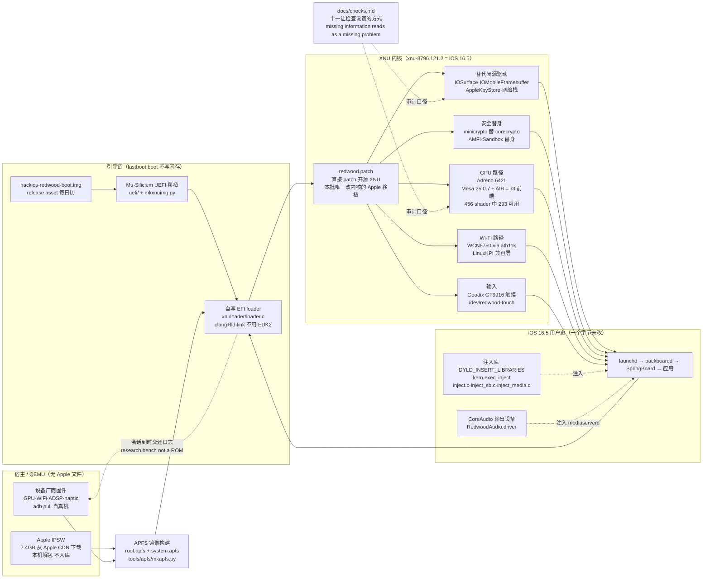

# oosexgang/hackios-xnu-kernel

## 一句话定位

在 Android 手机硬件与 QEMU 上启动 Apple 开源的 XNU 内核（xnu-8796.121.2，iOS 16.5 的内核）并在其上运行**未修改的 iOS 16.5 用户态**——它用自写 EFI loader、Mu-Silicium UEFI 移植、Apple 闭源驱动的替代实现与一层 Linux Wi-Fi 驱动兼容层补齐 XNU 期待的硬件契约，同时用 `DYLD_INSERT_LIBRARIES` 注入库补齐用户态缺失的部分。

## 它解决的问题

iOS 16.5 的用户态（launchd → backboardd → SpringBoard → 应用）依赖一批 Apple 从未开源的组件：IOSurface、IOMobileFramebuffer、CoreAudio 输出设备、Secure Enclave、Metal 驱动，以及一堆与具体 SoC 绑定的私有框架。**Apple 自己有这些组件，但没有第三条方的、可在 Android 硬件或 QEMU 上运行的实现。**

这个项目的目标非常具体：**让原封不动的 iOS 16.5 用户态在一台 POCO X5 Pro 5G 或一台普通 Linux 电脑的 QEMU 里跑起来。** 它选择的路径与另外两个同期项目（UniXNU 走 UEFI + 伪平台契约且拒绝碰内核；Macintosh 走 EL2 hypervisor 跑官方 kernelcache）**恰好相反**——既然 Apple 的 XNU 本身是开源的（APSL 2.0），那就直接编译它、打补丁，然后让内核提供用户态需要的一切。

它同时解决了一个**可复现性**问题：QEMU 路径让没有 Android 手机的人也能在 20 分钟内看到锁屏。

## 为什么值得关注（2026-10-24）

**因为它是 48 小时内出现的第三个 Apple 内核移植项目，而它在最关键的那个决策上与前两个相反。** 三个项目、三种路线、同一周——这个事实本身就是本日最强的结构性信号：Apple 硬件逆向已经不再是一个人的黑客项目，而是一个有多种已验证技术路线的领域。

四个具体理由：

1. **⭐ `docs/checks.md` 是本批最值得学的一份文档。** 「How our own checks lie」列出十一让检查说谎的方式，开头就点破机制：**「missing information reads as a missing problem.」** 每条都附了真实代价，而不是泛泛的最佳实践。
2. **它提供了一条第三方可独立执行的验证路径**（QEMU：Linux x86-64 + 12 GB 磁盘 + 4 GB 内存，20 分钟会话，2–3 分钟出锁屏）。**本批四个项目中只有两个能由外部独立复现，这是其中之一。**
3. **它把「用户态一个字节未改」落到了具体机制上**——`DYLD_INSERT_LIBRARIES` 注入（`kern.exec_inject`）而非改系统二进制，这是可核验的工程主张而非口号。
4. **设备移植路径已经存在**（`common/new-device.sh` + `docs/PORTING.md` + 设备 profile 模板），这解释了它本日 17.2% 的 fork-star——fork 去移植自己的机型。

## 热度来源判断

**1,064⭐ 对 6 个 commit、2 个贡献者、4 个 subscribers——star 数在此度量的是话题吸引力（一个极有视觉冲击力的「iOS 跑在 Android 上」演示），不是社区规模。** 这与 10-23 记录的 UniXNU（750⭐ / 6 人 / subs 3）是同一形态。

热度来源有三条，都可核验：

- **视觉冲击**：`docs/` 下 20 余张真机截图（lockscreen / homescreen / control-center / settings / 各个应用界面），加上一句「The iOS programs, frameworks and dyld shared cache are not changed by a single byte」。
- **可及性**：QEMU 路径意味着任何有 Linux 机器的人都能在半小时内看到结果。
- **概念独特性**：它是本批唯一「直接编译 Apple 开源内核」的路线，与另外两条形成对照。

**这不是刷星**（contributors 2 人、subs 4、oi 7 都是小数字，与 1,064⭐ 的比例说明它还没有形成社区）**也不是虚假关注**（有真实可运行的产物、真实截图、明确的「不支持」清单）。**它是真实需求 + 真实技术 + 小团队规模**的组合，与 10-21 php2shell-poc 那种「事件驱动的注意力洪峰」性质完全不同。

## 关键技术亮点

1. **直接编译 Apple 开源 XNU 并打补丁**（`xnu/redwood.patch` + `xnu/apply.sh` + `xnu/export.sh`，以 BCM2837 配置为基底 + 自己的平台）。**这是本批三个 Apple 移植项目里唯一改内核的**，代价是每次内核升级都要 rebase——而对固定的 iOS 16.5，rebase 成本为零。
2. **自写 EFI loader**（`xnuloader/loader.c`，clang + lld-link，**不用 EDK2**）。它常驻内存，提供 USB fastboot 协议链路、看门狗、接收内核日志，并在 ExitBootServices 之后把控制交给内核。
3. **UEFI 移植**（`uefi/` 为 Project Silicium 移植 + `mkxnuimg.py` 打包）。**每个 release 附带 `hackios-redwood-boot.img`**——redwood UEFI 内嵌自写 loader，可直接 `fastboot boot`，**且不含任何 Apple 文件**。
4. **Apple 闭源驱动的替代实现**：IOSurface、IOMobileFramebuffer、AppleKeyStore、网络栈；**minicrypto 替代 corecrypto**；AMFI 与 Sandbox 替身（承担 MAC 策略）。
5. **Metal 驱动工作**：`tools/mk-mesa.sh` 拉 Mesa 25.0.7 并打补丁，**自带 AIR（Apple 的 Metal IR）前端**把 Apple shader 翻译到 Mesa ir3。**456 个系统 shader 中 293 个已在 Adreno 642L 上运行（62.9%）**，`docs/air.md` 记录进度。
6. **Linux Wi-Fi 驱动层**（`wifi/lx/`）：WCN6750 via ath11k + LinuxKPI，在 iOS 的网络栈下工作，实测 55–90 Mbit/s。
7. **⭐ `docs/checks.md`「How our own checks lie」**——十一让检查说谎的方式 + 一条对策，每条附真实代价。
8. **双运行目标**：真机（fastboot boot，不写闪存，重启即回 Android）与 QEMU（无需真机）。
9. **设备 profile 机制**：`common/devices/{redwood,qemu-virt,_template}.conf` + `common/new-device.sh <codename> path/to/device.dtb`。

## 架构师速览

| 决策问题 | 研究判断 | 证据边界 |
|---|---|---|
| 系统边界 | 两层仓库：① **内核侧**（本仓库：XNU 补丁、EFI loader、UEFI 移植、替代闭源驱动、Wi-Fi 层、QEMU 脚本、`xl` 宿主控制工具、预构建产物、`common/` 脚本）② **用户态侧**（`hackios-xnu-userland`：init.c、注入库、CoreAudio 设备、OpenGL ES 到 Mesa 的桥、APFS 镜像构建器、Mesa/AIR 工具、Procursus bootstrap）。**边界划在「Apple 文件」处**：两个仓库都不含 Apple 文件，IPSW 由 `ios165/fetch.sh` 从 Apple CDN 下载到本机并本地解包 | README 的两仓库分工表与 Layout 表、userland README 的 Path 表、`ios165/fetch.sh` 与 `fetch-from-ipsw.py`；**`xnu/redwood.patch` 的实际改动规模与 `xnu/files/` 的新增内容本窗口未取，待核验** |
| 主路径 | 设备上电 → `fastboot boot` 加载预构建 `hackios-redwood-boot.img`（Mu-Silicium UEFI，内嵌自写 loader）→ loader 起 USB fastboot 协议链路 → 上传系统镜像到 RAM（2.5 GB，约 80 s）→ loader 装载 XNU（应用 redwood.patch 后的配置）→ 内核提供替代驱动（IOSurface / IOMobileFramebuffer / AppleKeyStore / 网络栈 / minicrypto 替 corecrypto / AMFI 与 Sandbox 替身）→ iOS 16.5 launchd → logd/notifyd/cfprefsd → runningboardd → backboardd → SpringBoard → 应用；**注入库经 `DYLD_INSERT_LIBRARIES`（`kern.exec_inject`）进入 backboardd / SpringBoard / mediaserverd**，mediaserverd 获得自写 CoreAudio 输出设备 | README 的 How it works ASCII 图、userland README 的 Path 表、`xl` 命令列表（enter / ramdisk / run / screenshot / reboot / logs / 屏幕与声音录制 / 相机帧 / stop / state）；**注入库在具体系统服务上的生命周期与失败回退路径未明说，待核验** |
| 关键权衡 | **改内核 vs 不改内核**（本批三个 Apple 项目里唯一改内核的：继承 rebase 成本，换取摆脱平台契约伪造；且 iOS 16.5 版本固定使 rebase 成本为零）· **直接编译 Apple 开源 XNU vs 用官方 kernelcache**（前者需要 theos + iPhoneOS16.5.sdk + 完整工具链，后者只需 Apple 文件）· **真机 + QEMU 双运行 vs 只跑其一**（QEMU 让无手机者能复现，真机让 GPU/Wi-Fi/摄像头路径可验证）· **fastboot boot 不写闪存 vs 刷入 ROM**（明确「research bench, not a ROM」，会话到时内核交还日志）· **注入库 vs 改系统二进制**（dyld 注入让「用户态一个字节未改」这句主张成立）· **APSL 2.0 vs 宽松许可**（用 APSL 分发 Apple 派生物有明确条件，见风险节） | README 的两处主张、Layout 表、`docs/checks.md`、userland README 的 Licenses 段、仓库 LICENSE 首行；**「为什么选择改内核」的显式论证 README 未给，只有结果** |
| 最小 PoC | 1. **确认主机条件**（Linux x86-64、约 12 GB 磁盘、4 GB 内存、7-Zip 23+ 因其读 APFS）→ 2. `common/setup.sh` 把用户态仓库并入同一棵树（git dir `.userland.git`）→ 3. `ios165/fetch.sh` 从 Apple CDN 下载 7.4 GB 并本地解包（**5–15 分钟，不可绕过**）→ 4. `common/build.sh qemu-virt` 构建 APFS 镜像（**没有交叉工具链时使用 `prebuilt/userland` 的预编译产物**）→ 5. `common/run.sh qemu-virt` 启动（**20 分钟会话，2–3 分钟后出现锁屏**）→ 6. **只验证锁屏与主屏渲染**，不要一上来碰 Metal 应用（**456 个 shader 中 293 个可跑，剩 163 个不可跑**）→ 7. 真机路径需 POCO X5 Pro 5G + 解锁 bootloader + adb/fastboot，**且必须先 `adb pull` 五个 vendor 固件**（`fw-gpu/` `fw-wifi/` `fw-audio/` `fw-haptic/`）→ 8. **按 `docs/checks.md` 的口径检查自己的每一条断言**（尤其不要把「没报错」当成「检查过了」） | **第 3 步是不可绕过的时间成本（7.4 GB 下载 + 5–15 分钟），第 6 步是本 PoC 最重要的判断**；**真机路径的固件提取必须在 `build.sh` 之前完成**（README 明写 `userland/build.sh` 会打印哪些固件被装入）；**本 PoC 无法验证摄像头、蜂窝与 App Store 路径——README 自己写明这些不支持** |

## 架构启发

**第一条启发：技术路线的选择不是品味问题，而是一个「未来成本」的问题。** UniXNU 与 Macintosh 都选了「不改内核」，继承内核全部不兼容，换来内核升级时零 rebase；HackiOS 选了「改内核」，继承每次升级都要 rebase 的成本，换来摆脱平台契约伪造的全部负担。**两者都对，因为它们的「未来」不同——前两者要跟 macOS/iOS 长期演进，后者锁死在 iOS 16.5。** 判断一条路线是否合理，必须先看它打算活多久。

**第二条启发，也是本项目最可迁移的部分：「检查会骗我们」是一个独立的失效类别，需要自己的文档。** 这份 checks.md 的核心洞察是：**「信息缺失」与「问题不存在」在结果上无法区分，而人的默认怀疑方向恰好是错的**——通常人们怀疑「检查通过」，这份文档主张更常见的失败是「检查根本没跑」。它给出的对策不是「更仔细地检查」，而是**结构性的**：让每个例外都有自己的列、名字和数字（而不是只让总数对得上）；让沉默的命令开口说话；让仪器先证明自己能说话再相信它的沉默。

**这三条可以脱离本项目独立成立。** 任何写测试、跑 benchmark、做验证的团队都适用——包括本日报的读者自己的项目。

**第三条启发：把「我不做什么」写进 README 的两列表格，比写进提交历史更有用。** 它的 What works / Does not work (yet) 表格逐项写明「不可用」的具体项目（蜂窝、蓝牙、本内核下充电、App Store 与 Apple ID 登录因无 Secure Enclave 而不可用、视频与实况照片），并附上原因。**读者不需要读完全文就知道这台机器现在能干什么**——这与 10-23 记录的 Macintosh 的 Status 表属同一种形式。

## 架构图（MMD）

> 证据边界：此图只采用本档案已有可核验描述；「待核验」节点不应视为项目实现事实。

## 定位判断

**研究快照类项目（研究台，非产品）。** 项目自己给出了这个定位——「It is a research bench, not a ROM: a session lasts a given number of seconds, then the kernel returns to the loader and hands over its log.」

**在 Apple 内核移植这个三项目并存的格局里，它的定位是「唯一可复现的那一条」**：UniXNU 需要一台已在 35 份设备文档里的 Android/ARM64 设备，Macintosh 需要一台 ASUS Zenbook A16 加一台 macOS 27 Mac 主机，**只有 HackiOS 有一条不需要任何特定硬件的路径（QEMU）**。这使得它成为这个领域里**第三方最容易独立验证的项目**。

同时它是三者中**最不打算长期维护**的一个：锁定 iOS 16.5，意味着它不会跟进新系统、不会有持续的用户基础。**它的价值不在于会被长期使用，而在于它证明了「Apple 开源内核可以被第三方编译、补丁化并在异构硬件上运行」这条路是通的——这是对领域边界的一次扩展，而不是一次产品发布。**

## 风险 / 局限 / 泡沫点

- **⚠️ 许可问题（本批最严重的一处可核验元数据问题）。** 仓库 `LICENSE` 首行是 `APPLE PUBLIC SOURCE LICENSE Version 2.0 - August 6, 2003`——**APSL 2.0，与 GPL 不同的 copyleft，且含专利报复条款**；GitHub 侧 `license.spdx_id` 为 `NOASSERTION`；**README 与 NOTICE 均未说明该仓库自有代码的许可**。APSL 2.0 对「External Deployment」（分发给第三方，或作为 Larger Work 提供服务）有明确条件（须满足 Section 2.1 关于 Source Code 的全部条件）。**依赖 license 扫描器判断「是否可商用/可内嵌」的工具会得到错误的默认答案——这直接影响「能不能把它的代码放进商业产品」这个判断。**
- **⚠️ 本日新增发现的元数据不一致，累计第四类四例**（10-22 php2shell-poc 的 spdx_id=null、10-23 UniXNU 与 Macintosh 两处 NOASSERTION、本日 HackiOS 的 NOASSERTION + Vesalius 的无 LICENSE 文件）。
- **star 数与社区规模严重不匹配**：1,064⭐ 但 subs **4**、贡献者 **2 人**、主仓库 **6 个 commit**。
- **功能缺口明确**：蜂窝、蓝牙、本内核下充电、**App Store 内容与 Apple ID 登录（无 Secure Enclave，FairPlay daemon 退出）**、视频与实况照片；Metal **456 个 shader 中 163 个不可用**。
- **未经第三方复现**：QEMU 的 20 分钟会话与全部真机截图均为作者自述。**本日报无法独立验证其中任何一项。**
- **用户态仓库同样极小**：328⭐ ⑂116（fork/star 35.4%），但只有 **4 个 commit 且 contributors API 返回空数组**。
- **依赖从 Apple CDN 下载 7.4 GB**：这是不可绕过的前置成本，也是整个流程里最容易失败的环节（CDN 可用性、解包正确性）。
- **需要 theos + iPhoneOS16.5.sdk 才能从源码重建内核**；否则只能用 `prebuilt/` 的预编译产物——**「从源码构建」这条路对多数人是不可达的**。
- **APSL 2.0 覆盖整个仓库**：项目自有代码（loader、UEFI 移植、驱动替代、Mesa 补丁）全部落在 APSL 之下，若这不有意为之，则连「只用其中一两个文件」也需要法律判断。

## 与同类项目的关系

- **vs UniXNU/UniXNU**（10-23 记录，750⭐）：UniXNU **拒绝 patch 内核**，靠 16 个 `Native*` 驱动 submodule 与 35 份设备文档补齐 Apple 平台契约，目标是 iOS + macOS 双系统、多机型。**HackiOS 直接改内核、只做 iOS 16.5、只支持一台真机加 QEMU。** 一个是「内核不动但设备无限多」，一个是「内核可变但版本固定」。
- **vs Macintosh/Snapintosh**（10-23 记录，745⭐，组织已从 Acelogic 改为 Macintosh）：Macintosh 走 **EL2 hypervisor 跑官方 kernelcache**，目标是 macOS 27 于 Snapdragon X2 Elite，自写 Metal 驱动栈（AdrenoMetal.bundle + AdrenoX2 + air2ir3）。**HackiOS 走「编译开源 XNU」路线，目标是 iOS 16.5 于 Android 手机，自写的是 XNU 补丁 + 替代驱动。** 三者都自写 Metal/图形路径，都写「Apple 私有输入不得入库」，但技术栈完全不同。
- **vs Asahi Linux**：Asahi 是**为 Apple 硬件做 Linux**（方向相反）；HackiOS 是**在非 Apple 硬件上跑 Apple 软件**。Asahi 追求硬件兼容性与可维护性，HackiOS 追求「原封不动跑起来」的演示效果。
- **vs Corellium / 项目内虚拟化方案**：那些是商业化的远程真机服务，HackiOS 是完全开源的研究台。
- **vs Android 自身的方案**：AOSP 提供的是 Linux 内核 + Android 用户态；HackiOS 提供的是 XNU 内核 + iOS 用户态，**在「Android 硬件」这一点上相同，在「操作系统」上完全相反**。

## 是否值得持续跟踪

**值得，但跟踪方式应是「它会不会扩到第二台设备」与「checks.md 会不会继续更新」，而不是 star 数。**

理由：它是本日唯一一个把「Apple 开源内核可以被第三方编译、补丁化并在异构硬件上运行」这条路走通并公开了完整方法的项目，**而且它提供了一条第三方可独立执行的验证路径（QEMU）**——这在研究类项目里是稀缺品。

**但同时必须清楚它的采用价值极低**：iOS 16.5 已被锁定、无 Secure Enclave、无 App Store、无 cellular、Metal 缺 163 个 shader。**今天没有任何人应该把 iOS 16.5 部署到生产上。**

具体观察点：
1. **`docs/checks.md` 是否继续更新**——这是它最独特的资产，也是唯一能与 star 数无关的跟踪指标。
2. **163 个不可用 shader 是否继续下降**（当前 293/456 = 62.9%）。
3. **是否出现第二台设备 profile**（决定它是可移植方案还是封闭作品）。
4. **`xnu/redwood.patch` 的规模与维护方式**（是否随 XNU 版本更新，rebase 成本实际有多大）。
5. **许可表述是否补齐自有代码条款**（当前 LICENSE 只有 APSL 原文）。
6. **`subscribers_count` 与贡献者人数的变化**（目前 4 与 2，判断社区是否形成的最直接指标）。

## 后续观察点

- Metal shader 覆盖率（456 → 293 → ?）与 `docs/air.md` 的更新节奏。
- `common/devices/` 下是否出现 `_template.conf` 之外的真实第二台设备。
- APSL 2.0 的实际履行方式（是否发布 Source Code 归档，是否有 NOTICE 补充自有代码条款）。
- 用户态仓库的 commit 数与 contributors 是否从 0 变为非 0。
- 是否有第三方在 QEMU 路径上复现锁屏（这是本项目最容易被独立证伪也最容易被独立证实的点）。

---
> 数据来源: GitHub API (2026-10-24 CST 06:00 前后 / UTC 2026-10-23T22:13Z 快照) | Stars: 1,064 | Forks: 183 | Subscribers: 4 | Open Issues: 7 | License: NOASSERTION（LICENSE 首行为 APSL 2.0）| 语言: C | 创建: 2026-10-22T06:20:11Z | 推: 2026-10-23T14:25:04Z | Commits: 6 | Contributors: 2 | Releases: 1
