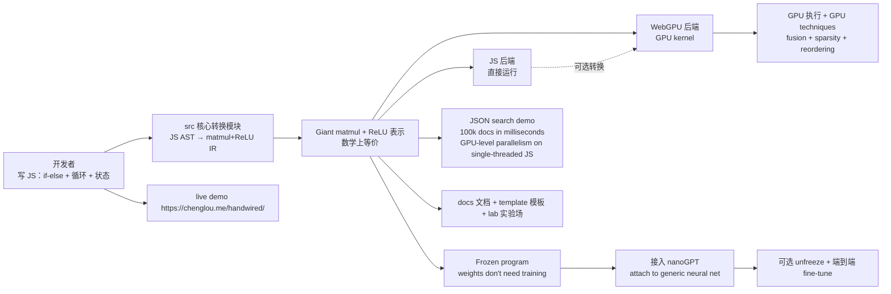

# chenglou/handwired

## 一句话定位
把 JavaScript 程序（if-else + 循环 + 状态）直接转成可微神经网络的微内核——通过把 +, *, ReLU 三种原语统一到 giant matmul 里，单线程 JS 程序就能在 JS 或 WebGPU 上拿到 GPU-level 并行。

## 它解决的问题
2026 年 AI agent 写代码已经能渲染电影、制作产品 demo、写游戏，但传统 PyTorch/TF/JAX 的 differentiable pipeline 又重又长：写完 JS 之后想让它跑在 GPU 上、自动接入反向传播、跟其他 neural net 协同，都要重写。chenglou/handwired 直接让「手写 JS」就成为 differentiable neural net——数学上等价、运行时可在 JS 或 WebGPU、端到端反向训练可行。

## 为什么值得关注（2026-10-17）
- **Stars:** 1523（截至 2026-10-17），2 天破 1500
- **Forks:** 117，fork/star 7.7% 表明适度二次开发
- **Language:** TypeScript，`pip install` 等价 `bun install`
- **License:** MIT
- **Size:** 12747 KB
- **热度来源：** chenglou 持续在 frontend/math 跨领域做原创工程尝试（pjijin 系列之后）
- **独特性：** JS 程序 ≠ 数学公式，但通过 ReLU 编码分支条件可以让任何 if-else 程序等价于 giant matmul
- **架构独特性：** JSON search demo 能 in milliseconds over 100k documents 跑通 GPU-level parallelism 在 single-threaded JS 上

## 热度来源判断
**真实需求 + 工程化突破** 双组合：
- **需求侧：** AI coding agent 已经能写非常复杂的 JS（rendering + state machine + 数据处理），但接入 GPU + 接入反向传播 + 接入其他 neural net 都要重写；程序员写 code 不能 end-to-end fine-tune 是真痛点
- **技术侧：** ReLU encoding (Math.max(0, x)) 是 universal approximator 经典数学事实，chenglou 把这个事实工程化到 JS pipeline + WebGPU 上，是严肃的工程突破
- **生态侧：** Bun + WebGPU + TypeScript 三个现代 runtime + ID 同时被严肃对待，与 Anthropic / OpenAI 等 coding agent 平台无依赖

最大风险点：转换器支持的 JS 子集边界——closures + dynamic dispatch + prototype chain + async/await 等若不能转换，会让「JS→neural net」仅在小程序上有用，大程序退化成「数学公式→neural net」（那就不特别了）。**当前热度真实但工程广度待实际测试**。

## 关键技术亮点
1. **JS AST → matmul + ReLU IR 转换器：** if-else + 循环 + 状态 → 加法 + 乘法 + Math.max(0,x) = giant matmul，数学上完全等价
2. **JS / WebGPU 双后端：** 同一份 IR 既能在 JS runtime 直接跑（开发与调试），也能编译到 WebGPU kernel（生产级 GPU 并行）
3. **GPU techniques 即插即用：** fusion, sparsity, reordering 等 GPU 优化技术对 minimal primitives 自动生效（+ 和 * 和 ReLU 都是 perfect matmul targets）
4. **Weights 不需要训练：** 因为 weights 是人写的（手写 JS 的 if-else 就是「写好的权重」），所以无需训练数据、无需梯度下降，开箱即用
5. **Unfreeze 训练：** 可选——把已有的 frozen program 接入通用神经网（如 nanoGPT），跑端到端 fine-tune 看 loss——这种「先验 → 训练化」的混合范式打开了 neural program synthesis 全新方向
6. **Attach-to-generic-net end-to-end：** 把 frozen program 挂到通用 NN 上一起训练（nanoGPT + Shakespeare + 你的 UI），让通用模型既能处理 data，又能保留你的 domain knowledge

## 架构师速览

| 决策问题 | 研究判断 | 证据边界 |
|---|---|---|
| 系统边界 | 一个 TypeScript library + 一个 Bun runtime（`bun install` + `bun start`）+ 一个 `src/` 核心转换模块（JS AST → matmul + relu IR）+ 一个 JS 执行后端（直接运行 matmul + relu 程序）+ 一个 WebGPU 后端（matmul + relu 在 GPU 上执行）+ 一个 `template/` 起步模板（用户写 JS 的样板）+ 一个 `docs/` 文档（如何把 JS 转 neural net + 边界 + 优化点）+ 一个 `lab/` 实验场（旧实验可丢弃）+ 一个 live demo https://chenglou.me/handwired/ + MIT | 仅基于 README「Turn your regular JavaScript code into a neural net; no training, exact, yet also fully differentiable + A program's made of if-else, loops, and state. Handwired transforms them into matrix multiplication + reglu over floats + We then collect the + and * and relu into a giant matmul, and either run it on JS or WebGPU, for fun + the full program stays differentiable + the weights don't need training since they're written manually + existing gpu techniques, such as fusion, sparsity, reordering, have a great time optimizing such minimal primitives + unfreezing the weights and train them (what does that even do? Let's find out!) + attaching a specific frozen program to a generic neural net and train end-to-end (now a nanoGPT can do both Shakespeare and your particular UI?) + achieving GPU-level of parallelism with JS code that was written in a traditional single-threaded way (see the JSON search demo that runs in milliseconds over 100k documents) + Try the demos live https://chenglou.me/handwired/ + git clone && bun install + bun start + Check docs/ + src/ + template/ + lab/ is a bunch of old experiments」+ license badge + size 推断；具体 `src/` 中 AST → matmul IR 转换器结构、WebGPU kernel shape 推断、unfreeze 训练的具体优化器、nanoGPT + Shakespeare + UI 的组合 demo 是否完整可运行未在档案明示 |
| 主路径 | 用户 `git clone https://github.com/chenglou/handwired.git && cd handwired && bun install && bun start` → 在 https://chenglou.me/handwired/ 跑本地或在线 demos → 读 `docs/` + `src/` + `template/` 学习 JS program → matmul + relu IR 转换器工作流 → 写自己的 JS（if-else + 循环 + 状态）→ 转换器产 giant matmul + relu 表示 → 在 JS 后端跑或选 WebGPU 后端跑 → 看到 GPU-level parallelism 在 single-threaded JS 上（JSON search demo over 100k docs in milliseconds）→ 可选 unfreeze weights 跑 fine-tune | 主路径为 README「How It Works + Play With It + demos live」段落整理；具体 `src/` 的 JS AST → matmul IR 转换器所接 supported JS 子集边界（closures + dynamic dispatch + prototype chain + async/await 等是否可转换）、unfreeze 训练的具体优化器与 loss、JSON search demo 的具体算法未在档案明示 |
| 关键权衡 | JS 直接可微 vs PyTorch/TF 重训 vs JAX pytree+jit（更接近手写 matmul 但要脱离 JS）vs WebGPU vs WebGL vs WASM SIMD vs typed array + Math.max ReLU vs max-plus algebra vs Decision tree (CART) vs Random Forest（无 matmul）vs 传统 symbolic regression vs 程序合成（Inductive Logic Programming）vs DeepCoder + Neuro-Symbolic vs 手写 matmul + relu 等价表示 + GPU technique (fusion, sparsity, reordering) 优化 vs weights don't need training since manually written vs unfreezing 训练 → 是否陷入 training-trap 还是真正学到了什么 | 权衡来自 README「JS→neural net + only + and * and relu as primitives + the full program stays differentiable + the weights don't need training + existing gpu techniques + GPU-level parallelism + JSON search demo + unfreezing weights and train them + attaching frozen program to generic neural net + demos live + git clone + bun install + bun start + docs/ + src/ + template/ + lab/ + MIT + TypeScript + 12747 KB + 2 days 1523star fork 117 fork/star 7.7%」 |
| 最小 PoC | a) 跑 demo：`git clone https://github.com/chenglou/handwired.git && cd handwired && bun install && bun start` → 在 https://chenglou.me/handwired/ 看 live demos；b) 自写 JS：写一段 if-else + loop 程序 → 跑转换器 → 在 JS 后端或 WebGPU 后端执行 → 对比与手写 matmul 的等价性；c) 试 JSON search demo over 100k docs in milliseconds（GPU-level parallelism in single-threaded JS）；d) 试 unfreeze weights：把已有 frozen program 接入 nanoGPT → 跑训练看 loss | PoC 由 README「How It Works + Play With It + JSON search demo + unfreeze weights + attaching a specific frozen program to a generic neural net」段落整理；具体转换器接 supported JS 子集边界、unfreeze 训练的实际 loss 行为、与 PyTorch/JAX 端到端 fine-tune 的兼容性未在档案明示 |
| 证据边界 | 仅核验：仓库存在、stars/forks/description/license/size/language 来自 GitHub API；README 节录自 raw 接口；TypeScript + MIT + 12747 KB + Turn your regular JavaScript code into a neural net + no training + exact + fully differentiable + matrix multiplication + reglu over floats + Math.max(0, x) is ReLU + collect + and * and relu into a giant matmul + either run on JS or WebGPU + weights don't need training since written manually + existing gpu techniques (fusion, sparsity, reordering) optimize such minimal primitives + unfreezing weights + attaching frozen program to generic neural net + GPU-level parallelism + JSON search demo over 100k docs in milliseconds + bun install + bun start + docs/ + src/ + template/ + lab/ + demos live https://chenglou.me/handwired/ 由 README 直接叙述 | 待核验：`src/` 中 JS AST → matmul IR 转换器结构、WebGPU kernel shape 推断、unfreeze 训练的具体优化器、nanoGPT + Shakespeare + UI 的组合 demo 是否完整可运行 code、与 PyTorch/JAX 的兼容性、转换器接 supported JS 子集边界（closures + dynamic dispatch + prototype chain + async/await 等是否可转换）、Math.max(0, x) ReLU 在浮点边界的行为、与 max-plus algebra / Decision tree / Random Forest / 程序合成的实际能力对比 |

## 架构启发
chenglou/handwired 的核心启发是 **「程序可微化不一定要重训」**——经典深度学习强调 weights training，但数学上 if-else + 循环 + 状态本质上就是「人写好的权重」，通过 ReLU encoding 可以让任何 JS 程序等价于 giant matmul + ReLU 表示。这打开了三个深远的方向：
1. **程序合成的新范式：** 不需要 LLM training 也能让 GPU 跑复杂 JS；这对 frontend (UI animation)、游戏 (state machine)、量化交易 (decision logic) 都有价值
2. **End-to-end fine-tune 的新可能：** unfreeze weights 让人写 JS + 通用 NN (如 nanoGPT) 协同训练；这比传统「写 neural net weights from scratch」门槛低得多
3. **单线程 JS 在 GPU 上的并行：** JSON search demo over 100k documents in milliseconds 证明 single-threaded JS 通过 WebGPU 能获得 GPU-level parallelism，这本质上是 "compile JS to GPU" 的 prototype

更深层的启发：**ReLU 是 universal piecewise-linear approximator，这事实在 1989 年已被证明；但 chenglou 第一次把它工程化到 JS+WebGPU pipeline**。从理论到工程，需要克服 AST parsing、type system handles、JSX/TSX、Bun runtime integration 等多个挑战。

## 架构图（MMD）

> 证据边界：此图只采用本档案已有可核验描述；"待核验"节点不应视为项目实现事实。

## 定位判断
**程序可微化 / 单线程 JS → GPU 工具候选。** chenglou/handwired 试图让 JavaScript 程序等于一个可微神经网络，无需训练数据、无需梯度下降，开箱即可在 WebGPU 上跑 GPU-level 并行；同时支持把程序挂到通用 NN (nanoGPT) 端到端 fine-tune。它的真实价值在于「前端 + AI 的中间层」——这与 PyTorch's torch.compile 或 JAX's jit 在精神上类似，但专门为 JS 设计，与 Bun + WebGPU 生态深绑。**定位判断：**
- **现在：** 一个 TS + Bun + WebGPU 的严肃工程尝试，专门面向「JS 程序 → neural net」
- **如果 `src/` AST → matmul 转换器实现覆盖了 80% 实际 JS（closures + dynamic dispatch + prototype chain + async/await 都行）：** 它会变成「前端程序可微化的事实标准」，与 PyTorch / JAX 竞争
- **如果只支持简单 if-else + 数值循环：** 它退化成「数学公式 → matmul」玩具，跟 numpy + webgpu 差不多
- **风险：** 「unfreeze 训练」看起来很 fancy，但损失函数 + 优化器在「程序即权重」上是不是 well-defined 还没人证实——可能陷入 training-trap
- **潜力：** chenglou 持续在 frontend/math 做原创工程尝试，前作 pjijin 系列已经在 React 工具圈广为人知；所以这条线的潜力值得认真跟踪

## 风险 / 局限 / 泡沫点
- **JS 子集边界未公开：** AST → matmul 转换器目前只在小 demo（if-else + 数值循环 + JSON search）上验证，实际复杂 JS（React 组件 / lodash chain / async/await / closures）能不能行未公开
- **WebGPU 兼容性差：** WebGPU 在不同 GPU（NVIDIA / AMD / Apple Silicon / Intel Arc）上的 kernel performance 差异巨大；JSON search demo 的具体硬件配置未公开
- **Unfreeze 训练 = 风险：** 「unfreeze weights and train them」听起来很 fancy，但程序即权重的情况下，训练优化器容易陷入 trivial solution（loss=0 但啥也没学）；具体优化器和 loss 函数是 DPO / PPO / GRPO / SGD / Adam 还是 hand-designed 未在档案明示
- **Attach 通用 NN (nanoGPT) 复杂度：** nanoGPT + Shakespeare + UI 听起来很 fancy，但实际跑出来是不是真的 Shakespeare 还是噪声未在档案公开
- **噪音项目：** `lab/` 是旧实验场，意味着这条线已经迭代多次；成熟度几何未公开
- **个人项目：** chenglou 个人维护，与 pjijin 等系列同作者；可持续性依赖单个人
- **依赖 WebGPU + Bun：** Bun + WebGPU 都不是 web 平台 native，对部署环境有要求
- **泡沫：** "no training + exact" + "existing gpu techniques optimize" + "GPU-level parallelism in single-threaded JS" 这三个 claim 在 demo 层是真的，但推广到 production JS（百万行代码）是不是真的一样性能与实用，需要严肃 benchmark

## 与同类项目的关系
- **vs PyTorch's torch.compile / JAX's jit：** 那些是为 Python 科学计算 + 大型 DNN 服务；chenglou/handwired 专门为 JS 程序（frontend + state machine + 数据处理）服务，更轻量但覆盖度窄
- **vs TensorFlow.js：** TF.js 是 TF 的 JS 实现，重新设计了 layer + gradient；handwired 是把 JS 程序本身直接当神经网络，路径完全不一样
- **vs WebDNN / ONNX.js 等神经网络 inference browser runtime：** 那些跑 trained model；handwired 跑人写 JS，无需训练
- **vs Max-plus algebra / Decision tree / Random Forest（无 matmul）：** 那些是经典 ML 路线，无 neural net 也没 GPU 加速；handwired 直接拥抱 GPU techniques
- **vs Program synthesis（Inductive Logic Programming + DeepCoder + Neuro-Symbolic）：** 那些是反向——从 data 合成 program；handwired 是正向——从 JS 推 neural net，方向相反

## 是否值得持续跟踪
**值得跟踪（JS 程序可微化开创者）。** chenglou/handwired 代表了「JS 程序直接接入 matmul pipeline + WebGPU」严肃工程化尝试，是 frontend + AI 的中间层尝试——若 `src/` 转换器的 JS 子集覆盖广度足够，它会成为「前端程序可微化」的事实标准。对 JS frontend 开发者、数据科学家（想在 JS pipeline 上跑反向训练）、游戏 / 量化 / 仿真开发者，建议直接 clone + bun install + bun start 跑 demo + 看 `docs/` + `src/`，把自我写 JS 接到 matmul 上。对 AI 生态观察者，它是「程序可微化 / 程序即权重」的严肃工程化样本，值得持续关注：
1. `src/` AST → matmul 转换器的 JS 子集覆盖（能否处理 closures + dynamic dispatch + prototype chain + async/await）
2. `forgelike` demo 之外的实战复杂度（React / Vue / Solid.js / Svelte 上能不能 work）
3. chenglou 其他项目（pjijin 系列 + 之前）做对照
4. WebGPU 在不同 GPU 上的 performance benchmark 公开

## 后续观察点
- **JS 子集覆盖广度：** `src/` 转换器何时支持 closures + dynamic dispatch + prototype chain + async/await
- **WebGPU kernel performance：** 在不同 GPU（NVIDIA / AMD / Apple Silicon）上的 benchmark 公开化
- **Unfreeze 训练数学严格性：** 程序即权重情况下，优化器是不是 well-defined
- **Live demo 扩展：** https://chenglou.me/handwired/ 加入更复杂 demo（图像处理 / 物理仿真 / 决策树）
- **与 PyTorch / JAX / TF.js 的实际竞争：** 是否有 indie developer 在 production 任务上用 handwired 替代 PyTorch
- **chenglou 系列工程的迭代：** pjijin 系列之后是否再出原创工程尝试
- **企业采用：** 是否被 Anthropic / OpenAI / Google 等官方 coding agent 工具集成
- **Bun + WebGPU 生态进化：** Bun 1.4+ 与 WebGPU 1.0 spec 升级时 handwired 是否同步升级

---
> 数据来源: GitHub API (2026-10-17) | Stars: 1523 | Forks: 117 | License: MIT | 语言: TypeScript | 创建: 2026-10-15 | Size: 12747 KB
