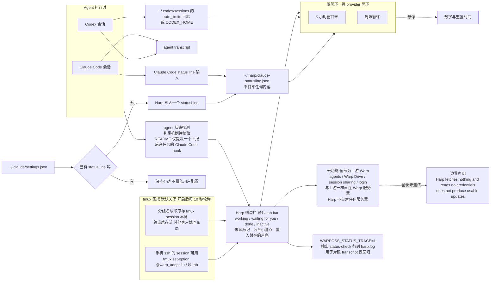

# dominikmartn/harp

## 一句话定位
Warp 终端的非官方 fork——**把 tab bar 换成专为长跑型 coding agent 设计的侧边栏**，让「哪一个 agent 在等我」成为一屏可见的状态，其余保持 Warp 原样。

## 它解决的问题
同时开三个以上 Claude Code 或 Codex 会话时，终端 tab bar 只告诉你「有几个 tab」，不告诉你「**哪一个正在等我回答**」。实际后果是：agent 已经停下等你输入了，但你还在另一个 tab 里写代码，直到它超时或你想起来去看。

Harp 的答案是把 agent 状态做成主界面而不是附注。每行显示一种状态：**working**（正在跑）· **waiting for you**（等你输入）· **done**（完成）· **inactive**（不活跃），配一个**未读标记，直到你真的看过才消失**；一个**小圆点**表示后台任务仍在跑；一个**月亮**表示你把这个 tab 置入了暂存。

第二个问题是**限额**。Claude Code 与 Codex 都有 5 小时窗口与周限额，但在多个 agent 并行时，用户往往在撞上限额之后才知道自己已经用完了。Harp 把两个环放在侧边栏底部，每个 provider 两个环，悬停显示数字与重置时间。

## 为什么值得关注（2026-10-22）
**因为它是本日四个项目里唯一一个「不靠模型、纯靠信息设计解决问题」的**——而且这套信息设计值得被更广的 agent 工具采用。

更具体地说，有三个设计选择值得单独记：

1. **限额从本地读，不读任何凭据。** README 写死了三句否定：「**Harp fetches nothing and reads no credentials.**」「They talk to Warp's servers exactly as upstream does; **Harp adds no servers of its own**.」「**Logging in through Harp is untested.**」——一个要显示你的配额信息的工具，明确声明自己不碰凭据，这比任何架构说明都有说服力。
2. **「有就不动，没有才加」的注入策略。** Claude Code 的计划限额只从 status line 拿到。Harp 首次启动时若 `~/.claude/settings.json` 里没有 `statusLine`，Harp 会自己加一个，**把输入存到 `~/.harp/claude-statusline.json` 且不打印任何内容**；**已有的 status line 保持不动**，并告诉用户若想两者兼得需要自己先把输入落盘（例如 `"command": "tee ~/.harp/claude-statusline.json | 你的命令"`）。**这个「不覆盖用户已有配置」的克制是整个设计里最成熟的一处。**
3. **它把状态判定做成了可回归验证的。** `WARPOSS_STATUS_TRACE=1` 把每一行状态的每次变化写成 `~/Library/Logs/harp.log` 的 `[status-check]` 行，README 明说用途是「**以对照某个 agent 的 transcript 做回归检查**」。**这意味着「状态显示对不对」可以变成一个可对照的日志证据，而不是主观感受。**

## 热度来源判断
2 天 527⭐ ⑂29（fork-star 5.5%），**2 天内 4 个 release**（v0.1.0 10-20 11:13Z → v0.1.1 13:43Z → v0.1.2 18:09Z → v0.1.3 10-21 10:29Z）。

**发布节奏说明项目在真实迭代**，不是发完 README 就不管了——这在 2 天龄的项目里是强信号，且与昨日记录的 opentrap（`releases` 为空）形成对比。

**但 fork-star 5.5% 与 `subscribers_count = 2` 说明这是「被围观但没被动手改」的状态**。一个合理的解释是：这是个 macOS 桌面应用，而 fork 一个终端对多数人没有直接用途（不像 fork 一个带靶场的靶场仓库）。**这是推断，不是事实。**

热度来源的另一个关键特征：**它建立在 Warp 已有的人群之上**。Warp 本身是知名产品，Harp 用「unofficial fork」这个定位降低了理解成本——用户不需要理解 agent 状态机，只需要理解「我认识的那个终端，只是换了个侧边栏」。**这是复用而非创新带来的传播优势。**

## 关键技术亮点
1. **状态即界面：** 五种状态 + 未读标记（直到真的看过）+ 后台小圆点 + 置入暂存的月亮 + `Cmd+R` 重命名 tab。这套设计不需要模型，纯靠状态机即可成立。
2. **tmux 集成的持久化位置选对了：** 分组名与顺序存在 **tmux session 本身**上，因此**跨重启存活，且其他 tmux 客户端看到同一布局**。这比存在应用自己的配置里正确——应用重启 tmux 就丢，存在 tmux 里则任何客户端都对。
3. **手机友好的收养机制：** 从手机 ssh 起的 session 可以用 `tmux set-option @warp_adopt 1` 认领一个 tab。这解决了一个真实的边缘场景——**你在外面用手机 ssh 起了个 agent，回来在电脑上想看到它。**
4. **限额环的数据来源分工明确：** Codex 从 `~/.codex/sessions`（或 `$CODEX_HOME`）的 `rate_limits` 日志读（需至少回答过一次才出现）；Claude Code 只能从 status line 拿（**且只对 Claude.ai 计划有效，API key 无效**——这一点 README 明说）。更多 provider 可由外部工具维护的 JSON 文件提供，同名条目替换 Harp 自己的读数。
5. **调试开关面向具体验证需求：** `WARPOSS_STATUS_TRACE=1`（状态变化日志，用于对照 transcript 回归）· `WARPOSS_SKIP_LOGIN=1`（用测试用户启动且所有认证请求失败，便于自动化运行）· `WARP_DATA_PROFILE=<name>`（debug 构建下把设置与数据放 `~/.harp-<name>`）。**三个开关分别对应「回归验证」「自动化」「多环境隔离」三种真实需求，而不是随手加的调试代码。**
6. **明确列出「故意移除」的东西：** tab bar 的搜索框、视图选项、tab 配置按钮、侧边栏分隔线选项、标题条面板开关。**把「我砍了什么」写进 README 是 fork 类项目的诚实做法**——用户需要知道哪些上游能力没有。
7. **身份标识诚实：** 显示名来自 `app/src/lib.rs` 的 `app_display_name!()`，bundle id / URL scheme / 设置目录有文件级列举，而**内部名称保持 Warp 的**（`warp-oss` 二进制、crates、`WARPOSS_*` 开关、其他 tmux 客户端读的 `@warp_*` 选项）——**这个「对外改名、对内不改名」的策略让 tmux 生态的互操作得以保留。**
8. **构建与发布路径完整：** `script/bootstrap` → `script/run`（构建 `target/debug/bundle/osx/Harp.app` 并启动）；`script/macos/run` 用钥匙串里第一个 Apple Development 身份签名、失败回落 ad-hoc 签名；`script/release_macos` 产出**可公证（notarizable）的 release DMG**；提交前跑 `./script/presubmit`（format / clippy / tests）。

## 架构启发
**第一条启发关于「信任边界用否定句表达」。** 「不抓取任何东西、不读任何凭据」「不自建任何服务器」「通过 Harp 登录未测试」——三句否定比任何功能描述都更快地建立了信任。**在工具要求接触用户数据或账号时，「我不碰什么」应当与「我能做什么」同等重要地出现在首页。**

**第二条启发关于「配置注入要尊重已有配置」。** 「有 statusLine 就不动，没有才加」是一个只有一处代码的策略，但它避免了最常见的两种失败：覆盖用户的自定义配置，以及在用户不知情时改变其工具行为。**README 甚至教用户如何两者兼得**（把 status line 命令改成 `tee ~/.harp/claude-statusline.json | 你自己的命令`）——**给受影响的用户一条自救路径，是工具注入行为的应有之义。**

**第三条启发关于「状态机应该可观测」。** `[status-check]` 日志行不是一个调试残留，而是一条**回归测试的数据源**——它让「agent 状态判定」这个本质上依赖推断的过程，变为可与 agent transcript 对照的事实。**任何自动化状态推断（IDE 里 agent 在干什么、CI 里 job 卡在哪、面板里 pod 处于什么阶段）都应该有同等的可观测出口。**

**第四条启发关于「把持久化状态放在被集成的系统里」。** 分组名与顺序存在 tmux session 而非 Harp 自己的配置，带来三个好处：跨重启存活、任何 tmux 客户端一致、换终端工具不会丢。**这是「谁是真正的状态所有者」这个问题的一个干净答案。**

## 架构师速览

| 决策问题 | 研究判断 | 证据边界 |
|---|---|---|
| 系统边界 | 一个 macOS 桌面 App（Warp 的 fork，AGPL-3.0，`warpui` 与 `warpui_core` 两个 crate 为 MIT）。侧边栏替代 tab bar；限额环从两个**本地**来源读（Codex 的 `~/.codex/sessions` 日志、Claude Code 的 status line 输入）；tmux 集成为可选（默认关闭）；云功能（agents / Warp Drive / session sharing / login）仍直连 Warp 的服务器，**Harp 不自建服务器**。**控制面：agent 状态探测 + 限额读取 + tmux 轮询；数据面：本地文件（`~/.codex/sessions`、`~/.harp/claude-statusline.json`、`~/.harp/settings.toml`）+ tmux session 属性** | 全部来自 README 的 What it adds / Settings / 贡献者细节三段；**agent 状态的判定机制（读 transcript？调 hook？）README 只提了一个「reports background tasks to the sidebar」的 Claude Code hook（`integrations/claude-code/README.md`），主路径待核验** |
| 主路径 | 启动 → 侧边栏为每个 tab 探测 agent 状态并归入 working / waiting / done / inactive + 未读标记 → 每 10 秒轮询 tmux（若开启）同步 tab 名、分组、顺序与 read/inactive 标志，并从 tmux 属性读限额或按 `session_script` 执行自定义脚本 → 限额环读 Codex 的 `rate_limits` 日志与 Claude Code 的 status line 输入 → **若用户已有 statusLine 则不改动，若无则由 Harp 写入一个并把输入落盘到 `~/.harp/claude-statusline.json`** → 一切云功能仍走 Warp 上游 | 逐条来自 README；**「Harp adds a statusLine if none exists」这条路径的失败模式（status line 被用户换掉、Claude Code 改格式）README 未讨论** |
| 关键权衡 | **fork 上游（Warp）拿全部既有功能 vs 从零写（无兼容负担）**——README 明确 Harp **does not produce usable updates**，这是 fork 路线最本质的债 · **读本地文件与日志拿限额 vs 请求云端 API（后者准确但要凭据）**——选择本地读并因此只能用 status line 这条间接通道 · **自动注入 status line（开箱即用）vs 不动用户配置（尊重但用户要自己配）**——选了「有就不动，没有才加」的折中 · **tmux 集成默认关闭（多数用户不需要）vs 默认开启（多 agent 玩家的核心诉求）** · **AGPL-3.0（改动必须开源回流的强约束）vs MIT（更易集成）**——Harp 用「`warpui` 与 `warpui_core` 两个 crate 例外为 MIT」给自己留了口子 | README 明示「does not produce usable updates」「Harp fetches nothing and reads no credentials」「Harp adds no servers of its own」「Logging in through Harp is untested」「if ~/.claude/settings.json has no statusLine yet, Harp adds one… A status line you already have is left alone」与许可证例外条款；**未明示 fork 与上游的同步策略、以及 AGPL 例外是否会随上游改动失效** |
| 最小 PoC | 1. 从 Releases 取最新 DMG 拖入 Applications（v0.1.3 已发布，**这条路今天就能走通**，与昨日 opentrap 的空 releases 形成对比）→ 2. 同时开一个 Claude Code 会话与一个 Codex 会话，**不要设任何 status line** → 3. 启动 Harp，核对是否出现两个限额环（悬停应显示 5 小时窗口与周限额的数字与重置时间）→ 4. **检查 `~/.claude/settings.json` 是否被写入了一个 `statusLine`，以及 `~/.harp/claude-statusline.json` 是否生成** → 5. 现在把 status line 改成自己的一条命令，**核对 Harp 不再改动它**（README 明示已有则不碰），并按 README 提示改成 `tee ~/.harp/claude-statusline.json \| 你的命令` → 6. 观察五个状态是否随 agent 实际行为切换，并**用 `WARPOSS_STATUS_TRACE=1` 把 `~/Library/Logs/harp.log` 的 `[status-check]` 行与某个 agent 的 transcript 对照**，验证状态判定不是猜的 → 7. 打开 tmux 集成，建两个分组，重启一次，**核对分组名与顺序是否仍在、其他 tmux 客户端是否看到同一布局** → 8. 从手机 ssh 上去 `tmux set-option @warp_adopt 1` 认领一个 tab | PoC 逐步来自 README；**第 6 步是本项目最有价值的验证动作**——它把「状态显示对不对」从主观感受变成可对照的日志证据；**第 3 步可能失败**（若 Claude Code 走的是 API key 而非 Claude.ai 计划，README 明示此时不出现环） |

## 架构图（MMD）

> 证据边界：此图只采用本档案已有可核验描述；标注「待核验」的节点不应视为项目实现事实。

## 定位判断
**工具型，且在「多 agent 并行」这个细分需求上暂时没有直接竞争者。**

Warp 本身有 AI 功能但 tab bar 不为 agent 设计；iTerm2 / Ghostty / WezTerm 需要自己配 tmux 与脚本；各类「agent 管理器」大多停在 web UI 或 CLI 层面。Harp 占住的是「**你已经在用 Warp，现在同时跑 5 个 agent**」这个具体格子。

它的传播优势来自**复用而非创新**：理解成本极低（我认识的那个终端），改造面极小（换了 tab bar），核心价值来自信息设计而非新能力。**这既是它的优点（易理解、易采用）也是它的天花板（难以形成技术壁垒）。**

从成熟度看：2 天、4 个 release、`subscribers_count = 2`、macOS 单平台、**且 README 明写不产出可用更新**。**它处在「今天就能用，但要盯着上游」的状态。**

## 风险 / 局限 / 泡沫点
1. **⚠️ 非官方 fork 的路线债是结构性的。** README 明写「**does not produce usable updates**」——上游 Warp 的每次改动不会自动到达，用户要么自己解冲突要么放弃某部分功能。2 天 4 个 release 说明当前跟随强度尚可，**但这不是一个能长期成立的模型**，README 自己也承认。
2. **agent 状态的判定机制未说明。** README 只提到一个「reports background tasks to the sidebar」的 Claude Code hook（`integrations/claude-code/README.md`），主路径不清。**「waiting for you」这个最有价值的状态如何被判定，直接决定了整个产品的可信度**——而这需要读代码或跑第 6 步 PoC 才能知道。
3. **限额环在 API key 模式下无效。** README 明示只对 Claude.ai 计划有效、API key 无效。**大量开发者在用 API key**——这意味着限额环这个功能对相当一部分目标用户是失效的。
4. **Harp 注入 status line 的失败模式未讨论。** 用户换掉 status line、Claude Code 改格式、Harp 崩溃后未恢复——README 未涉及。而**静默失效的限额显示比没有更危险**：用户会以为自己还在配额内。
5. **macOS 单平台。** 徽章只标 macOS，Windows / Linux 未提。
6. **`subscribers_count = 2`，fork-star 5.5%。** 处于「被围观但没被动手改」的状态。
7. **AGPL-3.0 加例外条款的长期风险。** 两个 crate（`warpui`、`warpui_core`）为 MIT，其余 AGPL。这个例外是否能随上游持续成立，README 未说明——**若上游改动这两个 crate 的依赖关系，例外的法律效力可能受影响。**
8. **登录路径未测试。** 「Logging in through Harp is untested」——这不是 bug，但它意味着走 Warp 账号的那部分功能（如 session sharing）在本 fork 上是未知状态。

## 与同类项目的关系
- **vs Warp（上游）：** fork 关系，非竞品。Harp 替换 tab bar 并新增侧边栏、限额环、tmux 集成，其余保持原样。**明写不被 Warp 支持或认可，issue 应提到 Harp 而非 Warp。**
- **vs tmux + 自定义脚本：** tmux 本身能做窗口/分组管理，且 Harp 的分组状态就存在 tmux 里。**差别在于 agent 状态语义与未读标记——tmux 不知道哪个 agent 在等你。** 若用户已在用 tmux + 脚本，Harp 的增量价值取决于状态判定是否比脚本可靠。
- **vs 各终端的 agent 集成：** Warp / iTerm2 / Ghostty 等若原生支持 agent 状态显示，Harp 的存在空间会迅速收窄。**它的窗口期取决于上游的反应速度。**
- **vs Claude Code / Codex 自带的 status line：** 两者都能通过 status line 显示配额。**Harp 的增量是把它做成了常驻的视觉元素（两个环）而非需要主动调用的命令。**
- **vs 各类 GUI 的「任务/会话管理器」（如 IDE 的 agent 面板）：** IDE 有更好的 agent 集成（Harp 集成的是 CLI agent）。**在 IDE 里工作的人不需要 Harp；在终端里工作的人才需要**——这是一个明确但不大的人群。

## 是否值得持续跟踪
**值得，且属于「今天就能抄走」的类别。** 三条明确理由：

1. **信息设计可迁移到任何多 agent 工具。** 五种状态 + 未读标记 + 后台圆点 + 置入暂存 + 双限额环，这套设计不需要模型即可成立，**任何要同时管多个异步任务的工具（IDE 插件、CI 面板、运维控制台）都能借鉴**。
2. **两个具体做法可以直接抄：** 其一，「有 statusLine 就不动，没有才加」并教用户如何自救；其二，`[status-check]` 日志行把状态推断变成可回归验证的证据。
3. **发布节奏真实。** 2 天 4 个 release，且 v0.1.3 存在意味着下载路径今天就能走通。

**但必须同时盯住一条结构性风险：** fork 上游且不产出可用更新的模式不可长期持续。**这个项目的生命力取决于 Warp 上游的变动频率。**

**具体动作建议：**
- **若你是多 agent 并行用户（macOS + Claude Code/Codex 的 Claude.ai 计划用户）：** 直接按上面的 PoC 走一遍，尤其第 6 步——**用 `[status-check]` 日志验证状态判定是否可信**，这是决定要不要继续用的关键。
- **若你在设计任何多任务/多 agent 工具：** 抄信息设计与配置注入策略，不必抄 fork 本身。
- **若你用 API key：** 限额环会失效，剩下的价值只有状态侧边栏。

## 后续观察点
1. **agent 状态的判定机制是否被公开说明或开源得更清楚。** 这是本产品最关键也最不透明的一环——观察 README 或 `integrations/claude-code/README.md` 是否补充「waiting for you」如何被检测。
2. **上游 Warp 的变动频率。** 这是结构性风险的核心指标——**观察 Warp 上游发版后 Harp 的跟进间隔，若连续多次落后超过两周，说明模式已失效。**
3. **平台扩展。** 是否出现 Linux / Windows 构建——这将直接决定它是个人工具还是可推广产品。
4. **限额环的 provider 覆盖面。** README 说可由外部 JSON 文件提供更多 provider，观察是否出现第三方 provider 生态（如 Cursor / Gemini CLI 的限额读取器）。
5. **Harp 注入的 statusLine 在异常情况下的行为。** 用户换掉 status line、Harp 崩溃、Claude Code 改格式时，是否会静默失效。
6. **`subscribers_count` 与 fork 的变化方向。** 当前 2 与 5.5% 说明处于围观状态；**若 fork 明显上升（对比昨日记录的同类 fork-star 分化），说明有人真的在改它**——那时它的长期价值判断需要重新评估。

---

*首次记录：2026-10-22*