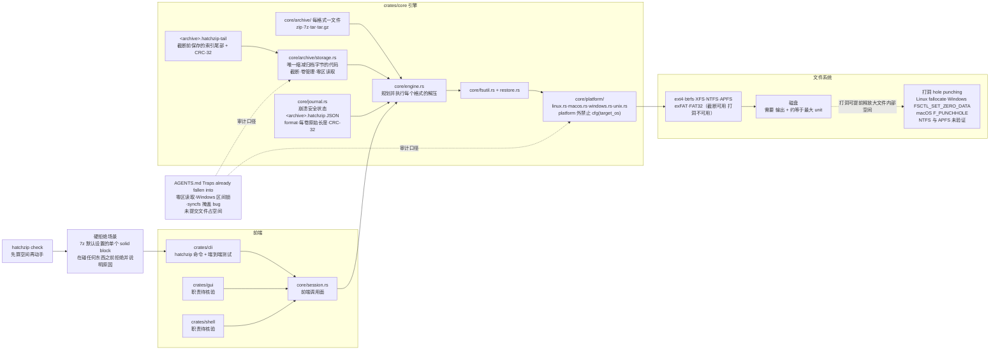

# xevrion/hatchzip

## 一句话定位

就地解压超大归档——**从归档尾部反向解压，边解边把已完成的单元从归档文件尾部截断**，于是归档让出的磁盘空间被下一个文件复用；**用户只需要为输出留空间，而不需要同时为归档和输出留空间**。

## 它解决的问题

**一个具体到能算的空间问题。** 180 GB 的游戏归档解出 200 GB，用 WinRAR、7-Zip 或 `unzip` 需要 **380 GB** 磁盘——因为归档与全部产物必须在磁盘上同时存在，而删除归档的动作发生在解压完成之后。

典型场景是：磁盘快满了，用户下了一个大归档，解压到一半失败，磁盘更满了，且**归档还在**。没有安全的恢复路径。

HatchZip 的做法是让**归档空间与输出空间错峰共存**：解压完一个单元，就把它在归档里占的那段从文件尾部截掉，归档让出的字节立即被下一个文件复用。**结果是只需要略多于 200 GB，而不是 380 GB。**

它同时处理了一个容易被忽略的正确性问题：**这个操作会销毁输入。** 解压工具通常假设「解压是只读输入的」，但 HatchZip 明确地、持续地删除自己的输入——因此它必须自带崩溃安全机制。

## 为什么值得关注（2026-10-24）

**因为它是本日唯一一个「今天就能下载、用它、并且能自己验证它」的项目——而它同时是本日 fork-star 最低的项目（1.9%）。**

这两件事同时成立，本身就是本日最强的一条读法：**热度与可用性脱钩，而且脱钩的方向与 star 排序相反。**

三个具体理由：

1. **⭐ 它的技术选择是一条完整的理由链，而不是一个技巧。** 「为什么不能从前面删」有文件系统层面的答案（打洞在 FAT32/exFAT 上不支持且各系统行为不同），「为什么必须先算空间」有 7z solid block 的解释，「为什么不做增量」有 journal 的设计。**每一个设计选择都能追溯到一个具体的约束。**
2. **⭐ AGENTS.md 把不变式写成绝对句。** 「The tool destroys its input. The invariant is absolute: the journal never claims a file before it is durable, and the archive is never truncated past an entry the journal doesn't claim.」**这是可以直接抄进任何破坏性工具的形式。**
3. **⭐ 它把踩过的坑写成具体条目，而不是泛泛的最佳实践。** 「Traps already fallen into」里的每一条都是真实事故：zip crate 的反向扫描语义、Windows 的字节区间锁、Linux 的 `syncfs` 批处理掩盖了 macOS/Windows 上的 bug。**这些是只有在真机上跑过才会知道的东西。**

## 热度来源判断

**888⭐ 对 1 个贡献者、1 个 subscriber、8 个 open issue——这是一个单人项目在 2.5 天里获得的注意力。**

热度来源是三条，都可核验：

- **痛点极其具体且高频**：大游戏/大模型的归档解压是普通用户的日常场景，而「磁盘不够」是最常见的失败原因。
- **有一个可以用一句话说清的对照数字**：**380 GB vs 略多于 200 GB**。这个对比极易传播，且读者能立刻在自己的场景里换算。
- **有真实产物**：3 个 release × 22 个 asset（Windows 安装器、macOS dmg、Linux tar.gz/.deb/.rpm/AppImage），**不需要编译**。

**它不是刷星**（contributors 1 人、subs 1、oi 8、fork-star 仅 1.9%——若为刷星，fork 比例会异常高）。**但 fork-star 1.9% 本身也是一条信息**：**它说明几乎没有人 fork 它——因为不需要 fork，只需下载。** 这与本日报连续四天观察到的分界线完全一致（10-23 的 reylo fork-star 0.5% 同属此类）。

**风险在于单点依赖**：contributors API 返回 1 人。这个项目的全部价值都在那一个人的手上。

## 关键技术亮点

1. **⭐ 只从尾部截断（理由链的起点）。** 从前或从中删除字节需要打洞：Linux `fallocate`、Windows `FSCTL_SET_ZERO_DATA`、macOS `F_PUNCHHOLE`——**而 FAT32 与 exFAT 不支持打洞，且各系统行为不同**。尾部截断（`ftruncate` / `SetEndOfFile`）是所有目标文件系统都支持的最小公倍数。
2. **⭐ 每格式的 unit 划分。** ZIP 一个 entry（本地头 + 数据）、7z 一个 solid block（非 solid 时一个文件）、tar 一个 entry（含其前的长名/pax 记录）、`.tar.gz` 整个压缩流从前端解。**unit 按文件位置倒序解压，每批之后把归档截断到该批最低 unit 的起点。**
3. **⭐ 7z solid block 只能从头解码，因此最大 unit 就是主要成本。** 需要的空间是「输出 + 约等于最大 unit」——这是就地解压的理论下界，而 README 明确地把它写成了下界而非缺陷。
4. **⭐ 可复算的硬拒绝。** 7-Zip 默认设置会把整个归档放进一个 solid block，此时「一块在被完全解出前一点空间都释放不了」——**HatchZip 在碰任何东西之前就拒绝并说明原因**（README 对比表最后一行：`Refused before touching anything`）。
5. **⭐ journal 作为崩溃安全的真相源。** `<archive>.hatchzip` 是一个小 JSON，记录 `format`（`zip`/`7z`/`tar`/`tar.gz`，**使恢复永远不必猜一个半 eaten 文件**）与每个卷的原始长度及 CRC-32。
6. **⭐ 保存的尾部（the saved tail）。** ZIP 与 7z 把索引放在文件末尾，而这正是截断首先移除的部分——因此截断前 HatchZip 把最后一个 unit 数据之后的全部内容复制到 `<archive>.hatchzip-tail` 并在 journal 里记 CRC-32；之后归档通过 `storage::Reader` 解析（对已截断区域**返回零而不是报错**），让 zip crate 反扫时零永不匹配签名、让 tar 把零读成归档结束。
7. **⭐ 分卷归档。** `Storage` 把 `game.7z.001`、`game.7z.002`… 拼成一个逻辑文件；截断到某长度会删除完全落在其后的卷并缩短它所落入的那个卷；**一个 unit 可以跨两个卷**。
8. **实测数字而非估计。** AGENTS.md 明令「Every number in the README and docs is measured on real hardware, never estimated. Paste the measurement when you change one.」并附测量环境（Fedora 43、Intel Core i7-14700HX、SK Hynix NVMe SSD、热页缓存；空间测试 220 MiB tmpfs、速度测试 ext4）。
9. **平台差异被收进一个模块。** AGENTS.md 明令 `platform/` 之外禁止 `cfg(target_os)`/`cfg(windows)`；CI 在 Linux/macOS/Windows 三平台跑测试（'since nobody develops on the latter two'）。
10. **⭐ 崩溃安全的具体验证。** README 称在每种格式运行的多个点、两个不安全时刻强杀进程，每次恢复的输出都逐字节一致。

## 架构师速览

| 决策问题 | 研究判断 | 证据边界 |
|---|---|---|
| 系统边界 | 四个 crate：`core`（引擎库：`archive/` 每格式一个文件 + **唯一缩减归档字节的 `storage.rs`** + `engine.rs` 规划并执行每个格式的解压 + `journal.rs` 崩溃安全状态 + `session.rs` 前端调用面 + `platform/` 每 OS 一个文件 linux.rs/macos.rs/windows.rs/unix.rs + `fsutil.rs` + `restore.rs`）、`cli`（`hatchzip` 命令与端到端测试）、`gui`、`shell`。**边界划在「截断」这个动作上**——只有 `storage.rs` 触碰归档字节，其余代码都不直接缩减文件 | AGENTS.md 的 Project coding standards 与 Traps already fallen into、README 的 Layout、`crates/core/src` 目录树；**`gui/` 与 `shell/` 的职责本窗口未取，待核验** |
| 主路径 | 用户选择归档 → `hatchzip check` 先算空间（**在任何改动之前**）→ 若可装下：从尾部定位最后一个 unit → 读取并写入输出 → **每批之后截断归档到该批最低 unit 的起点并 fsync** → journal 记录已提交项 → 全部完成后归档归零、只留输出；崩溃后由 journal 恢复（**已截断区域读作零**，让 zip crate 反扫与 tar 解析都正确停下） | README 的 Highlights 与 `docs/how-it-works.md` 的 The space problem / Why from the end / The journal / The saved tail 节；**「恢复时如何发现崩溃批次写过但未提交的文件」在 AGENTS.md 里提到（必须先删除再做空间检查）但流程细节未取，待核验** |
| 关键权衡 | **只从尾部截断 vs 打洞**（尾部是所有文件系统都支持的最小公倍数；打洞收益大但 FAT32/exFAT 不支持且各系统行为不同）· **就地释放空间 vs 需要 2 倍磁盘**（核心主张）· **最大 unit 作为不可压缩成本 vs 预先拒绝**（7z 默认设置直接被拒——**用「拒绝」而不是「失败」处理不可行的情况**）· **journal 作为崩溃恢复的真相源 vs 不做恢复**（恢复能力以额外状态与复杂度为代价）· **每平台一个文件 vs cfg 条件编译**（AGENTS.md 明令 `platform/` 之外禁止 `cfg(target_os)`）· **Rust 1.95 + MSRV 1.89 vs 更低版本**（`File::try_lock` 是 MSRV 1.89 的新 API） | README 的 Highlights、AGENTS.md 的 Operating systems 与 Rust 节、AGENTS.md 的 Traps 逐条；**未明示：journal 文件与输出目录之间的原子性策略细节、gui 与 cli 是否共用同一 session 路径** |
| 最小 PoC | 1. **先准备一个可重建的归档**（AGENTS.md：「Never run `extract` on an archive you can't recreate. It deletes it.」）→ 2. 跑 `hatchzip check` 看它算出的确切空间需求 → 3. **故意试一个 7-Zip 默认设置的 7z——它应该在动手之前就拒绝并解释原因**（**这是本 PoC 唯一能证伪「它真的提前拒绝」的步骤**）→ 4. 用 `-ms=20m` 的多 block 7z 跑一次，对比输出与原文件**逐字节一致** → 5. **在解压过程中强杀进程，然后恢复，验证输出逐字节一致**（README 声称在每种格式运行的多个点、两个不安全时刻都杀过，每次恢复输出都相同）→ 6. 在一个空间只够「输出 + 最大 unit」的分区上跑，验证它不会在空间耗尽时留下半个归档 → 7. **验证已截断区域读作零的行为**（这是恢复正确性的基础）→ 8. 检查 `platform/` 之外的代码没有 `cfg(target_os)` | **第 3 步与第 5 步是唯二能证伪其核心主张的步骤**；**第 1 步是硬前提**；**第 6 步需要真实的分区或 tmpfs 配额，本 PoC 不覆盖多卷删除路径** |

## 架构启发

**第一条启发：破坏性操作也可以有绝对不变式，前提是把不变式写下来并让所有代码路径都服从它。** 「journal 在文件持久化之前不认领它；归档绝不截断到 journal 未认领的条目之后」——**这条不变式同时定义了「什么可以安全地做」和「什么绝对不能做」**，而且它是可测试的：任何一次崩溃恢复后的逐字节比对都在验证它。

**第二条启发：把「不可行」变成「提前拒绝」，比让它在运行中失败便宜得多。** 7z 默认设置的那个 solid block 案例是本项目最好的一课：**它不是限制输入，而是解释为什么这个输入不可行，并给出用户能行动的信息**（改用 `-ms=<size>` 创建多 block 归档）。**一个工具如果只能说「不」，用户会去找别的工具；一个工具能说「不行，因为 X，你可以改 Y」，用户会改 Y。**

**第三条启发：平台差异应该收进一个模块，而不是散落成条件编译。** AGENTS.md 明令 `platform/` 之外禁止 `cfg(target_os)`，并给出理由（CI 在三个平台跑测试，「since nobody develops on the latter two」）。**这条纪律的真正价值不是代码风格，而是它让「平台相关行为」变成一份可枚举、可逐个测试的清单**——这正是它那份「Traps already fallen into」能写得有条理的原因：每条坑都能归属到某个平台的具体行为。

**第四条启发（可迁移到文档写作）：把失败写成具体的、可复现的条目，比写「注意异常情况」有用一个数量级。** 这份 AGENTS.md 的坑列表里，「zip crate 反向扫描整个归档找 end record，`storage::Reader` 必须对已截断区域返回零而不是报错，否则每次恢复都失败于 `No CDFH found`」这一条，**任何人读了都能立刻在自己的实现里避免同一个 bug**——而这是通用建议做不到的。

## 架构图（MMD）

> 证据边界：此图只采用本档案已有可核验描述；「待核验」节点不应视为项目实现事实。

## 定位判断

**可立即采用的实用工具（本日四个项目中唯一「下载即用」且核心机制完整可验证的两个之一）。**

在归档工具的谱系上，它的定位是**「空间受限场景的专用解法」**——不是替代 7-Zip 或 `unzip`（那两个更快、更全），而是**在「磁盘装不下归档 + 输出」这一特定条件下唯一可行的做法**。**这个定位很窄，但很实。**

**它的差异化不在功能清单，而在机制的唯一性**：所有其他解压工具都是「读归档 → 写输出 → 用户自己删归档」，只有 HatchZip 是「读归档 → 写输出 → 边读边把归档截短」。**这个差异是结构性的，不可通过给 7-Zip 加选项获得**（7z 的 solid block 设计决定了它无法边解边释放）。

**它的第二个定位是「破坏性操作的工程规范样本」**——即使读者永远不用它解压，AGENTS.md 的不变式与坑列表也是可以直接借鉴的写法。

## 风险 / 局限 / 泡沫点

- **⚠️ 未代码签名。** Windows 需「更多信息 → 仍要运行」，macOS 15+ 需手动允许（README 明写）。**这在企业环境是实际部署障碍**——安全策略通常会直接拦截未签名二进制。
- **⚠️ APFS 与 NTFS 上的打洞未验证。** README 明说 'NTFS and APFS not yet verified'。**这意味着「每 256 MiB 释放一次」的那个优化在 macOS 与 Windows 上不生效**——那两个平台上的实际收益接近「输出 + 最大 unit」，而非 README 里那个 950 MiB tmpfs / 367 MB 空闲 / 600 MiB 存储文件的极端例子。**README 的最优数字来自 ext4 上的 tmpfs，跨平台的实际收益需要读者自行折算。**
- **单作者。** contributors API 返回 1 人，subscribers 1。项目连续性完全取决于一个人。
- **这是破坏性操作。** AGENTS.md 自己说「It deletes it」「Never run `extract` on an archive you can't recreate. It deletes it.」——**journal 的正确性是唯一的安全屏障，而 journal 的实现在本窗口未逐行核验。**
- **7z 支持不完整。** 7-Zip 自己的格式特性（加密归档、某些压缩方法如 PPMd/BZIP2/LZMA2 的边缘情形、多卷与 solid 的组合）是否全覆盖，本窗口未核验。
- **单一文件系统的行为差异。** README 说「任何能收缩文件的文件系统」都能用，但**收益差异未量化**——打洞可用的系统（ext4/XFS/btrfs/tmpfs）远优于只能截断的（exFAT/FAT32）。
- **2.5 天、888⭐ 的项目在快速迭代期。** 3 个 release 在 2 天内发布（v0.1.0/v0.1.1/v0.1.2），**接口与行为都可能继续变化**；journal 格式的稳定性未经时间检验。
- **本日报无法独立验证其对比表中的任何数字**（需真实硬件与 tmpfs 配额环境）。

## 与同类项目的关系

- **vs 7-Zip / WinRAR / `unzip` / `tar`**：**不是替代，是补位。** 它们更快、更全、支持更多格式与加密；**但它们都要求归档与输出同时存在。** HatchZip 唯一解决的是「磁盘装不下两者之和」。**这是互补关系而非竞争关系**——实际使用中，最合理的做法是「正常情况用 7z，空间不够时用 HatchZip」。
- **vs `unar` / `7zz` 等其他解压器**：同样不做就地释放。
- **vs Python 的 `zipfile` + 手动删除**：手工方案无法保证「文件已持久化后才认领」，而 HatchZip 的不变式正是围绕这一点。
- **vs 支持流式解压的格式（如 `.tar.zst` 的管道模式）**：`cat x.tar.zst | zstd -d | tar x` **在原理上可以达到类似的空间效果**（不落归档文件），但**不适用于已有的 ZIP/7z 文件**——而游戏分发用的正是这两种格式。**HatchZip 的价值域是「已存在的归档文件」**。
- **vs bsdtar 的 `--to-stdout`**：同上，适用面窄。
- **vs `aria2c` / 下载器边下边解**：那是另一类问题（网络流式），HatchZip 处理的是本地已完成的归档。
- **vs `unar` 的多卷处理**：HatchZip 的分卷支持是**为了就地释放而做的卷级截断与删除**，与 `unar` 的拼卷是不同机制。

## 是否值得持续跟踪

**值得，且在本日「可立即采用」类别中优先级最高。**

理由：它是本日唯一「下载即用、机制完整可验证、且解决的问题可以用一句话说清」的项目。**它甚至可以直接替代一个真实痛点场景——如果你曾因为磁盘不够而解压失败，这个工具就是为你写的。**

**但必须同时说清三条限制**：未代码签名（企业环境阻塞）、APFS/NTFS 打洞未验证（跨平台收益低于 README 的最佳数字）、单作者（连续性风险）。

具体观察点：
1. **代码签名与公证**（Windows Authenticode + macOS notarization）——**这是企业落地的必要条件，也是判断项目走向的第一个信号**。
2. **APFS 与 NTFS 的打洞验证**——一旦验证，macOS 与 Windows 用户能拿到 README 里那个最优数字。
3. **是否支持更多 7z 压缩方法与加密归档**——当前覆盖面的边界未核验。
4. **journal 格式的稳定性**——跨版本恢复的兼容性是长期使用的关键；2 天内 3 个 release 说明格式可能仍在变。
5. **贡献者人数**——contributors 从 1 变为 2 是这个项目可持续性的最直接指标。
6. **`crates/gui/` 与 `crates/shell/` 的成熟度**——桌面 GUI 的存在会显著扩大它的用户面。

## 后续观察点

- v0.1.3 之后的 release notes 是否提到签名（当前 3 个 release 的 body 极简，只有 Full Changelog 链接）。
- `docs/how-it-works.md` 中「Freeing space inside a large file」一节的平台覆盖是否更新（当前明说 NTFS 与 APFS 未验证）。
- 是否加入 `--dry-run` 式的完整计划输出（当前 `check` 子命令是唯一的预演入口）。
- AGENTS.md 的 Traps 列表是否继续增长——**这份清单的长度本身就是项目成熟度的指标**。
- 是否有第二个贡献者提交（GitHub contributors API 当前返回 1 人）。
- 是否处理 7z 加密归档与 PPMd 等边缘压缩方法。

---
> 数据来源: GitHub API (2026-10-24 CST 06:00 前后 / UTC 2026-10-23T22:13Z 快照) | Stars: 888 | Forks: 17 | Subscribers: 1 | Open Issues: 8 | License: Apache-2.0 | 语言: Rust | 创建: 2026-10-21T17:29:28Z | 推: 2026-10-23T14:28:39Z | Commits: 75 | Contributors: 1 | Releases: 3（每个 22 个 asset）| Size: 1990 KB
