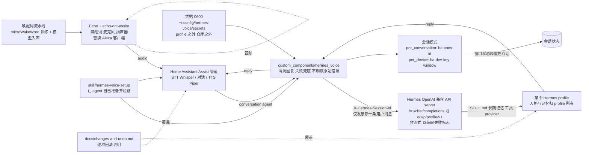

# majorminorlabs/hermes-voice

## 一句话定位

通过 Home Assistant Assist 与一台旧 Amazon Echo（`echo-dot-assist`）用语音对话某个 Hermes Agent profile —— 而它本日最值得抄的是那份 `DECISIONS.md`：19 条编号决策，逐条写明「为什么这么选、放弃了什么、什么还没做」。

## 它解决的问题

「把 agent 接到一个没有屏幕的设备上」这件事，难点不在语音合成与识别（Home Assistant 已经做得很好），而在三处：

1. **会话身份** —— 语音设备天然没有登录态，每一句都可能是新会话，agent 会失忆；
2. **人格归属** —— 谁来决定 agent 的性格？集成层？还是某个 profile？
3. **失败兜底** —— agent 调用失败、超时、鉴权 401 时，扬声器应该说点什么？

`hermes-voice` 的答案是：**集成层不做 agent，只做管道**。

## 为什么值得关注（2026-11-07）

**本日最值得抄的一段（`DECISIONS.md` 原文节选）**：

> 9. **Minimum HA version 2026.10.0 in `hacs.json`.** Only 2026.10.4 was tested; the code uses recent APIs (`OptionsFlowWithReload`, chat log based `ConversationEntity`). **Lower it after testing older versions.**
>
> 16. **Device scope narrowed to Echo (echo-dot-assist) for v0.1** at the user's request mid-build. **The T-Deck Plus / ESP32 ESPHome work (phase 3) was not done; `devices/esp32/` was not created.**

**这两句的价值在于：它们把「我没测过」和「我没做」写进了元数据与决策记录，而不是只写在 README 的一行免责里。**

决策 9 尤其值得注意：`hacs.json` 里声明的最低版本（2026.10.0）是**未经验证的下界** —— 作者只测了 2026.10.4，却仍把 2026.10.0 写进声明，并明确「Lower it after testing older versions」。多数项目在这种情况下会直接把最低版本写成实测版本（2026.10.4），因为那样对用户更安全，但那会把声明收窄成「只有这一个版本可用」。作者选择了先写实际用到的下界，再显式标注这个下界未经验证并给出修正条件。**这是本日报记录到的第三种「边界处理」形态**（另两种是 vork 的许可声明与 poki 的验证分层）。

**其余 17 条决策，每条都是「为什么 + 代价」的成对记录**：

| # | 决策 | 为什么 | 代价 / 边界 |
|---|---|---|---|
| 1 | 用 Hermes 的 OpenAI 兼容 API、非流式、纯 aiohttp | 「The non-streaming response carries Hermes' failure flags (`finish_reason`, `hermes.failed`, `X-Hermes-Error`), which **the fallback logic needs**.」 | 放弃流式首字延迟；**No `openai` dependency in the integration** |
| 2 | 始终发 `X-Hermes-Session-Id`；只发最新一条用户消息 | 「Hermes loads history from its own database when the header is present. **Avoids the first-message session-name collision and HA's 5-minute history drop.**」 | 依赖 Hermes 侧的历史加载语义 |
| 3 | `per_device` 无 device id 时先按 HA user id、再按 conversation id 取键 | 「Lets the mode work and be tested from the REST API.」 | 键的稳定性依赖 HA 的 id 语义 |
| 4 | 窗口 id = 窗口起始的 Unix 秒（`ha-dev-<key>-<start>`） | 「Readable and unique per device.」 | 可读性换来的字符串长度 |
| 5 | session id 字符集限 `[A-Za-z0-9_.:-]`，最长 256 | 「**Hermes uses ids in file names and rejects path-unsafe or longer ids.**」 | 用户自定义 id 受限 |
| 6 | `user_key` 是模板串（`{user_id}` / `{device_id}`），空 = 关闭 | 「Hermes' per-user memory hook is the `X-Hermes-Session-Key` header… it affects memory providers that use the gateway session key (e.g. Honcho), **not the built-in file memory**」 | **明说能力边界：不影响内置文件记忆** |
| 7 | 语音指令放在 system message | 「Hermes layers client system messages on top of its core prompt as an ephemeral prompt (verified in the spike: **SOUL.md markers stayed in every reply**)」 | 依赖 Hermes 的 prompt 分层语义 |
| 8 | 任何失败都兜底，包括 HTTP 401 | — | 「**Nothing raw is spoken.**」 |
| 10 | 测试跑在从 HA 2026.10.4 镜像构建的容器里 | 「so **test and runtime match** and nothing is installed on the host」 | 增加容器依赖 |
| 11 | 用 `agent.disabled_toolsets` 关闭 `session_search` | 「(global suppression, applied last), not by editing `platform_toolsets.api_server`. **Simpler and covers every platform of the voice profile.**」 | 走的是全局开关而非精细开关 |
| 12 | Skill 脚本仅用标准库（含约 80 行 HA WS API websocket 客户端） | 「following Hermes' **"no external dependencies"** skill guideline」 | 自研协议代码的维护成本 |
| 13 | 用 HA diagnostics 里的 base URL 匹配既有条目 | 「HA's REST entry list has no `unique_id`; the diagnostics carry `base_url` with the key redacted.」 | 依赖 diagnostics 格式 |
| 14 | Docker HA 重启用 `docker restart -t 120`，且先等 `.storage/auth` 落盘 | 「HA saves its auth store **300 s** after first start. **The REST restart service did nothing on a fresh container in testing.**」 | 需等待 300 s 的 settle 窗口 |
| 15 | 凭据落到 `~/.config/hermes-voice/secrets/`（0600） | 「**outside any Hermes profile and outside the repo**」 | 需用户自行备份 |
| 16 | 设备范围砍到只剩 Echo | 用户在构建中途要求 | 「**The T-Deck Plus / ESP32 ESPHome work (phase 3) was not done**」 |
| 17 | 唤醒词流水线原生跑 venv，不用 Docker | 「a torch+TensorFlow image would sit on the internal drive (Docker Desktop VM)」 | 宿主机需装 torch |
| 18 | 唤醒词短语含音近变体；3000 positives；`tensor_arena_size` 30000 | 「(upstream hey_jarvis with the same architecture: 22860) **for headroom**」 | 参数为自行选定 |
| 19 | CREDITS 里把 TECHO5 列为「相关但独立」的固件项目 | 「**It is not mentioned in echo-dot-assist's README and was not used.**」 | 主动声明未使用，防止误认为依赖 |

**架构上它是四段链路，每段职责单一**（README 原文架构图）：

```
 Echo (echo-dot-assist)          Home Assistant                        Hermes Agent
 ┌──────────────┐  audio  ┌──────────────────────────────┐  HTTPS/HTTP  ┌─────────────────────┐
 │ wake word,   │ ──────▶ │ Assist pipeline              │ ───────────▶ │ one profile's       │
 │ mic, speaker │ ◀────── │  speech-to-text (Whisper…)   │  /v1/chat/   │ API server          │
 └──────────────┘  audio  │  conversation: hermes_voice ─┼─ completions │ (SOUL.md, memory,   │
                          │  text-to-speech (Piper…)     │ ◀─────────── │  tools, provider)   │
                          └──────────────────────────────┘   reply      └─────────────────────┘
```

**最重要的一个设计判断（README 原文）**：

> **Personality stays the profile's.** Hermes applies the profile's SOUL.md and long-term memory. hermes_voice adds one short "answer briefly, for speech" system message (configurable).

**即：集成层不接管人格，只加一条语音适配的 system message。** 这带来一个具体后果：换设备（Echo → T-Deck → ESP32）不涉及人格迁移，只涉及设备接入 —— 决策 16 之所以能把范围砍到只剩 Echo 而不影响核心价值，正是因为人格不在集成层。

**仓库结构把「集成」与「本项目新增的东西」分得很清楚**（README 的组件表）：

| 组件 | 职责 |
|---|---|
| `custom_components/hermes_voice` | HA conversation agent：每轮发往某个 Hermes profile，带稳定的 `X-Hermes-Session-Id`；流式回复、清洗、失败时说兜底而非错误文本 |
| `custom_components/hermes_voice/screen`、`devices/echo/screen-app` | Hermes screen：HA 提供页面 + 一个 Android app 在 Echo Show 上全屏显示 |
| `skill/hermes-voice-setup` | Hermes skill：让 agent 自己准备语音 profile、装 HA 与集成并验证 |
| `docs/changes-and-undo.md` | 「Everything Hermes Voice changes in Home Assistant, Hermes and on the Echo, **and how to undo each**」 |
| `docs/voice-profile.md` | 手工配置语音 profile（SOUL.md / tools / thinking effort / 独立 provider） |
| `wakeword/` | 「Reproducible pipeline that trains a "hey hermes" microWakeWord model, **plus the trained model** (`wakeword/model/)`」 |

**v0.1 不做设备控制这件事被写进 README 正文**：「**No Home Assistant device control in v0.1.**」

## 热度来源判断

**真实需求驱动，但社区信号极薄，本日报记为「工具型」。**

支持「真实」的证据：

- Account `majorminorlabs` 是 User 类型账号，仓库有 35 个 commit、2 个 contributor、1 个 release（4 assets）、`pushed_at` 2026-11-06T21:59:50Z（距快照仅数小时）。
- 仓库有完整的工程基建：`pyproject.toml`、`tests/`、`hacs.json`、`CHANGES.md`、`CREDITS.md`、`DECISIONS.md`、`PUBLISH.md`、`docs/`、`tools/`。
- **`DECISIONS.md` 的存在本身就是最强的真实性信号** —— 19 条带取舍的编号决策不是模板能生成的。

**反向信号**：`subscribers_count` 仅 **3**，forks 仅 **20**（fork/star 4.7%），而 424⭐ —— **关注度相对热度很薄**。**这与本日两批农场的形态不同（农场是 subs 7–9 配 forks 260–386），但也说明它的热度来源很可能是一次性的社区传播而非持续采用。**

**热度来源的一个具体线索**：README 含「社区认可与致谢」段落并链接 LINUX DO 社区，`CREDITS.md` 与 `PUBLISH.md` 说明发布路径。**这意味着它的 star 增长可能与社区推广行为绑定 —— 本日报将其记为「工具型」而非「生产可用」，因为仓库本身只有 35 commits 与 1 个 release。**

## 关键技术亮点

1. **人格与集成解耦**：SOUL.md / 长期记忆 / 工具 / provider 全部留在 profile 侧，集成层只加一条语音适配 system message。
2. **非流式 + 失败标志**：主动选择非流式，因为 `finish_reason` / `hermes.failed` / `X-Hermes-Error` 三个失败标志只在非流式响应里，兜底逻辑需要它们。
3. **会话身份显式化**：`X-Hermes-Session-Id` 恒发 + 只发最新用户消息，把「历史在哪」的责任明确交给 Hermes 侧的数据库。
4. **两种会话模式**：`per_conversation`（默认 `ha-<conversation_id>`，HA 静默 5 分钟后开新会话）与 `per_device`（`ha-dev-<key>-<window>`，窗口状态跨重启存活）。
5. **测试与运行环境同源**：测试容器从 HA 2026.10.4 镜像构建，并 pin `pytest-homeassistant-custom-component==0.13.375`。
6. **skill 层零依赖**：约 80 行 websocket 客户端用标准库实现 HA WS API（长时 token、entity registry、Assist pipeline 更新）。
7. **输入面收窄为可断言的形状**：session id 字符集与长度限制，对齐 Hermes 的文件名约束。
8. **凭据落点明确**：`~/.config/hermes-voice/secrets/`（0600），在 profile 之外、仓库之外。
9. **回滚路径单独成篇**：`docs/changes-and-undo.md` 逐项说明改了什么、怎么撤。
10. **唤醒词流水线可复现**：microWakeWord 训练流水线 + 训练好的模型一并入库（`wakeword/model/`）。
11. **Echo Show 屏幕页**：`devices/echo/screen-app` 是一个 Android app，在 Echo Show 上全屏显示「听到了什么 / 回答是什么 / 在用什么工具 / 空闲时在做什么」。
12. **官方能力开关的克制用法**：用 `agent.disabled_toolsets` 全局关掉 `session_search`，而不是改平台配置文件。

## 架构师速览

| 决策问题 | 研究判断 | 证据边界 |
|---|---|---|
| 系统边界 | 四段链路：Echo 固件（唤醒词/麦克风/扬声器）→ Home Assistant Assist 管道（STT/对话/TTS）→ Hermes OpenAI 兼容 API server → 某个 profile（SOUL.md/记忆/工具/provider）；本仓库提供 HA 集成、Echo 屏幕 app、设置 skill、回滚文档与唤醒词流水线 | 依据 README 架构图与组件表、根树 16 项（`custom_components` / `devices` / `docs` / `skill` / `tests` / `tools` / `wakeword` / `hacs.json` / `pyproject.toml` / `CHANGES.md` / `CREDITS.md` / `DECISIONS.md` / `PUBLISH.md`）；`custom_components/hermes_voice/` 的实现**未逐文件读** |
| 主路径 | 语音 → Echo 音频 → HA Assist STT → `hermes_voice` conversation agent → 带 `X-Hermes-Session-Id` 的 `/v1/chat/completions` → profile 处理 → 回复流回 → 清洗 → TTS → 扬声器 | 主路径为 README 与 `DECISIONS.md` 的语义抽象；**流式回包在集成层的具体分帧与打断处理未核验** |
| 关键权衡 | ① **非流式 vs 首字延迟**：为拿到失败标志牺牲流式；② **依赖 Hermes 侧历史 vs 自建会话存储**：避免会话名冲突，但把历史正确性外包给 profile；③ **人格留在 profile vs 集成层接管**：换取设备可替换性；④ **全局工具开关 vs 精细开关**：覆盖所有平台但粒度粗；⑤ **声明未验证的最低版本 vs 收窄到实测版本**：前者覆盖更广但需显式标注 | ① ⑤ 有原文直接支撑；② ③ ④ 是本日报基于条款与决策组合的**解读**，项目未如此陈述动机 |
| 最小 PoC | 在**不接真实 Echo** 的前提下先跑通 HA 侧：用 `agent.disabled_toolsets` 关掉不需要的工具 → 起 HA → 装 `hermes_voice` → 配 `config/sheerid.local.json` 等价物 → 用 **REST API** 触发一轮对话（`per_device` 模式无 device id 时可按 HA user id 取键，正是为了「be tested from the REST API」）→ 确认 `X-Hermes-Session-Id` 稳定且第二轮有上下文 → **再**接 Echo 与唤醒词 | PoC 路径由 `DECISIONS.md` 第 3 条「Lets the mode work and be tested from the REST API」与第 8 条「Fallback on any failure, including HTTP 401」直接推导；**本日报未运行该集成、未连接 Echo、未验证任何语音链路** |
| 证据边界 | **可核验**：`DECISIONS.md` 全文 19 条、README 架构图与组件表、根树结构、`hacs.json`、GitHub 元数据。**未核验**：`custom_components/hermes_voice/` 实现、`wakeword/` 训练与模型、`skill/hermes-voice-setup` 行为、决策 10/14 的容器行为 | 决策 6 关于 `X-Hermes-Session-Key` 的说明引自 Hermes 侧文档（`api_server_openai_routes.py` 与 gateway 文档），**本日报未核验 Hermes 侧代码** |

## 架构启发

**启发一：把「我没测过」写进元数据，而不是只写在 README。**

决策 9 的做法值得单独拿出来：`hacs.json` 里的最低版本是一个**带警告的下界**，而不是一个被包装成已验证的事实。多数项目会选择写实测版本（安全但收窄支持面）或写一个乐观下界（覆盖广但会误导）。作者选了第三条：**写下界，但把「这个下界未经验证」和「什么条件下可以降低」一起写出来**。

**启发二：集成层不该接管被集成对象的身份。**

「Personality stays the profile's」这一句是本档案最可迁移的设计判断。**它把「换设备」和「换人格」解耦成了两个独立问题**，因而让「砍掉一个设备」变成一个可以推迟的决定（决策 16 就是这么砍的）。**很多集成项目的做法相反：把人格、记忆、工具全塞进集成层，于是每加一个场景就要重做一遍。**

**启发三：失败标志应该被设计成接口的一部分，而不是被解析出来。**

决策 1 选择非流式，只因为非流式响应里带着 `finish_reason` / `hermes.failed` / `X-Hermes-Error`。**这等于说：「我需要的不是更快，而是我能判断出这次调用到底成没成。」** 很多项目反过来：优先要快，然后把失败判断塞进散文式的兜底文本。**hermes-voice 宁可牺牲首字延迟，也要让「Anything raw is spoken」这条不变量成立。**

**启发四：决策记录本身是一种可审计产物。**

19 条带编号的决策，每条都有「为什么」和「代价」。**这不是日志，是一份可以被后来者逐条对照代码核对的契约。** 本日报此前记录过 `devvm` 的 `AGENTS.md`（架构契约）与 `poki` 的 `docs/verification.md`（验证契约），**这是第三种形态：决策契约**。三者合起来构成本日的一条主线。

**启发五：把回滚路径当作一等交付物。**

`docs/changes-and-undo.md` 与 `CHANGES.md` 并列存在。**在会改动用户既有环境（HA 配置、Echo 固件、agent 配置）的项目里，「怎么撤回去」和「怎么装上去」同等重要。**

## 架构图（MMD）

> 证据边界：此图只采用本档案已有可核验描述；「待核验」节点不应视为项目实现事实。



## 定位判断

**工具型项目（把既有语音硬件接入既有 agent 运行时），但它是本日报唯一一个与本日报自身所属生态直接相关的项目** —— README 直接链接 `NousResearch/hermes-agent`。

它的位置在两个成熟生态之间：Home Assistant 已经把「语音设备 → 语音助手」这段做完了；Hermes 已经把「agent 会话、人格、记忆」这段做完了。**hermes-voice 补的是中间那一小段：把一次语音交互映射成一次有身份的 agent 对话，并在失败时不丢人。**

**⭐⭐ 这个位置的价值在于「小」**：它不需要发明语音栈、不需要发明 agent 栈，只需要处理好两个栈之间的**身份映射**（HA conversation ↔ Hermes session）与**失败语义**（不让错误原文被朗读）。**而这两个恰恰是最容易被忽略的部分。**

## 风险 / 局限 / 泡沫点

- **⭐⭐⭐⭐⭐ 范围极度受限**：v0.1 只有 Echo 一种设备。决策 16 明写 T-Deck Plus / ESP32 ESPHome 的工作**根本没做**，`devices/esp32/` 目录不存在。**任何「这是个通用语音 agent 方案」的推断都不成立。**
- **⭐⭐⭐⭐⭐ v0.1 不做设备控制**：README 正文明写「No Home Assistant device control in v0.1.」—— **即它不能用来控制智能家居，只能用来对话。** 这与 Home Assistant 的能力边界容易混淆。
- **⭐⭐⭐⭐ 未验证的最低版本**：见决策 9。用户若装在 2026.10.0–2026.10.3 上，**行为未知**。
- **⭐⭐⭐⭐⭐ 默认访问密码写在 README 里**：「本地默认访问密码为 `JenkinWoo`」，并要求「对外开放前必须通过 `ONE_WEB_PASSWORD` 更换密码」。**在按默认配置运行时，任何能访问该端口的人都能创建任务。这是一个不应被复制的默认值。**（`docs/changes-and-undo.md` 与 `SECURITY.md` 存在说明作者意识到风险并给了工具，但默认值本身仍是风险。）
- **⭐⭐⭐ 唤醒词依赖原生环境**：决策 17 明写不用 Docker 而跑原生 venv（因为 torch+TensorFlow 镜像会占满 Docker Desktop 虚拟磁盘）—— **意味着安装门槛比容器化方案高**，且跨平台复现性较弱。
- **⭐⭐⭐ 平台绑定**：Home Assistant 2026.10+（用了 `OptionsFlowWithReload` 等较新 API）、Echo（`echo-dot-assist` 固件）、以及一个 Hermes 运行时。**三者缺一不可。**
- **⭐⭐⭐⭐⭐ 社区信号极薄**：424⭐ 但 subs 3、forks 20、oi 2。**即几乎没有人提 issue，也没有深度关注者。** 这对一个「改变用户 HA 环境」的集成项目是真实的风险 —— **而 `docs/changes-and-undo.md` 的存在恰好承认了这个风险。**
- **⭐⭐ 热度与社区推广绑定**：README 的致谢段与 LINUX DO 链接、`CREDITS.md` / `PUBLISH.md` 的存在，意味着 star 增长可能主要来自推广行为而非使用。**读它的价值在于那份 `DECISIONS.md`，不在于它有多少 star。**

## 与同类项目的关系

- **⭐⭐⭐⭐⭐ vs 官方 Home Assistant conversation agent（OpenAI 兼容等）**：那些直接对接云端模型或某个 API 端点，**不涉及 agent 的会话、人格、记忆模型**。hermes-voice 的独特之处是**它不接管人格** —— 它把 agent 当成一个有状态的服务来连，而不是当一个 API 来调。
- **⭐⭐⭐⭐ vs `echo-dot-assist`（`Gamer92000/echo-dot-assist`）**：**互补而非竞争** —— 前者替换 Alexa 客户端并保留 Fire OS 与音频处理，后者提供 Assist 对话管道与 agent 桥接。hermes-voice 的 `CREDITS.md` 明确列出上游工作并声明「Everything else is existing open-source work, used as-is」。
- **⭐⭐⭐⭐ vs Echo Show 的官方技能/应用**：那些在 Alexa 生态内，能力受限且无法接入本地 agent；hermes-voice 走的是 Home Assistant + 自建 agent 的路子，**代价是安装门槛高得多**。
- **⭐⭐⭐⭐⭐ vs 本日报的 `poki`（同为 Hermes/agent 生态周边）**：两者都在解决「把物理设备接入 agent」，但失败模式完全不同。**hermes-voice 的失败是「会话丢了/鉴权失败/该说不该说的被朗读出来」；poki 的失败是「触摸没生效」。** 后者需要 `screen_changed` 这种物理信号，前者需要 `X-Hermes-Session-Id` 这种身份信号。**⭐⭐ 两者的解法结构上是同构的：让「动作是否生效」变成可观测的两个信号。**
- **⭐⭐⭐ vs 本日报的 `vork`**：vork 的边界处理在许可层，hermes-voice 的在决策层。**两者都做同一件事：把不确定性显式化。**

## 是否值得持续跟踪

**值得跟踪，但应把它的价值定位在「一份决策记录的样本」，而不是「424⭐ 的项目」。**

**理由**：19 条编号决策、逐条带取舍与未做范围，是本日报记录到的**第三种边界结构化形态**（前两种是 vork 的许可声明、poki 的验证文档）。**这种写法可以直接搬到本日报自身的工作流上 —— 本日报连续多日写的「证据边界」段落，本质上是它的弱化版。**

**具体跟踪方式**：
1. 跟踪 **`DECISIONS.md` 的条目数与是否新增「后来做了」的条目** —— 一份只记决策不记回顾的日志会逐渐失真；
2. 跟踪 **`devices/esp32/` 是否出现**（决策 16 承诺过的 phase 3）；
3. 跟踪 **`hacs.json` 的最低版本是否下调**（决策 9 说「Lower it after testing older versions」）；
4. 跟踪 **`subscribers_count` 与 open issues 是否开始增长** —— 对一个改动用户环境的集成，这是最真实的需求信号；
5. 跟踪 **README 的默认密码是否被移除或改为必须显式设置**。

## 后续观察点

- **⭐⭐⭐⭐⭐ `DECISIONS.md` 是否补充「后来验证的结果」** —— 即决策 9 的下界下调后，是否回填记录；
- **⭐⭐⭐⭐⭐ `devices/esp32/` 是否创建**（决策 16 的 phase 3）；
- **⭐⭐⭐⭐⭐ 默认访问密码的处理是否收紧**（`ONE_WEB_PASSWORD` 是否变为强制）；
- **⭐⭐⭐⭐ `subscribers_count`（现为 3）与 open issues（现为 2）是否开始增长**；
- **⭐⭐⭐ `docs/changes-and-undo.md` 是否覆盖 v0.1 之后的版本**；
- **⭐⭐⭐ 唤醒词模型是否随上游 microWakeWord 升级而重训**；
- **⭐⭐ `pushed_at` 是否保持高频**（本次 2026-11-06T21:59:50Z，距快照数小时）。

---
> 数据来源: GitHub REST API (2026-11-06T22:00Z 快照区间) | Stars: 424 | Forks: 20 | Subscribers: 3 | Open Issues: 2 | License: MIT | 语言: Python | 体积: 411 KB | Commits: 35 | Contributors: 2 | Releases: 1 (4 assets) | 创建: 2026-11-05T05:28:37Z | 最后推送: 2026-11-06T21:59:50Z
> 本档案未核验项：`custom_components/hermes_voice/` 实现、`wakeword/` 训练与模型、`skill/hermes-voice-setup` 行为、决策 10/14 的容器行为、Hermes 侧 `api_server_openai_routes.py` 与 gateway 文档；未运行该集成、未连接 Echo、未验证任何语音链路。
