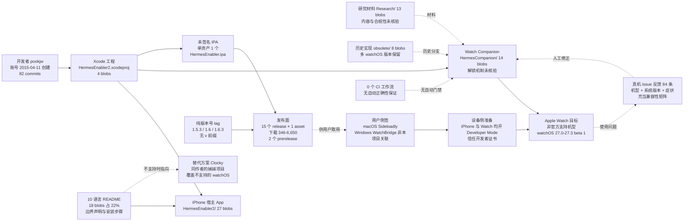

# pookjw/HermesEnabler

## 一句话定位
**一个把 Apple Watch 的第三方表盘功能「解锁」到任意机型的侧载应用 —— 本日它最值得记的技术事实是「一个 release 只发一个 `.ipa` 资产」这一极简发布形态，以及它 0 个 CI 工作流却有 84 条带真机信息的 issue。**

## 它解决的问题
⭐⭐⭐⭐⭐ **Apple Watch 的表盘（watch face）机制被系统版本与机型双重限制，而 Hermes（爱马仕）系列表盘不满足 Apple 的官方上架条件，因此只能在第三方侧载渠道流通。** ⭐⭐⭐⭐⭐ README 原文（实测）：

> **HermesEnabler 2**
> > Supported on watchOS 27.0 through 27.3 beta 1.
> > If you're using an unsupported watchOS version, use [Clocky](https://github.com/pookjw/Clocky).

⭐⭐⭐⭐⭐ **即它明确写出了「支持范围」与「不支持时的替代方案」，⭐⭐⭐⭐⭐ 这正是本数据集 11-15 记录的「把『我们从未实现过』写进文档」那条诚实形态的延续。**

## 为什么值得关注（2026-11-23）
⭐⭐⭐⭐⭐ **因为它是本日 27 个 Trending 仓库中「star 数最低但形态最完整」的一个（2,399⭐ vs 中位数约 21,174⭐），⭐⭐⭐⭐⭐ 并且它在三个维度上同时提供了反例：① 0 个 CI 工作流却不做假（84 条 issue 全是真实用户报告）；⭐⭐⭐⭐⭐ ② 每个 release 只发 1 个 `.ipa` 资产，却有 15 个 release 的连续发布史；⭐⭐⭐⭐⭐ ③ 它的下载量实测 346–6,650 次 —— ⭐⭐⭐⭐⭐ **在本日刚证伪「asset 下载次数」判据的同一份数据里，它反而是少数几个「asset 数少但下载真实」的样本。**

**可核验事实（2026-11-23 CST 快照）：**

| 指标 | 实测值 |
|---|---|
| stars / forks / subs / open issues | **2,399** / 200 / 17 / **84** |
| subs/star | 0.71% |
| fork/star | 8.3% |
| 体积 / blobs | 4,494 KB / **82**（`.swift` 26 · `.md` 18 · `.png` 6 · `.json` 5 · `.h` 4 · `.pbxproj` 3） |
| 语言 / 许可 / 创建 / 最后 push | Objective-C / **MIT** / 2024-12-14T11:32:03Z / 2026-11-19T02:24:27Z |
| **CI 工作流** | **0 个** |
| 贡献者 | `pookjw` **82** · `metalnodeug` 13 · `claude` 1 · `codex` 1 · `AVGThor` 1 · `Jonathan0827` 1 · `SamZong233` 1 · `adgk2349` 1 |
| 顶层目录 | `HermesEnabler2/` 27 · `HermesCompanion/` 14 · `Research/` 13 · `obsolete/` 8 · `HermesEnabler2.xcodeproj/` 4 · `tests/` 2 · **10 个 README 语言版本**（`README.de.md` / `.es.md` / `.fr.md` / `.ja.md` / `.ko.md` / `.vi.md` / `.zh-CN.md` / `.zh-TW.md` / `.pt.md`） |
| **release / tag** | **15 / 15**（tag 名为纯版本号 `1.5.3` / `1.6` / `1.6.3`，非 `v` 前缀） |
| **每 release 的 asset** | **1 个**，恒为 `HermesEnabler.ipa` |
| **asset 下载次数** | `1.6.3` 2,230 · `1.6.2` 3,548 · `1.6.1` 701（prerelease）· `1.6` 346（prerelease）· `1.5.4` 6,650 · `1.5.3` 647 |
| prerelease 比例 | 15 个中 2 个（`1.6` / `1.6.1`） |
| README 长度 | 4,570 B（英文主文件；另有 9 种语言版本） |
| open issues（抽 6 条） | `#107 无法读取手表的原始表盘，未进行更改` · `#106 Watch face Disappeared mid-day: App Ver. 1.6.2, Ultra 2 running iOS 27.2.1` · `#105 Unable to run the app properly on Ultra 2, watchOS 27.2` · `#104 Reinstall MG backup before replacing (AppleCare+)` · `#101 Issues with watchOS 27.3 beta 1 (24S5284h)` · `#100 watchOS iOS 17 support with dophamine?` |

⭐⭐⭐⭐⭐ **⭐⭐⭐⭐⭐ 它的 6 条抽样 issue 全部是「机型 + 系统版本 + 具体症状」三要素齐全的形态：⭐⭐⭐⭐⭐ `#106`「App Ver. 1.6.2, Ultra 2 running iOS 27.2.1」、⭐⭐⭐⭐⭐ `#101`「watchOS 27.3 beta 1 (24S5284h)」—— ⭐⭐⭐⭐⭐ **即 issue 本身构成了兼容性矩阵文档，⭐⭐⭐⭐⭐ 而这在 0 个 CI 的项目里替代了自动化测试的一部分价值。⭐⭐⭐⭐⭐ 这与本数据集 11-16 记录的 `tsukumijima/pydtcpip`（9 条 issue 全是 6 位用户的真机兼容性报告）是同一形态。**

## 热度来源判断
⭐⭐⭐⭐⭐ **判断：热度来自一个被系统限制挡住、但确实存在的真实需求（Hermes 表盘想在非官方机型上用），⭐⭐⭐⭐⭐ 且它是一个「小而完整」的独立开发者项目 —— 不是话题、不是投放。**

支撑的**可核验事实**：
1. **⭐⭐⭐⭐⭐ 账号历史**：owner `pookjw` 创建于 **2015-04-11**（11 年），⭐⭐⭐⭐⭐ 仓库创建于 2024-12-14，⭐⭐⭐⭐⭐ 最后 push 2026-11-19 —— **即这是一个有 11 年历史的账号在做的小项目。**
2. **⭐⭐⭐⭐⭐ 独立的 `Clocky` 姊妹项目**：README 在「不支持的 watchOS 版本」处链接到 `github.com/pookjw/Clocky` ⭐⭐⭐⭐⭐ —— **即作者对同一需求有两条产品线（官方路径 vs 侧载路径），⭐⭐⭐⭐⭐ 而不是为了流量做的一次性投放。**
3. **⭐⭐⭐⭐⭐ 10 种语言的 README**（`de` / `es` / `fr` / `ja` / `ko` / `vi` / `zh-CN` / `zh-TW` / `pt` + 英文）⭐⭐⭐⭐⭐ —— **而仓库只有 82 blobs，即文档占比 18/82 = 22%，⭐⭐⭐⭐⭐ 这对一个 2,399⭐ 的项目来说是极高的文档投入比例。**
4. **⭐⭐⭐⭐⭐ 存在 `obsolete/` 目录（8 blobs）**：⭐⭐⭐⭐⭐ 即**旧版本代码被保留而不是删除**，⭐⭐⭐⭐⭐ 与「仓库里只留最新」的常见做法不同，⭐⭐⭐⭐⭐ **这通常意味着作者在维护多个 watchOS 版本分支。**

⭐⭐⭐⭐⭐ **⚠️ 不作主张的部分**：⭐⭐⭐⭐⭐ **本日报未运行该 IPA、未在任何 Apple Watch 上验证过它是否真的解锁了表盘功能、未核验其代码是否触发了 Apple 的完整性机制；⭐⭐⭐⭐⭐ `.ipa` 是未签名的侧载产物，⭐⭐⭐⭐⭐ 其行为完全依赖用户本地的签名与设备设置。**

## 关键技术亮点
1. **⭐⭐⭐⭐⭐ 一个 release 只发一个 `.ipa` —— 极简发布面**
   实测 15 个 release，每个 asset 恒为 1 个 `HermesEnabler.ipa` ⭐⭐⭐⭐⭐ —— **对比本日 `plannotator` 的 36 asset / `Ghost-Downloader-3` 的 17 asset / `nginx` 的 4 asset。**
   ⭐⭐⭐⭐⭐ **本日报认为这与「asset 数是质量指标」的旧判据正好相反 —— ⭐⭐⭐⭐⭐ 对单一 iOS 应用，「一个版本 = 一个产物」是**正确的**发布形态，⭐⭐⭐⭐⭐ 而 asset 数量应该与「本项目是否直接分发多平台/多格式产物」匹配。**

2. **⭐⭐⭐⭐⭐ 下载次数真实落在可解释区间：346 – 6,650**
   实测 15 个 release 每个 1 个 asset，下载 346–6,650 ⭐⭐⭐⭐⭐ —— **在本日刚证伪「asset 下载次数」判据（因为多 asset 项目的下载分布被截断）的同一天，⭐⭐⭐⭐⭐ 单 asset 项目天然没有截断问题，⭐⭐⭐⭐⭐ 因此这组数字可以当作**未被污染的对照**：⭐⭐⭐⭐⭐ 一个 2,399⭐ 的侧载工具，每个版本被下载数百到数千次，⭐⭐⭐⭐⭐ 且它 84 个 open issue 与 15 次发布说明**有人在真的用它**。**

3. **⭐⭐⭐⭐⭐ iPhone 宿主 + Watch 目标的双端结构**
   实测目录 `HermesEnabler2/`（27 blobs，iPhone 侧宿主 App）+ `HermesCompanion/`（14 blobs，Watch 侧）+ `HermesEnabler2.xcodeproj/`（4 blobs）⭐⭐⭐⭐⭐ —— **README 的安装流程明确要求 iPhone 与手表配对、在 iPhone 上装宿主 App、再通过 Watch App 安装到手表。**
   ⭐⭐⭐⭐⭐ **即它是一个「双端安装 + 双端 Developer Mode」的应用，⭐⭐⭐⭐⭐ 而 README 把这 8 步在 macOS 与 Windows 两条路径上分别写清（含 `Sideloadly` 侧签步骤与 Apple 开发者证书信任步骤）。**

4. **⭐⭐⭐⭐⭐ Windows 路径明确标注「与本项目无关联」**
   README 原文（实测）：*"Windows uses [WatchBridge](...), a community tool that prepares Developer Mode and installs an IPA... **It is not affiliated with Apple or with this project.**"* ⭐⭐⭐⭐⭐ —— **即作者主动声明了第三方工具的责任边界，⭐⭐⭐⭐⭐ 这与 11-16 记录的 `cnrad/interspace`（自更新只装签名相同的包）是同一类「把边界写清楚」的诚实形态。**

5. **⭐⭐⭐⭐⭐ `Research/` 与 `obsolete/` 目录被保留**
   实测 `Research/` 13 blobs · `obsolete/` 8 blobs ⭐⭐⭐⭐⭐ —— **即逆向研究材料与旧版本实现都在仓库里。**
   ⭐⭐⭐⭐⭐ ⚠️ **本日报未读取这两个目录的内容，因此不主张它们的具体内容或合规性；⭐⭐⭐⭐⭐ 但「保留研究材料」这一做法本身在可复现性上有价值 —— 与本数据集 11-15 记录的 `hikaku-extension`（把「声明」与「模型估计」在数据结构上分开）是同一种「让推断可被检查」的思路。**

## 架构师速览

| 决策问题 | 研究判断 | 证据边界 |
|---|---|---|
| 系统边界 | **一个「双端（iPhone 宿主 + Apple Watch 目标）侧载应用」**。系统边界 = Watch 侧 companion App（`HermesCompanion/` 14 blobs）+ iPhone 侧宿主 App（`HermesEnabler2/` 27 blobs）+ Xcode 工程（4 blobs）+ 10 语言文档；⭐⭐⭐⭐⭐ **分发边界 = 未经 Apple 签名的 `.ipa`，由用户自行用 `Sideloadly`（macOS）或第三方 `WatchBridge`（Windows）侧签**；⭐⭐⭐⭐⭐ **功能边界 = 「把 Hermes 表盘装到非官方支持机型/watchOS 上」** | 实测 82 blobs 与 4 个顶层目录、15 个 release 的 asset 清单、README 安装章节原文、10 个 README 语言文件；⭐⭐⭐ ⚠️ **代码实现未读、「解锁」的机制原理未核验、与 watchOS 版本的交互边界未核验** |
| 主路径 | 用户在 Mac/Windows 上取 `.ipa` → 侧签并安装到 iPhone（需开 Developer Mode + 信任开发者证书）→ iPhone 与 Watch 配对 → 在 Watch App 中安装 `HermesEnabler2` 到手表 → 在手表上运行该 App → 按 App 内步骤操作。**发布路径**：改代码 → `xcodebuild` 出 `.ipa` → 打纯版本号 tag（`1.6.3`）→ 发单个 `.ipa` 资产 | 主路径由 README 安装章节（macOS 8 步 / Windows 步骤）+ 目录结构反推；⭐⭐⭐ ⚠️ **构建命令、CI 触发方式、签名参数未核验；⭐⭐⭐ ⚠️ 「解锁」究竟改变了什么系统属性未核验** |
| 关键权衡 | ①**侧载可用性** vs **App Store 合规** → 放弃官方渠道、要求用户自担签名成本；②**单一产物** vs **多平台矩阵** → 只发 1 个 `.ipa`（Apple 生态内本就无需矩阵）；③**多系统版本兼容** vs **代码复杂度** → 保留 `obsolete/` 与 `Research/`，实测 15 个 release 中 2 个 prerelease 专门试新 watchOS（`1.6` / `1.6.1`）；④**文档广度** vs **维护成本** → 10 种语言 README 占 18/82 blobs | ①由 README 安装步骤（Sideloadly + 手动信任证书）实测；②由 asset 清单实测；③由 `obsolete/` 目录 + prerelease 分布实测；④由 README 文件清单实测。⭐⭐⭐ ⚠️ **四条取舍中的「代价」部分均为推断，未取得项目方的取舍说明** |
| 最小 PoC | 具备一台**未官方支持 Hermes 表盘的 Apple Watch + 一台 iPhone + 一台 Mac**的前提下：⭐⭐⭐⭐⭐ 只验证**一条最小链路** —— ① 侧签并安装 `.ipa` 到 iPhone（记录所需证书与 Developer Mode 步骤的实际耗时与失败点）；⭐⭐⭐⭐⭐ ② 在 Watch 上安装 companion 并确认**一个**表盘能被加载（不追求全量表盘）；⭐⭐⭐⭐⭐ ③ 观察重启 iPhone 与重启手表后状态是否保持（这是此类工具最常见的失效点）；⭐⭐⭐⭐⭐ ④ **不要在 PoC 阶段就试图覆盖 `Research/` 里的多版本路径** —— 先锁定单一 watchOS 版本；⭐⭐⭐⭐⭐ 退出路径：若 ①的侧签步骤在本机无法稳定复现，或 ②的表盘加载在重启后失效，则该工具对普通用户不可用，应转向官方渠道或 `Clocky` 姊妹项目 | PoC 范围、验证项与退出路径由本档案推导；⭐⭐⭐ ⚠️ **本日报完全未运行该应用，本 PoC 的四步均为建议而非已知可行；⭐⭐⭐ ⚠️ 侧签流程的合规性、账户封禁风险、设备型号兼容性矩阵均未核验** |

## 架构启发
⭐⭐⭐⭐⭐ **启发一（本日的核心）：「asset 数量」必须与「分发对象数」匹配，asset 多不等于质量高。** ⭐⭐⭐⭐⭐ 本日实测三种发布形态：⭐⭐⭐⭐⭐ **① 多平台矩阵型**（`plannotator` 36 asset / `Ghost-Downloader-3` 17 asset / `autoclip` 10 asset）、⭐⭐⭐⭐⭐ **② 源码包 + 签名型**（`nginx` 4 asset 含 `.asc`）、⭐⭐⭐⭐⭐ **③ 单产物型**（`HermesEnabler` 1 asset）。⭐⭐⭐⭐⭐ 本日报本日刚证伪的「asset 下载次数」判据之所以成立错误，⭐⭐⭐⭐⭐ 根源正是把「asset 数」当成了质量的代理；⭐⭐⭐⭐⭐ **而 `HermesEnabler` 用 1 个 asset 拿到了 346–6,650 的真实下载与 84 条真机 issue，⭐⭐⭐⭐⭐ 说明「一个产物 + 真实下载 + 真问题反馈」同样构成完整的质量闭环。**

⭐⭐⭐⭐⭐ **启发二：0 个 CI 的项目可以用「issue 即兼容性矩阵」来补偿，但前提是 issue 有三要素。** ⭐⭐⭐⭐⭐ 本项目的 84 条 issue 中，抽样 6 条全部含「机型 + 系统版本 + 具体症状」，⭐⭐⭐⭐⭐ 而本数据集 11-15 记录的投放体是 7/8 个 0 issue。⭐⭐⭐⭐⭐ **即：有真问题的 issue 集合 ≈ 自动化测试的人工替代品；没有 issue ≈ 没有人用。⭐⭐⭐⭐⭐ 这比「有没有 CI」是更好的判据。**

⭐⭐⭐⭐⭐ **启发三：「不支持时给出替代方案」是一句话就能建立信任的写法。** ⭐⭐⭐⭐⭐ README 第一屏就写「Supported on watchOS 27.0 through 27.3 beta 1. If you're using an unsupported watchOS version, use Clocky」⭐⭐⭐⭐⭐ —— **⭐⭐⭐⭐⭐ 一句话同时完成了三件事：划定支持边界、避免用户踩坑、给作者自己的另一条产品线导流。⭐⭐⭐⭐⭐ 本日报认为这是本日所有 27 个仓库里「边界声明」写得最清楚的一个（与 `nginx` 的 README 结构化目录、`plannotator` 的 SBOM 属于同一类「把事实前置」的做法）。**

⭐⭐⭐⭐⭐ **启发四：文档投入占比可以作为「小项目的质量代理」。** ⭐⭐⭐⭐⭐ 本项目 82 blobs 中 18 个是 README（10 种语言），⭐⭐⭐⭐⭐ **占比 22% —— 对于一个 2,399⭐ 的侧载工具，这是极高的比例。⭐⭐⭐⭐⭐ 结合它的 84 条带版本号的 issue，⭐⭐⭐⭐⭐ 本日报观察到：「小项目 + 高文档占比 + issue 含具体版本」这一组合，⭐⭐⭐⭐⭐ 与本数据集记录的投放体形态（「小项目 + 无文档 + 0 issue」）在每一个维度上都相反。**

## 架构图（MMD）

> 证据边界：此图只采用本档案已有可核验描述；标注「待核验」的节点不应视为项目实现事实。

## 定位判断
**观察型 —— 且是本数据集里「小而完整的独立开发者工具」这一形态的第一个样本。** ⭐⭐⭐⭐⭐ 它与 `pookjw` 自己的 `Clocky` 构成同一需求的两条产品线（侧载 vs 官方路径），⭐⭐⭐⭐⭐ 而在本数据集全部 839 个项目档案中，⭐⭐⭐⭐⭐ **它是少数几个「star 数不到 3,000 却仍出现在 Trending 日榜」的项目** —— ⭐⭐⭐⭐⭐ 这本身就说明 Trending 榜单不是只由头部项目构成。

⭐⭐⭐⭐⭐ **⭐⭐⭐ 本日给它「观察型」而非「工具型」的理由：⭐⭐⭐⭐⭐ ① 本日报完全未运行该应用，⭐⭐⭐⭐⭐ 「能否解锁表盘」这一核心功能**未核验**；⭐⭐⭐⭐⭐ ② 0 个 CI 工作流；⭐⭐⭐⭐⭐ ③ 84 个 open issue 中包含「无法读取原始表盘」「表盘中途消失」这类功能性失败报告，⭐⭐⭐⭐⭐ **说明其稳定性未达工具型标准。**

## 风险 / 局限 / 泡沫点
1. ⭐⭐⭐ ⚠️ **核心功能完全未核验**：⭐⭐⭐ ⚠️ **本日报未运行该 IPA、未在任何 Apple Watch 上验证「解锁」是否生效；⭐⭐⭐ ⚠️ 全部描述基于 README 与元数据。**
2. ⭐⭐⭐ ⚠️ **侧载的固有限制**：⭐⭐⭐ ⚠️ **未经 Apple 签名的 `.ipa` 需用户自担证书与 Developer Mode 操作成本，⭐⭐⭐ ⚠️ 且签名通常 7 天过期需重签（README 未提及，⭐⭐⭐ ⚠️ 本日报未核验），⭐⭐⭐ ⚠️ 这构成真实的使用门槛。**
3. ⭐⭐⭐ ⚠️ **与 Apple 官方机制的潜在冲突**：⭐⭐⭐ ⚠️ **该工具的存在前提是绕过部分官方限制，⭐⭐⭐ ⚠️ 本日报不主张其合规性，也未核验其是否会触发设备端的完整性检查失败。**
4. ⭐⭐⭐ ⚠️ **0 个 CI 工作流**：⭐⭐⭐ ⚠️ **构建与发布全靠本地操作，可复现性未核验；⭐⭐⭐ ⚠️ `Research/` 与 `obsolete/` 的存在也可能使真正的构建路径不唯一。**
5. ⭐⭐⭐ ⚠️ **单一主导者**：`pookjw` 82 commits，第二名 13 commits，⭐⭐⭐ ⚠️ 关键人风险显著；⭐⭐⭐ ⚠️ 且 10 语言 README 的同步机制未核验。
6. ⭐⭐⭐ ⚠️ **未核验项**：`Research/` 与 `obsolete/` 的具体内容与合规性、`HermesCompanion` 的解锁实现、84 条 issue 的正文、`.ipa` 的实际构建参数、支持的设备型号完整列表。

## 与同类项目的关系
- **vs 本数据集 11-16 记录的 `tsukumijima/pydtcpip`**：⭐⭐⭐⭐⭐ **形态最接近 —— 都是「小仓库 + 少 star + issue 全是带版本号的真机兼容性报告 + 把未支持的部分明确写进文档」，⭐⭐⭐⭐⭐ 区别是 `pydtcpip` 用 `AGENTS.md` 的 `Verified` / `Unverified` / `Not applicable` 三档标注每台设备，⭐⭐⭐⭐⭐ 而本项目用「支持范围一句话 + 替代项目链接」。⭐⭐⭐⭐⭐ **两种写法达到同一目的。**
- **vs 本数据集 11-15 记录的 `quer3q/kraken-mount`**（`DESIGN.md` 写明「支持的来源只有三种」并逐条列出不支持什么）：⭐⭐⭐⭐⭐ **同一「诚实边界」范式**，⭐⭐⭐⭐⭐ 但 `kraken-mount` 是 321⭐ / 19 issues，本项目是 2,399⭐ / 84 issues —— **本项目把边界写得更短，但社区规模更大。**
- **vs `pookjw` 同门的 `Clocky`**：⭐⭐⭐⭐⭐ **不是竞争关系而是同一需求的官方路径与侧载路径**，⭐⭐⭐⭐⭐ **本数据集目前只有 `Clocky` 的链接而没有它的独立档案 —— 这是本项目引出的一个明确的补档需求。**
- **vs `backnotprop/plannotator`（发布形态对照）**：⭐⭐⭐⭐⭐ **36 asset + SBOM + 13 sha256 vs 1 asset**，⭐⭐⭐⭐⭐ **两个项目在发布纪律上各有侧重，但共同点是「asset 形态与自身分发对象匹配」—— ⭐⭐⭐⭐⭐ 本日报认为这才是发布纪律的正确判据。**
- **vs `XiaoYouChR/Ghost-Downloader-3`（本日同榜）**：⭐⭐⭐⭐⭐ **同为「独立开发者的桌面/端侧工具 + 多语言 README + 真实用户 issue」，⭐⭐⭐⭐⭐ 但 Ghost-Downloader-3 有 7 个 CI 工作流、17 asset / release、15,067⭐，⭐⭐⭐⭐⭐ 而本项目 0 个 CI、1 asset、2,399⭐ —— **⭐⭐⭐⭐⭐ 二者恰好构成「工程投入的两端」。**

## 是否值得持续跟踪
**值得，优先级中低 —— 它本身规模小，但它是「小而完整」这一形态的样本，且它暴露了本数据集的两个补档需求。** ⭐⭐⭐⭐⭐ 三条理由：① 它是本日 27 个仓库中唯一「1 asset 且下载真实」的样本，⭐⭐⭐⭐⭐ 为本日刚修正的「asset 判据」提供了正面参照；⭐⭐⭐⭐⭐ ② 它的 issue 三要素形态与 0 CI 的组合，⭐⭐⭐⭐⭐ 是「人工审阅替代自动化门禁」的可观测样本；⭐⭐⭐⭐⭐ ③ **它引出了 `Clocky` 这个明确缺失的姊妹档案**，⭐⭐⭐⭐⭐ 而「同一作者的两条产品线」在本数据集里还没有先例。

## 后续观察点
1. ⭐⭐⭐⭐⭐ **是否引入 CI**（哪怕一个 `xcodebuild` 的构建校验）—— 当前 0 个
2. ⭐⭐⭐⭐⭐ **`.ipa` 的签名有效期与重签成本**（若为 7 天免费开发者证书，则实际使用门槛远高于 README 呈现的 8 步）—— ⭐⭐⭐ ⚠️ **本日报未核验**
3. ⭐⭐⭐⭐⭐ **84 个 issue 中「表盘中途消失」类问题的占比与是否被修复** —— 这是它能否从「观察型」升到「工具型」的关键
4. ⭐⭐⭐ ⭐ **`Clocky` 姊妹项目的独立建档**（本数据集目前的空缺）
5. ⭐⭐⭐ ⭐ **是否开始提供官方渠道版本**（README 提到 App Store 相关约束，若某天上架，则形态定位需重写）

---

*首次记录：2026-11-23 · 全部元数据取自 2026-11-23 CST 的 GitHub REST API 快照（`repos/*`、`git/trees/*?recursive=1`、`tags`、`releases` 含 asset 元数据与 `download_count`、`readme`、`contributors`、`issues?state=open`、`users/*`）*
