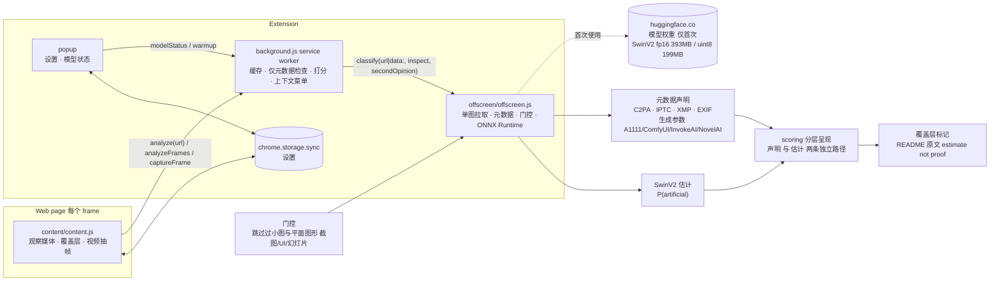

# hikaku-io/hikaku-extension

## 一句话定位
**一个在浏览器本地标记 AI 生成图像与视频的 Manifest V3 扩展** —— 它的独特之处不是「本地跑模型」，而是**把模型的真实失败率直接写进产品文档，并把「元数据声明」与「模型估计」在数据结构上分成两条独立路径**，而不是合并成一个混合分数。

## 它解决的问题
**浏览网页时，用户无法判断一张图/一段视频是不是 AI 生成的。** ⭐⭐⭐⭐⭐ 现有的两条路各有明显缺陷：

- **在线检测服务**：图片要上传，隐私不保；且服务方通常不公开自己的准确率；
- **纯元数据检查（C2PA / EXIF）**：⭐⭐⭐⭐⭐ 实测在真实分发平台上**几乎无效** —— 本项目在 `docs/MODELS.md` 里记录：「**Provenance metadata survived on 0 of 548 Reddit images.**」⭐⭐⭐⭐⭐ 换言之，现实世界的图片基本都已经丢掉了溯源元数据。

⭐⭐⭐⭐⭐ Hikaku 的答案是在**设备本地**同时做三件事：解析残留的溯源元数据（C2PA / IPTC / XMP / EXIF）、读取嵌入式生成参数（Automatic1111 / ComfyUI / InvokeAI / NovelAI）、以及用视觉模型做整体分类。

## 为什么值得关注（2026-11-15）
⭐⭐⭐⭐⭐ **因为它把「我的模型有多准」这个通常被回避的问题，做成了一份可核验、可复现、且自带降级声明的公开文档。**

⭐⭐⭐⭐⭐ **可核验事实一：它公开了真实的、不好看的准确率。**

`docs/MODELS.md` 的 Evaluation 段：

| Threshold | AI caught | Real wrongly flagged |
|---|---:|---:|
| 0.50 | 94% | 6% |
| 0.90 | 88% | 6% |

⭐⭐⭐⭐⭐ 并且紧接着加了一句降级声明：**`Sanity check, not a benchmark.`** —— 主动给自己的数字降级。

⭐⭐⭐⭐⭐ 更有价值的是真实世界那一组：

> Real-world (Reddit via soci.ly, 548 images + 53 videos/GIFs, weak labels, from hikaku-bench): **65% of AI images caught, 6% of real photos flagged (2.5% excluding film), AI video 22% caught.**

⭐⭐⭐⭐⭐ **注意「AI video 22% caught」这个数字** —— ⭐⭐⭐⭐⭐ 一个检测 AI 图像的扩展，在视频上只有 22% 的召回率，而它把这个数字原样写在了 README 第一屏的架构链接旁边。⭐⭐⭐⭐⭐ 这在本数据集里非常罕见。

⭐⭐⭐⭐⭐ **可核验事实二：它把「声明」与「估计」做成了两条独立路径。**
`docs/ARCHITECTURE.md` 的 Mermaid 检测管线图里，`metadata declarations` 与 `SwinV2 estimate` 是两个独立节点，最后汇入同一个 scoring 层；文档同时写明「Evidence weights rank metadata signals; **they are not confidence probabilities**」与「Repeated EXIF/XMP/C2PA claims use the strongest declaration, **not noisy-OR**」。

⭐⭐⭐⭐⭐ **可核验事实三：README 第一屏就声明「标记不是证据」。**
图片说明文字原文：「a flag is the model's **estimate, not proof**」。

⭐⭐⭐⭐⭐ **可核验事实四：它有独立的基准仓库与发布工程。**
`hikaku-bench` 作为独立仓库存在；本仓库有 `.github/workflows/ci.yml` / `e2e.yml` / `release.yml` 三个工作流、`.github/ISSUE_TEMPLATE/` 三个模板（含 `detection_report.yml`）、`CHANGELOG.md` / `CONTRIBUTING.md` / `CODE_OF_CONDUCT.md` / `PRIVACY.md` / `SECURITY.md` / `NOTICE` 六个治理文件，以及 `docs/ARCHITECTURE.md` / `docs/MODELS.md` / `docs/RELEASING.md` 三份工程文档与 `docs/hikaku-demo.mp4`。

⭐⭐⭐⭐⭐ **可核验事实五：模型与权重来源被完整披露。**

| 项 | 值 |
|---|---|
| 上游模型 | `haywoodsloan/ai-image-detector-deploy`（SwinV2-base） |
| ONNX 导出 | `SoldadoXara/ai-image-detector-deploy-ONNX` @ `0df8696b5db0ab5bd72baeab571fec55d65128e7` |
| 许可 | Apache-2.0 |
| 变体 | `fp16`（393 MB，WebGPU 需 `shader-f16`）/ `uint8`（199 MB，WASM） |
| 输入 | 256×256 RGB，拉伸（不裁剪），ImageNet mean/std，透明→白 |
| 输出 | softmax over `[artificial, real]`，取 P(artificial) |

⭐⭐⭐⭐⭐ **把 ONNX 导出的 commit hash 写进文档**，是本数据集里少见的供应链写法。

⭐⭐⭐⭐⭐ **可核验事实六：性能数字也给了。**
「~70–200 ms per image with fp16 on WebGPU (**software adapter in headless Chrome**); ~0.5–1 s with uint8 on WASM」—— ⭐⭐⭐⭐⭐ **主动标注了「软件适配器」这个测量条件**，这与 11-13 记录的 `open-orange`（「4.8× cheaper」无任何测量条件）形成对照。

## 热度来源判断
⭐⭐⭐⭐⭐ **真实需求驱动，但当前热度包含明显的「新仓库尝鲜」成分。**

支持「真实」的一面：283⭐ / ⑂1 / subs 0 / oi 0，⭐⭐⭐⭐⭐ **fork/star 仅 0.35%** —— 与本数据集记录的多个投放体（1.8%–146.2%）相比极低；仓库 87 个文件、12.3 MB、含 393 MB / 199 MB 两种模型变体的分发逻辑与 `docs/RELEASING.md`；10 个提交里有「Release 0.1.0」「Build real zip files on Linux」「Improve detection checks and add optional second opinions」「Docs: real-world screenshot, release and capture tooling」等**具体的工程动作**。

⭐⭐⭐⭐⭐ 支持「含尝鲜成分」的一面：仓库创建仅约 8 小时，⭐⭐⭐⭐⭐ **owner 账号 `hikaku-io` 创建于 2026-11-14T01:53:26Z，与仓库创建（14:06:05Z）相差约 12 小时，且只有 2 个公开仓库、5 followers**。⭐⭐⭐⭐⭐ 按 11-12 记录 `Kianuni/Erosion-CN` 的反例判据（「账号当天新建」在本数据集已给出错误结论，账号信号只能作辅证不能定性），⭐⭐⭐⭐⭐ **本样本的账号特征不足以定性，也不构成疑点 —— 真项目的账号可以是新的**。⭐⭐⭐⭐⭐ **本日报不下结论；star 增速未做统计。**

## 关键技术亮点
1. **四上下文分工的 Manifest V3 架构**：content script（观察媒体、覆盖层、视频抽帧）/ service worker（缓存、纯元数据检查、打分、上下文菜单）/ offscreen document（单图拉取、元数据、门控、ONNX Runtime）/ popup（设置、模型状态），⭐⭐⭐⭐⭐ 且 Firefox 用 background page 替代 offscreen。
2. **WebGPU 优先、WASM 兜底**：fp16（393 MB）走 WebGPU，uint8（199 MB）走 WASM；⭐⭐⭐⭐⭐ `manifest.json` 声明 `cross_origin_embedder_policy: require-corp` + `cross_origin_opener_policy: same-origin` —— **这是 WebGPU 共享内存的必要条件，等于把「模型能跑」这件事写进了浏览器安全策略**。
3. **先门控再推理**：先读元数据声明、跳过过小图像与平面图形（截图/UI/幻灯片），再加载模型 —— ⭐⭐⭐⭐⭐ 这既省算力，也直接针对 `docs/MODELS.md` 里列出的「Known failure modes」（截图、聊天截图、UI、幻灯片）。
4. **视频/GIF 抽帧取中位数**：3 帧 / 中位数分数，避免单帧误判。
5. **可选的「第二意见」**：详情面板里可显式请求 `Community Forensics estimate`，⭐⭐⭐⭐⭐ **即把「要一个更强的模型」做成用户的主动选择，而不是默认拉高成本**。
6. **完全本地**：图片字节只在内存中流转，不落盘。

## 架构师速览

| 决策问题 | 研究判断 | 证据边界 |
|---|---|---|
| 系统边界 | 浏览器扩展（Chrome/Edge 116+、Firefox 140+）内的「媒体 → 判定」闭环；边界 = 页面 DOM 与扩展进程之间 | `manifest.json` 完整内容 + `docs/ARCHITECTURE.md` 的 Mermaid 图；⚠️ **本日报未安装、未运行、未在任何真实网页上验证** |
| 主路径 | content script 观察媒体 → service worker 判定（可只做元数据）→ 需要时把图交给 offscreen → ONNX Runtime 推理 → scoring 层合并「声明」与「估计」 → content script 画覆盖层 | 路径由 `docs/ARCHITECTURE.md` 的两张 Mermaid 图给出；**具体评分权重本日报未逐项核对**（文档明确说权重「不是置信概率」） |
| 关键权衡 | ①隐私 vs 检测率：全本地换掉云端能力；②模型体积 vs 速度：fp16 393 MB / WebGPU vs uint8 199 MB / WASM；③召回 vs 误报：0.90 阈值下 88% 召回配 6% 误报；④单一分数 vs 分层呈现：**选择分层而非合并** | 权衡的**存在**由文档与配置证实；**每个取舍的实际代价本日报未实测**（未测延迟、未测内存、未测误报） |
| 最小 PoC | 装扩展 → 打开一个含 AI 生成图的公开页面 → 悬停看 summary → 点开详情确认「声明」与「估计」两栏是否分别呈现 → 读 `docs/MODELS.md` 的 548 张基准 → 用 `npm run eval-model -- --n=16` 跑本地 sanity check | PoC 范围由本档案的取证路径推导；**具体命令本日报未执行**（需 clone + 393 MB 模型下载） |

## 架构启发
⭐⭐⭐⭐⭐ **最值得抄的一条：当你要输出「模型判断」时，不要输出一个混合分数，把它拆成「事实声明」与「模型估计」两条可分别查看的路径。** ⭐⭐⭐⭐⭐ 这与 11-11 记录的 `solana-vigil`（观测失败 → `unknown`，绝不伪造健康值）是同一条原则的不同实现：⭐⭐⭐⭐⭐ **都不让「不确定性」消失在一个数字里。**

⭐⭐⭐⭐⭐ 第二条：**把「我的方法有多准」写进产品文档，并把弱标签、样本量、测量条件一并写上。** ⭐⭐⭐⭐⭐ 「weak labels」「software adapter in headless Chrome」「Sanity check, not a benchmark」这三处限定语，比任何「95% accuracy」都更有信息量。

⭐⭐⭐⭐⭐ 第三条：**把「模型权重从哪来、哪个 commit、什么许可」写进文档。** ⭐⭐⭐⭐⭐ 一个 ONNX 导出 hash 就把整条供应链钉住了。

## 架构图（MMD）

> 证据边界：此图的结构取自 `docs/ARCHITECTURE.md` 自带的 Mermaid 图与 `manifest.json`；「待核验」为本日报未能独立验证的部分。

## 定位判断
**工具型项目，工程质量在本数据集的「真项目」分组里属上游。** ⭐⭐⭐⭐⭐ 它的定位特别之处在于：**它没有假装自己是检测器，而是把自己定位成「证据呈现器」** —— 一个标了 flag 但同时告诉你「模型说 88%、弱标签基准、6% 误报率」的工具，比一个只给「AI 生成」红标的工具有用得多。

## 风险/局限/泡沫点
- ⭐⭐⭐⭐⭐ **误报与漏报都真实存在**：6% 的真图误报率意味着在高频浏览场景中用户会频繁看到假警报；视频召回仅 22%。
- ⭐⭐⭐⭐⭐ **模型体积不小**：393 MB（fp16）/ 199 MB（uint8），首次使用需从 huggingface.co 下载 —— ⭐⭐⭐⭐⭐ 这与「完全本地、不外传」的隐私承诺构成真实张力。
- ⭐⭐⭐⭐⭐ **权限很宽**：`host_permissions: ["<all_urls>"]` + `scripting` + `offscreen` + `contextMenus` —— ⭐⭐⭐⭐⭐ 即它可以在任意页面注入脚本并抓取图片字节。⭐⭐⭐ ⚠️ **本日报未做隐私审计**，不主张其存在恶意；仅记录该权限面。
- ⭐⭐⭐⭐⭐ **仓库仅 8 小时、v0.1.0**：`docs/MODELS.md` 的基准来自弱标签数据，且作者自己标为 sanity check。
- ⭐⭐⭐ ⚠️ **未核验项**：未安装、未运行、未复现任何准确率数字；`Community Forensics estimate` 的模型与阈值未核验；`hikaku-bench` 仓库未打开；Firefox 路径未验证。

## 与同类项目的关系
- **vs 纯 C2PA 检查器**：C2PA 是签名标准，不是检测器；⭐⭐⭐⭐⭐ 本项目实测「Reddit 548 张图上元数据存活 0 张」，正说明纯元数据路线在现实分发链上失效。
- **vs 云端 AI 检测 API**（如 Hive、Sightline 等）：⭐⭐⭐⭐⭐ 本项目把隐私做成了架构约束（图片不出设备），代价是准确率上限受本地模型限制。
- **vs 本日同窗的 `-desktop` 族 / `IPTV_Player_2.0` 族**：⭐⭐⭐⭐⭐ 三者都把「模型/载荷从哪里来」写得含糊，**而 Hikaku 把上游模型仓库、ONNX 导出 commit、许可、输入预处理、输出定义全部写了出来** —— ⭐⭐⭐⭐⭐ 这是同一批数据里最直接的正面对照。
- **vs 11-11 的 `solana-vigil`**：同样是「拒绝伪造确定值」，但 Hikaku 用分层呈现而非 `unknown` 枚举。

## 是否值得持续跟踪
**值得，且值得直接使用（配合其自陈的 6% 误报率）。** ⭐⭐⭐⭐⭐ 具体建议：
1. 对「AI 内容识别」有需求的人可以直接安装，它是本数据集里少见的存在于 Chrome 商店与 AMO 的真实产品；
2. 做 AI 检测类项目的人，**应抄它的 `docs/MODELS.md` 写法**（模型来源 + commit + 许可 + 输入输出定义 + 阈值表 + 真实基准 + 失败模式表 + 主动降级声明）；
3. 做浏览器扩展的人，可抄它的「先门控再推理」与「fp16/WASM 双变体」策略。

## 后续观察点
- `docs/MODELS.md` 的基准是否会扩展到更多平台（目前只有 Wikimedia sanity check 与 Reddit 弱标签）
- 视频召回率（22%）是否随模型升级改善，还是被明确写成「不支持视频」而只做图像
- 是否引入「签名验证」（README 写明 C2PA「signatures not yet verified」）
- `Community Forensics estimate` 这条「第二意见」路径是否公开其模型与隐私边界
- 权限面（`<all_urls>`）是否会因商店审核而收窄

---
> 数据来源: GitHub API (2026-11-15) | Stars: 283 | Forks: 1 | Subscribers: 0 | License: Apache-2.0 | 语言: JavaScript | 创建: 2026-11-14T14:06:05Z | release v0.1.0 | owner 创建: 2026-11-14T01:53:26Z
