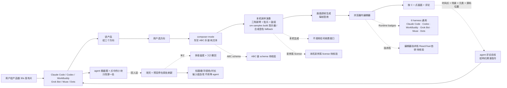

# alchaincyf/huashu-motion

## 一句话定位
alchaincyf 个人 2026-10-18 发布的「**agent 视频作曲家**」严肃工程化实现：**npx skills add + composer mode（先 ABC 乐谱 + 本机采样演奏 + 每帧音效）+ 浏览器内编辑器 + 按 C + 点画面 + 评论（时间点 + 场景 + 元素 + 源码位置）+ agent 看截图 + 只改那一处 + ⌘Z 多版留底 + 标题/数字/颜色/时长输入框自改 + 6 harness 通用 + 53 秒自发布片**——让 agent 一键直出商业级产品宣传片。

## 它解决的问题
2025-2026 agent 做视频的痛点：**(1) 框架重**：CapCut / Premiere / Final Cut Pro 等专业剪辑工具门槛高；**(2) AI 不精准**：Runway / Pika / Sora 等商用模型仅生成画面，**不精准控制**某一帧；**(3) 配乐贵**：商用配乐库（Epidemic Sound / Artlist）按月收费；**(4) 改一处要重做**：商用模型只能全片重生成，无法精准改某一帧；**(5) harness 不通用**：多数 agent 视频工具仅支持单一 Claude Code。huashu-motion 直击——**composer mode（先 ABC 乐谱 + 本机采样演奏）+ 指着画面评论 + ⌘Z 多版留底 + 6 harness 通用 + 53 秒自发布片 + MIT + 本机采样无收费依赖**——这是 2026-Q4 严肃工程化「**agent 时代产品宣传片一键化**」的代表样本。

## 为什么值得关注（2026-10-19）
今日观察窗为 GitHub Search API 抓取时刻起、且截至 2026-10-19 仍在快速增长的新发现项目。`alchaincyf/huashu-motion` 1 天 239⭐ ⑂28 fork/star 11.7%——239⭐ + 28 fork 在 1 天是异常高的「**agent + 视频创作**」信号（fork 11.7% 反映大量「**想给产品做发布片**」的真实需求）。**composer mode（先 ABC 乐谱 + 本机采样演奏 + 每帧音效）+ 指着画面评论 + ⌘Z 多版留底 + 6 harness 通用 + 53 秒自发布片**——这是 2026-Q4 严肃工程化「**agent + 视频创作大众化**」的代表样本。

## 热度来源判断
huashu-motion 的热度是「**agent 视频作曲刚需 + composer mode（先 ABC 乐谱）+ 本机采样演奏 + 指着画面评论 + ⌘Z 多版留底 + 6 harness 通用 + 53 秒自发布片**」八要素共振：
- **agent 视频作曲刚需**：商业级产品宣传片门槛高，agent 一键化是真实需求
- **composer mode（先 ABC 乐谱）**：agent 按节奏单先写一份 ABC 谱（纯文本乐谱），谱里标记对齐每个场景
- **本机采样演奏**：三角钢琴 / 弦乐 / 鼓组的采样演奏（om samples build 真乐器，不跑则用合成音色）
- **每帧音效**：画面上每个东西落地的那一帧，配一个音效
- **指着画面评论**：按 C，在画面上点一下，写下要改什么。评论带时间点 + 场景 + 元素 + 源码位置
- **agent 只改那一处**：agent 先看截图 + 点中的小块，再只改那一处
- **多版留底 + ⌘Z**：每一版都留底，可撤回
- **输入框自改**：标题/数字/颜色/停留时长变输入框，不用等 agent
- **6 harness 通用**：Claude Code / Codex / WorkBuddy / Grok Bot / Muse / Dots
- **README 全动画演示**：hero.gif + point-to-edit.gif + score-first.gif + 53 秒自发布片（MP4 带声音）
- **本机采样 + 合成音色 fallback**：不调用任何收费接口
- **Runtime badges**：Claude Code · Codex · WorkBuddy · Grok Bot · Muse · Dots

热度**真实且具产品宣传片大众化潜力**——239⭐ + 28 fork + 11.7% fork 比例 + 53 秒自发布片是真实需求信号。

## 关键技术亮点
1. **composer mode（先 ABC 乐谱）**：agent 按节奏单先写一份 ABC 谱（纯文本乐谱），谱里标记对齐每个场景
2. **本机采样演奏**：三角钢琴 / 弦乐 / 鼓组的采样演奏（om samples build 真乐器，不跑则用合成音色）
3. **每帧音效**：画面上每个东西落地的那一帧，配一个音效
4. **指着画面评论**：按 C，在画面上点一下，写下要改什么。评论带时间点 + 场景 + 元素 + 源码位置
5. **agent 只改那一处**：agent 先看截图 + 点中的小块，再只改那一处
6. **多版留底 + ⌘Z**：每一版都留底，可撤回
7. **输入框自改**：标题/数字/颜色/停留时长变输入框，不用等 agent
8. **npx skills add 一键安装**：标准 agent skills 注册
9. **6 harness 通用**：Claude Code / Codex / WorkBuddy / Grok Bot / Muse / Dots
10. **README 全动画演示**：hero.gif + point-to-edit.gif + score-first.gif + 53 秒自发布片（MP4 带声音）
11. **本机采样 + 合成音色 fallback**：不调用任何收费接口

## 架构师速览

| 决策问题 | 研究判断 | 证据边界 |
|---|---|---|
| 系统边界 | 单仓：npx skills add + 浏览器内编辑器 + 本机采样库（三角钢琴/弦乐/鼓组）+ ABC 乐谱生成器 + agent 评论总线（时间点 + 场景 + 元素 + 源码位置）+ docs/media/{hero,point-to-edit,score-first}.gif 演示 | 基于 README「看效果」+「安装」+「能做什么」+「怎么做到的」+「背后的故事」段 |
| 主路径 | user 对 agent 说「给产品做 30s 发布片」 → agent 读产品 → 给三个方向 → user 选 → agent 写 ABC 谱 → 本机采样/合成音色演奏 → 画面逐帧生成 + 每帧音效 → 浏览器内打开编辑器 → user 按 C + 点画面 + 评论 → agent 看截图 + 只改那一处 + 回人话 → ⌘Z 撤回 → 标题/数字/颜色/时长输入框自改 | 主路径由 README「看效果」+「指着画面改」+「先写谱，再拍片」+「一天二十支」段推导；具体 ABC 谱 schema / 采样播放引擎 / 浏览器编辑器技术栈（React / Vue / 自研）未在档案主页明示 |
| 关键权衡 | composer mode（先 ABC 谱 + 本机演奏）vs LLM 写脚本 + 商用配乐库 / 指着画面评论（精准改一处）vs 全片重生成 / 本机采样 + 合成音色 vs 调用商用接口（无收费依赖）/ 6 harness 通用 vs 单一 Claude Code / 53s 自发布片 + README 全动画 vs 文档 dry | 档案明示六点权衡；具体本机采样库 license 与音色库大小 + om samples build 命令细节待核验 |
| 最小 PoC | 1. npx skills add alchaincyf/huashu-motion → 2. Claude Code / Codex / WorkBuddy / Grok Bot 任选 → 3. 对 agent 说「给 [某产品] 做 30 秒发布片」 → 4. 在浏览器编辑器里按 C + 点一帧 + 评论 → 5. ⌘Z 撤回 → 6. 测 om samples build 真乐器 vs 默认合成音色音质差 | PoC 由 README「安装」+「看效果」段推导；具体编辑器源码位置 + agent 评论总线协议待核验 |

## 架构启发
huashu-motion 的核心启发是「**agent + 视频创作大众化 = composer mode + 本机采样 + 指着画面评论 + ⌘Z + 6 harness 通用 + 自发布片**」六要素。与某些「**CapCut 模板 + LLM 写脚本 + 商用配乐库 + 单一 harness + 全片重生成**」的旧方案对比，**composer mode（先 ABC 谱）+ 本机采样 + 精准改一处 + 6 harness 通用**完整一个量级。更深层的启发是：**agent 评论总线协议（时间点 + 场景 + 元素 + 源码位置）**——这是把「**人给 agent 反馈**」从「**自然语言描述**」升级到「**精准结构化指令**」的严肃工程化样本，让 agent 只改那一处而无需全片重生成。

## 架构图（MMD）

> 证据边界：此图只采用本档案已有可核验描述；"待核验"节点不应视为项目实现事实。

## 定位判断
**工具型项目（agent 视频作曲 + 商业级产品宣传片 + 6 harness 通用）。** huashu-motion 不仅是 agent 视频工具，更是「**agent 时代产品宣传片一键化的严肃工程化实现**」——把「**composer mode（先 ABC 谱）+ 本机采样 + 精准改一处 + 6 harness 通用 + 53s 自发布片**」五位一体严肃工程化交付。在生态中的位置类似「**agent 时代视频领域的 Figma**」——所见即所评，所评即所改。

## 风险 / 局限 / 泡沫点
- **40030 KB size 偏大**：含本机采样库，git clone 较慢
- **仅 hero / point-to-edit / score-first 三个 demo gif**：其他场景演示不足
- **om samples build 真乐器采样**：首次使用需下载采样库，网络受限场景体验差
- **仅 6 harness 列名**：实际 harness 兼容性矩阵未在 README 中量化
- **ABC 谱 schema 与采样播放引擎**：README 未明示具体技术栈
- **MIT license**：但本机采样库可能有独立 license（README 未明示）
- **单一作者**：alchaincyf 个人维护，长期维护可持续性待观察
- **1 天 239⭐ 早期信号**：agent + 视频创作需求真实，但商业化路径未明确

## 与同类项目的关系
- **vs CapCut / Premiere / Final Cut Pro**：传统剪辑工具 GUI + 手动拖拽 + 学习曲线高；huashu-motion agent 一键 + 指着画面评论 + ⌘Z
- **vs Runway / Pika / Sora**：商用模型闭源 + 按生成量收费 + 全片重生成；huashu-motion 开源 + 本机采样无收费依赖 + 精准改一处
- **vs Epidemic Sound / Artlist 商用配乐库**：按月收费 + 闭源；huashu-motion 本机采样（三角钢琴/弦乐/鼓组）+ ABC 谱生成
- **vs 各家 agent 视频工具**：多数仅支持 Claude Code；huashu-motion 6 harness 通用
- **vs Claude Code 其他 agent 应用**：Claude Code 之前用于反向工程（leanrea）/ TV 治理（tv-vibehack）/ 游戏（coop-anything）/ 渲染（web-ocean），huashu-motion 是**首次严肃工程化应用在视频创作**

## 是否值得持续跟踪
**值得跟踪（agent 时代产品宣传片大众化 + 严肃工程化）。** huashu-motion 是 2026-Q4 严肃工程化「**agent + 视频创作大众化**」的代表样本。**composer mode + 指着画面评论 + 6 harness 通用 + 53s 自发布片 + MIT + 本机采样无收费依赖**五件套**使产品宣传片创作大众可及**。建议关注：编辑器技术栈 + 本机采样库 license + om samples build 网络依赖 + harness 兼容性矩阵 + AI 同质化风险。

## 后续观察点
- 编辑器技术栈（React / Vue / 自研）
- 本机采样库 license 与音色库大小
- om samples build 真乐器 vs 默认合成音色音质差
- 6 harness 实际兼容性矩阵
- AI 同质化发布片风险（视觉风格库扩展）
- 商业化路径（云端采样订阅 / 自定义音色 / 团队协作）
- 与 CapCut / Runway / Sora 等竞品的 head-to-head

---
> 数据来源: GitHub API (2026-10-19) | Stars: 239 | Forks: 28 | License: MIT | 语言: JavaScript | 创建: 2026-10-18 | Size: 40030 KB | Topics: 无显式 topics | Runtime badges: Claude Code · Codex · WorkBuddy · Grok Bot · Muse · Dots