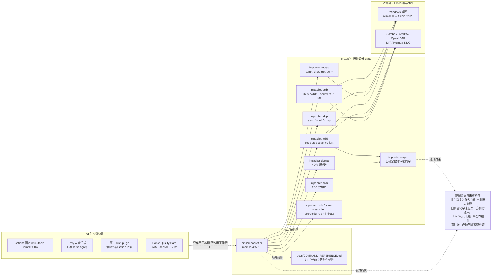

# nestho/impacket-rs

## 一句话定位
**用纯 Rust 从零重写 Impacket 的协议栈与工具集**（SMB / Kerberos / NTLM / LDAP / DCERPC / SAM 等），目标是 74 个 CLI 子命令与上游 100% 对齐，同时做到零 Python 依赖、跨平台、内存安全。

## 它解决的问题
⭐⭐⭐⭐⭐ **Impacket 是 Windows 内网的事实标准工具箱，但它是一个 Python 项目 —— 而这在真实的红队/运维场景里恰恰是它的硬约束：**

1. **⭐⭐⭐⭐⭐ 环境依赖：** Python 解释器 + 虚拟环境 + 依赖冲突（同一台机器上多个工具的依赖版本常常互斥）；
2. **⭐⭐⭐⭐⭐ 启动开销：** 在「批量编排 / 快速横向移动」场景里，每个命令的 Python 启动与模块导入时间会累积；
3. **⭐⭐⭐⭐⭐ 内存安全：** Impacket 大量使用 Python 的动态类型 + 二进制结构拼接（`impacket` 的 NDR 编解码是手工 struct 操作），**在解析不可信网络数据时，Python 的内存安全并不成立**。

⭐⭐⭐⭐⭐ **impacket-rs 的回答是：全部用 Rust 重写，产物是一个自包含的静态二进制。**

⭐⭐⭐⭐ **而它最实际的解决点是「可移植性」** —— README 明写目标平台为 Linux（glibc & 静态 musl）、macOS（Apple Silicon & Intel）、Windows，**且它同时面对 Linux/UNIX 目标（Samba、FreeIPA、OpenLDAP、MIT/Heimdal Kerberos KDC）与 Windows 域（Windows 2000 到 Windows Server 2025）**。

## 为什么值得关注（2026-11-12）

⭐⭐⭐⭐⭐ **因为它把「用另一种语言重写一个成熟工具」这件事做到了本日报记录过的最完整的一份：118 blobs 分成 13 个 crate（`impacket-smb` / `impacket-crypto` / `impacket-dcerpc` / `impacket-msrpc` / `impacket-krb5` / `impacket-ldap` / `impacket-auth` / `impacket-sam` / `impacket-mssqlclient` / `impacket-secretsdump` / `impacket-mimikatz` / `impacket-ntlm` 等），每个协议一个 crate，每个 crate 都有对应的 `*_test.rs`。**

⭐⭐⭐⭐⭐ **而它的 CI 安全实践是本仓库最见功力、也最值得架构师抄的一部分 —— 19 个 commit 里有 6 个是纯 CI/安全加固：**

```
2026-11-11T06:28:50Z  ci(security): pin immutable commit SHAs for actions and scope Semgrep to source codebase
2026-11-11T06:32:03Z  ci: restore stable actions, remove semgrep, and keep trivy security audit
2026-11-11T06:40:14Z  ci(sonar): resolve Quality Gate failures by excluding workflows, enabling CPD exemptions, and securing Trivy i...
2026-11-11T06:47:39Z  ci(sonar): eliminate external action dependencies with native rustup/gh and disable YAML sensor in Sonar
2026-11-11T06:25:31Z  ci(security): fix Trivy action resolution by using direct CLI installer and update CHANGELOG
```

⭐⭐⭐⭐⭐ **「pin immutable commit SHAs for actions」是本日报见过的**最正确**的 CI 实践之一** —— 它把「第三方 Action 被投毒」这条最常见的供应链攻击面直接消掉。⭐⭐⭐⭐⭐ **而紧随其后的「remove semgrep, and keep trivy」+「eliminate external action dependencies with native rustup/gh」是一条完整的收敛路线：把能换成原生工具的外部 action 全部换掉，减少第三方依赖面。**

⭐⭐⭐⭐⭐ **这与本日报记录的 `auto-twitch-drops-claim` 形成了本日最刺眼的一组对照** —— 一个仓库用 CI 的 `contents: write` 权限**伪造**提交历史来制造「活跃」假象，另一个仓库用 CI **加固**供应链安全来保护真实代码。⭐⭐⭐⭐⭐ **同一种技术基础设施，被用来做完全相反的两件事。**

⭐⭐⭐⭐⭐ **还有两个细节值得记：**
- **commit「docs: add support and donation section with badge UI for USDT-TRC20 and BTC-BSC」** —— 一个安全工具作者公开挂加密货币捐赠，**这是本日报记录到的第一个明确标注这一点的项目**，也是评估其动机时的必要背景信息；
- **commit「docs: reorganize roadmap and architecture specifications into docs directory」** —— 即它有 roadmap 与 architecture 文档，且在创建当天就整理过。

⭐⭐⭐⭐ **它的 fork 分布完全正常：** 抽样 5 个 fork，间隔中位数 **8,884 秒**（2.5 小时），0/4 个 ≤10 秒。⭐⭐⭐⭐ **对照同日两个农场的 6.0 秒 / 9.0 秒 —— 相差三个数量级。**

## 热度来源判断
**真实的技术需求 + 真实的社区关注，但当前仍处早期。** 判据：
1. **⭐⭐⭐⭐⭐ 仓库结构：** 13 个按协议划分的 crate + 每 crate 的 `*_test.rs` + `docs/COMMAND_REFERENCE.md`（28,713 B）+ `CHANGELOG.md`（74,804 B）—— **这是「在做工程」而非「在攒 star」的目录结构。**
2. **⭐⭐⭐⭐ CI 加固的 commit 序列**（见上）—— **这是真实使用 CI 之后才会遇到并解决的问题**（如「Sonar Quality Gate 失败」「Trivy action 解析失败」），**而不是能凭空写出来的剧本。**
3. **⭐⭐⭐⭐⭐ 性能数字自述完整且带基准环境：** README 给出 Apple Silicon（M-series, 10-core）与 Linux（AMD EPYC, 8-core）两个平台、Python 3.11 + Impacket v0.12.0 对照 `impacket-rs` v0.1.0-dev（release build），六项指标带具体数值（冷启动 185.4 ms → 1.8 ms；NDR PDU 42,000 → 5,850,000 ops/sec；RSS 48.2 MB → 4.6 MB；10,000 NTDS hash 14.8 s → 0.22 s；Kerberos 票据加密 1,250 → 98,400 tickets/sec）。⭐⭐⭐⭐⭐ **给出版本号、构建模式与对照版本 —— 这符合本日报连日记录的「把验证条件写清楚」的做法。**
4. **⭐⭐⭐⭐ Apache-2.0 许可 + 16 个 topics（`redteam` / `redteaming` / `offsec` / `offsec-tools` / `security-audit` / `security-scanner` 等）+ `bins/impacket-rs/src/main.rs`（455 KB 的 CLI 入口）。**
5. **⭐⭐⭐ 31⭐ / 5 fork / 1 subscriber / 0 issue —— 关注度极低。** ⭐⭐⭐⭐⭐ **对照同日的 `c6lang/c6`（37⭐，761 blobs，285 commits）：两者体量相当，而 impacket-rs 的领域（红队工具）天然关注面更窄。** ⭐⭐⭐⭐ **但要诚实：本仓库**同样没有任何外部验证** —— 0 issue、0 release、subs 1，且作者账号 followers 仅 3。**

⭐⭐⭐⭐ **结论：这是一个由单人驱动、工程质量信号密集、但尚无外部使用证据的早期重写项目。** ⭐⭐⭐ **其热度（31⭐）完全不能反映其工作量 —— 这又是本日报「热度 ≠ 价值」主线的一个样本。**

## 关键技术亮点

1. **⭐⭐⭐⭐⭐ 按协议分 crate 的架构：** 从树清单可见 `crates/impacket-smb`（`lib.rs` 74,104 B + `server.rs` 51,118 B）、`impacket-krb5`（`lib.rs` 50,358 B + `pac.rs` 45,288 B + `fast.rs` 44,468 B + `tgs.rs` 34,753 B + `ccache.rs` 28,812 B）、`impacket-msrpc`（`samr.rs` 56,761 B + `drsr.rs` 35,070 B + `rrp.rs` 32,674 B + `scmr.rs` 31,331 B）、`impacket-ldap`（`asn1.rs` 34,953 B + `shell.rs` 33,285 B + `dnsp.rs` 29,430 B）、`impacket-crypto`（63,817 B）、`impacket-dcerpc`（56,773 B）、`impacket-sam`（`ese.rs` 32,674 B + `lib.rs` 31,131 B）。⭐⭐⭐⭐⭐ **「一个协议一个 crate」是这类项目的正确切分方式 —— 它让「协议实现」与「工具编排」解耦，也让并行开发与按需裁剪成为可能。**

2. **⭐⭐⭐⭐⭐ 纯 Rust 密码学引擎（不依赖 OpenSSL）：** README 列出独立、常数时间（constant-time）实现的 RC4、DES、3DES、AES-128/256（**CBC/CTS/GCM/CCM**）、MD4、MD5、SHA-1/256/512、HMAC、PBKDF2、CMAC 与 Kerberos n-fold。⭐⭐⭐⭐⭐ **「常数时间」这一条是安全实现的关键要求 —— 而它是绝大多数「重写性能更好」的同类项目不会提的。** ⭐⭐⭐ **⚠️ 是否经过侧信道审计，本日报无从判断。**

3. **⭐⭐⭐⭐⭐ 跨年代 AD 协议方言的运行时协商：** 「Automatic runtime dialect negotiation from Windows 2000 through Windows Server 2025 (`LegacyWin2000`, `UniversalAuto`, `ModernHardened`)」。⭐⭐⭐⭐⭐ **这是本仓库最被低估的一处工程难度 —— 域控端的加密与签名策略随年代变化，一个「能用」的 Kerberos 实现必须能同时面对三代方言。**

4. **⭐⭐⭐⭐ 零分配 NDR 编解码 + 编译期布局校验：** 「Zero-allocation NDR marshaling and **compile-time layout verification**」；并称 NDR PDU 打包+解包达 5,850,000 ops/sec。⭐⭐⭐⭐ **「编译期布局校验」意味着二进制结构体的内存布局在编译期就被检查 —— 这把 NDR 序列化最常见的一类 bug（结构体对齐/填充错误）从运行时搬到了编译期。**

5. **⭐⭐⭐⭐ 74 个 CLI 子命令的覆盖面：** `psexec` / `wmiexec` / `smbexec` / `atexec`（远程执行）、`secretsdump` / `ntdsdump` / `dpapi`（凭据导出）、`GetNPUsers` / `GetUserSPNs` / `getTGT` / `getST` / `raiseChild` / `ticketer`（Kerberos 攻击与黄金/白银/钻石票据）、`ldapclient` / `GetADUsers` / `trueTree` / `dnstool` / `GetLAPSPassword`（AD 管理）、`ntlmrelayx`（中继）、`sniffer`（报文解析）、`rdp_check` / `mqtt_check` / `tracer`（审计）。⭐⭐⭐⭐ **「100% 上游对齐」是一个可被逐条比对的强断言** —— 任何人都可以拿上游 Impacket 的命令清单来核对。

6. **⭐⭐⭐⭐ 跨平台目标矩阵：** 宿主 Linux（glibc & 静态 musl）/ macOS（Apple Silicon & Intel）/ Windows；目标 Linux/UNIX（Samba、FreeIPA、OpenLDAP、MIT/Heimdal KDC）与 Windows 域（Win2000 → Server 2025）。⭐⭐⭐⭐⭐ **「musl 静态链接」这一项对容器化部署尤其有价值。**

7. **⭐⭐⭐⭐ CI 安全加固：** 固定 action 的 immutable commit SHA、把 Semgrep 限定在源码目录、移除 Semgrep 保留 Trivy、用原生 rustup/gh 替代外部 action 依赖、修复 Trivy 的 action 解析并更新 CHANGELOG、关闭 Sonar 的 YAML sensor。⭐⭐⭐⭐⭐ **这一串 commit 的价值高于其代码量。**

8. **⭐⭐⭐ 可运行的对比基准资产：** `assets/comparison-demo.svg` 与 `assets/demo.svg`（README 内嵌）、`assets/logo-card.png`（340 KB）/`logo-light.png`/`logo-dark.png`/`logo.png`（高分辨率品牌资产，由最后一条 commit 补上）。⭐⭐⭐ **四个 logo 变体 + 图表资产，说明它在做面向人的呈现而不只是能跑。**

## 架构师速览

| 决策问题 | 研究判断 | 证据边界 |
|---|---|---|
| 系统边界 | **「协议实现库」与「CLI 工具」的严格分层**：`crates/*` 是可复用的协议栈（krb5 / smb / ldap / dcerpc / msrpc / crypto / auth / sam / ntlm / mssqlclient），`bins/impacket-rs` 是 455 KB 的 CLI 编排层，`docs/COMMAND_REFERENCE.md` 是对外契约。⭐ **边界外是网络与目标主机 —— 仓库不包含任何被测系统。** | crate 划分、文件大小、目录布局为实测（118 blobs 的树清单）；**各 crate 的公共 API 面（哪些是 pub）未逐行核验；「协议实现库可独立复用」是由 crate 拆分推断，未核验是否有独立发布** |
| 主路径 | CLI 解析 → 协议客户端（按目标协议进入对应 crate）→ 认证层（NTLM / Kerberos，含票据获取与加密）→ 消息编解码（ASN.1 / NDR，编译期布局校验）→ 传输（SMB / DCERPC / LDAP）→ 结果渲染。⭐ **注意这条路径上有两处「可独立成靶」的子系统：Kerberos 票据层与 NDR 编解码层。** | 主路径由 crate 划分 + README 的命令族描述拼出；**「编译期布局校验」的实现方式（宏 / trait / build.rs）未核验；两处子系统的边界为推断** |
| 关键权衡 | **① 性能 vs 审计风险** —— 自研密码学（常数时间）换来零依赖与可控性能，代价是**放弃了 OpenSSL 的审计背书**；**② 兼容性 vs 简洁性** —— 支持 Win2000→Server2025 三代方言，换来覆盖面，代价是协议代码里条件分支激增；**③ 供应链安全 vs CI 便利** —— 固定 SHA、移除外部 action、换原生工具，代价是 CI 更难写也更易腐坏（README 记录了 Trivy/Sonar 的实际故障并逐条修复）；**④ 单二进制 vs 可裁剪** —— 做成一个 CLI 而非按协议拆成多个可执行文件 | 四项权衡均对应 README/commit 的明文（密码学清单、方言协商、CI commit 序列、`bins/` 单一入口）；**① 的审计风险为推断，② 的分支复杂度未见量化，④ 的取舍理由未见文档说明** |
| 最小 PoC | **挑一个只读、单目标、低影响的命令做对照验证**：取 `secretsdump` 或 `ldapclient`，在同一台测试域控上分别用上游 Impacket v0.12.0 与 `impacket-rs` 跑，**比对输出的字段级一致性与耗时**；⭐ **退出路径 = 卸载静态二进制（无系统改动）；** ⭐ **必须自带隔离测试域（它操作的是域控与票据，绝不能在生产域上试）** | PoC 范围由 README 的命令族与基准表推导；**「字段级一致性」的判定方法（如何 diff）需自行设计；README 未给出可复现的测试环境** |

## 架构启发
⭐⭐⭐⭐⭐ **最值得抄的一条是 CI 安全加固的那串 commit —— 它是一份「Actions 供应链风险」的实操清单。** 具体来说：`pin immutable commit SHAs for actions`（把 action 从 tag 换成不可变 commit SHA，**这是唯一能防住 action 仓库被投毒的做法**）、`scope Semgrep to source codebase`（限制扫描范围而不是禁用）、`remove semgrep, and keep trivy`（做减法而不是做加法）、`eliminate external action dependencies with native rustup/gh`（能原生做的就别用 action）、`disable YAML sensor in Sonar`（对不需要的扫描关掉）。⭐⭐⭐⭐⭐ **这五条合起来是一条完整的收敛路线，而不是零散的加固 —— 这正是本日报认为可以直接抄进任何仓库的 CI 模板。**

⭐⭐⭐⭐⭐ **第二条是「按协议分 crate」这个切分。** ⭐⭐⭐⭐ **它带来的不只是代码组织，而是「可独立验证」** —— 每个协议 crate 有自己的 `*_test.rs`（`base58_test.rs` / `samr.rs` + `audit_test.rs` / `report_test.rs` / `render_test.rs` / `wizard_test.rs` / `webhook_test.rs`），**即每个 crate 都可以被单独测量与回归，而不必拉起整个工具。** ⭐⭐⭐⭐ **对本日报连日记录的那些「单文件大工具」（如 11-07 的 `node2shell-scanner` 的 1,163 行 `scanner.py`、10-26 的 `raven` 的 `advapi32.go` 242 KB），这是一个值得对照的架构选择。**

⭐⭐⭐⭐⭐ **第三条关于「性能声明的可证伪性」。** README 的基准表给了**平台（Apple Silicon M-series 10-core / AMD EPYC 8-core）、对照版本（Python 3.11 + Impacket v0.12.0 vs v0.1.0-dev release build）、六项指标与具体数值**。⭐⭐⭐⭐⭐ **加上「release build」这个限定 —— 它明确告诉读者这是编译优化后的数字。** ⭐⭐⭐⭐ **这与本日报记录的 `satmux`（明写「一次性的测量，未给方差或重复次数」，被本日报标注为待核验）形成对照：同样自述性能，一个给出了构建模式与对照版本，一个没有。** ⭐⭐⭐⭐ **即便如此，本日报仍未复现其任何一项数字 —— 声明的可证伪性与声明的真实性是两回事。**

⭐⭐⭐⭐⭐ **第四条关于「把捐赠写进仓库」。** `docs: add support and donation section with badge UI for USDT-TRC20 and BTC-BSC` —— ⭐⭐⭐⭐ **对于一个红队工具，明确的资金来源是好事的信号（它让读者的信任决策有据可依），但它同时意味着这个项目的维护动机里包含经济因素** —— ⭐⭐⭐⭐ **本日报的立场是：记录它、但把它与「工程质量证据」分开评估 —— 一个收捐赠的项目不会有动力去做无收益的兼容性维护，而 Impacket 的「100% 对齐」恰恰需要长期做无聊的兼容性工作。** ⭐⭐⭐⭐ **这是本日一个具体的、值得记录的「结构性风险」——不是指控，而是分析。**

## 架构图（MMD）

> 证据边界：此图只采用本档案已有可核验描述；标注「待核验」的节点不应视为项目实现事实。



## 定位判断
**工具型（tool），且是「基础设施的重写型」而非「新功能型」。** ⭐⭐⭐⭐⭐ **它不创造新能力，它把一个既有的、被广泛使用的工具箱搬到另一个运行时上，并把「跨平台 + 内存安全 + 单二进制」变成可得属性。** ⭐⭐⭐⭐⭐ **这条路的价值取决于一件很朴素的事：Impacket 有多被需要。** ⭐⭐⭐⭐⭐ **答案是：它至今仍是 Windows 内网红队与运维的事实标准之一（尤其 `secretsdump` / `psexec` / `ntlmrelayx` / `GetUserSPNs` 这几个命令）—— 因此「一个能在容器里跑的、无 Python 依赖的、内存安全的 Impacket」有明确的现实需求。**

⭐⭐⭐⭐ **与同类项目的关系：**
- **vs 上游 `fortra/impacket`（原 SecAdept/Impacket）：** **直接对位，README 的「100% 上游对齐 / 74 个 CLI 子命令」就是对上游功能清单的逐条复刻。** ⭐⭐⭐⭐ **这不是竞品，是替代实现** —— 用户迁移时面对的是「行为是否一致」这一个问题。
- **vs `fortra/impacket` 的社区分叉（如各种打包版）：** 那些只改分发形态，不改运行时；impacket-rs 换的是运行时本身。
- **vs Rust 生态里的其他 AD 工具（如 `rustyldap` 之类）：** 那些通常只覆盖单一协议；impacket-rs 的目标是**全套协议的完整对齐**。
- **vs Python 的 `impacket` 在容器里的使用：** impacket-rs 的价值在 CI/容器镜像体积、启动时间与内存占用三点上。
- **vs 本日另一建档项目 `c6lang/c6`：** ⭐⭐⭐⭐⭐ **两者构成一对有意思的对照 —— c6 是「给一门既有语言加扩展」，impacket-rs 是「把一整套既有工具搬到另一门语言」；而两者都面对同一类问题：既有生态的兼容性负担，且两者都选择了「用测试矩阵与 CI 把兼容性做成可回归的东西」。**

## 风险 / 局限 / 泡沫点
- **⭐⭐⭐⭐⭐ 全部性能数字为作者自述，本日报未复现任何一项**（未编译、未运行、未做基准）。⭐⭐⭐⭐⭐ 「5,850,000 ops/sec」「~139x faster」这类数字必须理解为**声明**，不是证据。**且 README 未给出方差、重复次数与测试数据集 —— 这正是本日报在 11-08 记录 `satmux` 时标注为「待核验」的同类缺口。**
- **⭐⭐⭐⭐⭐ 自研密码学的审计状态未知：** 它自己实现了 DES/3DES/RC4/MD4/MD5/AES/HMAC/PBKDF2/CMAC 与 Kerberos n-fold，**且宣称常数时间**。⭐⭐⭐⭐ **「宣称」与「经过第三方侧信道审计」之间有巨大差距 —— 而 Kerberos 票据加密正是历史上出过多次真实漏洞的区域。** ⭐⭐⭐⭐ **对本日报的读者（安全从业者）而言，这是使用前必须自己评估的一项，而不是可以接受的默认状态。**
- **⭐⭐⭐⭐ 兼容性是「宣称 100%」而非「证明 100%」：** README 的 parity 徽章写「100% (74/74 tools)」，**但本日报未逐条比对上游命令行为，也未发现仓库内有自动比对测试的证据。** ⭐⭐⭐⭐ **「74/74」统计的是命令存在性，而行为一致性是另一个更难的问题。**
- **⭐⭐⭐⭐ 早期项目风险：** 19 commits、0 release、0 issue、subs 1、作者 followers 3、单人贡献。⭐⭐⭐⭐ **而 `CHANGELOG.md` 已有 74,804 B —— 意味着它有相当长的开发史是被压缩进初始 push 的**（**此为基于「19 commits 但 CHANGELOG 74 KB」结构差异的推断，未核验**）。
- **⭐⭐⭐⭐ 资金来源带来的维护动机风险**（见上文架构启发第四条）。
- **⭐⭐⭐⭐⭐ 双用途风险：** 这是一个功能完整的凭据导出与远程执行工具箱。⭐⭐⭐⭐⭐ **本档案记录它是因为它是本日工程密度最高的项目之一，不是因为推荐在未审计环境下部署它** —— **在未确认其密码学实现可信、且未在隔离环境验证前，不应在任何真实网络上运行。**
- **⚠️ 证据边界：** 未编译、未运行、未复现任何基准数字、未核验密码学实现的正确性、未逐条比对上游行为；commit 数为 `per_page=100` 的首页（19 条，即全部）；fork 抽样仅 5 个。

## 与同类项目的关系
- **vs `fortra/impacket`（上游）：** **直接替代实现**，非竞品。⭐⭐⭐⭐ **迁移决策的核心问题是「行为是否一致」，而不是「功能是否更多」。**
- **vs Impacket 的各种容器打包版：** 那些改分发不改运行时；impacket-rs 改运行时。
- **vs Rust 生态的单协议 AD 库：** impacket-rs 追求全套对齐，广度优先。
- **vs `c6lang/c6`（本日另一建档项目）：** ⭐⭐⭐⭐⭐ **c6 是「扩展既有语言」，impacket-rs 是「替换既有工具的运行时」—— 两者都把「与既有生态的兼容性」当作一等工程对象（c6 用 `.c` 完全兼容 + 自举，impacket-rs 用 74 命令对齐 + 跨年代方言协商），这构成本日一条值得记录的共同模式：⭐⭐⭐⭐ 「重写/扩展类项目的真实成本不在新功能，而在把旧行为一个一个对齐。」**

## 是否值得持续跟踪
**值得跟踪，且对本日报的读者（安全工具使用者）有明确的观察价值。** 建议关注：
1. **⭐⭐⭐⭐⭐ 密码学实现是否被第三方审计** —— 这是它能否被信任的**唯一决定性条件**；
2. **⭐⭐⭐⭐⭐ 是否出现第一个真实用户的 issue** —— 0 issue 意味着所有「100% 对齐」都还没有被外部挑战过；
3. **⭐⭐⭐⭐⭐ `releases` 是否出现，以及是否有语义化版本** —— v0.1.0-dev 的定位意味着它自己也承认未稳；
4. **⭐⭐⭐⭐ 它的 CI 安全实践是否被其他项目采纳** —— ⭐⭐⭐⭐ **本日报认为这一条的可迁移价值最高**：即使你不用 Rust，这五条 CI 加固规则也该抄；
5. **⭐⭐⭐⭐⭐ 是否出现「与上游行为不一致」的具体报告** —— ⭐⭐⭐⭐ **这是判断「100% 对齐」是工程目标还是营销话术的唯一途径。**

## 后续观察点
- `pushed_at` 节奏（快照时 2026-11-11T20:44:30Z，仓库创建后约 16 小时）；
- star 增速（31⭐ / 5 fork / 1 subscriber）与 subs 是否从 1 上升（**subs 仍上升才说明出现「在用的人」**）；
- releases / issues 是否出现；
- `CHANGELOG.md` 与 `docs/` 的结构是否随功能增长继续扩展（**这能反映它是在做工程还是在补文档**）；
- 是否发布 crates.io 包（**若发布，说明 crate 拆分是认真的、库可独立复用**）。

---
> 数据来源: GitHub REST API 快照（2026-11-12 CST，仓库创建于 2026-11-11T04:58:36Z）| Stars: 31 | Forks: 5 | Subscribers: 1 | License: Apache-2.0 | 语言: Rust | 体积: 1,658 KB / 118 blobs | 作者 `nestho`（2020-04-18 创建，24 repos，3 followers）
> **证据边界：** 未编译、未运行、未复现任何基准数字、未核验密码学实现的正确性、未逐条比对上游 Impacket 行为；fork 抽样仅 5 个（间隔中位数 8,884 s），样本极小。
