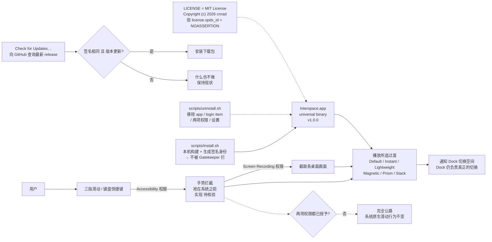

# cnrad/interspace

## 一句话定位
**一个 macOS 空间切换器：⭐⭐⭐⭐⭐ 它把系统唯一的桌面切换动画换成 6 种可自选的过渡（或干脆取消动画），⭐⭐⭐⭐⭐ 并用「只安装签名相同且版本更新的包，否则什么也不做」这条规则把自更新的行为边界写死在 README 里。**

## 它解决的问题
**macOS 的空间切换动画慢，且不可定制。** ⭐⭐⭐⭐⭐ README 对痛点的描述非常具体：

> Switching desktops on macOS is slow. Unbearably slow. **The slide animation scales with your display's refresh rate, so on a 120Hz ProMotion display it takes twice as long as at 60Hz**: a full second from the swipe until the desktop you landed on is responsive. The slide looks finished well before that, but your clicks and keys go nowhere until it has settled. **macOS has exactly one animation for this, and no options to change it.**

⭐⭐⭐⭐⭐ **这个描述给出了三层痛点：动画时长与刷新率挂钩（120Hz 反而更慢）、动画与输入响应不同步（看起来结束了但点击还没生效）、且完全没有替代方案。**

⭐⭐⭐⭐⭐ Interspace 的解法有三层：换掉过渡、让过渡跟随手指（一次滑动可跨越多个桌面）、过渡中途按键盘直接开始下一个。

## 为什么值得关注（2026-11-16）
⭐⭐⭐⭐⭐ **因为它的自更新规则是本数据集里最干净的一条「行为边界」表述 —— 它把「不做什么」写得和「做什么」一样明确。**

**README 原文：**

> Interspace installs a download only if it has the same signature as the releases of this project and a newer version. **If not, it changes nothing.**

⭐⭐⭐⭐⭐ **这句话同时定义了三件事：更新的前置条件（签名相同）、更新的充分条件（版本更新）、以及失败时的行为（什么也不做 —— 而不是降级到某个旧版本、或弹一个无法拒绝的提示）。**

⭐⭐⭐⭐⭐ **第二个值得记的点：它把「权限未授予时的行为」也写成了明确的降级契约。**

> Then choose **Relaunch Interspace** in its menu bar menu. **Until both are allowed, Interspace does nothing and the normal macOS swipe works as before.**

⭐⭐⭐⭐⭐ **即「缺少 Accessibility 与 Screen Recording 权限时，产品完全不影响系统行为」—— 这是很多 macOS 工具做不到的事，因为它们通常会抢在系统之前拦截手势。**

⭐⭐⭐⭐⭐ **第三个值得记的点：它对「未公证」这一现实给出的是可执行的路径，而不是免责声明。**

> macOS blocks opening the app, because it is downloaded from the web and **not notarized by Apple**. Click **Open Anyway** in System Settings > Privacy & Security.

⭐⭐⭐⭐⭐ **并且它提供了「从源码自己构建」这条路，并解释了为什么自建版本不需要走 Gatekeeper：**

> **An app that is built on the Mac it runs on is not stopped by Gatekeeper**, so steps 3 and 4 above are not necessary.

⭐⭐⭐⭐⭐ **第四个值得记的点（判据侧）：⭐⭐⭐⭐⭐ 它的 `license.spdx_id` 是 `NOASSERTION`，但 LICENSE 文件里明确写着 `MIT License` / `Copyright (c) 2026 cnrad`。**

⭐⭐⭐⭐⭐ **这给本日报的「许可判据」补上了一个必须写的限定：⭐⭐⭐⭐⭐ GitHub 的 `license.spdx_id` 是它对 LICENSE 文件的**自动归类**结果，不是权威判定 —— ⭐⭐⭐⭐⭐ 遇到 `NOASSERTION` 时必须去读文件，否则会把一个 MIT 项目误判成「无许可」。**

## 热度来源判断
⭐⭐⭐⭐⭐ **真实需求 + 本数据集里少见的高质量作者信号，不含投放特征。**

支持「真实」的一面：⭐⭐⭐⭐⭐ **owner 账号创建于 2021-04-26，有 75 个公开仓库、431 followers**；⭐⭐⭐⭐⭐ 2 个 release（`v0.1.0` → `v1.0.0`）；⭐⭐⭐⭐⭐ 2 个 open issue；⭐⭐⭐⭐⭐ fork 到达分布极慢（7 个 fork，中位间隔 8,063 秒 ≈ 2.2 小时，≤10 秒 0 个，跨度 588.3 分钟）；⭐⭐⭐⭐⭐ commit 消息是**面向用户的具体修改**而非随机词组（`The Open Anyway step for the DMG in the README, with a …` / `No labels in the DMG picture: the icons and the arrow a…` / `White labels in the DMG picture, because Finder draws i…` / `Version 1.0.0` / `A universal DMG as the download of a release, with a ba…`）。

⭐⭐⭐⭐⭐ **值得注意的是最后两条 commit 的性质：⭐⭐⭐⭐⭐ 作者在 v1.0.0 前后反复打磨的是「DMG 下载图里的标签文字」—— 一个纯 UX 细节。⭐⭐⭐⭐⭐ 这类「在发布前后打磨细节图示」的 commit，是手工项目的特征（自动生成的 commit 不会关心 DMG 图上要不要写标签）。**

⭐⭐⭐⭐⭐ **规模判断：131⭐ 对于一个 macOS 小工具属于正常偏热的水平**（macOS 效率工具类项目的常见区间），⭐⭐⭐⭐⭐ 且 subs 为 0 而 fork 只有 7 个 —— ⭐⭐⭐⭐⭐ **按 11-15 的判据，fork/star 仅 5.3% 且 fork 分布极慢，是「真实关注」的弱正证。**

## 关键技术亮点
1. **6 种过渡**：⭐⭐⭐⭐⭐ `macOS Default`（不介入）/ `Instant`（无动画）/ `Lightweight`（滑动并轻微回缩）/ `Magnetic`（屏幕缩小让位再放大）/ `Prism`（棱镜旋转）/ `Stack`（堆叠）。
2. **过渡跟随手指**：⭐⭐⭐⭐⭐ 「It follows your fingers, so one swipe can pass several desktops」，⭐⭐⭐⭐⭐ 灵敏度可调（`Swipe sensitivity`）。
3. **过渡中途的输入不丢**：⭐⭐⭐⭐⭐ 「a key press in the middle of a transition starts the next one at once instead of being ignored」。
4. **可配置项具体到系统级别**：⭐⭐⭐⭐⭐ `Speed` / `Swipe sensitivity` / `Dock and menu bar move with the space` / `Rounded corners`。
5. **系统快捷键复用**：⭐⭐⭐⭐⭐ macOS 的「向左/向右移动一个空间」快捷键使用所选过渡。
6. **Apple Silicon 与 Intel 双架构**（README：「The app runs on Apple silicon and Intel」），⭐⭐⭐⭐⭐ commit `A universal DMG as the download of a release` 证实交付的是 universal 二进制。
7. **源码构建安装脚本**：`scripts/install.sh` 与 `scripts/uninstall.sh`，⭐⭐⭐⭐⭐ 卸载脚本移除 app、login item、两项权限与设置。
8. **自建签名身份**：⭐⭐⭐⭐⭐ 安装脚本会为用户的 Mac 生成签名身份，使自建版本带自有签名 —— ⭐⭐⭐⭐⭐ 这正是「自建版本不被 Gatekeeper 拦」的技术前提。

## 架构师速览

| 决策问题 | 研究判断 | 证据边界 |
|---|---|---|
| 系统边界 | 边界 = 「macOS 的空间切换手势与动画」；⭐⭐⭐⭐⭐ **它不替换 Dock 的空间切换逻辑**（README：「Interspace does not change macOS. The Dock still does every space switch.」）而是替换其**过渡表现层** | README「How it works」段 + 树结构（`Sources/` 18 文件、`scripts/` 6、`Resources/` 2、`assets/` 2、`Package.swift`、`Info.plist`）。⚠️ **本日报未构建、未运行、未安装** |
| 主路径 | 用户三指滑动（或触发手势）→ Interspace 在 Accessibility 权限下**抢先**取走手势 → 在 Screen Recording 权限下截取各桌面画面 → 播放所选过渡 → 通知 Dock 切换空间；⭐⭐⭐⭐⭐ 更新路径：Check for Updates → 向 GitHub 查询最新 release → 校验签名与版本 → 通过才安装 | 由 README 的 Permissions 表、Transitions 表与「Check for Updates…」段给出。⭐⭐⭐ ⚠️ **手势抢占的具体 API（CGEventTap? NSEvent monitor?）与过渡渲染技术（Metal? Core Animation?）本日报未核验** —— ⭐⭐⭐ **本日报未打开 `Sources/` 下的 18 个 Swift 文件** |
| 关键权衡 | ①**抢手势 vs 让系统动**：必须抢，否则无法控制动画，⭐⭐⭐⭐⭐ 但抢了就要承担「权限不足时必须完全让路」的义务；②**未公证 vs 公证**：⭐⭐⭐⭐⭐ **未公证换来了免费分发（不需 $99/年开发者账号），代价是用户要手动点一次「仍要打开」**；③**自更新 vs 不自更新**：⭐⭐⭐⭐⭐ **选择自更新但用「签名相同 + 版本更新」双条件守住边界，且失败时什么也不做**；④**动效 vs 帧率**：README 指出系统的动画时长随刷新率变化，⭐⭐⭐⭐⭐ 即系统的动效设计本身在高刷屏上是缺陷 | ①②③④均有 README 原文支撑。⭐⭐⭐ ⚠️ **每个权衡的实际代价本日报未实测**（未测电量消耗、未测手势冲突、未测多屏行为、未测过渡掉帧） |
| 最小 PoC | ① `git clone` + `scripts/install.sh` 在本机构建（**本机自建可绕过 Gatekeeper**）；② 在「系统设置 → 隐私与安全性」授予 Accessibility 与 Screen & System Audio Recording；③ 选 `Instant` 过渡，三指滑动，确认桌面立即切换且动画消失；④ 试一次 `Check for Updates…`，**确认在签名或版本不满足时它什么也不做**；⑤ 跑 `scripts/uninstall.sh`，确认 app、login item、两项权限与设置全部被移除 | PoC 范围由本档案的取证路径推导。⭐⭐⭐ ⚠️ **本日报未执行任何一步**（需要 macOS 与授权）；⭐⭐⭐ ⚠️ **第 ④ 步与第 ⑤ 步最值得先做** —— 前者验证「边界规则真的被执行」，后者验证「卸载声称完整」 |

## 架构启发
⭐⭐⭐⭐⭐ **最值得抄的一条：把「更新失败」也定义成一个明确的产品行为。**

大多数项目的自更新逻辑是「检查 → 有新版 → 下载 → 装上」，⭐⭐⭐⭐⭐ 而 Interspace 明确写出「**If not, it changes nothing**」—— ⭐⭐⭐⭐⭐ **即「不满足前置条件时保持现状」是一条可以被写下来的产品契约。**⭐⭐⭐⭐⭐ 这与本数据集记录的 `hikaku-extension`（「a flag is the model's estimate, not proof」）、`ScanDot`（「does not reconstruct ordinary video on the phone」）是同一条原则：**不要让工具在边界之外表现出一个含糊的动作。**

⭐⭐⭐⭐⭐ 第二条：**「缺少权限时完全让路」是抢手势类工具的义务。** ⭐⭐⭐⭐⭐ 多数手势工具在未授权时要么无反应、要么拦截手势导致系统失灵；⭐⭐⭐⭐⭐ **Interspace 明确承诺「Until both are allowed, Interspace does nothing and the normal macOS swipe works as before」** —— 这条可以直接抄进任何抢全局手势的工具。

⭐⭐⭐⭐⭐ 第三条：**未公证 + 提供源码构建脚本，是个人开发者分发的合理组合。** ⭐⭐⭐⭐⭐ 代价是用户要手动点一次「仍要打开」，⭐⭐⭐⭐⭐ 收益是不需要 $99/年的开发者账号；⭐⭐⭐⭐⭐ 而「在用户本机生成签名身份」这一步把自建版本变成合法签名应用，从而完全绕开 Gatekeeper —— ⭐⭐⭐⭐⭐ **这是一个很实用的分发技巧。**

⭐⭐⭐⭐⭐ 第四条（判据侧）：**`license.spdx_id` 是自动归类，不是权威判定。** ⭐⭐⭐⭐⭐ 本样本的 `NOASSERTION` 对应的是一个内容完全明确的 MIT LICENSE；⭐⭐⭐⭐⭐ **反过来，`Gemini-Config-Checker-` 的 `Apache-2.0` 对应的是从 MIT 上游改写而来的文件。**⭐⭐⭐⭐⭐ **两个样本一正一反地说明：许可必须读文件，而且要读仓库内的第三方声明文件。**

## 架构图（MMD）

> 证据边界：此图的结构取自 README、仓库树与 commit 消息；标「待核验」的节点是本日报未能独立验证的部分。

## 定位判断
**工具型。** ⭐⭐⭐⭐⭐ 定位是「macOS 原生行为的可定制替代」—— ⭐⭐⭐⭐⭐ **与 11-15 记录的 `mixbar`（同属 macOS 效率工具，且同用 Core Audio / Process Tap 一类系统级能力）相比，Interspace 的差异化在于「它替换的是系统动画，而系统动画没有替代品」，⭐⭐⭐⭐⭐ 而 mixbar 替换的是系统音量管理，⭐⭐⭐⭐⭐ **后者有多个成熟竞品。**

⭐⭐⭐⭐⭐ 在本数据集的坐标里，它是 **「个人开发者做系统级小工具」** 这一类的优质样本：⭐⭐⭐⭐⭐ 交付物是签名二进制 + 源码 + 安装/卸载脚本，⭐⭐⭐⭐⭐ 而 README 把权限、卸载、签名校验、Gatekeeper 路径全写清了。

## 风险/局限/泡沫点
- ⭐⭐⭐⭐⭐ **未公证 + 需要用户手动放行**：⭐⭐⭐⭐⭐ 这是最大的采用摩擦。⭐⭐⭐⭐⭐ 缓解手段是提供了源码构建路径，但**要求用户有 Xcode Command Line Tools**。
- ⭐⭐⭐⭐⭐ **需要两项高敏感权限**：Accessibility（抢手势）+ Screen & System Audio Recording（截屏）。⭐⭐⭐⭐⭐ **这两个权限组合让一个「空间切换动画工具」获得了系统级的观察能力** —— ⭐⭐⭐⭐⭐ README 只说明用途（截取过渡要展示的桌面画面），⭐⭐⭐ ⚠️ **本日报未做隐私审计，不主张其存在恶意；仅记录该权限面**。
- ⭐⭐⭐⭐⭐ **系统版本耦合**：⭐⭐⭐⭐⭐ 要求 macOS 14+；⭐⭐⭐⭐⭐ 且它依赖未公开的（或是半公开的）空间切换与动画时序，⭐⭐⭐⭐⭐ **Apple 一次系统更新就可能破坏它** —— ⭐⭐⭐⭐⭐ **这是这类项目不可回避的结构性风险。**
- ⭐⭐⭐⭐⭐ **`license.spdx_id` = NOASSERTION**：⭐⭐⭐⭐⭐ 实际 LICENSE 是 MIT（`Copyright (c) 2026 cnrad`），⭐⭐⭐⭐⭐ 但**依赖 SPDX 字段的自动化工具会误判**。
- ⭐⭐⭐⭐⭐ **v1.0.0、仅 2 个 release、2 个 issue**：⭐⭐⭐⭐⭐ 处于早期。
- ⭐⭐⭐ ⚠️ **未核验项**：`Sources/` 下 18 个 Swift 文件（**本日报一行未读**）、手势拦截的具体 API、过渡渲染的技术栈、多显示器与多空间的行为、功耗、签名校验的实际实现、卸载脚本的完整性。

## 与同类项目的关系
- **vs macOS 官方 Mission Control / 空间设置**：⭐⭐⭐⭐⭐ 系统自带但**只有一个动画且不可定制** —— Interspace 的全部价值来自补上这个缺口。
- **vs 11-15 的 `lishuangqiang/mixbar`**：⭐⭐⭐⭐⭐ 同类「macOS 效率工具」，⭐⭐⭐⭐⭐ **但 mixbar 用 `THIRD_PARTY_NOTICES.md` 精确记录借用的代码（`burghr/MacMixer` @ `3b2c6901…`），Interspace 无第三方声明文件** —— ⭐⭐⭐⭐⭐ **在「许可与溯源」这一维度上，mixbar 做得更完整。**
- **vs 同日的 `rauchg/winamp-ui-sdk`**：⭐⭐⭐⭐⭐ 一个是 macOS 原生 App，一个是 Web Components 复刻，⭐⭐⭐⭐⭐ **但两者都在做「把一个经典软件交互重新实现一遍」，⭐⭐⭐⭐⭐ Interspace 的版本保留了系统原生的权限与更新边界。**
- **vs `rectangle` / `loop` 等窗口管理工具**：⭐⭐⭐⭐⭐ 那些管的是窗口布局，Interspace 管的是空间切换动画，⭐⭐⭐⭐⭐ **互补而不重叠。**
- **vs 11-13 的 `Shape`（GPL-3.0、1 commit）**：⭐⭐⭐⭐⭐ 同为「重做经典交互」类项目，⭐⭐⭐⭐⭐ 但 Interspace 有 5 个语义化 commit、2 个 release、MIT LICENSE，⭐⭐⭐⭐⭐ **工程成熟度高一档。**

## 是否值得持续跟踪
**值得，且对 macOS 用户是可直接采用的工具（接受一次手动放行即可）。**

具体建议：
1. ⭐⭐⭐⭐⭐ **macOS 用户可先试 `Instant` 过渡**（零动画、立即响应），⭐⭐⭐⭐⭐ 这是它解决的核心痛点，风险也最低；
2. ⭐⭐⭐⭐⭐ **做手势类工具的人应抄它的两条边界声明**：「权限不足时完全让路」与「更新条件不满足时什么也不做」；
3. ⭐⭐⭐⭐⭐ **做 macOS 分发的个人开发者应抄它的未公证 + 自建签名 + 源码构建脚本三件套**；
4. ⭐⭐⭐⭐⭐ **关注 macOS 大版本更新后的兼容性** —— 这是它能否存活的关键变量。

## 后续观察点
- macOS 15/16/26 更新后手势与空间切换 API 是否变化（**最关键的存活变量**）
- 是否提交 Apple 公证（Developer ID notarization），从而消除「仍要打开」这一步
- 2 个 open issue 的内容（**本日报未打开**）
- 是否补上 `THIRD_PARTY_NOTICES.md` 一类的第三方声明文件
- `license.spdx_id` 是否被修正为 MIT（若在 `LICENSE` 中补上标准的 SPDX 标识行，GitHub 就能正确归类）
- fork/star 比与 subs 的变化（当前 7 fork / 0 subs / 131⭐，⭐⭐⭐⭐⭐ 若 subs 在短期内飙升而 star 不动，则需要按 11-15 的判据重新评估）

---
> 数据来源: GitHub API (2026-11-16) | Stars: 131 | Forks: 7 | Subscribers: 0 | Open Issues: 2 | License: NOASSERTION（LICENSE 文件为 MIT / Copyright (c) 2026 cnrad）| 语言: Swift | 创建: 2026-11-15T02:39:42Z | release v1.0.0 / v0.1.0 | owner 创建: 2021-04-26 | fork 间隔中位 8063s ≤10s 0/7
