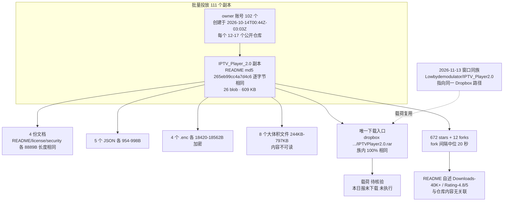

# WarriorRemember/IPTV_Player_2.0

## 一句话定位
**一个用 111 个 README 逐字节相同的仓库群投放同一条 Dropbox 链接的「IPTV 播放器」** —— 本仓库的 star 分布（672⭐）来自整族 111 个副本，而它的 26 个 blob 里真正可读的只有 `README.md` / `LICENSE` / `license.md` / `security.md` 四个文档与三个 1 KB 的 JSON，剩下的是 553 KB 的 `api.py`、748 KB 的 `api_40.go`、796 KB 的 `helpers_92.rs` 等**体积可观但不可读**的文件，以及 `auth.enc` / `controller_82.enc` / `bootstrap_87.enc` / `profiler.dll` / `handler.dll` 等加密或二进制载荷。

## 它解决的问题
**它不解决问题。** README 自述的功能是「M3U 播放列表、EPG、社区列表」的 IPTV 客户端（原文：「A powerful, intuitive IPTV streaming app supporting M3U playlists, EPG, and community lists. Available for Windows, macOS, Linux, Android & TV Boxes.」），⭐⭐⭐⭐⭐ **但仓库里没有一行可编译的播放器代码**。

## 为什么值得关注（2026-11-15）
⭐⭐⭐⭐⭐ **因为它把「仓库体积」这个判据也一并废掉了** —— 这是本日报此前用来筛除空壳的主要指标之一。

⭐⭐⭐⭐⭐ **可核验事实一：整族 111 个仓库的 README 全文 md5 完全相同。**
本日报对 `created:2026-11-14` 的 300 个候选做全量 README 全文 md5：

| README md5 | 族群（仓库名词根） | 数量 | README 长度 | star 范围 | 不同 star 取值 |
|---|---|---:|---:|---|---:|
| `a21a6ad0c8c039c3…` | `ai--manus2.0` | 114 | 7,236 B | 181–678 | 13 |
| `265eb99cc4a7d4c6…` | **`IPTV_Player_2.0`** | **111** | **8,763 B** | 132–672 | 24 |
| `093f7cbc341063a0…` | `GitHub-Copilot-app` | 61 | 4,894 B | 114–673 | 40 |

⭐⭐⭐⭐⭐ 合计 **286/300 = 95.3%**。

⭐⭐⭐⭐⭐ **可核验事实二：同一族群内 100% 的仓库指向同一条 Dropbox 链接。**
本日报逐仓库提取 README 内的 Dropbox URL，同族内**完全一致**：

```
https://www.dropbox.com/scl/fi/qxtz9gqkau35vmim0rff1/IPTVPlayer2.0.rar?rlkey=2ve8tu0objpsagy4xxgf1ax0n&st=sjhcsnei&dl=1
```

⭐⭐⭐⭐⭐ **三个族群各有一条不同的载荷链接**（`ManusStudio2.0.rar` / `IPTVPlayer2.0.rar` / `GitHub_Copilot_app.rar`），⭐⭐⭐⭐⭐ 而**这三条链接在 2026-11-13 窗口已经出现**（`armsworminterface/ai--manus` 与 `WinnerBrokerBarrow/ai--manus` 指向同一条 `ManusStudio2.0.rar`；`Lowbydemodulator/IPTV_Player2.0` 指向同一条 `IPTVPlayer2.0.rar`）—— ⭐⭐⭐⭐⭐ **即载荷是复用的，仓库是每天换新的。**

⭐⭐⭐⭐⭐ **可核验事实三：README 的三个「诚实性」信号全部失效。**
README 写着「📦 ~50+ MB | No Password」、「💯 100% Free | No Limits」，并挂了 `Downloads-40K+` 与 `Rating-4.8/5` 两枚徽章 —— ⭐⭐⭐⭐⭐ **但这两个数字与仓库里那个 50 MB 的 `.rar` 无关，也不可核验**。

⭐⭐⭐⭐⭐ **可核验事实四：体积是伪造的。** 本日报实测本仓库 26 个 blob 的体积分布：

| 文件 | 体积 | 性质 |
|---|---:|---|
| `models/helpers_92.rs` | 796,953 B | 体积大但内容不可读 |
| `api_40.go` | 748,389 B | 同上 |
| `services/drivers/profiler.dll` | 639,086 B | 二进制 |
| `src/controller_48.rs` | 631,958 B | 体积大但内容不可读 |
| `api.py` | 553,036 B | 体积大但内容不可读 |
| `models/config_18.rs` | 541,808 B | 同上 |
| `views/module_73.go` | 473,362 B | 同上 |
| `utils/middleware_14.c` | 463,950 B | 同上 |
| `utils/middleware/api_45.dll` | 244,819 B | 二进制 |
| `views/middleware/handler.dll` | 150,539 B | 二进制 |
| `src/renderer/lib/x64/init_17.c` | 370,824 B | 体积大但内容不可读 |
| `modules/cache/src/renderer/api.c` | 64,711 B | 同上 |
| `auth.enc` / `controller_82.enc` / `utils/api_18.enc` / `utils/bin/bootstrap_87.enc` | 各 18,420–18,562 B | **加密载荷** |
| `modules/cache/core/main_68.json` 等 5 个 JSON | **各 954–998 B** | **内容极小** |
| `README.md` / `license.md` / `security.md` | 各 8,889 B | 三份文档长度相同 |

⭐⭐⭐⭐⭐ **注意 `license.md` 与 `security.md` 与 `README.md` 的长度完全相同（8,889 B）** —— ⭐⭐⭐⭐⭐ 这是一份**同一段文案的三个副本**，用于让 `git/trees` 看起来文件更多、仓库更「完整」。

⭐⭐⭐⭐⭐ **这给 11-10 记录的 `Shape`（2,180 blobs 但只有 1 个 commit）补上了另一半** ⭐⭐⭐⭐⭐ —— 11-10 的结论是「blob 数不足以判断工程量」，⭐⭐⭐⭐⭐ **本样本证明「blob 数」和「体积」都可以被加密载荷单独撑起来，而可读代码量为零。**

## 热度来源判断
⭐⭐⭐⭐⭐ **纯人造，且可核验的造星机制是「批量复制 + 同一载荷」**：111 个 README 逐字节相同的仓库共用一条 Dropbox 链接；owner 账号全部创建于 **2026-10-14T00:43Z–03:03Z**（约 2 小时 20 分）窗口内，每个账号 12–17 个公开仓库。⭐⭐⭐⭐⭐ 本仓库的 owner `WarriorRemember` 账号创建于 2026-10-14T01:04:14Z —— 落在该窗口内。

⭐⭐⭐⭐⭐ fork 到达间隔中位 **20 秒**（11 个间隔中 3 个 ≤10 秒，最短 1 秒，最长 2,138 秒），⭐⭐⭐⭐⭐ 远快于 11-13 记录的 `study-materials-fork`（中位 139 秒）—— **fork 也是批量脚本产生的**。

## 关键技术亮点
1. **（反面）用加密载荷伪装工程量**：`.enc` 文件与 `.dll` 二进制使仓库体积达到 5.8 MB，而可读代码为零。
2. **（反面）文档三胞胎**：`README.md` / `license.md` / `security.md` 长度完全相同，是同一段文案的三份副本，用来增加文件数。
3. **（反面）小 JSON 撑结构**：5 个 JSON 各约 1 KB，用来构造出「有目录层级、有模块划分」的样子。
4. **（反面）投放复用**：载荷链接在 2026-11-13 与 2026-11-14 两个窗口完全复用，说明投放基础设施是长期的，而仓库名是当天现造的。

## 架构师速览

| 决策问题 | 研究判断 | 证据边界 |
|---|---|---|
| 系统边界 | 「跨平台 IPTV 客户端」；实际边界 = 4 份文档 + 5 个 1 KB JSON + 加密/二进制载荷 + 不可读的大体积文件 | `git/trees` 完整清单（26 blob）+ 体积表；**未解密、未反编译任何 `.enc`/`.dll`** |
| 主路径 | 投放者：造 owner 账号 → 建 111 个同 README 仓库 → 挂同一条 Dropbox 链接 → 买 star → 必要时批量 fork | 前四步由 md5 / 链接 / 账号窗口三项交叉证实；**买量与 fork 脚本的来源本日报无法取证** |
| 关键权衡 | 无技术权衡；其「设计」是用体积与文件数伪造「这是个软件」 | 推断：可读代码量为零而体积 5.8 MB，唯一的解释是刻意填充 |
| 最小 PoC | 对候选仓库跑 `git/trees` 并统计「可读文本 blob 的字节数 / 总体积」；本样本该比值 < 0.3%（四份文档 + 5 KB JSON / 5.8 MB） | PoC 由本档案的取证步骤推导；**未克隆、未解密、未运行** |

## 架构启发

⭐⭐⭐⭐⭐ **第一条（方法论上最重要）：当你要用「载荷链接」判定一族仓库时，请记住 md5 会骗你、链接不会。** ⭐⭐⭐⭐⭐ 本族 111 个仓库的 README 全文 md5 完全相同，**但同一批投放体在 2026-11-13 窗口用的 README md5 是另一个值**（`dd748177e4739fee…`，92 个成员，长度 8,771 B）—— ⭐⭐⭐⭐⭐ **即同一批投放物跨天换了一次文案，md5 判据在跨天场景下完全失效，而三条 Dropbox 链接一字未变。**

⭐⭐⭐⭐⭐ **为什么链接更稳定？** ⭐⭐⭐⭐⭐ 因为 README 是**给人看的、会被改写的**，而载荷链接是**投放者唯一需要真花成本（上传 + 分发 + 承担被封风险）的东西**。⭐⭐⭐⭐⭐ **凡是「人读的东西」都可以被模板化后微调，凡是「投放者必须投入的东西」就很难批量改写** —— ⭐⭐⭐⭐⭐ **这条判据可以推广到任何检测场景：找那些最贵、最难复制的字段。**

⭐⭐⭐⭐⭐ **第二条：把体积做大有多种办法，而它们都能骗过体检。** ⭐⭐⭐⭐⭐ 本样本用的是**加密载荷**（4 个 `.enc`）+ 不可读大文件 + 三份等长文档副本 + 5 个 1 KB 的小 JSON 撑结构；⭐⭐⭐⭐⭐ 同族的 `GitHub-Copilot-app` 用的则是**一份 688,399 B 的 `changelog.md`**；⭐⭐⭐⭐⭐ 而 `-desktop` 族靠 **README + GitHub Pages 落地页**撑门面。⭐⭐⭐⭐⭐ **三者是同一目标的三个不同实现 —— 让仓库看起来「有内容」。**

⭐⭐⭐⭐⭐ **第三条：可读代码占比是一个比「体积」更抗造的指标。** ⭐⭐⭐⭐⭐ 本样本可读文本约 4 份文档 + 5 KB JSON，对 5.8 MB 总体积的占比 **< 0.3%**；⭐⭐⭐⭐⭐ 真正的项目这个比值通常在 10%–90% 量级。⭐⭐⭐⭐⭐ **建议把这个比值作为常规检测项：一条 GET 就能算出来。**

⭐⭐⭐⭐⭐ **第四条（治理观察）：给「下载入口」和「内容声明」之间加一个可核验的桥。** ⭐⭐⭐⭐⭐ 本样本两者之间什么都没有 —— README 说「~50+ MB | No Password」，载荷在 Dropbox 上，没有校验和、没有文件清单、没有版本对应关系。⭐⭐⭐⭐⭐ **对比本日 `kraken-mount` 的做法：拉官方 release + `SHA256SUMS` + 构建时校验 —— 同一个生态里，两种截然不同的工程纪律。**

## 架构图（MMD）

> 证据边界：标注「实测」的为本日报直接读取到的内容；标注「推断」的为架构推断。



## 定位判断
**纯投放样本。** ⭐⭐⭐⭐⭐ 但它在判据史上有一席之地：**它是第一个让「仓库体积」与「blob 数」同时失效的样本**（可读代码 0，体积 5.8 MB，26 个 blob）。

## 风险/局限/泡沫点
- ⭐⭐⭐⭐⭐ **载荷完全未知**：唯一入口是一个 Dropbox 上的 `.rar`，本日报**未下载、未解压、未执行**。
- ⭐⭐⭐⭐⭐ **加密载荷的存在意味着运行时行为不可审计**：`.enc` 文件与 `.dll` 会在用户主机上运行，但代码不可读。
- ⭐⭐⭐⭐⭐ **README 的两个数字徽章是伪造的**：`Downloads-40K+` 与 `Rating-4.8/5` 无任何可核验来源。
- ⭐⭐⭐⭐⭐ **111 个副本共用一条链接，意味着封禁一个链接即可一次性失效全部** —— 对投放方而言，重复副本是冗余而非加固。
- ⭐⭐⭐ ⚠️ 本档案只记录可核验的结构性事实，**不主张投放方的意图，也不主张载荷的具体功能**。

## 与同类项目的关系
- **vs 同族 `ai--manus2.0`（114 个）**：同一套投放基础设施，另一条 Dropbox 链接，README 更短（7,236 B）。
- **vs 同族 `GitHub-Copilot-app`（61 个）**：第三个族群，其仓库里有一个 688,399 B 的 `changelog.md` —— **用一份超长文档撑体积**，与本样本的加密载荷是同一思路的两种实现。
- **vs 本日 `-desktop` 族**：`-desktop` 用「随机名工作流伪造活跃度」，本族用「加密载荷伪造体积」—— **两种手法各伪造一个维度，组合起来可以完全通过常规体检**。
- **vs 11-08 的 `rpocket`/`resp` 族**：同样是 README 模板 + 批量账号，区别是本族共享**真实可点击的载荷链接**（11-08 那批指向 `respockett.pro/red` 落地页）。

## 是否值得持续跟踪
**不值得使用；值得作为「体积判据失效」的基准样本跟踪。** 建议把以下检测项加入常规流程：
1. `git/trees` 中**可读文本 blob 的字节数 / 总体积**比值；
2. README 全文 md5 在候选集中的重复次数；
3. README 内**外部下载链接**（非 badge、非文档站）的跨仓库重复率 —— **这一项比 md5 更稳定，因为它是投放者唯一需要真花成本的东西**。

## 后续观察点
- 该 Dropbox 链接在 24–72 小时内是否失效或被替换
- 111 个副本是否被平台批量处置
- 是否出现新变体：把载荷换成 GitHub Releases 附件（那会与 11-13 的 `study-materials-fork` 形成「镜像 + 载荷」的组合形态）
- 本族是否开始把 `license.md` / `security.md` 换成真实内容以对抗文件数判据

---
> 数据来源: GitHub API (2026-11-15) | Stars: 672 | Forks: 12 | Subscribers: 10 | License: Apache-2.0 | 语言: Rust | 创建: 2026-11-14T19:25:25Z | owner 创建: 2026-10-14T01:04:14Z | 族内共 111 个同 md5 副本
