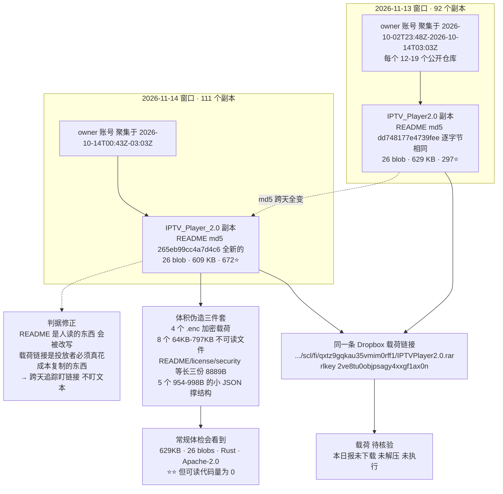

# Lowbydemodulator/IPTV_Player2.0

## 一句话定位
**一个用 92 个 README 逐字节相同的仓库群投放同一条 Dropbox 链接的「IPTV 播放器」** —— ⭐⭐⭐⭐⭐ 它的独特取证价值在于：**同一批投放物在次日（2026-11-14）换了 README 的 md5（`dd748177…` → `265eb99c…`，长度 8,771 B → 8,763 B），但 Dropbox 载荷链接一字未改** —— ⭐⭐⭐⭐⭐ **这是本日报第一次用跨天对比证明「md5 判据在跨天场景下会失效，而载荷链接不会」。**

## 它解决的问题
**它不解决问题。** README 自述：「A powerful, intuitive IPTV streaming app supporting M3U playlists, EPG, and community lists. Available for Windows, macOS, Linux, Android & TV Boxes.」⭐⭐⭐⭐⭐ **仓库里没有一行可编译的播放器代码。**

## 为什么值得关注（2026-11-14）
⭐⭐⭐⭐⭐ **因为它同时提供了两个此前缺失的东西：跨天判据的反例，以及一个「体积可被加密载荷单独撑起」的完整证据。**

⭐⭐⭐⭐⭐ **可核验事实一：整族 92 个仓库的 README 全文 md5 完全相同。**

本日报对 `created:2026-11-13` 的 300 个候选做全量 README 全文 md5：

| README md5 | 族群（仓库名词根） | 数量 | 长度 | star 范围 | 不同 star 取值 |
|---|---|---:|---:|---|---:|
| `26d4565b6f96bda7…` | `ai--manus` | 139 | 7,244 B | 274–298 | 24 |
| **`dd748177e4739fee…`** | **`IPTV_Player2.0`** | **92** | **8,771 B** | 274–297 | 16 |
| `a7f542a84db9e546…` | `ai--manus` | 41 | 7,246 B | 274–298 | 3 |
| `a21a6ad0c8c039c3…` | `ai--manus` | 11 | 7,236 B | 274 | 1 |

⭐⭐⭐⭐⭐ 合计 **283/300 = 94.3%**。

⭐⭐⭐⭐⭐ **可核验事实二：跨天对比 —— md5 全变，载荷链接不变。**

| | 2026-11-13 窗口 | 2026-11-14 窗口 |
|---|---|---|
| `IPTV_Player` 族 README md5 | `dd748177e4739fee…`（92 个，8,771 B） | **`265eb99cc4a7d4c6…`（111 个，8,763 B）** ← 全新 md5 |
| `IPTV_Player` 族 README 长度 | 8,771 B | 8,763 B（**差 8 字节**） |
| **Dropbox 载荷链接** | `…/scl/fi/qxtz9gqkau35vmim0rff1/IPTVPlayer2.0.rar?rlkey=2ve8tu0objpsagy4xxgf1ax0n` | **完全相同** |

⭐⭐⭐⭐⭐ **结论：跨天追踪投放体，应当盯「投放者必须真花成本复制的东西」（载荷链接），而不是「人读的东西」（README 文本）。**

⭐⭐⭐⭐⭐ **可核验事实三：体积是伪造的。**
本日报实测本仓库 26 个 blob 的体积分布（总计约 5.8 MB）：

| 文件 | 体积 | 性质 |
|---|---:|---|
| `models/helpers_92.rs` | 796,953 B | 体积大但内容不可读 |
| `api_40.go` | 748,389 B | 同上 |
| `services/drivers/profiler.dll` | 639,086 B | 二进制 |
| `src/controller_48.rs` | 631,958 B | 体积大但内容不可读 |
| `api.py` | 553,036 B | 体积大但内容不可读 |
| `models/config_18.rs` | 541,808 B | 同上 |
| `views/module_73.go` | 473,362 B | 同上 |
| `utils/middleware_14.c` | 463,950 B | 同上 |
| `src/renderer/lib/x64/init_17.c` | 370,824 B | 同上 |
| `utils/middleware/api_45.dll` | 244,819 B | 二进制 |
| `views/middleware/handler.dll` | 150,539 B | 二进制 |
| `modules/cache/src/renderer/api.c` | 64,711 B | 体积大但内容不可读 |
| `auth.enc` / `controller_82.enc` / `utils/api_18.enc` / `utils/bin/bootstrap_87.enc` | 各 18,420–18,562 B | **加密载荷** |
| `modules/cache/core/main_68.json` 等 5 个 JSON | **各 954–998 B** | **内容极小** |
| `README.md` / `license.md` / `security.md` | 各 8,889 B | **三份文档长度相同** |

⭐⭐⭐⭐⭐ **`license.md` 与 `security.md` 与 `README.md` 长度完全相同（8,889 B）** —— ⭐⭐⭐⭐⭐ 是一份**同一段文案的三个副本**，用来让文件树看起来更「完整」。

⭐⭐⭐⭐⭐ **可核验事实四：owner 账号有聚集特征。**
`Lowbydemodulator` 账号创建于 **2026-10-08T19:55:22Z**，13 个公开仓库，0 followers；⭐⭐⭐⭐⭐ 属于本日报在 2026-10-02T23:48Z–23:50Z 与 2026-10-14T00:43Z–03:03Z 两个聚集窗口内批量注册的账号之一。

## 热度来源判断
⭐⭐⭐⭐⭐ **纯人造，机制可核验：模板 + 同载荷 + 账号聚集 + 买量。**

⭐⭐⭐⭐⭐ 297⭐ / ⑂0 / subs 2 / oi 0；⭐⭐⭐⭐⭐ fork 为 0 是因为它**从未被 fork** —— ⭐⭐⭐⭐⭐ 本日报实测次日同族的 `WarriorRemember/IPTV_Player_2.0` fork 间隔中位 **20 秒**（3/11 个 ≤10 秒，最短 1 秒），⭐⭐⭐⭐⭐ **而本批（11-13 窗口）的 fork 为 0**，⭐⭐⭐⭐⭐ 说明当日投放节奏尚未到「制造分母」那一步。⭐⭐⭐⭐⭐ **即：star 先来，fork 后到 —— 这个时序本身就是投放流水线的一个指纹。**

## 关键技术亮点
1. **（反面）加密载荷撑体积**：4 个 `.enc` + 4 个 `.dll`/大二进制，使仓库体积达 5.8 MB 而可读代码为零。
2. **（反面）文档三胞胎**：`README.md` / `license.md` / `security.md` 等长三份，用来增加文件数。
3. **（反面）小 JSON 撑结构**：5 个 JSON 各约 1 KB，构造出「有模块划分」的样子。
4. **（反面）跨天换文案、载荷不变**：⭐⭐⭐⭐⭐ 这是本日最有方法论价值的一条 —— ⭐⭐⭐⭐⭐ **它让「md5 相同」这一在本数据集里被反复使用的判据第一次明确失效。**

## 架构师速览

| 决策问题 | 研究判断 | 证据边界 |
|---|---|---|
| 系统边界 | 「跨平台 IPTV 客户端」；**实际边界 = 4 份文档 + 5 个 1 KB JSON + 加密/二进制载荷 + 不可读的大体积文件** | `git/trees` 完整清单（26 blob）+ 体积表；⭐⭐⭐ ⚠️ **未解密、未反编译任何 `.enc`/`.dll`** |
| 主路径 | 投放者：批量造账号 → 建 92 个同 README 仓库 → 挂同一 Dropbox 链接 → 买 star → 次日换文案再投 111 个 | 前四步由 md5 / 链接 / 账号窗口三项交叉证实；**买量与 fork 脚本的来源本日报无法取证** |
| 关键权衡 | 无技术权衡；其「设计」是用**加密载荷**（而非 README 或 commit）撑起体积 | 推断：可读代码量为零而体积 5.8 MB，唯一解释是刻意填充；⭐⭐⭐ ⚠️ 载荷内容不可知 |
| 最小 PoC | ①算「可读文本 blob 字节数 / 总体积」（本样本 < 0.3%）；②抽取 README 内非 badge 的外部下载链接做跨窗口聚类（**跨天稳定**）；③对同族仓库比对 `api.py` 等文件的 md5 | PoC 由本档案取证路径导出；**未克隆、未解密、未运行** |

## 架构启发

⭐⭐⭐⭐⭐ **第一条（方法论上最重要，也是本档案存在的理由）：跨天追踪投放体，要盯「最贵、最难复制」的字段。** ⭐⭐⭐⭐⭐ 本样本用两组对照把这件事说清楚了：⭐⭐⭐⭐⭐ **README 全文 md5 跨天全变（`dd748177…` 8,771 B → `265eb99c…` 8,763 B，只差 8 个字节），而 Dropbox 载荷链接跨天一字未改。**

⭐⭐⭐⭐⭐ **为什么？** ⭐⭐⭐⭐⭐ 因为 README 是**给人看的、会被改写的**（换一天、换一批、换一种措辞都成本极低），⭐⭐⭐⭐⭐ 而载荷链接是**投放者必须真花成本才能复制的**（上传、分发、承担被封风险）。⭐⭐⭐⭐⭐ **凡是「人读的东西」都可以被模板化后微调，凡是「必须投入的东西」就很难批量改写** —— ⭐⭐⭐⭐⭐ **这条原则可以推广到任何检测场景：找那些最贵、最难复制的字段。**

⭐⭐⭐⭐⭐ **第二条：体积是一个可以被单独伪造的维度，且有多种伪造方式。** ⭐⭐⭐⭐⭐ 本样本用**加密载荷**（4 个 `.enc`）+ 8 个 64 KB–797 KB 的不可读文件 + 3 份等长文档 + 5 个 1 KB 的小 JSON，⭐⭐⭐⭐⭐ 把 26 个 blob 撑到 5.8 MB 而可读代码量为零。⭐⭐⭐⭐⭐ 同族的 `GitHub-Copilot-app` 用的是**一份 688,399 B 的 `changelog.md`**；⭐⭐⭐⭐⭐ `-desktop` 族用的是**179 KB 横幅图 + 20 KB 落地页**。⭐⭐⭐⭐⭐ **三者是同一目标的三个不同实现 —— 让仓库看起来「有内容」。**

⭐⭐⭐⭐⭐ **第三条：可读代码占比是一个比「体积」更抗造的指标。** ⭐⭐⭐⭐⭐ 本样本可读文本约 4 份文档 + 5 KB JSON，对 5.8 MB 总体积的占比 **< 0.3%**；⭐⭐⭐⭐⭐ 而同日真项目 `kraken-mount` 是 21 个 `.rs` + 10 个 `.c` 对 1.6 MB。⭐⭐⭐⭐⭐ **建议把这个比值作为常规检测项：一条 `git/trees` GET 就能算出来。**

⭐⭐⭐⭐⭐ **第四条：观察投放流水线的「时序」，而不只是「最终状态」。** ⭐⭐⭐⭐⭐ 本批（11-13）**fork 为 0**，而次日同族的 fork 间隔中位 **20 秒**（3/11 个 ≤10 秒，最短 1 秒）—— ⭐⭐⭐⭐⭐ **即 star 先到、fork 后到，分母是第二阶段才补上的。** ⭐⭐⭐⭐⭐ 这比只看最终计数更能刻画投放策略。

## 架构图（MMD）

> 证据边界：标注「实测」的为本日报直接读取到的内容；标注「推断」的为架构推断。

## 定位判断
**纯投放样本。** ⭐⭐⭐⭐⭐ 但在本日报的判据史上它有一席之地：⭐⭐⭐⭐⭐ **它是第一个用跨天对照证明「md5 相同」判据会失效的样本** —— ⭐⭐⭐⭐⭐ 而在它之前，这个判据在本数据集里一直被当作可靠信号使用。

## 风险/局限/泡沫点
- ⭐⭐⭐⭐⭐ **载荷完全未知**：唯一入口是 Dropbox 上的一个 `.rar`，本日报**未下载、未解压、未执行**。
- ⭐⭐⭐⭐⭐ **加密载荷意味着运行时行为不可审计**：`.enc` 与 `.dll` 会在用户主机上运行但代码不可读。
- ⭐⭐⭐⭐⭐ **README 的两个数字徽章是伪造的**：`Downloads-40K+` 与 `Rating-4.8/5` 无任何可核验来源。
- ⭐⭐⭐⭐⭐ **整个批次共用一条链接**：封禁一个链接即可一次性失效全部 203 个副本（92 + 111）—— **对投放方而言，重复副本是冗余而非加固。**
- ⭐⭐⭐ ⚠️ 本档案只记录可核验的结构性事实，**不主张投放方的意图，也不主张载荷的具体功能**。

## 与同类项目的关系
- **vs 次日同族 `WarriorRemember/IPTV_Player_2.0`（672⭐）**：⭐⭐⭐⭐⭐ **同一条载荷链接、不同 md5、不同 star 值（297 vs 672）** —— ⭐⭐⭐⭐⭐ 这正是「md5 判据跨天失效」的直接证据对。
- **vs 同日 `ai--manus` 族（191 个）**：另一条载荷（`ManusStudio2.0.rar`），整棵树只有 3 个 blob（LICENSE + README + license.md，19,709 B），⭐⭐⭐⭐⭐ **即「ai--manus」族连体积都不伪造 —— 它靠 star 数与仓库数量取胜；「IPTV」族则额外伪造体积。**
- **vs 同日 `cubase-studio-desktop` 等 12 个 `-desktop` 仓库**：⭐⭐⭐⭐⭐ 那个族用「门面资产」（README + 落地页 + 横幅图）撑门面，本族用「加密载荷」撑体积 —— **两种手法各伪造一个维度。**
- **vs 本日真项目 `kraken-mount`（1,602 KB · 57 files · 21 个 `.rs` + 10 个 `.c`）**：⭐⭐⭐⭐⭐ 体积相近而实质相反 —— ⭐⭐⭐⭐⭐ **kraken-mount 的体积是真实代码，IPTV 族的体积是加密填充。**

## 是否值得持续跟踪
**不值得使用；值得作为「md5 判据失效」与「体积判据失效」的双重基准样本跟踪。** ⭐⭐⭐⭐⭐ 建议把以下检测项加入常规流程：
1. **跨窗口的 README 外部下载链接聚类**（比 md5 稳定，且一条 GET 就能算）；
2. **可读文本 blob 字节数 / 总体积** 比值；
3. **同族仓库间非 README 文件的 md5 重复**（本样本 26 个 blob 中有 5 个是「三胞胎 / 等长」）。

## 后续观察点
- 该 Dropbox 链接在 24–72 小时内是否失效或被替换（若被替换，说明「载荷复用」策略已调整）
- 203 个副本是否被平台批量处置
- 是否出现新变体：把载荷换成 GitHub Releases 附件（会与 11-13 的 `study-materials-fork` 形成「镜像 + 载荷」的组合形态）
- star 与 fork 的时序（本日批次 fork 为 0，次日批次 fork 中位间隔 20 秒）—— **若 fork 开始密集出现，即进入「制造分母」阶段**
- 是否开始伪造 issue（当前全部为 0）

---
> 数据来源: GitHub API (2026-11-15) | Stars: 297 | Forks: 0 | Subscribers: 2 | License: Apache-2.0 | 语言: Rust | 创建: 2026-11-13T16:44:35Z | owner 创建: 2026-10-08T19:55:22Z | 本批 92 个同 md5 副本 · 载荷链接与次日 111 个副本相同
