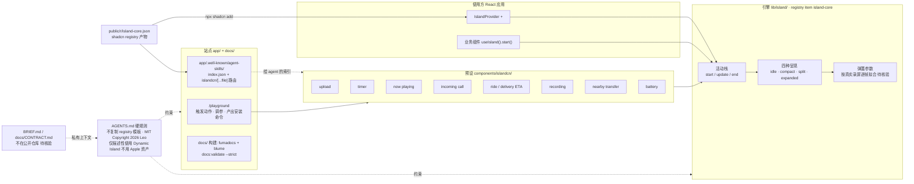

# opencoredev/islandcn

## 一句话定位
**React 的「Dynamic Island」引擎，以 shadcn registry 端点而非 git clone 分发** —— ⭐⭐⭐⭐⭐ 它的独特之处是**把 `AGENTS.md` 写成了一份给 coding agent 的路径归属与许可归属合同**，并在仓库里放了一个 `app/.well-known/agent-skills/index.json/route.ts` 路由 —— **即站点本身对外提供「给 agent 的技能索引」这个 HTTP 端点**。

## 它解决的问题
**应用需要展示「正在进行的事」**（上传进度、计时、正在播放、来电、骑行 ETA、录音、附近传输、电池）—— ⭐⭐⭐⭐⭐ 传统做法是每个应用自己写一个顶部浮层，而 Apple 的 Dynamic Island 交互形态（紧凑/分裂/展开三种呈现 + 长按 + 告警 + 减少动效）需要大量动效调校。

⭐⭐⭐⭐⭐ islandcn 把这套交互做成了一个可安装的引擎：**`npx shadcn@latest add https://islandcn.dev/r/island-core.json`**，然后在应用根部挂一次 `IslandProvider`，再从任意组件调 `island.start({...})` 拿到一个可控的活动句柄。

## 为什么值得关注（2026-11-15）
⭐⭐⭐⭐⭐ **因为它是本数据集里第一个把「给 coding agent 的上下文」当成一等工程对象的组件型项目** —— 不是在 README 里贴一段 prompt，而是在仓库根放 `AGENTS.md`、在站点里放 `/r/island-core.json` registry 端点、在 `app/.well-known/agent-skills/` 下放一个 HTTP 路由。

⭐⭐⭐⭐⭐ **可核验事实一：`AGENTS.md` 是一份合同，不是提示词。**

本日报实测该文件的内容（完整原文摘录）：

> # AGENTS.md
> Guide for coding agents in this repository: the islandcn site, the shadcn registry it publishes, and the island engine those items ship with. To build an island in another project, use the agent skill instead: `skills/islandcn/SKILL.md`.
>
> In Leo's local checkout, also read `BRIEF.md` for the goal and `docs/CONTRACT.md` for who owns which paths. Neither is in the public repo, and neither is the `reference/` folder.
>
> ## Hard rules
> - Every file is written for this repo. Don't copy from startercn, asciicn or any registry template.
> - The license is MIT, `Copyright (c) 2026 Leo`. Nobody else goes on it.
> - Copy the look and motion of Apple's island, never its assets. The product is islandcn. "Dynamic Island" may be used descriptively, as in the hero's "The open-source Dynamic Island for React", and the footer says islandcn is not affiliated with Apple. Still banned in anything a v[...]

⭐⭐⭐⭐⭐ **三条硬规则各自做了一件具体的事**：①禁止从 startercn/asciicn 等 registry 模板复制（守住原创性）；②许可归属唯一（`Copyright (c) 2026 Leo`，任何人不得改写）；③**区分「描述性使用」与「资产使用」** —— 可以写「The open-source Dynamic Island for React」，但不能使用 Apple 的资产。

⭐⭐⭐⭐⭐ **可核验事实二：它诚实地告诉外部 agent「有一部分上下文你拿不到」。**
原文：「In Leo's local checkout, also read `BRIEF.md`… **Neither is in the public repo**, and neither is the `reference/` folder.」⭐⭐⭐⭐⭐ 这与 11-13 记录的 `open-orange` 在 README 结尾写「**Do not change my app code**」是同一条思路：**把对 agent 的约束写成对人也成立的契约。**

⭐⭐⭐⭐⭐ **可核验事实三：站点对外提供 agent 技能索引。**
`app/.well-known/agent-skills/index.json/route.ts` 与 `app/.well-known/agent-skills/islandcn/[...file]/route.ts` 两个路由存在于 310 个 blob 之中 —— ⭐⭐⭐⭐⭐ **即 `/.well-known/agent-skills/` 是一个真实约定的路径前缀**，而不是随手起的目录。

⭐⭐⭐⭐⭐ **可核验事实四：它有真实的安全响应记录。**
4 个提交里的最后一个是：

```
2026-11-13T15:14:36Z | fix(security): bump next to 16.4.1 and override vulnerable transitive deps (#1)
```

⭐⭐⭐⭐⭐ **在发布后 3 小时内就处理了依赖漏洞并带上 issue 编号（#1）** —— 这是一个组织账号（56 个公开仓库、118 followers）的正常节奏。

⭐⭐⭐⭐⭐ **可核验事实五：README 的第一屏就是给 coding agent 的可粘贴指令。**
`AGENTS.md` 与 README 开头直接给出 `npx shadcn@latest add https://islandcn.dev/r/island-core.json` 与一段 `tsx` 示例（`IslandProvider` + `island.start({id, label, compact, expanded})` + `upload.update(...)` + `upload.end()`），⭐⭐⭐⭐⭐ **即它的 README 首先是给 agent 读的，其次是给人读的。**

## 热度来源判断
⭐⭐⭐⭐⭐ **真实需求 + 分发机制红利，两个来源都能部分核验。**

支持「真实」的一面：658⭐ / ⑂56 = **fork/star 8.5%**（在本日投放体普遍 0.7%–1.8% 的对照下明显更高），⭐⭐⭐⭐⭐ fork 更可能是真实使用者按 shadcn registry 的方式取用后留痕；**Organization 账号**（2025-06-25 创建、56 个公开仓库、118 followers）—— ⭐⭐⭐⭐⭐ 按 11-13 记录的判据，组织账号 + 已有仓库史是「非一次性账号」的正信号；310 个 blob、1.8 MB 体积、完整的 `app/` + `components/` + `lib/` + `docs/` 结构。

支持「含分发红利」的一面：⭐⭐⭐⭐⭐ **它是一枚「装了就能用」的 registry 组件**，`npx shadcn add` 这种安装方式天然带来 star；⭐⭐⭐⭐⭐ 且 4 个 commit / 0 个 issue / 0 个 subs 在 34 小时内的组合，无法区分「安静地做好了」与「还没被使用」—— ⭐⭐⭐ **star 增速未做统计，本日报不下结论。**

## 关键技术亮点
1. **registry 作为分发协议**：引擎以 `island-core` 这个 registry item 形式发布，端点是 `/r/island-core.json` —— ⭐⭐⭐⭐⭐ 即**用户拿到的是一份 registry JSON，而不是一个 git clone**，这也正是 `AGENTS.md` 里要求「不要从 startercn/asciicn 等 registry 模板复制」的原因。
2. **四种呈现形态 + 弹簧动画**：idle / compact / split / expanded，⭐⭐⭐⭐⭐ README 称弹簧参数是「fitted to frame-by-frame recordings of the real island」—— 即**用真实录屏逐帧拟合**而非凭感觉调参。
3. **活动栈模型**：`island.start()` 返回一个句柄，支持 `update()` 与 `end()`，⭐⭐⭐⭐⭐ 即**活动是对象而非状态字符串** —— 这让「上传中」这类可更新的活动有干净的 API。
4. **预设与内容套件分离**：引擎（`lib/island/`）与预设（`components/islandcn/`）分离，⭐⭐⭐⭐⭐ 每个预设「one file on the engine」。
5. **可编程 playground**：`/playground` 允许从预设或空白活动构建、触发所有动作、调参，并**直接产出安装命令与代码**。
6. **文档工具链**：`fumadocs-core` + `blume`（`docs:build` / `docs:validate --strict`），⭐⭐⭐⭐⭐ **文档有独立的严格校验命令**，说明文档被视为需要 CI 保证的产物。

## 架构师速览

| 决策问题 | 研究判断 | 证据边界 |
|---|---|---|
| 系统边界 | 「应用内顶部活动岛」= 引擎（`lib/island/`）+ 预设（`components/islandcn/`）+ 站点（`app/`）+ 文档（`docs/`）+ registry 产物（`public/r/`）；**站点与引擎同仓，但 registry 是分发边界** | `AGENTS.md` 明列四块职责 + `package.json` 的 `registry:build` / `docs:build` 脚本；⚠️ **未 clone、未构建、未取回 registry JSON** |
| 主路径 | 应用安装 registry item → 根部挂 `IslandProvider` → 组件调 `useIsland().start()` → 引擎压入活动栈 → 按呈现形态渲染 → 调用方 `update()` / `end()` | 主路径由 `AGENTS.md` 的 tsx 示例与 README 的「What's here」段给出；⚠️ **内部实现（栈的数据结构、弹簧参数、渲染层）本日报未打开核验** |
| 关键权衡 | ①**分发**：registry vs git clone —— registry 免 clone 但要求对方已有 shadcn 工具链；②**原创 vs 相似**：允许描述性使用「Dynamic Island」但禁用 Apple 资产 —— 换来可传播性、承担被指近似风险；③**上下文公开 vs 保密**：`AGENTS.md` 公开硬规则但 `BRIEF.md` / `docs/CONTRACT.md` 留在私有 —— 对外 agent 能读规则、读不到全部意图 | 三个权衡的**存在**均由文件证据证实；**每项的实际代价本日报未评估**（未测安装成功率、未测与真实 Apple 实现的差异、未读私有文档） |
| 最小 PoC | 在一个空 React + Tailwind + shadcn 项目里执行 `npx shadcn@latest add https://islandcn.dev/r/island-core.json` → 挂 `IslandProvider` + `<Island placement="viewport" />` → 用 `island.start()` 造一个 timer → 验证 compact/expanded 切换与长按 | PoC 范围由 README 的安装路径推导；**本日报未执行该命令**（会写入第三方项目，且需实际安装 registry item） |

## 架构启发
⭐⭐⭐⭐⭐ **第一条：当一个项目开始服务 coding agent，「上下文」就应该成为有版本、有边界、有校验的工程产物，而不是 README 里的一段话。** ⭐⭐⭐⭐⭐ 三件可抄的具体做法：①`AGENTS.md` 写成硬规则清单（每条规则可判定对错）；②明确写出「哪些文件不在公开仓库」；③把「描述性使用」与「资产使用」的边界写死。

⭐⭐⭐⭐⭐ **第二条：分发协议的选择会倒逼工程结构。** ⭐⭐⭐⭐⭐ 因为要以 registry item 发布，所以引擎必须与站点代码分离、预设必须「one file on the engine」、文档必须有独立的构建与校验命令。⭐⭐⭐⭐⭐ **这不是「先写代码再考虑怎么发」，而是「怎么发决定代码怎么长」** —— 这与 11-13 记录的 `Shape`（五种接入形态：CLI / SDK / C ABI / npm / cargo）是同一条线索。

⭐⭐⭐⭐⭐ **第三条：用真实录屏拟合动效。** ⭐⭐⭐⭐⭐ 「springs fitted to frame-by-frame recordings of the real island」把「动效手感」从审美猜测变成了可回归的工程输入。⭐⭐⭐⭐⭐ ⚠️ **本日报未逐帧比对，也未核验是否有可复现的录制数据入库**。

## 架构图（MMD）

> 证据边界：结构取自 `AGENTS.md`、`README.md`、`package.json` 与 `git/trees` 清单；标注「待核验」的为本日报未能独立验证的部分。



## 定位判断
**基础设施候选（组件型 / registry 分发）。** ⭐⭐⭐⭐⭐ 在「React 顶部活动岛」这个细分位置上，它是本数据集里唯一一个以 registry 协议正式分发的实现。⭐⭐⭐⭐⭐ 它更像「一个被打磨过的引擎 + 一套面向 agent 的工程规范」的组合体，而不只是「一个 UI 库」—— ⭐⭐⭐⭐⭐ **它真正稀缺的不是动效，而是那三条 `AGENTS.md` 硬规则与 `/r/island-core.json` 这条分发路径。**

## 风险/局限/泡沫点
- ⭐⭐⭐⭐⭐ **「Dynamic Island」一词的近似风险是真实的**：⭐⭐⭐⭐⭐ 项目自己在 `AGENTS.md` 里承认这条边界并写入「footer says islandcn is not affiliated with Apple」，⭐⭐⭐⭐⭐ **但这只能降低风险，不能消除 —— 一个 MIT 项目声称复刻 Apple 的交互并以「The open-source Dynamic Island for React」为 hero 文案，存在被 Apple 主张商标/外观问题的可能。** ⚠️ 本日报不评价法律结论。
- ⭐⭐⭐⭐⭐ **注册表分发依赖外部工具链**：需要已有 shadcn 环境才能安装，⭐⭐⭐⭐⭐ 增加了采用门槛；⚠️ **本日报未验证 `/r/island-core.json` 的实际可达性与完整性。**
- ⭐⭐⭐⭐⭐ **仅 4 个 commit、0 个 issue、0 个 subs，且无 release / 无 tag**：⭐⭐⭐⭐⭐ 658⭐ 的项目在 34 小时内的全部提交只有 4 条 —— ⭐⭐⭐⭐⭐ **这符合「一次性发布一个打磨好的东西」，但也意味着尚无长期维护记录可观察。**
- ⭐⭐⭐ ⚠️ **未核验项**：未 clone、未构建、未运行、未取回 registry JSON；弹簧参数未逐帧比对；私有文档内容不可知；`opencoredev` 组织下其他 55 个仓库未核验是否与本仓库同源或含推广型项目。

## 与同类项目的关系
- **vs Apple 原生 Dynamic Island（iOS）**：不可比的平台，但交互形态参照系明确。
- **vs 各类「shadcn 风格组件」仓库**：那些是**组件集合**（clone 后自行维护），⭐⭐⭐⭐⭐ islandcn 是**引擎 + registry 分发**，并额外提供了 `/playground` 与 agent 技能索引。
- **vs 11-13 的 `Shape`（五形态分发）** ⭐⭐⭐⭐⭐ 与 `Shape` 同属「把接入方式当成产品设计」的一类，但 islandcn 更进一步：它把**给 agent 的上下文**也做成了分发物。
- **vs 同日 `hikaku-extension`** ⭐⭐⭐⭐⭐ 两者都在「治理文件」上超出常规：hikaku 有 `PRIVACY.md` / `SECURITY.md` / `CONTRIBUTING.md` / `CHANGELOG.md`，islandcn 有 `AGENTS.md` + 严格文档校验。

## 是否值得持续跟踪
**值得，且 React 开发者可直接采用。** ⭐⭐⭐⭐⭐ 具体建议：
1. React 应用要做上传/计时/来电等顶部活动提示时，可直接装 registry item 试用；
2. **做 AI 编程工具适配的项目，应抄它的 `AGENTS.md` 写法** —— 硬规则清单 + 明确列出「哪些文件不在公开仓库」+ 区分描述性使用与资产使用；
3. 观察 Apple 是否对该 hero 文案采取行动（这会直接决定这个细分赛道的可行性）。

## 后续观察点
- `/r/island-core.json` 的实际可达性与版本策略（是否有语义化版本、变更如何通知下游）
- `islandcn-skill` 这个 agent skill 是否成为独立可安装项（`AGENTS.md` 提到 `skills/islandcn/SKILL.md`，但它在本仓库 `git/trees` 中未见 → ⚠️ 待核验）
- 是否出现 issue 与 release（当前 0 issue、0 release，将决定它是「作品」还是「项目」）
- Apple 或其法务对该命名/文案是否有动作
- 私有文档 `BRIEF.md` / `docs/CONTRACT.md` 是否会在某天公开（公开即意味着它把路径归属合同也对外了）

---
> 数据来源: GitHub API (2026-11-15) | Stars: 658 | Forks: 56 | Subscribers: 0 | License: MIT | 语言: TypeScript | 创建: 2026-11-13T11:50:50Z | owner 创建: 2025-06-25T23:57:23Z | Organization
