# KohakuBlueleaf/KohakUnlock

## 一句话定位
NVIDIA 显存改卡在 Linux 上的固件级解锁移植研究——**而它最有价值的资产不是解锁代码，而是那份把「失败之后该做什么」写成不可协商顺序的 `docs/SAFETY.md`。**

## 它解决的问题
**22 GB 版本的 NVIDIA 显卡在 Linux 上的软件栈（SPIR-V / Vulkan 驱动路径）跑不满性能**，除非让 GPU 加载一个「解锁版」固件，把原本被屏蔽的计算能力放开。

具体地：这些卡（2080 Ti 22 GB、3090 22 GB 等）在硬件层面被厂商限制了张量计算能力，而社区发现可以通过给 GPU 加载一份修改过的固件来解除这个限制。

**⭐ 而这带来一个极其特殊的工程约束：固件写入 GPU 是一次性的、有可能不可逆的、且失败时可能让整台机器起不来。**

**⭐⭐ 大多数同类项目只写「怎么做」，而这个项目花了大篇幅写「如果失败了怎么办」。**

## 为什么值得关注（2026-10-26）
**⭐⭐⭐ 因为它是本日唯一一个「把高权限、可能造成物理损坏的操作」写出了完整失败模型与不可逆边界的样本——而这份文档的质量远超它的代码量。**

可核验的硬事实：

1. **⭐⭐⭐ `docs/SAFETY.md` 写出了本日报见过最硬的失败模型之一**（原文）：

   > Once writes may have reached the GPU, an unverified result retains DMA backing/BAR ownership and a driver_override string that prevents NVIDIA matching this device. **The boot hook MUST check `handoff_safe` and halt before udev/NVIDIA if it is not Y.**
   >
   > Do not delete the driver_override, unload the module, free memory, force-bind NVIDIA or continue from the failure shell. **Capture the console, then fully power off/on into the known-good entry. SSH cannot recover a host stopped before networking starts.** A warm reboot may not reset all GPU state. **Do not automatically retry an uncertain hardware mutation.**
   >
   > **Timeouts bound software polling but cannot guarantee recovery from an unresponsive PCI/MMIO transaction. A successful host simulation is not evidence of hardware quiescence. A successful unlock boot is not long-term stability certification.**

2. **⭐⭐⭐ 默认构建即为「禁用硬件执行」**：`make module` **默认构建一个 hardware-execution-disabled 模块**，需 `make module ENABLE_EXPERIMENT=1` 才能编入可执行版本，**且运行时仍需额外参数**。`make test` 是 CPU-only、firmware-free、**no GPU or sudo needed**。
3. **⭐⭐⭐ 精确 profile 绑定，而非按型号名**：只认 BDF **42:00.0**、Leadtek subsystem IDs、**精确的原生固件哈希/描述符**、22 GiB 容量、workspace=1、observed selectors 0/0。README 明写「**Same marketing name or VBIOS version is insufficient**」。
4. **⭐⭐⭐ `AGENTS.md` 把 agent 本身也纳入边界**：「Default tasks are offline source/tests only. **Do not load a module, access BARs, change bindings, reboot, modify boot settings or run firmware without explicit authorization and verified recovery access.**」「**Do not weaken guards to make another board run.**」「**Keep runtime source and model tests synchronized; label simulations vs hardware evidence.**」「**No automatic public hardware runner in CI.**」
5. **⭐⭐⭐ 结果表连「没赢的地方」都写了**：2080 Ti FP16→FP32 32×8×16：**59.9 → 111.0 TFLOPS（+85.3%，同卡前后对比）**；**而 FP16→FP16 对照组 119.5 → 118.5（基本不变）**；125-shape sweep 中位数 57.71 → 88.24（**+52.9%，明确标注 not same-card A/B**）；单张 3090 的 8192³ PyTorch GEMM 73.03 → 122.76（**+68.1%**，标注功耗上限 370 W → 360 W）。

## 热度来源判断
**⭐⭐ 热度来自一个真实存在且有大量关注者的硬件话题，但这个项目的采用信号极弱——它更像一份研究记录，而不是一个被使用的工具。**

- **⭐⭐ 账号背景可核验且历史悠久**：`KohakuBlueleaf` 创建于 **2020-01-09**，**110 个公开仓库**，**1,028 followers**。**不是新号。**
- **⭐⭐⭐ 而采用信号极弱**：**contributors API 返回 1 人**、**`releases` API 返回 0 个**、**仅 3 个 commit**、**subscribers 2**、topics 为空数组、oi 3。** **⭐⭐ 即：148⭐ 而零发布、零协作、62 KB 代码。**
- **⭐⭐⭐ 而 21 小时 148⭐ 的速度本身是可解释的**：NVIDIA 改卡是一个有明确受众的话题（显存矿工 / AI 训练用户 / 二手卡玩家），**⭐⭐ 而一个 148⭐ 的小项目能拿到这个量级，与「项目质量」的关联度远低于「话题热度」的关联度。**
- **⭐⭐⭐⭐ 而本日报必须记录的最重要的一点是：**这是一个可能损坏硬件的操作，而它的关注面只有 2 个 subscribers。** **⭐⭐ 这两件事放在一起，说明「热度」与「风险」在本项目上是脱钩的——**而这恰恰是它自己的 `docs/SAFETY.md` 想要对抗的误读方式。**

## 关键技术亮点

1. **⭐⭐⭐ `handoff_safe` —— 跨越不可逆点之前的 fail-closed 门**
   启动钩子**必须**检查 `handoff_safe`，若不是 `Y` 则**在 udev/NVIDIA 之前停机**。
   **⭐⭐⭐ 这是本日报见过最干净的「不可逆操作门」设计：门的位置在「加载 GPU 驱动之前」，检查的是一个显式的布尔信号，失败时的动作是「停下」而不是「继续」。**

2. **⭐⭐⭐ 不可逆性被显式化而不是被隐藏**
   README 明写：「**No module unload path exists for the executor. Reboot is the lifecycle boundary.**」
   **⭐⭐ 即它不提供卸载路径，因为卸载路径在「写已经到达 GPU」之后是不存在的。** **⭐⭐⭐ 而「重启即生命周期终点」这句话把「我要怎么回滚」这个用户必然会问的问题，直接回答在了设计上。**

3. **⭐⭐⭐ 精确 profile 绑定**
   只接受：BDF **42:00.0** + Leadtek subsystem IDs + **精确的原生固件哈希/描述符** + 22 GiB 容量 + workspace=1 + observed selectors 0/0。
   **⭐⭐ 而 README 明写「Same marketing name or VBIOS version is insufficient」** ——即**它拒绝按营销名或 VBIOS 版本号匹配，因为那会误伤别人的卡。**
   另有一条：「Existing device binding causes refusal; **never unbind a working display GPU to bypass this**」——**⭐⭐ 即它拒绝通过解绑正在使用的显示卡来绕过检查。**

4. **⭐⭐⭐ 明确列出的「不做什么」**
   「No VBIOS flashing, fuse programming, bus-wide reset, power-limit modification or overclock is implemented.」
   **⭐⭐⭐ 即：它不刷固件、不烧熔丝、不做总线级复位、不改功耗限制、不超频。** **⭐⭐ 这几项恰恰是同类项目里最常见也最危险的操作——它一条都不做。**

5. **⭐⭐⭐ 默认关闭执行**
   `make module` 默认构建 **hardware-execution-disabled** 模块；`ENABLE_EXPERIMENT=1` 才编入执行能力，且运行时仍需额外参数。
   **⭐⭐⭐ 即：即使有人 clone 下来直接编译，产物也是**不能执行硬件操作**的。** **⭐⭐ 这与「默认安全」是同一条原则在硬件领域的再现——本日报本日已在 brotli-checker（不主动发探针）与 ub-mode（原则需工具执行）处见到同一原则的不同形态。**

6. **⭐⭐⭐ 物理改造与软件解锁的严格区分**
   README 明写：「**The 22 GB cards are physically VRAM-modded, not factory 22 GB models. Both the unlocked card and locked comparison card already had that modification. This software unlock does not add VRAM, and the repository does not provide a memory-soldering guide.**」
   **⭐⭐⭐ 三层声明：**① 这些卡本来就是物理改过的，不是原厂 22 GB；② 对照卡也是改过的；③ **本项目不增加显存，且不提供焊接指南。**
   **⭐⭐⭐⭐ 即：它主动掐死了最容易被误读的主张——「用这个软件就能把 8 GB 变 22 GB」。**

7. **⭐⭐⭐ `NOTICE.md` 的完整溯源链**
   组合源码为 **GPL-2.0-only**（`LICENSE`），但保留上游许可文本（`LICENSES/CMP40HX-MIT.txt`、`LICENSES/NVIDIA-MIT.txt`、`LICENSES/NVIDIA-driver-COPYING`、`LICENSES/copyleft-next-0.3.1.txt`）；
   - `kernel/tu102_core_port.h` 与 `tests/test_core_port.c` 改编自 `haohervchb/Turing-unlock`（commit `a188b24a392414f29f931ea886329227cfbc2f98`，copyleft-next 0.3.1）
   - 后者又来自 `PZH1gdmu/CMP40HX-Unlock`（MIT, Copyright (c) 2026）
   - 再往下是 CMP 90HX (GA102) 解锁工作与 Jon Pry 的「A Canary in the Crypto Mine」(DOI 10.5281/zenodo.20916112)
   **⭐⭐⭐ 而它明写两句免责：「Public availability is not by itself redistribution permission」「No upstream endorsement implied」。**

8. **⭐⭐ 仿真与硬件证据的分离**
   `AGENTS.md`：「**Keep runtime source and model tests synchronized; label simulations vs hardware evidence.**」
   `make test` = CPU-only、firmware-free 离线测试；`make test-private ASSETS=...` = 协议模型模拟。
   **⭐⭐ 即它明确区分「仿真跑过了」与「硬件验证过了」——这两者在本项目里差着一个数量级的置信度。**

9. **⭐⭐ 结果表里的自我否定比自我肯定更有信息量**
   「A successful kernel log alone is not proof of higher throughput」
   「BF16/TF32 are not added to Turing」
   「This is not a claim of a 2× application/game speedup」
   **⭐⭐⭐ 而 125-shape sweep 的 +52.9% 明确标注「not same-card A/B」——即它没有把非同卡对比包装成同卡对比。**

## 架构师速览

| 决策问题 | 研究判断 | 证据边界 |
|---|---|---|
| 系统边界 | 四层结构：① **离线源与测试层**（`kernel/` + `tests/` + `tools/`，`make test` 无需 GPU 或 sudo）② **受限执行层**（`make module` 默认编译为禁用硬件执行的模块；`ENABLE_EXPERIMENT=1` 才编入执行能力，运行时仍需额外参数）③ **一次性启动门**（initramfs 钩子必须在 `handoff_safe != Y` 时于 udev/NVIDIA 之前停机）④ **不可逆边界**（无卸载路径，重启即生命周期终点）。**⭐ 边界划在「不提供固件、不提供刷写工具、不提供自动安装器、不做超频/熔丝/总线复位」**。**⭐⭐ 而边界之外它接受一件事：可能永久损坏硬件——并且把它写成「Capture the console, then fully power off/on into the known-good entry」这样可执行的指令 | `docs/SAFETY.md` 的 Defaults / Failure model / Profiles 三节原文、README 的「Start here」「Offline entry points」与「Results」节、`AGENTS.md` 四条禁止项与三条实践项、仓库根树文件清单、`LICENSES/` 四份上游许可文本、`NOTICE.md` 溯源链。**⭐ `tools/` 五个脚本与 `docs/TURING.md` / `docs/AMPERE.md` / `docs/AGENT-GUIDE.md` / `docs/RESULTS.md` 本窗口未读；`kernel/` 内部结构未逐文件核验；oi 3 的内容未核验** |
| 主路径 | ① 读 `docs/SAFETY.md`（**必须先读**）→ ② 读 `docs/AGENT-GUIDE.md` → ③ `make test`（CPU-only、firmware-free、no GPU or sudo needed）→ ④ `make test-private ASSETS=...`（私有输入的协议模型模拟）→ ⑤ `make module`（**默认禁用硬件执行**）→ ⑥ `make module ENABLE_EXPERIMENT=1`（**需已审查的精确 profile**）→ ⑦ 一次性启动 → ⑧ **⭐ 验证 `handoff_safe`** → ⑨ 失败则**完全断电重启**进 known-good 入口（**不是 warm reboot**）。**⭐⭐ 而整条路径上「加载模块 / 访问 BAR / 改绑定 / 重启 / 改启动设置 / 跑固件」这六件事，`AGENTS.md` 要求全部有显式授权与已验证的恢复通道** | README 的「Start here」与「Offline entry points」两节、`docs/SAFETY.md` 的 Defaults 段（默认关闭执行、execute=1 + 精确历史 BDF、身份/容量/原生固件/外部资产均校验不猜测）、`AGENTS.md` 的四条禁止项、`Makefile` 的 `module` / `test` / `test-private` / `ENABLE_EXPERIMENT` 目标。**⭐ initramfs 钩子的实际装载流程（如何注入、如何读 `handoff_safe`）本窗口未核验** |
| 关键权衡 | **⭐⭐ 硬件实验 vs 安全边界**（选「把执行默认关掉 + 失败模型写成不可协商顺序 + 接受可能永久损坏」——**⭐⭐ 代价是绝大多数用户永远无法使用它，因为安全路径要求物理控制台**）· **⭐⭐ 精确 profile vs 型号通用**（选精确绑定，**代价是覆盖率极低**——只有极少数卡能用）· **⭐⭐ 物理改造 vs 软件解锁的区分**（明写软件解锁不增加显存、不提供焊接指南——**代价是可能被误读，而它用一句声明堵住**）· **⭐ 仿真 vs 硬件证据的分离**（AGENTS.md 要求 label，**代价是读者要自己分辨哪条结论来自哪一层**）· **⭐⭐ 不提供卸载路径 vs 提供一个可能有害的卸载**（选「重启即生命周期终点」，**代价是用户必须接受「一次失败可能需要断电」**）· **⭐ GPL-2.0-only vs 组合许可**（选 GPL-2.0-only 并保留上游文本，**推测是为了覆盖 copyleft-next 上游的衍生约束——README 未给动机说明**）· **⭐ 主动停止 vs 尽力恢复**（`handoff_safe` 门失败即停机，**代价是「停机」本身可能就是一台开不了的机器——但它明说了 SSH 救不回来，并要求走物理/BMC 路径**）· **⭐⭐ 「不要自动重试一次不确定的变更」** | `docs/SAFETY.md` 原文、`AGENTS.md` 四条、`README.md` 的免责声明与「Not a universal unlocker」定位句、`NOTICE.md` 溯源链、`LICENSES/` 四份文本。**未明示：解锁后的长期稳定性（明写「not long-term stability certification」）；不同 SKU 的覆盖情况；实际故障率** |
| 最小 PoC | 1. **⭐⭐ 第一步不是编译，是读 `docs/SAFETY.md` 全文** —— 确认你的场景是否落在它的禁区（活着的生产卡 / 没有物理或 BMC 控制台的机器 / 无法接受「一次失败要断电」的环境）→ 2. **⭐ 读 `docs/AGENT-GUIDE.md`** → 3. **⭐⭐ `make test`**（README 明写 CPU-only、firmware-free、**no GPU or sudo needed**）—— **这一步验证的是「协议逻辑可离线跑通」** → 4. **⭐ `make test-private ASSETS=...`**（若有私有输入）→ 5. **⭐⭐ 关键步骤：`make module` 并检查产物默认不执行硬件** —— **这一步验证的是「默认关闭」这个最重要的安全属性** → 6. **⭐ 读 README 的 Profiles 段，确认你的卡是否满足全部五项**（BDF、subsystem ID、固件哈希、容量、selectors）→ 7. **⭐⭐ 若你有匹配 profile 的卡**，才进入 `ENABLE_EXPERIMENT=1` 路径；**且在此之前先确认你有物理/BMC 控制台与断电能力** —— **⭐⭐ 这一步是硬前提，不是建议** → 8. **⭐ 一次性启动后立即验证 `handoff_safe`** → 9. **⭐ 失败时严格按 `docs/SAFETY.md` 执行**：捕获控制台 → **完全断电重启**进 known-good 入口（**不是 warm reboot**）→ **不要自动重试** | **第 3、5 步是本 PoC 唯一的「在硬件上之前」的可执行步骤**（第 5 步是唯一能证伪其「默认关闭」主张的步骤）· **第 7 步是硬前提** · **第 9 步是它全部文档价值兑现的地方** · 本 PoC **不覆盖** 任何真实 GPU 硬件变更 · **不覆盖** X11/多显示器/长时间稳定性 · **不覆盖** 其他 SKU · **不覆盖** 任何「已解锁状态下的性能长期稳定性」（作者自己声明不覆盖） |
## 架构启发

**⭐⭐⭐ 核心启发（本日报认为这是本日最值得抄的一条）：不可逆操作的设计目标不是「成功」，而是「失败时你知道该做什么」。**

`docs/SAFETY.md` 的全部内容可以归结为一句话：**失败之后的具体动作是什么。** 而它给出的答案是极其具体的：
- 捕获控制台 → **完全断电重启**（明说 warm reboot 可能无法重置全部 GPU 状态）
- **SSH 救不回来**（因为机器在网络起来之前就停住了）——**⭐⭐ 即它连「怎么远程救」这个用户最想听的答案都直接给了「不行」**
- **不要自动重试一次不确定的硬件变更**

**⭐⭐⭐⭐ 而这三条里最有价值的是「不要自动重试」。** 因为在自动化流程里，「失败了再试一次」是几乎所有人的默认反应——**而在硬件写入这种场景下，「再试一次」可能把「一次不确定的失败」变成「两次确定的损坏」。** **⭐⭐⭐⭐⭐ 这条规则与本日报本日记录的 KohakUnlock 的其他主张、以及 ex-ussr 的「审计前置」是同一条原则：**不可逆操作必须有一个明确的前置门和一个明确的后置失败剧本，两者都不能由执行者临场发挥。**

**⭐⭐⭐ 第二个启发：把「我不会做什么」写得比「我会做什么」更详细。**

「No VBIOS flashing, fuse programming, bus-wide reset, power-limit modification or overclock is implemented.」
「No module unload path exists for the executor. Reboot is the lifecycle boundary.」
「No automatic persistence installer exists. First attempt must be a one-time boot with a separate known-good default.」
「the repository does not provide a memory-soldering guide.」

**⭐⭐⭐⭐ 而这四条合起来构成一个完整的边界声明——它们覆盖了同类项目里最常见也最危险的几类操作。** **⭐⭐⭐⭐⭐ 值得与本日报记录的 brotli-checker 的「Do not send malformed streams or exploit probes」对照：两者是同一条工程直觉在不同领域的再现——**主动声明自己不做什么的人，才值得被信任它说自己做了什么。**

**⭐⭐⭐ 第三个启发：把「仿真跑通了」与「硬件验证过了」在文档层面分开标注。**

`AGENTS.md`：「Keep runtime source and model tests synchronized; **label simulations vs hardware evidence**.」而结果表里那个 +52.9% 明确标注「not same-card A/B」——**⭐⭐ 即它连自己数据里的弱点都标出来了。**
**⭐⭐⭐⭐ 而这一条正是本日趋势 3 的反面教材：**xss-audit 的 star 涨了 103% 而 commits 仍是 1、mcreplay 的 star 涨 64% 而 subs 仍是 0 —— **「热度」与「证据」是两个独立的轴，而 KohakUnlock 是本日唯一把这两个轴明确分开标注的项目。**

**⭐⭐ 第四个启发：精确绑定比通用匹配更安全。**

「Same marketing name or VBIOS version is insufficient」+「never unbind a working display GPU to bypass this」——**⭐⭐ 即它宁愿只覆盖极少数卡，也不愿在一个判断上出错。** **⭐⭐⭐ 而这与本日报记录的 brotli-checker「精确 profile 指纹 + 逐副本结论」是同一族思路：在可能造成伤害的场景里，宁可保守到不可用。**

## 架构图（MMD）

> 证据边界：此图只采用本档案已有可核验描述；「待核验」节点不应视为项目实现事实。

```mermaid
flowchart TB
  Reader[阅读者] --> Safety["docs/SAFETY.md 必读<br/>Defaults / Failure model / Profiles<br/>把失败之后该做什么写成不可协商顺序"]
  Safety --> Guide[docs/AGENT-GUIDE.md]
  Guide --> Offline[离线层<br/>make test CPU-only firmware-free<br/>no GPU or sudo needed<br/>make test-private 协议模型模拟]

  Offline --> Build[make module 默认构建<br/>hardware-execution-disabled 模块<br/>产物默认不能执行硬件操作]

  Build --> Gate{精确 profile 绑定<br/>BDF 42:00.0<br/>Leadtek subsystem IDs<br/>精确原生固件哈希与描述符<br/>22 GiB 容量 workspace=1 selectors 0/0<br/>Same marketing name or VBIOS version is insufficient}

  Gate -->|不匹配| Refuse[拒绝执行<br/>Existing device binding causes refusal<br/>never unbind a working display GPU to bypass this]
  Gate -->|匹配且授权| Enable[make module ENABLE_EXPERIMENT=1<br/>编入执行能力 运行时仍需额外参数<br/>execute=1 精确历史 BDF]

  Enable --> Boot[一次性启动 initramfs 钩子]

  Boot --> Safe{handoff_safe 是否为 Y}
  Safe -->|是| Handoff[交接给 udev 与 NVIDIA 正常路径]
  Safe -->|否或未验证| Halt[MUST halt before udev/NVIDIA<br/>Fail-closed 停在不可逆点之前]

  Halt --> Capture[捕获控制台]
  Capture --> PowerOff[完全断电重启进 known-good 入口<br/>不是 warm reboot<br/>warm reboot 可能无法重置全部 GPU 状态]
  PowerOff --> NoRetry[不要自动重试一次不确定的硬件变更]

  Halt -.SSH 无法恢复.-> NoSSH[机器在网络起来之前已停机<br/>SSH cannot recover a host stopped<br/>before networking starts<br/>需要物理或 BMC 控制台]

  Enable --> Results[结果表<br/>2080 Ti FP16 到 FP32 32x8x16<br/>59.9 到 111.0 TFLOPS 加 85.3% 同卡前后<br/>对照组 FP16 到 FP16 119.5 到 118.5 基本不变<br/>125-shape sweep 57.71 到 88.24 加 52.9% 标注 not same-card A-B<br/>3090 8192 立方 PyTorch GEMM 73.03 到 122.76 加 68.1%<br/>标注 A successful kernel log alone is not proof<br/>not a claim of 2x application or game speedup]

  NoVBIOS[明确不做的事<br/>No VBIOS flashing<br/>No fuse programming<br/>No bus-wide reset<br/>No power-limit modification<br/>No overclock<br/>No module unload path<br/>Reboot is the lifecycle boundary<br/>No automatic persistence installer<br/>First attempt must be a one-time boot<br/>with a separate known-good default]

  Notice[NOTICE.md 溯源链<br/>组合源码 GPL-2.0-only 保留上游许可文本<br/>kernel tu102_core_port.h 与 tests test_core_port.c<br/>改编自 haohervchb Turing-unlock a188b24a<br/>来自 PZH1gdmu CMP40HX-Unlock MIT 2026<br/>再往下为 CMP 90HX GA102<br/>与 Jon Pry A Canary in the Crypto Mine<br/>DOI 10.5281 zenodo.20916112<br/>Public availability is not by itself redistribution permission<br/>No upstream endorsement implied] --> Build

  Mod[物理改造与软件解锁的区分<br/>The 22 GB cards are physically VRAM-modded<br/>not factory 22 GB models<br/>Both unlocked and locked comparison card<br/>already had that modification<br/>This software unlock does not add VRAM<br/>and the repository does not provide<br/>a memory-soldering guide] --> ResultBound

  ResultBound[结果与定位边界<br/>Source-first research on volatile NVIDIA<br/>tensor-compute unlocks<br/>Not a universal GPU unlocker] --> Results

  Agents[AGENTS.md<br/>Do not load a module access BARs change bindings<br/>reboot modify boot settings or run firmware<br/>without explicit authorization and verified recovery access<br/>Do not weaken guards to make another board run<br/>label simulations vs hardware evidence<br/>No automatic public hardware runner in CI] -.约束.-> Build

  Risk[硬件风险自述<br/>can hang a GPU or host, prevent boot,<br/>corrupt data, or damage hardware<br/>There is no guarantee of recovery<br/>Timeouts bound software polling but cannot<br/>guarantee recovery from an unresponsive PCI/MMIO transaction<br/>A successful unlock boot is not<br/>long-term stability certification] -.约束.-> Enable
```

## 定位判断
**研究记录 + 受限实验工具（Research record with a fail-closed experiment gate）。**

在 GPU 改卡这个领域里，它的位置是「**把社区已有成果移植到 Linux，并把它做成了可审计的工程**」。**⭐⭐ 而它与前作的关系是可核验的：`kernel/tu102_core_port.h` 与 `tests/test_cort_port.c` 改编自 `haohervchb/Turing-unlock`，后者又来自 `PZH1gdmu/CMP40HX-Unlock`（MIT, 2026）**——**即它站在一条清晰的移植链上，而 `NOTICE.md` 把这条链完整记录了下来。**

**⭐⭐⭐ 从架构位置看，它的独特性不在 GPU 技术，而在「它把失败剧本当成一等产出」。** 绝大多数同类项目的文档结构是「原理 → 使用 → 效果」，而这个项目的结构是「**边界 → 失败模型 → 默认关闭的实现 → 结果（含对照组与否定句）**」。

**⭐⭐⭐⭐ 而本日报认为这正是它最值得被关注的原因：一个可能损坏硬件的项目，最需要的不是更好的代码，而是更好的失败剧本。而它把这一项做到了本批最完整的程度。**

**⭐⭐ 而它的「观察型」定位也是准确的：3 commits、0 releases、1 contributor、subs 2。** **⭐⭐ 即它不是一个要被依赖的工具，而是一份**可以被学习的方法论样本**——包括它的边界声明写法、它的结果表写法（带对照组与否定句）、它的溯源链写法。**

## 风险 / 局限 / 泡沫点

- **⚠️⚠️⚠️ 这是本批风险最高的项目，因为它做的是「在 Linux 上以特权执行 GPU 固件」。** README 自述风险：「can hang a GPU or host, prevent boot, corrupt data, or damage hardware. **There is no guarantee of recovery.**」**⭐⭐ 而它的安全设计（默认关闭、精确绑定、失败剧本）降低的是**误操作**的概率，不是硬件损坏本身的概率。**
- **⚠️⚠️⚠️⭐ 而本日报必须指出一个不舒服的事实：它的安全路径要求物理或 BMC 控制台，而它的关注面只有 2 个 subscribers。** **⭐⭐ 即：几乎没有人在持续关注这个可能损坏硬件的东西。** **⭐⭐⭐ 这是本日报认为最值得警惕的一点——项目的安全文档写得再好，也无法保护一个没人监督的实验。**
- **⚠️⚠️ 全部硬件结论均为作者自述，本日报未在硬件上验证任何一项。** 59.9 → 111.0 TFLOPS、+85.3%、+68.1% 等数字**均来自 README 的结果表**，未经第三方复现。
- **⚠️⚠️ 125-shape sweep 的 +52.9% 明确标注「not same-card A/B」** —— 即**这三个数字里有一个不是同卡对比**。作者标注了这一点（这是诚实的），但读者仍需自行区分。
- **⚠️⚠️ 作者自己声明「A successful unlock boot is not long-term stability certification」** —— **⭐⭐ 即「解锁成功」与「长期稳定」是两件事，而后者未被验证。**
- **⚠️ 精确 profile 绑定意味着覆盖率极低。** 只有极少数 BDF + subsystem ID + 固件哈希组合能用——**这是正确的取舍，但也意味着社区里绝大多数遇到同样问题的人无法使用它。**
- **⚠️ 3 commits、1 contributor、0 releases。** **⭐ 无版本、无变更记录、无 issue 反馈。** **⭐⭐ 而这是一个需要「在特定硬件上验证过的精确 profile」的项目——**没有 release 意味着没有「哪个版本对应哪个 profile」的可追溯记录。**
- **⚠️ `tools/` 五个脚本与 `docs/TURING.md` / `AMPERE.md` / `AGENT-GUIDE.md` / `RESULTS.md` 本窗口未读** —— 本档案对实现的评估基于 README 与 SAFETY 文档，不是对代码的审计。
- **⚠️ GPL-2.0-only 与 copyleft-next 上游的组合合规性本日报未独立核验** —— **⭐ 即 `NOTICE.md` 的溯源链是作者自述的，本日报只核验了链条的存在与 commit hash 的形式，未核验每一环的许可义务是否被满足。**
- **⚠️ 潜在的「解锁版固件」来源与分发问题**：项目本身不提供固件（明写），**但读者会从哪获得固件、该固件是否合法，本项目不回答也不负责。**

## 与同类项目的关系

- **⭐⭐⭐ vs `haohervchb/Turing-unlock` 与 `PZH1gdmu/CMP40HX-Unlock`**：**不是竞品，是被移植的上游**。`NOTICE.md` 明写 `kernel/tu102_core_port.h` 与 `tests/test_core_port.c` 改编自前者（commit `a188b24a392414f29f931ea886329227cfbc2f98`，copyleft-next 0.3.1），后者又来自 `PZH1gdmu/CMP40HX-Unlock`（MIT, 2026）。**⭐⭐⭐ 而三者的关键差异是工程规范而非技术：上游提供解锁逻辑，本项目提供的是「默认关闭 + 精确绑定 + 失败剧本 + 溯源链」这一整套工程外壳。**
- **⭐⭐⭐ vs 本日同日记录的 `trailofbits/brotli-checker` 与 `assetnote/node2shell-scanner`**：**⭐⭐ 这是本日最有价值的一组跨领域对照——三个项目的领域完全不同（GPU 固件 / Brotli 供应链 / HTTP 漏洞），但它们各自独立地做了同一件事：**
  - **把「我不能回答的问题」写进输出**：KohakUnlock 的「not long-term stability certification」/ brotli-checker 的「exit 0 does not establish that the running app is fixed」/ scanner 的 `INCONCLUSIVE` 状态
  - **把「我不做的事」逐条列明**：KohakUnlock 的「No VBIOS flashing…」/ brotli-checker 的「Do not send malformed streams or exploit probes」/ scanner 的「does not execute a command」
  - **⭐⭐⭐ 三者都拒绝给出一个全局的布尔结论**
  **⭐⭐⭐ 而这个「三领域同构」是本日报趋势 1 与趋势 4 的真正交集——它不是巧合，而是一批更成熟的项目在同步收敛到同一种工程语言。**
- **⭐⭐ vs `unclebob/ub-mode` 与 `DenisSergeevitch/ex-ussr-kinship-research`（本日同期另两位 key_project）**：**⭐⭐ 三个都是给 AI agent 用的东西，且都用一份 Markdown 把边界写给 agent**（`AGENTS.md` / `SKILL.md`）。**⭐⭐ 而差异在边界类型：KohakUnlock 的边界是**物理上**不可做（不刷固件、不卸载模块），另两个的边界是**流程上**不应做（不再第三次修复 / 不过验证码）。** **⭐⭐⭐ 而 KohakUnlock 是三者中唯一有真实物理后果的——因此它的边界写得最硬、也最值得学。**
- **⭐ vs 本日报记录的 `mirkobrombin/raven` 的 `LICENSES.json`**：**⭐⭐ 同一条「把声明结构化」原则的不同应用** —— raven 结构化的是许可边界，KohakUnlock 的 `NOTICE.md` 结构化的是**代码来源与溯源链**。**⭐⭐⭐ 而两者都做了一件关键的事：**没有假装自己是原创的**——raven 明写「Earlier MIT grants remain valid」，KohakUnlock 明写「Public availability is not by itself redistribution permission」。**
- **⭐ vs 通用 GPU 固件刷写工具**：**⭐⭐ 那些工具提供的是「把任意固件写进 GPU」的能力，而这个项目提供的是「在极窄的条件下解锁一种特定卡」+「一整套失败剧本」。** **⭐⭐ 前者是能力，本日报本日观察到的这个项目是**责任模型**。**

## 是否值得持续跟踪
**值得，但跟踪方式应与它的定位一致：作为方法论样本跟踪，而不是作为可用工具跟踪。**

- **⭐⭐⭐ 理由一：它的 `docs/SAFETY.md` 是本日报本日最值得抄的一份失败剧本写法。** 具体到可以逐条迁移：「明写失败后的动作顺序」「明写恢复手段的边界（SSH 不行）」「明写不要自动重试」「明写仿真是仿真不是硬件证据」。**⭐⭐⭐ 而这四条在任何涉及不可逆操作的项目里都适用——而这类项目在 AI 辅助编程的浪潮里正在变多。**
- **⭐⭐⭐ 理由二：它是一个极好的「反面教材的正向样本」** —— 一个只有 3 个 commit、62 KB、0 release 的小项目，在**文档的严格性**上超过了几百个 commit 的同类仓库。**⭐⭐ 这说明「工程规范」与「代码量」是两个独立的轴。**
- **⭐⭐ 理由三：精确 profile 绑定的思路可迁移** —— **⭐⭐ 「Same marketing name or VBIOS version is insufficient」这条判据，可以直接用在任何「按名字匹配硬件/服务/依赖」的误伤场景。**
- **⭐⭐⭐⭐ 而本日报认为最需要持续观察的是它的实际采用情况：**subs 2、3 commits、0 releases —— **⭐⭐ 如果它在 30 天内仍然没有第二个 commit 且 subs 仍是个位数，那么它更可能是一份「写完就放下的记录」；而如果出现 release 与外部 PR，则说明它的失败剧本正在被真实使用并迭代。** **⭐⭐⭐⭐ 本日报倾向于前者（它更像一份研究成果），但保留观察。**
- **⚠️ 使用建议：不要在生产 GPU 或唯一一台机器上尝试。** 若要评估，正确姿势是「读它的 SAFETY 与 AGENTS 文档，把它的失败剧本模式抄走」，而不是运行它。

## 后续观察点

1. **⭐⭐⭐ 是否出现第二个 commit / 首个 release / 第一个外部 PR** —— **⭐⭐⭐ 这是判断「研究记录」与「持续维护的工具」的分水岭**，且它对一个需要「精确 profile」的项目尤为关键（没有 release 就没有「版本 ↔ profile」的可追溯记录）。
2. **⭐⭐⭐ 是否有人按它的失败剧本成功恢复了** —— **⭐⭐ 即 `docs/SAFETY.md` 的那套流程有没有被真实使用过。这份文档的价值只有在被用过之后才成立。**
3. **⭐⭐ `subscribers_count` 是否从 2 增长** —— **⭐⭐ 在一个可能损坏硬件的项目上，关注面本身就是一种安全指标。**
4. **⭐⭐ 是否会扩展到更多 SKU / 更多 GPU 架构**（Ampere / Hopper）—— **⭐⭐ 即 `docs/AMPERE.md` 是否会被真正填充内容。**
5. **⭐ 是否会补充独立第三方复现** —— **⭐⭐ 目前全部数字均为作者自述；一次独立复现（含 FP16→FP16 对照组）会大幅提升可信度。**
6. **⭐⭐ 「不要自动重试一次不确定的变更」这条规则是否会出现在别处** —— **⭐⭐⭐ 本日报认为这是本日最值得观察的扩散点：一条与硬件无关的通用工程规则，如果被广泛采纳，其价值远超这个项目本身。**

---
> 数据来源: GitHub API (2026-10-25T22:55:09Z 快照) | Stars: 148 | Forks: 9 | Subscribers: 2 | Open Issues: 3 | License: GPL-2.0（根 LICENSE）+ LICENSES/ 四份上游许可文本 | 语言: C | 创建: 2026-10-25T01:18:54Z | pushed: 2026-10-25T01:24:59Z | 3 commits | contributors 1 人 | releases 0 个 | topics 0 | 62 KB
> 附: 账号 `KohakuBlueleaf` 创建于 2020-01-09，110 个公开仓库，1,028 followers；溯源链 `haohervchb/Turing-unlock`（commit a188b24a392414f29f931ea886329227cfbc2f98，copyleft-next 0.3.1）← `PZH1gdmu/CMP40HX-Unlock`（MIT, Copyright (c) 2026）← CMP 90HX (GA102) 解锁工作 ← Jon Pry「A Canary in the Crypto Mine」(DOI 10.5281/zenodo.20916112)
> 证据边界: 全部硬件结论（+85.3% / +52.9% / +68.1% 等）均为作者自述，本日报未在硬件上验证任何一项；`tools/` 五个脚本与 `docs/TURING.md` / `AMPERE.md` / `AGENT-GUIDE.md` / `RESULTS.md` 未读；`kernel/` 内部结构未逐文件核验；oi 3 内容未核验；GPL-2.0-only 与 copyleft-next 上游的组合合规性未独立核验
