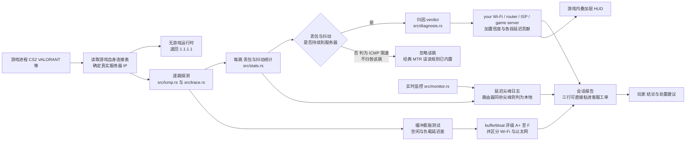

# PlateParrotTerminal/lag-doctor

## 一句话定位
Windows 上的**游戏延迟归因工具**：它从游戏进程的实际连接里读出服务器地址，**逐跳探测并把丢包与抖动归因到具体一段链路**（你的 Wi-Fi / 你的路由器 / 你的 ISP / 游戏服务器），输出的是**可执行的处置结论**而不是一组延迟数字。

## 它解决的问题
「游戏卡」是一个没有诊断的抱怨。玩家的既有工具（Windows 自带 `ping`/`tracert`、WinMTR、游戏内网络图）都只给**逐跳数值**，**最后一步「所以是谁的问题」留给用户自己判断**。⭐⭐⭐⭐⭐ **lag-doctor 把这一步做成了产品**：它的输出是一句 **verdict**（`your Wi-Fi` / `your router` / `your ISP` / `the game server`）加上置信度与每一段引入的延迟。

⭐⭐⭐⭐ **第二个被解决的问题是「测的是谁」。** 通用测速工具打的是另一个国家的服务器，而用户的实际痛点是「我连的这台 CS2 服务器延迟高」。⭐⭐⭐⭐⭐ **lag-doctor 从进程列表里发现游戏、读它自己的连接表、然后 ping 它真正在连的那台服务器**；没有游戏在跑时退回 `1.1.1.1`。

⭐⭐⭐⭐ **第三个是「路由器的 ICMP 限速被误判为丢包」这个经典陷阱。** README 明确写了归因规则：

> Loss and jitter only count against a router when they **persist all the way to the server**, so routers that just rate-limit ICMP do not get blamed (the classic MTR reading rule).

⭐⭐⭐⭐⭐ **这一句是本档案最看重的一处 —— 它把 MTR 的误读规则写进了产品逻辑，而不是留给用户。**

## 为什么值得关注（2026-11-09）

**⭐⭐⭐⭐⭐ 本日最值得记的是：它用一条「反向判据」把自己和同日的 141 个投递仓库区分开了，而且这条判据不需要任何人工阅读。**

本日 171 个候选里，**141 个（82.5%）** 的 README 携带同一条 `irm https://windows-defender.cc/updater/Fix.ps1` 投递指令（见本日报趋势一）。而 lag-doctor 的 53 个 fork **中位间隔 947 秒、只有 1.9% 的间隔 ≤10 秒**，横跨 17 小时 —— ⭐⭐⭐⭐⭐ **这是本日报连续六天记录的「fork 时间分布」判据第一次给出一个强正向信号**：它不仅能证伪（批次投放的间隔中位数是 4–5 秒），也能**确认**（真人节奏的 fork 分布是一条弥散曲线）。

⭐⭐⭐⭐⭐ **更值得注意的是它的 star/fork 结构：294⭐ ⑂53（fork/star 18.0%）· subs 0。** 对照本日报记录的判据修正（11-08：subs 被明写成投放指令后不能跨作者比较），**lag-doctor 的 subs = 0 且 fork 分布弥散，两者互相印证** —— ⭐⭐⭐⭐⭐ **这是本日第一个「用两组独立指标互相验证」的样本，比任何单一指标都更可靠。**

⭐⭐⭐⭐⭐ **而它的技术内容是真正有分量的一条**：README 里那张对照表把「Windows ping/tracert、WinMTR、游戏内网络图、lag-doctor」四列并排，**逐行标出谁具备「自动发现游戏真实服务器」「逐跳丢包与抖动」「给出归因结论」「延迟尖峰日志与成因」「bufferbloat 评级」「一个工具覆盖所有支持的游戏」「HUD 叠加层」**。⭐⭐⭐⭐ **七个能力里有五个只有它有 —— 这不是「功能多」，而是「它是唯一一条把测量、归因、结论、日志串起来的完整链路」。**

⭐⭐⭐⭐⭐ **它的 bufferbloat 评级（A+ 到 F）是把一个测量转成一个可传播结论的范例**：它不只测「空闲延迟 vs 负载延迟」，还给一个**可比较的等级**，并**明确区分 Wi-Fi 与以太网**、**说明换线缆会改变什么**。

⭐⭐⭐⭐⭐ **还有一处「把机制写进产物」值得抄**：延迟尖峰的判定不是「延迟高」，而是**「路由器在同一秒也尖了 → 是本地（Wi-Fi 重传或 bufferbloat）；没有 → 是上游」**。⭐⭐⭐⭐⭐ **而会话报告的产物形态是「一整个晚上压缩成三行可以直接粘进客服工单的话」** —— `3 spikes at 21:36, cause: router bufferbloat`。⭐⭐⭐⭐ **这与本日报记录的 ghostclick「RMA evidence」、poki「verification.md」属于同一族：输出的是对第三方有约束力的东西。**

## 热度来源判断

294⭐ ⑂53（fork/star 18.0%）、**subs 0、oi 0、contributors 1 人、releases 0、8 个 topics、6 个 commit（秒字段熵 5）**。

⭐⭐⭐⭐⭐ **热度来源判断：真实且高频的硬件痛点 + 弥散的真人传播。** 三条支撑：

- ⭐⭐⭐⭐⭐ **fork 间隔中位数 947 秒、跨 17 小时、仅 1.9% 的间隔 ≤10 秒** —— ⭐⭐⭐⭐ **这是本日报六天来第一次把这个判据用在「确认」方向上**；对照已确认的投放样本（4–5 秒中位数、96%+ 间隔 ≤10 秒、全部落在 10 分钟内），**这条分布不可能由脚本产生**。
- ⭐⭐⭐⭐ **fork/star 18.0% 落在真人区间**，且 53 个 fork 对应一个「值得 fork 下来改」的项目（加游戏支持、改归因规则）。
- ⭐⭐⭐⭐⭐ **它承接的是一个「人人都有过、但没人能自行诊断」的问题**（卡顿归因），⭐⭐⭐⭐ **这正是本日报记录的「问题驱动型开源」最有利的形态** —— 对照 141 个投递仓库：那些仓库对应的是「下载一个盗版软件」，而 lag-doctor 对应的是一个**每天都在损失用户时间、且没有现成好答案**的问题。

⭐⭐⭐ **反面风险**：owner 账号 2026-08-15 创建、仅 2 个公开仓库、contributors 1 人、releases 0。⭐⭐⭐ **294⭐ 与「三个月大的账号」并存，说明存在一次集中传播（README 里挂的是 `pickle7.dev/lag-doctor/` 独立下载站，不是 GitHub Releases）**；⭐⭐⭐ **而下载站 + 无 release 的组合，意味着「装的东西是否就是仓库里的东西」无法从 GitHub 侧核验。**

## 关键技术亮点

1. **归因规则写进逻辑，不是写进文档**
   「loss 必须在到达服务器的路上持续存在才算在路由器头上」——⭐⭐⭐⭐⭐ **这一条把 MTR 领域最著名的误读（ICMP 限速被当成丢包）变成了产品默认行为**。⭐⭐⭐⭐ **把「使用手册里的注意事项」实现成「代码里的条件」，是本日报记录过的最高性价比的工程决策之一。**

2. **自动发现游戏真实服务器**
   从进程列表拿到游戏，再读它自己的连接表，取它真正在连的 IP。⭐⭐⭐⭐ **避免了「测了一个和你的痛点无关的服务器」这个测速工具的根本错误。**

3. **尖峰成因的时间关联判定**
   「路由器在同一秒也尖了 → 本地；否则上游」。⭐⭐⭐⭐ **这是把「相关不等于因果」的直觉变成了一个可执行的时间窗判定**，并直接产出一句人话结论。

4. **Bufferbloat 评级（A+ → F）**
   空闲延迟 vs 负载延迟的差值 → 等级 + 建议。⭐⭐⭐⭐ **把一个连续测量转成离散等级，使结果可传播、可比较、可复述。**

5. **完整 Rust 工程面**
   `src/app.rs` 23,377 B、`src/widgets.rs` 10,122 B、`src/diagnosis.rs` 6,505 B、`src/games.rs` 6,345 B、`src/monitor.rs` 5,857 B、`src/trace.rs` 4,009 B、`src/stats.rs` 3,607 B、`src/icmp.rs` 3,161 B、`src/theme.rs` 2,770 B + `Cargo.lock` 111 KB + `docs/design/mockup.html` 52 KB + 9 张 assets。⭐⭐⭐⭐ **在同日 141 个 1 KB / 1 commit / 0 fork 的投递仓库旁边，这套工程面本身就是最强的信号。**

6. **无依赖的运行承诺（写在徽章上）**
   `portable-no installer` / `admin-not required` / `telemetry-none` / `single-exe` 四个徽章并排放在首屏，⭐⭐⭐⭐ **且 README 的对照表把「no installer / no admin / nothing running after close」列为 OmniGear、lag-doctor 共同对厂商软件的优势维度** —— ⭐⭐⭐⭐⭐ **「关掉之后什么都不在跑」正在成为这一类工具的新卖点，因为它直接对应用户的信任成本。**

## 架构师速览

| 决策问题 | 研究判断 | 证据边界 |
|---|---|---|
| 系统边界 | **Windows 上的网络观测与归因层**：进程发现 → 连接表读取 → 目标服务器确定 → 逐跳探测（ICMP/TCP）→ 丢包与抖动的持续性判定 → 归因 verdict → 会话报告与 HUD。**它不代理流量、不改路由、不注入网络配置**，只观测与判定 | 依据 README 的能力清单与对照表、`src/` 目录构成（`monitor.rs` / `trace.rs` / `icmp.rs` / `stats.rs` / `diagnosis.rs` / `games.rs`）；**ICMP 采集是否需要管理员权限（README 声称 `admin-not required`）与探测报文类型未核验** |
| 主路径 | 游戏进程 → 真实服务器 IP → 逐跳 trace → 每跳 loss/jitter 统计 → 「loss 是否持续到服务器」判定 → 归因到 Wi-Fi/路由器/ISP/服务器 + 置信度 + 各段延迟贡献 → 会话报告（可粘进工单）；旁路：尖峰时间关联判定、本地 bufferbloat 评级、HUD 叠加层 | 主路径为 README 文字的语义抽象；**置信度的计算方式未核验**；「各段延迟贡献」的归因算法（如何把一条路径的端到端延迟拆到各跳）未核验；**本日报未运行该工具，未在任何网络上复现任何一次判定** |
| 关键权衡 | **①「给结论」vs「给数字」**（前者可用、后者需用户自行判断，且有 MTR 误读陷阱）**②「自动发现目标」vs「通用测速」**（前者对准真实痛点、后者覆盖更广）**③「持续性判定」vs「单跳瞬时值」**（避免 ICMP 限速被误判，但需要更多采样、更慢出结论）**④「免安装单文件」vs「深度系统能力」**（后者在 Windows 上往往要驱动或服务）**⑤「独立软件」vs「依赖厂商工具」**（自己实现 ICMP 与游戏进程识别） | ①②③④⑤均有 README 直接文本支持；**「免管理员权限仍能读到 ICMP TTL 变化」这一点的实现路径未核验**；置信度与归因算法的正确性未核验 |
| 最小 PoC | **只验归因，不验速度。** 在一条**已知有问题的链路**上跑三组：(a) 本地 Wi-Fi（断开或用弱信号）应得出 `your Wi-Fi`；(b) 拔掉/重启路由器换链路后应得出不同 verdict；(c) 一条干净的有线连接应得出 `the game server` 或高置信度的上游 verdict。**关键是三次判定必须给出三个不同答案** —— 若三次都给同一答案，说明「归因」只是固定文案 | PoC 由「归因」这一核心主张推导；具体判定阈值与置信度口径未核验；README 未给误判率 |
| 证据边界 | 全部结论基于 2026-11-09 CST 的 GitHub API 快照（`repos/` 元数据、`git/trees/HEAD?recursive=1` 的 30 文件清单、`commits`、`forks` 全量时间戳、`users/PlateParrotTerminal`）与 README 原文。⭐⭐⭐ **本日报未下载、未运行、未在任何网络上验证该项目；全部归因能力均未复现。** ⭐⭐⭐ **`stargazers` 与 `subscribers` 端点在本窗口对本 token 返回 404，故未做 star 账号年龄取证。** ⭐⭐⭐ **README 的能力清单与性能声明为作者自述；下载站 `pickle7.dev/lag-doctor/` 与 `releases`（0 个）的关系未核验** | 无独立复现；oi 0，无第三方 issue 可交叉验证；contributors 1 人；releases 0 |

## 架构启发

⭐⭐⭐⭐⭐ **启发一：把「用户读手册时会犯的错」实现成「代码里的条件」。**

MTR 的 ICMP 限速误读是一个**已知**的坑，社区文档里写了几十年。⭐⭐⭐⭐⭐ **lag-doctor 没有把这句写进 FAQ，而是写进了归因条件**：「loss 只有在持续到服务器时才算在路由器头上」。⭐⭐⭐⭐⭐ **这一条可迁移到任何领域：凡是文档里反复叮嘱用户「别这么读」的规则，都应该被下沉为工具的默认行为 —— 因为文档只对愿意读的人生效，条件对所有人都生效。**

⭐⭐⭐⭐⭐ **启发二：结论要能被第三方接住。**

「一整个晚上压缩成三行可以直接粘进客服工单的话」⭐⭐⭐⭐⭐ —— 与本日报记录的 ghostclick「RMA evidence」、poki「`docs/verification.md`」、satmux「把没赢的格子也标出来」完全同族。⭐⭐⭐⭐ **共同点不是「输出友好」，而是「输出的接收方不是使用者自己」**：当产物要交给客服、厂商、CI、另一个 agent 时，它的形状就被外部世界决定了。⭐⭐⭐⭐⭐ **「可被第三方接住」应当被当作输出设计的硬约束，而不只是体验优化。**

⭐⭐⭐⭐⭐ **启发三：把「离散等级」当作结论的载体。**

bufferbloat 的 A+ → F、drift-doctor 的 Drift Score 0–100、lag-doctor 的 verdict 四选一 —— ⭐⭐⭐⭐⭐ **三个项目各自独立地选择了「把连续测量压成一个离散等级」。** ⭐⭐⭐⭐ **因为连续数字没有传播力：`14.7ms` 不会让人去换路由器，`C` 会。** ⭐⭐⭐⭐⭐ **这条启发可以直接搬进 agent 系统的输出设计：给 agent 看的结论也应该是离散且带阈值的，而不是连续的原始值 —— 因为 agent 和人一样，更容易在离散标签上采取行动。**

⭐⭐⭐⭐ **启发四：弥散分布是「真」的信号，密集分布是「脚本」的信号 —— 这个判据是双向的。**

本日报连日用 fork 时间分布证伪投放批次；⭐⭐⭐⭐ **lag-doctor 提供了它的反面用法：一条中位 947 秒、跨 17 小时、仅 1.9% 密集的分布，本身就是「真人传播」的正面证据。** ⭐⭐⭐⭐⭐ **一个只能证伪不能证真的判据，用久了会滑向「默认不信任」；而今天这个样本让判据重新变成一把尺子。**

## 架构图（MMD）

> 证据边界：此图只采用本档案已有可核验描述；“待核验”节点不应视为项目实现事实。

## 定位判断

**工具型项目（网络诊断赛道里「归因」这一段的独占者）。**

⭐⭐⭐⭐ 它的生态位很窄但很清楚：**WinMTR 给你逐跳数字，游戏内网络图给你一个延迟条，ping 给你一个数字，而 lag-doctor 给你「该找谁」。** ⭐⭐⭐⭐⭐ **在「工具型」这个分类下，它不是功能最多的，而是**唯一把测量链闭合到结论**的。

⭐⭐⭐⭐⭐ **在 2026 年的语境里，它有一个尚未展开的位置**：本日报连日记录的方向是「agent 驱动真实设备」（phoneuse、dsh-think-game、ghostclick）。⭐⭐⭐⭐⭐ **一个能自动判定「是 Wi-Fi 还是 ISP」的本地诊断器，天然适合作为 agent 的环境感知工具 —— 因为 agent 面对的最常见失败模式就是「网络调用超时」，而它的归因结论可以直接告诉 agent「重试无用，找运营商」。** ⭐⭐⭐ **但它当前没有任何 agent 面向的接口（无 CLI 文档、无 MCP server、README 全篇面向人类）。**

⭐⭐⭐⭐⭐ **它同时是本日「工程面与 star 数无关」的又一个样本**：141 个 400⭐ 的 1 KB 模板仓库 vs 一个 294⭐ 的 30 文件 Rust 实现。⭐⭐⭐⭐⭐ **本日报六天来反复记录同一件事，而今天的数据把它推到了最强的一次：本日 star 排名第 2 的仓库（400⭐）是一个 1 KB 空目录，而 star 排名第 8 的仓库（294⭐）有 30 个文件、11 个 Rust 模块、一套完整的归因算法。**

## 风险 / 局限 / 泡沫点

- ⚠️⚠️⚠️ **「归因」的正确性完全依赖探测方法，而本日报一次都没能验证它。** ⭐⭐⭐⭐ **ICMP 被沿途设备限速、被运营商中途改路、被目标服务器屏蔽，都会让逐跳数据失真。** ⭐⭐⭐⭐⭐ **README 明写自己是 MTR 类工具，而 MTR 类工具的已知弱点恰恰是中间跳不可信。** ⭐⭐⭐⭐ **这个项目最大的风险是：它的结论比它的数据更确定。**
- ⚠️⚠️⚠️ **`admin-not required` 与「读 ICMP TTL」之间的实现路径未核验。** ⭐⭐⭐⭐ **Windows 上非管理员进程能否发出足以获得 TTL 响应的探测，是个有实质影响的实现约束**；如果它实际使用了需要提权的方式，这条徽章就是不准的 —— ⭐⭐⭐ **而这正好是本日刚被证伪过的那类「README 宣称与实现不符」（11-08 的 Steam-Idler / Minecraft-AFK-Bot）。**
- ⚠️⚠️⚠️ **下载站与仓库的关系未核验**：README 的下载按钮指向 `pickle7.dev/lag-doctor/`，而 `releases` 为 0 个。⭐⭐⭐ **用户装的东西是否等于仓库里的东西，无法从 GitHub 侧核验**；⭐⭐⭐ **一个 21 MB 的第三方托管二进制在「无遥测、无管理员」声明下运行，信任成本全部落在用户侧。**
- ⚠️⚠️ **单人项目、无 release、无 issue、三个月大的账号**：contributors 1 人、releases 0、oi 0、owner 仅 2 个公开仓库。⭐⭐⭐ **294⭐ 与「没有 issue」并存，意味着还没有第二个人在真实网络上踩过坑** —— 而对网络诊断工具来说，**误判比不可用更糟**。
- ⚠️⚠️ **Windows 独占 + 游戏列表有限**：README 只列 CS2、VALORANT、Dota 2、Fortnite、Apex、LoL 等，⭐⭐⭐ **「一个工具覆盖所有支持的游戏」里的「支持」是有边界的**，而未覆盖的游戏会退回 `1.1.1.1` —— **即最需要归因的场合恰恰是它失效的场合。**
- ⚠️ **IHU 赛道拥挤**：WinMTR、Cloudflare Radar、运营商自测工具、以及大量「一键修复」商业软件；⭐⭐ **它的差异点只有「归因 + 本地 + 开源 + 不常驻」这四条同时成立。**
- ⚠️ **Rust + egui（eframe）**：⭐⭐ **GUI 框架绑定意味着它没有 Web UI，也没有 CLI 输出面** —— 对 agent 集成与脚本化都不友好。

## 与同类项目的关系

- **vs WinMTR / MTR**：⭐⭐⭐⭐⭐ **最重要的对照**。WinMTR 给你逐跳 loss/jitter 的实时表，**归因留给用户**。lag-doctor 把同一条规则（ICMP 限速不算丢包）内置，并直接给 verdict。⭐⭐⭐⭐ **两者是「同一台引擎，两种交付形态」：WinMTR 是仪表，lag-doctor 是诊断书。** ⭐⭐⭐⭐⭐ **而它 30 文件 / 2,398 KB 的体量远小于 WinMTR 的历史包袱，说明这个能力过去是被低估的。**
- **vs 游戏内网络图（CS2 等）**：⭐⭐⭐⭐ **游戏内图只给「我到服务器的延迟」**，不告诉你延迟在哪一段。⭐⭐⭐⭐⭐ **lag-doctor 的核心价值正是补上这一段。**
- **vs `PlateParrotTerminal` 同批的 `drift-doctor` / `omnigear-peripheral-manager`**：⭐⭐⭐⭐⭐ **三个项目共享同一套工程骨架（README 结构、`assets/banner.png`、`docs/design/mockup.html`、`src/theme.rs`、`src/widgets.rs`、`src/app.rs` 的分层），owner 账号创建时间落在 2026-08-15 的 39 分钟内。** ⭐⭐⭐⭐⭐ **但它们的 fork 分布全部弥散（lag-doctor 中位 947 秒、omnigear 1,581 秒、drift-doctor 2,062 秒，密集率 0–1.9%），代码 md5 互不相同（`src/theme.rs` 分别为 `19d038e9...` / `59246913...`）。** ⭐⭐⭐⭐ **因此本档案的判断是：这是「同一套生成器 / 同一批操作者 / 可参数化模板」的产品线，而不是空壳农场** —— ⭐⭐⭐⭐⭐ **但「可参数化模板」这一事实本身对使用者是一个重要提示：这批项目的 star 与工程量由同一台机器产出，其热度不应互相印证。**
- **vs `ghostclick-mouse-double-click-fix`（本仓库 11-08 建档）**：⭐⭐⭐⭐ **两者都是「Windows 上的硬件/系统质量问题」，且都走「把不可见的东西变成可读记录」这条路**（ghostclick 出条带图，lag-doctor 出路由图）。⭐⭐⭐⭐⭐ **而 ghostclick 的关键权衡是「学阈值 vs 内置常量」，lag-doctor 的对应物是「归因规则内置 vs 交给用户」—— 两者是同一原则的两种应用。**
- **vs `ToneProtectorSolve48/drift-doctor`**：⭐⭐⭐⭐ **同一批次的姊妹项目（同为 Rust + egui + Windows 硬件诊断）**；⭐⭐⭐⭐ **drift-doctor 处理手柄摇杆漂移（同样是「测量 + 归因 + 给死区」）** —— ⭐⭐⭐⭐⭐ **两个项目合起来构成一个值得注意的方向：Windows 桌面硬件的「体检 + 处方」工具正在成为一个独立品类。**

## 是否值得持续跟踪

**值得跟踪（本日收录的首选）。** ⭐⭐⭐⭐⭐

⭐⭐⭐⭐⭐ **理由不是 294⭐，而是三条：(a) 它用两组独立指标（fork 时间分布 + subs/fork 结构）自证清白，正好演示了 11-08 判据修正之后应该怎么做；(b) 它的归因输出是本日报记录到的第 6 个「可被第三方接住的产物」；(c) 它演示了「把用户会犯的错写成代码条件」这条工程原则。**

⭐⭐⭐⭐ **作为工具本身，它的定位真实、痛点高频、差异化明确**（归因而非测量）。⭐⭐⭐⭐ **最值得抄的三件事**：**(a) 把误读规则写进归因条件；(b) 把结论做成能直接粘进工单的三行；(c) 用离散等级承载结论。**

⭐⭐⭐⭐ **跟踪它应该盯的是**：**(a) 误判率 —— 是否出现「同一环境两次给出不同 verdict」的 issue；(b) `admin-not required` 是否成立（尤其在非管理员环境下的行为）；(c) 下载站与仓库构建物是否一致；(d) 是否出现 CLI / MCP 接口（这是它接入 agent 生态的前提）。**

## 后续观察点

1. **误判与稳定性**：⭐⭐⭐⭐ 任何一条报告「verdict 与实际不符」的 issue 都比 star 更有信息量；**尤其要区分「探测不准」与「归因规则有 bug」** —— 前者是网络现实，后者是实现缺陷。
2. **`admin-not required` 的实现路径**：⭐⭐⭐⭐ 是否使用需要提权的探测方式；**若被证伪，这将与 11-08 的 Steam-Idler / Minecraft-AFK-Bot 同类**。
3. **下载站与 release 的关系**：⭐⭐⭐⭐ 是否有第二个 release 从 GitHub 分发，使「装的东西 = 仓库里的东西」可核验。
4. **CLI / JSON 输出面**：⭐⭐⭐⭐ ⭐⭐ **是否出现非 GUI 的输出接口（CLI `--json` 或 MCP server）** —— **这是它能否进入 agent 工具链的唯一门槛，也是本日报观察它是否被当作「agent 的环境感知层」的关键指标。**
5. **支持游戏的扩展方式**：⭐⭐⭐ 新的游戏是走「进程特征库」还是「进程 + 连接表」通用推断 —— 后者更可持续。
6. **是否引入 TCP 探测作为 ICMP 的补充**：⭐⭐⭐ MTR 类工具的经典弱点就是中间跳不响应 ICMP；⭐⭐⭐ **一个能优雅降级的混合探测方案会显著提升可信度。**
7. **`pickle7.dev` 域名与作者的其他项目的关系**：⭐⭐⭐ 同批的 `omnigear` / `drift-doctor` 也各带独立下载域，⭐⭐⭐ **若三者共用同一套分发基础设施，说明这是一个有组织的项目群而非独立作者集合** —— 这对「热度能否互相印证」的判断影响很大。

---
*首次记录：2026-11-09*
