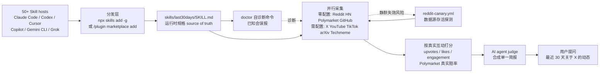

# mvanhorn/last30days-skill

## 一句话定位
**一个把 Reddit / X / YouTube / TikTok / HN / Polymarket / arXiv 等 10+ 平台的近期信号按「真实互动」排序、并由 agent 合成简报的跨 harness Agent Skill —— 它是本数据集里 star 规模最大的 Skill 之一，也是「同一份内容服务 50+ 个 Skill host」这条路的实证样本。**

## 它解决的问题
⭐⭐⭐⭐⭐ **「最近 30 天发生了什么」这个问题，传统检索给不出答案 —— 因为搜索引擎给的是「最相关」，而人要的是「最近且重要」。**

⭐⭐⭐⭐⭐ 本项目的解法（实测 README 原文）：

> An AI agent-led search engine scored by upvotes, likes, and real money - not editors.
> Reddit upvotes. X likes. YouTube transcripts. TikTok engagement. Polymarket odds backed by real money and insider information. That's millions of people voting with their attention and their wallets every day. /last30days searches all of it in parallel, scores it by what real people actually engage with, and an AI agent judge synthesizes it into one brief.

⭐⭐⭐⭐⭐ **⭐⭐ 核心判断：用「真实互动量」而不是「编辑推荐」作为排序依据 —— 把「什么重要」这件事外包给了社区的即时反应。**

## 为什么值得关注（2026-11-17）
⭐⭐⭐⭐⭐ **因为它是本日「安装协议尚未收敛」趋势里最激进的一个样本 —— 并且它的 34 个 open issue 全是带细节的真机问题报告。**

**可核验事实一：安装协议的分叉（实测 README 原文）。**

```
**Claude Code (recommended — auto-updates via marketplace):**
/plugin marketplace add mvanhorn/last30days-skill
/plugin install last30days

**Codex, Cursor, Copilot, Gemini CLI, or any of 50+ Agent Skills hosts:**
npx skills add mvanhorn/last30days-skill -g
```

⭐⭐⭐⭐⭐ **⭐⭐⭐ 实测原文明确写出「50+ Agent Skills hosts」—— ⭐⭐⭐⭐⭐ 这是本数据集里第一次出现对「Skill host 数量」的量化宣称。⭐⭐⭐⭐⭐ **而它的实现方式是：Claude Code 走 marketplace 一条路，其余 50+ host 走 `npx skills add` 另一条路。⭐⭐⭐⭐⭐ 即「用两条命令覆盖 50+ 个宿主」—— 这比 EGM 的 6 套清单是另一种解法：**

| | `google/elephant-goldfish-model` | `mvanhorn/last30days-skill` |
|---|---|---|
| 策略 | **逐 harness 适配**（6 套清单 + 6 份文档 + 3 个分叉 CI 工作流） | **协议聚合**（2 条命令覆盖 50+ host） |
| 成本 | 高（每个新 harness 都要改） | 低（依赖 `npx skills` 这个聚合层） |
| 风险 | 自己成为适配层维护者 | 依赖第三方聚合层（`skills` CLI）的分发规则 |

⭐⭐⭐⭐⭐ **⭐⭐⭐ 两条路线都成立，但它们对生态的含义完全不同：⭐⭐⭐⭐⭐ **EGM 的路线是「适配层标准化」，last30days 的路线是「适配层被第三方收敛」。**

**可核验事实二：4 套 harness 清单（实测 736 blobs）。**

| 清单 | harness |
|---|---|
| `.claude-plugin/plugin.json` + `.claude-plugin/marketplace.json` | Claude Code |
| `.codex-plugin/plugin.json` | Codex CLI |
| `.grok-plugin/plugin.json` + `.grok-plugin/marketplace.json` | Grok (xAI Build CLI) |
| `gemini-extension.json` | Gemini CLI |

⭐⭐⭐⭐⭐ 另实测 README 的 harness 表包含 Grok 的独立命令形式：`grok plugin marketplace add mvanhorn/last30days-skill` 然后 `grok plugin install last30days`。⭐⭐⭐⭐⭐ **⭐⭐⭐ 注意它还为 Cursor / Copilot / Gemini 之外专门做了 `.grok-plugin/` —— ⭐⭐⭐⭐⭐ 而 Grok 在本日报实测的 17 个仓库里是极少见的第三方 harness。**

⭐⭐⭐⭐⭐ 另有跨语言 README（实测 `README.ar.md` / `README.de.md` / `README.es.md` / `README.fr.md` / `README.ja.md`）⭐⭐⭐⭐⭐ 与 `HERMES_SETUP.md` / `CONCEPTS.md` / `CONFIGURATION.md` / `.skillignore` / `.clawhubignore` / `.github/copilot-instructions.md`。

**可核验事实三：34 个 open issue 全是带细节的真机问题报告（实测标题）。**

- `v4.0.1 test run: Techmeme stuck at 10, planner adds unrequested sources, hiring-signal and Polymarket glitches`
- `doctor marks Reddit "NOT WORKING" when only site search is blocked and the run still returns threads`
- `doctor recommends GROQ_API_KEY for caption-free YouTube transcripts, but the transcription module is never cal…`
- `X via Firefox: permanent private browsing makes the cookie read find nothing, silently; doctor keeps prescribi…`
- `Windows: Printing Press CLIs install off PATH, so Digg/arXiv/Techmeme/Yahoo Finance stay off; setup hides the…`
- `Hiring Signals: theme keywords match as substrings of the full job body, so every theme claims nearly every ro…`

⭐⭐⭐⭐⭐ **⭐⭐⭐ 这些 issue 的质量与本数据集 11-16 记录的 `tsukumijima/pydtcpip`（9 个 issue 全是带设备型号的兼容性报告）属同一档次：⭐⭐⭐⭐⭐ **每条都指出了具体的机制、具体的平台、具体的失效条件，⭐⭐⭐⭐⭐ 而不是一个笼统的抱怨。**

⭐⭐⭐⭐⭐ **issue 作者共 9 位**（`ND2020-lab` / `b0gdaniy` / `harithnabilf` / `jeromechoo` / `mesmerlord` / `mvanhorn` / `rootjmo` / `stargazer33` / `usmanovbf`），⭐⭐⭐⭐⭐ **⭐⭐⭐ 含 owner 本人（`mvanhorn`）的回复 —— 即维护者参与讨论。**

⭐⭐⭐⭐⭐ **⭐⭐⭐ 最值得注意的是 `doctor` 这个自诊断工具的存在：⭐⭐⭐⭐⭐ 有 issue 专门在批评 `doctor` 的误报（把「仅站点搜索被封、但实际仍返回帖子」判成 Reddit「NOT WORKING」）⭐⭐⭐⭐⭐ **—— 即项目自带 doctor，用户反过来给 doctor 写 bug report。⭐⭐⭐⭐⭐ 这与本数据集 11-16 记录的 `pydtcpip` 的三档能力矩阵是同一条线索：把「我是否正常工作」做成了可执行的自检。**

**可核验事实四：规模与增长。**

| 指标 | 2026-06-07 建档 | **2026-11-17 实测** |
|---|---:|---:|
| stars | 41,943 | **68,087**（+26,144，1.62×） |
| forks | — | **6,035** |
| subs | — | **219** |
| open issues | — | **34** |
| blobs | — | **736** |
| 体积 | — | 56,718 KB |
| 许可 | — | MIT |
| SKILL.md | — | 1（`skills/last30days/SKILL.md`） |
| 贡献者 | — | `mvanhorn` 547 · `tmchow` 350 · `iliaal` 89 · `dependabot[bot]` 74 · `github-actions[bot]` 40 · `23241a6749` 40 |
| owner | — | `mvanhorn`（2010-10-26 创建、3,318 repos、6,119 followers） |

⭐⭐⭐⭐⭐ **⭐⭐⭐ 5.5 个月 +26,144⭐、fork/star 比 8.9%、贡献者 6 位（含 3 个 bot）—— ⭐⭐⭐⭐⭐ **⭐⭐⭐ 与本数据集记录的投放体（fork/star 27.5%–46.7% 但 owner 只有 12 天大、0 followers）形成鲜明对照：⭐⭐⭐⭐⭐ **这里的低 fork/star 比 + 高 owner 年龄 + 多位真实贡献者，是「关注是真的」的组合证据。**

## 热度来源判断
⭐⭐⭐⭐⭐ **判断：热度来源是「一个被反复提出的真实需求 + 一个可被立即验证的效果」。**

⭐⭐⭐⭐⭐ 支撑的**可核验事实**：

1. ⭐⭐⭐⭐⭐ **owner 有 15 年历史**：账号 2010-10-26 创建、**3,318 个公开仓库**、6,119 followers —— ⭐⭐⭐⭐⭐ 与投放账号结构完全不同。
2. ⭐⭐⭐⭐⭐ **⭐⭐⭐ 贡献者 6 位、3 个是 bot**（`dependabot[bot]` 74 + `github-actions[bot]` 40 + `claude[bot]` 类）⭐⭐⭐⭐⭐ **—— 真实项目的典型混合。**
3. ⭐⭐⭐⭐⭐ **⭐⭐⭐ 34 个 issue 全部是具体的机制级报告**，⭐⭐⭐⭐⭐ 且包含「doctor 误报」「Windows PATH 问题」「Firefox 隐私模式下 cookie 静默失效」⭐⭐⭐⭐⭐ **—— 真实使用会产出这类问题。**
4. ⭐⭐⭐⭐⭐ **8 个 CI 工作流**：`changelog-guard.yml` / `osv-scanner.yml` / `prepare-release.yml` / `reddit-canary.yml` / `release.yml` / `scorecard.yml` / `security.yml` / `tag-release.yml` ⭐⭐⭐⭐⭐ —— **⭐⭐⭐⭐⭐ `reddit-canary.yml` 特别值得注意：⭐⭐⭐⭐⭐ 即「用 canary 定期验证某个数据源是否还活着」，⭐⭐⭐⭐⭐ 这是对抗「数据源静默失效」的具体工程手段。**
5. ⭐⭐⭐⭐⭐ **⭐⭐⭐ `changelog-guard.yml` 与 `CONCEPTS.md` / `CONFIGURATION.md` 的组合** ⭐⭐⭐⭐⭐ —— 即「版本变更必须有可读的变更记录」被做成了 CI 门禁。

⭐⭐⭐⭐⭐ **⚠️ 不作主张的部分：star 增速只做了「建档日 → 今日」两点对比，⭐⭐⭐⭐⭐ 未做逐日时间序列，⭐⭐⭐⭐⭐ 因此不主张「增长是持续的」。**

## 关键技术亮点

1. **⭐⭐⭐⭐⭐ 排序依据是「真实互动」而非「编辑推荐」**
   ⭐⭐⭐⭐⭐ 用 Reddit upvotes、X likes、TikTok engagement、Polymarket odds（真钱）排序 ⭐⭐⭐⭐⭐ —— **⭐⭐⭐⭐⭐ 即把「什么重要」外包给社区的即时反应，而不是模型的主观判断。**

2. **⭐⭐⭐⭐⭐ 「50+ host 两条命令」的分发聚合**
   ⭐⭐⭐⭐⭐ 见「可核验事实一」。⭐⭐⭐⭐⭐ **⭐⭐⭐ 这条路线的价值在于：⭐⭐⭐⭐⭐ **它把「适配」的成本从项目方转移到了一个聚合层（`skills` CLI），⭐⭐⭐⭐⭐ 而 EGM 的路线是自己承担适配。**

3. **⭐⭐⭐⭐⭐ 自带 `doctor` 诊断命令**
   ⭐⭐⭐⭐⭐ ⭐⭐⭐ **用户会给 doctor 写 bug report（实测至少 3 条 issue 直接针对 doctor 的判定逻辑），⭐⭐⭐⭐⭐ **说明它不只是一个提示词，而是一套带自检的运行时。**

4. **⭐⭐⭐⭐⭐ `reddit-canary.yml`：数据源存活探测**
   ⭐⭐⭐⭐⭐ **⭐⭐⭐⭐⭐ 把「某个平台开始封锁导致数据源静默失效」这类问题变成 CI 定期检查项 —— ⭐⭐⭐⭐⭐ 这对本数据集记录的 `pydtcpip` 那类「能力会因环境而失效」的项目是直接可借鉴的。**

5. **⭐⭐⭐⭐⭐ `changelog-guard.yml` + 多语言 README + `HERMES_SETUP.md`**
   ⭐⭐⭐⭐⭐ 变更记录被 CI 门禁；⭐⭐⭐⭐⭐ 文档覆盖 ar / de / es / fr / ja；⭐⭐⭐⭐⭐ 另有一份专门面向 Hermes Agent 的设置文档 —— **⭐⭐⭐⭐⭐ 即把「接入本生态的具体步骤」当成一等文档。**

6. **⭐⭐⭐⭐⭐ 供应链安全工作流齐备**
   `osv-scanner.yml` + `security.yml` + `scorecard.yml` ⭐⭐⭐⭐⭐ —— **⭐⭐⭐⭐⭐ 与 `NVIDIA/SkillEvaluator` 同样把供应链检查写进 CI，⭐⭐⭐⭐⭐ 而这两者之间没有已知关系 —— 说明「Skill 需要供应链防护」已是共识。**

## 架构师速览

| 决策问题 | 研究判断 | 证据边界 |
|---|---|---|
| 系统边界 | **一个「采集 → 打分 → 合成」的研究管线 + 一个 Skill 契约**。输入 = 一个时间窗查询；输出 = 一份带来源的简报。**边界不含平台本身、不含模型选择**（模型由 provider 配置决定） | 仓库树实测（736 blob / 1 个 SKILL.md / 4 套清单 / 8 工作流）；README 的「searches all of it in parallel, scores it… and an AI agent judge synthesizes it」；**未安装、未运行任何一次检索** |
| 主路径 | ①**并行采集**：Reddit / HN / Polymarket / GitHub 立即可用；X / YouTube / TikTok / arXiv / Techmeme 等由 setup wizard 在约 30 秒内解锁 ②**按互动量打分** ③**agent 合成**：AI agent judge 产出单一简报 ④**自检**：`doctor` 诊断各数据源状态。发布路径：功能 commit → `chore(release): bump version` → tag → release（`tag-release.yml` + `prepare-release.yml`） | 采集与打分来自 README 自述；**各平台的实际抓取实现未读**；`doctor` 的判定逻辑**未核验**（只知道它会误报） |
| 关键权衡 | ①**覆盖面 vs 可靠接入** → 零配置可用的（Reddit/HN/Polymarket/GitHub）与需要额外配置的（X/YouTube/TikTok…）分层；②**排序客观性 vs 可解释性** → 用互动量排序而非模型判断；③**多宿主分发 vs 自建适配层** → 依赖 `npx skills` 聚合层 | ① 由 README 的分层表述支撑；② 由 README 表述支撑；③ 由安装命令结构支撑；**⭐⭐⭐ 「50+ host」是项目自述，本日报未逐一验证** |
| 最小 PoC | 在单一宿主（建议 Claude Code，走 marketplace）安装 → 跑一次只查 Reddit + HN 的窄查询（避开需要额外凭据的平台）→ 核对三件事：①每条结果能否追溯到原始 URL 与互动数 ②`doctor` 对未配置的平台是否**明确报缺配置**而非含糊报错 ③同一查询连跑两次结果是否稳定 → 再测 `reddit-canary.yml` 的判定阈值 → 最后才接需要凭据的平台 | PoC 由本档案推导；⭐⭐⭐ **第②条最有价值**，因为实测 issue 显示 `doctor` 会把「部分受限」误判为「NOT WORKING」；⭐⭐⭐ **结果稳定性与 canary 阈值未核验** |

## 架构启发
⭐⭐⭐⭐⭐ **启发一：⭐⭐⭐⭐⭐ 「把重要性判断外包给真实互动」是一条可迁移的信息质量原则。**
⭐⭐⭐⭐⭐ 任何「给我最重要的 N 条」的需求，都可以问：**有没有一个不需要模型主观判断的即时信号？** ⭐⭐⭐⭐⭐ **点赞、回复、下载量、真实资金赔率 —— 本项目的做法是找到这些信号并直接排序。**

⭐⭐⭐⭐⭐ **启发二：⭐⭐⭐⭐⭐ 分发策略有两条路，别混着做。**
⭐⭐⭐⭐⭐ EGM 选「逐 harness 适配」（6 套清单 + 6 份文档 + 3 个 CI 工作流），⭐⭐⭐⭐⭐ last30days 选「协议聚合」（2 条命令覆盖 50+ host）。⭐⭐⭐⭐⭐ **⭐⭐⭐ 前者的护城河是「适配得最全」，后者的护城河是「被装得最多」。⭐⭐⭐⭐⭐ 若一个项目两条都想占，结果通常是两边都不够好。**

⭐⭐⭐⭐⭐ **启发三：⭐⭐⭐⭐⭐ 数据源会静默失效，因此「canary」应成为数据管线的标配。**
⭐⭐⭐⭐⭐ 实测 `reddit-canary.yml` ⭐⭐⭐⭐⭐ 与实测 issue「X via Firefox: permanent private browsing makes the cookie read find nothing, **silently**」⭐⭐⭐⭐⭐ —— **⭐⭐⭐⭐⭐ 「silently」这个词是关键：⭐⭐⭐⭐⭐ 一个静默失效的数据源比一个报错的数据源危险得多，⭐⭐⭐⭐⭐ 因为用户会拿旧结果当新结果用。**

⭐⭐⭐⭐⭐ **启发四：⭐⭐⭐⭐⭐ 把「我是否正常工作」做成可执行的自检命令，是对抗长尾故障最便宜的手段。**
⭐⭐⭐⭐⭐ 本项目的 `doctor` 会被用户反过来报 bug（实测至少 3 条）⭐⭐⭐⭐⭐ —— **⭐⭐⭐⭐⭐ 这说明 doctor 确实在被高频使用。⭐⭐⭐⭐⭐ 对照本数据集记录的 `pydtcpip` 三档能力矩阵、`coordinator` 的 `.token-ceilings`、`interspace` 的签名校验条款 —— 共同点是「把纪律写进机器会读到的地方」。**

## 架构图（MMD）

> 证据边界：此图只采用本档案已有可核验描述；标注「待核验」的节点不应视为项目实现事实。



## 定位判断
**生产可用 —— 且是本数据集里「Agent Skill 分发」这条路上规模最大的样本之一。**

⭐⭐⭐⭐⭐ 68,087⭐ / 6,035 forks / 3,318 repos 的 owner / 6 位贡献者 / 8 个 CI 工作流 / 34 条机制级 issue / 4 套 harness 清单 + 50+ host 聚合 —— ⭐⭐⭐⭐⭐ **⭐⭐⭐ 这些指标放在一起，本项目在本数据集里的成熟度是最高的（与 `anthropics/skills` 同属第一梯队，但后者是官方规范仓库，本项目是第三方实现）。**

⭐⭐⭐⭐⭐ ⭐⭐⭐ 更重要的是它对生态的示范作用：⭐⭐⭐⭐⭐ **它证明了「一份 SKILL.md + 少量 harness 清单 + 一条聚合安装命令」可以支撑 6.8 万 star 的规模** —— ⭐⭐⭐⭐⭐ 这对「做 Skill 要不要投入适配层」的决策是一个重要的成本参考。

## 风险/局限/泡沫点
1. ⭐⭐⭐⭐⭐ **⭐⭐⭐ 数据源的长期可用性完全不受项目控制**：Reddit / X / TikTok 的封锁策略一变，功能就衰减。⭐⭐⭐⭐⭐ **⭐⭐⭐ `reddit-canary.yml` 能发现「坏了」，但不能防止「坏了」。**
2. ⭐⭐⭐ ⚠️ **⭐⭐⭐ 「50+ hosts」是项目自述**，⭐⭐⭐ ⚠️ 本日报未逐一验证；⭐⭐⭐ ⚠️ **`npx skills` 这个聚合层本身的分发规则与稳定性未核验** —— ⭐⭐⭐ ⚠️ **即把适配成本转移出去，也把控制权转移出去了。**
3. ⭐⭐⭐ ⚠️ **⭐⭐⭐ `doctor` 会误报**（实测 issue：把「仅站点搜索被封」判成 Reddit「NOT WORKING」）⭐⭐⭐ ⚠️ —— **⭐⭐⭐ 一个会误报的自检工具，可能比没有自检更危险。**
4. ⭐⭐⭐ ⚠️ **排序依据本身可被操纵**：⭐⭐⭐ ⚠️ 用互动量排序 = 把排序权交给刷量，⭐⭐⭐ ⚠️ **而本数据集这五天的全部主题就是「低成本伪造指标」—— ⭐⭐⭐ ⚠️ 这个张力在 last30days 上同样存在。**
5. ⭐⭐ ⚠️ **未核验项**：各平台抓取实现、模型选择与成本、Polymarket 等付费数据的准确性、34 个 issue 的正文（仅读了标题与作者）、5.5 个月的逐日 star 序列。

## 与同类项目的关系
- **vs `google/elephant-goldfish-model`**：⭐⭐⭐⭐⭐ **⭐⭐⭐ 本日最重要的一组对照 —— 两条不同的分发路线：EGM 自己适配 6 个 harness；last30days 靠 `npx skills` 覆盖 50+ host。⭐⭐⭐⭐⭐ 前者护城河是「适配最全」，后者是「被装最多」。**
- **vs `kajisho5/ffmpeg-skill`**：⭐⭐⭐⭐⭐ 同为多 harness，但 last30days 走**协议聚合**、ffmpeg-skill 走**自建多清单 + 分层工具暴露**；⭐⭐⭐⭐⭐ ⭐⭐⭐ 后者的 42 个工具与上下文预算问题，last30days 没有对应难题。
- **vs `NVIDIA/SkillEvaluator`**：⭐⭐⭐⭐⭐ **互补 —— last30days 是被评估对象，⭐⭐⭐⭐⭐ 而它的 `changelog-guard.yml` / `osv-scanner.yml` / `scorecard.yml` 已经自行做了一部分 SkillEvaluator 想做的门禁工作。**
- **vs `addyosmani/agent-skills` / `anthropics/skills`**：⭐⭐⭐⭐⭐ 同为多技能集合，⭐⭐⭐⭐⭐ 但 last30days 是**单一深度场景**（近期信号聚合），后两者是**横向覆盖**。
- **vs `boringmarketer/boring-marketing-skills`**：⭐⭐⭐⭐⭐ 同为「覆盖 50+ host」的宣称，⭐⭐⭐⭐⭐ **但 last30days 有 68k⭐ / 6035 forks / 34 条 issue 与 6 位贡献者，⭐⭐⭐⭐⭐ boring-marketing-skills 是本日新建、0 issue、0 open issues —— ⭐⭐⭐⭐⭐ 同一条路上相差 5 个月。**

## 是否值得持续跟踪
**值得 —— 已在跟踪（2026-06-07 建档），本日为第 2 次更新。**

⭐⭐⭐⭐⭐ 本次更新的价值：⭐⭐⭐⭐⭐ **star 从 41,943 → 68,087（1.62×）证实了持续增长；⭐⭐⭐⭐⭐ 而新增记录的 4 套 harness 清单 + 50+ host 宣称 + `doctor`/`canary`/`changelog-guard` 三套工程手段，⭐⭐⭐⭐⭐ 使它成为「Skill 如何走向生产可用」的参考样本。**

## 后续观察点
1. ⭐⭐⭐⭐⭐ **⭐⭐⭐ 是否出现更宽的 harness 适配**（实测已有 Claude / Codex / Grok / Gemini + 聚合层，⭐⭐⭐⭐⭐ 值得看是否新增 Antigravity / Cursor 原生清单）
2. ⭐⭐⭐⭐⭐ **`doctor` 的误报是否修复** —— ⭐⭐⭐⭐⭐ 修复情况直接反映维护者对「假阴性」的重视程度
3. ⭐⭐⭐⭐⭐ **`reddit-canary.yml` 覆盖的数据源是否扩展**（目前只观察到 Reddit 一个）
4. ⭐⭐⭐ ⭐ **⭐⭐⭐ 「按互动量排序」是否被刷量污染** —— 这是本项目最本质的风险
5. ⭐⭐⭐ ⚠️ **fork/star 比（8.9%）的走势** —— 当前偏低但 owner 资历深、多贡献者，⭐⭐⭐ ⚠️ 若持续走低且无真实使用迹象则需复核
6. ⭐⭐⭐ ⚠️ **`npx skills` 聚合层的规则变化** —— 聚合层一旦改规则，全部 50+ host 用户受影响

---

*首次记录：2026-06-07 · 本次更新：2026-11-17 · 全部元数据取自 2026-11-17 CST 的 GitHub REST API 快照*
