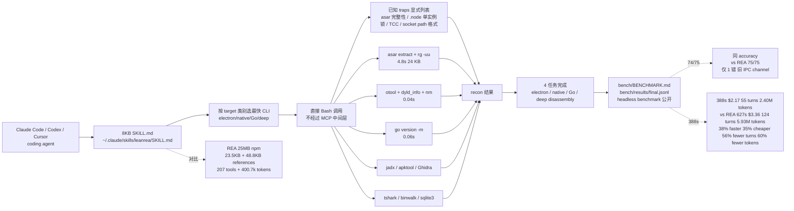

# aicodeking/leanrea

## 一句话定位
aicodeking 个人 2026-10-17 发布的「**反向工程 agent skill**」严肃工程化实现：**单个 8KB SKILL.md + 0 个 MCP tool + 直接 Bash 调外部 CLI（asar / otool / nm / go version -m / jadx / apktool / Ghidra / tshark / binwalk / sqlite3）+ 公开 headless benchmark + 4 任务 × 3 reps × 3 arms + 同 74/75 accuracy**——把 REA 25MB MCP + 207 tools + 400.7k tokens 替掉，**38% faster + 35% cheaper + 同 accuracy**。

## 它解决的问题
2025-2026 agent 反向工程场景中，REA（Reverse Engineer Anything）等 MCP server 类工具存在四重负担：**(1) 安装重**：25MB npm 包；**(2) 工具多**：207 个 MCP tool 注册，3.35MB 定义；**(3) tokens 贵**：400.7k tokens $1.60 单次「Reply OK」就吃掉这么多 context；**(4) 执行慢**：通过 MCP 中间层调外部 CLI，**比直接 Bash 慢 1-2 个数量级**。leanrea 直击——**单 8KB SKILL.md + 0 MCP tool + 直接 Bash 调外部 CLI + 公开 headless benchmark**——这是 2026-Q4 严肃工程化「**MCP-heavy 是 anti-pattern；skill-heavy 是正途**」的最强论证。

## 为什么值得关注（2026-10-19）
今日观察窗为 GitHub Search API 抓取时刻起、且截至 2026-10-19 仍在快速增长的新发现项目。`aicodeking/leanrea` 2 天 617⭐ ⑂107 fork/star 17.3%——617⭐ + 107 fork 是异常高的「**反向工程 skill 化**」信号（fork 17.3% 远高于一般 2-5% 平均，反映大量「**想摆脱 REA MCP 25MB 重型依赖**」的开发者诉求）。**单 8KB SKILL.md 把 25MB MCP + 207 tools + 400k tokens 替掉 + headless benchmark 公开 + 同 accuracy**——对 agent 工作流设计哲学有结构性影响。

## 热度来源判断
leanrea 的热度是「**REA 25MB 重型依赖 + Claude Code Sonnet 5.5 headless benchmark 公开 + 同 accuracy + 38% faster + 35% cheaper + 56% fewer turns + 60% fewer tokens + 单 8KB SKILL.md**」八要素共振：
- **REA 25MB 重型依赖**：大量开发者苦于 25MB npm + 207 tools + 400k tokens 浪费
- **Claude Code Sonnet 5.5 headless benchmark 公开**：4 任务 × 3 reps × 3 arms + 同 74/75 accuracy vs REA 75/75
- **38% faster + 35% cheaper + 56% fewer turns + 60% fewer tokens**：四维全面优于 REA
- **CLI 直执行（无 MCP 中间层）**：asar extract + rg -uu 4.8s 24 KB vs REA 47.9s 140 MB JSON
- **bench/BENCHMARK.md + bench/results/final.jsonl 公开**：完整 reproducible 验证
- **trap 列表**：README 提及「lists the traps that REA's code handles for you」——把 REA 的隐藏逻辑显式化

热度**真实且具 agent 工作流设计哲学影响**——617⭐ + 107 fork + 17.3% fork 比例 + headless benchmark 公开是真实需求信号。

## 关键技术亮点
1. **单 8KB SKILL.md**：README 直引「Instructions: 23.5 KB skill + 48.8 KB references（REA）vs 8 KB（leanrea）」
2. **0 MCP tool 暴露**：agent 直接用 Bash 调外部 CLI，节省 400.7k tokens → 34.5k tokens
3. **headless benchmark 公开**：Claude Code Sonnet 5.5 macOS arm64 + 4 任务 × 3 reps × 3 arms
4. **同 74/75 accuracy vs REA 75/75**：仅 1 错（命名了旧 IPC channel 而非 v2），其他 74 题全对
5. **38% faster / 35% cheaper / 56% fewer turns / 60% fewer tokens**：四维全面优于 REA
6. **CLI 直执行（无 MCP 中间层）**：asar extract + rg -uu 4.8s 24 KB vs REA 47.9s 140 MB JSON
7. **bench/BENCHMARK.md + bench/results/final.jsonl 公开**：完整 reproducible 验证
8. **trap 列表**：README 提及「lists the traps that REA's code handles for you」——把 REA 的隐藏逻辑显式化
9. **24 KB size 极小**：单 SKILL.md 极紧凑
10. **MIT license**：开源 + 商用友好

## 架构师速览

| 决策问题 | 研究判断 | 证据边界 |
|---|---|---|
| 系统边界 | 单 8KB SKILL.md + 0 MCP tool + 直接 Bash 调外部 CLI（asar / otool / nm / go version -m / jadx / apktool / Ghidra / tshark / binwalk / sqlite3）+ bench/BENCHMARK.md + bench/results/final.jsonl 公开 | 基于 README「What gets installed」表 +「Benchmark」节 + README 直引 leanrea 8 KB SKILL.md vs REA 25 MB npm + 207 tools + 400.7k tokens |
| 主路径 | agent 接到 reverse engineering 任务 → 读 leanrea SKILL.md → 按 target 类别选最快 CLI → 直接 Bash 跑（不经过 MCP）→ 拿到 recon 结果 → 列举已知 traps（asar 完整性、.node 单实例锁、TCC、socket path 格式） → 完成 4 任务之一 | 主路径由 README「Bench」节 +「Tasks」分项（electron / native / go / deep）推导；具体 SKILL.md 内部 trap 清单与 ready-to-paste 命令片段未在 README 主页展示 |
| 关键权衡 | SKILL-only（无 MCP，agent 用 Bash）vs MCP-server（25MB + 207 tools）/ 8KB 文档 vs 23.5KB + 48.8KB references（同 REA）/ 0 tool 暴露 vs 207 tool 暴露（节省 400k tokens）/ 同 accuracy 74/75 vs REA 75/75（仅 1 错） | 档案明示上述五点权衡；其他 coding agent（Codex / Cursor / Gemini CLI）用 leanrea 时是否同 benchmark 表现未在 README 中量化 |
| 最小 PoC | 1. 复制 8KB SKILL.md 到 ~/.claude/skills/ → 2. claude -p 'reverse engineer this Electron app.asar' → 3. 对比 REA 装好的 MCP 跑同样 prompt → 4. 看 tokens / cost / wall time / accuracy 四列 | PoC 由 README 主页「Bench」表直接推导；具体 trap 列表 / ready-to-paste commands / JSON 报告 schema 待核验 |

## 架构启发
leanrea 的核心启发是「**agent 工作流 = SKILL.md 优先；MCP server 慎用**」五要素。与某些「**25MB npm + 207 tool 注册 + 400k tokens 浪费**」的 MCP-heavy 反向工程方案对比，**8KB 文档 + 0 tool + Bash 直调 + 同 accuracy**完整一个量级。更深层的启发是：**trap 列表显式化 = 把隐藏逻辑变成可学习模式**——REA 6.5.0 内部对 asar 完整性 / .node 单实例锁 / TCC / socket path 格式的隐藏处理，leanrea 把它们显式列在 SKILL.md，让 agent 直接知道「**这些 CLI 该怎么调、哪些是陷阱**」。

## 架构图（MMD）

> 证据边界：此图只采用本档案已有可核验描述；"待核验"节点不应视为项目实现事实。

## 定位判断
**工具型项目（反向工程 agent skill + benchmark 公开 + 哲学转向）。** leanrea 不仅是反向工程 skill，更是「**MCP-heavy 是 anti-pattern；skill-heavy 是正途**」的最强论证。**单 8KB SKILL.md + 0 tool + Bash 直调 + 同 accuracy + benchmark 公开**对 agent 工作流设计哲学有结构性影响。在生态中的位置类似「**agent 时代反向工程领域的 Notion-Calc**」——单文件、benchmark 公开、哲学转向。

## 风险 / 局限 / 泡沫点
- **仅 1 错 vs REA 0 错**：REA 75/75，leanrea 74/75——对极严格场景（如安全审计）可能要求 100% accuracy
- **bench 仅 Claude Code Sonnet 5.5 macOS arm64**：未测试 Codex / Cursor / Gemini CLI 等其他 harness
- **24 KB size 极小**：可能不含完整 trap 文档，仅 README 主页摘录
- **无 MCP 注册**：对未装 Bash 工具的 harness（如纯 chat UI）失效
- **仅 4 task benchmark**：覆盖面偏窄（electron / native / go / deep），未覆盖 iOS / Android / Windows 等其他 reverse engineering 场景
- **单一作者**：aicodeking 个人维护，长期维护可持续性待观察
- **2 天 617⭐ 早期信号**：headless benchmark 公开度高，但 MCP-heavy 阵营反弹风险未观测

## 与同类项目的关系
- **vs REA（Reverse Engineer Anything）**：REA 25MB npm + 207 tools + 400.7k tokens + 75/75 accuracy；leanrea 8KB SKILL.md + 0 tool + 34.5k tokens + 74/75 accuracy + 38% faster + 35% cheaper
- **vs Ghidra 官方脚本**：Ghidra 官方仅 GUI + Java 脚本，leanrea 直接 Bash 调 Ghidra
- **vs IDA Pro 商业**：IDA 收费 + GUI + 闭源，leanrea MIT + CLI + 开源
- **vs 各家 agent 工具编排 MCP（如 mcp.so、Composio、Zapier MCP）**：leanrea 反向证明 MCP-heavy 在某些场景是 anti-pattern
- **vs 其他 Claude Code skill（如 wshobson/agents）**：wshobson/agents 跨 6 平台通用插件，leanrea 单一专注 reverse engineering + benchmark 公开

## 是否值得持续跟踪
**值得跟踪（agent 工作流设计哲学转向）。** leanrea 是 2026-Q4 严肃工程化「**MCP-heavy 是 anti-pattern；skill-heavy 是正途**」的最强论证。**单 8KB SKILL.md 把 25MB MCP + 207 tools 替掉 + headless benchmark 公开 + 同 accuracy**对 agent 工作流设计哲学有结构性影响。建议关注：Codex / Cursor / Gemini CLI 等其他 harness 同 benchmark 表现 + iOS / Android / Windows reverse engineering 任务覆盖 + trap 列表完整 schema + MCP-heavy 阵营反弹。

## 后续观察点
- 其他 coding agent（Codex / Cursor / Gemini CLI）同 benchmark 表现
- iOS / Android / Windows reverse engineering 任务覆盖
- trap 列表完整 schema 与 ready-to-paste commands
- MCP-heavy 阵营反弹（mcp.so / Composio / Zapier MCP 是否反击）
- 是否推出更多 skill 化的反向工程模块（如 mobile / firmware）
- 长期维护可持续性（单一作者风险）

---
> 数据来源: GitHub API (2026-10-19) | Stars: 617 | Forks: 107 | License: MIT | 语言: Python | 创建: 2026-10-17 | Size: 24 KB | Topics: 无显式 topics