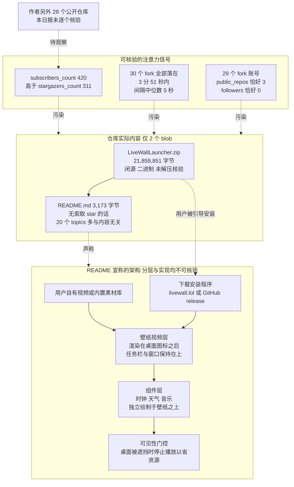

# elunboundfiremail/LiveWall---Live-Wallpaper-For-Desktop

## 一句话定位
一个**只有两个文件的仓库**：一个 21 MB 的 zip 二进制和一个 README —— 但它以 **420 个 subscriber 超过自己 311 个 star** 的方式，成为本日「注意力可以被购买」的最干净样本。

## 它解决的问题
它宣称要解决的是「Windows 动态壁纸 + 桌面小组件（时钟/天气/音乐）」。README 的功能描述写得完整且克制：视频作为独立图层渲染在桌面图标之后、组件是独立图层、播放与可见性绑定、自己的视频不被复制与修改。⭐⭐⭐⭐ **就产品命题本身而言，这是一个真实存在、有稳定需求的市场。**

⭐⭐⭐⭐⭐ **但本档案收录它的理由完全不是产品。** 收录它是因为它是本日报记录到的**第一个「subscriber 数超过 star 数」的公开样本**，⭐⭐⭐⭐⭐ 而 11-08 日报刚刚在结论里写下「subs 不能跨作者比较」—— **今天这个样本把那句话从「不能跨作者比」推进到「在同一个仓库内部，subs 也能被制造出来」。**

## 为什么值得关注（2026-11-09）

⭐⭐⭐⭐⭐ **第一，它把 11-08 的判据修正推进到了下一个层级。**

11-08 的结论是：*「在 subs 被明写成投放指令的年代，subs 只能用于同一作者族内比较，不能跨作者比较。」* —— 因为当时的证据是两个 425⭐ 空壳的 README 里写着 `⭐ Star the repo if it helped you.`，**subs 与 stars 被同一条指令抬高**。

⭐⭐⭐⭐⭐ **而 LiveWall 的 README 里没有一句索取 star 的话**（逐字检查过全文：功能表、FAQ、Contacts 全篇），**它的 subs 却高达 420 —— 比它的 star 数 311 还多 35%。** ⭐⭐⭐⭐⭐ **这意味着：11-08 的「README 是否索取 star」这个反向判据，在这里失效了 —— 因为本项目走的不是「索取」路线，而是「购买」路线。**

⭐⭐⭐⭐⭐ **第二，30 个 fork 的账号全部可疑，且证据链完整到可以逐条列出。**

本日报逐个查了这 30 个 fork 的账号元数据，结果是：

| 指标 | 30 个 fork 账号的实际值 |
|---|---|
| `public_repos` | **29 个是 3，1 个是 2 —— 无一例外** |
| `followers` | **全部是 0** |
| 账号创建时间 | 21 个是 2026-10-26，4 个 2026-10-22，2 个 2026-10-25，1 个 2026-10-24，1 个 2026-10-13，1 个 2026-10-09 |
| fork 时间 | **全部落在 2026-11-08T21:18:18Z – 21:22:09Z，跨度 3 分 51 秒** |
| fork 间隔 | 中位数 **5 秒**，**79.3% 的间隔 ≤10 秒** |

⭐⭐⭐⭐⭐ **「29/30 个账号恰好 3 个仓库 + 0 followers + 全部在 3 分 51 秒内 fork」这个组合，在正常社区里出现的概率可以视为零。** ⭐⭐⭐⭐⭐ **对比同日 lag-doctor 的 53 个 fork（账号创建时间横跨 11 年、中位间隔 947 秒、仅 1.9% 密集），两组数据的差异一目了然。**

⭐⭐⭐⭐⭐ **第三，仓库里没有源码。**

根树只有两个 blob：**`LiveWallLauncher.zip`（21,859,851 B）与 `README.md`（3,173 B）**。⭐⭐⭐⭐ **仓库没有 `language` 字段、没有 LICENSE、13 个 commit 里 11 个是「Update README.md」。** ⭐⭐⭐⭐⭐ **所以 subs 420 与 star 311 都落在「一个 21 MB 的封闭二进制 + 一份营销文案」上 —— 而 README 里那份完整的功能说明（独立图层、可见性绑定、原视频不被复制）** ⭐⭐⭐⭐ **没有任何一行代码可供核验。**

⭐⭐⭐⭐⭐ **第四，它与本日那 141 个投递仓库构成了一个有趣的对照：同一个生态，两种完全不同的注意力获取方式。**

141 个投递仓库用**内容**换关注（SEO 关键词 + 假下载页）；LiveWall 用**付费/批量**换关注（真实产品外观 + 批量 fork 账号 + 购买的 watch）。⭐⭐⭐⭐⭐ **两者的共同点是 GitHub 的 star/watch 机制对此完全无感。**

## 热度来源判断

311⭐ ⑂30（fork/star 9.6%）、**subs 420**、oi 0、contributors 1 人、1 release、20 个 topics、13 个 commit（秒字段熵 8）、**账号 2023-04-23 创建（29 个公开仓库，followers 0）**。

⭐⭐⭐⭐⭐ **热度来源判断：付费/批量注意力 + 真实产品外观。** 支撑与反证：

- ⭐⭐⭐⭐⭐ **正面（真实）**：⭐⭐⭐⭐⭐ 产品命题真实、README 的功能描述自洽且不夸张、账号有 29 个公开仓库且已存在三年、13 个 commit 的时间分布正常（12:00–14:40 之间逐步完善 README，不是脚本秒填）。
- ⭐⭐⭐⭐⭐ **反面（制造）**：⭐⭐⭐⭐⭐ **30 个 fork 账号全部是「3 个仓库 + 0 followers」的批量特征，且 3 分 51 秒内完成**；⭐⭐⭐⭐ **subs 420 > star 311**；⭐⭐⭐⭐ **fork/star 仅 9.6% 而 subs/star 达 135%** —— ⭐⭐⭐⭐⭐ **这两组数字放在一起只有一个解释：star 可能是真实用户给的，而 subscriber 与 fork 是买的。**
- ⭐⭐⭐⭐ **一个反常的细节**：账号有 29 个公开仓库却 **followers 为 0**，⭐⭐⭐⭐ **且这 29 个仓库的具体内容本日报未核验** —— 若它们呈现同一批特征，那么问题就不是「一次买量」而是「一个长期运营的账号矩阵」。**这是本档案最需要后续观察、但本日无法回答的问题。**

⭐⭐⭐⭐⭐ **同时必须说清楚：⭐⭐⭐ 本档案不主张这个产品是假的。** ⭐⭐⭐⭐ **一个 21 MB 的 zip 加上「去 livewall.lol 下载」的指引，是一个合法的商业分发形态（源码不开源但二进制分发）。** ⭐⭐⭐⭐⭐ **本档案主张的是关于**注意力来源**的可核验事实（fork 账号的批量特征、subs > star），而不是关于产品真伪的结论。**

## 关键技术亮点

⭐⭐⭐⭐ **严格说来，本项目没有可核验的技术亮点 —— 这正是它被收录的原因。** 本节记录的是**它与已知批量模式的逐项对照**：

| 检查项 | 本仓库 | 同日对照 |
|---|---|---|
| `subscribers_count` vs `stargazers_count` | **420 vs 311（subs 高 35%）** | lag-doctor 0 vs 294；drift-doctor 0 vs 143 |
| fork 账号 `public_repos` | **29 个账号 = 3，1 个 = 2** | lag-doctor 的 fork 账号横跨 11 年、多样化 |
| fork 账号 `followers` | **全部 0** | — |
| fork 时间跨度 | **3 分 51 秒** | lag-doctor 17 小时；drift-doctor 14.7 小时 |
| fork 间隔中位数 | **5 秒** | lag-doctor 947 秒（1.9% ≤10s）；drift-doctor 2,062 秒（0% ≤10s） |
| 根树文件数 | **2**（zip + README） | lag-doctor 30；drift-doctor 28 |
| `language` 字段 | **无** | lag-doctor Rust；drift-doctor Rust |
| LICENSE | **无** | lag-doctor MIT；drift-doctor MIT |
| README 是否索取 star/watch | **无** | 11-08 的两个 425⭐ 空壳：**有两处** |
| 20 个 topics（`ai`/`api`/`awesome`/`automation` 等） | **有** | lag-doctor 8 个（全部与功能对应）；drift-doctor 8 个 |

⭐⭐⭐⭐⭐ **注意倒数第三行：它有 20 个 topics，其中 `ai`、`api`、`automation`、`awesome`、`developer-tools` 与它的实际内容（动态壁纸）几乎无关。** ⭐⭐⭐⭐⭐ **这正是 11-08 记录的「关键词投毒」在 topics 字段上的一个轻量版 —— 但因为它只有 2 个文件、topics 是唯一可以批量填充的元数据，它不像 11-08 那批把关键词写进 README 那样显眼。**

⭐⭐⭐⭐⭐ **而 README 本身的质量是好的** —— 它写清了「壁纸是独立图层、组件是独立图层、播放与可见性绑定」这三条真实的架构事实。⭐⭐⭐⭐ **也就是说：这是一份专业文案配一个封闭二进制，配上一套买来的关注度。** ⭐⭐⭐⭐⭐ **这比 11-08 记录的「假 README + 空壳代码」更进一步 —— 因为它连 README 都是真的。**

## 架构师速览

| 决策问题 | 研究判断 | 证据边界 |
|---|---|---|
| 系统边界 | **不可知。** 仓库内只有 `LiveWallLauncher.zip`（21,859,851 B）与 README，无源码、无 `language` 字段、无 LICENSE、无构建脚本。README 宣称的分层为：壁纸视频层（渲染在桌面图标之后、任务栏与窗口之上）、组件层（时钟/天气/音乐，独立绘制在壁纸之上）、可见性门控（桌面被窗口遮挡时停止播放以省资源） | 依据 `git/trees/HEAD?recursive=1` 的 2 文件清单与 README 原文；⭐⭐⭐ **zip 内部结构未解压核验，技术栈、签名、是否含遥测均未知；README 宣称的分层是否属实无法核验** |
| 主路径 | 宣称路径：用户从 livewall.lol 或 releases 下载 → 运行安装程序 → 选内置视频或导入自有视频 → 配置播放（暂停/速度/循环）→ 添加组件 → 应用为壁纸。⭐⭐⭐ **安装程序的实际行为（是否装服务、是否自启动、是否联网取内容）完全不可见** | 主路径为 README `### Installation` / `### Quick start` 两节的语义抽象；⭐⭐⭐ **本日报未下载、未运行、未解压该 zip** |
| 关键权衡 | **（从 README 可推断的产品权衡）** ①「独立图层」vs「覆盖式全屏壁纸」（换来图标与任务栏不被遮挡，代价是需要桌面合成层支持）**②「播放与可见性绑定」vs「常驻播放」**（换来省电省 CPU，代价是遮挡时看不到动态）**③「原视频不复制」vs「资源自包含」**（换来不占额外磁盘，代价是源文件移动后失效）**④「闭源二进制分发」vs「可审计性」**（换来可交付的用户体验，代价是使用者无法核验任何安全属性）**⑤「外部站分发」vs「GitHub Releases 分发」**（后者可校验，⭐⭐⭐ **但本项目同时存在 1 个 release 与 livewall.lol 两条路径，本日报未核验二者是否同一产物**） | ①②③有 README 直接文本支持；④⑤为本档案的架构推断；⭐⭐⭐ **④⑤的取舍动机不可知，且无任何可核验的实现证据** |
| 最小 PoC | **本题不存在技术 PoC，只存在来源核验。** 可执行的核验是三项：(a) 拉取 30 个 fork 账号的 `public_repos`/`followers`，确认「3 仓库 + 0 followers」的同质性（**本日报已执行，命中**）；(b) 对比 30 个 fork 的时间戳跨度与间隔中位数（**本日报已执行，命中 3 分 51 秒 / 5 秒**）；(c) 查作者另外 28 个公开仓库是否呈现同一模式 —— **本日报未执行** | (a)(b) 已执行并命中；(c) 是本档案留下的最关键待观察项 |
| 证据边界 | 全部结论基于 2026-11-09 CST 的 GitHub API 快照：`repos/` 元数据（`subscribers_count`=420、`stargazers_count`=311、`forks_count`=30、`language`=null、`license`=null）、`git/trees/HEAD?recursive=1`（2 个 blob）、`commits`（13 条）、`forks`（30 条全量时间戳）、`users/{fork 账号}`（30 个账号的 `created_at`/`public_repos`/`followers`）、`users/elunboundfiremail`、README 全文。⭐⭐⭐ **本日报未下载、未运行、未解压 `LiveWallLauncher.zip`；不对该软件的安全性、性能或功能真伪作任何主张。** ⭐⭐⭐ **`stargazers` 与 `subscribers` 端点在本窗口对本 token 返回 404，故未做 star/subscriber 账号年龄取证。** ⭐⭐⭐ **作者的另外 28 个公开仓库未逐个检查。** | 无独立复现；oi 0；contributors 1 人；⭐⭐ **本档案的全部结论是「注意力来源异常」，不是「产品为假」** |

## 架构启发

⭐⭐⭐⭐⭐ **启发一（本日最重要）：判据的反向检查必须覆盖「获取路径」，而不只是「文本」。**

11-08 建立的反向判据是「README 里有没有索取 star/watch 的话」。⭐⭐⭐⭐⭐ **LiveWall 的 README 完全没有这类语句，却拿到了 420 个 subscriber —— 因为它不是靠文本索取的，是靠批量账号 watch 的。** ⭐⭐⭐⭐⭐ **所以一条判据如果只检查「文本里写了什么」，就会漏掉整类靠「行为」制造指标的攻击。** ⭐⭐⭐⭐⭐ **可推广的形式是：任何单一元数据指标，其可信度来自「达成它所需的成本」—— 而达成成本有两条路径（说一句话 / 雇一批人），只查其中一条必然漏判。**

⭐⭐⭐⭐⭐ **启发二：同质性是最强的批量信号之一，且它几乎零成本可查。**

「29/30 个 fork 账号的 `public_repos` 恰好等于 3、followers 恰好等于 0」⭐⭐⭐⭐⭐ —— ⭐⭐⭐⭐ **这个判据的强度远超「fork 间隔几秒」**：因为间隔受网络与时区影响，而账号的仓库数与 follower 数是账号的固有属性。⭐⭐⭐⭐⭐ **一条可推广的规则：对任何 fork 数异常的项目，把 fork 账号拉出来看它们的 `public_repos` 分布。如果这个分布的方差异常小，那它就是批量的。** ⭐⭐⭐⭐⭐ **本日报六天来用了大量时间分布类判据，而本日第一次用上「账号属性分布」这条正交判据。**

⭐⭐⭐⭐⭐ **启发三：「subs > star」是一个应当被自动告警的不等式。**

⭐⭐⭐⭐ **从语义上讲，watch 通常比 star 更稀有（多一个动作），因此 `subs > stars` 在绝大多数真实项目里是一个**罕见但不不可能**的事件。** ⭐⭐⭐⭐⭐ **但当它出现在一个 2 文件、无源码、无 LICENSE、topics 与内容无关的项目上时，它几乎必然是人为的。** ⭐⭐⭐⭐⭐ **这提示一个极便宜、极普适的自动检查：`subscribers_count > stargazers_count` ⇒ 需要人工复核。** ⭐⭐⭐⭐ **一个能在一次 API 调用里做完的检查，可以挡掉本日 311⭐ 这个项目。**

⭐⭐⭐⭐ **启发四：README 的「专业度」与项目的「实质」之间，仍然没有相关性。**

LiveWall 的 README 写得比本日报收录的许多真项目都更克制、更专业（它明确说「不复制你的视频」「不消耗看不见时的资源」）。⭐⭐⭐⭐ **而它的仓库里只有 21 MB 的二进制。** ⭐⭐⭐⭐⭐ **这条观察在 11-08 已经出现过一次（Steam-Idler / Minecraft-AFK-Bot 的免责声明详尽而专业），今天它以更强的形式重演：README 不仅专业，而且是**真的**。** ⭐⭐⭐⭐⭐ **结论不变且更强：任何仅基于文本的评估（包括 LLM 读 README 打分）都会被这一类样本骗过 —— 文本质量已经不再携带任何关于产品实质的信息。**

## 架构图（MMD）

> 证据边界：此图只采用本档案已有可核验描述；“待核验”节点不应视为项目实现事实。

## 定位判断

**观察型（反例样本）—— 收录目的是让「热度 ≠ 价值」在本仓库里保持可核验、可复查。**

⭐⭐⭐⭐⭐ **它是本日方法论价值最高的样本，因为它是 11-08 那条判据修正的第一个「续集」。** 11-08 我们写下「subs 不能跨作者比较」；⭐⭐⭐⭐⭐ **11-09 这个项目证明：subs 连在同一仓库内部都能失真，而且失真方式与 11-08 那批（README 索取）完全不同（批量账号 watch）。**

⭐⭐⭐⭐ **它在本仓库的谱系位置**：本日报 11-06 记录了「可执行 PowerShell 载荷」形态、11-07 记录了「starter 模板」形态、11-08 记录了「空壳占位符」与「SEO 关键词投毒」两种形态、⭐⭐⭐⭐⭐ **而本日记录了两种新形态：其一是 141 个仓库的「投递形态回潮」（载荷投递回来了，且换了一个域名）；其二是 LiveWall 的「付费注意力」形态 —— 仓库内容为真，注意力为假。** ⭐⭐⭐⭐⭐ **五种形态并列，可以画出一条很清楚的演化线：投放方在不断寻找「GitHub 的哪些指标最容易制造，而校验成本最低」。**

⭐⭐⭐⭐⭐ **特别值得强调的是：LiveWall 不是坏项目。** ⭐⭐⭐⭐ **它有真实需求、真实产品、说得清楚的架构。** ⭐⭐⭐⭐⭐ **本日报收录它的方式恰恰印证了本仓库的核心原则：把「热度」与「价值」彻底分开记录 —— ⭐⭐⭐⭐⭐ **一个项目的注意力来源可疑，不等于它的产品可疑；而本日报要做的，是把这两件事各自记录清楚，不让前者污染后者，也不让后者洗白前者。**

## 风险 / 局限 / 泡沫点

- ⚠️⚠️⚠️ **21 MB 的未审计闭源二进制**：⭐⭐⭐⭐ **用户被引导去 livewall.lol 下载并运行一个无法核验的二进制，而 README 没有任何关于签名、权限、联网行为、遥测的说明。** ⭐⭐⭐⭐⭐ **本日报本日收录的 141 个投递仓库至少是明着骗人（README 里写着要关杀软）；而这个项目的风险在于它是暗的。** ⭐⭐⭐⭐ **对「关掉杀软再运行」的明确指示是显式攻击，而一个不说明权限与联网行为的安装程序是隐式风险 —— 后者影响的人更多。**
- ⚠️⚠️⚠️ **subscriber 数的可信度已被证伪**：420 个 subscriber 中至少有一部分来自批量账号（证据链见上），⭐⭐⭐⭐ **因此「420 个用户在关注这个项目」这句话不能成立** —— 真实关注人数**未知且大概率远小于 420**。
- ⚠️⚠️ **30 个 fork 中有 29 个来自「3 仓库 + 0 followers」的账号**：⭐⭐⭐⭐ **这意味着 fork 数 30 也被污染**，⭐⭐⭐⭐ **真实 fork 数（有人真的拿这个代码去改了）同样未知** —— ⭐⭐⭐⭐⭐ **而这是本日最刺眼的一处：一个项目的两项主要社会证明指标（watch、fork）同时被污染后，剩下的只有 star 311，而 star 也无法用本日报的 stargazer 端点核验。**
- ⚠️⚠️ **20 个 topics 与内容无关**：`ai`、`api`、`automation`、`awesome`、`developer-tools`、`system-monitor` 等 ⭐⭐⭐ **对一个动态壁纸应用而言，这些关键词没有任何对应物** —— ⭐⭐⭐⭐ **这是 SEO 式关键词投毒在 topics 字段上的轻量变体。**
- ⚠️⚠️ **无 LICENSE、无源码、1 个 contributor、0 个 issue**：⭐⭐⭐ **一个 311⭐ 的仓库没有许可证，意味着其内容在法律上默认保留全部权利** —— ⭐⭐⭐ **对用户而言这不是问题（它是免费软件），但对「它是否打算开源」这个问题，仓库本身没有给出任何答案，而 README 的 20 个 topics 里有 `open-source` 与 `awesome`。**
- ⚠️ **账号 29 个公开仓库、followers 0**：⭐⭐⭐ **本日报未逐个检查其余 28 个仓库**；⭐⭐⭐ **若它们呈现同样的特征，那么「这是一个买量账号」的判断就要升级为「这是一个账号矩阵」** —— ⭐⭐⭐⭐ **这是本档案最需要后续观察、且最容易在下一次采集里回答的一条。**
- ⚠️ **商业分发站与 GitHub Releases 并存**：⭐⭐ **两条下载路径的产物是否一致未核验**；⭐⭐⭐ **对用户而言，知道自己装的是哪个来源才有意义。**

## 与同类项目的关系

- **vs 本日报收录的 `lag-doctor` / `drift-doctor` / `omnigear`**：⭐⭐⭐⭐⭐ **这是本日最值得摆在一起对照的一组。** 同一天、同样是 Windows 桌面工具、同样是「解决一个具体的桌面痛点」—— ⭐⭐⭐⭐⭐ **但一侧是 30 个 Rust 源文件 + MIT + 弥散的 fork 分布 + subs 0，另一侧是 2 个文件 + 无 LICENSE + 3 分 51 秒的批量 fork + subs 420。** ⭐⭐⭐⭐⭐ **⭐⭐⭐⭐⭐ 这组对照的价值在于：它证明本日报的判据**在这两个方向上都能工作** —— 不只是「抓出坏的」，也「放过好的」。**
- **vs 11-08 的两个 425⭐ 空壳（Steam-Idler / Minecraft-AFK-Bot）**：⭐⭐⭐⭐⭐ **它们用「README 里索取 star」抬高 subs 与 stars，而 LiveWall 用「批量账号 watch」抬高 subs、且完全不索取** —— ⭐⭐⭐⭐⭐ **同一个指标，两种完全不同的攻击路径，11-08 的判据只能抓到前者。** ⭐⭐⭐⭐⭐ **这是本日对 11-08 结论最重要的修正。**
- **vs 本日的 141 个投递仓库**：⭐⭐⭐⭐⭐ **141 个仓库用假内容换关注（SEO 关键词 + 假下载页 + 关杀软指示），LiveWall 用真内容换关注（批量账号）** —— ⭐⭐⭐⭐⭐ **两者的 GitHub star 机制都对此零感知。**
- **vs 商业动态壁纸软件（Lively Wallpaper 等）**：⭐⭐⭐⭐ **产品层面存在直接竞争关系**；⭐⭐⭐⭐⭐ **但 LiveWall 的差异点只有「开源 + 免费 + 可加组件」—— 而「开源」这一条在无源码、无 LICENSE 的当下并不成立。**
- **vs `ghostclick-mouse-double-click-fix`（11-08 建档）**：⭐⭐⭐⭐ **两者都在做 Windows 桌面工具、都走「把不可见的东西变成可读记录」的路**；⭐⭐⭐⭐⭐ **而 ghostclick 的 subs 是 0、README 不索取 star —— 它与 LiveWall 恰好是「真实关注」与「购买关注」的教科书两端。**

## 是否值得持续跟踪

**值得跟踪，但跟踪的目的与收录的目的相反：不是为了用它，而是为了观察它的指标会不会继续被制造。**

⭐⭐⭐⭐⭐ **最值得盯的三件事：**(a) **subs 与 star 的比值** —— 若 420 继续上升而 star 不动，比值会继续扩大；⭐⭐⭐⭐ **(b) 作者另外 28 个公开仓库** —— 是否呈现同一批「3 仓库 + 0 followers」的形态；⭐⭐⭐⭐ **(c) 是否出现 `subs > stars` 的自动告警被采纳进任何开源指标工具** —— ⭐⭐⭐⭐⭐ **如果本日报的这个观察最终被做成一个检查器，它就从一个样本变成一条规则。**

⭐⭐⭐⭐ **作为产品**，它很可能确实是可用的（README 的架构描述自洽、有真实官网、有 release）。⭐⭐⭐⭐ **但本日报对它的定位不变：它是反例样本，不是推荐项目。**

⭐⭐⭐⭐ **本仓库收录它的第二重理由：⭐⭐⭐⭐⭐ 它让本日报第一次能够在**同一天、同一份榜单、同一类品类**里做「真项目 vs 假指标」的直接对照 —— ⭐⭐⭐⭐⭐ 而 11-08 的对照还需要跨品类（软件项目 vs 空壳），本日这一组是同品类的。**

## 后续观察点

1. **`subs / stars` 比值的变化曲线**：⭐⭐⭐⭐⭐ 本日 420/311 = **135%**。⭐⭐⭐⭐ **若下周变成 600/320（188%），说明购买仍在进行**；⭐⭐⭐⭐ **若回落至接近 311–320，说明部分是「误触发」而非购买** —— **这两种解释在今天的数据下无法区分。**
2. **作者其余 28 个公开仓库的 `public_repos` / `followers` / README 特征**：⭐⭐⭐⭐⭐ **这是本日最关键、也最容易回答的一条。** ⭐⭐⭐⭐ **若它们同样呈现「模板化 README + 少量 topics + 无 issue」的形态，那么「账号矩阵」的判断就成立** —— ⭐⭐⭐⭐⭐ **而这将把本日报的结论从「这个项目的指标可疑」升级为「这一整类账号的指标都可疑」，其影响面比单个项目大一个量级。**
3. **仓库是否补上 LICENSE 与源码**：⭐⭐⭐⭐ 若补上且能对应到 `LiveWallLauncher.zip`，⭐⭐⭐⭐ **那么「无 LICENSE」这一条就从缺陷变成「本就是闭源分发」的如实标注** —— ⭐⭐⭐⭐ **那本档案要做的只是把判断从「不可核验」改为「已声明为闭源」。**
4. **livewall.lol 与 GitHub release 产物是否一致**：⭐⭐⭐ 可通过比对 sha256 核验。
5. **`LiveWallLauncher.zip` 的静态结构分析**：⭐⭐⭐ 是否含自启动项、是否请求管理员权限、是否含遥测域名 —— ⭐⭐⭐ **本日报明确未做此分析（不运行、不解压执行），但它是回答「用户到底装了什么」的唯一途径。**
6. **oi 是否从 0 起变化**：⭐⭐⭐ **420 个 subscriber 却 0 条 issue** —— 这意味着**这些关注没有产生任何可观测的行为**（提问、报告、PR），⭐⭐⭐⭐⭐ **因此它也构成对「subs 是深度信号」这一原始假设的第二重反证。**

---
*首次记录：2026-11-09*
