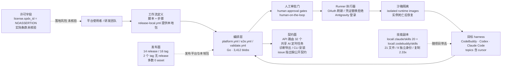

# Tencent/LoopForge

## 一句话定位
**腾讯的自托管 coding-agent 交付工作流平台 —— 但它本日最刺眼的一条事实是：它有 21 个 `SKILL.md`、9 个 harness 相关的技能目录，⭐⭐⭐⭐⭐ 却是本日实测的 12 个 skill 类 Trending 项目里 harness 目录数最少的一个（0 套）。**

## 它解决的问题
⭐⭐⭐⭐⭐ **coding agent 的「交付」环节没有编排层。** README 描述（实测）：

> Self-hosted workflows for coding-agent delivery. Orchestrate CodeBuddy, Codex and Claude Code with scripts and human approval gates. Includes Local workflows for coding assistants.

⭐⭐⭐⭐⭐ **⭐⭐⭐ 关键词是三个：「self-hosted」「scripts」「human approval gates」。⭐⭐⭐⭐⭐ 即它把 agent 当成一个需要被编排、被门禁把关的执行体，⭐⭐⭐⭐⭐ 而不是直接放进 IDE 的助手。⭐⭐⭐⭐⭐ topics 实测含 `human-on-the-loop`、`agent-orchestration`、`codebuddy`、`codex`、`claude-code`、`cursor`、`code-review`。**

## 为什么值得关注（2026-11-18）
⭐⭐⭐⭐⭐ **因为它是本日实测的「分发适配层」这条线上最靠后的一端 —— ⭐⭐⭐⭐⭐ 21 个 SKILL.md 文件、9 个独立技能身份、复制倍数 2.33×，⭐⭐⭐⭐⭐ 但 **0 套 harness 目录、0 条 `npx skills add`、0 条 `marketplace add`**。⭐⭐⭐⭐⭐ ⭐⭐⭐⭐⭐ 这与 ECC（9 套目录）、`obra/superpowers`（5 套）、`google/elephant-goldfish-model`（7 套）形成完整的梯度。**

**可核验事实（2026-11-18 CST 快照）。**

| 指标 | 实测值 |
|---|---|
| stars / forks / subs / open issues | 3,071 / 435 / 12 / **184** |
| 体积 / blobs | 79,595 KB / 3,412 |
| 语言 / **许可字段** | Go / **`license.spdx_id` = NOASSERTION** |
| 创建 / 最后 push | 2026-07-28T03:51:01Z / 2026-11-17T17:57:53Z |
| homepage | `https://loopforge.cn` |
| **release / tag** | **14 / 16**（无 release 的 tag：`v0.3.7` / `v0.2.3`） |
| release 节奏 | `v0.4.0` 2026-11-17 · `v0.3.9-rc.1` 2026-11-13（prerelease）· `v0.3.8` 2026-11-12 |
| release asset | 多数 **0 asset**（`v0.4.0` 0 · `v0.3.9-rc.1` 0 · `v0.3.8` 0），全库合计仅 8 个 asset |
| **SKILL.md 文件数 / 独立身份** | **21 / 9**（`knowledge-distillation` 4 份 · `brainstorming` 4 份 · `writing-plans` 3 份 · `tech-design` 3 份 · `agent-observability` 3 份 · `report-workflow-usage` 1 份） |
| **harness 目录** | **0 套**（**但**有 `.claude/skills/` 与 `.codebuddy/skills/` 这样的嵌套技能目录） |
| CI 工作流 | 5 个（`e2e.yml` / `platform.yml` / `release.yml` / `release-local.yml` / `validate.yml`） |
| 贡献者 | `Robert0622` 59 · `crispinhu27` 39 · `cocofhu` 20 · `dependabot[bot]` 13 · `newexploreor` 5 · `Yanami-2K` 4 · `Zhong-Chenchen` 3 · `wycocoyu` 2 |

⭐⭐⭐⭐⭐ **⭐⭐⭐ 关键结构发现（本日）：它的 21 个 SKILL.md 全部位于 `local/` 目录下**（实测 `local/.claude/skills/` 20 个 + `local/.codebuddy/skills/`），⭐⭐⭐⭐⭐ **即它把「面向不同 harness 的技能副本」放在一个 `local/` 目录里，⭐⭐⭐⭐⭐ 而不是在仓库根部按 harness 分目录。⭐⭐⭐⭐⭐ ⭐⭐⭐⭐⭐ 结果是：它的 SKILL.md 数量看起来不少（21），⭐⭐⭐⭐⭐ **但它在 harness 清单这个维度上是 0。⭐⭐⭐⭐⭐ 「有多少技能文件」与「能被多少个 harness 直接加载」是两个独立的问题。**

⭐⭐⭐⭐⭐ **⭐⭐⭐ 第二条：它的 release 有 2 个 tag 没有对应 release**（`v0.3.7` / `v0.2.3`），⭐⭐⭐⭐⭐ 而 `modern-web-guidance-src` 是 100/100 个 tag 无 release（本日档案）。⭐⭐⭐⭐⭐ **两个方向相反的缺口同时存在：⭐⭐⭐⭐⭐ 「有 tag 没 release」与「有 release 没 tag」都不是异常，⭐⭐⭐⭐⭐ 但它们各自指向不同的工程状态 —— 前者是「内部版本快照被推到 tags」，后者是「正式发布面缺失」。**

⭐⭐⭐⭐⭐ **⭐⭐⭐ 第三条：`license.spdx_id` = NOASSERTION。** ⭐⭐⭐⭐⭐ 这与 11-16 记录的 `cnrad/interspace` 情况相同（LICENSE 文件实为 MIT，但 GitHub 未能归类）⭐⭐⭐⭐⭐ —— **⭐⭐⭐⭐⭐ 但本日报**未读取**其 LICENSE 文件，⭐⭐⭐⭐⭐ 因此**不主张**它的实际许可是什么。⭐⭐⭐⭐⭐ 这是一处必须记下的证据边界。**

⭐⭐⭐⭐⭐ **⭐⭐⭐ 第四条：issue 质量极高，且全是「带定位信息的修复请求」。** 实测 14 条 issue：

- `#1026 fix(models): preserve and configure per-model reasoning efforts`（4,086 字符，`crispinhu27`）
- `#1025 fix(sandbox): explain missing isolated runtime images`（1,549，`wcy12378`）
- `#1024 docs(api): index assistant and shared schedule routes`（1,563）
- `#1023 fix(assistant): explain unsupported OpenCode variants`（1,998）
- `#1022 [Docs]: API 索引漏掉 AI 对话（/api/assistant，32 个路由）与共享 AI 定时任务，v0.4.0 的诊断导出/CLI 安装没有公开契约`（2,721，含代码块）
- `#1021 Coordinate Runner OAuth refresh and reject sandbox credential replacement`（3,131）
- `#1020 fix(assistant): report disk-full execution failures`（1,546）
- `#1017 fix(workspace): recover a conversation after its instance dies`（2,319，含代码块）

⭐⭐⭐⭐⭐ **⭐⭐⭐ 这批 issue 的形态与 `paper-orchestra` 的完全不同：⭐⭐⭐⭐⭐ 那边是「用户跑流程时踩到的具体失效」，⭐⭐⭐⭐⭐ 这边是「**开发者在自测中发现的边界条件与缺失契约**」—— ⭐⭐⭐⭐⭐ 沙箱镜像缺失、磁盘满、实例死亡后恢复、OAuth 刷新与凭证替换、OpenCode 变体不支持、**「32 个路由没有公开契约」**。⭐⭐⭐⭐⭐ ⭐⭐⭐⭐⭐ **这说明这是一个正在被自己的团队高频使用、并把使用中的粗糙处写成 issue 的项目 —— 是本数据集里少见的「内部使用强度」的直接证据。**

## 热度来源判断
⭐⭐⭐⭐⭐ **判断：热度来自「腾讯内部 coding agent 交付的真实需求外化」，⭐⭐⭐⭐⭐ 而它的 issue 文本是最强的支撑证据 —— ⭐⭐⭐⭐⭐ 但它的分发面最弱（0 套 harness 清单、0 条安装命令），⭐⭐⭐⭐⭐ 所以它目前更像是「一个内部工具的开源版本」而不是「一个社区分发中心」。**

支撑的**可核验事实**：
1. **⭐⭐⭐⭐⭐ 组织账号 + 真实的多人贡献结构**：`Tencent`（2016-04-14 创建、15,261 followers、311 repos）⭐⭐⭐⭐⭐ 加上 `Robert0622` 59 / `crispinhu27` 39 / `cocofhu` 20 等 7 位真人贡献者。
2. **⭐⭐⭐⭐⭐ issue 是「开发者自测记录」而非功能许愿**：见上表，⭐⭐⭐⭐⭐ 全部带具体子域前缀（`fix(models)` / `fix(sandbox)` / `fix(assistant)` / `fix(workspace)` / `fix(git)` / `feat(runner)`）。
3. **⭐⭐⭐⭐⭐ 有 `human approval gates` 与 `human-on-the-loop` topic** ⭐⭐⭐⭐⭐ —— **审批门是这类平台的真实卖点，不是包装词。**
4. **⭐⭐⭐⭐⭐ fork/star = 14.16%**（435 / 3,071），⭐⭐⭐⭐⭐ 属正常偏热区间。

⭐⭐⭐⭐⭐ **⚠️ 不作主张的部分**：⭐⭐⭐⭐⭐ **本日报未安装、未运行、未访问 `loopforge.cn`。**⭐⭐⭐⭐⭐ **`license.spdx_id` = NOASSERTION 意味着本日报**不主张**它的许可条款 —— ⭐⭐⭐⭐⭐ **企业采用前必须先确认许可，这是本项目最实际的落地风险。**⭐⭐⭐⭐⭐ **本日报未做 star 增速统计。**

## 关键技术亮点
1. **⭐⭐⭐⭐⭐ 人工审批门是架构中的一等公民**
   README 明述「human approval gates」⭐⭐⭐⭐⭐ + topic `human-on-the-loop` ⭐⭐⭐⭐⭐ —— **⭐⭐⭐⭐⭐ 即它不是「agent 自己跑到底」，⭐⭐⭐⭐⭐ 而是每一步可被人类接管。这与 `paper-orchestra` 的 `paper_writing_cli.sh`（无门禁）、`ECC` 的「skills/memory/security 配置」都不同。**

2. **⭐⭐⭐⭐⭐ 三家 harness 统一编排**
   README 明述 Orchestrate **CodeBuddy, Codex and Claude Code** ⭐⭐⭐⭐⭐ —— **⭐⭐⭐⭐⭐ CodeBuddy 是腾讯自家的 coding agent，⭐⭐⭐⭐⭐ 即这是「大厂编排自家 + 竞品」的组合。**

3. **⭐⭐⭐⭐⭐ 自托管优先**
   homepage `loopforge.cn` + `release-local.yml` 工作流 + `local/` 目录 ⭐⭐⭐⭐⭐ —— **⭐⭐⭐⭐⭐ 即它的分发形态包含「本地部署包」，⭐⭐⭐⭐⭐ 对企业内网场景是必需的。**

4. **⭐⭐⭐⭐⭐ 技能以「项目内目录」形式交付**
   实测 `local/.claude/skills/` 与 `local/.codebuddy/skills/` ⭐⭐⭐⭐⭐ —— **⭐⭐⭐⭐⭐ 即它不要求用户「安装插件」，而是把技能文件随项目带过去。⭐⭐⭐⭐⭐ 这与 ECC（npm + GitHub App + 插件 slug）的分发哲学相反，⭐⭐⭐⭐⭐ 但对企业内网更省事。**

5. **⭐⭐⭐⭐⭐ 契约缺失被显式记录**
   issue `#1022` 原文（实测）：「v0.4.0 的诊断导出/CLI 安装没有公开契约」⭐⭐⭐⭐⭐ —— **⭐⭐⭐⭐⭐ 即团队自己知道「对外接口没有公开契约」是缺陷，⭐⭐⭐⭐⭐ 并把「32 个路由未收录进 API 索引」写成 issue。⭐⭐⭐⭐⭐ 这比 11-17 记录的 `EGM` 的「打包时怎么定位 Claude 根目录需要专门修」更具体。**

6. **⭐⭐⭐⭐⭐ Runner 凭证与沙箱是显式的安全面**
   issue `#1016 feat(runner): support Antigravity login and harden credential refresh` ⭐⭐⭐⭐⭐ · `#1021 Coordinate Runner OAuth refresh and reject sandbox credential replacement` ⭐⭐⭐⭐⭐ · `#1025 fix(sandbox): explain missing isolated runtime images` ⭐⭐⭐⭐⭐ —— **⭐⭐⭐⭐⭐ 即凭证刷新、凭证替换拒绝、沙箱隔离镜像是这个平台反复出问题的地方，⭐⭐⭐⭐⭐ 也是它的真实能力边界所在。**

## 架构师速览

| 决策问题 | 研究判断 | 证据边界 |
|---|---|---|
| 系统边界 | **一个「自托管的 coding-agent 编排 + 交付平台」**，⭐⭐⭐⭐⭐ 包含编排面（`platform.yml` / `release.yml` / `release-local.yml`）· 执行器面（Runner / Sandbox）· 客户端面（CodeBuddy / Codex / Claude Code）· 契约面（API 路由与共享定时任务）。**不含模型** | 实测 5 个工作流名、README 描述、topics、issue 中的子域前缀（`fix(models)` / `fix(sandbox)` / `fix(assistant)` / `fix(workspace)` / `fix(git)` / `feat(runner)`）；**未运行、未读任何 Go 源码，API 路由清单未获取** |
| 主路径 | 用户在 LoopForge 上定义一个工作流（脚本 + 步骤）→ 平台把步骤分派给指定 harness（CodeBuddy / Codex / Claude Code）执行 → 每步之间经过人工审批门 → 结果与日志回流 → 平台产出交付物。**发布路径**：`release.yml`（平台）/ `release-local.yml`（本地包） | 主路径由 README 描述与工作流名反推；**审批门的具体粒度（每步？每阶段？）、Runner 与 Sandbox 的部署形态、失败回滚策略均未核验** |
| 关键权衡 | ①**自动化 vs 可控** → 用人工审批门换取可控性，代价是吞吐；②**自托管 vs 开箱即用** → 换取数据不出内网，代价是部署复杂度；③**多 harness 编排 vs 适配成本** → 统一了编排层，但**技能分发层仍是 0 套清单**，即它把「适配成本」推给了使用者 | ①有 README 原文 + topic 支撑；②有 homepage + `release-local.yml` + `local/` 目录支撑；③由 harness 清单实测 = 0 支撑 |
| 最小 PoC | 只接**一个** harness（建议 Claude Code，因为存在 `.claude/skills/` 副本）→ 定义一个含 **1 个人工审批门**的两步工作流 → 验证审批门确实能拦住执行 → 检查日志与交付物是否可溯源到具体步骤 → 再评估接入 Codex/CodeBuddy 的边际成本 → **最后单独确认许可证**（当前 `NOASSERTION`） | PoC 范围与退出路径由本档案推导；**部署前置条件、资源需求、审批门语义、许可证均未核验** |

## 架构启发
⭐⭐⭐⭐⭐ **启发一（本日的核心）：「技能分发」与「技能适配」是两笔独立的成本，而 SKILL.md 文件数同时掩盖了两者。** ⭐⭐⭐⭐⭐ 本日实测的三组数字：⭐⭐⭐⭐⭐ `ECC` 1,087 文件 / 330 身份 / **9 套清单** ⭐⭐⭐⭐⭐ · `obra/superpowers` 15 文件 / 15 身份 / **5 套清单** ⭐⭐⭐⭐⭐ · `Tencent/LoopForge` 21 文件 / 9 身份 / **0 套清单**。⭐⭐⭐⭐⭐ ⭐⭐⭐⭐⭐ 即 LoopForge 的技能文件数是 superpowers 的 1.4 倍、独立身份却只有 60%，⭐⭐⭐⭐⭐ **而能被多少 harness 直接加载是 0。⭐⭐⭐⭐⭐ ⭐⭐⭐⭐⭐ **结论：测量 agent 生态成熟度时，「SKILL.md 数」与「独立身份数」与「harness 清单数」必须并列为三个指标。**

⭐⭐⭐⭐⭐ **启发二：「把粗糙处写成 issue」是内部使用强度的公开证据。** ⭐⭐⭐⭐⭐ 本项目的 issue 全是带定位信息的修复请求（`fix(sandbox)` / `fix(assistant)` / `fix(workspace)` / `feat(runner)`），⭐⭐⭐⭐⭐ 且明确指出「32 个路由没有公开契约」「诊断导出/CLI 安装没有公开契约」⭐⭐⭐⭐⭐ —— ⭐⭐⭐⭐⭐ **⭐⭐⭐⭐⭐ 这类 issue 不可能由外部用户批量写出，⭐⭐⭐⭐⭐ 它是团队自己在用的证据。⭐⭐⭐⭐⭐ 这与本数据集记录的「反例样本」（issue 是 `NOT WORK` / `无法运行`）形成一条实用的区分线：⭐⭐⭐⭐⭐ **issue 的技术含量与定位精度，是判断项目是否真被使用的免费信号。**

⭐⭐⭐⭐⭐ **启发三：许可字段的「不确定」本身就是一条风险信号。** ⭐⭐⭐⭐⭐ `NOASSERTION` 意味着 GitHub 的许可证检测器没能识别，⭐⭐⭐⭐⭐ **对企业采用者来说，这必须先被解决，⭐⭐⭐⭐⭐ 而不是被默认为 MIT。⭐⭐⭐⭐⭐ 本日报在 `cnrad/interspace`（11-16）上已经遇到过同一情形，⭐⭐⭐⭐⭐ 当时是「实为 MIT 但字段 NOASSERTION」，⭐⭐⭐⭐⭐ **本日再次遇到，说明这是一个值得单独建档的类别：「许可不可判定」。**

## 架构图（MMD）

> 证据边界：此图只采用本档案已有可核验描述；标注「待核验」的节点不应视为项目实现事实。

## 定位判断
**平台候选 —— 且是本日实测的「编排层」这一端的代表样本。** ⭐⭐⭐⭐⭐ 与同组项目的层次关系清晰：`ECC` 做**分发适配层** ⭐⭐⭐⭐⭐ · `plannotator` 做**人机协作工作台** ⭐⭐⭐⭐⭐ · `open-code-review` 做**评审引擎** ⭐⭐⭐⭐⭐ · `modern-web-guidance-src` 做**平台知识层** ⭐⭐⭐⭐⭐ · **LoopForge 做「执行编排层」** ⭐⭐⭐⭐⭐ —— 即它是唯一把「谁来跑、跑哪一步、什么时候必须停下等人」作为核心抽象的项目。

⭐⭐⭐⭐⭐ **⭐⭐⭐ 但它的短板非常明确：分发面为 0。⭐⭐⭐⭐⭐ 一个 3,071⭐ 的平台项目，⭐⭐⭐⭐⭐ 有 21 个技能文件却没有任何 harness 清单、没有 `npx skills add`、没有 `marketplace add` —— ⭐⭐⭐⭐⭐ **⭐⭐⭐⭐⭐ 即它的能力目前只能通过「自托管 + 读文档 + 自己拼装」来使用。⭐⭐⭐⭐⭐ 这使它在 11-17 提出的「Skills 的竞争战场已从内容转向分发适配层」这条判断上，处于这条赛道最末端的位置。**

## 风险 / 局限 / 泡沫点
1. ⭐⭐⭐ ⚠️ **许可不可判定**：`license.spdx_id` = **NOASSERTION** ⭐⭐⭐ ⚠️ —— **⭐⭐⭐⭐⭐ 这是本项目最实际的落地风险：企业采用前必须先确认条款，本日报不主张任何许可内容。**
2. ⭐⭐⭐ ⚠️ **分发面为 0**：⭐⭐⭐ ⚠️ 0 套 harness 清单、0 条安装命令，⭐⭐⭐ ⚠️ **技能以 `local/` 目录形式交付，⭐⭐⭐ ⚠️ 使用门槛（自托管 + 手工拼装）显著高于 `npx skills add`。**
3. ⭐⭐⭐ ⚠️ **14 个 release 中多数 0 asset**（全库合计仅 8 个 asset）⭐⭐⭐ ⚠️ —— **⭐⭐⭐⚠️ 因此 11-16 判据的第二段「release 资产是否随版本变化」在本项目基本不可用。**
4. ⭐⭐⭐ ⚠️ **2 个 tag 无对应 release**（`v0.3.7` / `v0.2.3`）⭐⭐⭐ ⚠️ —— 版本与发布的对应关系不完全闭合。
5. ⭐⭐⭐ ⚠️ **主贡献者占 34%**（`Robert0622` 59 / 约 173）⭐⭐⭐ ⚠️ —— 关键人风险中等，有 7 位真人贡献者。
6. ⭐⭐⭐ ⚠️ **未核验项**：部署前置条件与资源需求、审批门的粒度语义、Runner/Sandbox 的安全模型、32 个 API 路由的完整清单、184 个 open issue 的正文（仅读了 14 条标题）、`local/` 目录中技能副本是否由 CI 生成、`loopforge.cn` 的实际内容。

## 与同类项目的关系
- **vs `alibaba/open-code-review`（本日档案）**：⭐⭐⭐⭐⭐ **⭐⭐⭐⭐⭐ 最直接的同类 —— 两家大厂各做一个 coding agent 平台：⭐⭐⭐⭐⭐ LoopForge 是**编排 + 人工审批门**（Go，3,071⭐，自托管），⭐⭐⭐⭐⭐ open-code-review 是**评审引擎**（Go，53,682⭐，二进制分发）。⭐⭐⭐⭐⭐ ⭐⭐⭐⭐⭐ 两者都出现了 `acp` 关键词（LoopForge 的 issue `#1023` 提到 OpenCode 变体，open-code-review 有 `acp-ci.yml`）。**
- **vs `affaan-m/ECC`（本日档案）**：⭐⭐⭐⭐⭐ **⭐⭐⭐⭐⭐ 互补且是本数据集里最好的一组「同层不同解」对照：⭐⭐⭐⭐⭐ ECC 是**配置/技能的分发层**（9 套清单 + npm + GitHub App + 插件 slug），⭐⭐⭐⭐⭐ LoopForge 是**执行编排层**（0 套清单 + 自托管 + 审批门）。⭐⭐⭐⭐⭐ ⭐⭐⭐⭐⭐ 一个解决「怎么把能力送到 harness」，一个解决「怎么在 harness 之间编排执行」。**
- **vs `backnotprop/plannotator`（本日档案）**：⭐⭐⭐⭐⭐ **互补 —— plannotator 的 inbox 通道（`inbox-claude-code.yml` / `inbox-pi.yml` / `inbox-qwen-code.yml`）也做「反馈送回 harness」，⭐⭐⭐⭐⭐ LoopForge 做「执行步骤编排与审批」。**
- **vs `obra/superpowers`（本数据集已有）**：⭐⭐⭐⭐⭐ **方法论 vs 平台 —— superpowers 定义 agent 怎么做事（15 个技能 / 5 套清单），⭐⭐⭐⭐⭐ LoopForge 定义人怎么把关 agent 的执行。**
- **vs `mvanhorn/last30days-skill`（11-17 档案）**：⭐⭐⭐⭐⭐ 正交 —— 一个是信息聚合技能（68,964⭐ / 4 套清单），⭐⭐⭐⭐⭐ 一个是执行编排平台（3,071⭐ / 0 套清单），⭐⭐⭐⭐⭐ ⭐⭐⭐⭐⭐ **两者构成「内容 vs 分发 vs 编排」三层的一个完整剖面。**

## 是否值得持续跟踪
**值得，跟踪优先级中高 —— 它是本日实测的「适配层成熟度梯度」的最末端样本。** ⭐⭐⭐⭐⭐ 具体三条：

1. ⭐⭐⭐⭐⭐ **harness 清单数是否从 0 变成非 0** ⭐⭐⭐⭐⭐ —— **这是本项目最重要的一条指标，⭐⭐⭐⭐⭐ 也是 11-17 「竞争战场转向分发适配层」这条判断的直接检验。**
2. ⭐⭐⭐⭐⭐ **许可字段是否从 `NOASSERTION` 变成明确 SPDX** ⭐⭐⭐⭐⭐ —— **企业采用的前置条件。**
3. ⭐⭐⭐ ⭐ **184 个 open issue 中「契约缺失类」的占比是否下降** ⭐⭐⭐⭐⭐ （如 `#1022` 指出的 32 个路由未收录、诊断导出/CLI 安装无公开契约）⭐⭐⭐⭐⭐ —— **契约收敛速度是平台成熟度的直接指标。**

## 后续观察点
1. ⭐⭐⭐⭐⭐ **harness 清单数**（当前 0）—— ⭐⭐⭐⭐⭐ 若出现 `.claude-plugin/` / `.cursor-plugin/` 等，即代表适配层开始补课
2. ⭐⭐⭐⭐⭐ **许可字段**（当前 `NOASSERTION`）
3. ⭐⭐⭐ ⭐ **是否公开 `npx skills add` / `marketplace add` 任一安装命令**（当前均为 0）
4. ⭐⭐⭐ ⭐ **release 的 asset 数**（当前 14 个 release 合计仅 8 个 asset，多数为 0）
5. ⭐⭐⭐ ⚠️ **「契约缺失」类 issue 是否减少**（⭐⭐⭐⚠️ 本日报仅读了 14 条标题，184 条 issue 的主题分布未统计）

---

*首次记录：2026-11-18 · 全部元数据取自 2026-11-18 CST 的 GitHub REST API 快照（`repos/*`、`git/trees/*?recursive=1`、`commits/{sha}` 含 files diff、`tags`、`releases` 含 asset 元数据、`readme`、`contributors`、`users/*`、`issues?state=all&per_page=30`）*
