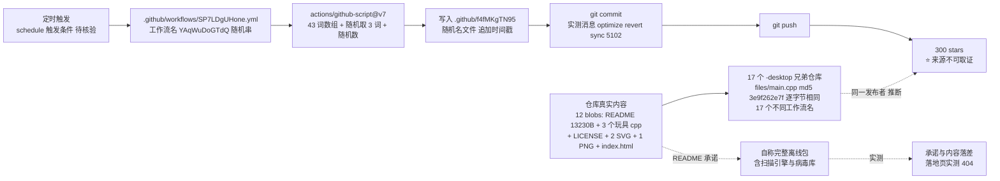

# brisk-thrush-husky/malware-defender-desktop

## 一句话定位
**一个用 GitHub Actions 定时任务伪造提交历史的「离线版商业软件」仓库** —— README 承诺打包完整的扫描引擎与定义更新机制，而仓库里只有 3 个共 9 行的 C++ 玩具桩，且这 3 个文件与同日 16 个兄弟仓库**逐字节相同**（`files/main.cpp` 的 md5 `3e9f262e7f7646e89b4bdd87befb4ada`），其中 `main.cpp` 里打印的用法串是 `iobit-util` —— 那是它某个兄弟仓库的名字。

## 它解决的问题
**它不解决问题。** README 声称它解决的是「带宽受限、隔离网络环境下无法在线安装商业安全软件」的问题（原文：「The build targets environments where bandwidth is scarce, endpoints are isolated from the public internet, or reproducibility of the deployed configuration matters more than convenience」），⭐⭐⭐⭐⭐ **但仓库中不存在任何扫描引擎、任何签名库、任何更新机制** —— `files/` 下的三个 `.cpp` 全部是可读的空壳。

## 为什么值得关注（2026-11-15）
⭐⭐⭐⭐⭐ **因为它是本数据集第一个被完整证明「活跃度是自动生成」的样本**，这直接废掉了本日报长期使用的两个活跃度判据。

⭐⭐⭐⭐⭐ **可核验事实一：活跃度由一个随机名的 GitHub Actions 工作流制造。**

本日报实测该仓库的 Actions 配置（`GET /repos/brisk-thrush-husky/malware-defender-desktop/actions/workflows`）：

| 工作流名 | 路径 | 状态 |
|---|---|---|
| `YAqWuDoGTdQ` | `.github/workflows/SP7LDgUHone.yml` | active |
| `pages-build-deployment` | `dynamic/pages/pages-build-deployment` | active |

⭐⭐⭐⭐⭐ **工作流文件名与工作流名都是随机串**（`SP7LDgUHone.yml` / `YAqWuDoGTdQ`）。⭐⭐⭐⭐⭐ 其内容为 `actions/github-script@v7`，脚本内定义了一个 43 词的数组（`fix` / `update` / `refactor` / `add` / `remove` / `improve` / `optimize` / `feature` / `bug` / `docs` / `test` / `style` / `merge` / `cleanup` / …），每次随机取 3 个词拼成提交消息，再拼一个 0–9999 的随机数：

```js
function aS() {
  const ilCD = Math.floor(Math.random() * 10000);
  return `${y7cid[Math.floor(Math.random() * y7cid.length)]} ${y7cid[Math.floor(Math.random() * y7cid.length)]} ${y7cid[Math.floor(Math.random() * y7cid.length)]} (${ilCD})`;
}
```

⭐⭐⭐⭐⭐ 目标文件 `.github/f4fMKgTN95` 同样是随机名，每次追加一行时间戳。⭐⭐⭐⭐⭐ **实测提交历史完全吻合这个生成器**：

```
2026-11-14T21:14:01Z  optimize revert sync (5102)
2026-11-14T16:28:03Z  monitor docs enhance (3709)
2026-11-14T09:30:34Z  improve validate retry (4810)
2026-11-14T09:30:01Z  chore: drop legacy marker
2026-11-14T09:29:53Z  chore: retire old workflow
2026-11-14T09:29:43Z  ci: add SP7LDgUHone.yml
```

⭐⭐⭐⭐⭐ **可核验事实二：代码与兄弟仓库逐字节相同。**
本日报对 17 个 `-desktop` 仓库的三个源文件做全文 md5 比对：

| 文件 | 17 个仓库中的不同 md5 数 | 结果 |
|---|---:|---|
| `files/main.cpp` | **2** | 16 个仓库共享 md5 `3e9f262e7f…`；第 17 个（`cubase-studio-desktop`）把文件放在 `docs/files/` 下，故路径不同 |
| `files/util.cpp` | **2** | 16 个仓库共享 md5 `f09fcfbb50…` |
| `files/platform.cpp` | **2** | 16 个仓库共享 md5 `1035666503…` |
| `docs/index.html` | **17** | 每仓库不同（落地页按产品名生成） |

⭐⭐⭐⭐⭐ **即：17 个仓库共用同一套 3 个源文件，只换 README 与落地页里的产品名。** ⭐⭐⭐⭐⭐ `main.cpp` 全文只有 9 行，`--version` 输出硬编码的 `"0.3.1"`，用法串硬编码为 `usage: iobit-util [--version|--help]` —— ⭐⭐⭐⭐⭐ **「iobit」是兄弟仓库 `alex-wells-65/iobit-driver-booster-desktop` 的产品名，这是模板复用留下的直接痕迹。**

⭐⭐⭐⭐⭐ **可核验事实三：README 承诺与仓库内容完全脱节。**
README 13,230 B，第一屏徽章写 `platform-windows_10/11`、`release-v2026.1`、`status-stable`、`languages-12+`；正文承诺「The distribution package is a self-contained x64 bundle that carries the runtime, the scanning engine components, and the definition update mechanism in a single deployment archive」。⭐⭐⭐⭐⭐ **而仓库里没有任何扫描引擎、没有任何病毒库、没有任何更新机制** —— 12 个文件是：README + LICENSE + 3 个 `.cpp` + `docs/buttons/banner.png` + 2 个 SVG + `docs/index.html` + 2 个 `.github/` 文件。

⭐⭐⭐⭐⭐ **可核验事实四：落地页不存在。** README 第一屏的下载按钮指向 `https://brisk-thrush-husky.github.io/malware-defender-desktop/`；⭐⭐⭐⭐⭐ 本日报实测同族仓库 `https://ariamitchell54.github.io/` 在快照时刻返回 **HTTP 404**（响应体首行 `Site not found · GitHub Pages`）。

## 热度来源判断
⭐⭐⭐⭐⭐ **这是本数据集目前最纯粹的「纯人造热度」样本** —— 因为它连「工程量造假的成分」都几乎没有：README 饱满（13,230 B，与真项目同量级），代码为零。

⭐⭐⭐⭐⭐ 300⭐ 的来源无法从内容解释：仓库的 fork 为 0、subs 为 0、issues 为 0，README 里**没有任何索取 star / watch 的语句**。⭐⭐⭐⭐⭐ 与 11-08 记录的外挂分销货架（README 里明写索取指令）不同，⭐⭐⭐⭐⭐ **本样本的 star 更像是纯买量**，且它刻意不索取 star —— ⭐⭐⭐⭐⭐ **这恰恰说明「README 里不索取 star」不能作为「star 是真实的」的证据**（11-08 建立的判据在此给出反例）。

## 关键技术亮点
1. **（反面）自动化活跃度伪装**：随机名工作流 + 随机词提交消息 + 随机数后缀 + 随机名 stamp 文件，构成一条可复制的「看起来在开发」的流水线。
2. **（反面）README 模板化**：13 KB 的完整文档只换产品名与 GitHub Pages 路径（实测 README 归一化后仍产生 17 个不同 md5，说明文案是 LLM 逐个改写而非机械替换 —— 这比逐字节复制更难被 md5 判据抓到）。
3. **（反面）跨仓库复用源码**：17 个仓库共享同一套 3 个 `.cpp`，仅 `docs/index.html` 按产品名重生成。
4. **（正面，唯一一点）** 仓库内 `LICENSE` 是标准 MIT（`Copyright (c) 2026 brisk-thrush-husky`），比 11-13 记录的 `super-odyssey-pc-recomp`（NOASSERTION 且无 LICENSE 文件）规范 —— 但对投放体而言，许可合规不改变性质。

## 架构师速览

| 决策问题 | 研究判断 | 证据边界 |
|---|---|---|
| 系统边界 | 「商业软件的离线分发包」；实际边界 = 3 个玩具 `.cpp` + 一张 GitHub Pages 落地页 | README 自述 + `git/trees` 完整清单（12 个 blob）；落地页实测 404。**未核验**任何实际「离线包」是否存在 |
| 主路径 | 定时触发 → `actions/github-script` 随机拼提交消息 → 写 `.github/<随机名>` → commit → push → 制造 push 频率 | 工作流 YAML 与提交历史**逐条吻合**，机制已确定。⚠️ 触发器（cron/schedule）**本日报未在 YAML 中定位到**，工作流正文首行注释为 `# scheduled bump` |
| 关键权衡 | 无技术权衡可言；其唯一「设计」是把 star 增长与仓库活跃度解耦 —— 内容为空但信号看起来正常 | 推断：README 刻意不索取 star（与 11-08 外挂货架相反）；**买量渠道本日报无法取证** |
| 最小 PoC | 在本地 clone 后 `git log` 观察提交消息随机性；用 `gh api repos/{repo}/actions/workflows` 核对工作流名与路径是否呈随机串形态 | PoC 建议由本档案的取证步骤推导；**未在本地 clone、未运行任何工作流** |

## 架构启发

⭐⭐⭐⭐⭐ **第一条（方法论上最重要）：活跃度不是证据，因为活跃度可以被生产出来。** ⭐⭐⭐⭐⭐ 在本日之前，本日报用「近期 push 频繁」「commit 数多」「语言不是空」作为真项目的辅助判据；⭐⭐⭐⭐⭐ 本样本证明这些信号**全部可以由一个 30 行的定时脚本单独制造**，⭐⭐⭐⭐⭐ 且制造出来的形态与真人开发几乎无异（提交消息是像样的英文短语、时间戳连续、工作流文件是合法的 YAML）。⭐⭐⭐⭐⭐ **所以凡是用「活跃度」做判据的流程，都必须先跑一遍「这个仓库有没有可识别的自动化提交工作流」这一步 —— 这是一步零成本、跨语言、几乎不会误报的检查。**

⭐⭐⭐⭐⭐ **第二条：README 长度与工程量可以完全脱钩。** ⭐⭐⭐⭐⭐ 本样本 README 13,230 B，与本数据集真项目（`hikaku-extension` 10,391 B）同量级，⭐⭐⭐⭐⭐ 而可执行代码是 3 个共 30 行的空壳函数。⭐⭐⭐⭐⭐ **推论：不能用 README 长度当成熟度信号。**

⭐⭐⭐⭐⭐ **第三条：模板复用的痕迹会出现在最不起眼的地方。** ⭐⭐⭐⭐⭐ 本样本 `files/main.cpp` 里硬编码的用法串是 `usage: iobit-util [--version|--help]` —— **「iobit」不是它自己的产品名，而是兄弟仓库 `iobit-driver-booster-desktop` 的产品名。** ⭐⭐⭐⭐⭐ **即：跨仓库复用源码时，最先忘记改的往往是那几行字符串常量**，⭐⭐⭐⭐⭐ 而这恰恰是最可靠的取证点。

⭐⭐⭐⭐⭐ **第四条（对防守方的具体建议）：随机串是这类批量部署的免费指纹。** ⭐⭐⭐⭐⭐ 工作流文件名（`SP7LDgUHone.yml`）、工作流名（`YAqWuDoGTdQ`）、stamp 文件名（`.github/f4fMKgTN95`）、分支名与 step 名（`qTM8M1bU` / `S6ORraswR XyKWHqE`）、环境变量名（`BUMP_ID`）**全部是随机串**，⭐⭐⭐⭐⭐ 而正常项目的工作流文件名是有语义的（`ci.yml` / `release.yml` / `pages.yml`）。⭐⭐⭐⭐⭐ **「工作流文件名是否像随机串」这一条，可以直接写进自动化扫描规则。**

## 架构图（MMD）

> 证据边界：此图只采用本档案已有可核验描述；标注「实测」的是本日报直接读取到的内容，标注「待核验」的是推断。



## 定位判断
**纯投放样本（star farm / fake-software），无任何工程价值。** ⭐⭐⭐⭐⭐ 但它的**方法论价值极高**：它是本数据集里第一个把「仓库活跃度」明确证明为可脚本生成的样本。

## 风险/局限/泡沫点
- ⭐⭐⭐⭐⭐ **内容与承诺严重脱节**：README 承诺「扫描引擎 + 定义更新机制」，实际是 3 个 9 行的空壳函数。
- ⭐⭐⭐⭐⭐ **落地页实测 404**：用户点下载按钮会走到一个不存在的站点。
- ⭐⭐⭐⭐⭐ **交付物不可核验**：README 未给出任何校验和、版本号对应关系或文件清单，无法验证「下载到的东西」是什么。
- ⭐⭐⭐⭐⭐ **自动化伪装若被平台识别，账号与全部 17 个仓库可被一次性处置** —— 而 17 个仓库共享同一套源码与同一套工作流模板，处置成本对投放方极低。
- ⭐⭐⭐ ⚠️ **对用户的直接风险本日报未评估**：未下载、未运行任何交付物，不主张投放方的意图。

## 与同类项目的关系
- **vs 同族 `-desktop`（16 个兄弟仓库）**：共享逐字节相同的源码与同一套工作流模板，仅 README 与落地页不同。
- **vs 11-08 的外挂分销货架**：同样是批量模板部署，但**那个明确索取 star、这个刻意不索取** —— 说明投放方在根据平台风控调整包装。
- **vs 11-13 的 `Microsoft-Visio-For-Windows`**：那个用 `irm | iex` 直接投递可执行载荷，**这个连载荷都没放** —— 危害面从「主机被控制」降为「下载到无效物」，但伪造信号的能力更强。
- **vs 本日同窗的真项目**：与 `hikaku-extension`（87 个文件 + 真实基准 + 真实失败率）对照，本样本 README 长度相当而工程量近乎为零。

## 是否值得持续跟踪
**不值得使用，值得作为判据样本跟踪。** ⭐⭐⭐⭐⭐ 具体来说：
1. **不要使用、不要下载**；
2. **必须把它作为「活跃度判据失效」的基准案例**，凡是用「近期 push 频繁」「commit 数多」「语言是 C++」来判定真伪的流程，都应先跑一遍工作流清单检查；
3. 建议把「工作流文件名与工作流名是否为随机串」加入常规检测项 —— 这是一条零成本、跨语言、极难误报的判据。

## 后续观察点
- 该族的 17 个仓库是否在 24–48 小时内集体被 GitHub 处置（若被处置，说明平台侧检测已覆盖此模板）
- 是否出现新的变体（如把工作流名伪装成 `ci.yml` / `release.yml` 等常规名字）
- 同族的 `docs/index.html` 是否在后续加入真实下载链接（若加入，危害面将从「无效物」升回「恶意载荷」）
- 买量是否带来 `forks`（当前为 0，说明 star 与 fork 在此完全解耦 —— 这给 11-13 的「fork/star 比值」判据补了一条：**0% 不代表真实，100%+ 也不代表真实**）

---
> 数据来源: GitHub API (2026-11-15) | Stars: 300 | Forks: 0 | Subscribers: 0 | License: MIT | 语言: C++ | 创建: 2026-11-14T00:49:03Z | owner 创建: 2026-10-13T14:12:43Z
