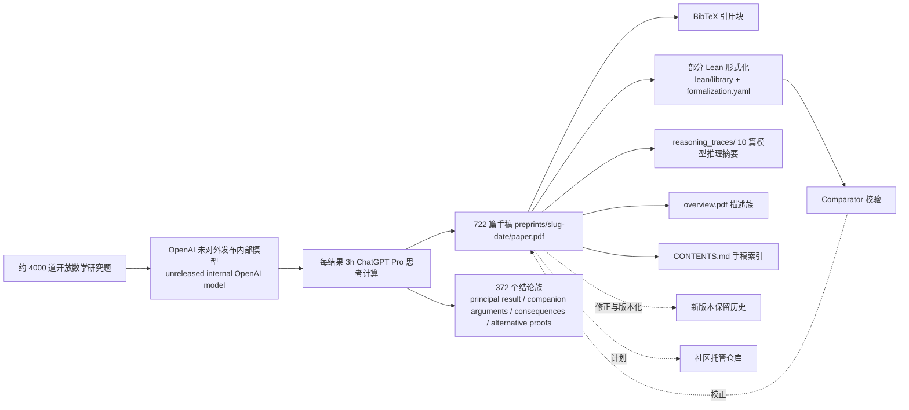

# openai/math

## 一句话定位
OpenAI 自家未对外发布的内部模型产出的 722 篇数学研究手稿（372 个结论族）+ 部分 Lean 形式化，覆盖 BSD / 准 Riemann / Milne 理性 / Kaplansky / 量子铁磁体自发性磁化 / 稀释自旋玻璃 Mézard-Parisi / 三维 Vlasov-Maxwell / free group factor 同构 / Mahler 等顶级未解问题推进。

## 它解决的问题
2026 年 AI 数学研究主要集中在"单题演示 + 论文 + 闭源模型"层级，OpenAI 选择把自家未对外发布模型在约 4000 道开放研究题、每题平均 3 小时 ChatGPT Pro 思考计算下产出的 372 个结论族（722 篇手稿）系统性公开 + 部分 Lean 形式化。本仓库不是传统开源项目（不开放模型权重），而是"AI 自动化数学研究"流水线产出的严肃工程化资产 + 部分形式化证明的开放。目标用户是数学研究者（BSD/Milne/Kaplansky 等可独立核验）、AI 研究者（参考其工作流）、形式化验证社区（复用 Lean 库）。

## 为什么值得关注
- **Stars:** 9,205（截至 2026-10-08），2 天突破 9200，增速极快
- **Forks:** 886，社区贡献极其活跃
- **License:** Apache-2.0
- **语言:** Lean（部分形式化）+ 论文 PDF（手稿主体）
- **规模:** 798,943 KB，含 722 篇手稿 + Lean 库 + reasoning_traces
- **覆盖:** BSD 公式（椭圆曲线低 Selmer corank 0/1 + 全 q-power + 两 primary + 二次 twist 密度 1）+ 准 Riemann Re(s)>7/8 zero-free + Milne 理性猜想 + Kaplansky 特征 2 + Mézard-Parisi 稀释自旋玻璃 + Heisenberg 量子铁磁体自发性磁化 + 三维 Vlasov-Maxwell + free group factor 同构 + Mahler 对称/一般 + 算术级数拟多项式界 + π 指数无理 + NP-hardness + Riemann zeta Re(s)>11/12 + Hodge CM abelian variety
- **关键文档:** overview.pdf + CONTENTS.md + lean/formalization.yaml + reasoning_traces/ 10 篇模型推理摘要

## 热度来源判断
openai/math 的热度是 **"OpenAI 品牌 × AI 自动化数学研究稀缺资产 × BSD/准 Riemann/Milne 等顶级未解问题推进 × Apache-2.0 商用清晰"** 的强劲组合。AI 自动化数学研究是 2026 年最具关注度的赛道之一，但此前多为单题演示或闭源论文。OpenAI 直接公开 722 篇手稿的系统性资产，自然爆火。886 个 forks 反映学术与工程社区的高度参与（手稿抽样核验、Lean 形式化推进、issue 反馈）。热度**真实且具研究资产价值**——但需警惕：（1）大部分手稿无独立同行评议，部分未形式化；（2）未对外发布模型黑盒，不可复现；（3）372 个结论族中可能存在正确性问题（"could have issues"）。

## 关键技术亮点
1. **未对外发布内部模型 + 4000 题 + 3h 思考计算：** 同一固定程序产出大部分结果，例外 Riemann zeta zero-free + Hodge CM
2. **372 个结论族 / 722 篇手稿：** family groups related papers, principal result, companion arguments, consequences, alternative proofs
3. **部分 Lean 形式化：** lean/library + formalization.yaml + Comparator 校验
4. **reasoning_traces/ 10 篇模型推理摘要：** 007 两点乘法函数相关性 + 017 π 指数无理 + 087 Mahler 对称/一般 + 102 半正定阈值 NP-hardness + 159 算术级数拟多项式界 + 197 Kaplansky 特征 2 + 221 Mézard-Parisi 稀释自旋玻璃 + 271 Heisenberg 量子铁磁体自发性磁化 + 287 free group factor 同构 + 362 三维 Vlasov-Maxwell
5. **Apache-2.0 商用清晰：** 可商用但需注明出处
6. **版本化修订机制：** 新版本保留历史，计划后续社区托管仓库

## 架构师速览

| 决策问题 | 研究判断 | 证据边界 |
|---|---|---|
| 系统边界 | OpenAI 未对外发布内部模型 + 约 4000 道开放数学研究题 + 每结果平均 3h ChatGPT Pro 思考计算 + 722 篇手稿（preprints/）+ 372 个结论族 + Lean 库 + 形式化清单 + Comparator 校验 + reasoning_traces/ + Apache-2.0 | 仅基于 README + overview.pdf + CONTENTS.md + lean/README.md + formalization.yaml + reasoning_traces/；具体未对外发布模型 ID / 训练细节 / 评估阈值 / Lean 形式化覆盖度未在档案中明示 |
| 主路径 | 约 4000 道题 → 未对外发布模型 → 每结果 3h ChatGPT Pro 思考计算 → 汇总成 372 个结论族 → 产出 722 篇手稿（preprints/{slug-date}/paper.pdf + 摘要 + BibTeX）→ 部分 Lean 形式化（lean/library + formalization.yaml）→ Comparator 校验 → 修正与版本化 → 计划社区托管仓库 | 主路径为档案语义抽象；具体模型 API 调用、版本控制流程、社区托管仓库平台未在档案中讨论 |
| 关键权衡 | 自家未对外发布模型 vs 开源 + 4000 题 vs 单题 + 3h ChatGPT Pro vs 实时算力 + 372 个结论族 vs 单论文 + 部分 Lean 形式化 vs 全形式化 + BSD/Milne/Kaplansky 等顶级未解问题推进 vs 单题演示 + Apache-2.0 vs 内部研究 + 计划社区托管仓库 vs 中央托管 | 档案明示自家未对外发布模型 + 约 4000 题 + 每结果 3h ChatGPT Pro 思考计算 + 372 个结论族 + 722 篇手稿 + 部分 Lean 形式化 + BSD/Milne/Kaplansky 等顶级未解问题推进 + Apache-2.0 + 计划社区托管仓库；具体未对外发布模型 ID / 训练细节 / 评估阈值 / Lean 形式化覆盖度 / 手稿数学正确性独立核验 / 计划社区托管仓库平台未在档案中讨论 |
| 最小 PoC | git clone openai/math → cd preprints/ → 任一结论族 → 读 paper.pdf → 切 lean/ → 看 Lean library + formalization.yaml → 切 reasoning_traces/ → 读 10 篇模型推理摘要 → 抽样交叉验证结论族（例如 BSD/Milne/Kaplansky）→ 跟踪形式化更新 | PoC 范围由档案「约 4000 题 + 3h ChatGPT Pro 思考计算 + 372 个结论族 + 722 篇手稿 + 部分 Lean 形式化 + BSD/Milne/Kaplansky 等顶级未解问题推进」建议推导；具体未对外发布模型 ID / 训练细节 / 评估阈值 / Lean 形式化覆盖度 / 手稿数学正确性独立核验未在档案中讨论 |

## 架构启发
openai/math 的核心启发是 **"AI 自动化数学研究应被视为工程流水线产出，而非单题演示"**。当前 AI 数学研究多停留在"AI 解出一道 IMO 题"的演示层级，本仓库则系统性展示了"4000 题 + 3h 思考计算 + 372 族 + 722 手稿 + 部分 Lean 形式化"的工业化流水线。更深层的启发是：**AI 研究的开放可以采用"产出开放、模型封闭"的混合模式**——Apache-2.0 公开所有手稿资产，但模型本身仍是 OpenAI 内部资源。这种模式使学术社区能复用产出而不泄露模型 IP，但也带来"正确性独立核验缺位 + 模型黑盒 + 部分形式化"三大限制，决定其作为"研究资产"的长期价值。决定其能否成为"AI for Math"标准模板的是（1）手稿数学正确性的独立核验；（2）Lean 形式化覆盖广度；（3）模型升级后的版本化严肃工程化承诺。

## 架构图（MMD）

> 证据边界：此图只采用本档案已有可核验描述；"待核验"节点不应视为项目实现事实。

## 定位判断
**基础设施候选型项目（OpenAI 数学研究资产开放化）。** openai/math 不是传统开源项目，而是 OpenAI 内部模型产出的数学研究资产（含 BSD/准 Riemann/Milne/Kaplansky 等顶级未解问题推进）的系统性开放——类似"AI for Math"研究阶段的"arXiv 化"。2 天 9205⭐ ⑂886 fork/star 9.6% + 798 MB 体积说明这是严肃资产而非演示级输出，Apache-2.0 保证可商用。372 个结论族 + 722 篇手稿 + 部分 Lean 形式化使该仓库可作为"AI 自动化数学研究"的范式样本。其长期价值取决于：（1）手稿数学正确性的独立核验（peer-review / 形式化推进）；（2）Lean 形式化覆盖广度（从"部分"到"全部"）；（3）后续社区托管仓库的可访问性；（4）模型升级后的版本化严肃工程化承诺。

## 风险/局限/泡沫点
- **数学正确性独立核验缺位：** 大部分手稿无独立同行评议，部分未形式化，"could have issues"
- **未对外发布模型黑盒：** 具体模型 ID、训练细节、评估阈值不可复现
- **Lean 形式化覆盖不全：** "Many, but not all" 形式化，关键手稿可能未形式化
- **Riemann zeta zero-free region 例外：** 部分结果手工化（human edited for readability）
- **Hodge CM 例外：** Hodge Conjecture for CM abelian varieties 例外，机制未充分讨论
- **计划社区托管仓库未落地：** "We are also exploring" 实际平台未明
- **资源中心化风险：** 所有 798 MB 内容由 OpenAI 单方面控制，未来政策变化可能调整
- **学习曲线陡峭：** 包含 Lean 形式化 + 高级数论/代数几何，本科及以下难独立核验
- **Meta 范畴声明：** "some unformalized results could have issues" 暗示正确性风险
- **大体积分发：** 798 MB 在低速网络下 clone 成本高

## 与同类项目的关系
- **vs DeepMind AlphaProof / AlphaGeometry：** 闭源-Driver，本项目开源产物但未开源模型
- **vs Facebook AI Research / MetaMath：** 数据集为主，本项目为手稿
- **vs Lean mathlib：** 形式化库，本项目为研究手稿（部分集成）
- **vs arXiv 数学板块：** 开放论文为主，本项目为系统化 AI 产出
- **vs OpenAI o1 / o3 数学能力：** 闭源能力评估，本项目自有 LLM 数学研究流水线

## 是否值得持续跟踪
**值得跟踪（AI 自动化数学研究范式）。** openai/math 是 2026 年 AI 数学研究"从单题演示到 722 篇手稿"的范式跃迁，无论其手稿资产本身是否被接住，其工作流（未对外发布模型 + 4000 题 + 3h 思考计算 + 372 族 + 部分 Lean 形式化）将成为"AI 自动化数学研究"的模板。建议关注：（1）手稿数学正确性的独立核验进度；（2）Lean 形式化覆盖广度推进；（3）后续社区托管仓库落地；（4）模型升级后第二批新版本发布。对数学研究者，这个仓库是"AI 自动化数学研究"严肃工程化的核心样本；对 AI 研究者，是"模型驱动数学研究流水线的开源案例"。

## 后续观察点
- 手稿数学正确性的独立同行评议进度（BSD/Milne/Kaplansky 抽样验证）
- Lean 形式化覆盖广度推进（"Many, but not all" → 全形式化）
- 后续社区托管仓库平台落地（计划中）
- 模型升级后第二批新版本发布
- 校正与修订版本化机制实际运作
- 4000 题中 372 族 + 722 篇手稿的抽样偏差分析

---
> 数据来源: GitHub API (2026-10-08) | Stars: 9,205 | Forks: 886 | License: Apache-2.0 | 语言: Lean | 创建: 2026-10-06 | Size: 798,943 KB