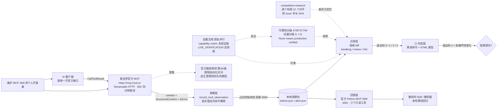

# YoyoLin008/mcreplay

## 一句话定位
把一次麦当劳 MCP 查询变成**可复现的本地结构测试**——删除响应真实值、保留结构、比较变化、再通过标准 MCP 在本地回放；**它的核心不是「调用官方 API」，而是「让上游 API 的输出漂移变成 CI 里会失败的一个退出码」**。

## 它解决的问题
维护一个基于第三方 API 的 Skill / 解析器 / 演示应用时，最难缠的故障不是「调用失败」，而是**「昨天能解析，今天为什么空了」**——字段类型改变、活动字段消失、文本返回变空，都可能让已有解析器**静默**失效。

麦当劳中国官方 MCP 恰好是这类问题的典型样本：**官方仓库 `M-China/mcd-mcp-server` 经 `?recursive=1` 全树查询确认只有 `README.md`（18,722 字节）与 `README_EN.md`（19,845 字节）两个文件**——**没有实现、没有机器可读的输入输出 schema、没有可运行的 SDK 示例**。官方 README 是好的（写明 `https://mcp.mcd.cn`、Streamable HTTP、Token 申请流程、**每 Token 每分钟 600 次请求上限与 429 错误码**），**但它是一份文档，不是一个契约**。当上游改了一个字段的类型，没有任何东西会告诉你的解析器。

mcreplay 解决的就是这个缺口：**把「结构变了」变成一个可判定、可阻断、且不泄露真实值的事件。**

## 为什么值得关注（2026-10-25）
**因为它是本日信息密度最高的项目，而它面对的问题类型在本日所有项目里是唯一的**——其他项目都在做「把一个东西做出来」，只有它在做「**怎么让一个已经存在的东西的变化能被机器发现**」。

更关键的是它处理「不确定性」的方式。本日报连续五天记录到「元数据不一致」这一类真实故障（NOASSERTION / null / 无 LICENSE 文件 / APSL 未标注 / 组合许可被折叠），而**mcreplay 把「我不知道」写成了产品的一部分，并且没有因此少发布任何东西**：

- `docs/capability-matrix.md` 的**第一行**就是「**No authenticated calls were possible: this session has no MCP token binding. … official authenticated calls remain unverified. All reliability judgments below are provisional, not production certifications.**」
- 同一仓库的 `docs/LIVE_VERIFICATION.md` 又记录了另一条路径的实测（三次成功查询、逐项耗时、端到端六项检查）
- **⭐ 两份互相矛盾的证据并列保留，读者能同时看到「我当时知道什么」与「后来验证了什么」**——这比「只写一份并标注可信度」更难，也更有信息量

**⭐⭐ 而它最有价值的一份文档是 `docs/competitive-research.md`**：它逐个检视了 10 个对手（每个都附官方登记 issue 号与被检视文件的具体 SHA），结论是：

> **The inspected sample is unusually implementation-rich. It would be inaccurate to label every competitor a "thin AI wrapper." … several contain deterministic engines and defensive transport.**

**在本日报连续第二天记录「热度不等于价值」的背景下，这是第一个反例样本——而且它是由一个正在比赛中的参赛者自己写下的。** 在一个 122 个仓库同天冒头的赛事生态里，最省事的判断是「绝大多数参赛者只是把提示词套在 API 上」；**它亲手检视了 10 个对手后给出了相反的判断。**

## 热度来源判断
**热度来自事件，不是来自采用。** 本日是麦当劳程序员创意开发大赛的**报名截止日**（官方 README：「报名及排名 | 2026年10月9日10:30—**10月25日23:59**」），官方 `RANKING.md` 有 **102 个排名条目**、更新时间 2026-10-25 06:00:57；本仓库排**第 37 名**（113⭐，快照时 122⭐）。

**⭐ 因此必须明确一件事：这个排行榜按 star 排序，而 star 在赛事语境里是参赛指标，不是采用信号。** 一个项目为了排名去刷 star，其 star 与「有多少人在生产环境依赖它」的相关性接近于零。

**⭐ 唯一可靠的判据是 mcreplay 自己用的那种**：读可执行代码、记录 SHA、标注「authors' claims, not independently rerun」。**它自己也照这个标准做了 10 次，并公开了对手的弱点。**

**推断（不构成事实）**：它选择在赛事截止日当天发布且同时公开「未验证」与「已验证」两份文档，**可能是因为对参赛项目而言「公开的不确定性」比「隐藏的空白」更能建立信任**——这类判断无法从仓库本身证实。

## 关键技术亮点

1. **⭐ 双路径证据，两份都留着。** `capability-matrix.md` 全部标注 provisional；`LIVE_VERIFICATION.md` 记录实测。**这是本批唯一的「并行矛盾证据」结构。**
2. **⭐ 证据分级精确到字段级。** `S:` = 必填字段名来自第三方 `CRFXN5C/mcd-mcp-kit` 在 2026-10-23 的 `tools/list` 捕获（**并明写「Do not copy this project's implementation or make our own live-test claims from it」**）；`O:` = 官方仓库 issue 里的确切 schema 示例；官方文档的 `data` 描述则被明确降级为「**a semantic summary from official documentation, not an output JSON schema**」。
3. **⭐ 官方 issue 只当观测痛点，不当官方保证。** 它逐条引用 issue 9（套餐可选池）、issue 11（营养 ID 缺失）、issue 13（订单列表只限最近 10 条，并写「Never label this full history/month/year analysis」）、issue 16（工具数 35 vs 33、**「wrong code→productCode mapping silently yields price0. Missing/zero price must not be treated as free」**）、issue 4（限流事故已被维护者确认修复）。
4. **⭐ 退出码即契约。** `0` = 无变化或仅信息项、`2` = 有破坏性风险、`3` = 仅需人工复核、`1` = 输入或执行失败。**「有破坏性变化」是一个可以被 CI 判定的离散状态，不是一句警告。**
5. **⭐ 结构比较覆盖两个编码面。** 官方响应同时有「Markdown 后缀 JSON」与 `structuredContent`；它的类型变更实验**同时定位了两处变化**，说明它不是只扫一个面。
6. **⭐ 真实值不出本机。** 业务值统一替换为占位符；接收文件权限实测为 **0600**；仓库附带的 `examples/fixtures/official-20261024.json`（87,252 字节）经 **Gitleaks 8.30.1** 校验无泄露。
7. **⭐ 逐个检视 10 个对手并公开其弱点**，同时明写「authors' claims, not independently rerun」与「This is an inspected sample, not a census」，并纠正了一个排名混淆（「official ranking's #3 is a different similarly named project」）。
8. **⭐ QA 记录完整到可以当模板用。** 原环境 `pytest -q` **120 passed in 4.35s**（核心 42 / 比较 47 / CLI 12 / MCP 服务 19，**全部合成输入**）+ SDK 子进程测试 **19 passed in 5.38s**（**协议测试有 25 秒截止**）+ `ruff check .` 与 `ruff format --check .` 通过 + sdist 与 wheel 构建成功 + 独立环境装 wheel 后 `pip check` 通过 + **Gitleaks 8.30.1** + **对锁文件全部 29 项依赖跑 pip-audit 无已知漏洞** + CI 覆盖 macOS/Python 3.13 与 Linux/Python 3.11、3.12、3.13。
9. **⭐ 离线演示自带破坏性样本。** `mcreplay demo --out-dir demo-output` 会显示三处预设的结构变化；`mcreplay compare` 对该演示**预期退出码为 2**——**即它的失败路径是默认可演示的**。

## 架构师速览

| 决策问题 | 研究判断 | 证据边界 |
|---|---|---|
| 系统边界 | 四个可分离的部分：① **观察层**（把一次官方查询的完整 `CallToolResult`（`content` + `structuredContent` + `isError`）落成「结构包」，业务值替换为占位符）② **比较层**（两份观察包的结构 diff，输出 `breaking`/`review`/`info` 三级 + 退出码）③ **回放层**（用官方 Python MCP SDK 起一个 stdio server，把结构包里的占位响应作为三个只读工具返回）④ **CI 层**（离线命令 + 明确退出码 + 独立 HTML 报告）。**边界划在「真实值不出本机」**：响应真实值在落盘前于内存中删除，接收到的文件权限 0600 | `docs/LIVE_VERIFICATION.md` 的端到端检查表、`docs/limitations.md` 的逐行支持范围、README 的「30 秒离线试用」、`examples/` 下三个脚本（`check_adapter.py` 1,336 字节、`check_recorded_structure.py` 2,875 字节、`fixtures/{before,after,official-20261024}.json`）；**观察层与比较层的具体实现本窗口未取，待核验** |
| 主路径 | 开发者：在 AI 客户端里查一次官方 MCP → `mcreplay import private/export-before.json` 导出结构 → 改了解析器 → 再查一次导出为 after → `mcreplay compare before.json after.json --html report.html` → **若退出码为 2 则阻断提交**；离线自检路径为 `mcreplay demo --out-dir demo-output`（**演示使用合成样本**）与 `python examples/check_recorded_structure.py`（用仓库附带的官方结构包走**标准 MCP 客户端**完成三项样本的接收与回放，验证时间、活动及营养响应的字段格式） | README 的三个实际开发工作流、`docs/LIVE_VERIFICATION.md` 的复现节、`examples/` 三个脚本；**「退出码 2 阻断提交」是本档案的推断——README 未明写 CI 接入方式** |
| 关键权衡 | **离线优先 vs 在线实时**（离线是为了能进 CI 且不触发 600 次/分钟限流，代价是延迟发现漂移）· **替换业务值 vs 保留原值**（替换让样本可公开且不泄露隐私，**代价是丢失了对值语义的检测能力——只能测结构不能测业务正确性**）· **未验证结论也发布 vs 只发已验证的**（它选择发布前者但逐条标注等级，代价是读者必须自己判断等级的可信度）· **通用 33 工具覆盖 vs 三工具精确覆盖**（它只实现了三个工具，**换来的是这三个工具的行为被完整刻画**）· **结构比较 vs 语义比较**（结构 diff 稳定可比，语义 diff 需要模型判断——它选了前者）· **⭐ 对照赛事的对手 vs 只做自己的工具**（它花大量篇幅逐个检视对手并公开弱点，**这在竞争环境里是反直觉的**） | `docs/limitations.md`、`docs/capability-matrix.md` 的 reliability grades 定义、`docs/competitive-research.md` 的方法节；**未明示：它是否有付费或商业动机、维护者是否计划扩展到更多工具** |
| 最小 PoC | 1. **先确认你能不碰官方服务就验证**（这是它离线优先的直接理由）→ 2. `git clone` + `python3 -m venv .venv` + `pip install -e .`（**需 Python 3.11+，Linux 或 macOS；Windows 不在其支持范围内**）→ 3. 跑 `mcreplay demo --out-dir demo-output`，打开 `demo-output/report.html` **看是否确实显示了三处预设的结构变化** → 4. **⭐ 跑 `mcreplay compare demo-output/before.json demo-output/after.json` 并确认退出码是 2**（**这一步是唯一能证伪「它的比较器真的会拒绝」的步骤**——与 10-24 记录的 oss-verify `oft check` 在 `Print Assumptions` 阶段拒绝越界公理同构）→ 5. 跑 `python examples/check_adapter.py demo-output/before.json`（应退出 0），再把文件换成 `after.json`（应检出类型变化并退出 2）→ 6. 跑 `python examples/check_recorded_structure.py`，**确认它是用标准 MCP 客户端完成回放的，而不是自己实现的假 server** → 7. **⭐ 验证「删掉真实值」这一步真的发生了**：检查 `examples/fixtures/official-20261024.json` 里是否还有任何具体的时间戳、门店码或价格；再检查 `record_mcd_observation` 写出的文件权限是否为 `0600` → 8. **⭐ 读 `docs/capability-matrix.md` 的第一行，确认它仍然写着「official authenticated calls remain unverified」——如果这句话消失了，说明文档与能力矩阵不同步** → 9. 若要接官方服务，先读官方 README 的限流条款（600 次/分钟）与 Token 申请流程 | **第 4 步是本 PoC 的核心**（一个只会通过的比较器不构成证据）· **第 7 步是本项目主张的核心价值**（不泄露真实值）· **第 8 步验证的是它最独特的资产（并行证据路径）是否还在** · **第 2 步的 Windows 限制是硬门槛** · 本 PoC **不覆盖**它未实现的 30 个工具，也不覆盖任何官方写操作（`W` 级工具） |

## 架构启发
**最值得迁移的一点不是工具，是「未验证」被当成一个可以发布的状态。**

绝大多数工程文档只有两种状态：已验证（于是被相信）与未提及（于是被忽略）。mcreplay 有第三种——**「我此刻不知道，这是我知道的边界，这是我的证据等级」**——并且把它写成**机器可读的形式**（A?/B?/C?/W + `S:`/`O:` 分级 + 退出码 0/1/2/3）。

**⭐ 更深的启发是它对「同一份仓库里的两份矛盾文档」的处理。** 它没有因为实测版本存在就把未验证版本删掉，也没有因为要发布就假装验证过。**两份都在，读者能自己判断哪一份更可信。** 这在一个「AI 生成的文档越来越多、而可信度标注越来越不显眼」的时间点，是一种值得被直接抄的诚实工程形式。

**第三个启发关于 fork 比例。** 它的 fork/star 只有 4.9%——**远低于同批的 xss-audit（25.8%）**——但这不说明它差。**它说明的是「fork 的单位成本」**：改一段 26 KB 的 Markdown 几乎零成本，而给一个框架加一个工具的契约测试是有实际工程量的。**这是本日报连续五日观察到的「可改造型 vs 不可改造型」分界线的一个推进版本——分的不再是「是否邀请改造」，而是「改造的单位成本」。**

## 架构图（MMD）

> 证据边界：此图只采用本档案已有可核验描述；标注「待核验」的节点不应视为项目实现事实。

## 定位判断
**「API 契约回归测试」品类的一个高质量样本，且很可能是该品类里目前最诚实的一份。**

它不是「麦当劳专属工具」——**它的核心能力（观察包 → 结构 diff → 退出码 → 本地回放）可以套在任何会漂移的第三方 API 上**，麦当劳只是它选择的第一个真实样本。这一点决定了它的**长期价值高于其赛事排名所暗示的位置**。

**⭐ 定位上最值得记的一点：它把「工具的价值」定位在「让人敢改代码」而不是「让人少写代码」。** 在一个 API 没有 schema、只提供 README 的现实里，**「我能确认我这次改动没踩到上游的字段变化」本身就是交付物的一部分**。这与本日报连续记录的「把边界写进可核验的位置」是同一条线，但落到了最实用的位置。

## 风险 / 局限 / 泡沫点
- **⚠️ `subs 0` + contributors API 返回 1 人 + 仅 8 个 commit = 一个个人项目在赛事截止日当天的一次集中发布。** 没有任何外部贡献者痕迹，也没有外部复现记录。
- **⚠️ 它的能力矩阵基于未验证的官方文档描述与第三方捕获，「33 个工具」的必填参数没有一条来自官方 schema。** 它自己写了这一点（`S:` 标记 + 「not an output JSON schema」），**但读者在摘要层很容易丢掉这个标记**。
- **⚠️ 平台限制**：Python 3.11+、**Linux 或 macOS（无 Windows）**；只实现了 3 个工具的契约回归。
- **⚠️ 它依赖官方服务的限流额度**（600 次/分钟），而官方服务规则第 3、6 条限制自动化访问——**这既是它选择离线优先的根因，也是它验证路径的天然边界。**
- **⚠️ `license.spdx_id` 为 NOASSERTION**（尽管 `LICENSE` 文件首行是 MIT License 且带额外条款）——**依赖 license 扫描器的工具会给出错误的默认答案**。**这是本日报已记录的第四类许可元数据问题的新增实例。**
- **⚠️ 官方 MCP 的许可条款禁止未经书面授权的商业使用**——**mcreplay 自己的 LICENSE 尾部也写了这一句**（「This license grants no permission to use the official service commercially or outside its rules」）。**依赖该服务的任何商业产品都需要单独审视这条边界。**
- **⚠️ 本日报无法核验它对 10 个对手的判断是否公允**——虽然它的方法可核验（附 SHA），但结论仍是它自己的。

## 与同类项目的关系
- **vs `mcd-self-butler`（同为参赛者，第 23 名，150⭐）：两种完全不同的取向。** 前者做**业务决策**（全成本比价 = 商品价 + 走路时间 + 排队时间），后者做**契约回归**。**⭐ 但两者的 SKILL 纪律高度同构**：mcd-self-butler 的 6 条铁律含「价格只信 `calculate-price`」「营养只信 `list-nutrition-foods`，分析套餐必须先 `query-meal-detail` 拆成子项」「不自动下单」「不编造」，**而 mcreplay 的整条主张就是「不编造结构」**。
- **vs `CRFXN5C/mcd-mcp-kit`（19⭐，非参赛的第三方工具抓取集）：mcreplay 把它的 `tools/list` 捕获当作二手证据来源（`S:` 标记），并明确拒绝复制其实现。** 这是分工而非竞争。
- **vs 通用契约测试工具（Schemathesis / dredd / pact）：那些工具需要被测服务提供 schema 或可配置的期望，而 mcreplay 只需要「抓一次真实响应」。** **⭐ 在「上游根本不提供 schema」的场景下，前者无法启动，后者可以——这是它的真实差异化。**
- **vs 各类 API mock 工具：mock 需要预先知道结构（同样需要 schema），mcreplay 是从真实响应里「长出」结构。**
- **vs `oss-verify-proofs`（10-24 记录）：两者都在做「让机器读出边界」，但方向相反——oss-verify 让机器**证明**代码不触发 sanitizer 错误，mcreplay 让机器**发现**接口的形状变了。** ⭐ 共同点是「检查器必须真的会拒绝」：oss-verify 在 `Print Assumptions` 阶段拒绝越界公理，mcreplay 用退出码 2 拒绝破坏性变化。**

## 是否值得持续跟踪
**值得，且跟踪方式应是「它是否被赛事之外的人采用」，而不是「它能不能获奖」。**

**⭐ 理由**：它的核心价值（API 契约回归）在赛事结束后的长期需求反而更大——**因为 122 个参赛仓库会在赛后暴露在同一类 API 漂移风险下**。**如果这些项目在赛后消失，而 mcreplay 的方法被更广泛采用，那它的长期价值远高于今天的第 37 名。**

**⭐ 而且它对 10 个对手的逐个检视是本日报最有用的一份生态判断**——即使它自己消失，这份文档也会被反复引用。

## 后续观察点
1. **⭐ 是否出现第一个外部 fork**（fork/star 4.9% 说明还没到；这与「有多少人在真的用它的比较器」是最直接的信号）
2. **它的工具覆盖是否从 3 个扩展**（这是它能力边界最直接的指标，也决定它是否真的成为「通用契约测试」而非「麦当劳工具」）
3. **是否有人把它的退出码接进 CI 并公开**（这会验证「契约回归」这个模式是否真的有用，而不只是「一个本地脚本」）
4. **⭐ 赛事结束（2026-10-25 23:59）后的存续情况**——**特别是那 122 个仓库里有多少会因为许可或无差异而消失**
5. **官方是否发布正式的 schema**（那会直接改变它的核心价值——如果官方给出 schema，`capability-matrix.md` 的整份暂定矩阵就失去意义）
6. **⭐ 官方服务规则第 3、6 条对自动化访问的具体限制范围**（这决定了它的离线优先是权宜之计还是长期形态）
7. **是否有人给它提 PR**（`subs 0` + contributors 1 人意味着目前完全没有人参与）

## 最近动态（2026-10-26）

**2026-10-26：** ⭐ 122 → **200**（+64%），⑂ 6 → **12**，**`subscribers_count` 仍为 0**，`pushed_at` 2026-10-24T18:56:03Z（**超过 27 小时无提交**）。⭐⭐⭐ **即 star +64% 而 subscribers 仍为 0——这与本日报同日记录的 `xss-audit`（star +103% 而 commits 仍为 1）构成同一族的两个反例。** ⭐⭐ **而这正是本日报本日确立的判据的核心：优先看 `subscribers_count` 与 `open_issues_count` 的变化，而不是 `stargazers_count`。**

⭐⭐⭐ **赛事侧同步更新：官方 `M-China/mcd-developer-innovation-challenge` 的 `RANKING.md` 更新时间从 10-25 的「2026-10-25 06:00:57」推进到「2026-10-26 00:01:01」，排名条目从 102 条降为 101 条（`grep -c "^| [0-9]"` 实测），本项目从第 37 名升至第 23 名 201⭐。** ⭐⭐ 而 README 明写「活动开始后，麦当劳将定时采集报名成功项目的**公开 Star 数据**」「**Star 数大于0**的项目将按照排名规则进入排行榜」——⭐⭐⭐ **即排行榜本身按 star 排序，而 star 在赛事里是参赛指标而非采用信号。这与本日报 10-25 记录的「赛事驱动的注意力洪峰」在本质上是同一件事，只是峰已过、峰后是退潮。** ⭐⭐ **而 subs 仍为 0 是本项目「结构性契约测试」主张尚无外部采用信号的最直接读数。**

---
> 数据来源: GitHub API (2026-10-25) | Stars: 116 | Forks: 6 | Subscribers: 0 | License: NOASSERTION (LICENSE 文件为 MIT + 额外条款) | 语言: Python | 创建: 2026-10-24T17:14:18Z | 8 commits | contributors 1 人
> 官方对照: `M-China/mcd-mcp-server` 246⭐ ⑂9（树仅 `README.md` + `README_EN.md`）、`M-China/mcd-developer-innovation-challenge` 237⭐ ⑂13（RANKING.md 102 条，本仓库第 37 名）
