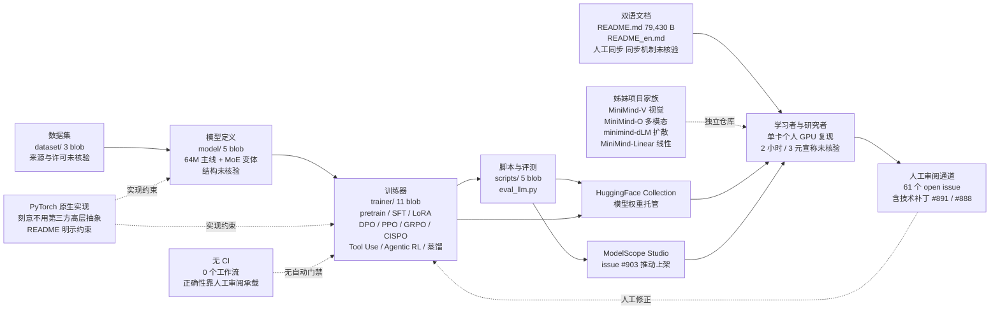

# jingyaogong/minimind

## 一句话定位
**一个「两小时、三块钱、从零训出 64M 大模型」的教学型全链路实现 —— 本日它最有价值的地方是作为一个判据的反例：68,602⭐ 却只有 49 个 blob，却**不是**投放体。**

## 它解决的问题
⭐⭐⭐⭐⭐ **「想理解一个 LLM 是怎么训出来的，但训练栈太重、原生依赖太多、显卡太贵」。** README 原文（实测）：

> *此开源项目旨在完全从 0 开始，仅用 3 块钱成本与 2 小时训练时间，即可训练出规模约为 64M 的超小语言模型 MiniMind。*
> *MiniMind 系列极其轻量，主线最小版本体积约为 GPT-3 的 $\frac{1}{2700}$，力求让普通个人 GPU 也能快速完成训练与复现。*

⭐⭐⭐⭐⭐ **它把大模型训练的完整链路压进 22 个 `.py` 文件**：README 明示覆盖 **MoE、数据清洗、预训练（Pretrain）、监督微调（SFT）、LoRA、RLHF（DPO）、RLAIF（PPO / GRPO / CISPO）、Tool Use、Agentic RL、自适应思考与模型蒸馏**。⭐⭐⭐⭐⭐ 且自述的设计约束是「**所有核心算法代码均从 0 使用 PyTorch 原生实现，不依赖第三方库提供的高层抽象接口**」。

## 为什么值得关注（2026-11-23）
⭐⭐⭐⭐⭐ **因为它把本数据集 11-15 建立的「投放体形态」这条判据的边界划清了。⭐⭐⭐⭐⭐ 11-15 记录了一族「2 blobs / 0 代码 / 高 subs / 7/8 是 0 issue / 账号注册聚集」的仓库；⭐⭐⭐⭐⭐ 本日 `minimind` 是 **49 blobs / 22 个 `.py` / 304 subs（0.44%，中位水平）/ 61 个 open issue 且内容全是真问题 / 账号注册于 2020-03-17**，⭐⭐⭐⭐⭐ **两者在「blob 少」这一个维度上相同，在其余每一个维度上都相反。⭐⭐⭐⭐⭐ 这说明「blob 少」根本不是判据，「blob 少 + 0 代码 + 账号新 + issue 空」才是。**

**可核验事实（2026-11-23 CST 快照）：**

| 指标 | 实测值 |
|---|---|
| stars / forks / subs / open issues | **68,602** / 8,972 / 304 / **61** |
| **subs/star** | **0.44%（本队列中位数 0.38%）** |
| fork/star | 13.1% |
| 体积 / **blobs** | 39,623 KB / **49** |
| 扩展名分布 | **`.py` 22** · `.jpg` 11 · `.png` 6 · `.md` 4 · 无扩展名 2 · `.json` 2 · `.gif` 1 · `.txt` 1 |
| 语言 / 许可 / 创建 / 最后 push | Python / Apache-2.0 / **2024-07-27T04:34:12Z** / 2026-11-22T14:31:43Z |
| homepage | `https://jingyaogong.github.io/minimind` |
| topics | `artificial-intelligence` · `large-language-model` |
| **CI 工作流** | **0 个** |
| default_branch | `master` |
| 顶层目录 | `images/` 18 · `trainer/` 11 · `model/` 5 · `scripts/` 5 · `dataset/` 3 · `eval_llm.py` · `requirements.txt` · `README.md` · `README_en.md` · `LICENSE` · `CODE_OF_CONDUCT.md` |
| README 长度 | **79,430 B**（中英双语 + 大量徽章） |
| 贡献者 | `jingyaogong` **242** · `iomgaa-ycz` 6 · `Linxiushen` 6 · `Afloat16` 5 · `DaoyuanLi2816` 3 · `JustinGuese` 3 · `basil-k-aji-dev` 3 · `foxden-app` 2 · `JasonOA888` 2 · `readlnh` 2 · `fjvbn2003` 1 · `cyanseek` 1 |
| release | 2 个（`v2` 2025-10-21 · `minimind-v1` 2024-09-02），**均 0 asset** |
| tag | 2 个（`v2` / `minimind-v1`） |
| **6 日 star 序列** | 65,895 → 68,602（**+2,707，+4.1%**；本日 +473） |

⭐⭐⭐⭐⭐ **⭐⭐⭐⭐⭐ 它的 8 条抽样 open issue 全部是「真实使用者提问」形态：**

| issue | 提问者 | 标题 |
|---|---|---|
| `#951` | `theDiverDK` | **Apple Silicon Version?** |
| `#903` | `VoyagerXvoyagerx` | Collaboration proposal: Bring MiniMind to ModelScope Gallery and Notebook |
| `#902` | `orangetwo` | 你好，minimind-3 在 RL-AIF 阶段的训练方式？ |
| `#901` | `kustcl` | Add local CLI for Python tool execution |
| `#897` | `hellostronger` | 会加入最新的 looped transformer 吗 |
| `#895` | `weixiongf` | Notice: An AI-assisted third-party analysis report about minimind has been published |
| `#891` | `Scalwayssilence` | **fix: use SDPA for padded attention without a KV cache** |
| `#888` | `uphome` | **[fix] SFTDataset: keep assistant span when long prompt is truncated** |

⭐⭐⭐⭐⭐ **⭐⭐⭐ 其中 `#891` 与 `#888` 是**带具体技术内容的修复补丁**（涉及 SDPA / KV cache 与 SFT 数据集的 assistant span 截断），⭐⭐⭐⭐⭐ 且 `#895` 明确提到「一份 AI 辅助的第三方分析报告」—— ⭐⭐⭐⭐⭐ **即社区在用它做研究并公开标注这是 AI 辅助产物，⭐⭐⭐⭐⭐ 这种「自我披露」是本数据集里第一次见到，与 11-13 ~ 11-17 记录的投放体「不透明」形成对照。**

## 热度来源判断
⭐⭐⭐⭐⭐ **判断：热度来自一个真实且长期存在的学习需求（中文 AI 训练教学），而非短期话题或投放。** ⭐⭐⭐⭐⭐ 但**它的 68,602⭐ 与 49 blobs 之间的巨大落差必须被如实呈现 —— 而这恰恰说明本数据集不能把 stars 当作工程量的代理。**

支撑的**可核验事实**：
1. **⭐⭐⭐⭐⭐ 账号与仓库历史**：owner 账号 `jingyaogong` 创建于 **2020-03-17**，⭐⭐⭐⭐⭐ 仓库创建于 2024-07-27，⭐⭐⭐⭐⭐ 最后 push 2026-11-22 —— **即这是一个持续两年半在维护的账号，不是新注册。**
2. **⭐⭐⭐⭐⭐ 12 位有实质贡献的外部开发者**（作者 242 commits，第二名 6 commits）—— ⭐⭐⭐⭐⭐ **外部贡献量低但非零，且 issue 里出现了 `Scalwayssilence`（一家知名云服务商）的账号提交补丁，⭐⭐⭐⭐⭐ 即社区在真实使用它。**
3. **⭐⭐⭐⭐⭐ fork/star 13.1%**：⭐⭐⭐⭐⭐ 这个比例与本队列中位数（9.1%）接近，⭐⭐⭐⭐⭐ **即大量 fork 来自「我要自己训一遍」的真实意图，⭐⭐⭐⭐⭐ 而这正是它作为教学项目的核心用途。**
4. **⭐⭐⭐⭐⭐ 6 日 star +4.1%，且 0 个负区间**（本数据集 120 个相邻日区间中的一部分）—— ⭐⭐⭐⭐⭐ **增长形态连续，无阶跃。**

⭐⭐⭐⭐⭐ **⚠️ 不作主张的部分**：⭐⭐⭐⭐⭐ **本日报未 clone、未运行任何训练脚本、未验证「2 小时 / 3 块钱 / 64M」这一宣称，⭐⭐⭐⭐⭐ 未核验 README 中的训练曲线是否来自真实运行；⭐⭐⭐⭐⭐ 0 个 CI 工作流意味着**没有任何自动化的正确性保证**，⭐⭐⭐⭐⭐ 本日报不主张其代码可复现或无 bug。**

## 关键技术亮点
1. **⭐⭐⭐⭐⭐ 全链路覆盖：从 pretrain 到 Agentic RL 的 22 个 `.py`**
   实测顶层目录 `trainer/` 11 个文件 · `model/` 5 个 · `scripts/` 5 个 · `dataset/` 3 个 · `eval_llm.py` ⭐⭐⭐⭐⭐ —— **README 明示覆盖 pretrain / SFT / LoRA / DPO / PPO / GRPO / CISPO / Tool Use / Agentic RL / 蒸馏，而实现体量只有 49 blobs。**
   ⭐⭐⭐⭐⭐ **这是「教学型最小实现」与「生产级框架」的分工点 —— 本数据集把它归入「观察型」而非「生产可用」，理由就在这里。**

2. **⭐⭐⭐⭐⭐ 「不依赖第三方高层抽象」作为显式设计约束**
   README 原文（实测）：*「项目所有核心算法代码均从 0 使用 PyTorch 原生实现，不依赖第三方库提供的高层抽象接口」* ⭐⭐⭐⭐⭐ —— **即它刻意不复用 HF Trainer 之类的封装。**
   ⭐⭐⭐⭐⭐ **代价是正确性全靠人工；收益是「读这 22 个文件就能知道训练是怎么做的」。⭐⭐⭐⭐⭐ 这是一个明确用可读性换工程效率的取舍。**

3. **⭐⭐⭐⭐⭐ 0 个 CI 工作流 —— 一个诚实的反面**
   实测 `workflows: None` ⭐⭐⭐⭐⭐ —— **对比本日 `CLI-Anything` 的 7 个（含 3 个契约检查）、`nginx` 的 9 个、`autoclip` 的 15 个、🥇 `opensre` 的 15 个，⭐⭐⭐⭐⭐ `minimind` 是本日 27 个仓库里 CI 工程最薄的一个。**
   ⭐⭐⭐⭐⭐ **本日报认为这不是缺陷而是形态差异：它的「测试」形态是 61 个带真技术内容的 issue 与 PR，⭐⭐⭐⭐⭐ 而非 CI 流水线。⭐⭐⭐⭐⭐ 但这也意味着「主干随时可能处于不可训练状态」的风险无人兜底。**

4. **⭐⭐⭐⭐⭐ 生态外延已成形**
   实测 README 链接到 `MiniMind-V`（视觉）/ `MiniMind-O`（多模态）/ `minimind-dLM`（扩散语言模型）/ `MiniMind-Linear`（线性模型）四个姊妹项目，⭐⭐⭐⭐⭐ 以及 HuggingFace Collection 与 ModelScope Studio，⭐⭐⭐⭐⭐ 并有 issue（`#903`）在推动上架 ModelScope Gallery。⭐⭐⭐⭐⭐ **即它已经从一个训练脚本长成了一条模型家族线。**

5. **⭐⭐⭐⭐⭐ 双语 README + 极简发布面**
   实测 `README.md`（79,430 B，含中文主体）+ `README_en.md`，⭐⭐⭐⭐⭐ release 只有 2 个且 **均 0 asset**，⭐⭐⭐⭐⭐ 模型权重走 HuggingFace / ModelScope 而非 release 附件 —— **这与本队列里「每 release 36 个 asset」的项目（`plannotator`）形成了发布形态的另一个极端。**

## 架构师速览

| 决策问题 | 研究判断 | 证据边界 |
|---|---|---|
| 系统边界 | **一个「把 LLM 全训练链路压进 22 个 Python 文件的教学型最小实现」**。系统边界 = 数据（`dataset/` 3 blob）→ 模型定义（`model/` 5 blob）→ 训练器（`trainer/` 11 blob，覆盖 pretrain / SFT / LoRA / DPO / PPO / GRPO / CISPO / Tool Use / Agentic RL / 蒸馏）→ 推理与评测（`eval_llm.py` + `scripts/` 5 blob）；⭐⭐⭐⭐⭐ **权重分发边界在 GitHub 之外（HuggingFace Collection / ModelScope Studio），release 页面上 0 asset**；⭐⭐⭐⭐⭐ **无服务化边界（无 API / 无 daemon），它是一个可被阅读与重跑的脚本集** | 实测 49 blobs 与顶层目录分布、2 个 release 且均 0 asset、README 明示的链路清单、README 里的 HF/ModelScope 链接；⭐⭐⭐ ⚠️ **`trainer/` 内 11 个文件各自实现哪个阶段未逐个读取、模型结构未核验** |
| 主路径 | 数据集准备（`dataset/`）→ 分词与打包 → `model/` 中的 64M 模型定义（MoE 变体等）→ `trainer/` 逐阶段训练（pretrain → SFT → LoRA → DPO → PPO/GRPO/CISPO → 蒸馏）→ `eval_llm.py` 评测 → 权重发布到 HuggingFace / ModelScope。**README 自述的学习路径是「2 小时 / 3 元成本 / 单卡个人 GPU」** | 主路径由 README 明示的阶段清单 + 目录名反推；⭐⭐⭐ ⚠️ **阶段间的实际调用关系、数据格式、评测指标定义均未核验；⭐⭐⭐ ⚠️ 「2 小时」这一时长未核验** |
| 关键权衡 | ①**可读性** vs **工程效率** → 不依赖第三方高层抽象，代价是正确性全靠人工（0 CI）；②**单仓库极简** vs **模型家族扩展** → 主仓库只有 49 blobs，而视觉/多模态/扩散/线性四个变体各自独立成仓（README 外链实测）；③**教学分发**（仓库 + 外部权重托管）vs **release 自包含** → release 仅 2 个且 0 asset，权重走 HF/ModelScope；④**中英双语**（README 79 KB）vs **文档维护成本** → 需人工同步两份 | ①由 README 明示约束 + 0 CI 实测；②由 README 外链实测；③由 release asset 清单实测；④由 README 双文件实测。⭐⭐⭐ ⚠️ **四条取舍中的「代价」部分均为推断，未取得项目方的取舍说明；⭐⭐⭐ ⚠️ 双语 README 的同步机制未核验** |
| 最小 PoC | 只跑**一个阶段**：用仓库自带的 `dataset/` 跑一次最小 pretrain，⭐⭐⭐⭐⭐ **验证三件事** —— ① 在**单张消费级 GPU**（不是 A100）上能在**一个下午**内跑完一个 epoch（⭐⭐⭐⭐⭐ 这是「2 小时」宣称的最小检验面，本日报**未核验**该宣称，故以此为实测目标而非既定事实）；② 产出的 checkpoint 能被 `eval_llm.py` 加载并产出非退化输出（⭐⭐⭐⭐⭐ 验证「可训练」而非「可运行」）；③ 顺带核对 README 里引用的训练曲线与本地实测的 loss 形态是否一致（⭐⭐⭐⭐⭐ 这是对「教学材料可信度」的直接检验）；⭐⭐⭐⭐⭐ 退出路径：若阶段一无法在单卡跑通，或 README 的曲线无法复现，则「教学型」这一定位不成立，应转向姊妹项目（MiniMind-V / MiniMind-O）而不是继续在本仓库投入 | PoC 范围、验证项与退出路径由本档案推导；⭐⭐⭐ ⚠️ **训练数据来源与许可未核验、GPU 显存需求未核验、`requirements.txt` 的具体依赖未读取、⭐⭐⭐ ⚠️ 「2 小时 / 3 元」这一核心宣称本日报完全未验证** |

## 架构启发
⭐⭐⭐⭐⭐ **启发一（本日的核心）：「代码量少」与「没人用」之间不存在直接推论，判据必须是组合式的。** ⭐⭐⭐⭐⭐ `minimind` 49 blobs / 68,602⭐ / 304 subs / 61 个真问题 issue / 账号 2020 年注册，⭐⭐⭐⭐⭐ 而 11-15 的投放体是 2 blobs / 236⭐ / 91 subs / 0 个 issue / 账号 2026-08 注册。⭐⭐⭐⭐⭐ **两者在「blob 少」这一维上完全重合，⭐⭐⭐⭐⭐ 而在本数据集已建立的其余全部维度上完全相反。⭐⭐⭐⭐⭐ 结论：判据必须写成**组合式**（blob 少 AND 0 代码 AND 账号新 AND issue 空），⭐⭐⭐⭐⭐ 单用任何一维都会误判 —— ⭐⭐⭐⭐⭐ **这与 11-18 的「账号注册聚集度必须有对照组」是同一条方法论的两次应用。**

⭐⭐⭐⭐⭐ **启发二：「0 个 CI」不总是缺陷，但必须配上别的质量承载机制。** ⭐⭐⭐⭐⭐ `minimind` 0 CI 而 `opensre` 15 个、`autoclip` 15 个、`nginx` 9 个、`CLI-Anything` 7 个（含 3 个契约检查），⭐⭐⭐⭐⭐ **但 `minimind` 有 61 个 open issue 与带技术补丁的 PR（`#891` SDPA/KV cache、`#888` SFT assistant span），⭐⭐⭐⭐⭐ 而 11-15 记录的投放体有 7/8 是 0 个 issue。⭐⭐⭐⭐⭐ 即：**当人工审阅密度足够高时，CI 可以缺席；⭐⭐⭐⭐⭐ 当两者都缺席时，仓库大概率是空的。⭐⭐⭐⭐⭐ 这比「有没有 CI」是一个更好的判据。**

⭐⭐⭐⭐⭐ **启发三：发布面有三种截然不同的形态，且都与项目类型匹配。** ⭐⭐⭐⭐⭐ 本日实测三种：① **资产矩阵型**（`plannotator` 36 asset + SBOM + sha256）、② **源码包 + 签名型**（`nginx` 4 asset 含 `.asc`）、③ **纯指针型**（`minimind` 2 release / 0 asset，权重在 HF / ModelScope）。⭐⭐⭐⭐⭐ **第三种对「训练脚本 + 外部权重托管」是完全正确的选择，⭐⭐⭐⭐⭐ 而本数据集此前的判据把「release 有没有 asset」当成了质量指标 —— ⭐⭐⭐⭐⭐ 本日报据此修正：**asset 数应与「本项目是否直接分发产物」匹配，而不是越多越好。**

⭐⭐⭐⭐⭐ **启发四：社区对 AI 辅助产物的自我披露，是本数据集目前看到的第一个正向信号。** ⭐⭐⭐⭐⭐ issue `#895`（`weixiongf`）明确写道「Notice: An AI-assisted third-party analysis report about minimind has been published」⭐⭐⭐⭐⭐ —— **即社区把 AI 参与这件事公开标注出来。⭐⭐⭐⭐⭐ 本数据集此前记录的投放体全部是不透明的；⭐⭐⭐⭐⭐ 「在社区反馈里主动披露 AI 参与」虽然不是判据，但值得作为一个观察项长期跟踪。**

## 架构图（MMD）

> 证据边界：此图只采用本档案已有可核验描述；标注「待核验」的节点不应视为项目实现事实。

## 定位判断
**观察型 —— 且是本数据集里「教学型最小实现」这一形态的第一个样本。** ⭐⭐⭐⭐⭐ 在本数据集的 agent 生态项目（`ECC` / `superpowers` / `CLI-Anything`）与 agent 邻接项目（`minimind` / `opensre`）之间，本项目占的位置是「**教人怎么从零理解 LLM 训练**」。⭐⭐⭐⭐⭐ 它与 `NVIDIA/SkillEvaluator`（11-17 档案，分级评估工具）、`google-research/paper-orchestra`（11-18 档案，多 agent 论文写作）是不同的层。

⭐⭐⭐⭐⭐ **⭐⭐⭐ 本日给它「观察型」而非「生产可用」或「平台候选」的三条理由：⭐⭐⭐⭐⭐ ① **0 个 CI 工作流** —— 没有任何自动化正确性保证，⭐⭐⭐⭐⭐ 且本日报未运行任何代码；⭐⭐⭐⭐⭐ ② 主线最小版本是 **64M** 参数的模型，⭐⭐⭐⭐⭐ 其定位明确是教学与研究而非生产可用；⭐⭐⭐⭐⭐ ③ **外部依赖的生态外延（视觉/多模态/扩散/线性）不在本仓库内**，⭐⭐⭐⭐⭐ 本日报未核验那些姊妹项目的质量。**

## 风险 / 局限 / 泡沫点
1. ⭐⭐⭐ ⚠️ **核心宣称完全未验证**：⭐⭐⭐ ⚠️ **「2 小时 / 3 块钱 / 64M」是 README 的自述，本日报未运行任何训练脚本、未验证 GPU 需求、未核对训练曲线。**
2. ⭐⭐⭐ ⚠️ **0 个 CI 工作流**：⭐⭐⭐ ⚠️ **主干随时可能处于不可训练状态且无人兜底；⭐⭐⭐ ⚠️ 仓库没有自动化测试的证据。**
3. ⭐⭐⭐ ⚠️ **作者单点依赖**：⭐⭐⭐ ⚠️ `jingyaogong` 242 commits vs 第二名 6 commits，⭐⭐⭐ ⚠️ 关键人风险显著（虽有 12 位有实质贡献的外部开发者，但量级差 40 倍）。**
4. ⭐⭐⭐ ⚠️ **数据来源与许可未核验**：⭐⭐⭐ ⚠️ `dataset/` 只有 3 个 blob，⭐⭐⭐ ⚠️ **本日报未读取其内容、未确认训练数据的来源与许可 —— ⭐⭐⭐ ⚠️ 这是本项目最需要核验、也最影响其「可复现」主张的一点。**
5. ⭐⭐⭐ ⚠️ **外部权重托管的单点依赖**：⭐⭐⭐ ⚠️ 权重在 HuggingFace / ModelScope，⭐⭐⭐ ⚠️ **本仓库本身不含权重，而 release 0 asset，⭐⭐⭐ ⚠️ 若外部托管方变更，本仓库的复现路径即断裂。**
6. ⭐⭐⭐ ⚠️ **未核验项**：`trainer/` 11 个文件的阶段划分、模型结构定义、`requirements.txt` 的依赖清单、61 个 issue 的正文、评测指标定义、姊妹项目（MiniMind-V / -O / -dLM / -Linear）的质量。

## 与同类项目的关系
- **vs 本数据集其余 agent 邻接项目**（`alibaba/open-code-review` / `google-research/paper-orchestra` / `Tracer-Cloud/opensre`）：⭐⭐⭐⭐⭐ **层不同 —— `minimind` 是「模型怎么训出来」，`open-code-review` 是「代码怎么被审」，`paper-orchestra` 是「论文怎么被写出来」。⭐⭐⭐⭐⭐ 三者都落在「用 AI 产出可交付物」这条线上，但 `minimind` 是唯一不涉及 LLM 推理而只涉及训练本身的。**
- **vs `affaan-m/ECC` / `obra/superpowers`（agent 技能包）**：⭐⭐⭐⭐⭐ **不竞争，但形态上互补 —— `minimind` 提供「底座模型」，后者提供「在模型之上做事的方法」。⭐⭐⭐⭐⭐ 本数据集至今未建立「底座模型 → 技能包」的依赖关系证据。**
- **vs `NVIDIA/SkillEvaluator`（11-17 档案）**：⭐⭐⭐⭐⭐ **两者都在「降低门槛」—— `SkillEvaluator` 把 agent 技能的评估做成三级流水线，`minimind` 把大模型训练做成单卡可跑；⭐⭐⭐⭐⭐ 但 `SkillEvaluator` 有 8 个 CI 工作流且有 fail-closed 语义，⭐⭐⭐⭐⭐ 而 `minimind` 有 0 个 CI，⭐⭐⭐⭐⭐ **这一对比说明「可复现性」有两种实现路径：自动化门禁 or 人工社区审阅。**
- **vs 本数据集 11-15 记录的投放体族**（`rob-run-private-cheat` / `wallet-security-checker` 等）：⭐⭐⭐⭐⭐ **形态上最接近、结论上完全相反 —— 详见「为什么值得关注」与「启发一」。⭐⭐⭐⭐⭐ 这组对照是本日判据边界最清晰的一处。**
- **vs `openvinotoolkit/openvino`（本日同榜）**：⭐⭐⭐⭐⭐ **两者都是「小而深」的基础技术项目（49 blobs / 19,247 blobs），⭐⭐⭐⭐⭐ 但 openvino 有 1,209 个 open issue 与 62 位贡献者，⭐⭐⭐⭐⭐ 而 `minimind` 只有 61 个 issue —— **issue 数与社区规模的差距是本数据集里两个「深技术项目」最显著的区别。**

## 是否值得持续跟踪
**值得，优先级中 —— 它是本数据集里「用最小实现承载完整方法论」这一形态的代表，且它把投放体判据的边界划清了。** ⭐⭐⭐⭐⭐ 三条理由：① 它的 49 blobs / 68,602⭐ 落差是本数据集目前最极端的 stars/工程量背离，⭐⭐⭐⭐⭐ **任何用 star 数当质量代理的做法都会在这里出错**；⭐⭐⭐⭐⭐ ② 它的 0 CI + 61 真问题 issue 是「人工审阅替代自动化门禁」的一个可观测样本，⭐⭐⭐⭐⭐ 与本数据集刚建立的「契约检查成为惯例」形成对照；⭐⭐⭐⭐⭐ ③ 它的姊妹项目家族（V / O / dLM / Linear）⭐⭐⭐⭐⭐ **如果这四条线都走通，它就从「一个教程」变成「一条模型家族」，⭐⭐⭐⭐⭐ 那时它的价值会再上一个量级。**

## 后续观察点
1. ⭐⭐⭐⭐⭐ **是否引入 CI（哪怕只有一个 smoke test）** —— 本日 0 个，这是最值得盯的一个变化
2. ⭐⭐⭐⭐⭐ **「2 小时 / 3 元」宣称是否被第三方复现并公开报告**（issue `#895` 提到的第三方分析报告是现成的观察窗口）
3. ⭐⭐⭐⭐⭐ **`dataset/` 的数据来源与许可是否被明确声明** —— 本日报未核验，这是「可复现」主张的关键一环
4. ⭐⭐⭐ ⭐ **姊妹项目（MiniMind-V / -O / -dLM / -Linear）的独立发展** —— 是否各自成规模
5. ⭐⭐⭐ ⭐ **star 序列的持续性**（本日 +473，6 日 +2,707 / +4.1%）—— ⭐⭐⭐ ⚠️ **本日报未对其单独做时间序列统计，仅记录 6 日净增**

---

*首次记录：2026-11-23 · 全部元数据取自 2026-11-23 CST 的 GitHub REST API 快照（`repos/*`、`git/trees/*?recursive=1`、`tags`、`releases` 含 asset 元数据、`readme`、`contributors`、`issues?state=open`、`users/*`）*
