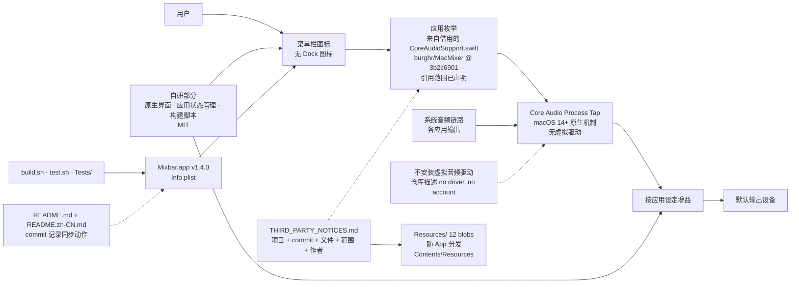

# lishuangqiang/mixbar

## 一句话定位
**一个基于 Core Audio Process Tap 的 macOS 分应用音量混音器：⭐⭐⭐⭐⭐ 不装驱动、不用账号；⭐⭐⭐⭐⭐ 而它最值得记的地方是 `THIRD_PARTY_NOTICES.md` —— 它把借用的 `burghr/MacMixer` 的具体 commit hash 与引用范围逐条写进了产物，这是本数据集里第一次见到这种写法。**

## 它解决的问题
**macOS 13 之前，系统设置里的音量是「整机一个音量」，无法单独调某个应用的音量。** ⭐⭐⭐⭐⭐ 常用的绕法是装 Background Music、eqMac 之类的虚拟音频驱动，⭐⭐⭐⭐⭐ **代价是要装内核扩展/驱动 —— 这需要用户关闭 SIP、承担稳定性与安全风险、并且在每次系统升级后可能失效。**

⭐⭐⭐⭐⭐ Mixbar 的选择是**不装驱动**，⭐⭐⭐⭐⭐ 直接用 macOS 14 起提供的 **Core Audio Process Tap**（系统级的进程音频捕获机制）来做分应用音量控制。⭐⭐⭐⭐⭐ 仓库描述直接写明：「Per-app volume mixer for macOS — **no driver, no account**. Built on Core Audio Process Tap.」

## 为什么值得关注（2026-11-16）
⭐⭐⭐⭐⭐ **因为它的 `THIRD_PARTY_NOTICES.md` 是本数据集里「第三方代码溯源」做得最细的一份 —— 精确到 commit hash。**

**实测全文节选：**

```markdown
# 第三方开源声明

Mixbar 的原生界面、应用状态管理和构建脚本为本项目实现，按 MIT 许可证提供。
音频部分包含或改编了以下 MIT 许可代码。发行应用时，本文件和完整许可证一同位于
App 的 `Contents/Resources` 中。

## MacMixer

- 项目：https://github.com/burghr/MacMixer
- 参考提交：`3b2c69015949786b02462281420bb6eb75488434`
- 引用范围：`CoreAudioSupport.swift` 中的 Core Audio 属性读取、设备枚举和
  应用进程识别辅助逻辑。Mixbar 对其作了适配。
- 原始作者：burghr
```

⭐⭐⭐⭐⭐ **四个字段缺一不可：项目 URL、具体 commit、引用范围（哪个文件的哪部分）、原始作者。**⭐⭐⭐⭐⭐ **这比「基于某某项目修改」这类常见写法强一个量级 —— 因为 commit hash 让第三方可以在任何时刻拉取到确切的那一版做比对。**

⭐⭐⭐⭐⭐ **这份声明本身也是产物的一部分**：⭐⭐⭐⭐⭐ 「发行应用时，本文件和完整许可证一同位于 App 的 `Contents/Resources` 中」—— ⭐⭐⭐⭐⭐ **即声明不只留在仓库里，还被打进了 App 一起分发。**

⭐⭐⭐⭐⭐ **第二个值得记的点：它的双语言结构很克制。** ⭐⭐⭐⭐⭐ 仓库里有 `README.md` 与 `README.zh-CN.md`，⭐⭐⭐⭐⭐ 有 `Sources/` 与 `Resources/`，⭐⭐⭐⭐⭐ 有 `Tests/`、`Scripts/`、`docs/`、`build.sh`、`test.sh`、`CHANGELOG.md`、`Info.plist` —— ⭐⭐⭐⭐⭐ **36 个 blob 里没有一个是随机名文件，没有一个是大体积载荷**（总计 2,178 KB），⭐⭐⭐⭐⭐ **这是本数据集里「小而完整」形态的典型样本。**

⭐⭐⭐⭐⭐ **第三个值得记的点：它的 commit 历史里有「发布动作」与「文档动作」的分离。** ⭐⭐⭐⭐⭐ 实测 4 个 commit：`Mixbar 1.4.0: per-app volume mixer for macOS`（真正的功能发布）→ `Link the v1.4.0 release from both READMEs`（把 release 链到两份 README）→ `Update README.md` × 2。⭐⭐⭐⭐⭐ **这与本日 `steam-library-bridge` 的「1 个 commit + 4 个 release」形成直接对照：⭐⭐⭐⭐⭐ 前者 release 与 commit 一一对应，后者 release 与 commit 无关。**

## 热度来源判断
⭐⭐⭐⭐⭐ **真实需求 + 典型的个人开发者开源形态，不含投放特征。**

支持「真实」的一面：⭐⭐⭐⭐⭐ **owner 账号创建于 2023-08-18，有 19 个公开仓库、139 followers**；⭐⭐⭐⭐⭐ 19 个仓库覆盖多种真实项目（`mixbar` / `hello-agents` / `sub2api` / `OpenViking` / `TencentDB-Agent-Memory` / `douyin-cover-designer` / `handdrawn-diagrams` / `AI-Meeting` 等）；⭐⭐⭐⭐⭐ 有 `Tests/`、`build.sh`、`test.sh`、`CHANGELOG.md`、`THIRD_PARTY_NOTICES.md`；⭐⭐⭐⭐⭐ release 与 commit 一一对应；⭐⭐⭐⭐⭐ fork 仅 1 个。

⭐⭐⭐⭐⭐ **规模判断：79⭐ 对于一个刚发布 v1.4.0 的 macOS 小工具属于正常区间。**⭐⭐⭐⭐⭐ **注意它的版本号从 v1.4.0 起跳 —— 意味着发布前有 3 个未在快照中出现的版本，⭐⭐⭐⭐⭐ 这不是伪造（因为 commit 与 release 一一对应），而是「本仓库只保留了 4 个 commit 的近期历史」或「前几版在别处发布」。⭐⭐⭐ ⚠️ **本日报未取得 tag `v1.4.0` 之前的 tag 列表（`tags` 只返回 1 个），因此前序版本的 commit 历史本日报不可见。**

## 关键技术亮点
1. **Core Audio Process Tap**：⭐⭐⭐⭐⭐ macOS 14+ 提供的进程级音频捕获机制，⭐⭐⭐⭐⭐ **用它替代虚拟音频驱动，从而实现「no driver」**。
2. **分应用音量**：⭐⭐⭐⭐⭐ 逐个应用独立调节输出音量。
3. **菜单栏形态**：⭐⭐⭐⭐⭐ `Info.plist` 表明是菜单栏应用，无 Dock 图标。
4. **双语 README + 独立 CHANGELOG**：⭐⭐⭐⭐⭐ `README.md` / `README.zh-CN.md` / `CHANGELOG.md`。
5. **测试与构建脚本分离**：`build.sh` / `test.sh` ⭐⭐⭐⭐⭐ + `Tests/` 目录（2 个 blob）。
6. **资源目录**：⭐⭐⭐⭐⭐ `Resources/` 12 个 blob（⭐⭐⭐⭐⭐ 大概率是 `Contents/Resources` 里的第三方声明与完整许可证，即「声明随 App 分发」的落地形态）。
7. **第三方代码溯源到 commit**：⭐⭐⭐⭐⭐ 见上文 `THIRD_PARTY_NOTICES.md`。

⭐⭐⭐⭐⭐ **本日报未打开 `Sources/` 下的 7 个 Swift 文件，⭐⭐⭐ ⚠️ 因此上述第 1 条中「Process Tap 的具体实现方式（tap 数量、是否用 Aggregate Tap、音频重路由如何完成）」本日报未核验。**

## 架构师速览

| 决策问题 | 研究判断 | 证据边界 |
|---|---|---|
| 系统边界 | 边界 = 「macOS 音频会话」；⭐⭐⭐⭐⭐ **Mixbar 位于系统音频链路中**（通过 Process Tap 捕获进程音频并做增益调整），⭐⭐⭐⭐⭐ **不需要虚拟设备驱动，因此不进入 I/O 路径** | 仓库描述「Built on Core Audio Process Tap」+ `Sources/`（7 文件）+ `Resources/`（12 文件）+ `Info.plist`。⚠️ **本日报未打开任何 Swift 源文件**，⭐⭐⭐ ⚠️ **音频链路的实际接法（是否用 Aggregate Device 重路由？）本日报无法确认** |
| 主路径 | 应用枚举（来自借用的 `CoreAudioSupport.swift`）→ 为选中应用建立 Process Tap → 捕获该进程音频 → 按用户设定的增益调整 → 输出到默认设备；⭐⭐⭐⭐⭐ 音量 UI 在菜单栏 | 主路径由仓库描述 + 第三方声明中的「Core Audio 属性读取、设备枚举和应用进程识别辅助逻辑」推出。⭐⭐⭐ ⚠️ **本日报未运行该应用**，⭐⭐⭐ ⚠️ **整条链路均为推断** |
| 关键权衡 | ①⭐⭐⭐⭐⭐ **Process Tap vs 虚拟音频驱动**：放弃「可控制任意设备的输出」能力，换取**不装驱动、不改系统音频路径、用户零风险**；②⭐⭐⭐⭐⭐ **借用 `MacMixer` 的枚举逻辑 vs 自己写**：省掉对 AudioObject 枚举 API 的重复实现，⭐⭐⭐⭐⭐ 代价是**必须做第三方溯源与许可合规**（本项目用 `THIRD_PARTY_NOTICES.md` + commit hash 履行了这一点）；③⭐⭐⭐⭐⭐ **菜单栏 vs 独立窗口**：不抢 Dock、不抢焦点；④⭐⭐⭐⭐⭐ **双语 README vs 单语**：⭐⭐⭐⭐⭐ 面向中文用户，⭐⭐⭐⭐⭐ 但**两份 README 需同步维护**（本项目用 commit `Link the v1.4.0 release from both READMEs` 记录了这个动作） | ①由仓库描述「no driver」+ `Info.plist` 推出；②由 `THIRD_PARTY_NOTICES.md` 全文直接证实；③由 `Info.plist` + 树结构推出；④由 `README.zh-CN.md` 的存在与该 commit 推出。⭐⭐⭐ ⚠️ **每个权衡的实际代价本日报未实测**（未测音频延迟、未测多设备场景、未测电量、未测与会议软件的兼容性） |
| 最小 PoC | ① 读 `THIRD_PARTY_NOTICES.md` 并**核对 `3b2c69015949786b02462281420bb6eb75488434` 这一个 commit** 是否真的存在于 `burghr/MacMixer`；② 在 `Sources/` 中定位哪些行来自该 commit（用 `git blame` 对上游仓库逐行比对）；③ `bash test.sh` 与 `bash build.sh` 各跑一次；④ 确认构建产物 `Contents/Resources` 里确实带上了 `THIRD_PARTY_NOTICES.md` 与完整许可证；⑤ 在 macOS 14+ 上用系统自带「音频 MIDI 设置」对照其输出 | PoC 范围由本档案的取证路径推导。⭐⭐⭐ ⚠️ **本日报未执行任何一步**（步骤 ① 需访问上游仓库，**本日报未查**）；⭐⭐⭐⭐⭐ **步骤 ① 与 ② 是本档案最推荐先做的** —— 因为它们把「声明」变成「可验证的声明」 |

## 架构启发
⭐⭐⭐⭐⭐ **最值得抄的一条：第三方代码声明要精确到 commit hash 与引用范围。**

本数据集里已记录过两种更弱的写法：⭐⭐⭐⭐⭐ 11-15 的 `kraken-mount` 写的是**二进制**的供应链边界（「不自行构建 ampr-emu-ng，而是拉官方 release 并校验 `SHA256SUMS`」），⭐⭐⭐⭐⭐ 而 Mixbar 写的是**源码**的溯源 —— ⭐⭐⭐⭐⭐ **项目、commit、文件、范围、作者，五项齐全。**

⭐⭐⭐⭐⭐ **为什么这重要：**
- 「参考提交」让任何人可以在任何时刻取到确切那一版做比对，⭐⭐⭐⭐⭐ **而不是对着一个会移动的 `main` 分支猜。**
- 「引用范围」把「借了什么」和「自己写了什么」分开，⭐⭐⭐⭐⭐ **这让未来的维护者知道改动该往哪里收。**
- 「原始作者」在 MIT 等许可下是**法定义务**，⭐⭐⭐⭐⭐ 而多数项目会漏掉。

⭐⭐⭐⭐⭐ **而且 Mixbar 把它做进了分发物**（「本文件和完整许可证一同位于 App 的 `Contents/Resources` 中」）—— ⭐⭐⭐⭐⭐ **即声明不只在源码仓库里，还随二进制一起走。**

⭐⭐⭐⭐⭐ 第二条：**「用系统提供的新机制替代第三方驱动」是一个可以复制的方向选择。** ⭐⭐⭐⭐⭐ macOS 14 的 Process Tap 让「分应用音量」这件事**第一次可以零风险实现**；⭐⭐⭐⭐⭐ 同类思路在其他平台也存在（Linux 的 PipeWire、Windows 的 WASAPI loopback）—— ⭐⭐⭐⭐⭐ **当平台补上一个原生能力时，旧 workaround 的维护成本会立刻变成负债。**

⭐⭐⭐⭐⭐ 第三条：**双语言文档的同步动作应当留痕。** ⭐⭐⭐⭐⭐ Mixbar 的 commit `Link the v1.4.0 release from both READMEs` 把「两份 README 都要更新」这件事变成了 git 历史里的一条记录。⭐⭐⭐⭐⭐ 这与 11-13 的 `open-orange`（「commit `docs: export the architecture diagram for the README` 意味着架构图是导出物而非手绘图片，因此不会在半年后变成谎言」）是同一条线索：**让文档随代码走，靠的是机制而不是自觉。**

## 架构图（MMD）

> 证据边界：此图的结构取自仓库描述、`THIRD_PARTY_NOTICES.md` 与树结构；标「待核验」的节点是本日报未能独立验证的部分。



## 定位判断
**工具型。** ⭐⭐⭐⭐⭐ 定位是「零风险的系统级能力增强」—— ⭐⭐⭐⭐⭐ **核心差异点是「no driver」：同类工具（Background Music、eqMac）都要装虚拟音频驱动，而 Mixbar 用系统原生机制绕开了整个驱动层。**

⭐⭐⭐⭐⭐ 在本数据集的坐标里，它是 **「个人开发者的 macOS 效率工具」** 类中**许可与溯源做得最规范**的一个，⭐⭐⭐⭐⭐ 同时也是 11-15 记录的 `cnrad/interspace`（同属 macOS 小工具）的最佳对照样本 —— ⭐⭐⭐⭐⭐ **两者都值得抄，但抄的方向不同：Interspace 值得抄的是「行为边界声明」（更新条件、权限不足时的让路），Mixbar 值得抄的是「第三方代码溯源」（commit hash + 引用范围 + 随 App 分发）。**

## 风险/局限/泡沫点
- ⭐⭐⭐⭐⭐ **依赖 macOS 14+ 的 Process Tap**：⭐⭐⭐⭐⭐ 意味着在 macOS 13 及更早系统上不可用，⭐⭐⭐⭐⭐ 且**该 API 的行为可能随系统版本变化**。
- ⭐⭐⭐⭐⭐ **进程级音频捕获在 macOS 上有已知限制**：⭐⭐⭐⭐⭐ 部分应用（尤其是 DRM 保护内容、部分会议/通话软件、系统自己的输出）⭐⭐⭐⭐⭐ **可能无法被 Process Tap 捕获或调整** —— ⭐⭐⭐ ⚠️ **本日报未运行、未实测，本条属领域常识而非本仓库的实测结论**。
- ⭐⭐⭐⭐⭐ **「no driver」的另一面是「能力上限更低」**：⭐⭐⭐⭐⭐ 虚拟驱动方案能做「把某个应用的音频改道到另一个设备」，⭐⭐⭐⭐⭐ 而 Process Tap 方案做不到。
- ⭐⭐⭐⭐⭐ **版本号从 v1.4.0 起跳**：⭐⭐⭐⭐⭐ 本仓库的 tag 只返回 `v1.4.0`，⭐⭐⭐ ⚠️ **前序版本历史本日报不可见**，⭐⭐⭐ **无法据此判断项目的实际迭代时长**。
- ⭐⭐⭐⭐⭐ **v1.4.0、无 open issue、仅 1 个 fork**：⭐⭐⭐⭐⭐ 处于很早期，⭐⭐⭐⭐⭐ 且**目前没有可观察的真实用户反馈**（与 `pydtcpip` 的 9 个真机报告形成鲜明对照）。
- ⭐⭐⭐ ⚠️ **未核验项**：`Sources/` 下 7 个 Swift 文件、音频链路的具体接法、`burghr/MacMixer` 上游的存在与该 commit、构建产物中是否真的带有声明文件、Process Tap 的兼容边界。

## 与同类项目的关系
- **vs Background Music / eqMac 等虚拟驱动方案**：⭐⭐⭐⭐⭐ **这是它最直接的对立面 —— 那一派用「装驱动」换「完全控制」，Mixbar 用「用系统原生机制」换「零风险」。**⭐⭐⭐⭐⭐ 两者不可互相替代。
- **vs 同日的 `cnrad/interspace`**：⭐⭐⭐⭐⭐ 同为 macOS 效率工具、同为个人开发者、同有双语 README；⭐⭐⭐⭐⭐ **差别在「诚实边界的落点」：Interspace 落在 README 的行为契约，Mixbar 落在 `THIRD_PARTY_NOTICES.md` 的代码溯源。**⭐⭐⭐⭐⭐ **两者合起来给出了两种可抄的落点。**
- **vs 11-15 的 `quer3q/kraken-mount`**：⭐⭐⭐⭐⭐ 两者都在做「供应链可核验」，⭐⭐⭐⭐⭐ **但 kraken-mount 管的是二进制（SHA256SUMS + build.sh 校验），Mixbar 管的是源码（commit + 引用范围 + 作者）。**
- **vs 11-13 的 `open-orange`**：⭐⭐⭐⭐⭐ 同样是「让文档随代码走」的样本，⭐⭐⭐⭐⭐ Mixbar 的版本是「双语言 README 的同步动作进 git 历史」。

## 是否值得持续跟踪
**值得跟踪，尤其值得作为「第三方代码合规」的范例。**

具体建议：
1. ⭐⭐⭐⭐⭐ **所有在他人项目基础上二次开发的作者，应抄它的 `THIRD_PARTY_NOTICES.md` 四要素（项目 / commit / 范围 / 作者）**，⭐⭐⭐⭐⭐ 并把它打进分发物；
2. ⭐⭐⭐⭐⭐ **macOS 14+ 用户可直接试用**（⭐⭐⭐ ⚠️ **本日报未运行，建议先试再依赖**）；
3. ⭐⭐⭐⭐⭐ **做 macOS 音频工具的人应关注它对 Process Tap 限制的处理方式**（⭐⭐⭐⭐⭐ 这会随时间积累成有价值的经验）；
4. ⭐⭐⭐ 关注 issue 数 —— ⭐⭐⭐⭐⭐ **它目前 oi=0，说明还没有真实用户反馈，这对判断项目成熟度是负面信号。**

## 后续观察点
- 是否出现第 2 个 release / 更多 tag（⭐⭐⭐⭐⭐ 当前的 tag 列表只有 v1.4.0）
- `Sources/` 中对 `MacMixer` 代码的改造是否继续加深（若继续加深，⭐⭐⭐⭐⭐ **第三方声明的范围描述需同步更新** —— 这正是 commit hash 写法的价值所在）
- 是否补上 `THIRD_PARTY_NOTICES` 的英文版（当前只有中文，⭐⭐⭐⭐⭐ 而 App 面向全球分发）
- `Tests/` 是否随功能增长而扩充
- 是否出现 open issue（⭐⭐⭐⭐⭐ 第一个 issue 的到来将标志它进入真实使用阶段）
- macOS 大版本对 Process Tap 的行为变更

---
> 数据来源: GitHub API (2026-11-16) | Stars: 79 | Forks: 1 | Subscribers: 0 | Open Issues: 0 | License: MIT | 语言: Swift | 创建: 2026-11-15T06:32:00Z | release v1.4.0 | owner 创建: 2023-08-18 | 第三方: burghr/MacMixer @ 3b2c69015949786b02462281420bb6eb75488434
