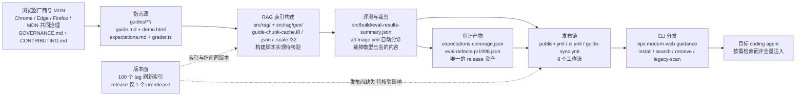

# GoogleChrome/modern-web-guidance-src

## 一句话定位
**把 Web 平台的新能力做成 coding agent 可调用的技能包 —— 但它本日最有研究价值的点是一个新的版本分类：100 个 tag、0 个正式 release，版本号停在 `v0.0.206`，每个 tag 的 commit 都真的改了源码。**

## 它解决的问题
⭐⭐⭐⭐⭐ **一个被 LLM 训练数据锁死的问题：Coding agent 面对 Web 任务时，系统性地偏好过时的写法。** README 原文（实测）：

> Coding agents often default to older patterns because LLM training data contains vast amounts of legacy code. This often leads them to generate bloated JavaScript for tasks that now have native, high-performance web platform solutions.

⭐⭐⭐⭐⭐ **Modern Web Guidance 的解法不是「给一份文档」，而是一条 RAG + 评测 + 裁剪的流水线：把指南做成可检索的 chunk（`src/rag/`），对模型跑评测，然后裁掉模型本来就会的低价值内容（README 原文：「The guides are **designed to be token-efficient**; we run evals enabling us to prune lowest-common-denominator content that models already know」）。**

⭐⭐⭐⭐⭐ **它同时由浏览器厂商共同维护 —— README 原文：「*Stewarded by the Google Chrome, Microsoft Edge, Mozilla Firefox, and MDN teams, alongside the web development community.*」⭐⭐⭐⭐⭐ **这是本数据集里第一次出现「多家浏览器厂商 + MDN 联合维护」的项目。**

## 为什么值得关注（2026-11-18）
⭐⭐⭐⭐⭐ **因为它是「版本发布」这条判据的第三个类别 —— 11-16 记录了「假发布」，11-17 记录了「多而实」，本日记录了「有版本但没有发布」。**

**可核验事实：tag 与 release 的强不对称。**

| 指标 | 实测值 |
|---|---|
| stars / forks / subs / open issues | 8,414 / 723 / 54 / **404** |
| 体积 / blobs | 173,849 KB / 2,405（`SKILL.md` 15 个） |
| 语言 / 许可 / 创建 | TypeScript / Apache-2.0 / 2026-01-27T20:22:24Z |
| 最后 push | 2026-11-17T19:50:32Z |
| homepage | `https://goo.gle/modern-web-guidance` |
| **tag 数** | **100**（`v1.0.1` / `v1.0.0` / `v0.0.206` … `v0.0.2`） |
| **release 数** | **1**（tag `audit-data`，**prerelease**，2 个 `.json` asset，2026-10-14） |
| **有 tag 但无 release 的数量** | **100 / 100** |
| release asset 名 | `audit-2026-09-24-expectations-coverage.json` / `audit-2026-10-12-eval-defects-pr1998.json` |
| CI 工作流 | 8 个（`ci.yml` / `atl-triage.yml` / `guide-sync.yml` / `publish.yml` / `deploy-pages.yml` / `deploy-dashboard.yml` / `update-web-features.yml`） |
| 贡献者 | `paulirish` 393 · `micahjo7` 308 · `rviscomi` 248 · `jamesnw` 44 · `LeaVerou` 43 · `philipwalton` 43 · `connorjclark` 42 |
| harness 目录 | `.agents`（1 套） |

⭐⭐⭐⭐⭐ **决定性的一步：逐个查 tag 指向的 commit，看它改没改代码。** 实测 10 个 tag：

| tag | 日期 | tag commit 改的文件数 | 其中含源码 | **父 commit** 改的文件数 |
|---|---|---:|---:|---:|
| `v1.0.1` | 2026-11-16 | 4 | 1 | 5 |
| `v1.0.0` | 2026-11-10 | 4 | 1 | 1 |
| `v0.0.206` | 2026-11-09 | 3 | 1 | 4 |
| `v0.0.205` | 2026-11-09 | 5 | 1 | 1 |
| `v0.0.204` | 2026-11-08 | 5 | 1 | 7 |
| `v0.0.203` | 2026-11-08 | 4 | 1 | 4 |
| `v0.0.202` | 2026-11-07 | 4 | 1 | 9 |

⭐⭐⭐⭐⭐ **⭐⭐⭐ 关键发现：10/10 个 tag 的 commit message 完全相同 ——「docs: auto-update recent evals and skill coverage」—— 且 10/10 个 tag commit 都改了 `src/rag/gen/guide-chunk-cache.i8` / `guide-chunk-cache.json` / `guide-chunk-cache.scale.f32` 这组 RAG 索引产物（`.i8` = int8 量化向量索引）。⭐⭐⭐⭐⭐ **同时每个 tag 的父 commit 才是真正的功能变更（`src/build/publish-skills.ts` / `src/harness/public/builder.ts` / `guides/.../grader.ts` / `guides/.../demo.html`）。⭐⭐⭐⭐⭐ **这与 `ffmpeg-skill`（11-17）结构相同：tag commit = 索引/元数据刷新，父 commit = 功能变更。**

⭐⭐⭐⭐⭐ **⭐⭐⭐ 因此本日给出的第三类版本形态是：**

| 类别 | 样本 | tag 数 | release 数 | tag commit 改源码? | 父 commit 改源码? | 判读 |
|---|---|---:|---:|---|---|---|
| **A. 假版本号** | `atlas7283/steam-library-bridge`（11-16） | 4 | 4 | **无**（全仓仅 1 个 commit） | 无 | **伪造** |
| **B. 多而实** | `kajisho5/ffmpeg-skill`（11-17） | 100 | 100 | 仅元数据（8 文件 / 0 源码） | **12/12 触及源码** | **真实** |
| **C. 有 tag 无 release** | **本项目（11-18）** | **100** | **1**（且为 prerelease） | **仅 RAG 索引产物**（有源码但非功能） | **10/10 触及源码** | **真实，但发布面缺失** |
| **D. 少而实** | `affaan-m/ECC`（11-18） | 20 | 19 | **36 个源码文件** | 功能 commit 在前 | **真实** |

⭐⭐⭐⭐⭐ **⭐⭐⭐ 本日的方法论结论：判据必须从「release 数量」改为三个可分别测量的量 —— ① tag 数；② release 数；③ tag→commit→源码 diff 链是否闭合。⭐⭐⭐⭐⭐ 类别 C 是本日新增的：**它有 100 个版本号、有真实的代码演进、却没有面向用户的发布物。⭐⭐⭐⭐⭐ 它既不是造假，也不能按「有 100 个 release」来计数。**

## 热度来源判断
⭐⭐⭐⭐⭐ **判断：热度来自一个尚未被主流 coding agent 解决的真实问题（模型对 Web 新特性有系统性偏见），加上浏览器厂商背书；但「本周 +6,542 stars」的量级需要与「安装协议尚未收敛」这个事实并读。**

支撑的**可核验事实**：
1. **⭐⭐⭐⭐⭐ 多厂商联合治理**：README 明写由 Google Chrome / Microsoft Edge / Mozilla Firefox / MDN 团队共同维护，且 `CONTRIBUTING.md` + `GOVERNANCE.md` 存在 ⭐⭐⭐⭐⭐ —— **这是本数据集里最强的机构背书形态。**
2. **⭐⭐⭐⭐⭐ 贡献者全是浏览器/Web 领域长期人物**：`paulirish`（393，Google，Web 性能领域）、`rviscomi`（248，Firefox）、`micahjo7`（308）、`LeaVerou`（43，MDN/CSS 领域）、`philipwalton`（43）⭐⭐⭐⭐⭐ —— **这份名单本身就是「这不是刷量项目」的证据。**
3. **⭐⭐⭐⭐⭐ 404 个 open issue**（本数据集的 Trending 项目中属高位）⭐⭐⭐⭐⭐ —— **对比 `elementalsouls/Claude-BugHunter` 的 11 个 issue（9,120⭐），404 : 11 的比例说明这里的社区参与度高得多。**
4. **⭐⭐⭐⭐⭐ 流水线是真的**：实测 tag commit 改的是 `src/rag/gen/guide-chunk-cache.*` 的 int8 量化索引产物，⭐⭐⭐⭐⭐ 说明 RAG 索引是被真实构建与版本化的产物，而非手写文档。

⭐⭐⭐⭐⭐ **⚠️ 不作主张的部分**：**本日报未运行 `npx modern-web-guidance` CLI、未安装任何技能、未复现任何一次评测。**⭐⭐⭐⭐⭐ **README 中「token-efficient」「prune lowest-common-denominator content」等表述是项目自述，本日报未验证裁剪效果。**⭐⭐⭐⭐⭐ **本日报不主张这 100 个 tag 对应 100 个「版本发布」—— 正式 release 只有 1 个。**

## 关键技术亮点
1. **⭐⭐⭐⭐⭐ RAG 索引本身是被版本化的构建产物**
   实测 tag commit 统一改 `src/rag/gen/guide-chunk-cache.i8` + `.json` + `.scale.f32` ⭐⭐⭐⭐⭐ —— **`.i8` 是 int8 量化后的向量索引，⭐⭐⭐⭐⭐ 即「指南的检索索引」是编译产物而非手写文件，⭐⭐⭐⭐⭐ 这让「索引与源码同步」成为可由 CI 校验的不变量。**

2. **⭐⭐⭐⭐⭐ 「评测驱动的内容裁剪」**
   README 原文：跑 evals 以便「prune lowest-common-denominator content that models already know」⭐⭐⭐⭐⭐ —— **即它把「模型已经会的东西」当作冗余裁掉，⭐⭐⭐⭐⭐ 这是把上下文预算当作一等设计目标 —— ⭐⭐⭐⭐⭐ 与 11-17 `ffmpeg-skill` 的「默认 12 个 / 全量 42 个工具」是同一问题的两种解法（一个裁内容，一个裁工具暴露面）。**

3. **⭐⭐⭐⭐⭐ 技能作为 CLI 而非文件**
   实测 README 快速开始：`npx modern-web-guidance@latest install` / `search "animate a dialog modal backdrop"` / `retrieve "animate-to-from-top-layer"` / `legacy-scan .` ⭐⭐⭐⭐⭐ —— **⭐⭐⭐⭐⭐ 即指南不是塞进上下文的静态文本，而是可按需查询的结构化接口。⭐⭐⭐⭐⭐ 这直接对应它自己的问题陈述（「bridge the gap」—— 模型缺少的是「真实实现的密度」，不是「API 是否存在」）。**

4. **⭐⭐⭐⭐⭐ 指南自带 grader 与 expectations**
   实测 tag 父 commit 涉及 `guides/visual-design/adapt-scrollbar-to-contrast-preferences/grader.ts` 与 `guides/pwa/install-web-app/expectations.md` ⭐⭐⭐⭐⭐ —— **即每条指南自带验收标准与评分器，⭐⭐⭐⭐⭐ 与 `modern-web-guidance` 的 `atl-triage.yml`（自动分诊）工作流配套。**

5. **⭐⭐⭐⭐⭐ 浏览器兼容数据进入技能**
   README 原文：技能内嵌「web platform expertise, best practices, and **browser compatibility data**」⭐⭐⭐⭐⭐ —— **兼容数据是多厂商共同维护的产物，⭐⭐⭐⭐⭐ 这解释了为什么它需要 4 家浏览器厂商 + MDN 的治理结构。**

6. **⭐⭐⭐⭐⭐ 唯一的 release 恰好是「审计数据」**
   实测那 1 个 release 的 asset 是 `audit-2026-09-24-expectations-coverage.json` 与 `audit-2026-10-12-eval-defects-pr1998.json` ⭐⭐⭐⭐⭐ —— **⭐⭐⭐⭐⭐ 即项目方把「评测覆盖度」与「评测缺陷」当作正式的、可下载的审计产物发布，⭐⭐⭐⭐⭐ 而不是 release 记录本身。⭐⭐⭐⭐⭐ 这是本日最值得学的一条发布习惯。**

## 架构师速览

| 决策问题 | 研究判断 | 证据边界 |
|---|---|---|
| 系统边界 | **一个「指南内容源 + RAG 索引构建链 + 评测门禁 + CLI 分发」**。内容边界 = `guides/` 下的可执行指南（每条带 `guide.md` / `demo.html` / `expectations.md` / `grader.ts`）；索引边界 = `src/rag/`（含 `gen/` 生成物）；分发边界 = npm 包 `modern-web-guidance` + GitHub Pages 文档站 + Eval Dashboard | 实测 tree 路径、tag commit 的 files diff、README 快速开始段；**npm 包内容、CLI 实际行为、索引生成脚本（`src/rag/gen/`）的实现未核验** |
| 主路径 | 指南源（`guides/**/guide.md` + demo + grader）→ 构建脚本生成 chunk 与 int8 索引（`src/rag/gen/guide-chunk-cache.*`）→ 评测（`src/build/eval-results-summary.json` + `atl-triage.yml`）→ 裁剪低价值内容 → 发布（`publish.yml` → npm + Pages + Dashboard）→ 用户侧 `npx … install / search / retrieve / legacy-scan` | 主路径由 README 快速开始段 + 工作流名 + tag commit 触及的文件反推；**评测与裁剪的具体触发顺序、CI 的实际 gate 条件未核验** |
| 关键权衡 | ①**上下文预算** vs **内容完整** → 用「按需检索 + 评测裁剪」而非「全量塞入」；②**内容时效** vs **版本可追溯** → 用 100 个自动索引刷新的 tag 保证「指南与索引同版本」；③**开放协作** vs **厂商治理** → 用 `GOVERNANCE.md` + 多厂商 steward 平衡 | ①、②有 README 原文与 tag diff 支撑；③有 README 治理声明与贡献者名单支撑，**治理文档正文未读** |
| 最小 PoC | 只取**一个**学科（建议 `visual-design` 或 `pwa`）→ 装 CLI → 用 `search` 拉 3 条指南、用 `retrieve` 取 1 条完整指南 → 用 `legacy-scan` 扫一个真实前端项目 → 对比「有/无技能」两种情况下 agent 生成的代码差异与 token 占用 → 再决定是否扩到全学科 | PoC 范围与退出路径由本档案推导；**具体 token 阈值、裁剪效果、评测可复现性均未核验** |

## 架构启发
⭐⭐⭐⭐⭐ **启发一（本日的核心）：「版本数量」必须拆成三个独立测量，否则必然误判。** ⭐⭐⭐⭐⭐ 本日实测同一批判据在四个真实项目上给出四种答案：tag 数、release 数、tag→commit→源码 diff 是否闭合。⭐⭐⭐⭐⭐ **只有把这三个量分别记下来，「这个项目发布纪律好不好」才是一个可回答的问题。⭐⭐⭐⭐⭐ **本日报建议把这三个量做成一个可脚本化的三元组，一次抓取、长期对比。**

⭐⭐⭐⭐⭐ **启发二：把「检索索引」当编译产物版本化，是内容型项目的正确形态。** ⭐⭐⭐⭐⭐ 本项目的 10/10 个 tag 都改 `guide-chunk-cache.i8` ⭐⭐⭐⭐⭐ —— **这保证了「装到 agent 里的内容」与「仓库里的内容」不会漂移，⭐⭐⭐⭐⭐ 而这正是 skill 生态目前最常见的失败模式（文档更新了，索引没更新）。**

⭐⭐⭐⭐⭐ **启发三：上下文预算有两种解法，且可以叠加。** ⭐⭐⭐⭐⭐ `ffmpeg-skill` 裁的是**工具暴露面**（默认 12 / 全量 42），⭐⭐⭐⭐⭐ 本项目裁的是**内容本身**（评测后剪掉模型已会的）。⭐⭐⭐⭐⭐ **两者正交 —— 一个成熟 skill 包应该同时具备「按需暴露工具」与「按需提供知识」两层。**

⭐⭐⭐⭐⭐ **启发四：「把审计产物当 release 发」比「把 release 笔记写好」更有信息量。** ⭐⭐⭐⭐⭐ 本项目唯一的 release 装的是覆盖度与缺陷 JSON ⭐⭐⭐⭐⭐ —— **对这类以「内容质量」为卖点的项目，⭐⭐⭐⭐⭐ 可下载的审计数据比版本说明更能证明主张。**

## 架构图（MMD）

> 证据边界：此图只采用本档案已有可核验描述；标注「待核验」的节点不应视为项目实现事实。

## 定位判断
**平台候选 —— 且是本数据集里「厂商级内容标准 + 评测门禁」这条路线上的第一个样本。** ⭐⭐⭐⭐⭐ 与同期的 skill 仓库相比，它的定位差异很清楚：`anthropics/skills`（官方但无评测门禁）、`cursor/plugins`（规范与官方插件）、`ECC`（跨 harness 配置分发）、`ffmpeg-skill`（工具链 + 工作流）、本项目（**平台知识 + 检索化 + 评测裁剪**）。⭐⭐⭐⭐⭐ **它更像是「给 agent 装一个 Web 领域的专家」，而不是「给 agent 装一堆脚本」。**

⭐⭐⭐⭐⭐ **但它的短板也清楚：**⭐⭐⭐⭐⭐ **分发协议仍未收敛 —— 实测本仓库只有 1 套 harness 目录（`.agents`），且 `npx skills add` 与 `marketplace add` 两条安装命令中只出现了 `npx modern-web-guidance@latest install` 这一条自有命令。⭐⭐⭐⭐⭐ **在「适配层」这条赛道上，它基本还没开始。**

## 风险 / 局限 / 泡沫点
1. ⭐⭐⭐ ⚠️ **100 个 tag / 1 个 release 的形态极易被误读**：⭐⭐⭐ ⚠️ 任何「100 个版本」的表述都会失真 —— **正式发布只有 1 个（且是 prerelease 的审计数据）。**
2. ⭐⭐⭐ ⚠️ **10 个 tag 是抽样**（100 个中的 10 个），⭐⭐⭐ ⚠️ 「10/10 触及源码」是抽样结论，未外推。
3. ⭐⭐⭐ ⚠️ **版本号停在 `v0.0.206` 却在 2026-11 打出 `v1.0.0` / `v1.0.1`**：⭐⭐⭐ ⚠️ `v0.0.2`~`v0.0.206` 与 `v1.0.0` 之间的语义关系未核验，⭐⭐⭐ ⚠️ **且 `v0.0.206` 到 `v1.0.0` 之间是否还有未列出的 tag 也未核验（tag 端点只返回 100 条）。**
4. ⭐⭐⭐ ⚠️ **「prune 掉模型已会的内容」是项目自述**：⭐⭐⭐ ⚠️ 本日报未复现任何评测，⭐⭐⭐ ⚠️ **裁剪是否真的降低了 token 而不降低有效性，完全未知。**
5. ⭐⭐⭐ ⚠️ **未核验项**：`src/rag/gen/` 的索引构建实现、`.i8` 量化格式、npm 包与仓库的一致性、`atl-triage.yml` 的分诊逻辑、Dashboard 与 Pages 站点的实际内容、`legacy-scan` 的检测规则。

## 与同类项目的关系
- **vs `kajisho5/ffmpeg-skill`（11-17 档案）**：⭐⭐⭐⭐⭐ **发布纪律的「多而实」正例（本项目是「有 tag 无 release」类别）；⭐⭐⭐⭐⭐ 两者在「上下文预算」上正交 —— ffmpeg-skill 裁工具暴露面，本项目裁内容。**
- **vs `atlas7283/steam-library-bridge`（11-16 档案）**：⭐⭐⭐⭐⭐ **假版本号的一端。**
- **vs `affaan-m/ECC`（本日档案）**：⭐⭐⭐⭐⭐ **「少而实」的一端（19 release / 20 tag，功能 commit 在 tag 上）；⭐⭐⭐⭐⭐ 两者合起来给出「发布纪律」的三种正确形态。**
- **vs `anthropics/skills` / `addyosmani/agent-skills`**：⭐⭐⭐⭐⭐ 纯文档型技能集合 —— **本项目多了 RAG 索引与评测门禁两层基础设施。**
- **vs `google/elephant-goldfish-model`（11-17 档案）**：⭐⭐⭐⭐⭐ 正交 —— EGM 管「怎么评审」，本项目管「评审时用什么内容」。⭐⭐⭐⭐⭐ 但两者共享「多机构治理」的稀缺属性。
- **vs `ChromeDevTools/chrome-devtools-mcp`**：⭐⭐⭐⭐⭐ 同生态互补 —— 一个给 agent 工具（浏览器控制），一个给 agent 知识（平台最佳实践）。

## 是否值得持续跟踪
**值得，优先级高 —— 它同时是「新类别样本」和「真平台项目」。** ⭐⭐⭐⭐⭐ 理由：① 它是版本判据三元组（tag 数 / release 数 / diff 闭合）唯一的「类别 C」样本，⭐⭐⭐⭐⭐ **可以为这条判据提供最锐利的边界**；② 它的评测门禁 + 内容裁剪是「skill 的质量如何被工程化」这个 11-17 提出的问题的最完整答案；⭐⭐⭐⭐⭐ ③ 它的多厂商治理结构在 11-17 的观察（「Skill 生态的竞争战场从内容转向分发适配层」）之外，⭐⭐⭐⭐⭐ **提供了一个新的观察维度：谁有资格定义「正确的 Web 写法」。**

## 后续观察点
1. ⭐⭐⭐⭐⭐ **release 数是否从 1 涨起来**（100 个 tag 已有，只差正式发布面）
2. ⭐⭐⭐⭐⭐ **是否接入更多 harness 目录**（当前 1 套 `.agents`）⭐⭐⭐⭐⭐ **若接入，它就是「内容 + 分发」双轮驱动的样本**
3. ⭐⭐⭐⭐⭐ **`v1.0.0` 之后的版本节奏与版本号语义**（`v0.0.206` → `v1.0.0` 的跨越是否意味着稳定性声明）
4. ⭐⭐⭐ ⭐ **404 个 open issue 的构成**（本日报未逐条读正文，仅读标题与作者；⭐⭐⭐⭐⭐ 其中 `rudycelekli` 一人提交的多条是产品改进建议）
5. ⭐⭐⭐ ⚠️ **评测裁剪的实际效果**（本日报未验证；⭐⭐⭐⚠️ 若该机制失效，「token-efficient」这一核心卖点将不成立）

---

*首次记录：2026-11-18 · 全部元数据取自 2026-11-18 CST 的 GitHub REST API 快照（`repos/*`、`git/trees/*?recursive=1`、`commits/{sha}` 含 files diff、`tags`、`releases`、`readme`、`contributors`、`users/*`）*
