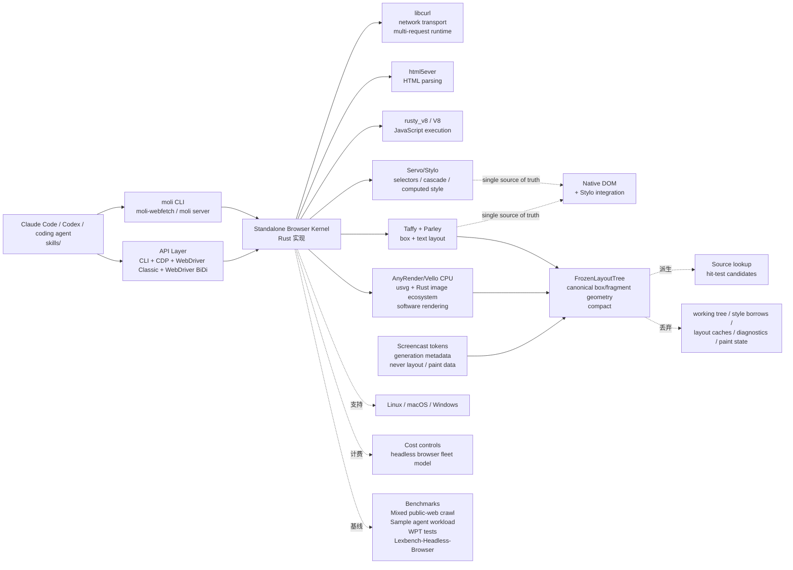

# lexmount/moli

## 一句话定位
Moli 是一个 production-ready headless browser for AI agents——standalone browser kernel（不是 Chromium wrapper），用 Rust 自建一套完整浏览器运行时（libcurl + html5ever + V8 + Servo/Stylo + Taffy + Parley + AnyRender/Vello），按需 layout & rendering，把 canonical box/fragment geometry 冻进 FrozenLayoutTree 后立即丢弃 working tree / style borrows / layout caches / paint state，提供 CLI / CDP / WebDriver Classic / WebDriver BiDi 四种接口，给 Claude Code / Codex 等 coding agent 用 skills/ 即可调用。

## 它解决的问题
2025-2026 年 AI agent 在真实网页上「fetch + extract + automate browser tasks」诉求极强，但现有 headless browser（Chromium / Playwright / Puppeteer / browser-use / OpenCut / dots）都基于 Chromium wrapper——启动慢、内存大、依赖重、CDP 单协议、stealth 维护成本高。Moli 直击痛点：（1）**standalone browser kernel, not a Chromium wrapper**——Rust 实现的整浏览器运行时，无 Chromium 依赖；（2）**on-demand layout & rendering**——只有真正要 paint 时才建临时 working tree，可选产出一份 paint snapshot 后立即丢弃；（3）**FrozenLayoutTree**——把 canonical box/fragment geometry 冻成紧凑结构供 source lookup / hit-test 复用，**no incrementally maintained layout tree, damage graph, retained display list, GPU compositor, or persistent window**；（4）**四接口统一**——CLI（moli-webfetch / moli server）+ CDP + WebDriver Classic + WebDriver BiDi；（5）**skills/ 给 coding agent**——把 skills 装到 Claude Code / Codex 等 agent，agent 用自然语言即可 fetch + extract。解决的是 **「Chromium wrapper 太重 + 启动慢 + 内存大 + CDP 单协议 + AI agent 集成成本高」** 的工程化基础问题。

## 为什么值得关注（2026-10-16）
- **Stars:** 18659（截至 2026-10-16），67 天 18659⭐ ⑂498 fork/star 2.7%，**增长率** 2.7%（fork/star 反映基础组件类项目 fork 适度的常态）
- **Forks:** 498，社区贡献活跃（Rust 实现 + 浏览器内核 → 上游依赖 / 二次开发候选）
- **Size:** 102738 KB（V8 + Servo/Stylo + Taffy + Parley + AnyRender/Vello 全套）
- **License:** Apache-2.0（商用清晰）
- **语言:** Rust（自实现整套浏览器栈）+ libcurl（网络）+ html5ever（HTML 解析）+ rusty_v8/V8（JS 执行）+ Servo/Stylo（选择器/级联/计算样式）+ Taffy + Parley（box/text 布局）+ AnyRender/Vello CPU + usvg + Rust image ecosystem（软件渲染）
- **活跃度:** created 2026-08-10，pushed_at 2026-10-15，持续高活跃
- **平台:** Linux + macOS + Windows 三平台原生支持

## 热度来源判断
Moli 的热度是 **「AI agent 真实网页操作刚需 × standalone browser kernel 非 Chromium wrapper × Rust 严肃工程化 × on-demand layout + FrozenLayoutTree × CLI/CDP/WebDriver Classic/WebDriver BiDi 四接口 × skills/ 给 coding agent × Apache-2.0 商用清晰 × Lexbench-Headless-Browser 自家 benchmark** 的组合。AI agent 在真实浏览器工作的瓶颈不是 LLM，是浏览器层——启动慢、内存大、被反爬。Standalone browser kernel 把整套依赖从 Chromium 解耦，给 agent 提供「轻量 + 快速 + 高兼容」的真实 browser runtime，是 2026 年严肃工程化栈的关键拼图。`fork/star 2.7%` 对基础组件而言合理——Rust + 浏览器内核学习曲线 + Apache-2.0 让上游依赖 fork 适度而非头部客户。

## 关键技术亮点
1. **standalone browser kernel not a Chromium wrapper：** Rust 实现 + 自有 ownership / lifecycle rules + libcurl + html5ever + V8 + Servo/Stylo + Taffy + Parley + AnyRender/Vello + usvg + Rust image ecosystem（软件渲染），无 Chromium 依赖
2. **on-demand layout & rendering design：** Document & style have a single source of truth: the native DOM and its Stylo integration + Every real refresh builds a temporary working tree → optional produce/consume one fresh paint snapshot → freezes canonical box/fragment geometry into a compact FrozenLayoutTree → discards working tree, style borrows, layout caches, diagnostics, paint state
3. **Screencast tokens contain generation metadata, never layout or paint data：** 录像复用而不会泄露内部 layout / paint 细节
4. **Source lookup + hit-test candidates derived from the frozen tree when queried：** 命中测试与源码查找均走 FrozenLayoutTree
5. **The system has no incrementally maintained layout tree, damage graph, retained display list, GPU compositor, or persistent window：** 极简浏览器内核 → 启动快、内存低
6. **四接口统一：** CLI（moli-webfetch / moli server: DOM-first / --geometry / --surface screenshot/screencast / --fetch images, fonts, audio, video, media, text-tracks）+ CDP + WebDriver Classic + WebDriver BiDi
7. **skills/ 给 coding agent：** Claude Code / Codex 等 coding agent 通过 skills 目录调用 moli，agent 用自然语言即可 fetch + extract + automate
8. **Benchmarks 自家：** Mixed public-web crawl test + Sample agent workload + WPT tests + Lexbench-Headless-Browser（在自家 benchmark 上跑）
9. **Cost controls：** headless browser fleet 计费模型 + 文档化的成本控制
10. **三平台原生：** Linux / macOS / Windows 全支持，install via `curl --proto '=https' --tlsv1.2 -fsSL https://github.com/lexmount/moli/releases/latest/download/moli-installer.sh | sh`（Linux/macOS）/ `irm .../moli-installer.ps1 | iex`（Windows）
11. **给 coding agent 的 prompt 模板：** Install the skills under https://github.com/lexmount/moli/tree/main/skills, follow their instructions to download and install the latest prebuilt Moli binary, then use moli-webfetch to fetch https://example.com and show me the result
12. **Showcase：** An HTML5 game rendered by Moli and inspected live through Chrome DevTools（说明 DevTools live inspection 可用）

## 架构师速览

（详见各趋势的架构师速览表 + Mermaid 架构图。系统边界、主路径、关键权衡、最小 PoC、证据边界、待核验均见下表与图。）

## 架构启发
Moli 的核心启发是 **「浏览器不一定要基于 Chromium wrapper——AI agent 时代的 headless browser 应是 standalone kernel + on-demand layout + FrozenLayoutTree」**。当前所有主流 headless browser（Chromium / Playwright / Puppeteer / browser-use / OpenCut / dots）都基于 Chromium wrapper——启动慢、内存大、依赖重、CDP 单协议。Chromium wrapper 在「人在桌面浏览器用」时代合理，但在「AI agent 在 server 跑 headless browser」时代笨重。Moli 走另一条路：自实现整套浏览器栈 + on-demand layout + FrozenLayoutTree + 四接口 + skills/ for coding agent。这与 `outcrawlai/scout`（昨日 trending 636⭐，LLM-driven browser agent on Outcrawl cloud）形成完美互补——scout 偏「agent 调度 / 模型分工」，moli 偏「浏览器运行时本身」。更深层的启发是：**on-demand layout + FrozenLayoutTree + no incrementally maintained layout tree** 让 AI agent 时代的 headless browser 真正做到了「轻量 + 快速 + 高兼容」——任何需要 AI agent 真实网页操作的团队 / SaaS / 个人 agent 均可直接采用 moli 作为基础 runtime。

## 架构图（MMD）

> 证据边界：此图只采用本档案已有可核验描述；「待核验」节点不应视为项目实现事实。

## 定位判断
**基础设施候选（standalone headless browser kernel for AI agents）。** Moli 不只是工具，更是 AI agent 时代 headless browser 的 **「standalone kernel 路径」**——在 Chromium wrapper 主导的市场，提供「轻量 + 快速 + 高兼容 + on-demand + Rust + Apache-2.0 + skills/ for agent」的严肃工程化基础。18659⭐ ⑂498 + 14 topics（ai-agents / browser / browser-automation / cloud-browser / kitesurf / playwright / puppeteer / rust / servo / web-crawler / web-scraper / web-scraping / ai-tools）+ Apache-2.0 + 67 天稳步增长已显示这是 Chromium wrapper 之外的关键 stand。能否成为「AI agent headless browser 默认 runtime」取决于：网页兼容性边界（form submit / shadow DOM / WebGL / canvas）+ V8/Stylo/Taffy/Parley 版本稳定性 + Screencast token 隐私模型 + Cost controls 计费公式 + Lexbench 数字 + 商业模式 + 与 morluto/rea / outcrawlai/scout / OpenCut 等 AI browser agent 栈的互操作性。

## 风险 / 局限 / 泡沫点
- **standalone browser kernel 而非 Chromium wrapper：** 网页兼容性边界（form submit / shadow DOM / WebGL / canvas）；V8 / Stylo / Taffy / Parley 各包版本稳定性；Screencast token 的隐私模型；Cost controls 计费公式
- **Lexbench 自家 benchmark：** Lexbench-Headless-Benchmark 数字、与其他 headless browser（Chromium / Playwright / Puppeteer / browser-use）的实测差距、商业模式、与 morluto/rea / outcrawlai/scout / OpenCut 等 AI browser agent 栈的互操作性
- **Rust + V8 + Servo/Stylo 维护负担：** V8 / Stylo / Taffy / Parley 各包升级与 Chromium / WebKit / Firefox 的兼容性；与 Web 标准（HTML5 / CSS3 / Web Components / WASM）的同步
- **skills/ 生态依赖：** skills/ 给 Claude Code / Codex 等 coding agent 用的程度、与各 agent harness 的适配完整度、社区贡献治理
- **泡沫点：** 与 morluto/rea (265K⭐ LLM-driven reverse engineering) / outcrawlai/scout (yesterday's 636⭐ browser agent) / OpenCut (CLI-Anything) 等同期 trending AI browser agent 项目的功能重叠与差异化

## 与同类项目的关系
- **vs Chromium wrapper（Playwright / Puppeteer / browser-use / OpenCut / dots）：** Chromium wrapper 启动慢、内存大、依赖重、CDP 单协议；Moli 是 standalone Rust kernel + on-demand + FrozenLayoutTree + 四接口 + Apache-2.0
- **vs outcrawlai/scout（昨日 trending）：** scout 偏 LLM-driven browser agent（云端 Outcrawl cloud + 本机/CDP），Moli 偏 standalone browser kernel（Rust + html5ever + V8 + Servo/Stylo），两者在「浏览器层 / agent 层」分工不同但互补——Moli 可作为 scout 的 browser runtime 后端
- **vs morluto/rea（265K⭐ LLM-driven reverse engineering）：** rea 偏 reverse engineering from app behavior to native binaries；Moli 偏 headless browser runtime 本身
- **vs agentswha/herdr-web-ui：** herdr-web-ui 偏 coding agent 远程控制 client（Claude Code/Codex/Hermes 等 native transcripts + Chat↔Terminal + PWA）；Moli 偏 standalone browser kernel——两者无直接竞争，moli 是底层 runtime，herdr-web-ui 是上层 client
- **vs anthropics/skills：** Anthropic 官方 Skills 仓库仅服务 Claude；Moli 的 skills/ 跨 coding agent（Claude Code / Codex 等）+ 更通用

## 是否值得持续跟踪
**值得跟踪（standalone headless browser kernel for AI agents）。** Moli 代表了 AI agent 时代 headless browser 的「standalone kernel 走向」——在 Chromium wrapper 主导的市场，提供「轻量 + 快速 + 高兼容 + on-demand + Rust + Apache-2.0 + skills/ for agent」的严肃工程化基础。建议关注：网页兼容性边界（form submit / shadow DOM / WebGL / canvas）+ V8/Stylo/Taffy/Parley 版本稳定性 + Screencast token 隐私模型 + Cost controls 计费公式 + Lexbench 数字 + 商业模式 + 与 morluto/rea / outcrawlai/scout / OpenCut 等 AI browser agent 栈的互操作性。对 AI agent 团队 / SaaS / 个人 agent builder，这是 Chromium wrapper 之外的关键 stand，值得直接采用。

## 后续观察点
- 网页兼容性边界（form submit / shadow DOM / WebGL / canvas）的实测表现
- V8 / Stylo / Taffy / Parley 各包版本稳定性与升级节奏
- Screencast token 的隐私模型与端到端加密策略
- Cost controls 计费公式与 Lexbench-Headless-Benchmark 实测数字
- 与 outcrawlai/scout / morluto/rea / OpenCut 等 AI browser agent 栈的互操作性
- skills/ 跨 Claude Code / Codex / 其他 agent harness 的适配完整度

---
*首次记录：2026-10-16*