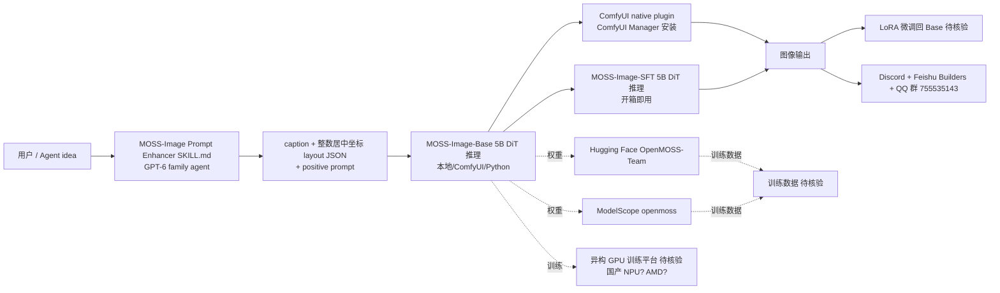

# OpenMOSS/MOSS-Image

## 一句话定位
OpenMOSS 团队 2026-10-16 发布的 **5B 参数 base DiT**，强文本渲染、布局控制、4K 长 prompt、异构 GPU 训练 + ComfyUI 原生插件 + GPT-6 family agent skill，Apache-2.0 双权重（Base + SFT）+ Hugging Face + ModelScope + 中文社区 + Discord + Feishu Builders 五位一体严肃工程化交付。

## 它解决的问题
2025-2026 SD/Flux/Qwen-Image/Seedream 等 DiT 模型在长文本清晰度、像素级布局控制、4K 长 prompt、可微调性、agent-friendly 工作流五个维度上各有短板：SDXL 文字模糊；Flux 长 prompt 一般；商业模型闭源；国产模型缺英文 base 与 SKILL 协议。MOSS-Image 直击——**5B base DiT 在同一权重里同时支持强文本渲染、布局控制、4K 长 prompt、agent skill 协议、ComfyUI 生态 + 国产开源 + 中英 README + QQ/Discord/Feishu 社区**，是 2026-Q4 国产生态首份严肃工程化 base DiT。

## 为什么值得关注（2026-10-18）
今日观察窗为 GitHub Search API 抓取时刻起、且截至 2026-10-18 仍在快速增长的新发现项目 + 延续跟踪项目。`OpenMOSS/MOSS-Image` 2 天 428⭐ ⑂14 fork/star 3.3%——428⭐ 在 2 天是异常高的"base 严肃工程化" 信号（中国团队 + 双仓库权重 + Apache-2.0 + 中文 + Discord + Feishu 五位一体）。**5B base + Apache-2.0 + ComfyUI 集成 + agent skill（不调用文生图服务）+ 长 prompt 4K**让生产可用变得可见。

## 热度来源判断
MOSS-Image 的热度是 **"国产严肃工程化 base DiT + Apache-2.0 + ComfyUI + agent skill + 异构 GPU 训练 + 双仓库权重 + 中文社区" 七要素共振**。
- 强文本渲染：把 SDXL/Flux 长痛点正面打
- 布局控制：从 prompt 升级到 spatial layout，对设计 / 海报 / UI mockup 场景关键
- 4K prompt：让长 prompt agent 工作流（如科学配图、4K 输入描述）顺畅
- 5B 紧凑：可本地 + LoRA 微调
- 异构 GPU：避开 NVIDIA 单一依赖
- ComfyUI 集成：用户生态无缝接入
- GPT-6 family skill：给 agent 提供 image-idea → caption + layout JSON 的本地 Python 工具脚本，**不调用文生图服务**避免循环调用

热度**真实且具生产可用候选潜力**——428⭐ + 双仓库权重 + Apache-2.0 + 中文 Discord + Feishu Builders + QQ 群 + 简体中文 README 是真实需求信号。

## 关键技术亮点
1. **5B base + SFT 双权重**：MOSS-Image-Base 与 MOSS-Image-SFT 两份，分别给微调起点与开箱即用
2. **强文本渲染 + 布局控制**：在图像里同时生成清晰文字 + spatial layout JSON
3. **4K prompt**：支持最长 4K token 的 prompt
4. **异构 GPU 训练**：在"非英伟达"平台训练，对国产 NPU 友好
5. **ComfyUI 原生插件**：ComfyUI Manager 搜索 MOSS-Image 安装，向官方 ComfyUI 仓库合入中
6. **MOSS-Image Prompt Enhancer skill**：skills/moss-image-prompt-enhancer/SKILL.md 单独成目录，给 GPT-6 family agent 提供"$moss-image-prompt-enhancer image-idea caption layout 1024x1024 → JSON"
7. **双仓库权重平台**：Hugging Face OpenMOSS-Team + ModelScope openmoss 同步发布
8. **中英双 README + 中文社区**：README + USERGUIDE + USERGUIDE_ZH + Discord + Feishu + QQ 群 755535143

## 架构师速览

| 决策问题 | 研究判断 | 证据边界 |
|---|---|---|
| 系统边界 | 5B base DiT 的训练 + 推理 + ComfyUI 插件 + GPT-6 family agent skill 的合体；MOSS-Image-Base 与 MOSS-Image-SFT 两个权重（Hugging Face + ModelScope 双发） | 仅基于 README 声明的 5B backbone 与 Apache-2.0 双仓库权重；具体训练数据 / GPU 集群类型 / SFT 配比未在 README 第一段中详述 |
| 主路径 | 用户/agent prompt → Prompt Enhancer skill（可选 GPT-6 family）→ 编译成 positive prompt + 可选 layout JSON → MOSS-Image-Base / -SFT 推理 → ComfyUI 插件 / Python / Gradio UI 输出图像 | 主路径由 README skill 与 ComfyUI 插件段推导；推理后端（diffusers / 自研 / vLLM 之类）未在 README 主页明示 |
| 关键权衡 | 5B 紧凑 vs 更大参数（Flux / SDXL）的画质上限 / 文本渲染 vs 视觉精细度 / 异构 GPU 训练 vs 仅 NVIDIA / Apache-2.0 vs 商业闭源 | 档案明示 5B 紧凑 + Apache-2.0 + 异构 GPU 三点权衡；具体异构 GPU 平台（AMD ROCm / 寒武纪 / 国产 NPU？）与训练规模未证实 |
| 最小 PoC | pip + Hugging Face 拉权重 + 一行 Python 推理 → 对比 flux1-dev/schnell 同 prompt 文本渲染清晰度 → 再启用 Layout 控制 + Prompt Enhancer skill | PoC 范围由 README 主页暗含的工作流推导；具体采样参数 / LoRA 训练配方待核验 |

## 架构启发
OpenMOSS/MOSS-Image 的核心启发是 **"严肃工程化国产基础模型 = 紧凑 backbone + 文本渲染 + 布局控制 + 异构 GPU + 完整 agent skill + 双仓库权重 + 社区"**。与 Hugging Face、ModelScope、Feishu、QQ 群、Discord 五位一体让生产可用变得可见——比起"只发 HF 权重的 base 模型"完整一个量级。更深层的启发是：**Prompt Enhancer skill 不调用文生图服务**——这避免了"agent 用文生图模型生成 prompt → 再调文生图模型画图"的循环调用，是 agent 工作流的健康设计。

## 架构图（MMD）

> 证据边界：此图只采用本档案已有可核验描述；"待核验"节点不应视为项目实现事实。

## 定位判断
**生产可用候选型项目（国产基础模型）**。MOSS-Image 不仅是 base DiT 权重，更是把"开源 + 双仓库 + ComfyUI + agent skill + 中文社区"五位一体严肃工程化交付。这与 Qwen-Image（阿里同期发布）在国产基础上构成"阿里 vs OpenMOSS"两条主线。Apache-2.0 + 5B 紧凑让它能 LoRA 微调到任意 domain——对设计 / 海报 / UI mockup / agent 内容生产等场景都是 2026-Q4 首选严肃工程化 base DiT 之一。

## 风险 / 局限 / 泡沫点
- **训练数据 / GPU 集群 / SFT 配比未在 README 主页详述**：需要深入 technical report PDF 查证
- **GPT-6 family 是面向未来的 agent**：当下主流 Claude / GPT-5.6 / Gemini 2.5 agent 是否能直接调用 SKILL.md 未明示
- **与 Flux / SDXL 同台竞技的画质上限未量化**：5B base 是否在自然图像上对标 Flux.1 [pro] 待 head-to-head 测试
- **异构 GPU 训练的合规性**：5B base 是否包含国产 NPU / 受限出口 GPU 训练，Apache-2.0 权重能否重新分发？待核验
- **ComfyUI Manager 现状**：README 写"actively working toward integration into the official ComfyUI repository"——尚未合入
- **OpenMOSS 团队早期项目**：与 Qwen-Image 等头部对手相比，社区与 star 历史短

## 与同类项目的关系
- **vs Qwen-Image (阿里同期)**：都是国产严肃工程化 DiT base，MOSS-Image Apache-2.0 + 异构 GPU + ComfyUI vs 通义闭源 / 开源 variant 需具体比较
- **vs Flux.1 (Black Forest Labs)**：Flux 长 prompt 一般，MOSS-Image 4K + 强文本是直接竞品；Flux 生态成熟，MOSS-Image 早期
- **vs SDXL (Stability AI)**：SDXL 文字模糊，MOSS-Image 强文本是直接竞品；SDXL 生态最成熟
- **vs Stable Diffusion 3.5**：SD3.5 是闭源权重，MOSS-Image 双仓库开源是其差异化
- **vs ComfyUI 原生模型**：ComfyUI 原生模型众多，但少有 5B base + 强文本 + 布局 + GPT-6 family skill + 中文社区五位一体

## 是否值得持续跟踪
**值得跟踪（生产可用候选）。** MOSS-Image 是 2026-Q4 国产生态首份严肃工程化 base DiT。**与 Hugging Face、ModelScope、Feishu、QQ 群、Discord 全栈整合**让生产可用变得可见。建议关注：与 Qwen-Image 的 head-to-head（文本渲染清晰度 + 4K prompt + 布局控制）、ComfyUI Manager 官方合入进度、technical report PDF 的训练规模 / 异构 GPU 平台名单、GPT-6 family agent 真实落地案例。对 agent 内容生产 / 海报 / UI mockup / 设计自动化等场景，这个权重值得直接采用并 LoRA 微调。

## 后续观察点
- 与 Qwen-Image / Flux / SDXL 同 prompt 文本渲染 head-to-head 基准
- ComfyUI 官方仓库合入进度
- technical report PDF 的训练规模、异构 GPU 平台具体名单、SFT 配比
- GPT-6 family agent 真实落地案例（OpenMOSS 是否有 Discord/Feishu 案例分享）
- 中文 Discord 群 / Feishu Builders 讨论热度（社区规模）
- 是否推出图像编辑 / ControlNet / IP-Adapter 等周边模块

---
> 数据来源: GitHub API (2026-10-18) | Stars: 428 | Forks: 14 | License: Apache-2.0 | 语言: Python | 创建: 2026-10-16 | Size: 85784 KB | Topics: controllable-generation, foundation-models, image-generation, text-rendering, text-to-image
