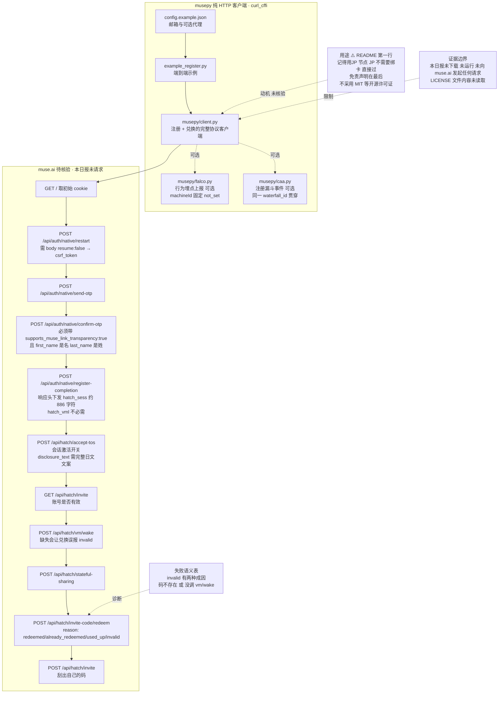

# duwqijlk/muse-protocol

## 一句话定位
**一份 muse.ai 注册与邀请码兑换流程的纯 HTTP 协议实现（9 个文件、32 KB）** —— ⭐⭐⭐⭐⭐ 它在本日报里的价值**不在于它是什么，而在于它是一条判据边界样本**：**513⭐ / ⑂253 = fork/star 49.3%**，⭐⭐⭐⭐⭐ 按 11-13 记录的判据这看起来像典型的农场信号，⭐⭐⭐⭐⭐ 但取证结果是**相反** —— 它的 fork 到达间隔中位 **266 秒**（仅 2/99 个 ≤10 秒，跨度 13 小时 15 分），⭐⭐⭐⭐⭐ **远慢于 11-13 记录的镜像样本（中位 139 秒）与本日投放体（中位 20 秒）**。

## 它解决的问题
**「不依赖浏览器完成注册与邀请码兑换」这件事本身。** ⭐⭐⭐⭐⭐ README 的技术目标很明确：把浏览器里那套带 OTP、TOS 激活、VM 唤醒的流程还原成可脚本调用的 HTTP 序列。

## 为什么值得关注（2026-11-15）
⭐⭐⭐⭐⭐ **因为它同时是两件事：一份高质量的协议逆向记录，以及一个必须被单独归类的用途样本。**

⭐⭐⭐⭐⭐ **可核验事实一：内容是真实且具体的协议记录。**
README 完整列出了端到端的调用序列：

```
GET  /                                   拿初始 cookie
POST /api/auth/native/restart            → 201 {csrf_token}
POST /api/auth/native/send-otp           → 201
POST /api/auth/native/confirm-otp        → 200 {registration_state:"completion_required"}
POST /api/auth/native/register-completion→ 200 {auth_meta_session:{frl_access_token, frl_account_id}}
POST /api/hatch/accept-tos               → 200（激活会话，必须）
GET  /api/hatch/invite                   → 200 表示账号有效
POST /api/hatch/vm/wake                  → 200（必须，否则兑换误报 invalid）
POST /api/hatch/stateful-sharing         → 200
POST /api/hatch/invite-code/redeem       → 200 {redemptionStatus:"redeemed"}
POST /api/hatch/invite                   → 200 {code}（刮出自己的码）
```

⭐⭐⭐⭐⭐ **并且记录了 6 个「容易踩的坑」**，每一个都带具体证据：

1. `confirm-otp` 必须带 `supports_muse_link_transparency: true`；
2. **`first_name` 是名（given name）、`last_name` 是姓（family name），与直觉相反** —— 且「生日早于约 18 年前会返回 403——同一会话同一份姓名，只把生日从 2013 改成 1993 就能从 403 变 200」；
3. `restart` 的 body 不是空对象，而是 `{"resume": false}`；
4. `accept-tos` 的 `disclosure_text` **必须填完整日文文案（不是随便一个字符串）**，否则 `invite` 仍返回 403；
5. **不调 `vm/wake` 直接兑换，即使码有效也会返回 `{"success":false,"reason":"invalid","detail":"この招待コードは存在しません"}`**；
6. 兑换失败的四种 reason 语义表：`redeemed` / `already_redeemed` / `used_up`（达到 30 次上限）/ `invalid`。

⭐⭐⭐⭐⭐ **「只把生日从 2013 改成 1993 就能从 403 变 200」这类描述，是只有真正逐字段试过才写得出来的东西** —— ⭐⭐⭐⭐⭐ 这与 11-13 记录的 `open-orange` 把 conformance 断言做成逐日可 diff 一样，属于「把调试过程本身做成产物」。

⭐⭐⭐⭐⭐ **可核验事实二：它把遥测也一并还原了。**
README 说明站点前端会上报两类遥测：`falco`（`POST /api/falco`，性能与业务交互，`machineId` 固定为 `not_set`）与 `caa-events`（`POST /api/auth/caa-events`，注册漏斗，经 `navigator.sendBeacon` 逐步骤上报，同一 `waterfall_id` 贯穿全程），⭐⭐⭐⭐⭐ 并明确「两者都不参与注册判定，缺省不影响流程能跑通」，代码里 `musepy/falco.py` 与 `musepy/caa.py` 保留了完整实现且可通过配置关闭。

⭐⭐⭐⭐⭐ **可核验事实三：fork 到达分布是正常的。**
本日报实测 `GET /repos/duwqijlk/muse-protocol/forks?sort=newest&per_page=100`：

| 指标 | 值 |
|---|---|
| 总 fork 数 | 253 |
| 抽样（最新 100 个）跨度 | 2026-11-14T09:00:27Z → 22:15:49Z（13 小时 15 分） |
| 相邻间隔中位数 | **266 秒** |
| ≤10 秒的间隔 | **2 / 99** |
| 最小 / 最大间隔 | 3 秒 / 2,980 秒 |

⭐⭐⭐⭐⭐ **对照同日三个投放族（`IPTV_Player_2.0` 中位 20 秒、`GitHub-Copilot-app` 中位 24 秒、`ai--manus2.0` 中位 22 秒）与 11-13 记录的镜像样本（中位 139 秒），本样本的 266 秒明显更慢** —— ⭐⭐⭐⭐⭐ **即这 253 个 fork 更像是「看到协议记录后自己实现一份」的真实扩散，而不是脚本批量制造的分母。**

⭐⭐⭐⭐⭐ **可核验事实四：owner 账号无投放特征。**
`duwqijlk` 创建于 **2023-03-04**、4 个公开仓库、14 followers、name「XCRUN」⭐⭐⭐⭐⭐ —— ⭐⭐⭐⭐⭐ 既不新、也无账号聚集、也不是一次性的随机名（⭐⭐⭐⭐⭐ **对照本日 6 个在 97 秒内注册的高订阅农场账号**）。

⭐⭐⭐⭐⭐ **可核验事实五：用途与声明的顺序是反的。**
README **第一行**（在标题与目录结构之前）写：

> 补充一下，记得用JP 节点， JP 不需要绑卡，直接过

⭐⭐⭐⭐⭐ 而免责声明在**最后**：

> 本项目仅供个人、非商业的学习与研究使用，**不采用 MIT 等开源许可证**。不得用于商业用途或再分发。实际使用时请遵守目标站点的服务条款与当地法律法规。

⭐⭐⭐⭐⭐ **即「怎么绕过注册限制」在最前，「不能用于商业」在最后。** ⭐⭐⭐⭐⭐ 并且许可声明是**否定式的**（「不采用 MIT 等开源许可证」）—— ⭐⭐⭐⭐⭐ `license.spdx_id = NOASSERTION`，⭐⭐⭐⭐⭐ 但仓库里**确实有 `LICENSE` 文件**（README 目录结构列出它），⭐⭐⭐⭐⭐ ⚠️ **该 LICENSE 文件的具体内容本日报未读取。**

## 热度来源判断
⭐⭐⭐⭐⭐ **热度来自一个真实的、可复现的技术需求 —— 但需求本身是「绕过注册限制」。**

⭐⭐⭐⭐⭐ 支持「真实扩散」的一面：253 个 fork 且间隔分布正常；⭐⭐⭐⭐⭐ 9 个文件 / 32 KB 却能覆盖 10 个端点 + 6 个坑 + 2 类遥测，⭐⭐⭐⭐⭐ **说明内容的「信息密度 ÷ 体积」比极高** —— ⭐⭐⭐⭐⭐ 这正是它值得被 fork 的原因；⭐⭐⭐⭐⭐ 账号与本数据集记录的所有投放特征都不匹配。

⭐⭐⭐⭐⭐ 支持「含灰产成分」的一面：⭐⭐⭐⭐⭐ README 首行直接给出规避风控的操作建议（换 JP 节点、免绑卡）；⭐⭐⭐⭐⭐ 兑换环节的 `used_up`（30 次上限）与「刮出自己的码」说明这是一套**邀请码套利流程**；⭐⭐⭐⭐⭐ 且**协议逆向本身触碰了目标站点的服务条款**（README 自己也承认「请遵守目标站点的服务条款与当地法律法规」）。

⭐⭐⭐⭐⭐ **本日报的立场：记录其工程结构与判据价值（它是本数据集里 fork/star 判据的一条重要反例），不主张其用途，也不复述其规避步骤。**

## 关键技术亮点
1. **纯 HTTP，无浏览器依赖**：用 `curl_cffi` 携带 TLS 指纹，⭐⭐⭐⭐⭐ 从而绕过基于浏览器指纹的风控 —— ⭐⭐⭐⭐⭐ 这本身是「为什么要这么写」的技术原因。
2. **端点顺序被完整建模**：`accept-tos` 与 `vm/wake` 是**会话激活的隐式前置条件**，⭐⭐⭐⭐⭐ 缺任一个都会让后续步骤以看似无关的错误码失败 —— ⭐⭐⭐⭐⭐ README 把这两个「隐式契约」显式化了。
3. **错误的可诊断化**：把 `reason` 字段做成一张语义表，⭐⭐⭐⭐⭐ 并明确指出「`invalid` 有两种成因（码不存在 / 没调 `vm/wake`）」—— ⭐⭐⭐⭐⭐ **这是把「错误码歧义」处理成了可行动的信息。**
4. **Cookie 生命周期的精确记录**：`hatch_sess`（约 886 字符）由 `register-completion` 的**响应头**下发；`hatch_vml` 在注册阶段一直是 `Max-Age=0` 且**不属于必需项** ⭐⭐⭐⭐⭐ —— ⭐⭐⭐⭐⭐ **明确指出一个「看起来相关但其实无关」的 cookie，避免读者浪费时间。**
5. **遥测可选化**：falco / caa-events 的实现保留但可关闭，且说明了它们不参与判定。

## 架构师速览

| 决策问题 | 研究判断 | 证据边界 |
|---|---|---|
| 系统边界 | 「muse.ai 注册 + 邀请码兑换这一条业务链」；**边界不含浏览器、不含目标站点前端、不含支付** | README 的目录结构 + 端点序列 + `config.example.json`（含「邮箱与可选代理」）；⚠️ **未运行、未抓包、未向 muse.ai 发起任何请求** |
| 主路径 | GET `/` 取 cookie → `restart` 取 csrf → `send-otp` → `confirm-otp` → `register-completion` → **`accept-tos`（激活会话）** → `vm/wake`（从已登录页提取 vmId）→ `stateful-sharing` → `invite-code/redeem` → `invite` 刮码 | 主路径由 README 的端点表 + `musepy/client.py` 的函数结构推导；⚠️ **未逐行审阅 client.py 的实现** |
| 关键权衡 | ①**浏览器 vs 纯 HTTP**：纯 HTTP 更快更可脚本化，但需要 `curl_cffi` 模拟 TLS 指纹 —— 且必须手工还原浏览器的隐式顺序；②**完整 vs 可选**：`vm/wake` 等步骤被拆成「必需」与「可省」（遥测可关）；③**开源 vs 不开源**：**选择不采用 MIT 等开源许可**，⭐⭐⭐⭐⭐ 即作者用许可换取「不被当作可复用依赖」 | 三个权衡的**存在**由 README 与代码结构证实；**每项的实际后果本日报未评估**（未跑通、未测稳定性、未读 LICENSE 全文） |
| 最小 PoC | 只读地复核端点与字段语义：对照 README 逐条与 `musepy/client.py` 的请求构造，核对 6 个「坑」的对应实现；**不向 muse.ai 发起任何请求、不注册任何账号** | PoC 范围刻意收窄到「只读复核」，因原任务涉及真实注册与兑换；⚠️ **本日报连这一步也未执行**（未下载仓库） |

## 架构启发
⭐⭐⭐⭐⭐ **第一条（本档案最想记的）：`fork/star` 高比率不是一个独立的结论，它必须与 fork 的到达时间分布一起读。** ⭐⭐⭐⭐⭐ 11-13 记录的镜像样本是 146.2% fork/star + 中位 139 秒，⭐⭐⭐⭐⭐ 本日投放族是 1.8% fork/star + 中位 20 秒，⭐⭐⭐⭐⭐ 本样本是 49.3% fork/star + **中位 266 秒** —— ⭐⭐⭐⭐⭐ **同一族比率下，分布形态完全不同。**

⭐⭐⭐⭐⭐ **第二条：把「看起来相关但其实无关」的东西明确标出来，是高密度技术文档的标志。** ⭐⭐⭐⭐⭐ `hatch_vml` 明明是同名前缀的 cookie 且在响应里出现，但 README 明确说它「一直是被清空状态，不属于必需项」—— ⭐⭐⭐⭐⭐ **读者因此不用花时间验证一个错误的假设。**

⭐⭐⭐⭐⭐ **第三条：错误码的歧义可以被工程化消除。** ⭐⭐⭐⭐⭐ 「`invalid` 有两种成因」+ 一张 reason 语义表，⭐⭐⭐⭐⭐ **比一句「出错时请检查」有用一个数量级。**

⭐⭐⭐⭐⭐ **第四条（对做合法项目的反向启发）：把免责与规避步骤的顺序颠倒，是一种可被检测的信号。** ⭐⭐⭐⭐⭐ 本日报此前记录的正例（`mate`、`super-odyssey-pc-recomp`、`open-orange`）**都把限制放在第一屏**；⭐⭐⭐⭐⭐ 本样本把「怎么绕过去」放第一行、把「不能用于商业」放最后 —— ⭐⭐⭐⭐⭐ **这是一个比任何技术指标都更快的甄别线索。**

## 架构图（MMD）

> 证据边界：结构取自 README 的端点序列与目录结构、`git/trees` 文件清单；**本日报未运行任何请求**，图中「实测」仅指本日报对公开文件的读取。



## 定位判断
**观察型（反例样本 / 边界案例）。** ⭐⭐⭐⭐⭐ 它在技术上是「一份质量相当高的协议逆向记录」，⭐⭐⭐⭐⭐ 在生态上是「一个用 fork 扩散的、用途位于灰区的项目」—— ⭐⭐⭐⭐⭐ **本日报把它记为反例样本，是因为它的主要价值是给判据提供反例，而不是给使用者提供工具。**

## 风险/局限/泡沫点
- ⭐⭐⭐⭐⭐ **用途规避注册限制**：README 首行直接给出规避风控的操作建议，⭐⭐⭐⭐⭐ 整条链路是「注册 → 激活 → 兑换 → 刮码」，⭐⭐⭐⭐⭐ 属于邀请码套利形态。
- ⭐⭐⭐⭐⭐ **触碰目标站点服务条款**：README 自己也承认这一点并把合规责任推给使用者。
- ⭐⭐⭐⭐⭐ **许可不明**：`license.spdx_id = NOASSERTION`，README 声明「不采用 MIT 等开源许可证」⭐⭐⭐⭐⭐ —— ⭐⭐⭐ ⚠️ **仓库内 `LICENSE` 文件的具体内容本日报未读取，因此不能判断它实际采用了什么条款。**
- ⭐⭐⭐⭐⭐ **协议会失效**：README 里的 `TOS_VERSION` 常量（`ntm_create_account:default_v1_meta_account_v3+docs_v2`）与站点实际值的一致性**完全依赖当时状态**，⭐⭐⭐⭐⭐ 站点一旦变更即失效。
- ⭐⭐⭐ ⠕ **未核验项**：未下载仓库、未运行、未向 muse.ai 发起任何请求、未读取 `LICENSE` 全文、未读取 `client.py` 全文、未核验 `musepy/falco.py` 与 `caa.py` 的实现。

## 与同类项目的关系
- **vs 本日三个投放族（`ai--manus2.0` / `IPTV_Player_2.0` / `GitHub-Copilot-app`）**：⭐⭐⭐⭐⭐ 那三族是 README 逐字节相同 + 同一 Dropbox 链接 + 账号聚集；**本样本 README 独立、账号独立、载荷无共享**，⭐⭐⭐⭐⭐ 但 fork/star 比值（49.3%）比它们（0.7%–1.8%）高一个数量级 —— ⭐⭐⭐⭐⭐ **这就是为什么单看比值会误判。**
- **vs 11-13 的 `AIRzZ90/study-materials-fork`（146.2% fork/star）**：⭐⭐⭐⭐⭐ 那个是镜像（README 首行自述转载），**fork 间隔中位 139 秒**；本样本 fork 间隔中位 266 秒、更慢，⭐⭐⭐⭐⭐ **且内容是原创的协议记录 —— 二者在比值上相近，在实质上完全相反。**
- **vs 11-13 的 `open-orange`（把 conformance 断言做成逐日可 diff）**：⭐⭐⭐⭐⭐ 两者都把「调试/验证过程」做成产物，⭐⭐⭐⭐⭐ 但 `open-orange` 公开的是**可复现的兼容性测试**，本样本公开的是**一次性的协议还原**。

## 是否值得持续跟踪
**不值得使用；值得作为「fork/star 判据必须有分布配套」的基准样本跟踪。** ⭐⭐⭐⭐⭐ 具体建议：
1. **不要按 README 执行**；
2. **方法论上应更新常规检测项**：把「fork 到达时间分布的中位间隔」与「≤10 秒间隔占比」作为 fork/star 比值的强制配套项 —— ⭐⭐⭐⭐⭐ 本样本证明**没有这一项，比值不可解释**；
3. 本样本也提示了一条低成本信号：**「免责与规避步骤的顺序」** —— 免责在最后而规避在第一行的项目，应被优先人工复核。

## 后续观察点
- 253 个 fork 的其余 153 个的到达分布（本日报只抽样了最新 100 个）
- 该仓库的 `LICENSE` 文件实际条款（⭐⭐⭐⭐⭐ 这是本档案最想补上但未补的一点）
- `muse.ai` 的注册策略是否变更（若收紧，本样本会自然失效）
- 是否出现同作者的后续项目（例如把 `musepy` 拆成可复用库）
- 该项目是否被加入任何「高质量协议记录」清单（那会说明其信息密度的价值被社区认可）

---
> 数据来源: GitHub API (2026-11-15) | Stars: 513 | Forks: 253 | Subscribers: 0 | License: NOASSERTION | 语言: Python | 创建: 2026-11-14T01:24:58Z | owner 创建: 2023-03-04T14:07:52Z
