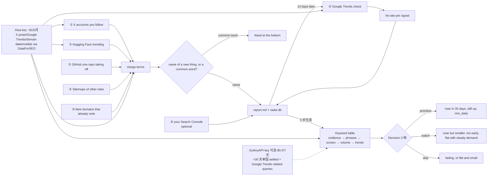

# zhuyansen/new-term-radar

## 一句话定位
new-term-radar 是一个 Python stdlib 的 AI 新词雷达工具——5 个信号源（X 关注账号 + Hugging Face trending + GitHub breakout 一个 repo 起飞 + sitemaps 其他站添加页面 + 新域名已 rank）+ 14 天后 Google Trends 回看 + 1 个 AIsa key 涵盖 X posts / Google Trends / domain data / models + 候选三栏（candidate new terms + other rising terms + 14-day review verdict）+ decision 3 档（prioritize / watch / skip）——把 AI 新词发现从「Google Trends step 5 慢 14 天 / 关键词工具读 Google Trends」推到「5 个前置信号 + 14 天后回看 + 1 key 全包 + 三栏决策」严肃工程化形态。

## 它解决的问题
2026 年做 AI 工具站 SEO / newsletter / directory 的团队面临痛点：Google Trends 后知后觉（step 5 慢 14 天），关键词工具都读 Google Trends，新词出来 14 天后才知道。new-term-radar 直击：**5 个前置信号（X 关注账号 + Hugging Face trending + GitHub breakout + sitemaps + 新域名）+ 14 天后回看 + 1 AIsa key 全包**。解决的是「AI 新词发现比 Google Trends 早 3-14 天」严肃工程化问题。

## 为什么值得关注（2026-10-13）
- **Stars:** 510（截至 2026-10-13），1 天 510⭐ ⑂210 fork/star 41.2%，**增长率** 41.2%（fork/star 反映社区参与，爆发极强）
- **Forks:** 210，社区参与度极高（SEO / newsletter / directory 用户群庞大）
- **Size:** 203 KB（小、轻、Python stdlib）
- **License:** MIT
- **语言:** Python（stdlib only）
- **活跃度:** created 2026-10-12，pushed_at 2026-10-12，1 天爆发
- **依赖:** Python 3.10+ + 仅标准库（No PyPI deps for the radar itself）；AIsa key 必需（X/Google Trends/domain data/models via DataForSEO）；GoAnyAPI key 可选（+30 天单国数据）

## 热度来源判断
new-term-radar 的热度是 **「AI 新词发现比 Google Trends 早 3-14 天 × 5 个前置信号源 × 14 天后回看 × 1 AIsa key 全包 × 三栏决策（prioritize/watch/skip）× 实测 Niko1221/Strata 早 3 天 × PhotoCraft/Claude Haiku 5.5/SynthID Detector 案例 × Python stdlib 轻量 × GitHub Actions 友好」** 的组合。AI 工具站 SEO / newsletter / directory 团队庞大，对「先于 Google Trends 3-14 天发现新词」有强需求——new-term-radar 把「5 个前置信号 + 14 天后回看」严肃工程化，自然爆火。210 fork 是 SEO / newsletter / directory 用户群的网络效应。热度真实且具「AI 新词发现 + 早于 Google Trends」严肃工程化场景的强需求。

## 关键技术亮点
1. **5 个前置信号源：** X accounts you follow + Hugging Face trending + GitHub one repo taking off + sitemaps of other sites + new domains that already rank
2. **14 天后 Google Trends 回看：** 报告 14 天后是否上升；hit rate per signal 自我校准
3. **1 AIsa key 涵盖：** X posts + Google Trends + domain data (DataForSEO behind) + 小模型 judge + 关键词表生成 models
4. **候选 5 列：** Keyword/Type（name or generic ⚠ or 🔎）/Behind/New?/Est. searches/day/Started rising/Peak vs gpts/Peak day/Last 7 vs 7 before/Now/Decision
5. **小模型 judge：** name of one specific thing, or a common word?（specific name → report + radar.db；common word → listed at the bottom）
6. **evidence → phrases → screen → volume → trends 5 步生成 keyword table：**
   - **Evidence:** X 高级搜索最赞 posts + repo README
   - **Phrases:** 模型读 evidence 写普通用户关键词 + 引文 + ⚠ 标 built on 其他产品名 + 可选 🔎 Google Trends related queries
   - **Screen:** 第二调用评分 + 标 brands + 识别 other 物 + 弱相关 drop
   - **Volume:** Google Ads 月搜索量批量调用 + min_volume 阈值 drop
   - **Trends:** 2 次/行（term 形状 + term vs benchmark 关键词 gpts 大小）
7. **Decision 3 档：** prioritize（涨 + still up + min_daily）/ watch（涨但小 + too early + flat + steady demand）/ skip（退 + flat + small）
8. **每个名字读 2 次：** announcement day + 3 days later（announcement day posts 是公告无 use）
9. **AIsa ~$15/月：** 35 X 账号读 3 次/天 + 5 关键词表/天 = $10 X reads + $5 keyword table
10. **可选 GoAnyAPI $0.07/天：** +Google Trends related queries + 30 天单国 settled 数据（rows 标 "Now" 后 `(US)`）
11. **Python stdlib only：** radar/ 目录；config.example.json；radar/usecases.py
12. **sources/daily 双命令：** `sources --out sources.md` 仅新名写报告；`daily --skip x,hf --out report.md` 每天 1 次
13. **灵活关信号：** `--skip x,hf,breakout,sitemaps,newsites,gsc,review,judge,usecases`
14. **其他 flags：** `--new-sites`（周信号今天跑）；`--mail`（发邮件）；`--state DIR`（移动 db 和 snapshots）
15. **GitHub Actions 友好：** sources 命令「Run every few hours」 + daily 命令「once a day」
16. **实测案例：** Niko1221/Strata 2026-09-25 报告 → 14 天后 Google Trends hit → 提前 3 天发现
17. **实测数据示例：** PhotoCraft 12747 searches/day started rising 2026-10-05 peak 2026-10-09 still rising prioritize；Claude Haiku 5.5 1863 searches/day started rising 2026-10-07 peak 2026-10-08 ×6.0 still rising prioritize
18. **generic terms 14 天回看：** "photoshop alternative" ran 80% above level in US for 5 days after PhotoCraft appeared; worldwide daily series showed almost nothing of it (2,1,1,2,4,2)

## 架构师速览

| 决策问题 | 研究判断 | 证据边界 |
|---|---|---|
| 系统边界 | 一个 Python stdlib CLI 工具（radar/ 目录）+ 1 个 AIsa key 必需（X posts/Google Trends/domain data/models via DataForSEO）+ 1 个可选 GoAnyAPI key（+30 天单国 + Google Trends related queries）+ 一个 config.json（X accounts / sitemaps / topics）+ radar.db 数据库 + report.md 输出 + sources.md 输出（仅新名时写） | 仅基于 README 「The radar uses only the standard library / AIsa key + GOANYAPI_API_KEY / config.example.json / radar/usecases.py / radar.db」 推断；具体 radar/ 模块边界、AIsa/GoAnyAPI 速率限制、sources/daily 命令调度策略未在档案明示 |
| 主路径 | 用户 config.json 配 X accounts / sitemaps / topics → `python -m radar daily --out report.md` → radar 跑 5 信号源 → 合并 terms → 小模型 judge（name vs common word） → 候选 5 列输出 + decision 3 档 → report.md → 14 天后 review 段对比 Google Trends → hit rate per signal 校准 → 自我校准反馈 | 主路径为 README 「Why + What it reads + The keyword table + Quick start」 段落整理；具体 evidence → phrases → screen → volume → trends 5 步实现、GoAnyAPI 单国曲线数据、Google Ads 月搜索量 batch 调用、rader.db schema 未在档案明示 |
| 关键权衡 | 1 AIsa key 全包 vs 单一供应商锁定（$15/月固定成本 + DataForSEO 上游） vs Python stdlib 限制（无 Pandas / numpy） vs 小模型 judge 准确率依赖模型 vs 5 信号源完整覆盖 vs Google Trends last 2 days 数据未 settled vs generic terms 14 天后回升概率未量化 | 权衡来自 README 「Without an AIsa key the free signals still run... the report then lists every term unsorted / Google Trends' last two days are not settled... every reader in the code now drops those two days, and a rise must last two days to count / Whether generic terms follow the names is what the 14-day review will show, and we have no result yet」 |
| 最小 PoC | 准备 AIsa key + 35 X 账号 + 5 主题 → config.json 配 → `python -m radar sources --out sources.md`（仅新名）→ 验证 sources.md 是否列出新名 → `python -m radar daily --out report.md` → 验证 report.md 三栏（candidate new terms + other rising terms + 14-day review verdict） | PoC 由 README 「Quick start + sources/daily 双命令 + The keyword table」 段落整理；具体 X 账号抓取频率、DataForSEO 速率限制、Google Trends last 2 days drop 实现、rader.db schema 未在档案明示 |
| 证据边界 | 仅核验：仓库存在、stars/forks/description/license/size/language 来自 GitHub API；README 节录自 raw 接口；5 信号源 + 14 天回看 + 1 AIsa key + 3 档决策 + Python stdlib + GitHub Actions 友好 + 实测 Niko1221/Strata 案例 + PhotoCraft/Claude Haiku 5.5/SynthID Detector 数据由 README 直接叙述 | 待核验：具体 radar/ 模块边界、AIsa/GoAnyAPI 速率限制、sources/daily 调度策略、rader.db schema、evidence → phrases → screen → volume → trends 5 步实现细节 |

## 架构启发
new-term-radar 的核心启发是 **「5 个前置信号源 + 14 天后回看 + 1 key 全包 + 三栏决策」是严肃工程化的「AI 新词发现」路径**。Google Trends 是 step 5（14 天后才到），但新词的「trail」从 X 关注账号 + Hugging Face trending + GitHub breakout + sitemaps + 新域名就开始了。new-term-radar 把这 5 个前置信号严肃工程化——比 Google Trends 早 3-14 天发现新词。这指向 **「新词发现 = 多源前置信号 + 14 天回看 + 自我校准」** 的未来。new-term-radar 还展示了 **「evidence → phrases → screen → volume → trends 5 步」** 的设计哲学——从 evidence 到 trends 5 步逐步精炼，每步都有模型调用、batch 调用、阈值 drop。这与 `jwuthri-cloud/Tracely-ai`（AI agent trace → regression test → CI gate → alert）形成完整的「AI 应用观察工具」严肃工程化方向。

## 架构图（MMD）

> 证据边界：此图只采用本档案已有可核验描述；"待核验"节点不应视为项目实现事实。

## 定位判断
**SEO / newsletter / directory 工具型项目（AI 新词发现比 Google Trends 早 3-14 天）。** new-term-radar 不仅是 SEO 工具，更展示了「5 个前置信号 + 14 天回看 + 1 key 全包 + 三栏决策」严肃工程化路径。510⭐ + 210 fork/star 41.2% 已显示 SEO / newsletter / directory 用户群对「先于 Google Trends 3-14 天发现新词」的强需求。但能否持续取决于：（1）AIsa key 单一供应商锁定；（2）Python stdlib 限制（无 Pandas / numpy）；（3）小模型 judge 准确率；（4）5 信号源完整覆盖；（5）Google Trends last 2 days 数据 drop；（6）generic terms 14 天后回升概率量化。定位是「AI 新词发现 + 早于 Google Trends + 三栏决策」严肃工程化整合的头部样本，向「团队 / 企业级 AI 新词发现 SaaS」演进是合理路径。

## 风险 / 局限 / 泡沫点
- **AIsa key 单一供应商锁定：** $15/月固定成本（35 X 账号 + 5 关键词表）；DataForSEO 上游；AIsa 故障会停摆
- **Python stdlib 限制：** 无 Pandas / numpy / 高级数据处理库；CSV / JSON 处理须手工
- **小模型 judge 准确率：** 依赖模型能力；对 "specific name vs common word" 判断可能错；对 generic terms 弱
- **Google Trends last 2 days 数据未 settled：** unrelated terms 出现 0 → 100 spike；first pass 被骗过；现在 drop last 2 days + rise must last 2 days to count
- **generic terms 14 天后回升概率未量化：** "Whether generic terms follow the names is what the 14-day review will show, and we have no result yet"
- **Google Ads 体积延迟：** Google Ads volumes run about two months behind
- **AIsa referral link：** README 提 AIsa + GoAnyAPI 推广 affiliate（README 内有 aff link）
- **GoAnyAPI 服务成熟度：** "first released in August 2026 / about one in ten failed / tries twice, reports a failure in the table and carries on"
- **config.json 配置成本：** 35 X 账号 + 5 主题 + sitemaps 须用户自配
- **个人项目属性：** zhuyansen 个人维护，可持续性存疑

## 与同类项目的关系
- **vs Google Trends:** Google Trends 是 step 5（14 天后才到）；new-term-radar 是 5 个前置信号（早 3-14 天）
- **vs 关键词工具（Ahrefs / SEMrush）:** 关键词工具都读 Google Trends；new-term-radar 读 5 个前置信号
- **vs jwuthri-cloud/Tracely-ai:** Tracely-ai 是「AI agent trace → regression test → CI gate → alert」；new-term-radar 是「AI 新词发现 + 早于 Google Trends 3-14 天 + 三栏决策」。两者形成「AI 应用观察工具」完整方向
- **vs KKKK浩子/AIHOT:** AIHOT 是「自己找热点 + 自己写日报的网站框架」；new-term-radar 是「AI 新词发现 + 三栏决策 + AIsa key」
- **vs awesome-AI-terms 类 awesome 列表:** 那些是人工收录；new-term-radar 是自动化发现

## 是否值得持续跟踪
**值得跟踪（AI 新词发现 + 早于 Google Trends 3-14 天 + 三栏决策）。** new-term-radar 代表了「5 个前置信号 + 14 天回看 + 1 key 全包 + 三栏决策」严肃工程化路径的完整演示。无论其本身成败，这一方向是 AI 工具站 SEO / newsletter / directory 团队的趋势。建议关注：（1）AIsa key 单一供应商锁定；（2）Python stdlib 限制；（3）小模型 judge 准确率；（4）5 信号源完整覆盖；（5）Google Trends last 2 days 数据 drop；（6）generic terms 14 天后回升概率量化。对做 AI 工具站 SEO / newsletter / directory 的团队，这个工具是「先于 Google Trends 3-14 天发现新词」的实用选择，值得直接采用。

## 后续观察点
- AIsa key 单一供应商锁定（是否增加多供应商）
- Python stdlib 限制（是否增加 Pandas/numpy 可选）
- 小模型 judge 准确率（对 "specific name vs common word"）
- 5 信号源完整覆盖（X 关注账号抓取频率、HF trending 延迟、GH breakout 阈值、sitemaps 解析）
- Google Trends last 2 days 数据 drop（是否优化）
- generic terms 14 天后回升概率量化（14-day review verdict 数据积累）
- config.json 配置成本（是否提供预设 config 模板）
- zhuyansen 个人项目可持续性

---
> 数据来源: GitHub Repository API (2026-10-13) + README raw 接口 | Stars: 510 | Forks: 210 | License: MIT | 语言: Python (stdlib only) | Size: 203 KB | 创建: 2026-10-12 | 依赖: Python 3.10+ + AIsa key + 可选 GoAnyAPI key
