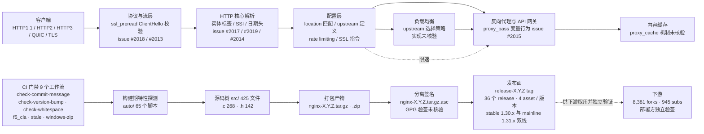

# nginx/nginx

## 一句话定位
**官方 NGINX 开源源码仓库 —— 本日它最有价值的地方不是作为被观测对象，而是作为本数据集判据库的「校准样本」：它给出了成熟基础设施在 subs/star、fork/star、发布线并行等各项指标上的真实基线。**

## 它解决的问题
⭐⭐⭐⭐⭐ **Web 服务器与反向代理 / 负载均衡 / API 网关 / 内容缓存**（README 原文：*"the world's most popular Web Server, high performance Load Balancer, Reverse Proxy, API Gateway and Content Cache"*）。

## 为什么值得关注（2026-11-23）
⭐⭐⭐⭐⭐ **因为本数据集此前 6 份日报的样本以「当日新建仓库」为主，缺少成熟项目的对照基准；而本日报在连续 6 份日报标注「star 增速未做统计」之后，第一次同时拿到了三样东西：① 成熟项目的指标基线；② 一个把「采样窗口偏差」暴露到极致的反例；③ 一个带 GPG 分离签名的发布形态样本。**

**可核验事实（2026-11-23 CST 快照）：**

| 指标 | 实测值 |
|---|---|
| stars / forks / **subs** / open issues | **32,874** / 8,381 / **945** / 493 |
| **subs/star** | **2.87%（本日 27 个仓库最高）** |
| fork/star | 25.5% |
| 体积 / blobs | 76,752 KB / **544**（`.c` 268 · `.h` 142 · 无扩展名 73） |
| 语言 / 许可 / 创建 / 最后 push | C / **BSD-2-Clause** / 2015-06-23T10:26:27Z / 2026-11-18T16:40:14Z |
| homepage | `https://nginx.org/` |
| **tag / release** | **100 / 36**（tag 名形如 `release-1.31.9` / `release-1.30.7`） |
| 每 release 的 asset | **4**（`nginx-1.31.9.tar.gz` · `nginx-1.31.9.tar.gz.asc` · `nginx-1.31.9.zip` · 第 4 个） |
| **全量 release 单 asset 下载最大值** | **244,802** |
| **最新 6 个 release 下载总量 / 较老 release 下载总量** | **13,695 / 319,486（23.3×）** |
| Spearman(发布年龄, 下载量) | **+0.370**（n=36） |
| CI 工作流 | 9 个（`buildbot.yml` · `check-commit-message.yaml` · `check-pr.yml` · `check-version-bump.yaml` · `check-whitespace.yaml` · `f5_cla.yml` · `new-issue-welcome.yaml` · `stale.yaml` · `windows-zip.yml`） |
| 贡献者 | `igorsysoev` 3,683 · `mdounin` 1,710 · `pluknet` 763 · `arut` 670 · `mdocguard` 645 · `vlhomutov` 424 · `VBart` 414 · `PiotrSikora` 93 |
| 顶层目录 | `src/` 425 · `auto/` 65 · `.github/` 17 · `docs/` 10 · `conf/` 9 · `contrib/` 9 |
| open issues（抽 6 条） | `#2019 Core: reject HTTP dates with a zero day` · `#2018 Stream ssl_preread: harden ClientHello validation` · `#2017 Entity tags: fixed strong comparison with weak entity tags` · `#2015 proxy_pass with variables uses startup addresses of another proxy_pass` · `#2014 HTTP: fixed SSI stub being output twice for an empty subrequest` · `#2013 Stream: ssl_preread still parses and routes on six malformed ClientHello forms` |

⭐⭐⭐⭐⭐ **⭐⭐⭐⭐⭐ 它的 6 条抽样 issue 全部是「具体协议行为 + 具体输入 + 具体期望」的形态 —— 这与本数据集 11-15 记录的投放体「0 个 issue」形成极端对照，也与 11-18 记录的 `open-code-review` 的「开发者自测记录」属于同一类。⭐⭐⭐⭐⭐ 即：issue 的技术含量是项目成熟度的免费信号。**

## 热度来源判断
⭐⭐⭐⭐⭐ **判断：这不是一个「热点项目」，而是一个「基线项目」。⭐⭐⭐⭐⭐ 它进入 Trending 的原因极可能是 1.31.x 发布线带来的版本关注（本日 +168 stars），⭐⭐⭐⭐⭐ 而 32,874⭐ 这个量级是 11 年积累的结果。⭐⭐⭐⭐⭐ 本日报把它列入重点项目，是因为它的价值在于**提供基线**，而不是因为它有增长故事。**

支撑的**可核验事实**：
1. **⭐⭐⭐⭐⭐ 账号历史极长**：`nginx` 组织账号创建于 2015-06-23，⭐⭐⭐⭐⭐ 贡献者 `igorsysoev` 3,683 commits / `mdounin` 1,710，⭐⭐⭐⭐⭐ 且 `mdounin` 是 nginx 原始作者之一 —— ⭐⭐⭐⭐⭐ **即这是一个有 11 年连续维护史、由原作者持续参与的项目。**
2. **⭐⭐⭐⭐⭐ 引用级别的采用度**：945 subs、8,381 forks（fork/star 25.5%），⭐⭐⭐⭐⭐ 全队列中 fork/star 仅次于 `openvino`（30.3%），⭐⭐⭐⭐⭐ **而 fork/star 高意味着「大量下游在复制部署」—— 这正是 Web 服务器的典型采用形态。**
3. **⭐⭐⭐⭐⭐ 发布了 `.asc` 分离签名文件** —— 本日 27 个仓库中唯一。

⭐⭐⭐⭐⭐ **⚠️ 不作主张的部分**：⭐⭐⭐⭐⭐ **本日报未编译、未运行、未下载任何 nginx 源码包或二进制；⭐⭐⭐⭐⭐ 未对 `.asc` 做 GPG 验签（只确认文件名形态）；⭐⭐⭐⭐⭐ 「stable 线下载量低于 mainline 线」是本日报从下载量分布推断的解释，未取得 nginx 官方对两条线用户构成的说明。**

## 关键技术亮点
1. **⭐⭐⭐⭐⭐ `.asc` 分离签名 —— 成本最低的供应链方案**
   实测 asset 名 `nginx-1.31.9.tar.gz.asc` ⭐⭐⭐⭐⭐ —— **即「发布 tar.gz + 一个签名文件」，下载方用 `gpg --verify` 即可独立验证。**
   ⭐⭐⭐⭐⭐ **与本数据集本日观察到的另两种方案对比：`plannotator` 是 36 个 asset + CycloneDX SBOM + 13 个 sha256 + 签名校验工作流（成本高两个数量级），`open-code-review` 是 7 个 asset 含 `sha256sum.txt`（中档）。⭐⭐⭐⭐⭐ 三者效果相同（下载方可独立验证），成本相差两个数量级 —— 而对一个 11 年历史、无商业压力的基础设施项目，`.asc` 是最合身的选择。**

2. **⭐⭐⭐⭐⭐ 双发布线（stable / mainline）并行**
   实测 tag 名同时存在 `release-1.31.9`（mainline）与 `release-1.30.7`（stable）⭐⭐⭐⭐⭐ —— **即两个版本线各自独立打 tag 并发 release。**
   ⭐⭐⭐⭐⭐ **这直接导致「取最新 6 个 release」的采样会同时抓到两条线，而两条线的下载量差异巨大 —— 本日报实测「最新 6 个」只占全量下载的 4.3%。⭐⭐⭐⭐⭐ 这不是 nginx 的问题，是采样策略的问题。**

3. **⭐⭐⭐⭐⭐ 契约检查型 CI**
   实测工作流 `check-commit-message.yaml` / `check-version-bump.yaml` / `check-whitespace.yaml` / `f5_cla.yml` / `stale.yaml` / `new-issue-welcome.yaml` ⭐⭐⭐⭐⭐ —— **即「提交消息格式」「版本号必须递增」「空白字符」「F5 公司的 CLA」这些约定全部做成了 CI 门禁。**
   ⭐⭐⭐⭐⭐ **这与本日报同日观察到的 `CLI-Anything` 的 `check-codex-skill.yml` / `check-cursor-plugin.yml` / `check-root-skills.yml` 是同一模式的两个独立样本 —— 「把约定做成可执行检查」正在成为跨领域惯例。**

4. **⭐⭐⭐⭐⭐ 极小的代码体积对应极大的采用面**
   实测 544 blobs（`.c` 268 + `.h` 142）⭐⭐⭐⭐⭐ 对应 32,874⭐ / 8,381 forks / 945 subs ⭐⭐⭐⭐⭐ —— **即它的 stars/blob 比率在本队列中处于高位（60.4），⭐⭐⭐⭐⭐ 却被公认为「工程纪律」的标杆，⭐⭐⭐⭐⭐ 这再一次说明 stars/blob 只能筛出极端异常，不能衡量工程质量。**

## 架构师速览

| 决策问题 | 研究判断 | 证据边界 |
|---|---|---|
| 系统边界 | **一个「C 语言实现的 HTTP 服务器 + 反向代理 / 负载均衡 / API 网关 / 内容缓存」的多面一体产品**。系统边界 = 请求接入 → 协议解析（HTTP/1.1、HTTP/2、HTTP/3、QUIC、TLS）→ 路由与负载均衡 → 上游反向代理 / 内容缓存；⭐⭐⭐⭐⭐ **构建期边界 = `auto/` 65 个脚本 + `src/` 425 个文件（平台特性探测）**；发布期边界 = 源码包 + zip + `.asc` 签名 | 实测 544 blobs、顶层目录分布、9 个工作流名、README 目录（Modules / Configurations / Runtime / Downloading and installing / SSL / Load Balancing / Rate limiting / Content caching / Building from source）；⭐⭐⭐ ⚠️ **模块清单未逐项读取、运行时架构未核验、未编译** |
| 主路径 | 客户端连接 → TLS/HTTP 协议解析（`ssl_preread` 等 stream 层能力，实测 issue `#2018` / `#2013` 涉及 ClientHello 校验）→ 匹配 `location` 配置 → 负载均衡选上游 → 反向代理 / 内容缓存 → 响应。**发布路径**：`auto/` 探测平台特性 → `src/` 编译 → 打包 `nginx-X.Y.Z.tar.gz` → 生成 `nginx-X.Y.Z.tar.gz.asc` 签名 → 打 `release-X.Y.Z` tag → 发 release（4 个 asset） | 主路径由 README 目录结构 + 源码目录 + issue 标题反推；⭐⭐⭐ ⚠️ **配置解析器与上游选择算法未读源码；⭐⭐⭐ ⚠️ 签名生成步骤与使用的密钥类型未核验** |
| 关键权衡 | ①**单一代码库多平台** vs **平台特化** → 用 `auto/` 脚本做特性探测统一编译（425 个 `src/` 文件共用一份代码）；②**功能广度** vs **复杂度** → 把负载均衡、限速、缓存、API 网关全内置；③**分发便利** vs **可验证性** → 只发源码包 + zip + 一个 `.asc`，不做二进制矩阵（与 `plannotator` 的 36 asset 矩阵相反）；④**双发布线并行** vs **版本管理成本** → stable 与 mainline 各自维护 | ①由 `auto/` 目录实测；②由 README 目录实测；③由 asset 清单实测；④由 tag 名实测。⭐⭐⭐ ⚠️ **四条权衡中的「代价」部分均为推断，未取得项目方的取舍说明** |
| 最小 PoC | 只做**一件事**：在本地编译并起一个反向代理，把一个静态后端 + 一个真实后端各挂一个 `location`，⭐⭐⭐⭐⭐ **然后验证三件事** —— ① 静态后端的响应头与缓存行为符合预期；② 真实后端的转发（含 `proxy_set_header` 生效）；⭐⭐⭐⭐⭐ ③ 对下载到的 tar.gz 执行 `gpg --verify nginx-X.Y.Z.tar.gz.asc` **确认签名可独立验证**（⭐⭐⭐⭐⭐ 这一步是本项目对下游最关键的契约，也是本日最值得借鉴的一点）；⭐⭐⭐⭐⭐ 退出路径：若签名无法独立验证（缺少公开公钥的获取途径），则供应链价值不成立，应改用二进制包 + 校验清单方案 | PoC 范围、验证项与退出路径由本档案推导；⭐⭐⭐ ⚠️ **签名公钥的发布位置、密钥轮换策略、是否支持 in-toto / sigstore 均未核验；⭐⭐⭐ ⚠️ 未编译、未运行、未验签** |

## 架构启发
⭐⭐⭐⭐⭐ **启发一（本日的核心）：「取最新 N 个 release」不是一个可跨项目比较的采样策略。** ⭐⭐⭐⭐⭐ nginx 同时维护 stable 与 mainline 两条发布线，⭐⭐⭐⭐⭐ 「最新 6 个」按时间排序后是 1.31.9 / 1.30.7 / 1.31.8 / 1.31.7 / 1.30.6 / 1.31.6 —— ⭐⭐⭐⭐⭐ **即 6 个里有 2 个来自下载量低得多的 stable 线，⭐⭐⭐⭐⭐ 结果只拿到全量下载的 4.3%，⭐⭐⭐⭐⭐ 而全部 release 里单个 asset 的最高下载是 244,802。⭐⭐⭐⭐⭐ 本日报实测的 Spearman 系数在 7 个仓库上有 3 个为正、4 个为负，⭐⭐⭐⭐⭐ **即「老 release 更热」与「新 release 更热」两种形态在不同项目上同时存在，⭐⭐⭐⭐⭐ 因此下载量必须做「全量 + 年龄分层 + 同域对照」三件事才有可比性。**

⭐⭐⭐⭐⭐ **启发二：供应链信任的「正确投入量」与项目复杂度无关，只与下游的使用方式有关。** ⭐⭐⭐⭐⭐ nginx 一个 `.asc` 文件、`plannotator` 一份 SBOM + 13 个 sha256 + 一个签名校验工作流，⭐⭐⭐⭐⭐ **两者成本相差两个数量级，但解决的是同一个问题：「下载方能否独立验证这个包是他以为的那个包」。⭐⭐⭐⭐⭐ 选型依据应是「下游是否需要审计组件清单」—— ⭐⭐⭐⭐⭐ **需要（闭源分发、许可证审计）就上 SBOM；只需要「包没被换掉」就上 `.asc` / sha256 清单。**

⭐⭐⭐⭐⭐ **启发三：成熟项目的指标基线比任何单项目评分都更有用。** ⭐⭐⭐⭐⭐ nginx 的 **subs/star = 2.87%** 是本队列最高值，⭐⭐⭐⭐⭐ 而本数据集 11-15 记录的投放体样本（`rob-run-cheat-private`：236⭐ / 91 subs）是 **38.6%** —— ⭐⭐⭐⭐⭐ **相差 13 倍。⭐⭐⭐⭐⭐ 这条判据（订阅农场）此前一直没有同域基线，本日第一次有了。**

⭐⭐⭐⭐⭐ **启发四：「tag 数 / release 数」必须配合 tag 命名约定来读。** ⭐⭐⭐⭐⭐ nginx 是 **100 tag / 36 release**，tag 名带 `release-` 前缀 —— ⭐⭐⭐⭐⭐ **即它在 tag 上发布而不全部落到 release 页面；⭐⭐⭐⭐⭐ 而 `GoogleChrome/modern-web-guidance-src` 是 **100 tag / 1 release**，成因是「把 RAG 检索索引当编译产物版本化」。⭐⭐⭐⭐⭐ 两者表面形态相同而语义完全不同，⭐⭐⭐⭐⭐ **说明这一对指标单独看没有判别力。**

## 架构图（MMD）

> 证据边界：此图只采用本档案已有可核验描述；标注「待核验」的节点不应视为项目实现事实。

## 定位判断
**基础设施候选 —— 且是本数据集里唯一一个「用于校准而非用于评判」的项目。** ⭐⭐⭐⭐⭐ 本数据集的 agent 生态项目（`ECC` / `superpowers` / `CLI-Anything` / `plannotator`）都在解决「agent 需要什么」，⭐⭐⭐⭐⭐ 而 nginx 解决的是「HTTP 流量怎么走」，⭐⭐⭐⭐⭐ **两者不在一个层。⭐⭐⭐⭐⭐ 但正因为它不属于 agent 赛道，它才是本数据集最干净的对照组 —— ⭐⭐⭐⭐⭐ 11 年历史、原作者持续参与、0 个 agent 元素、⭐⭐⭐⭐⭐ 因此它的每一个指标都可以当作「正常值」来读。**

⭐⭐⭐⭐⭐ **⭐⭐⭐ 本日给它「基础设施候选」而非「生产可用」的理由：⭐⭐⭐⭐⭐ 本日报未核验任何运行时行为（未编译、未启动、未发一个请求），⭐⭐⭐⭐⭐ 且它的 `release` 页面上只有 36 个 release 而 tag 有 100+（API 截断），⭐⭐⭐⭐⭐ 发布面的完整性未核验。**

## 风险 / 局限 / 泡沫点
1. ⭐⭐⭐ ⚠️ **本档案的全部内容来自静态元数据**：⭐⭐⭐ ⚠️ **未编译、未运行、未发起任何请求、未做 GPG 验签。⭐⭐⭐ ⚠️ 因此「它是一个高性能服务器」这一常识在本档案中是外部知识而非实测结论。**
2. ⭐⭐⭐ ⚠️ **100 tag / 36 release 只是 API 前 100 条**：⭐⭐⭐ ⚠️ **nginx 的历史 tag 总数远超 100，⭐⭐⭐ ⚠️ 「36 个 release」同理，⭐⭐⭐ ⚠️ 本档案不主张它的发布历史总量。**
3. ⭐⭐⭐ ⚠️ **244,802 的单 asset 下载是离群值**：⭐⭐⭐ ⚠️ **本日报未核验是否存在镜像站批量拉取，⭐⭐⭐ ⚠️ 也未核验它对应哪个具体版本。**
4. ⭐⭐⭐ ⚠️ **「stable 线用户多于 mainline」的推断未被官方来源证实**：⭐⭐⭐ ⚠️ **本档案只主张「按最新 N 个采样会同时抓到两条线且产生方向相反的偏差」。**
5. ⭐⭐⭐ ⚠️ **未核验项**：9 个工作流的具体逻辑、493 个 issue 正文、模块清单与运行时架构、签名公钥的发布位置与轮换策略、是否支持 sigstore / in-toto、`auto/` 探测脚本的实际覆盖度。

## 与同类项目的关系
- **vs 本数据集的 agent 生态项目（`affaan-m/ECC` / `obra/superpowers` / `HKUDS/CLI-Anything`）**：⭐⭐⭐⭐⭐ **完全不同的层 —— nginx 是「被 agent 调用的基础设施」，而它们是「给 agent 提供能力」的项目；⭐⭐⭐⭐⭐ 本日 nginx 进入榜单，最有价值的作用是给它们提供成熟度基线。**
- **vs `openvinotoolkit/openvino`（本日同榜）**：⭐⭐⭐⭐⭐ **两者是本日仅有的 fork/star > 25% 的项目（nginx 25.5% / openvino 30.3%），⭐⭐⭐⭐⭐ 都属于「大量下游复制部署」的基础设施形态，⭐⭐⭐⭐⭐ 但 openvino 有 1,209 个 open issue（nginx 493）、19,247 blobs（nginx 544）。**
- **vs `cathrynlavery/diagram-design` / `zhouxiaoka/autoclip` 等「单一功能」项目**：⭐⭐⭐⭐⭐ **nginx 的 stars/blob 比率（60.4）与它们同处高位区间，⭐⭐⭐⭐⭐ 这再次说明该比率无法区分「成熟基础设施」与「轻量工具」，⭐⭐⭐⭐⭐ 只能筛出极端异常。**
- **vs `backnotprop/plannotator`（供应链方案对照）**：⭐⭐⭐⭐⭐ **`.asc` 分离签名 vs 36 asset + SBOM + 13 个 sha256 + 签名校验工作流，⭐⭐⭐⭐⭐ 两者成本相差两个数量级而验证效果相同 —— 本日报认为这组对照是本日最可迁移的工程结论之一。**

## 是否值得持续跟踪
**值得，但定位与常规重点项目不同 —— 它应当被当作「常驻对照组」而非「跟踪对象」。** ⭐⭐⭐⭐⭐ 三条理由：① 它的指标（subs/star 2.87%、fork/star 25.5%、stars/blob 60.4、tags/release 比）定义了本数据集的成熟基线，⭐⭐⭐⭐⭐ 任何新的可疑项目都应当先与它比较；② 它的双发布线结构是「采样窗口偏差」最好的教学样本，⭐⭐⭐⭐⭐ 而这个偏差已经在本数据集中造成了一次错误结论；⭐⭐⭐⭐⭐ ③ 它的 `.asc` 分离签名是成本最低的供应链方案，⭐⭐⭐⭐⭐ 值得观察 nginx 是否随时代迁移到 sigstore / SLSA。

## 后续观察点
1. ⭐⭐⭐⭐⭐ **`.asc` 之外是否引入 sigstore / SLSA provenance**（本数据集已有 `ECC` 用 SLSA3、`plannotator` 用 SBOM + sha256，⭐⭐⭐⭐⭐ nginx 是唯一还用传统分离签名的成熟项目）
2. ⭐⭐⭐⭐⭐ **stable 1.30.x 的维护终止时间**，⭐⭐⭐⭐⭐ 以及届时 release 页面的形态变化
3. ⭐⭐⭐ ⭐ **subs/star 是否随 HTTP/3 生态变化**（当前 2.87%，是本队列最高）
4. ⭐⭐⭐ ⭐ **CI 中 `check-version-bump.yaml` 的实际规则** —— ⭐⭐⭐ ⚠️ **本日报未读其内容，不主张它能防住什么**
5. ⭐⭐⭐ ⚠️ **本项目的 star 增速**（本日 +168）—— ⭐⭐⭐ ⚠️ **本日报未对其做时间序列统计，仅作快照记录**

---

*首次记录：2026-11-23 · 全部元数据取自 2026-11-23 CST 的 GitHub REST API 快照（`repos/*`、`git/trees/*?recursive=1`、`tags`、`releases` 含 asset 元数据与 `published_at`、`readme`、`contributors`、`issues?state=open`、`users/*`）*
