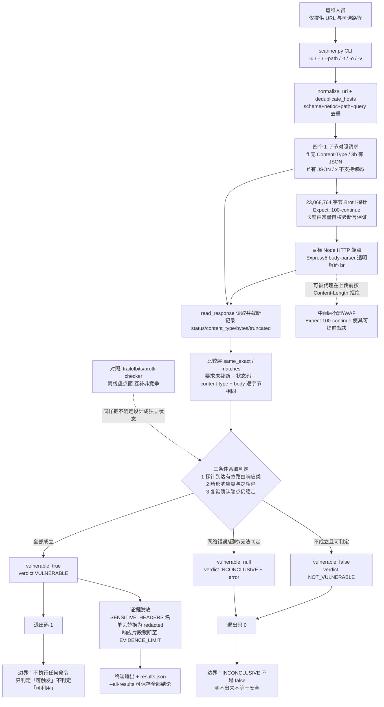

# assetnote/node2shell-scanner

## 一句话定位
针对 CVE-2026-111497（Node.js 内置 Brotli 解码器越界写）的**主动式**黑盒检测器——用四个 1 字节对照请求与一个 23,068,764 字节的 Brotli 探针对 HTTP 端点做探测，**只有当三条判定同时成立时才报告 vulnerable**，且**全程不执行任何命令**。

## 它解决的问题
Node 22.x / 24.x / 26.x 在安全版本之前内置的 Brotli 解码器存在越界写（CVE-2026-111497）。由于 Express 5 / body-parser 2.x 会对 `Content-Encoding: br` 的请求体透明解码，**这个漏洞的暴露面是「任何接受压缩请求体的 Node HTTP 应用」**——而绝大多数应用团队**不知道自己部署的运行时里还带着哪一份解码器副本**（可能是 Node 自带的、可能是容器里的、可能是静态链接的、可能是发行版 backport 的）。

**问题不在于「漏洞是什么」，而在于「我能不能在不重启、不改代码、不冒执行任意命令风险的前提下，判断我这台机器是否受影响」。**

这个项目给出的答案是一个**纯网络面**的黑盒检测器：它不需要服务器访问权限，只需要一个 URL。

## 为什么值得关注（2026-10-26）
**⭐ 因为它是本日 CVE-2026-111497 生态里唯一一个由安全厂商自己发布、且判定逻辑完全公开可核验的检测工具**——而生态里同期还有大量单 commit 的 PoC 仓库。

具体值得关注的四个可核验事实：

1. **⭐ 它的判定是三条件合取，而不是「探测成功 = 漏洞」**。README 原文：「A target is reported vulnerable only when **the full probe reaches the valid route-response class**, **the malformed-response class is distinct**, and **the final control confirms the endpoint remained stable**. This matches Assetnote's internal postmodule detection logic and **does not execute a command**.」——**三条断言各自对应一种不同的误判来源，而它逐条堵住。**
2. **⭐ 它的三态输出把「测不出来」与「测过了没问题」区分开**：`vulnerable` 取值为 `true` / `false` / `null`（后者对应 `verdict: INCONCLUSIVE` 并记录 `error`），退出码为 `raise SystemExit(1 if vulnerable_count else 0)`。
3. **⭐ 它把自己的网络影响写成可复算的数字**：每个被测端点收到 **5 个 1 字节请求 + 1 个 23,068,764 字节的探针**，并且**探针使用 `Expect: 100-continue`**——所以代理可以在 body 上传之前就按 `Content-Length` 拒绝它。
4. **⭐ 它的依赖只有两个**（`h11>=0.14.0`、`tqdm>=4.64.0`），Python 3.9+，提供 Dockerfile。

## 热度来源判断
**热度是真实需求驱动的，但 star 数不能当作质量信号。**

- **⭐ 真实需求的证据**：CVE-2026-111497 自 2026-10-21 起形成一个持续 5 天的仓库潮——`CVE-2026-111497 created:<date>` 逐日为 **10-21: 2 → 10-22: 9 → 10-23: 16 → 10-24: 12 → 10-25: 11**；`node2shell` 关键词为 0 → 0 → 10 → 12 → 4。**即这是一个真实发生的、正在扩散的安全事件，而不是一次蹭热度的集体创作。**
- **⭐ 但本项目自身只有 1 个 commit、contributors API 返回 1 人、`releases` API 返回 0 个、subscribers 仅 1**——**它是 Assetnote 内部检测逻辑的一次性提取产物（README 原文：「Built by the Assetnote Security Research Team using detection logic developed for [Searchlight's Exposure Platform]」），不是社区迭代出来的项目。**
- **⭐ 账号背景可核验**：`assetnote` 是 Organization，创建于 **2018-01-09T14:25:25Z**，40 个公开仓库，995 followers。**这是一个有八年历史的真实安全公司，而不是刷星农场。**
- **⭐⭐ 因此本日报的判断是：这是一个「厂商把内部能力开源出来」的一次性发布，热度反映的是 CVE 本身的关注度，而不是项目的采用度。** subs 1 与 oi 0 是这个判断的直接证据。**任何用 48⭐ 推断「很多人在用它的检测能力」的读法都是错的。**

## 关键技术亮点

1. **⭐⭐⭐ 三条件合取判定（核心设计）**
   - `the full probe reaches the valid route-response class` — 探针真的被解码并路由到了业务处理逻辑，而不是被中间层（代理、WAF、body 大小限制）直接吞掉。
   - `the malformed-response class is distinct` — 畸形 Brotli 的响应与有效 Brotli 的响应属于**不同的响应类**，从而排除「两者都返回同一个空 200」这种假阴性。
   - `the final control confirms the endpoint remained stable` — 探针之后重发有效对照，确认端点**没有被探针打崩**。这一条排除的是「崩溃导致的响应差异被误读成漏洞信号」。
   - **⭐ 这三条合起来，本质上是在说：「差异必须来自解码器的行为差异，而不是来自服务端状态的变化。」**

2. **⭐⭐⭐ 探针的构造是可核验的常量**
   - `PROBE_BYTES = 23_068_764`
   - `PROBE_REPETITIONS = (1 << 21) - 1`
   - `PROBE_PREFIX` / `PROBE_UNIT`（`f5a8473dea518f7ad4a31e`）/ `PROBE_SUFFIX` 三段拼接
   - **⭐ 代码里有一条自校验断言**：`len(PROBE_PREFIX) + len(PROBE_UNIT) * PROBE_REPETITIONS + len(PROBE_SUFFIX) == PROBE_BYTES`——即探针长度的正确性由代码本身保证，而不是靠注释。

3. **⭐⭐⭐ 四个对照请求是固定登记的**
   在 `request_evidence()` 中固定为：`ff (Content-Encoding: br; no Content-Type)` / `3b (Content-Encoding: br; Content-Type: application/json)` / `ff (Content-Encoding: br; Content-Type: application/json)` / `x (Content-Encoding: x; Content-Type: application/json)`。
   **⭐ 第四个对照（不支持的编码 `x`）是一个「负对照」**——它用来观察端点在无法解码时如何响应，从而区分「业务逻辑返回了不同内容」与「解码器根本不在路径上」。

4. **⭐⭐⭐ 响应比较要求「逐字节相同」**
   `same_exact()` 要求：双方 `error is None`、**均未截断**、状态码相同、content-type 相同、**body 逐字节相同**。另有仅比较状态码的 `status` 模式作为弱比较。
   **⭐ 「未截断」这一条是必要的**——否则一个被截断的响应会与另一个被截断的响应「逐字节相同」，产生假阴性。

5. **⭐⭐ 多路径语义：`scan_url()` 中任一路径命中即返回 vulnerable**
   代码逻辑为：遍历所有目标路径，**只要有一个路径判为 `vulnerable` 就立即返回 true**；否则回退到第一个「非 inconclusive」的结论。这个语义是正确的——漏洞的存在性是析取的。

6. **⭐⭐ 证据脱敏**
   `redact_header()` 对 `SENSITIVE_HEADERS` 名单内的头（Authorization / Cookie 等）替换为 `<redacted>`；`-o results.json` 保存的是**脱敏后**的请求/响应证据；`response_dump()` 只保留 `EVIDENCE_LIMIT` 长度的响应片段。

7. **⭐ 文档形态克制**
   仓库只有 6 个文件：`.gitignore`（41 B）、`Dockerfile`（353 B）、`LICENSE`（1,066 B）、`README.md`（2,546 B）、`requirements.txt`（25 B）、`scanner.py`（36,291 B）。**⭐ 没有任何 `docs/` 目录、没有任何测试目录、没有任何 CI workflow。** README 本身写得极准：它同时说明了「怎么用」「判定条件是什么」「会造成什么网络影响」「不做什么」。

## 架构师速览

| 决策问题 | 研究判断 | 证据边界 |
|---|---|---|
| 系统边界 | 单一网络面工具，边界划在「**是否执行命令**」：README 明写 `does not execute a command`，因此它停在「可触发」而不进入「可利用」。内部结构为六段：`normalize_url()` 归一化目标 → `request_headers()` 构造四个对照与探针的 HTTP 头（含 `Expect: 100-continue`）→ `upload_body()` 分块流式上传 23 MB 探针（`probe_chunks()` 按 `UPLOAD_CHUNK_SIZE` 切块）→ `read_response()` 读取并截断响应 → `same_exact()` / `matches()` 做比较 → `scan_url()` 汇总成三态结论。**控制面（判定逻辑）与数据面（23 MB 字节流）被清晰分开** | `scanner.py` 1,163 行的函数清单与常量定义（`PROBE_BYTES`/`PROBE_REPETITIONS`/`PROBE_UNIT`/`UPLOAD_CHUNK_SIZE`/`EVIDENCE_LIMIT`/`SENSITIVE_HEADERS`）、`request_evidence()` 中固定的四个 controls、README 的 How It Works / Network Impact 两节。**⭐ `exchange_post()` 的 HTTP 状态机与 `upload_body()` 的背压处理本窗口未逐行核验，待核验** |
| 主路径 | 用户运行 `python3 scanner.py -u https://example.com/api`（或 `-l hosts.txt` 批量、`-t 20` 并发、`--path` / `--path-file` 指定多条路径）→ 对每个 host 做 `deduplicate_hosts()`（按 scheme + netloc + path + query 去重）→ 对每条路径跑 4 对照 + 1 探针 + 1 复验 → 收集 `response_metadata()`（`status_code` / `content_type` / `response_bytes` / `response_truncated` / `bytes_sent` / `error`）→ 判定 → 打印 → `-o results.json` 保存脱敏证据（`--all-results` 可保存全部结论而非仅 vulnerable）→ 退出码 1（有漏洞）或 0（无漏洞）。**⭐ 判定路径上「网络错误」与「端点正常」被分开：前者得到 `vulnerable: null` / `INCONCLUSIVE` 并记 `error`，后者得到 `false`** | README 的 Usage / Options / Output 三节与 Dockerfile（`docker run --rm node2shell-scanner -u https://example.com/api`）、`requirements.txt`（`h11>=0.14.0`、`tqdm>=4.64.0`）、`scanner.py` 的 `main()` 与 `scan_url()` 分支。**⭐ 多线程下的误报率与端点稳定性假设本窗口未核验** |
| 关键权衡 | **主动探测 vs 离线盘点**（前者能证明「攻击者的输入能到达解码器」，但要发 23 MB 且可能被代理拦截；后者零副作用，但只覆盖「部署里有什么」）· **⭐ 三条件合取 vs 单条件命中**（三条断言显著降低误报，**代价是每个目标要 6 次往返**，其中一次是 23 MB）· **⭐「不执行命令」vs「给出可利用性结论」**（明确放弃 RCE 验证——**这是负责任的边界，也是它与 PoC 仓库最本质的区别**）· **⭐ `Expect: 100-continue` vs 直接上传**（前者让代理可在上传前拒绝，**代价是在拒绝代理下会得到 inconclusive 而非 false**）· **「逐字节相同」vs「状态码相同」**（前者更严格，**但对响应体本身随请求变化的端点会一直判 inconclusive**）· **多路径析取 vs 首命中即返回**（任一路径命中即 true，**避免漏报**）· **证据脱敏 vs 证据完整**（敏感头替换为 `<redacted>`，**代价是证据不可直接复用做二次分析**）· **⭐ 「vulnerable: null」vs 二元输出**（把测不出来单列，**代价是调用方必须处理第三种状态**——而这正是它的价值所在） | README 全文、`scanner.py` 的常量与函数实现、退出码语句 `raise SystemExit(1 if vulnerable_count else 0)`。**未明示：是否与 Assetnote 商业产品（Searchlight Exposure Platform）共享指纹库、误报率的公开统计** |
| 最小 PoC | 1. **⭐ 先准备对照环境**：找一台**自己的**、已知未打补丁的 Node 服务（22.23.4 / 24.22.1 / 26.12.1 之前），**绝不用生产站点试**——本工具会发 23 MB 请求 → 2. `pip install -r requirements.txt`（两个依赖）→ 3. `python3 scanner.py -u http://127.0.0.1:PORT/` → 4. **⭐ 加 `-v` 阅读 verdict reason，逐条确认三条件真的都被满足**（而非仅看到一个 `true`）→ 5. **⭐⭐ 关键步骤：对一个已打补丁的 Node（≥22.23.4 / ≥24.22.1 / ≥26.12.1）跑同一命令，确认返回 `Not vulnerable`**——**这一步是唯一能证伪其比较器真的有区分力的步骤** → 6. **⭐ 对一个被代理拦截的环境跑一遍，确认它给出的是 `INCONCLUSIVE` 而非错误的 `false`**（这正是 README 自述的网络影响边界）→ 7. 对一个明确不是 Node 的端点（如 nginx 静态站）跑一遍，确认 `Not vulnerable` → 8. 用 `--path /a /b` 测多路径，确认任一命中即返回 → 9. `-o results.json` 并检查敏感头是否已被替换为 `<redacted>` | **第 5 步是本 PoC 的核心**（一个只会返回 true 的比较器不构成证据，与 10-25 记录的 oss-verify `oft check` 在 `Print Assumptions` 阶段拒绝越界公理同构）· **第 6 步是它自述边界最容易被误用为「无漏洞」的地方** · **第 4 步是唯一能验证「三条件」而非「布尔值」的步骤** · 本 PoC **不覆盖**任何真实公网目标的扫描、**不覆盖** RCE 可利用性验证（工具明确不做）、**不覆盖** 24 MB 探针对慢速链路的表现 |

## 架构启发

**⭐ 核心启发：「差异必须可归因」是黑盒检测的基本纪律。**

大多数黑盒漏洞扫描器的判定是「我发的东西触发了异常响应 → 判为 vulnerable」。这个项目的判定严格得多：**差异必须来自解码器行为本身的差异，而不是来自服务端状态的漂移**。为此它付出了三重代价：多一次对照（区分「无效输入 vs 不支持的编码」）、多一次复验（排除「端点崩了」）、以及逐字节的比较（排除「两边都被截断」）。

**⭐ 第二个启发：「不执行命令」是一个可以被明确声明的边界，而声明它反而增强了可信度。** 一个报告「可触发但不证明可利用」的工具，比一个报告「可以 RCE」但无法核验的工具更可信——**因为前者的结论可以被独立重放，后者的结论只能被信任。**

**⭐ 第三个启发：把「测不出来」设计成一等输出，而不是异常。** `vulnerable: null` + `verdict: INCONCLUSIVE` + `error` 原因 + 退出码 0（无漏洞时）——**这三条合起来意味着：CI 里「扫描器没报错」不会被误读成「扫描器说安全」。**

**⭐⭐ 第四个启发（本日报认为是最可迁移的一条）：把副作用的量级写进产品文档，而不是留给使用者去估算。** 「Each tested endpoint receives five one-byte requests and one 23,068,764-byte probe」+「The probe uses `Expect: 100-continue`, so a proxy can reject its advertised size before the body is uploaded」——**这不是免责声明，而是把决策权交还给部署方的网络层。** 一个好的安全工具必须能回答「用我的代价是什么」。

**⭐⭐⭐ 架构对比：** 本项目与 `trailofbits/brotli-checker` 是**互补**关系，不是竞争关系——一个在网络面、一个在文件面。**⭐ 两者加起来仍然回答不了「这台机器现在安不安全」**（前者能证明可达但不能证明可利用，后者能证明存在但不能证明可达），**但两者都把这个缺口写进了自己的输出状态**。**这正是本日趋势 1 的核心形状。**

## 架构图（MMD）

> 证据边界：此图只采用本档案已有可核验描述；「待核验」节点不应视为项目实现事实。

## 定位判断
**安全检测工具（Detection-only），不是扫描平台，也不是 PoC。**

在 CVE-2026-111497 的生态里，它占据一个特定且重要的位置：**它是「厂商级、可核验、不执行代码」这一侧的代表**。生态里的另一侧是大量单 commit 的 PoC 仓库——那些仓库演示的是「怎么触发」，而它回答的是「**怎么在不触发的前提下判断我是否受影响**」。

**⭐ 它的下游关系是可核验的**：README 明写它的检测逻辑来自 Assetnote 的商业产品 Searchlight Exposure Platform。**⭐ 即它是一个商业攻击面管理平台的能力开源——这类项目的典型生命周期是「发布 → 被社区采纳或忽略 → 随 CVE 退潮而沉寂」。**

**⭐ 从架构位置看，它处在「资产清单」与「主动攻击」之间的窄缝**：它的输入只需要 URL（极低门槛），输出是一份可归档的 JSON 证据（可进工单）。**这个组合使它适合作为 CI 步骤或定期巡检任务。**

## 风险 / 局限 / 泡沫点

- **⚠️⚠️ 23 MB 的探针是一个真实的服务端压力点。** 每个目标接收 5 个 1 字节请求 + 1 个 23,068,764 字节请求。**⭐ README 主动给出了缓解手段（`Expect: 100-continue`），但这依赖代理正确实现该机制。** 在没有代理的场景下，**这 23 MB 会真实打到目标服务上**——对一个低配或被限流的实例，这本身就是一次压力事件。**任何把本工具指向第三方生产系统而不事先取得授权的行为，都是滥用。**
- **⚠️⚠️ 判定依赖「响应类相异」，而响应类在真实应用里不稳定。** 若端点对畸形输入返回与有效输入相同的响应（例如统一的错误 JSON、或经过 WAF 统一改写），工具会持续给出 `INCONCLUSIVE`。**⭐ 这不是 bug，而是它诚实边界的一部分——但对使用者而言，这意味着工具可能长期给不出结论。**
- **⚠️⚠️ 「不执行命令」意味着它无法确认可利用性。** 它证明「解码器可被触发到异常路径」，**不证明「可以 RCE」**。**在合规与授权场景下这是优点，在需要 PoC 证据的场景下这是限制。**
- **⚠️ 判定为 `false` 不等于「已打补丁」。** 它只能说明「本次探测未观察到漏洞特征」——**目标可能用了不同的编码路径、不同的 body 大小上限、或不同的错误处理，从而绕开了探针**。工具本身用三态输出表达了这一点，但**退出码 0 在 CI 里极易被读成「安全」。**
- **⚠️ 单一 commit、零 release、零 issue。** 没有版本、没有变更记录、没有公开的误报率数据。**⭐ 一个由厂商内部逻辑一次性提取的工具，其与内部生产版本的差距本日报无法核验。**
- **⚠️ 只覆盖 HTTP 端点。** 不覆盖 WebSocket、不覆盖 gRPC、不覆盖自研协议、不覆盖内部 RPC。**一个只用 gRPC 的 Node 服务无法用它评估。**
- **⚠️ CVE 本身有生命周期。** 一旦所有主流运行时都升级到含修复的版本，本工具的存在意义会迅速下降——**它的价值窗口与 CVE 的修补速度直接绑定。**

## 与同类项目的关系

- **⭐ vs `trailofbits/brotli-checker`（本日同期另一位 key_project）**：**互补，最清晰的对照**。scanner 走**网络面**（URL → 主动探测 → 可触发性），brotli-checker 走**文件面**（本地目录 → 资产盘点 → 存在性）。**⭐ 两者都把「不确定」做成独立输出状态**（scanner 的 `INCONCLUSIVE`、brotli-checker 的 exit 3），**但两者的能力边界完全相反**：scanner 无法证明「副本存在」，brotli-checker 无法证明「输入可达」。
- **⭐ vs `Rabbitbong/node2shell`（81⭐，PoC lab）**：后者是**演示**——它构造一个「 Orbital 批量导入端点」的靶场并展示 16 字节 OOB 写如何变成 RCE。**scanner 是判定**。**⭐ 二者用途正交：PoC 用来理解漏洞，scanner 用来回答「我的机器有没有它」。**
- **⭐ vs `trailofbits/trailmark`**：不是竞品而是**上游依赖**——brotli-checker 明确把 Trailmark 作为「把调用映射到解码器与 fetch API」的补充工具，用于缩小人工检查范围。**⭐ 即 Trailmark 回答「代码怎么连的」，brotli-checker 回答「哪些文件有风险」，scanner 回答「线上是否可触发」。**
- **vs 同生态的单 commit PoC 仓库**（如 `dimasma0305/CVE-2026-111497-POC` 43⭐ ⑂14、`ZeroHackOrg/node2shell-poc`、`tani2shell/node2shell-lab` 等）：**⭐ 那些仓库提供的是「能打进去」的证据，本项目提供的是「不打也能判断」的证据。** 前者的 star 数更高（81 vs 47），**但两者回答的不是同一个问题**。

## 是否值得持续跟踪
**值得跟踪，但跟踪重点应放在「生命周期」而非「功能演进」。**

- **⭐ 理由一：它代表了一种值得被抄的判定纪律。** 三条件合取 + 三态输出 + 把网络影响量化，这三条在本日报本日记录的多个工具里都出现了，值得作为团队检测工具的设计基准。
- **⭐ 理由二：生态对比价值高。** 它与 brotli-checker 的「网络面 vs 文件面」对照是本日报趋势 1 的骨架，**后续若社区出现第三种路线（如基于 eBPF 或运行时插桩的检测），三者对照会是本日这条趋势最好的后续验证。**
- **⚠️ 不宜作为长期依赖。** 单 commit、零 release、零 issue、无公开误报率。**在本日报的采用建议里，它的正确用法是「CVE 期间的临时巡检工具」，而不是「常驻的安全基线检查」。**
- **⭐ 若要长期跟踪 CVE-2026-111497 的暴露面，比长期跟踪本项目更值得跟踪的是 brotli-checker**——因为它的快照机制（`verified_on` + `review_date` + `LICENSES.json` 式结构化）具备可持续更新的形态。

## 后续观察点

1. **⭐⭐ 是否会发布第二个 commit / 首个 release**（当前 1 commit / 0 release）——**这是判断「一次性提取」还是「持续维护」的最直接指标。**
2. **⭐⭐ 误报率的公开数据**：在真实 CDN / WAF / API 网关后面的目标上，`INCONCLUSIVE` 的比例是多少？**这决定了它在企业环境里的可用性。**
3. **⭐⭐ 是否会被上游 `google/brotli` 或 `nodejs/node` 官方采纳为检测建议**（即出现在官方 advisory 的 mitigation 段落里）——**⭐ 这是本项目能否超越「一次性提取」命运的关键。**
4. **⭐ 是否会出现第三个检测面**（例如运行时插桩 / eBPF / 供应链 SBOM 侧的解码器副本枚举）——**若出现，本日趋势 1 的「两极」结构将变成「三极」，需要重新评估。**
5. **⭐ 生态里 39 个 `in:description` 命中 CVE 的仓库中，有多少会在 CVE 退潮后被归档**——**这决定了 12 个月后本日报这一节应该被删除还是重写。**

---
> 数据来源: GitHub API (2026-10-25T22:55:09Z 快照) | Stars: 48 | Forks: 6 | Subscribers: 1 | Open Issues: 0 | License: MIT | 语言: Python | 创建: 2026-10-25T04:23:54Z | pushed: 2026-10-25T04:24:27Z | 1 commit | contributors 1 人 | releases 0 个 | topics 0 | 11 KB
> 附: 组织 `assetnote` 创建于 2018-01-09T14:25:25Z，40 个公开仓库，995 followers；README 声明检测逻辑源自 Searchlight's Exposure Platform；上游修复 `google/brotli@0ed4268a4401abcb4472096340477cf4af7d1a2b`（作者日期 2026-02-27T13:10:32Z），安全版本 v1.0.10 / v1.1.1 / v1.2.1 均发布于 2026-10-21T19:26–19:27Z
> 证据边界: `scanner.py` 的 `exchange_post()` 状态机与 `upload_body()` 背压处理未逐行核验；多线程误报率未知；代理环境中的实际成功率未核验；与 Searchlight 内部版本的一致性未核验
