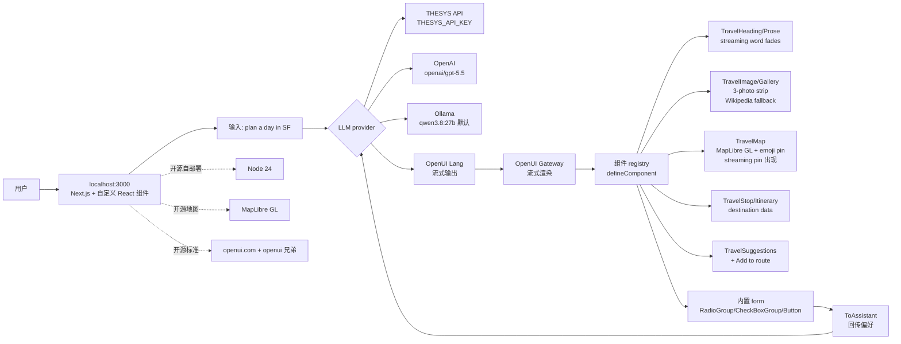

# thesysdev/open-intelligent-ui

## 一句话定位
Open Intelligent UI 是「ChatGPT Intelligent UI 体验的开源复刻」——基于 thesysdev/openui 开源标准，用 OpenUI Lang + OpenUI Gateway + 自定义组件 + MapLibre GL 地图，重现 ChatGPT「plan a day in San Francisco」返回可交互地图/照片/可编辑行程的体验。

## 它解决的问题
ChatGPT 的 Intelligent UI（plan a day in San Francisco 返回地图+照片+可编辑行程）是 OpenAI 私货：
- **不可移植：** 只能在 ChatGPT 网页/App 上体验，不能嵌入自己的应用
- **不可定制：** 不能改组件、改交互、改模型
- **闭源：** OpenAI 没开源这些 component / streaming Lang 规范

Open Intelligent UI 的解决思路是「**OpenUI 开源标准 + 自定义组件 + 多种 LLM provider + 本地运行**」：
- **OpenUI 开源标准：** thesysdev/openui 提供「Generative UI」的开放规范
- **OpenUI Gateway 流式 Lang：** 模型流式输出 OpenUI Lang，Gateway 渲染为组件
- **自定义组件 via defineComponent：** 用户可定义自己的 UI 组件（演示是 TravelHeading/Prose/Image/Gallery/Stop/Map/Suggestions）
- **MapLibre GL 地图 + Wikipedia fallback：** 用开源地图（不用 Google Maps）+ Wikipedia fallback image（不用专有图库）
- **多 provider：** THESYS_API_KEY（默认）/ OpenAI / Ollama（本地 qwen3.8:27b）

## 为什么值得关注（2026-10-11）
- **Stars:** 293（截至 2026-10-11），4 天累计
- **Forks:** 20，fork/star 6.8%（正常 fork 比例）
- **License:** NOASSERTION（许可证需独立确认）
- **Language:** TypeScript
- **Size:** 19645 KB（较大——含 Node 24 + OpenUI Lang + 自定义组件库）
- **创新点:** 把 ChatGPT Intelligent UI 用 OpenUI 开源标准 + OpenUI Gateway + MapLibre GL + Wikipedia fallback + 多 LLM provider 复刻
- **定位：** Generative UI 开源标准 + ChatGPT Intelligent UI 开源复刻方向

## 热度来源判断
thesysdev/open-intelligent-ui 的热度是「**ChatGPT Intelligent UI 开源复刻 + OpenUI 开源标准 + 自定义组件 + 本地 LLM**」的组合。Generative UI（LLM 输出 UI 而非文本）是 2025-2026 年 AI 应用的最热方向之一——ChatGPT Intelligent UI、Vercel v0、Anthropic Artifacts、OpenAI Canvas 都是这条赛道。Open Intelligent UI 把 ChatGPT Intelligent UI 用开源标准复刻——这与 Vercel v0、Anthropic Artifacts、OpenAI Canvas 形成镜像：**开源 vs 闭源、可移植 vs 锁定、可定制 vs 不可定制**。20 个 fork 反映社区严肃参与——很可能是前端 / LLM 应用开发者。热度**真实且具定位意义**——但需警惕：OpenUI 标准成熟度未观察（早期）+ thesysdev API key 仍必需（除非 Ollama）+ NOASSERTION 许可证（闭源二次分发限制不明）+ ChatGPT Intelligent UI 本身是 OpenAI 私货（OpenAI 是否会反击或封锁）+ Node 24 依赖（不是 LTS）。

## 关键技术亮点
1. **OpenUI 开源标准：** thesysdev/openui 提供「Generative UI」的开放规范（不是闭源协议）
2. **OpenUI Gateway 流式 Lang：** 模型流式输出 OpenUI Lang，Gateway 实时渲染为组件
3. **自定义组件 via defineComponent：** 用户可定义自己的 UI 组件（演示是 7 个 Travel* 组件）
4. **MapLibre GL 地图：** 开源地图（不用 Google Maps / Mapbox）
5. **emoji pin + streaming pin 出现 + 路线绘制：** 流式输出过程中 pin 出现，结束时画路线
6. **Wikipedia fallback image：** 不依赖专有图库（用 Wikipedia 作为图片后备）
7. **内置 form 回传 ToAssistant：** 用户偏好（如"Customize your route"）回传到对话上下文
8. **Ollama 兼容（qwen3.8:27b 默认）：** 本地运行不需 API key
9. **多 provider：** THESYS_API_KEY / OpenAI / Ollama 切换
10. **Node 24 依赖：** 现代 Node
11. **openui.com 官网：** 标准官网背书
12. **thesysdev/openui 兄弟仓库：** 协议本体

## 架构师速览

| 决策问题 | 研究判断 | 证据边界 |
|---|---|---|
| 系统边界 | 基于 OpenUI 标准的 Generative UI 应用，前端（Next.js + 自定义 React 组件）+ 后端（OpenUI Gateway）+ 多 LLM provider（THESYS / OpenAI / Ollama）+ MapLibre GL 地图 | 仅基于 README 列出的 OpenUI / OpenUI Gateway / defineComponent / MapLibre GL / Ollama；具体 OpenUI Lang schema、组件 registry 协议、Gateway 实现未在档案中给出 |
| 主路径 | 模型流式输出 OpenUI Lang → OpenUI Gateway 渲染为组件 → React 应用渲染 → 用户交互（form / pin / map）→ ToAssistant 回传到模型 → 持续对话 | 主路径来自 README 描述；具体 streaming chunk 协议、组件 hydration、Wikipedia fallback 触发条件均待核验 |
| 关键权衡 | 开源标准（OpenUI）vs 闭源协议（OpenAI Canvas / Anthropic Artifacts）+ 开源地图（MapLibre）vs 闭源地图（Google Maps）+ Wikipedia fallback（免费）vs 专有图库（稳定）+ Ollama 兼容（本地）vs 闭源 API（更准）+ defineComponent（可定制）vs 固定组件（不可改） | 档案明示开源/可定制/多 provider/Ollama 四点；具体 OpenUI 标准 vs OpenAI Canvas 兼容性、组件嵌套深度限制未证实 |
| 最小 PoC | Node 24 + Ollama 已装 + qwen3.8:27b 拉模型 → git clone + npm install + npm run dev → 访问 localhost:3000 → 输入"plan a day in San Francisco" → 看 streaming 出地图 + pin + itinerary → Customize your route form 改偏好 → 看结果更新 | PoC 范围由 README "San Francisco plan" demo 反推；具体 Ollama 推理速度、qwen3.8:27b 推理质量 vs THESYS API、组件响应延迟待核验 |

## 架构启发
thesysdev/open-intelligent-ui 的核心启发是 **「Generative UI 的下一阶段不在于'谁先做出体验'，而在于'谁先做出开源标准 + 可移植 + 可定制'」**。当前 Generative UI 赛道是 ChatGPT Intelligent UI、Vercel v0、Anthropic Artifacts、OpenAI Canvas 四分天下——都是闭源、锁定、不可移植。Open Intelligent UI 用 OpenUI 开源标准 + 自定义组件 + 多 LLM provider + 本地运行复刻了 ChatGPT Intelligent UI 的核心体验。这与 OpenAI Canvas / Anthropic Artifacts 形成镜像：**开源 vs 闭源、可移植 vs 锁定、可定制 vs 不可改、本地可跑 vs 必走 API**。更深层的启发是：**「Generative UI 标准 + 地图 / 图库开源替代 + 本地 LLM」三件套是 Generative UI 民主化的关键**——它把 Generative UI 从「OpenAI 私货」推向「任何 LLM + 任何 UI 组件 + 任何部署」。

## 架构图（MMD）

> 证据边界：此图只采用本档案已有可核验描述；"待核验"节点不应视为项目实现事实。

## 定位判断
**工具型项目（Generative UI 开源标准 + ChatGPT Intelligent UI 开源复刻）。** thesysdev/open-intelligent-ui 不只是工具，更是「**Generative UI 开源标准 + 可移植 + 可定制 + 本地可跑**」方向的开源代表。它把 ChatGPT Intelligent UI 用 OpenUI 开源标准 + 自定义组件 + MapLibre GL + Wikipedia fallback + 多 LLM provider 复刻——这与 OpenAI Canvas / Anthropic Artifacts / Vercel v0 形成镜像。其潜在演进路径：(1) 成为「Generative UI」的事实标准（类似 OpenAPI 之于 REST API 描述）；(2) 衍生出更多组件库（如电商 / 教育 / 金融场景）；(3) 与 LangChain / LlamaIndex 整合；(4) 被 IDE 厂商（Cursor / VS Code）集成。当前定位：「**Generative UI 开源标准 + ChatGPT Intelligent UI 开源复刻**」的开源先驱。

## 风险 / 局限 / 泡沫点
- **OpenUI 标准成熟度未观察：** 早期阶段；vs OpenAI Canvas / Anthropic Artifacts 兼容性未验证
- **THESYS API key 仍必需：** 除非用 Ollama（默认 qwen3.8:27b）
- **NOASSERTION 许可证：** 闭源二次分发限制不明（需独立审查）
- **ChatGPT Intelligent UI 是 OpenAI 私货：** OpenAI 是否会反击或封锁未观察
- **Node 24 依赖：** 不是 LTS（稳定版未到）
- **演示组件深度有限：** 仅 Travel* 7 个组件（电商 / 教育 / 金融等场景需自建）
- **Ollama 推理速度未观察：** 本地 qwen3.8:27b 推理速度 vs THESYS API
- **Wikipedia fallback 稳定性：** Wikipedia API 限流 / 内容缺失可能影响图片质量
- **OpenUI Gateway 实现细节未明：** 自部署 OpenUI Gateway 的能力未明

## 与同类项目的关系
- **vs ChatGPT Intelligent UI：** 那个是 OpenAI 私货；Open Intelligent UI 是开源
- **vs Vercel v0：** v0 是闭源 SaaS + React 组件生成；Open Intelligent UI 是开源 OpenUI 标准
- **vs Anthropic Artifacts：** Artifacts 是 Claude 内的 UI 渲染；Open Intelligent UI 是独立应用
- **vs OpenAI Canvas：** Canvas 是 ChatGPT 内的协作画布；Open Intelligent UI 是开源复刻
- **vs LangChain / LlamaIndex：** 那些是 LLM 框架；Open Intelligent UI 是 Generative UI 应用
- **vs Open WebUI：** Open WebUI 是通用 LLM Web UI；Open Intelligent UI 是 Generative UI 应用

## 是否值得持续跟踪
**值得跟踪（Generative UI 开源标准 + ChatGPT Intelligent UI 开源复刻）。** thesysdev/open-intelligent-ui 代表了「**Generative UI 开源标准 + 可移植 + 可定制 + 本地可跑**」方向——无论其本身成败，这一方向与 ChatGPT Intelligent UI / Vercel v0 / Anthropic Artifacts / OpenAI Canvas 形成镜像。建议关注：OpenUI 标准成熟度、组件库扩展（电商 / 教育 / 金融）、与 LangChain / LlamaIndex 整合、IDEA 厂商采用。对前端 / LLM 应用开发者，这是「Generative UI」的开源起点；对 Generative UI 观察者，这是「开源 vs 闭源」范式的标杆样本。

## 后续观察点
- OpenUI 标准的成熟度（与 OpenAI Canvas / Anthropic Artifacts 的兼容性）
- 组件库扩展（电商 / 教育 / 金融 / 医疗场景）
- 与 LangChain / LlamaIndex / Vercel AI SDK 的整合
- Ollama / vLLM / 本地推理性能优化
- Wikipedia fallback 稳定性 + 其他开源图库整合（OpenStreetMap / Wikimedia）
- thesysdev 团队的治理可持续性 + 开源生态
- 是否有 IDE（Cursor / VS Code / JetBrains）集成

---
> 数据来源: GitHub Search API + Repository API (2026-10-11) + README 公开摘录 | Stars: 293 | Forks: 20 | License: NOASSERTION | 语言: TypeScript | 创建: 2026-10-07
