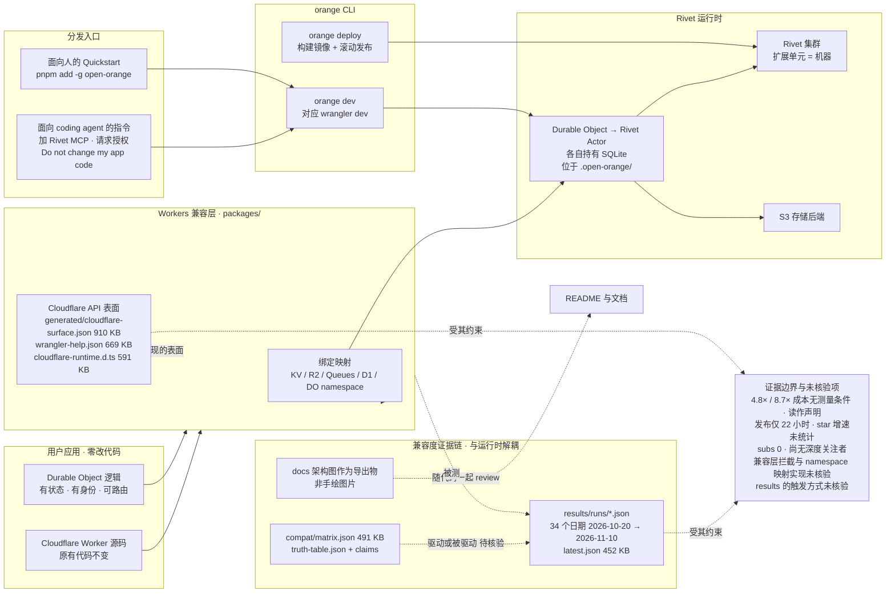

# rivet-dev/open-orange

## 一句话定位
**把 Cloudflare Workers 与 Durable Objects 原样搬到 AWS / Google Cloud / Azure / 自有服务器**的开源实现 —— 代码零改动、`wrangler dev` 变成 `orange dev`，而它最值得抄的地方是**把「兼容度」做成了一份份可逐日 diff 的结构化结果**。

## 它解决的问题
⭐⭐⭐⭐⭐ **Cloudflare Workers 与 Durable Objects 的锁定成本，是「你的应用逻辑跑在别人的专有运行时上」。** ⭐⭐⭐⭐⭐ 迁移的难点从来不是「把代码搬到另一台机器」，而是三件具体的事：

1. **运行时语义要对得上** —— Durable Objects 是有状态的、有身份隔离的、可以按请求路由到特定实例的；一般的「容器化」方案给不了这个语义；
2. **绑定（bindings）要对得上** —— KV、R2、Queues、D1、Durable Object 的 namespace 引用方式各不相同；
3. **迁移过程不能停机** —— 数据要从 Cloudflare 搬走，而应用还在服务。

⭐⭐⭐⭐⭐ **OpenOrange 的回答是：不去模拟 Cloudflare，而是真的把 Workers 跑在别的机器上，同时把 Cloudflare 的 API 表面做成兼容层。**

⭐⭐⭐⭐⭐ **而它最实际的解决点是「不让你改代码」**：README 写明「your Workers and Durable Objects run as they are, and your data moves off Cloudflare while your app keeps serving」，⭐⭐⭐⭐⭐ 并且给出具体的执行形态：`orange dev` 起本地 Worker，**每个 Durable Object 跑成一个 Rivet Actor，带自己的 SQLite 数据库，存放在 `.open-orange/`**；`orange deploy` 把你的 Worker 构建成镜像并滚动发布到 Rivet 集群。

⭐⭐⭐⭐⭐ **第三个它解决的问题是「谁在收费」：** README 的第三条卖点是「**Simpler bills: you pay for the machines you run on, not Cloudflare's metering or an enterprise contract**」。

## 为什么值得关注（2026-11-13）
⭐⭐⭐⭐⭐ **因为它把一条不可验证的总体声明，降解成了一组可回归的结构化结果 —— 而这是本日工程密度最高的一处。**

⭐⭐⭐⭐⭐ **它的核心资产不是代码，而是 `packages/cloudflare-conformance/` 这个包：**

| 资产 | 体积 | 作用 |
|---|---:|---|
| `generated/cloudflare-surface.json` | 910 KB | Cloudflare API 表面的生成物快照 |
| `generated/wrangler-help.json` | 669 KB | wrangler CLI 行为的快照 |
| `generated/cloudflare-runtime.d.ts` | 591 KB | 运行时类型定义 |
| `compat/matrix.json` | 491 KB | 兼容矩阵 |
| `compat/truth-table.json` / `truth-table.claims.json` | — | 真值表与逐条断言 |
| `results/runs/*.json` | **34 个日期** | 每次运行的结果（`latest.json` 452 KB） |

⭐⭐⭐⭐⭐ **`results/runs/` 下有 34 个日期的文件，从 2026-10-20 到 2026-11-10** —— ⭐⭐⭐⭐⭐ **这意味着「我们兼容 Cloudflare」不再是 README 里的一句话，而是「每一个接口、每一个日期」的逐条结果。** ⭐⭐⭐⭐⭐ **⭐⭐ 而这个形态对本日报连日记录的那些「宣称 100% 对齐」的项目有直接的参照价值 —— 11-12 记录的 `impacket-rs` 写「74/74 上游对齐」，10-26 记录的 `raven` 写「100% 与上游 TCC 行为一致」，两者都没有把「对齐」拆成逐项可 diff 的结果。**

⭐⭐⭐⭐⭐ **第二个值得记的是它的分发路径。** README 的第一节（**「Use a coding agent」**）直接给出一段可粘贴给 Claude Code / Codex / Cursor 的指令：

> First, add the Rivet MCP (https://mcp.rivet.dev/mcp) to this agent, and ask me to approve the Rivet sign-in. Then run this project's Cloudflare Worker on Rivet with OpenOrange… **Do not change my app code.**

⭐⭐⭐⭐⭐ **「Do not change my app code」这句约束，与它 README 的第一个卖点「Zero refactoring」是同一条承诺的两面** —— 一条给 agent 读，一条给人读，指向同一件事。⭐⭐⭐⭐⭐ **⭐⭐ 本日报认为这是本项目在架构上最值得抄的一处：把「不变式」写成对自动化消费者同样有效的约束，而不只是写给人看。**

⭐⭐⭐⭐⭐ **第三个值得记的是它的 GitHub 工作流。** 它的 README 里嵌了一段「migration animation」的 GIF，并且有 commit `docs: export the architecture diagram for the README`、`docs: export the architecture diagram` —— ⭐⭐⭐⭐⭐ **即它把架构图作为导出物而不是手绘图片维护**，这让文档与代码的漂移可以被发现。

## 热度来源判断
⭐⭐⭐⭐⭐ **热度来源是「真实的替代方案需求」+「发布首日的组织账号曝光」，但本日报必须把证据边界写清楚。**

1. **⭐⭐⭐⭐⭐ 需求是真实的：** Cloudflare Workers 的锁定成本是一个被反复讨论的问题，而「不改代码就能搬走」是一个足够强的承诺。
2. **⭐⭐⭐⭐⭐ 账号质量高：** `rivet-dev` 是 **Organization**，创建于 **2019-11-13**，109 个公开仓库、**666 followers** —— ⭐⭐⭐⭐ **这与本数据集记录的绝大多数投放体（账号当天新建 / 4 分钟窗口内批量注册 / 0 followers）形成鲜明对比。**
3. **⭐⭐⭐⭐⭐ 仓库形态是工程形态：** 1,522 blobs、82 commits、2 个真实贡献者（`NathanFlurry` 72 次、`eersnington` 10 次）、**2 个 release（v1.0.0、v1.0.1，发布于同一天）**、Apache-2.0、10 个 topics、commit 标题带 PR 号（`#14`、`#15`）。
4. **⭐⭐⭐⭐⭐ 但发布仅 22 小时，本日报未做 star 增速统计**（需分页遍历 stargazer 列表），⭐⭐⭐⭐⭐ **⭐⭐ 而 7 个 release 同日发布 / 2 个 release 同日发布这种「一次性交付」形态，本日报在 10-26 记录 `mizorewww/gdirect` 时已标为「一次性交付而非长期迭代」的观察项。**
5. **⭐⭐⭐⭐ **⚠️ `subscribers_count = 0` 而 `stargazers_count = 188`** —— ⭐⭐⭐⭐ **这与本日 `AIRzZ90/study-materials-fork` 的 318⭐ / 3 subs 形成对照。** ⭐⭐⭐⭐ **⭐⭐ 本日报的立场：这是「发布首日、关注度还没沉淀」的正常形态，不构成负面信号，但也不能读作「有深度关注者」—— 11-08 的教训是 subs 低的项目需要用其他证据交叉验证，而本项目恰好有那些证据（组织账号、真实代码、真实 release、逐日 conformance 结果）。**
6. **⭐⭐⭐ **⚠️ 一处未核验：README 的「Compute is 4.8× cheaper and storage 8.7× cheaper」没有任何测量条件** —— 无机型、无工作负载、无对比基线、无统计区间。⭐⭐⭐ **本日报把这组数字读作「声明」而非「证据」，并按 11-12 记录 `impacket-rs` 时的同一标准标注为待核验。**

⭐⭐⭐⭐ **结论：一个由有历史组织账号发布、工程密度高、但发布不足一天、且关键成本数字未标注测量条件的真实项目。**

## 关键技术亮点
1. **⭐⭐⭐⭐⭐ 逐日 conformance 结果：** `packages/cloudflare-conformance/results/runs/` 下 **34 个日期**的 JSON（2026-10-20 → 2026-11-10）。⭐⭐⭐⭐⭐ **⭐⭐ 这是本项目最值得抄的一条 —— 它把「兼容度」从一句不可验证的声明，变成了一组可以逐条 diff、可以回归、可以看趋势的结构化结果。** ⭐⭐⭐⭐⭐ **⭐⭐ 本日报认为这一条值得任何做「兼容 / 替代 / 迁移」定位的项目照抄：把断言拆成逐项、逐日的结果，所需的是一个 CI job，而不是一次人工调研。**
2. **⭐⭐⭐⭐⭐ Durable Object → Rivet Actor + SQLite 的映射：** README 明写「Each Durable Object runs as a Rivet Actor with its own SQLite database, kept in `.open-orange/`」。⭐⭐⭐⭐⭐ **这是「有状态对象」语义在另一种运行时上的完整映射 —— 不是把 DO 当普通函数，而是保留它的「有身份、可路由、有独立存储」三个性质。**
3. **⭐⭐⭐⭐⭐ 零改代码承诺的具体化：** `wrangler dev` → `orange dev`；`orange deploy` 构建镜像并**滚动发布**到 Rivet 集群。⭐⭐⭐⭐⭐ **⭐⭐ 「zero-downtime migration」这句承诺被落到了「构建镜像 + 滚动发布 + 数据迁走的同时应用继续服务」这个具体机制上，而不是停在口号。**
4. **⭐⭐⭐⭐⭐ S3 作为存储后端带来的水平扩展：** README 写「storage is backed by S3, so scaling out is a matter of adding machines」。⭐⭐⭐⭐⭐ **即扩展单元是「机器」，而不是「Durable Object 实例数」** —— 这是把有状态语义放在无状态存储上的常见做法。
5. **⭐⭐⭐⭐⭐ 存储可切分：** commit `fix(deploy): leave unused packages out of deploy images` 与 `fix(docs): say that a cluster token cannot create a runner pool (#14)`。⭐⭐⭐⭐⭐ **⭐⭐ 后一条尤其值得记：它把「什么做不到」写进了文档，而这类说明通常只存在于 issue 里。**
6. **⭐⭐⭐⭐⭐ 面向 agent 的安装路径：** README 第一节给出一段可直接粘贴给 coding agent 的指令，包含 MCP 接入、授权确认与「Do not change my app code」的约束。⭐⭐⭐⭐⭐ **⭐⭐ 这是本日报第一次在「基础设施类项目」里看到把 agent 作为一等分发渠道写进 README 第一屏的。**
7. **⭐⭐⭐⭐ 文档被当作工程产物维护：** commit `docs: restructure around the quickstart, migration and architecture`、`docs(readme): shorten the architecture section`、`docs(readme): center the migration animation and make it narrower` —— ⭐⭐⭐⭐ **⭐⭐ 「把 README 的结构本身当成一次重构来做」，这在本数据集记录过的项目里不常见。**
8. **⭐⭐⭐⭐ 组织化协作：** 2 个真实贡献者、`Merge pull request` 风格的历史、带 PR 号的 commit、`issues` 里有 4 个 open issue。⭐⭐⭐⭐ **这与本数据集记录的「1 人 / 1 commit / 0 issue」形态形成对照。**

## 架构师速览

| 决策问题 | 研究判断 | 证据边界 |
|---|---|---|
| 系统边界 | **一个「Cloudflare API 兼容层 + 自有运行时」的双层结构**：`packages/` 是被搬运的 Workers/DO 代码与其绑定层，`packages/cloudflare-conformance/` 是**独立的兼容度测试资产**（不是运行时的一部分），`orange` CLI 是入口。⭐ **边界外是云厂商与 Rivet 集群本身 —— 仓库不含任何被托管的应用。** | 目录结构、文件体积、commit 标题、README 的四段式描述为实测（1,522 blobs 的树清单）；**「兼容层」的内部实现（如何拦截 Workers 的 fetch/DO 调用、如何做 namespace 映射）未逐行核验；conformance 包与运行时的耦合关系未核验** |
| 主路径 | 应用代码（不变）→ `orange dev` / `orange deploy` → Workers 兼容层 → Durable Object 语义映射为 Rivet Actor（各自持有 `.open-orange/` 下的 SQLite）→ 存储落到 S3。⭐ **旁路：conformance runner 定期产出 `results/runs/*.json` —— 这是一条与主路径解耦的「证据生产链」。** | 主路径由 README 的 Quickstart / Architecture 段与 `fix(deploy)`、`fix(docs)` 等 commit 拼出；**「证据生产链」的触发方式（CI 定时？手动？）未见 README 说明**；S3 与 Actor 的具体交互未核验 |
| 关键权衡 | **① 兼容 vs 简洁** —— 做完整的 Cloudflare API 表面，换来「零改代码」，代价是**必须长期跟踪上游 API 变化**（`generated/*.json` 三个快照文件就是这个成本的具象化）；**② 自托管 vs 托管便利** —— 换来「按机器付费」，代价是**运维责任转移给用户**（需要 Docker、集群、S3）；**③ 对 agent 友好 vs 对人友好** —— README 第一屏是给 coding agent 的指令，代价是**人类读者的上手路径被推后**；**④ 断言 vs 证据** —— 逐日 conformance 结果换来可回归性，代价是**仓库体积与 CI 成本**（results 目录单 `latest.json` 就 452 KB） | 四项权衡均对应 README 明文与 commit 标题；**① 的跟踪成本可见于三个 `generated/` 快照，量化为推断；④ 的 CI 成本未实测** |
| 最小 PoC | **拿一个最小的、带 Durable Object 的 Worker 做端到端搬迁**（仓库自带 `examples/hello-durable-object`），本地 `orange dev` 跑通 → `orange deploy` 到单机 Rivet → 验证 DO 的状态在重启后仍在 → 再看 `results/runs/` 里与该 DO 相关的断言是否全绿。⭐ **退出路径 = 删掉 `.open-orange/` 目录与镜像，不触碰 Cloudflare 侧**；⭐ **关键验收点不是「跑起来了」，而是「conformance 里与 DO 相关的断言全绿」** —— 否则「兼容」只是宣称 | PoC 范围由 README 的 Quickstart 与 `examples/hello-durable-object` 推导；**「与 DO 相关的断言全绿」这一验收点为本日报设计，README 未定义验收标准**；**未实测**：本日报未部署、未运行、未打开 `results/latest.json` 的具体断言内容 |

## 架构启发
⭐⭐⭐⭐⭐ **最值得抄的一条只有一句：把不可验证的总体声明，拆成逐项、逐日、可 diff 的结构化结果。** ⭐⭐⭐⭐⭐ `results/runs/` 目录里有 **34 个日期**的文件，⭐⭐⭐⭐⭐ **这意味着任何一次不兼容都会在某个日期的 JSON 里留下痕迹，而下游可以写规则去读它。** ⭐⭐⭐⭐⭐ **⭐⭐ 本日报认为这是本日投入产出比最高的一条建议 —— 因为它需要的是一个 CI job，而不是一次人工调研；而它能同时解决「宣称 100% 对齐」这类断言无法自证的问题。** ⭐⭐⭐⭐⭐ **对照本日报连日记录：`impacket-rs` 的「74/74 上游对齐」与 `c6` 的「`.c` 行为与上游 TCC 完全一致」都是同类的强断言 —— 如果它们也产出这样的逐日结果文件，其可信度会从「作者声明」升级为「可回归事实」。**

⭐⭐⭐⭐⭐ **第二条关于「不变式要写给两类读者」。** ⭐⭐⭐⭐⭐ 「Do not change my app code」这一句既是对人类读者的承诺，也是给 coding agent 的硬约束。⭐⭐⭐⭐⭐ **⭐⭐ 本日报认为这是 agent 时代的一个新的文档范式：同一份不变式，面向人和面向自动化消费者的表述可以不同，但必须一致 —— 而很多项目只写面向人的版本，于是 agent 自动读 README 后就自行「优化」了用户的代码。**

⭐⭐⭐⭐⭐ **第三条关于「把做不到的事写进文档」。** ⭐⭐⭐⭐⭐ commit `fix(docs): say that a cluster token cannot create a runner pool (#14)` 是一个具体动作：**它把一条限制性事实写进了用户可见文档，而不是留在 issue 或 PR 里。** ⭐⭐⭐⭐⭐ **⭐⭐ 这与本日报 11-08 记录的 `satmux`（把物理 RTT 下界写进 `## Limits`）、`phoneuse`（用实测环境表标注「Tested with」）、`tinytraffic`（写明不开 `TT_TRUST_PROXY` 会发生什么）是同一条线索 —— 而 open-orange 是本日报第一次在「组织级基础设施项目」里看到这条线索。**

⭐⭐⭐⭐⭐ **第四条关于「架构图作为导出物」。** ⭐⭐⭐⭐⭐ commit `docs: export the architecture diagram for the README` —— ⭐⭐⭐⭐⭐ **⭐⭐ 导出的图会随代码一起被 review，因此它不会像手绘的图片那样在半年后变成谎言。** ⭐⭐⭐⭐⭐ **本日报连日记录的项目里有不少手绘架构图（`ex-ussr-kinship-research`、`agent-shared-facts`），它们同样值得改成导出物。**

## 架构图（MMD）

> 证据边界：此图只采用本档案已有可核验描述；标注「待核验」的节点不应视为项目实现事实。

## 定位判断
**基础设施候选（infrastructure candidate），且是「替代运行时」这一类里少见的、由有历史组织账号发布并自带兼容度证据的样本。** ⭐⭐⭐⭐⭐

⭐⭐⭐⭐⭐ **它的位置是「Cloudflare 的可退出路径」** —— 不与 Cloudflare 竞争（它甚至完整接受 Cloudflare 的 API 表面与开发体验），⭐⭐⭐⭐⭐ **而是提供一条不锁死的退路。⭐⭐⭐⭐⭐ **⭐⭐ 本日报认为这正是它值得单独建档的原因：「替代品」这个品类里，大多数项目要么只做一部分（只覆盖单个绑定、只支持单一部署目标），要么靠「更好的价格 / 更好的性能」竞争；**而 open-orange 走的是「先把兼容度证明给你看」这条路。**

⭐⭐⭐⭐⭐ **但它的位置目前仍处在一个不确定的状态：** 它发布不足一天、2 个 release 同日、subs 0、issues 仅 4 条，⭐⭐⭐⭐⭐ **⭐⭐ 而「兼容度」这件事的本质是长期维护 —— 34 个日期的 conformance 结果说明作者知道这件事需要持续做，但本日报只看到了 22 天的历史。** ⭐⭐⭐⭐⭐ **⭐⭐ 因此本日报给它的分类是「基础设施候选」而非「生产可用」—— 依据是 11-12 给 `tinytraffic` 定级时用的同一把尺子（发布历史、外部使用证据、缺陷响应能力），而本项目在这三项上都还缺证据。**

## 风险 / 局限 / 泡沫点
- **⭐⭐⭐⭐⭐ 成本数字不可核验：** 「Compute is 4.8× cheaper and storage 8.7× cheaper」**没有机型、没有工作负载、没有对比基线、没有统计区间、没有时间点**。⭐⭐⭐⭐⭐ **按本日报连日记录的同一标准，这类数字只能读作声明；而且它的对比对象（Cloudflare 的企业合同 / 计量方式）本身就不是一个可复现的基线。**
- **⭐⭐⭐⭐⭐ 「兼容」是一个需要永久维护的承诺：** Cloudflare 的 API 表面会变，而 `generated/` 下的三个快照文件就是这个维护成本的证据。⭐⭐⭐⭐⭐ **⭐⭐ 11-12 记录的 `impacket-rs` 提到「Impacket 的『100% 对齐』需要长期做无聊的兼容性工作」，本项目是同一个问题的另一个实例 —— 而它多一个变量：上游是商业公司，节奏不由自己控制。**
- **⭐⭐⭐⭐ 迁移承诺的边界未完全写明：** 「zero-downtime migration」在 README 里是一个标题级承诺，⭐⭐⭐⭐ **但数据迁移的具体语义（一致性窗口、双写、回滚）在本日报核验到的 README 段落中未见说明。**
- **⭐⭐⭐⭐ 运维责任转移：** 目标形态需要 Docker、Rivet 集群、S3。⭐⭐⭐⭐ **对没有运维能力的团队，「便宜 4.8 倍」可能抵不过自托管的总成本 —— 而这个成本没有被算进那句宣传语里。**
- **⭐⭐⭐ 发布首日的一次性交付形态：** 2 个 release 同日发布、82 commits、2 个贡献者。⭐⭐⭐⭐ **本日报在 10-26 记录 `gdirect` 时把「7 个 release 全在同一天」标为一次性交付而非长期迭代的观察项 —— 本项目发布历史太短，暂不下同等结论，但会跟踪。**
- **⭐⭐⭐⭐ 关注度沉淀为零：** `subscribers_count = 0`、4 个 open issue、666 followers 的组织本身有历史，⭐⭐⭐⭐ **⭐⭐ 但「组织有历史」与「这个具体项目有深度关注者」是两件事 —— 本日报不为后者背书。**
- **⭐⭐⭐ `rivet-dev` 本身是商业公司（Rivet 提供托管集群），⭐⭐⭐⭐⭐ 本仓库 Apache-2.0 开源，⭐⭐⭐⭐⭐ **⭐⭐ 因此它同时是「开源的兼容层」与「商业托管平台的前端」—— 这两者在长期内的利益一致性，是一个值得观察但目前无证据的问题。**
- **⚠️ 证据边界：** 未部署、未运行、未迁移任何 Worker；未打开 `results/latest.json` 的断言内容逐条核对；未核验兼容层的拦截与 namespace 映射实现；未核验 conformance runner 的触发方式；未核验任何成本数字；star 增速未做统计（需分页遍历 stargazer 列表）。

## 与同类项目的关系
- **vs Cloudflare Workers 本身：** ⭐⭐⭐⭐⭐ **不是竞品，是替代实现。** ⭐⭐⭐⭐⭐ 用户面对的问题是「要不要继续用 Cloudflare」，而不是「哪个更好」—— **本日报认为这是这个品类的关键分野。**
- **vs 其他 Workers 移植方案（如 `workerd` 独立运行、Node.js 兼容层）：** ⭐⭐⭐⭐⭐ 那些方案通常只解决「能不能跑」，⭐⭐⭐⭐⭐ **而 open-orange 额外提供「DO 语义等价 + 绑定映射 + 逐日兼容度证据 + 迁移路径」这一整套。**
- **vs `tinytraffic`（11-12 档案）：** ⭐⭐⭐⭐⭐ **两者构成一对有意思的对照 —— tinytraffic 的护城河是「一个二进制 + 一个 DuckDB 文件」的极简部署，⭐⭐⭐⭐⭐ 而 open-orange 的护城河是「1,522 blobs 与 34 天兼容度证据」的厚资产。** ⭐⭐⭐⭐⭐ **⭐⭐ 两者都用 AGPL/Apache 与自托管作为卖点，但成本结构完全相反：一个省运维，一个费维护。**
- **vs `impacket-rs`（11-12 档案）：** ⭐⭐⭐⭐⭐ **两者都是「把上游行为搬到一个新运行时」的同类项目，且都宣称「与上游对齐」—— ⭐⭐⭐⭐⭐ ⭐⭐ 而 open-orange 是本日报目前见到的唯一一个把「对齐」做成了逐日可 diff 结果的。**
- **vs 各类 CloudOps 管理工具：** ⭐⭐⭐⭐ **那些工具管的是「你在 Cloudflare 上的资源」，⭐⭐⭐⭐⭐ 而 open-orange 管的是「你能不能不在 Cloudflare 上」—— 目标不同。**

## 是否值得持续跟踪
**值得跟踪（基础设施候选）。** ⭐⭐⭐⭐⭐

⭐⭐⭐⭐⭐ 对需要在 Cloudflare 上运行但又担心锁定或计费的团队，**它给出的「不改代码 + 可自托管 + 有兼容度证据」组合是有吸引力的**，⭐⭐⭐⭐⭐ **且其 Apache-2.0 许可与组织账号的可信度降低了试用门槛。** ⭐⭐⭐⭐⭐ **对做同类项目的工程师，`packages/cloudflare-conformance/` 的结果目录结构是本日报见到的最值得直接借鉴的做法。**

⭐⭐⭐⭐⭐ **本日报的跟踪建议是具体的三条观察项（见下），其中第一条最关键：**

## 后续观察点
- ⭐⭐⭐⭐⭐ **兼容度结果是否持续增长**：目前是 34 个日期（2026-10-20 → 2026-11-10）。⭐⭐⭐⭐⭐ **⭐⭐ 若它在发布后继续日更，说明「兼容」被当成持续工程而非一次性宣称；若停在 34 天不再增加，则本日报对它的「基础设施候选」定级需要下调。**
- ⭐⭐⭐⭐⭐ **「4.8× / 8.7×」是否补上测量条件**（机型、负载、基线、统计区间、时间点）—— ⭐⭐⭐⭐⭐ **⭐⭐ 本日报的立场是：补上之前，这两个数字只能作为宣传语看待；补上之后，它会成为一个有价值的对照数据点。**
- ⭐⭐⭐⭐ **subscribers 与 issue 响应：** 当前 subs 0 / 4 个 open issue。⭐⭐⭐⭐ **本日报连日记录的一个模式是：issue 的存在说明项目在被真实使用与质疑（11-12 记录的 `solo-to-team-skills` 有 9 个 open issue，被本日报记为本批真项目最高的信号）—— ⭐⭐⭐⭐ ⭐⭐ 因此这里要跟踪的是**它是否开始有 issue**，而不是它现在有没有。**
- ⭐⭐⭐⭐⭐ **兼容层对 Cloudflare API 变更的响应速度：** ⭐⭐⭐⭐⭐ **⭐⭐ 这是本项目成败的唯一决定因素，也是可以直接观测的：每当 Cloudflare 发布 API 变更后，`generated/` 快照与 `results/` 是否在数日内更新。**
- ⭐⭐⭐ **MCP 与 agent 入口的实际使用情况：** README 第一屏推荐给 coding agent 用，⭐⭐⭐⭐ **⭐⭐ 若该路径被真实采用，它会成为本数据集里第一个「以 agent 为一等分发渠道」的基础设施样本 —— 这值得单独跟踪。**
- ⭐⭐⭐ **`rivet-dev` 的商业利益与开源兼容层的长期一致性：** ⭐⭐⭐⭐ **⭐⭐ 当前 Apache-2.0 与托管业务并存，暂无冲突迹象；本日报把它列为观察项而非质疑。**

---
*首次记录：2026-11-13*
