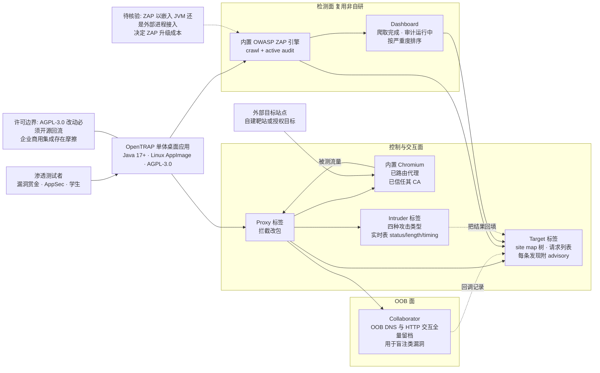

# opentrap/opentrap

## 一句话定位
Burp Suite 的免费开源替代：把用户已经熟悉的 Burp 式拦截代理工作流，放在成熟的 OWASP ZAP 检测引擎上，核心能力没有许可门禁。

## 它解决的问题
安全测试工具里存在一个长期的结构性缺口：**最有力的拦截代理（Burp Suite）是商业闭源的，最有用的功能在付费许可后面**；**OWASP ZAP 是强力的开源引擎，但界面对大量 proxy-first 的测试者不熟悉**。两头的用户都被卡住——想用 Burp 工作流的人要付费，想免费的人要重新学一套界面。

OpenTRAP 的主张就是把两头接起来，并且用 AGPL-3.0 保证"核心能力没有许可门禁"、改进由使用者而非单一厂商的路线图驱动。

## 为什么值得关注（2026-10-21）
- **它选的是正确的战场**：不重造检测引擎（明说依赖 ZAP），而是攻"交互层迁移成本"这个真实痛点
- **内置 Chromium 一键打开即已路由代理并信任其 CA**——这是 proxy-first 用户最大的一段配置摩擦，被一句话消掉了
- **AGPL-3.0 的选择很诚实**：README 明确主张 `nothing locked behind a licence`，代价（传染性、单平台）没有展开讨论
- **19 个 topics 是明确的发现位设计**：含 `burp-alternative`、`burp-suite`、`owasp-zap`，直接打"Burp 替代品"这一搜索意图

**但今天必须同时记住两个反向信号**：**`releases` API 返回空数组**（README 的 AppImage 下载链接指向 `releases/latest`，当前大概率下不到），以及 **fork-star 仅 1.1%（177⭐ 只有 2 fork）**，与"contributions welcome"的自标存在张力。

## 热度来源判断
**偏曝光驱动，采用信号弱。** 177⭐ ⑂2 的 fork-star 1.1% 是本批四个项目里最低的——被看见了，但没人动手改。结合 `open_issues_count = 0`（2 天新项目更可能是"还没人提"而非"质量完美"）和 releases 为空，更合理的解释是：**它拿到了搜索/推荐位的曝光，尚未证明有真实工作流依赖**。这是本档案把 Score 定在 88 但明确标注"不应基于热度做采用决策"的原因。

## 关键技术亮点
1. **引擎复用而非重造**：检测能力明确依赖内置 OWASP ZAP——README 定位句是 `on top of the trusted OWASP ZAP detection engine`
2. **内置 Chromium 开箱 TLS 拦截**：`One click opens Chromium already routed through the proxy and trusting its certificate authority, so TLS interception works with nothing to configure`
3. **五个工作面完整**：Proxy（拦截 + 内置浏览器）· Target（site map 树、请求列表、每个发现附完整 advisory 含请求与响应并排）· Collaborator（OOB DNS 与 HTTP 交互全量留档，用于盲注类漏洞，每个回调请求都有记录）· Intruder（四种攻击类型 + payload 集与处理，实时攻击表显示每个请求的 status / length / timing）· Dashboard（爬取完成 + 活跃审计运行 + 按严重度排序的实时漏洞表）
4. **AGPL-3.0 无许可门禁**：README 明说 `nothing locked behind a licence`，并主张 `built to be improved by the people who use it rather than steered by a single vendor's roadmap`
5. **技术栈与分发**：Java 17+ · AGPL-3.0 · Linux AppImage · 徽章自标 `status: active development` / `contributions welcome`

## 架构师速览

| 决策问题 | 研究判断 | 证据边界 |
|---|---|---|
| 系统边界 | 单体桌面应用（Java 17+ / Linux AppImage）：代理与内置 Chromium 负责浏览器侧 TLS 拦截；检测能力完全依赖内置 OWASP ZAP（不是自研规则）；AGPL-3.0 保证改动必须开源回流 | README「What it is」+「Why we built it」+ 徽章行；**ZAP 是嵌入 JVM 还是外部进程调用，README 未明示**；macOS/Windows 支持未见声明 |
| 主路径 | 启动 → 浏览器或内置 Chromium 的流量走本地代理 → Proxy 拦截与改包 → Target 里从 site map 选攻击面 → Repeater/Intruder 手工或自动打点 → Collaborator 收 OOB 回调验证盲注 → Dashboard 看 ZAP crawl + active audit 的按严重度结果 → 逐条读 advisory | 主路径由 README 五张截图（target/proxy/collaborator/intruder/dashboard）的说明文字拼合；**ZAP 扫描结果与手工代理视图在同一 UI 内的状态同步机制未明示** |
| 关键权衡 | Burp 式交互（迁移成本低）vs ZAP 式自动化（检测成熟）· 复用 ZAP 引擎（不重复造规则）vs 自研规则（差异化但无覆盖）· AGPL（无门禁、强制回流）vs Apache/MIT（更易商用集成）· 桌面单进程（易用）vs 服务端（可团队共享）· 仅 Linux AppImage（分发简单）vs 三平台 | README 明示了"无许可门禁"与"由使用者驱动路线图"；**代价是 AGPL 传染性与单平台**，README 未讨论 |
| 最小 PoC | 1. 下载 Linux AppImage（**注意：当前 releases 为空，此步可能直接失败——这本身就是第一个待观察信号**）→ 2. 让目标浏览器信任其 CA → 3. 打开内置 Chromium 访问自建靶站，确认 HTTPS 明文可见 → 4. 跑一次 ZAP active scan，确认 Dashboard 按严重度出结果 → 5. 用 Collaborator 发一个 OOB 请求确认回调留档 → 6. 用 Intruder 跑一次 sniper 攻击看 timing 列 | PoC 由 README 五张功能截图 + 能力清单推导；**第 1 步能否完成是本项目当前最关键的未验证项** |

## 架构图（MMD）

> 证据边界：此图只采用本档案已有可核验描述；"待核验"节点不应视为项目实现事实。

## 架构启发
OpenTRAP 的启发可以用一句话概括：**在成熟引擎之上，交互层本身就是可以独立竞争的产品**。检测能力从 ZAP 来，但用户是否会用，取决于界面是否匹配他们的既有习惯——OpenTRAP 选的是 proxy-first 人群，而不是"技术上最强"的人群。这是工具类项目常见的、被低估的竞争维度。

具体到设计上有两点值得抄：其一，**把最大的配置摩擦做成一个按钮**。内置 Chromium 一键打开且已路由代理、已信任其 CA——这一下消掉了"装 CA、设代理、配证书例外"整段流程。对任何代理类工具，减少一次配置就减少一批放弃。README 把它写成一句话（`so TLS interception works with nothing to configure`），说明设计者清楚这才是卖点。

其二，**用发现位设计而不是功能堆砌来获取早期用户**。19 个 topics 里 `burp-alternative` / `burp-suite` / `owasp-zap` 三个关键词直指用户的搜索意图——对于一个"替代品"项目，用户已经在搜旧产品的名字了，把新项目挂到那个词上是最短路径。这不是技术能力，但它是替代品项目存活的关键技能。

反面启发同样清楚：**当核心能力来自上游时，界面优势会被上游的短板抵消**。OpenTRAP 的 TLS 拦截体验再顺，也改变不了 ZAP 在现代 JS 框架上的扫描覆盖。选"复用引擎 + 重做界面"这条路，必须接受自己无法在上游短板上超越原厂——这是这条路的天花板。

## 定位判断
**工具型（交互层重构型）。** 它在生态中的位置不是"又一个扫描器"，而是**成熟引擎之上的重新包装**。这类项目在安全工具史上反复出现且往往成立（caido、ZAP 的 Burp 兼容层思路同源）。真正的差异化在交互层：让 proxy-first 的测试者不必重新学界面。**它的长期价值取决于交互层做得是否真的顺手，而检测能力完全继承自 ZAP——ZAP 变强它变强，ZAP 的短板（如对现代 JS 框架的覆盖）也会原样继承。**

## 风险 / 局限 / 泡沫点
- **`releases` 为空**：GitHub API 返回空数组，README 的 AppImage 下载链接指向 `releases/latest`——**当前大概率下不到**。这是最直接的可采用性阻塞
- **fork-star 1.1%（177⭐ 只有 2 fork）**：本批最低，社区尚未进入动手阶段，与"contributions welcome"的自标存在张力
- **仅 Linux 声明**：AppImage 是唯一明确分发物，macOS/Windows 未提
- **AGPL-3.0 的商用摩擦**：企业安全工具常需嵌入既有平台，AGPL 的传染性是现实采用障碍——README 未讨论这一点
- **`open_issues_count = 0` 的解读**：2 天新项目更可能是"还没人提"，不能读作质量背书
- **ZAP 集成耦合度未知**：是嵌入 JVM 还是外部进程，决定了升级 ZAP 的成本与分发体积，README 未说
- **继承 ZAP 的全部短板**：作为代理工作流没问题，但作为扫描器其覆盖面与 Burp 的差距即 ZAP 与 Burp 的差距

## 与同类项目的关系
- **vs Burp Suite**：直接对标。Burp 是商业闭源 + 付费墙；OpenTRAP 是 AGPL 免费 + 熟悉界面。检测能力上 ZAP 与 Burp 存在真实差距，这一点 OpenTRAP 不解决
- **vs OWASP ZAP 原版**：ZAP 自带 GUI 但对 proxy-first 用户不友好；OpenTRAP 把 Burp 式交互加在 ZAP 引擎上，是"同一引擎的另一种皮肤"
- **vs Caido（商业）**：Caido 在商业侧做同类事（更现代的代理 UX），OpenTRAP 在开源侧做；二者不可直接互换，检测引擎不同
- **vs mitmproxy + 独立脚本**：轻量得多，但没有内置扫描、OOB 与 Intruder 这三块工作面
- **vs 各类 Burp 扩展**：扩展不改主界面与工作流，仍要面对 Burp 的许可与形态

## 是否值得持续跟踪
**值得，但定位要放在"交互层重构能否立住"，而不是"检测能力突破"。** 判断它是否真的解决了问题的标志有三个，且都可在 7 天内观察：**releases 是否出现（当前下不到）**、**fork 是否从 2 涨起来**、**macOS/Windows 是否跟进**。三个都没发生的话，它就只是一次成功的曝光。

## 后续观察点
- 首个正式 release 何时出现、AppImage 能否实际下载运行
- macOS / Windows 计划是否公布（决定实际可部署面）
- fork 是否从 2 开始增长（真实采用 vs 曝光的分水岭）
- ZAP 集成方式（嵌入 JVM vs 外部进程）与 ZAP 升级路径
- 12 个 issue 级别的问题中，最常被反馈的是什么（能力缺口清单）
- 社区是否接受 AGPL-3.0 作为企业可用的许可

---
*首次记录：2026-10-21*

> 数据来源: GitHub REST API + README 原文（2026-10-21 CST 06:00） | Stars: 177 | Forks: 2 | License: AGPL-3.0 | 语言: Java | 创建: 2026-10-19 | 推送: 2026-10-20 | Subscribers: 1 | Open Issues: 0 | Releases: 无（API 返回空数组）