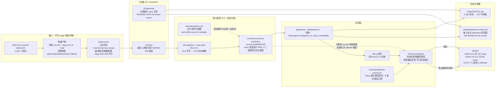

# theorem-labs/oss-verify-proofs

## 一句话定位

对 OSS-Fuzz 的 fuzz target 给出**机器检验的 Rocq 证明**——证明在陈述的界限内不存在使 sanitizer 报错的输入，且 sanitizer 构建与普通构建的可观测行为一致；**证明的对象是编译后的二进制而非源码**，陈述于 LPS（一个 Linux 进程运行 RISC-V 二进制的形式化模型）。

## 它解决的问题

**fuzzing 只能告诉你「找到了一个反例」，不能告诉你「没有反例」。** OSS-Fuzz 每天在 1,381 个项目上跑 fuzz target，它产出的最重要信息是「没找到 bug」——但这个「没找到」是**关于搜索过程的陈述，不是关于程序的陈述**。搜索空间无限、时间有限、启发式有偏。

这个项目试图补上这一段：**对具体的 fuzz target，给出一个关于程序本身的陈述**——在指定的输入界限内，没有任何输入能让 sanitizer 构建报错，且两个构建的行为一致。这把「fuzzing 没找到」升级为「在形式化的模型里，数学上不可能找到」。

**它同时明确划出了这个结论的边界**，并且把边界写进了可执行的形式。

## 为什么值得关注（2026-10-24）

**因为它证明了一件本日其他项目都在做但没做到的事：把边界变成可执行的检查，而不只是可读的声明。**

具体的对比：

- HackiOS 的 `checks.md` 讲**怎么验证你的验证**——但那是给人读的准则。
- Vesalius 的 benchmark 讲**我的实验失败了**——那是数据。
- **oss-verify 的 `oft check` 会真的拒绝**：它读取 `Print Assumptions` 的输出，**拒绝任何不在 `toolchain/allowed-axioms.txt` 里的假设**。

**一个只会通过的检查器和一个会拒绝的检查器，价值差一个数量级**——因为前者无法被独立证伪，而后者可以：给它一个越界的公理，它必须报错。

第二个理由是**它的规模数字被诚实摊开**：20,164 条 statement 里 **138 条已证、19,797 条仍 open、229 条被模型阻塞、0 条已知为假**。这个比例（0.68% 已证）没有经过任何粉饰，而是被完整地列在一张表里。

第三个理由是**它的许可分层处理值得直接借鉴**（见「与同类项目的关系」节）。

## 热度来源判断

**92⭐ / ⑂6 / subs 0 / 2 个 commit / contributors API 返回空数组——这是一个机构发布，而不是社区共建。**

热度来源基本只有一条：**Theorem Labs 作为形式化验证公司发布了一个可下载、可独立检查的大型证明集。** 这属于「专业社区注意力」而非「大众注意力」——subscribers 为 0 说明几乎没有深度关注者，fork-star 6.5% 略高于纯阅读型项目的典型值（对应「fork 去读证明语句」）。

**它没有刷星特征**（2 commits、无 fork 潮、无模板化描述），**也不是虚假关注**（427 个 release asset、851 个源码 asset、可独立运行的 `oft check` 命令、公开的 judge/检查脚本）。

**但热度与价值在本项目上完全脱钩，且脱钩幅度是本批最大的**：一个能对 openssl / simdjson / libpcap / mbedtls 的 fuzz target 给出形式化证明的仓库，star 数不到本批最热的项目的十分之一。**原因很清楚：这不是一个「能被 star 一下就受益」的项目——它要么被形式化验证社区使用，要么被完全忽略。**

## 关键技术亮点

1. **⭐ 证明对象是二进制而非源码。** 「Each proof is about compiled binaries, not source code.」这让证明可核验（build record 含每个二进制的 SHA-256），但也让它**与 OSS-Fuzz 实际的 x86-64 动态构建之间存在明确落差**——README 自己列了这一条。
2. **agreement statement 的定义是形式化的**：「On every input on which the plain build stays within its memory budget, neither build reaches an error, and the plain build and the sanitizer build have the same set of observable behaviours.」其中 'every input' 指 LPS 接受为有效的全部进程输入（参数、环境变量、文件及其内容或缺失、stdin 等）；'error' 含崩溃、无效内存访问、`abort()`（含 assert 失败与 sanitizer 报告）、失败的 UBSan 检查、**LPS 无法解释的步骤**；'observable behaviours' 含进程读写标准流与连接的字节及其顺序、退出状态、文件最终内容。
3. **⭐ 内存预算是前提而非结论。** ASan 类 statement 用 2 GiB，UBSan 类用 16 GiB，**超预算的输入不在覆盖范围内**——这意味着「证明覆盖所有输入」这句话本身必须带上这个限定。
4. **⭐ `oft check` 的检查序列是硬的**：校验每个二进制的 SHA-256 → 构建 LPS 内存映像与 statement → 编译每条证明 → **编译一个把证明的定理赋予 statement 类型的 wrapper** → **读取 wrapper 的 `Print Assumptions` 输出并拒绝任何越界假设**。
5. **公理边界被逐条列出**：`toolchain/allowed-axioms.txt` 只含 Rocq 原生的整数/数组/字符串类型及其规范，加上 **6 条**标准库公理（`classic`、`functional_extensionality_dep`、`constructive_indefinite_description`、`propositional_extensionality`、`sig_forall_dec`、`sig_not_dec`）。
6. **build record 让一切可复现**：每个证明的 `provenance/` 记录上游仓库与 commit、harness 文件、recipe、编译器、构建器镜像、static AddressSanitizer commit、编译与链接 flags、**每个二进制的 SHA-256** 与许可。
7. **checker image 固定到内容哈希**（`sha256:cc9ae43a…`），消除「环境漂移」这一不可信来源。
8. **⭐ 许可分层**（见下）。
9. **规模被完整摊开**：1,381 个 OSS-Fuzz 项目中 427 个可构建、781 个「语言待定」、97 个「尚未构建」、3 个「需要模型支持」、3 个「无编译器」、32 个「无 harness」、6 个「排除」、32 个「暂缓」；427 个可用项目有 2,148 个 harness、**20,164 条 statement**、**8,578 个随发布附上的二进制（0 withheld）**；2,148 个 harness 中 2,141 个有全部四种构建（plain / ASan / UBSan / ASan+UBSan）。
10. **`analyses/known-issues.md` 逐条给出每个未证 statement 的原因**（例：`arrow/arrow-csv-fuzz` 的全部四条 statement 标 `blocked by the model`，原因是「the binary queries CPU affinity and starts threads, which the model does not cover yet」）。

## 架构师速览

| 决策问题 | 研究判断 | 证据边界 |
|---|---|---|
| 系统边界 | 五层：① **证明层**（`proofs/` 每目录一个证明，含 `Statements.v` 与 Rocq 证明）② **语义模型层**（外部仓库 theorem-labs/rocq-linux-process-semantics，commit `f1006fe81783`）③ **工具链层**（`tools/oft/` 是 `oft` 命令的 Python 实现，负责 fetch/check/generate；`toolchain/checker.Dockerfile` 固定 checker 镜像；`toolchain/allowed-axioms.txt` 定义公理边界）④ **生成层**（`oft generate` 从模板与 facts 生成 README、index/STATUS.md 与 analyses/known-issues.md，**文件头明写 "generated by oft generate; do not edit"**）⑤ **信任层**（`docs/trust.md`、`docs/semantics.md`、`release.yaml`）。**数据面是 ELF 字节 → LPS 内存映像 → Rocq 定理；控制面是 `oft` 的 fetch/check/generate 三条命令与三条 CI 工作流** | README 的 Repository layout 与 Versions 节、`analyses/known-issues.md` 首行、`.github/workflows/{release-check,pr,weekly}.yml`；**`tools/oft/` 的具体实现本窗口未取，待核验** |
| 主路径 | 维护者在 theorem-labs/oss-verify 登记项目 → CI 拉取该项目的 OSS-Fuzz 二进制（`./oft fetch <project>`，每个二进制对 SHA-256 校验）→ `oft check <project>/<harness> --parts statements,proofs` 在固定 checker 镜像内构建 LPS 内存映像、生成 statement、编译证明、编译 wrapper、读取 `Print Assumptions` 并拒绝越界假设 → 通过的证明随 release 发布（`v2026.10.0` 含 427 个 asset，`v2026.10.0-src` 含 851 个）→ 未证明的 statement 进 `index/STATUS.md` 与 `analyses/known-issues.md`（含原因分类） | README 的 Check a proof 节与 Statements for OSS-Fuzz fuzz targets 节、`docs/proving.md` 与 `CONTRIBUTING.md` 被指向；**「登记 → 拉取 → 证明」流水线的自动化程度与人工介入点未明说，待核验** |
| 关键权衡 | **证明二进制 vs 证明源码**（二进制可核验但脱离源码语境；源码可读但需要可信编译器链）· **限定 riscv64 静态链接 vs 覆盖 OSS-Fuzz 实际的 x86-64 动态构建**（前者可在形式化模型里完整建模，后者不能——**这是一个明确的取舍，不是缺陷**）· **agreement statement vs halts statement**（前者可证（138 条），后者本次一条未证——**因为模型不支持终止性**）· **LPS 的不完备性 vs 完备性成本**（作者明写「LPS is best effort and not complete」并把 `docs/semantics.md` 指向读者——**这是自觉的取舍而非疏漏**）· **MIT 主体 + 逐证明保留 Anthropic 原始许可 vs 统一重许可**（前者保留原始归属，后者省事但可能违反来源许可）· **2.1 GB 仓库体积 vs 逐证明分单元可检查**（CI 已改为 "one proof unit per check job"，说明体积已构成工程约束） | README 的 What a proof does not say 与 Versions 与信任清单、NOTICE、commit "ci: one proof unit per check job"；**未明示：证明工作的实际人力投入、哪些库的证明有商业资助** |
| 最小 PoC | 1. 确认有 Docker、zstd、Python 3 + PyYAML → 2. `git clone` + `cd oss-verify-proofs` → 3. `./oft fetch coturn`（拉取该项目的二进制并逐个对 SHA-256 校验）→ 4. `python3 -m pip install --require-hashes --target "$HOME/oft-pydeps" -r tools/oft/requirements.txt` → 5. **docker run（`--network none`、非 root 用户、挂载 pydeps 与工作目录）跑 `./oft check coturn/FuzzStunClient --parts statements,proofs`** → 6. **必须预留资源：16 核上一次证明检查最多需 20 GiB 内存**，核越多内存需求越大（每核编译一个文件），`--cpuset-cpus` 可限制核数 → 7. **读 `oft check` 的输出**：它应当在 `Print Assumptions` 阶段拒绝任何越界公理——**如果这一步没有输出拒绝，检查本身就没在起作用** → 8. 再跑一条 `analyses/known-issues.md` 里标为 `blocked by the model` 的 statement，确认它被正确归类为阻塞而非静默跳过 | **第 5 步是唯一能独立证伪「它真的在检查」的步骤**（与 HackiOS 的 checks.md 同构——**必须验证检查器会拒绝，而不只验证它会通过**）；**第 6 步的资源需求决定了它不是「随手跑一下」的验证路径**；**本 PoC 无法验证证明对 x86-64 的适用性（那不是它证明的东西）** |

## 架构启发

**第一条启发，也是本项目最可迁移的一条：「我的主张是什么」应该是一个可以由机器读取并核对的东西，而不是一段散文。** `oft check` 的最后一步——读取 `Print Assumptions` 并拒绝越界假设——把「这个证明依赖哪些公理」从一个人类必须读文档才能回答的问题，变成了一条可以自动失败的检查。**这与 HatchiOS 的「能拒绝的先拒绝」和 Vesalius 的「stats 让不可见变可见」是同一个思路的三种实现：把「我可能错在哪里」显式化，然后让它可被观测。**

**第二条启发：证明的强度上限不由证明本身决定，而由语义模型的完备性决定——因此必须把模型的不完备性和证明一起发布。** 这份 README 的第三节不是「我们的成果」，而是「LPS is best effort and not complete. A proof is only as good as LPS.」**把限制条件放在成果之前而不是之后，是一种论证结构上的选择，它直接决定读者会不会误用这些结论。**

**第三条启发：许可的混合来源可以被结构化地记录，而不必被简化成一个标签。** 这份 NOTICE 明确区分「我们写的」与「由 Anthropic 授权的证明派生而来的」，`LICENSES/` 存两份许可文本 + NOTICE，**且每个此类证明的 build record 指名这三个文件**——**归属声明被做成了可追溯的引用结构，而不是角落里的一段说明**。在一个 AI 辅助证明越来越多、训练数据来源许可越来越敏感的时间点，这个处理方式值得被直接借鉴。

**第四条启发：未完成的工作量本身是信息。** 19,797 条 open statement 与 `analyses/known-issues.md` 里逐条的阻塞原因（**229 条 blocked by the model，且原因高度集中——「查询 CPU affinity 并启动线程，模型尚未覆盖」**），等于一张公开的「形式化验证路线图」：**任何做 LPS 扩展的人都能从这份清单里直接看到最值得补的模型能力。**

## 架构图（MMD）

> 证据边界：此图只采用本档案已有可核验描述；「待核验」节点不应视为项目实现事实。

## 定位判断

**方法与规范的样本，而非可用工具。**

它不是一个能装进你项目里的库，也不是一个能跑的检查器产品——**它是一批证明，加上一个可运行的检查命令，加上一份写明了边界的文档。** 它的使用者只有两类：形式化验证领域的从业者（拿它做参考或复用其 statement），以及被它证明过的库的维护者（拿它做对外沟通的凭据）。

**在「形式化验证 vs 动态分析」的谱系上，它的定位是「对动态分析产物做形式化保证」**——OSS-Fuzz 是动态分析（找反例），这个项目是形式化（证明没有反例）。**两者是互补的**：fuzzing 负责找到 bug 交给上游，这个项目负责在找到之后说「而且这一类 bug 已经被证明不存在了」。

**它是机构发布的产物，而非社区运动。** 2 commits、contributors API 空数组、subs 0 明确说明这一点。**这对评估意味着**：技术质量可以很高（证明本身是可独立检查的），但**社区采用度、生态可持续性、跨版本跟进能力都不确定**。

## 风险 / 局限 / 泡沫点

- **⚠️ 本次发布没有任何一条 proof 证明 halts。** 138 条已证证明的主张只是「在覆盖范围内 sanitizer 不报错且两构建行为一致」，**而不是「程序会终止」**。一个能被 fuzzing 之外的形式化方法证明「不会崩溃」却没证明「会终止」的库，在实践中仍然可能挂死。**作者把这一点写在 README 的独立一节，但只读标题的读者会高估其主张强度。**
- **⚠️ LPS 公开声明为不完备。** 「LPS is best effort and not complete. It describes part of Linux, and it makes some assumptions that it does not check. **A proof is only as good as LPS.**」——**证明的强度上限由一个作者自陈不完备的模型决定。** 这不是缺陷（形式化验证本就是渐进的），但读者必须知道上限在哪。
- **⚠️ 证明只对静态 riscv64 有效**（clang 20.1.8 + musl），**与 OSS-Fuzz 实际的 x86-64 动态构建之间存在明确落差**。README 列出了这一条，但落差对真实缺陷的影响需读者自行判断。
- **⚠️ `subs 0` + 2 commits + contributors API 返回空数组 = 机构发布而非社区共建。** 没有任何外部贡献者痕迹，也没有外部复现记录。
- **2.1 GB 仓库体积对 clone 不友好**；CI 已改为 "one proof unit per check job"，说明体积确实构成工程约束。
- **验证成本高**：16 核上一次证明检查最多需 20 GiB 内存（每核编译一个文件，核越多内存需求越大）。
- **规模完成度低**：20,164 条 statement 中 138 条已证（**0.68%**）、19,797 条 open、229 条被模型阻塞。**这个比例本身不是缺点——它诚实反映了形式化验证的真实成本——但读者若期待「一个库被证明了」，会严重误判。**
- **本日报无法独立验证任何一条证明的正确性**（需要 Docker、20 GiB 内存与数十分钟编译）。

## 与同类项目的关系

- **vs OSS-Fuzz 本身**：OSS-Fuzz 是动态分析（**找**反例），这个项目是形式化（**证明没有**反例）。**互补而非竞争**：fuzzing 找到的 bug 交给上游，形式化证明可以补上「这一类已被排除」的凭据。
- **vs 其他 sanitizer / 静态分析工具**：ASan/UBSan 是运行时检测（会报），这个项目是编译期到证明期的静态保证（不会报，因为已排除）。**两者的关系是「检测」与「排除」。**
- **vs CompCert / seL4**：那些是**从零写**的可信实现（语言 + 编译器 + 内核全链条验证）；这个项目是**对既有二进制**做后验证明。**前者是「设计时就正确」，后者是「运行前就正确」。** 前者范围窄但强度高，后者范围广但受限于已有二进制的可分析性。
- **vs 各类 fuzzing 复现框架（如 OSS-Fuzz 的 `atheris` 生态）**：那些把 Python 代码变成 fuzz target；这个项目只处理已存在的 OSS-Fuzz target。
- **vs Anthropic 的形式化证明工作**：**这是一个直接的上下游关系。** NOTICE 明确「Proofs that we made from proofs that Anthropic licensed under the Apache License 2.0 or the MIT licence, at the recipient's option, keep those licences and their file headers」，`LICENSES/` 下存 `anthropic-proofs-LICENSE`（Apache-2.0）、`anthropic-proofs-LICENSE-MIT`、`anthropic-proofs-NOTICE`，**且每个此类证明的 build record 指名这三个文件**。**这种「混用许可时保留来源条款并逐文件标注」的处理方式，比绝大多数开源项目做得更细。**
- **vs theorem-labs/oss-verify**（同组织，本窗口未取其 README）：后者是项目登记入口（README 明确「a maintainer enrolls a project at theorem-labs/oss-verify」），前者是证明仓库。

## 是否值得持续跟踪

**值得，但作为「方法与文档规范的样本」而非「可用工具」。**

理由：它是本日报里唯一一个**把「我证明了什么」与「我没证明什么」做成可执行形式**的项目，而这个问题的答案在 2026 年正在变得重要——随着 AI 生成证明的普及，「怎么知道一份 AI 写的证明没有偷偷依赖未声明的公理」会成为一个真问题。**它给出的答案（`Print Assumptions` + 允许公理清单）是一个具体、可复制、且已经在生产 CI 中运行的方案。**

**但必须同时说清：它不是一个今天可以引入你项目的东西。** 没有库管理接口、没有 CI 集成指南、没有「把这个库纳入证明集」的路径说明（除了指向另一个仓库登记）。

具体观察点：
1. **19,797 条 open statement 的下降速度**——这决定 LPS 支持面扩张的节奏。
2. **是否出现 halts statement**——那会显著改变主张强度。
3. **是否开始接受外部项目的证明**（contributors 是否从 0 变成非 0）。
4. **LPS 的模型覆盖扩展**——线程与 CPU affinity 是当前 229 条阻塞的主因，补上这两项可能一次性解锁大量 statement。
5. **是否开始覆盖 x86-64**（这决定它能否直接服务于 OSS-Fuzz 的实际构建）。
6. **`toolchain/allowed-axioms.txt` 是否变化**——公理清单的变化直接反映主张强度的变化。

## 后续观察点

- `index/STATUS.md` 中 427 可构建项目数与 20,164 statement 数的月度变化。
- `analyses/known-issues.md` 中 `blocked by the model` 的分类分布（是否从 CPU affinity/线程扩展到新的模型能力缺口）。
- 是否发布含 halts statement 的版本（README 明说本次一条未证）。
- contributors API 是否从空数组变为非空（社区形成的判据）。
- `toolchain/allowed-axioms.txt` 的公理数量变化（当前 6 条标准库公理 + 原生类型规范）。
- checker image 的哈希是否随 LPS 版本更新（若不更新，说明 LPS 的新 commit 未被实际验证）。

---
> 数据来源: GitHub API (2026-10-24 CST 06:00 前后 / UTC 2026-10-23T22:13Z 快照) | Stars: 92 | Forks: 6 | Subscribers: 0 | Open Issues: 1 | License: MIT | 语言: Rocq Prover | 创建: 2026-10-22T17:20:28Z | 推: 2026-10-23T03:58:49Z | Commits: 2 | Contributors: 0（API 返回空数组）| Releases: 3 | Size: 2142968 KB
