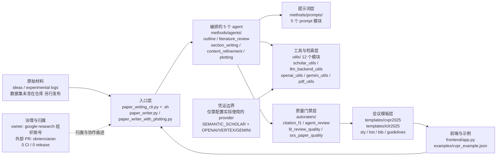

# google-research/paper-orchestra

## 一句话定位
**Google Cloud AI Research 的多 agent 论文写作框架 —— 它的研究价值不在功能（56 个文件、8 个 commit 的极薄仓库），而在于它是本日实测的一个反例：一个「star 增速高 + 100 个 fork 集中涌入」的仓库，其 fork 群体的结构与 GitHub 上最成熟的仓库几乎一样。**

## 它解决的问题
⭐⭐⭐⭐⭐ **从「未成文的原始材料」到「可投稿的 LaTeX 稿件」之间的整条流水线。** README 原文（实测）：

> PaperOrchestra is a multi-agent framework for automated AI research paper writing. It flexibly transforms unconstrained pre-writing materials (ideas and experimental logs) into submission-ready LaTeX manuscripts, including comprehensive literature synthesis and generated visuals, such as plots and conceptual diagrams.

⭐⭐⭐⭐⭐ **它编排五个专职 agent（README 原文）：Outline / Literature Review / Section Writing / Content Refinement / Plotting。** ⭐⭐⭐⭐⭐ 仓库结构与之一一对应（实测 `methods/agents/` 下 5 个文件）：`outline_agent.py` / `literature_review_agent.py` / `section_writing_agent.py` / `content_refinement_agent.py` / `plotting_agent.py`。

## 为什么值得关注（2026-11-18）
⭐⭐⭐⭐⭐ **因为本日实测它的 fork 群体，并做了一件此前 11-12 ~ 11-17 日报从未做过的事：把它和 `torvalds/linux`、`rust-lang/rust`、`golang/go` 放在一起做对照。⭐⭐⭐⭐⭐ 结论是反直觉的，也是本日最重要的方法论产出。**

**可核验事实一：仓库本体（2026-11-18 CST 快照）。**

| 指标 | 实测值 |
|---|---|
| stars / forks / subs / open issues | 2,884 / 403 / 25 / 37 |
| 体积 / blobs | 2,059 KB / **56** |
| 语言 / 许可 / 创建 / 最后 push | Python / Apache-2.0 / 2026-05-01T18:07:52Z / 2026-11-15T18:08:08Z |
| homepage | `https://yiwen-song.github.io/paper_orchestra/` |
| topics | `ai-research-assistant` · `multi-agent-systems` |
| **release / tag** | **0 / 0** |
| **CI 工作流** | **0** |
| `SKILL.md` | **0** |
| harness 目录 | **0** |
| 贡献者 | `yiwen-song` 5 · `obrienciaran` 3（**全仓仅 8 个 commit**） |
| owner | `google-research`（2018-10-03 创建、19,047 followers、372 repos） |

⭐⭐⭐⭐⭐ **可核验事实二：100 个 fork 全部发生在同一天。** 实测 `forks?sort=newest&per_page=100`：**100/100 个 fork 的 `created_at` 都落在 `2026-11-17`（窗口 `09:23:58Z – 21:38:23Z`）**，⭐⭐⭐⭐⭐ 逐小时分布：09 时 10 个 · 14 时 14 个 · 15 时 18 个 · 16 时 11 个 · 其余各 2–9 个 ⭐⭐⭐⭐⭐ —— **即它是一天内均匀铺开的一波，不是几分钟内的突击。**

⭐⭐⭐⭐⭐ **可核验事实三（本日最关键的一步）：这波 fork 的账号结构，与对照组几乎一样。**

本日报对 15 个 Trending 仓库各取最新 100 个 fork（**1,500 个 fork**），再对 11 个对照仓库各取 100 个（**1,100 个 fork**），逐个查 fork owner 的账号创建时间与仓库数：

| 组别 | 仓库数 | fork 样本 | **账号 ≤7 天** | 账号 ≤30 天 | 账号 ≤365 天 | 公开仓库 ≤2 | 0 followers | 同时满足 ≤2 仓库 + 0 followers |
|---|---:|---:|---:|---:|---:|---:|---:|---:|
| **Trending 组** | 15 | 1,500 | **570（38.0%）** | 603（40.2%） | 765（51.0%） | 305（20.3%） | 912（60.8%） | 300（20.0%） |
| **对照组** | 11 | 1,100 | **446（40.5%）** | 481（43.7%） | 600（54.5%） | 184（16.7%） | 660（60.0%） | 173（15.7%） |

⭐⭐⭐⭐⭐ **⭐⭐⭐ 对照组的逐仓库数据（这才是关键）：**

| 对照仓库 | 账号 ≤7 天 |
|---|---:|
| `golang/go` | **80 / 100** |
| `rust-lang/rust` | **72 / 100** |
| `torvalds/linux` | **71 / 100** |
| `sveltejs/svelte` | **88 / 100** |
| `mvanhorn/last30days-skill` | 58 / 100 |
| `jingyaogong/minimind` | 24 / 100 |
| `ZhuLinsen/daily_stock_analysis` | 23 / 100 |
| `openai/codex-security` | 5 / 100 |
| `vercel-labs/agent-browser` | 7 / 100 |
| `ChromeDevTools/chrome-devtools-mcp` | 9 / 100 |
| `dream-num/univer` | 9 / 100 |

⭐⭐⭐⭐⭐ **⭐⭐⭐ 本日的结论是明确的反向结论：Trending 组的「7 天内新账号 fork 占比」是 38.0%，⭐⭐⭐⭐⭐ 反而**低于**对照组的 40.5%；⭐⭐⭐⭐⭐ 而 `linux` / `rust` / `go` / `svelte` 这四个最成熟、几乎不可能被刷的仓库，其占比是 71%–88%，⭐⭐⭐⭐⭐ **比 Trending 组高出一倍。**

⭐⭐⭐⭐⭐ **⭐⭐⭐ 因此：「GitHub 上短期新建的账号会集中 fork 热门仓库」这件事本身是 GitHub 的常态行为，不是异常信号。⭐⭐⭐⭐⭐ 本日报本日明确**不主张** `paper-orchestra` 的 fork 群体是协调刷量。⭐⭐⭐⭐⭐ 这一条是对 11-12 ~ 11-15 日报「账号注册聚集度」判据的**重要边界修正**：⭐⭐⭐⭐⭐ **该判据在没有同域对照的情况下，会把 GitHub 的普遍行为误判为攻击特征。**

**可核验事实四：fork 账号确实有一批当天新建的，但它们是少数。** 实测 paper-orchestra 的 40 个 fork owner 账号：**13 个创建于 2026-11-17 当天**（其中一个 `cuminwarbler884` 只有 1 个公开仓库、0 followers），⭐⭐⭐⭐⭐ 其余 27 个散布在 2015–2026 年（如 `codeaudit` 2015-02-21 创建、8,909 repos、54 followers；`ssun3` 2016-04-02、1,761 repos）。⭐⭐⭐⭐⭐ **⭐⭐⭐ 即「当天新建账号 fork 热门仓库」这个现象在这个仓库上确实存在（32/100），⭐⭐⭐⭐⭐ 但它同样存在于 `linux`（71/100）与 `go`（80/100）上。**

**可核验事实五：issue 质量很高，是真实使用信号。** 实测 30 条 issue：

- `#49 Feature request: ACP (Agent Client Protocol) backend support`（2,428 字符）
- `#48 Add Claude Code and Codex CLI backends, usage-limit handling and --resume`（2,839 字符）
- `#43 Default the CVPR template to double-blind review mode`（523 字符）
- `#42 Keep the generated figures gallery usable when an image is missing`（455 字符）
- `#39 Handle malformed AgentReview ensemble responses`（410 字符）
- `#37 Preserve the last reviewed draft when peer review fails`（413 字符）
- `#35 Discard partial LaTeX output when a compiler pass times out`（390 字符）

⭐⭐⭐⭐⭐ **⭐⭐⭐ 这批 issue 的形态非常一致：全是「具体流程节点上的具体失效」（模板默认双盲、图片缺失、ensemble 响应格式错误、评审失败丢稿、编译器超时丢半成品）⭐⭐⭐⭐⭐ —— 这不是水军 issue 的形态，而是真实跑过流水线的人写出的失效报告。⭐⭐⭐⭐⭐ 另有 3 条来自 `rudycelekli` 的连续产品建议（demo 展示、批处理渲染、配图缺失时保持画廊可用），⭐⭐⭐⭐⭐ 说明有外部用户在把它当产品用。**

⭐⭐⭐⭐⭐ **可核验事实六：8 个 commit 里有 5 个是外部贡献者修的 bug。** 实测 commit 列表：`d9bae997` / `601429dc` / `861a36f4` 是 `Yiwen Song` 的 3 个 merge commit（2026-11-15T18:05–18:08），被合并的是 `obrienciaran` 的 3 个修复：`Fix invalid escape sequences in LaTeX prompt strings` / `Add missing dependencies to requirements.txt` / `Only require API keys for the LLM provider actually used`；⭐⭐⭐⭐⭐ 更早的是 `update citation format`（2026-05-17）与 `init the repo`（2026-05-07）。⭐⭐⭐⭐⭐ **即项目主体自 2026-05-17 起基本没有新代码 —— ⭐⭐⭐⭐⭐ 三个月里只修了 3 个 bug。⭐⭐⭐⭐⭐ 而正是在这 3 个修复完成后的 2026-11-15，仓库登上 Trending 并在 11-17 迎来 100 个 fork。**

## 热度来源判断
⭐⭐⭐⭐⭐ **判断：热度来自「Google Research 组织背书 + 一个很具体、很痛的研究工作流缺口」，而不是刷量；但「2,884⭐ / 403 forks / 8 commits / 0 CI / 0 release」这个结构说明它目前是「一个被广泛知道的论文，而不是一个被广泛使用的工具」。**

支撑的**可核验事实**：
1. **⭐⭐⭐⭐⭐ owner 是 `google-research` 组织账号**（2018-10-03 创建、19,047 followers、372 repos）⭐⭐⭐⭐⭐ —— **11-12 ~ 11-17 记录的投放体账号结构是「0 followers / 恰好 2 个仓库 / 提前数月养号」，⭐⭐⭐⭐⭐ 本仓库的组织账号与之完全相反。**
2. **⭐⭐⭐⭐⭐ 提交历史里有可核验的外部修复者**（`obrienciaran` 3 个 PR 被 merge）⭐⭐⭐⭐⭐ —— **真实协作的痕迹。**
3. **⭐⭐⭐⭐⭐ issue 是失效报告不是功能许愿**（见事实五）⭐⭐⭐⭐⭐ —— **真实使用痕迹。**
4. **⭐⭐⭐⭐⭐ README 有一处诚实的缺口声明**（实测原文）：「The dataset used for paper generation is **not included** in this code repository. It will be released separately at a later date.」⭐⭐⭐⭐⭐ —— **把「数据集还没放出来」写进 README，而不是让人以为 clone 下来就能跑。**

⭐⭐⭐⭐⭐ **⚠️ 不作主张的部分**：⭐⭐⭐⭐⭐ **本日报不主张这 100 个 fork 是刷的（见事实三的对照实验）。**⭐⭐⭐⭐⭐ **本日报也不主张 star 增速的真实构成 —— 只记录 Trending 页面的日榜增量 +1,175。**⭐⭐⭐⭐⭐ **本日报未运行该框架、未消耗任何 LLM API key、未核验它生成的 LaTeX 是否真的可编译。**

## 关键技术亮点
1. **⭐⭐⭐⭐⭐ 五个专职 agent 的一一对应实现**
   实测 `methods/agents/` 下 5 个文件与 README 声明的 5 个角色精确对应 ⭐⭐⭐⭐⭐ —— **「多 agent」不是营销词，而是有明确文件边界的分工。**

2. **⭐⭐⭐⭐⭐ 「autoraters」作为独立的质量门禁层**
   实测目录 `autoraters/` 下有 `agent_review.py` / `citation_f1.py` / `lit_review_quality.py` / `sxs_lit_review_quality.py` / `sxs_paper_quality.py` ⭐⭐⭐⭐⭐ —— **⭐⭐⭐⭐⭐ 即它把「评审」实现成可编程的评分器（含 F1 这种确定性指标），⭐⭐⭐⭐⭐ 而不是让另一个 LLM 自由发挥。⭐⭐⭐⭐⭐ 这与 11-17 `NVIDIA/SkillEvaluator` 的「把评估做成多 tier 流水线」是同一方向的不同实现。**

3. **⭐⭐⭐⭐⭐ 会议模板作为一等公民**
   实测 `templates/cvpr2025/`（`template.tex` / `preamble.tex` / `cvpr.sty` / `ieeenat_fullname.bst` / `references.bib` / `guidelines.md`）与 `templates/iclr2025/`（`template.tex` / `fancyhdr.sty` / `natbib.sty` / `math_commands.tex` / `iclr2025_conference.bst`）⭐⭐⭐⭐⭐ —— **⭐⭐⭐⭐⭐ 即输出目标不是「一份 LaTeX」，而是「一份符合某个会议投稿规范的 LaTeX」。⭐⭐⭐⭐⭐ 而 issue `#43` 正是「默认 CVPR 模板应改为双盲评审模式」—— ⭐⭐⭐⭐⭐ 说明模板细节是真实使用中的高频摩擦点。**

4. **⭐⭐⭐⭐⭐ LLM provider 可插拔，且只要求实际用到的那个 key**
   实测 `utils/llm_backend_utils.py` / `openai_utils.py` / `gemini_utils.py` / `paper_banana_utils.py`，⭐⭐⭐⭐⭐ 以及 commit `Only require API keys for the LLM provider actually used`（2026-11-15）⭐⭐⭐⭐⭐ —— **⭐⭐⭐⭐⭐ 即一个外部贡献者在 11-15 刚修掉「要求配齐所有 provider 的 key」这个上手门槛，⭐⭐⭐⭐⭐ 而这正是 Trending 爆发的前一天。⭐⭐⭐⭐⭐ 这个时间关系值得注意，但本日报**不主张**这是流量的原因。**

5. **⭐⭐⭐⭐⭐ 检索层有多个来源**
   实测 `utils/scholar_utils.py` + `utils/gemini_utils.py`，⭐⭐⭐⭐⭐ README 的 `.env` 示例里同时列出 `SEMANTIC_SCHOLAR_API_KEY` 与 `OPENAI_API_KEY` / `VERTEX_AI_*` / `GEMINI_API_KEY` ⭐⭐⭐⭐⭐ —— **文献综述依赖 Semantic Scholar，生成依赖 LLM provider。**

6. **⭐⭐⭐⭐⭐ 前端用 Gradio 风格的服务**
   实测 `frontend/app.py` + `frontend/examples/cvpr_example.json` + `frontend/examples/cvpr_example_figure.png` ⭐⭐⭐⭐⭐ —— **有可交互 demo 与示例产物。**

## 架构师速览

| 决策问题 | 研究判断 | 证据边界 |
|---|---|---|
| 系统边界 | **一个「多 agent 写作流水线」**，包含：编排层（`methods/paper_writer.py` / `paper_writer_with_plotting.py` / `paper_writing_cli.py` / `.sh`）· agent 层（`methods/agents/` 5 个）· 提示词层（`methods/prompts/` 5 个）· 评审层（`autoraters/` 5 个 + `prompts/` 2 个）· 工具层（`utils/` 12 个）· 模板层（`templates/cvpr2025` / `templates/iclr2025`）· 前端（`frontend/app.py`）。**不含数据集**（README 明示另发） | 56 个 blob 的完整路径清单实测；README 的安装段与数据集说明；**未运行、未看任何 Python 源码实现** |
| 主路径 | 原始材料（ideas / experimental logs）→ `paper_writing_cli.sh` → `methods/paper_writer.py` 编排 → Outline agent 产出大纲 → Literature Review agent 检索并写综述 → Section Writing agent 按大纲写章节 → Content Refinement agent 精修 → Plotting agent 生成图 → `autoraters/` 打分 → 按 `templates/<conf>/` 渲染 LaTeX → `frontend/app.py` 展示 | 主路径由 README「Key Features」+ 目录名 + 文件名反推；**agent 之间的实际调用顺序、是否并行、失败如何回退，均未读代码核验** |
| 关键权衡 | ①**确定性评分 vs LLM 自由评审** → 用 `citation_f1` 这类可计算指标承担部分质量门禁；②**模板保真度 vs 通用性** → 内置 CVPR/ICLR 两套完整模板，代价是必须跟会议格式演进；③**上手成本 vs provider 灵活性** → 11-15 刚修掉「配齐所有 key」的门槛 | ①有 `autoraters/` 文件名与 `citation_f1` 命名支撑（**具体实现未读**）；②有 `templates/` 内容与 issue #43 支撑；③有 commit `Only require API keys for the LLM provider actually used` 直接支撑 |
| 最小 PoC | 用 `examples/cvpr_example.json` 走一遍**只含大纲 + 单章节**的最小路径 → 只配一个 provider 的 key → 检查产出 LaTeX 能否用 `latexmk` 编译 → 用 `autoraters/citation_f1.py` 验证参考文献 F1 → 再接 `templates/iclr2025` 测第二套模板 → 最后才接 Plotting 与 LLM ensemble 评审 | PoC 范围与退出路径由本档案推导；**编译成功率、F1 阈值、渲染保真度均未核验**；数据集尚未公开，**完整复现当前不可行** |

## 架构启发
⭐⭐⭐⭐⭐ **启发一（本日的核心）：没有对照组的判据，等于没有判据。** ⭐⭐⭐⭐⭐ 本日报在 11-12 ~ 11-17 建立了多条账号层面的判据，⭐⭐⭐⭐⭐ 但本日第一次为它们加上**同域对照组**（`linux` / `rust` / `go` / `svelte`），⭐⭐⭐⭐⭐ 结果是「7 天内新账号 fork 占比」在 Trending 组是 38.0%、对照组是 40.5%，⭐⭐⭐⭐⭐ **而 `linux` 是 71%、`go` 是 80%。⭐⭐⭐⭐⭐ ⭐⭐⭐⭐⭐ 即：这条判据在缺少对照时会把 GitHub 的普遍行为读成异常。⭐⭐⭐⭐⭐ **这条修正比本日报任何一个新发现都更值得写进方法论 —— 因为它约束的是「我们此前所有账号层面判据的可信区间」。**

⭐⭐⭐⭐⭐ **启发二：「机构背书 + 薄实现」是一个独立的类别，值得单独跟踪。** ⭐⭐⭐⭐⭐ 本仓库 56 blobs / 8 commits / 0 CI / 0 release，⭐⭐⭐⭐⭐ 却由 Google Research 组织账号持有、登上 Trending、收获 100 个同日 fork。⭐⭐⭐⭐⭐ **⭐⭐⭐⭐⭐ 这与 11-13 ~ 11-17 记录的「高 star + 零代码 + 载荷链接」形态在结构上相似（都是「实现薄、传播广」），⭐⭐⭐⭐⭐ 但组织归属、外部 PR、失效型 issue 三项证据全部指向真实项目。⭐⭐⭐⭐⭐ **⭐⭐⭐⭐⭐ 即「薄实现」本身不是判据，「薄实现 + 无机构背书 + 无外部协作 + issue 是水军形态」才是。**

⭐⭐⭐⭐⭐ **启发三：确定性评分器是 agent 质量门禁的可行路径。** ⭐⭐⭐⭐⭐ `autoraters/citation_f1.py` 这类文件把「评审」的一部分变成可计算指标 ⭐⭐⭐⭐⭐ —— **⭐⭐⭐⭐⭐ 与 11-17 `NVIDIA/SkillEvaluator` 的 tier 流水线共同指向同一个方向：⭐⭐⭐⭐⭐ **agent 产物需要能被程序检查的那一层锚点，否则「自评」会滑向「自说自话」。**

⭐⭐⭐⭐⭐ **启发四：「让用户不必配齐所有 key」这种小修复，可能比功能更影响采用。** ⭐⭐⭐⭐⭐ 本仓库 2026-11-15 的三个修复全是这类，⭐⭐⭐⭐⭐ 而 Trending 爆发紧随其后 ⭐⭐⭐⭐⭐ —— **本日报不主张因果，但把「上手摩擦的修复」与「传播峰值」的时间关系记录在案。**

## 架构图（MMD）

> 证据边界：此图只采用本档案已有可核验描述；标注「待核验」的节点不应视为项目实现事实。

## 定位判断
**观察型 —— 准确地说，是「研究级原型 / 机构背书的早期公开」，尚未到生产可用。** ⭐⭐⭐⭐⭐ 与同赛道的对比：

- **vs `autoresearch`（本数据集已有档案）/ `ai-research-skills`**：⭐⭐⭐⭐⭐ 那些是「可复用的研究自动化技能包」，⭐⭐⭐⭐⭐ **本仓库是「一个具体的端到端论文写作系统」** —— 更垂直、更完整、更不通用。
- **vs `google-research/paper-orchestra` 的组织位置**：⭐⭐⭐⭐⭐ 它在 `google-research` 组织下，⭐⭐⭐⭐⭐ **但主贡献者是 `yiwen-song`（5 commits）⭐⭐⭐⭐⭐ —— 实际主导者与组织归属的关系未核验（与 11-17 记录的 EGM 情况相同）。**
- **vs `NVIDIA/SkillEvaluator`（11-17 档案）**：⭐⭐⭐⭐⭐ 互补 —— **SkillEvaluator 评估 Skill 本身，本仓库的 `autoraters/` 评估自己产出的论文。⭐⭐⭐⭐⭐ 同一个思路（程序化质量门禁）在两个层面各有一个样本。**

⭐⭐⭐⭐⭐ **⭐⭐⭐ 定位结论：它目前更像「一个被广泛知晓的论文」，而不是「一个被广泛使用的工具」⭐⭐⭐⭐⭐ —— 0 CI / 0 release / 8 commits / 数据集未公开，四项都指向这一点。⭐⭐⭐⭐⭐ **但 37 个 issue 里的失效报告说明它确实有人在跑。**

## 风险 / 局限 / 泡沫点
1. ⭐⭐⭐ ⚠️ **仓库极薄且基本停更**：⭐⭐⭐ ⚠️ 8 个 commit、最后 push 2026-11-15，⭐⭐⭐ ⚠️ **主体自 2026-05-17（`update citation format`）后没有新功能提交**，⭐⭐⭐ ⚠️ **三个月只修了 3 个 bug。**
2. ⭐⭐⭐ ⚠️ **数据集不公开**（README 明示）：⭐⭐⭐ ⚠️ **因此当前无法完整复现**，⭐⭐⭐ ⚠️ 且「数据集将另行发布」未给时间表。
3. ⭐⭐⭐ ⚠️ **0 CI / 0 release**：⭐⭐⭐ ⚠️ 没有回归测试、没有版本化发布，⭐⭐⭐ ⚠️ **对依赖 LLM 行为的多 agent 系统，这意味着「换个模型就可能悄悄坏掉」而无人察觉。**
4. ⭐⭐⭐ ⚠️ **样本与外推的边界**：⭐⭐⭐ ⚠️ 本日报的 fork 对照实验用了 **15 个 Trending + 11 个对照 × 各 100 个最新 fork = 2,600 个样本**，⭐⭐⭐ ⚠️ **「最新 fork」是有偏样本（老 fork 不可见），⭐⭐⭐ ⚠️ 且「账号 ≤7 天」的基线会随时间波动，⭐⭐⭐ ⚠️ 单日单次快照不能当作长期基线。**
5. ⭐⭐⭐ ⚠️ **未核验项**：任何 Python 源码实现、agent 调用顺序、LaTeX 产物可编译性、`autoraters` 的评分口径、数据集发布计划、`google-research` 组织与个人贡献者的关系。

## 与同类项目的关系
- **vs `NVIDIA/SkillEvaluator`（11-17 档案）**：⭐⭐⭐⭐⭐ 互补 —— **同一条思路（程序化质量门禁）的一个在「Skill 层」、一个在「产物层」。**
- **vs `google/elephant-goldfish-model`（11-17 档案）**：⭐⭐⭐⭐⭐ 两者都源自 Google 系；⭐⭐⭐⭐⭐ EGM 做「评审规范」，本项目做「评审对象的生产」，⭐⭐⭐⭐⭐ 且本项目自己的 `autoraters/agent_review.py` 恰好是 EGM 式双阶段复核的一个具体实例。
- **vs `anthropics/skills` / `cursor/plugins`**：⭐⭐⭐⭐⭐ 纯技能包 vs 端到端系统。
- **vs `zai-org/DeepResearch` 一类的「自动研究」项目**：⭐⭐⭐⭐⭐ 方向相同但产物类型不同（论文 vs 报告）；⭐⭐⭐⭐⭐ **本日报未核验同类项目的实现，故不作具体对比。**
- **vs 本数据集 11-13 ~ 11-17 记录的「薄实现 + 高传播」样本**：⭐⭐⭐⭐⭐ **⭐⭐⭐⭐⭐ 结构相似但性质相反 —— 这是本日最重要的对照之一。**

## 是否值得持续跟踪
**值得，但跟踪指标应是「工程化进度」而不是「热度」。** ⭐⭐⭐⭐⭐ 具体三条：

1. ⭐⭐⭐⭐⭐ **是否出现第一个 CI 工作流 / 第一个 release**（当前 0 / 0）—— ⭐⭐⭐⭐⭐ **这两个数字归零到非零，就是「从论文变成工具」的标志。**
2. ⭐⭐⭐⭐⭐ **数据集是否发布**（README 承诺「released separately at a later date」）—— ⭐⭐⭐⭐⭐ **这是复现性的前提。**
3. ⭐⭐⭐⭐⭐ **主贡献者是否恢复提交**（自 2026-05-17 起主体停滞）—— ⭐⭐⭐⭐⭐ **若 3 个月后仍是 8 个 commit，说明它就是一篇配套代码的论文。**

⭐⭐⭐⭐⭐ **⭐⭐⭐⭐⭐ 同时本仓库对本数据集的方法论有一个特殊价值：它是「账号层面判据必须有对照组」的第一个实证案例，⭐⭐⭐⭐⭐ 建议把 `linux` / `rust` / `go` / `svelte` 固定为长期对照组。**

## 后续观察点
1. ⭐⭐⭐⭐⭐ **CI 工作流数与 release 数**（当前 0 / 0）
2. ⭐⭐⭐⭐⭐ **数据集发布**（README 承诺另发，无时间表）
3. ⭐⭐⭐⭐⭐ **主贡献者 `yiwen-song` 的提交频率**（当前 8 commit / 6.5 个月）
4. ⭐⭐⭐ ⭐ **`obrienciaran` 等外部贡献者是否继续参与**（当前 3 个 PR）
5. ⭐⭐⭐ ⭐ **issue 从「失效报告」转向「功能许愿」的比例**（当前 30 条抽样中失效型占多数）—— ⭐⭐⭐ ⚠️ **若许愿型激增，说明产品方向未定**

---

*首次记录：2026-11-18 · 全部元数据取自 2026-11-18 CST 的 GitHub REST API 快照（`repos/*`、`git/trees/*?recursive=1`、`commits`、`forks?sort=newest&per_page=100`、`issues?state=all`、`users/*`、`search/repositories`、`github.com/trending?since=daily` 与 `?since=weekly`）*
