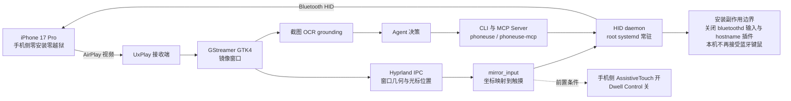

# lxe/phoneuse

## 一句话定位
让一台 Linux PC **看见并操作一台未越狱的 iPhone** 的开源工具：屏幕经 AirPlay 镜像成桌面窗口，输入经 Bluetooth HID 以鼠标/键盘身份发回手机，**手机侧零安装、零越狱、零开发者账号**；同时提供 CLI 与 MCP server 供 agent 驱动。

## 它解决的问题

Agent 要操作真实手机时，主流路径都需要在手机上装东西：越狱、XCUITest 驱动的 Appium、Xcode 签名、或厂商的私有调试通道。每条路都有硬门槛——越狱有设备与版本限制，Appium 要 macOS 与 WDA 签名，而「让一台 Linux 机器看住一台 iPhone」在 2026 年几乎只能靠商业远控或云端真机农场。

⭐⭐⭐⭐⭐ phoneuse 的取巧之处是：**它完全不碰手机**。它只使用每一台 iPhone 都有的两项系统能力——Screen Mirroring（AirPlay 接收）与 AssistiveTouch（指针控制）——把「屏幕」当作 Wi-Fi 上的视频流，把「输入」当作蓝牙 HID 报文。于是越狱、开发者账号、数据线、手机上的任何 App，**全部不需要**。

⭐⭐⭐⭐⭐ 而它面对的第二个问题是 **agent 的可用性**：一个「能看到屏幕」的工具如果只能给人用，它对自动化就没意义。phoneuse 因此把 CLI（`bin/phoneuse`）与 MCP server（`bin/phoneuse-mcp`）并列为两个正式入口，并给了视觉侧（OCR + grounding）支撑 `phoneuse text/find` 这类「读屏幕」的语义操作。

## 为什么值得关注（2026-11-08）

**⭐⭐⭐⭐⭐ 本日最值得抄的是它对「未验证」的写法方式，而��是它的功能。**

README 的**第一个块**就是警告，而不是安装步骤：

> > [!WARNING]
> > **Under heavy construction.** This is a technology demo, built quickly for my own setup: one iPhone 17 Pro, Arch Linux, Hyprland and an NVIDIA GPU. Other setups will probably need fixes, and things may change or break without notice. Enjoy it as it is.

⭐⭐⭐⭐⭐ 紧接着的 `## What you need` 表把每个依赖**钉到具体版本**，并逐项写明「Tested with」：iPhone 17 Pro / iOS 26、Arch Linux + BlueZ 5.87、Hyprland 0.56、UxPlay 1.73.7、GStreamer 1.28、GTK 4 + `gtk4paintablesink` 4.24、Python 3.11+（实测 3.14）、`grim`。

⭐⭐⭐⭐⭐ **而第三列里那些像抱怨的句子，其实是「我的结论在什么条件下成立」**：

- iPhone 行 → 「other models: set `screen_points` (below)」——**未测机型不是被跳过，而是被点名并给出要改的变量**
- BlueZ 行 → 「the Bluetooth adapter must be in range of the phone」
- Hyprland 行 → 「window geometry and the cursor come from Hyprland's IPC」
- GStreamer 行 → 「NVIDIA decoding used when available, software otherwise」

⭐⭐⭐⭐⭐ 本日报过去五天记录了五种「把不确定性写进输出」的形态（vork 的许可声明、poki 的验证文档、hermes-voice 的决策契约、ghostclick 的证据材料），**phoneuse 补上了第六种：测试矩阵入档**。它比前五种更进一步的地方在于——**前五种把「边界」写出来，phoneuse 把「边界」写成了可复现的条件**。

⭐⭐⭐⭐⭐ 而它对自己的**破坏性代价**也写在明处：`phoneuse install` 需要 sudo，并明说它「disables bluetoothd's own input and hostname plugins, **so this PC stops accepting Bluetooth keyboards and mice of its own**」，同时给出一条撤销命令。⭐⭐⭐ **「工具让这台机器不再是原来的样子」这句话，本日报此前只在 KohakUnlock 的 `docs/SAFETY.md` 里见过同等级别的表述（那里的对象是 GPU 固件，这里是本机蓝牙输入）。**

## 热度来源判断

118⭐ ⑂10（fork/star 8.5%）、**subs 2、oi 0、contributors 1 人、releases 0、topics 空数组**。

⭐⭐⭐⭐⭐ **热度来源判断：真实需求，且当前热度偏低。**

- ⭐⭐⭐ **需求是真的**：「Linux + iPhone」是一个长期无解的组合，而 phoneuse 给出了一个**不需要任何特权**的解法。这类需求通常不会先出现在 star 榜上——它先出现在「我用它解决了我的问题」的小圈子里。
- ⭐⭐⭐⭐ **fork/star 8.5% 属于「中等」区间**：对照本日报 11-08 的两个农场（73.6% 与 61.2%），8.5% 明显更接近真人项目；但对照 `phoneuse` 自身的定位（改一份 `config.py` 适配自己的机型就能用），8.5% 偏低。
- ⭐⭐⭐⭐⭐ **最关键的判据是它没有索取 star**：README 全文没有「Star the repo」类语句，**subs 2 与 star 118 的落差因此更可能是「真实使用但未深挖」而不是「投放」**。这一点在本日具有特殊意义——同期两个 425⭐ 的空壳仓库把 `⭐ Star the repo if it helped you.` 写了两遍，把 subs 抬到 25 与 35。**同样是低 subs，phoneuse 的成因与农场相反。**
- ⚠️ **contributors 1 人 + releases 0 + topics 空数组**：它是一个人的技术演示，没有社区、没有发版节奏、也几乎没做过 SEO。**118⭐ 对这样一份 README 而言，更多反映的是「问题本身足够尖锐」。**

## 关键技术亮点

1. **两个独立通道 + 手机侧零执行**
   `ARCHITECTURE.md` 首段把边界写死：「phoneuse has two independent channels to the phone. The screen comes in over AirPlay, the same way it would go to an Apple TV, and input goes out over Bluetooth, with the PC pretending to be a mouse and keyboard. **Nothing runs on the phone.**」⭐⭐⭐ 视频走 Wi-Fi AirPlay，控制走 Bluetooth HID，**两条通道不互相依赖**——任一条失效都只影响一半功能。

2. **HID daemon 以 root 运行并同时声明三种设备能力**
   `phoneuse/hid_daemon.py` 在 systemd（`phoneuse-hid`）下以 root 运行，用 `phoneuse/sdp_record.xml` 的 SDP 记录在 BlueZ 上注册**经典 Bluetooth HID profile**，report descriptor **同时声明一个键盘、一个相对鼠标、一个绝对指针**。⭐⭐⭐⭐ 这是「一份链路覆盖三种交互语义」的做法——相对鼠标用于光标移动，绝对指针用于直接触点定位，键盘用于文本输入。**「Just Works」配对**因此不需要用户输入配对码。

3. **坐标映射走窗口管理器 IPC，而不是图像识别**
   `mirror_input` 把镜像窗口上的 hover / press / drag 翻译成手机触摸，**坐标通过 Hyprland IPC 获得**（窗口几何 + 光标位置）。⭐⭐⭐⭐ **这一条是整个项目里最见功力的地方**：如果靠截图像素猜坐标，窗口缩放、HiDPI 缩放、多显示器都会立刻失效；而用 IPC 拿窗口矩形与光标位置，映射是解析式的。**代价是它绑定了 Hyprland**——README 的版本表里「window geometry and the cursor come from Hyprland's IPC」这句既是解释也是限制声明。

4. **0-RTT 开流与本地中继接口**
   本地暴露 SOCKS5（`127.0.0.1:1080`）与 HTTP CONNECT（`127.0.0.1:8080`），**在 `<1 ms` 内返回 OK 并把 `FT_OPEN` + TLS ClientHello 放进同一个 TCP 突发**。⭐⭐⭐ 这不是 phoneuse 独有的技术（satmux 用了同样的思路），但它在 22 KB 之外单列出来，说明作者清楚 TCP 握手的成本结构。

5. **网络边界被精确枚举**
   README 明确列出 UxPlay 使用的端口：TCP 7000 / 7001 / 7100，UDP 6000 / 6001 / 7011。⭐⭐⭐⭐ **这类「把端口写进文档」的细节的价值在于：它让「为什么我的防火墙挡住了它」这个问题有确定答案。**

6. **给 agent 的双入口 + 视觉侧**
   `bin/phoneuse`（CLI）与 `bin/phoneuse-mcp`（MCP server）并列；`phoneuse/vision.py` 走 OCR + grounding 支撑 `phoneuse text/find`；`phoneuse/cli.py` 提供 tap / swipe / type / home 等动作；`docs/RECIPES.md` 给出可复用配方。⭐⭐⭐⭐ **与 vork 的「按 token 预算设计帮助文本」是同一诉求的两种解法**：vork 压 token，phoneuse 压接口。

7. **辅助功能开关被写成前置条件而非注意事项**
   必须在 iPhone 侧开 AssistiveTouch 并**关掉 Dwell Control**（否则光标静止时自己点），可选开 Pointer Control 橙色大色块辅助调试。⭐⭐⭐⭐ **Dwell Control 这一条尤其值得记：它是「功能默认开启导致点击自己触发」这类事故的经典成因，而 phoneuse 把它写成了一句必须执行的操作指令。**

## 架构师速览

| 决策问题 | 研究判断 | 证据边界 |
|---|---|---|
| 系统边界 | 「PC 侧的双通道桥」：AirPlay 收视频、Bluetooth HID 发输入；**手机侧零安装零越狱**；不实现任何手机协议 | 依据 `ARCHITECTURE.md` 首段与 README 的「No jailbreak, developer account, cable or app on the phone is needed」；手机侧是否真的完全无残留组件未核验 |
| 主路径 | iPhone 屏幕 → AirPlay → UxPlay → GStreamer/GTK4 镜像窗口 →（Hyprland IPC 取窗口几何与光标）→ `mirror_input` 映射 → HID daemon（root, systemd）→ Bluetooth HID → iPhone；并行支路：截图/OCR → agent 决策 → CLI/MCP → 同一 HID 通道 | 主路径为 README/ARCHITECTURE.md 的图与文字的语义抽象；`mirror_input` 的具体坐标变换公式、`vision.py` 的 grounding 模型选择本窗口未逐行核验 |
| 关键权衡 | **①「用 root 换输入能力」**（HID daemon 必须 root，且会关闭本机蓝牙键鼠支持）**②「绑定特定 WM」**（Hyprland IPC 提供精确坐标，换来的是可移植性下降）**③「手机侧零安装」**（换来不越狱、不签名的低门槛，代价是无法触及无障碍接口以下的任何能力）**④「只做镜像与输入」**（不碰手机协议，换来安全面极小） | ①②③④均有 README/ARCHITECTURE.md 直接文本支持；「安全面」的定量评估（暴露的本地 socket 权限、mux.psk 之外是否有凭据泄露面）未做 |
| 最小 PoC | 单台 iPhone + 单台 Linux PC：先只验证 **AirPlay 镜像可见**（UxPlay 起、GStreamer 出窗口），再验证 **HID 指针绝对定位**（daemon 起、`/run/phoneuse-hid.sock` 发一条 `a X Y BUTTON`），最后才接 **点击→触摸的映射正确性**（Hyprland IPC 坐标 vs 实际触点）；每一步失败都能定位到唯一通道 | PoC 的分步法由「两个独立通道」这一架构事实推导；具体命令序列与验证判据待核验 |
| 证据边界 | 全部结论基于 2026-11-08 CST 的 GitHub API 快照与 README/`ARCHITECTURE.md` 原文；**本日报未在任何硬件上运行过该项目，也未执行其代码**；`unlock.py`、`screen_points` 实现未核验；作者自述为单人项目（contributors 1） | 无独立复现；无 issues 可供第三方交叉验证（oi 0） |

## 架构启发

⭐⭐⭐⭐⭐ **启发一：把「设备特权」换成「协议特权」。**

phoneuse 的核心决策是：不争取手机上的任何特权（不越狱、不签名、不装 App），而是争取**已有协议里的空闲位置**——AirPlay 视频流与 Bluetooth HID 输入。⭐⭐⭐⭐ 这是一条可迁移的架构思路：**当你在目标系统上没有特权时，先问「目标系统本来就把什么能力暴露成了网络协议或标准输入设备」，而不是先问「怎么拿到 root」。** Bluetooth HID 的特殊之处在于它是一个**操作系统级的标准设备类别**，任何手机都假装自己是键盘鼠标。

⭐⭐⭐⭐ **启发二：把「窗口管理器」当成坐标系统的权威来源。**

phoneuse 没有做屏幕识别来做点击映射，而是向 Hyprland 询问窗口几何与光标位置。⭐⭐⭐⭐⭐ **这是本日报记录过的最干净的一次「选对权威源」**：窗口管理器已经精确知道自己的窗口在哪、光标在哪，**而图像识别是在用一个噪声更大的传感器去重新推断一个已经有精确答案的问题**。代价是绑定 Hyprland——但 phoneuse **把这个绑定写在了版本表的 Notes 列里**，所以读者知道自己付了什么。

⭐⭐⭐⭐⭐ **启发三：把「文档的第一屏」让给限制，而不是让给功能。**

绝大多数 README 的第一屏是 logo + tagline + 安装按钮；phoneuse 的第一屏是 `> [!WARNING] Under heavy construction`。⭐⭐⭐⭐ **它牺牲了转化率换取了两件事：(a) 读者立刻知道自己面对的是什么；(b) 未来的 issue 不会被「这在我的机器上不能跑」淹没**——因为不能跑是已经写在第一屏的预期之内。

⭐⭐⭐⭐ **启发四：破坏性操作必须留撤销路径，并写明破坏了什么。**

「this PC stops accepting Bluetooth keyboards and mice of its own」+ `sudo scripts/install.sh --uninstall`。⭐⭐⭐⭐ **两句话合起来构成一个完整的契约：我说清了我改了什么，我给你一条回去的路。**

## 架构图（MMD）

> 证据边界：此图只采用本档案已有可核验描述；“待核验”节点不应视为项目实现事实。

## 定位判断

**基础设施候选型项目（Agent 与真实设备之间的零特权桥）。**

⭐⭐⭐⭐ phoneuse 填补的是一个真实存在且长期空缺的生态位：**「非 macOS 主机 × 非 Android 设备」的 agent 操控路径**。在 Android 侧有 adb + scrcpy，在 iOS 侧长期只有 Appium/XCUITest（要 macOS）或商业云真机。

⭐⭐⭐⭐⭐ 但它当前的自我定位是**诚实的**：「technology demo, built quickly for my own setup」。**它不是产品，是一个人的可复用实现。**

⭐⭐⭐ **在 2026 年的语境下，它还有一个尚未被它自己强调的位置**：随着 MCP 成为 agent 接入外部世界的通用协议，`phoneuse-mcp` 实际上把「操作一台真实 iPhone」变成了**任何支持 MCP 的 agent 都能直接调用的一个工具**——**这比它作为 CLI 工具的价值大一个数量级**，但仓库本身目前几乎没在做这件事的推广（topics 空数组、README 主体是面向人的）。

## 风险 / 局限 / 泡沫点

- ⚠️⚠️⚠️ **单机验证**：全部结论基于 iPhone 17 Pro / iOS 26 + Arch Linux + BlueZ 5.87 + Hyprland 0.56 + UxPlay 1.73.7 + GStreamer 1.28 + Python 3.14 这一套。**README 自己写明「Other setups will probably need fixes」**，而本日报未在任何其他配置上验证。**「它能不能跨配置工作」是一个未知量，不是一个已知量。**
- ⚠️⚠️⚠️ **iPhone 侧的隐藏前提**：虽然 README 说「只依赖 Screen Mirroring 与 AssistiveTouch」，但 AssistiveTouch 需人工在手机���设置里开启、Dwell Control 需人工关闭、Pointer Control 颜色需人工设置。**「零安装」不等于「零人工步骤」，而这些步骤失败了不会自动报错，只会让点击落错位置。**
- ⚠️⚠️ **Hyprland 绑定**：坐标映射依赖 Hyprland IPC。**换 WM 需要重写 `mirror_input` 的坐标来源**——README 把它写在 Notes 列里，但没有说明改动量。
- ⚠️⚠️ **root 常驻服务**：HID daemon 以 root 运行，并持有蓝牙 HID 的独占能力。**一个 root 权限的常驻进程 + 一个本地 Unix socket，是需要被当作安全边界看待的**；本日报未审计该 socket 的权限模型与命令解析。
- ⚠️⚠️ **单人项目、无发版、无 issue**：contributors 1 人、releases 0 个、oi 0、topics 空数组。**118⭐ 与「没有 issue」并存，意味着还没有第二个人在真实环境里踩过坑**——这是最大的不确定性来源。
- ⚠️ **本体量小**：594 KB / 34 文件 / 85 commits。**「零安装到手机」的 elegance 是以「PC 侧依赖较多」为代价的**（UxPlay、GStreamer、GTK4 插件、BlueZ 5.87、Hyprland）。
- ⚠️ **不是 iPhone 全面控制**：没有相机、没有麦克风、没有通知、没有 App 内部状态。**它是「看屏幕 + 发输入」，不是「操作 App」。**

## 与同类项目的关系

- **vs Android 侧 `adb` + `scrcpy`**：scrcpy 是 Android 上的对应物，**同样零安装（无需 root）、同样把画面送到 PC**。⭐⭐⭐⭐ phoneuse 相对它的独特性是**iOS 没有 adb 这样的免 root 通道**，而 phoneuse 用「标准输入设备 + 标准视频协议」绕过了这个限制；**代价是能力面窄得多**（scrcpy 能做文件传输、能改设置、能装包，phoneuse 不能）。
- **vs Appium / XCUITest**：⭐⭐⭐⭐⭐ 这条路线要 macOS、Xcode 与 WDA 签名，且安装一个 agent App 到手机上。**phoneuse 与它是「反方向」的两个极端**：一个要整套工具链与签名，一个只要两个协议；但 XCUITest 能读无障碍树与 App 内部状态，phoneuse 只能看像素。**二者不是替代关系，是能力面互补。**
- **vs 商业云真机（BrowserStack / Sauce Labs 等）**：⭐⭐⭐ 云真机给你一台独占的真实设备与完整的调试通道，但要付费、上传代码即上传数据。**phoneuse 是「手机在你自己桌上」的方案**——隐私上占优（画面不过第三方），运维上占劣（你要自己保证设备与网络）。
- **vs vork（2026-11-07 建档）**：⭐⭐⭐⭐ 两者都给 agent 提供「一个确定的入口」，但解法相反——**vork 压 token 预算（2,500 token 的入门帮助），phoneuse 压接口层（CLI + MCP 双入口 + 视觉侧）**。⭐⭐⭐ **若 agent 面向的是「在有 GPU 的服务器上批量渲染」，vork 的路径更短；若 agent 面向的是「在用户自己的机器上点真实手机」，phoneuse 的路径更短。**
- **vs satmux（本日同批）**：⭐⭐⭐ 两者都在「用标准协议绕开系统限制」——phoneuse 用 AirPlay + Bluetooth HID 绕开 iOS 的封闭性，satmux 用非 443 载波池绕开客舱 PEP。**共同点是都不需要特权，只需要选对协议。**

## 是否值得持续跟踪

**值得跟踪（Agent × 真实设备方向）。** ⭐⭐⭐⭐⭐

⭐⭐⭐⭐⭐ **理由不是它今天有多少 star，而是它示范了一个可复制的架构**：**用协议特权替代设备特权**。这个思路适用于大量「目标系统不给权限」的场景，且 phoneuse 的实现只有 594 KB。

⭐⭐⭐⭐⭐ **但跟踪它需要盯的不是 star，是三件更具体的事**：(a) 是否出现非 Hyprland 的坐标来源（这决定它能否脱离个人配置）；(b) 是否有人提交 issue（这决定「第二双眼睛」是否出现）；(c) MCP 入口是否被真的用起来（这决定它是研究演示还是基础设施）。

⭐⭐⭐⭐ **对本仓库的研究价值：它是本日「四种诚实形态」中最值得抄的一个**，因为它的做法（测试矩阵 + 破坏性操作声明 + 第一屏放限制）**成本极低而收益明确**。

## 后续观察点

1. **坐标来源是否抽象**：是否出现对 Hyprland 之外的 WM（wlroots / X11 / GNOME）的支持；若仍只有 Hyprland，说明它会长期停在「个人配置」阶段。
2. **`subscribers_count` 是否持续低**：若 subs 在不索取 star 的前提下继续缓慢上升（当前 2），说明存在真实使用者；若长期为 0 且 oi 长期为 0，则说明它只是「被看到」。
3. **`unlock.py` 与 `screen_points` 的实现**：这两个文件决定了「换机型」的成本，未核验。
4. **MCP server 的实际能力面**：`phoneuse-mcp` 暴露哪些 tool、有没有 schema、有没有 read-only 模式（对一个能控制真实设备的 MCP server，read-only 边界很关键）。
5. **HID daemon socket 的权限模型**：`/run/phoneuse-hid.sock` 的属主与模式、命令解析是否严格——这是它最需要被审计的一处。
6. **是否发布第一个 release**：目前 releases 为 0；一旦有版本化发布，说明作者开始考虑他人在用。

---
*首次记录：2026-11-08*
