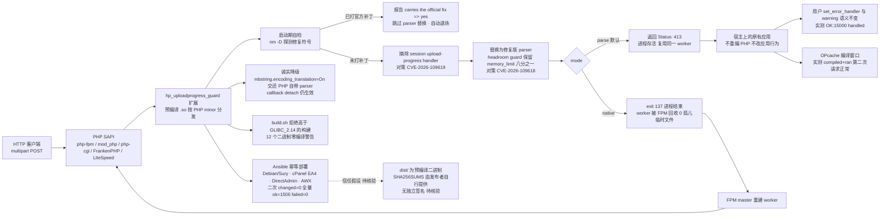

# HOSTED-POWER/php_uploadprogress_guard

## 一句话定位
一个可加载的 PHP 扩展，逐组件镜像 CVE-2026-109618 / CVE-2026-109619 的官方修复，让**没打补丁的 PHP** 也移除已公布攻击链的每一环——不重编 PHP、不改宿主上任何应用行为，升级后自动退场。

## 它解决的问题
2026-10-21 PHP 发布 CVE-2026-109618（OOM → `longjmp()` 使 Zend 引擎状态失效 → RCE）与 CVE-2026-109619（FPM worker 请求间残留全局状态 → UAF → RCE），两条都是 `critical`，修复版本为 8.2.35 / 8.3.36 / 8.4.27 / 8.5.12。

对多数站点，「升级到 8.2.35 以上」就是答案。但存在一类机器没有这个选项：发行版已停更的 LTS、厂商把 PHP 嵌进 appliance / 网络设备 / 管理界面（NCSC-NL 公告点名了这一类：「administrators may not be able to update PHP directly」）、自编译的旧版本、或锁死了包管理器的共享主机。这些机器在补丁到达前只能改 `php.ini` 或加 WAF 规则——**而 php_uploadprogress_guard 指出这两者都不解决问题**：`ikow/php2shell-poc` 的 README 明确写道「The OOM corruption (Chain D) is in the Zend engine core — **no INI setting fixes it**」。

这个项目填的正是这段窗口：把缓解措施本身做成有版本、有测试、有退场机制的正经软件。

## 为什么值得关注（2026-10-22）
**不是因为它星多（53⭐ 是本批最低之一），而是因为它是本日唯一把「临时缓解方案」当作长期工程对象来做的项目**，并且在三个方面做到了临时方案通常缺失的事：

1. **可复核的实测证据。** README 的 v3.1.0 段给出的是**具体输入 + 具体输出数值**（15000 字段的单个 multipart body、exit 255 / 137 / 0、`Status: 413`、`code 70`、孤儿临时文件计数），而不是「有效」「已修复」这类断言。本日报采信的所有材料中，这是唯一带完整数值的一组。
2. **自检让位机制。** 用 `nm -D` 探测引擎是否导出修复符号，已打补丁则跳过 parser 替换并报告 `carries the official fix => yes`。这意味着**装了它的机器在升级 PHP 后会自己退场**，不需要任何人工卸载动作——这是临时缓解方案最重要的工程属性，而它被写进了机制而非文档说明。
3. **把自己的两次回归写进 README。** v3.0.0 修了 v2.2.0 在 PHP 7.0–7.4 上拒绝所有 multipart 请求的 bug；v3.0.1 修了 v3.0.0 二进制在 Debian 12 及更早因 `GLIBC_2.38` 无法加载、**导致 PHP 继续运行但 guard 未生效**的 bug。第二个回归尤其值得注意——它意味着用户可能在毫无察觉的情况下处于「以为装了、其实没生效」的状态，而 README 把这件事写在了首页。

## 热度来源判断
53⭐ ⑂4 的绝对量级说明**这不是被广泛采用的工具**。更合理的读法是：它诞生于一个真实且迫切的时间窗口（补丁发布后 12 小时），而这类项目天然不会成为 star 收割品——**它的用户是那批「机器今天就要被攻击」的运维，而不是 GitHub 的探索者**。

fork-star 7.5% 与 `subscribers_count = 4` 都偏低，这与「托管商为自己机队构建、公开出来分享」的自述一致：**这是一个厂商把自己的内部应急方案开源的案例，不是社区驱动的项目**。

**反向信号同样要说清楚**：README 开头就写「**Install the official PHP release… we recommend it without reservation**」——**作者自己把它定位为候补而非首选**。加上它明确列出了失败场景（`mode=parse` 会改变超大 multipart 的响应语义、`mode=native` 会牺牲 worker、mbstring 开启时放弃镜像 parser），这是一个克制到 unusual 的项目。**结论：热度低是定位使然，不是缺陷；但「维护者只有一人 + 一家托管商」是真实的持续性风险。**

## 关键技术亮点
1. **逐组件镜像官方补丁，覆盖 PHP 5.6–8.5 十二个 minor，每分支每 SAPI 单独测试。** 不是写一份补丁说明，而是编译出十二份针对具体引擎版本的二进制，并给出按版本的测试结果。
2. **三个机制对应两条 CVE：** 移除 session upload-progress handler（对 109619：handler 在每个 multipart 请求上、于请求初始化之前运行，能消费同一 worker 上前一个请求留下的状态）· 携带修复版 parser 并让 parser 本身不可能 OOM（对 109618，用 headroom guard 保留 `memory_limit` 的八分之一）· `mode=native` 在 OOM 时直接结束进程（exit 137）而非让半初始化状态继续服务下一个请求。
3. **自检让位：** `nm -D` 探测修复符号。README 给出逐版本结果——Sury 的 5.6.40-104 / 7.0.33-92 / 7.3.33-35 / 7.4.33-31 / 8.1.34-9 / 8.3.36-1 全部报 `carries the official fix => yes`，官方 docker 的 8.4.11 / 8.1.20 / 7.4.33 / 5.6.40 全部报 `no` 且机制全 active，并说明「Neither fix symbol exists on any unpatched engine (`nm -D`)」。
4. **孤儿上传临时文件：** php-fpm 场景下 `mode=native` 时 worker 因 `child exited with code 137` 被回收且 **0 个孤儿上传临时文件**，而**原生 PHP 启动失败会留下 1 个（`code 70`）**——在共享主机上这是磁盘耗尽的一个真实来源。
5. **不改变用户代码语义：** `set_error_handler` + 未定义变量 + `trigger_error` 的 15000 字段 POST 在 8.4 与 5.6 上均返回 `OK:15000 handled: … handled: custom`，证明请求状态重置不动用户的错误处理器。
6. **两处诚实降级：** mbstring 的多字节 hook 是 file-static、无法镜像，因此 `mbstring.encoding_translation=On` 的宿主交还给 PHP 自带 parser（callback detach 仍生效）；8.0–8.3 的副本不再依赖中途才加入的 `max_multipart_body_parts`。
7. **构建基线：** 12 个二进制零编译警告、不高于 `GLIBC_2.14`，修复探针以 versionless weak reference 形式存在（`objdump -T` 可查）；`build.sh` **拒绝任何高于 `GLIBC_2.14` 的构建**——这是 v3.0.1 回归的直接对策。
8. **部署幂等性有实测：** Ansible 二次运行 `changed=0`，全量部署 `ok=1506 failed=0`；web1/2/3 经 AWX 各 `changed=4` 且 fpm 重启、二次重跑 `changed=0`；cPanel EA4 与 DirectAdmin CustomBuild 两类真实面板均 `failed=0 changed=0`。

## 架构启发
这个项目示范了一件在安全领域少见的事：**把「临时」这个属性编码进架构，而不是只写在免责声明里。**

大多数缓解方案的隐含假设是「装上就一直有效」，于是它要么长期驻留并与官方补丁冲突，要么需要用户记得手工卸载。而这个项目把「什么时候我应该消失」变成了一个**可被机器判定的问题**——引擎是否导出了修复符号？——并把这个判定做进每次加载的路径里。同样的思路还体现在：升级到带补丁的 PHP 后，**它报告 skipped 而不报错**，因为「我不做事了」在这个语境下是成功状态而不是失败状态。

第二个启发是关于**降级的表达方式**。mbstring 场景的降级不是静默的：README 说清了为什么不能镜像（file-static hook）、降级到什么程度（callback detach 仍生效）、以及这只影响哪些配置。把「做不到什么」写得和「做到什么」一样清楚，是这个项目可信度的主要来源。

第三个启发关于**验证的可证伪性**。「我们的扩展有效」是不可检验的陈述；「15000 字段的 multipart body 在未打补丁的 8.4.11 / 8.1.20 / 7.0.33 / 5.6.40 上，无模块时 exit 255、`mode=native` 时 exit 137、默认 `mode=parse` 时 exit 0 且 `Status: 413`，四个版本结果一致」是可以被任何人复现的。

## 架构师速览

| 决策问题 | 研究判断 | 证据边界 |
|---|---|---|
| 系统边界 | 一个 PHP 扩展（`src/hp_uploadprogress_guard.c` + `config.m4`）+ 按 PHP minor 预编译的 NTS x86_64 `.so` 与 SHA256SUMS（`dist/`）+ 重建脚本（`build.sh`，从官方 `php:<X.Y>-cli` 镜像重建）+ 测试三件（`test/probe.php`、`test/run-builtin-server.sh`、`test/fcgi-probe.py`）+ 实际部署用的 Ansible task 与 ini（`ansible/`）。**控制面在 PHP 引擎内部**（handler 摘除 + parser 替换 + 内存余量闸门 + OOM 退出策略），**数据面是 multipart 请求解析** | 全部来自 README 的「Repository layout」与 v3.1.0 测试段；**逐符号级的引擎内部改动（具体 patch 了哪些 Zend 结构）README 未展开**，只说 mirrors the official fix component by component——这是审计该扩展时的第一道信息缺口 |
| 主路径 | 请求进入 → 请求初始化阶段 session upload-progress handler 已被摘除（对 109619 的直接对策）→ parser 换成修复版并带 headroom guard，`memory_limit` 的八分之一保持空闲（对 109618 的直接对策）→ 若真发生 OOM，`mode=native` 结束进程而非让半初始化状态继续跑 → 请求结束后状态被重置，用户的 error handler 不受影响 → 升级到带官方补丁的 PHP 后，`nm -D` 探测到修复符号即跳过 parser 替换 | 逐条来自 README 的 v3.1.0 测试表、临时文件计数、error handler 测试、fix detection 段；**`mode=parse` 与 `mode=native` 的自动选择逻辑、headroom guard 与 OOM exit 的优先级关系 README 未说明** |
| 关键权衡 | **自研缓解层（覆盖补丁空窗期，代价是必须逐版本跟引擎结构）vs 只发检测（安全但不阻断）vs 等发行版 backport（最稳但可能永远不来）** · `mode=parse` 返回 413（保住进程，但改变了服务端对超大 multipart 的响应语义）vs `mode=native` 直接 exit 137（语义最贴近「崩溃」，但牺牲 worker）· 预编译二进制覆盖 5.6–8.5 十二个 minor（覆盖广，但每个都要单独构建与测试）vs 只支持当前分支（省事，但嵌入式与 LTS 机器恰恰是老分支）· 在 `mbstring.encoding_translation=On` 的宿主上放弃镜像 parser（诚实降级）vs 强行镜像（可能出错）· 主动向 PHP 官方发行版退让（自检到已修复就跳过）vs 长期驻留（与官方补丁冲突的风险） | README 明示「we recommend it without reservation」「it notices and steps aside」「steps aside on its own, so there is nothing to undo」以及 mbstring 与 max_multipart_body_parts 两处降级说明；**未明示：12 个 minor 二进制矩阵的维护机制、与未来 CVE 的兼容性、以及长期维护者承诺** |
| 最小 PoC | 1. 找一台**不能升级 PHP** 的机器（发行版停更 / 厂商 appliance / 自编译旧版）→ 2. 核对 `nm -D` 确认修复符号**不存在**（README 用这条命令证明未打补丁机没有该符号）→ 3. 从 `dist/` 取对应 minor 的 `.so` 并核对 SHA256SUMS → 4. 用 `test/probe.php` 确认模块加载且报 detached → 5. 用 `test/run-builtin-server.sh` 复现 v3.1.0 表：15000 字段 POST 前后各一次 GET，确认得到 `Status: 413`（`mode=parse`）或 worker 被回收且无孤儿临时文件（`mode=native`）→ 6. 装一个带 `set_error_handler` 的脚本，确认 `handled:` 前缀仍在（证明未改用户代码语义）→ 7. 跑一次 Ansible tag-scoped 部署，**再跑第二次确认 `changed=0`**（幂等性是这个项目最值得学的工程纪律）→ 8. 升级 PHP 到带补丁版本，确认自检报告 `carries the official fix` 并自动让位 | PoC 顺序完全按 README 已给的证据链倒排；**第 2 步与第 8 步是整个 PoC 的意义所在**：证明「装了会自己退场」比证明「装了能挡住」更重要；**第 5 步是唯一真正需要自己动手的部分，前 3 步的产物 README 都已提供** |

## 架构图（MMD）

> 证据边界：此图只采用本档案已有可核验描述；标注「待核验」的节点不应视为项目实现事实。

## 定位判断
**生产可用（针对特定窗口），而非通用推荐。** 这是一个**候补方案**——作者自己在 README 第一句劝你装官方发行版。它的适用范围非常明确：**补丁到达之前、包管理器不会供上补丁、且你无法更换机器的那段窗口**。这个窗口可能是几天（发行版跟进快）、几个月（LTS backport 慢），也可能永远（厂商 appliance）。

不属于「生产可用」的另一层含义是**它不适合所有站点**：绝大多数能升级的机器装它没有意义（升级本身就是更完整的修复），而 `dist/` 里是预编译二进制，这本身构成一个信任假设。

从生态位置看，它填补的是一个此前没有专职产品的缝隙：**「CVE 的临时缓解方案」通常以博客文章或一条 `php.ini` 配置的形式存在，很少被做成可版本化、可测试、可退场的软件**。这个项目证明了这条路可行。

## 风险 / 局限 / 泡沫点
1. **⚠️ `dist/` 是预编译二进制，发布者即构建者。** 即使有 SHA256SUMS，宿主仍需信任发布者。这是所有「预编译缓解方案」的共同性质，也是本项目最大的信任假设——它恰好出现在安全事件中，读者是否有能力验证是另一件事。
2. **维护是单人 + 一家托管商。** 上游 PHP 若在 Zend 引擎结构上做新改动，镜像可能失效。README 未说明跟进机制，也未见路线图。
3. **存在一个「以为装了、其实没生效」的失败模式，且它真实发生过。** README 自己记录了 v3.0.1 的回归（`GLIBC_2.38` 二进制在 Debian 12 及更早加载失败，**PHP 继续运行但 guard 未生效**）。用户如何自行确认当前生效，README 未给一键命令。
4. **`mode=parse` 改变了服务端对超大 multipart 的响应语义**（从 255 变成 `413`）。如果上游应用依赖原有行为，这是一次行为变更而非纯加固。
5. **与 WAF / `session.upload_progress.enabled=Off` 叠加是否会冲突，README 未讨论。** NCSC-NL 建议的第一条正是 `session.upload_progress` 禁用。
6. **`subscribers_count = 4`，53⭐ ⑂4。** 这不是被广泛验证的工具。
7. **版本矩阵的隐性成本：** 12 个 minor × 多 SAPI × 多面板的组合测试在版本发布时是真实工作量，而这类工作量通常不产生可见回报，容易在注意力转移后衰减。

## 与同类项目的关系
- **vs 直接升级 PHP（官方推荐的正解）：** 不是竞品而是互补。它的价值恰恰建立在「升级不可行」这个前提上，README 第一句就劝你升级。
- **vs `session.upload_progress.enabled=Off`（PHP 官方缓解）：** 官方 INI 开关能挡住 109619 的一部分，但**挡不住 Chain D**（OOM 路径在 Zend 引擎核心里，`ikow/php2shell-poc` 明言没有任何 INI 设置能修）。本项目做的是 INI 做不到的那部分。
- **vs WAF 规则（`modsecurity.conf` / Suricata / OpenResty Lua）：** WAF 在网络层看请求，本扩展在引擎内部改行为。**两者是叠加关系而非替代关系**——WAF 可能被编码变形绕过，扩展不依赖请求特征。
- **vs `syhunt/php2shell-protection`（同事件，62⭐ ⑂6，PHP + MIT）：** 那个走的是 Apache 侧的加固（multipart POST 阻断、请求大小限制），属于配置层；本项目走的是引擎层。**两者可叠加但 README 均未讨论对方。**
- **vs `HOSTED-POWER` 自家机队 vs 社区项目：** 这个项目的独特之处不在技术，而在**它是厂商把自己的内部应急方案开源**——这决定了它有真实的生产环境（cPanel、DirectAdmin、AWX 部署）作为测试床，而这是社区项目通常没有的。

## 是否值得持续跟踪
**值得，且优先级高于它的 star 数。** 理由与热度无关：**它是本日唯一一个把「临时缓解方案」当作长期工程对象来做、并把「自己会退场」写进机制设计的项目**。这两条（可复现的验证记录 + 自动让位）正是所有临时缓解方案通常缺失的部分，且这个模式可迁移到任何「等上游修复」的场景——不只是安全事件。

对**没有受影响机器**的读者，它的价值是方法论参照：可按它的 README 组织方式检查自己团队的应急方案是否具备「可验证」与「会退场」两条属性。

**明确的跟踪建议：**
- **若你有不能升级 PHP 的机器**：按上面的最小 PoC 走一遍，尤其确认第 2 步（`nm -D`）与第 8 步（自检让位）。**先装官方发行版，本模块只当候补。**
- **若你没有**：跟踪 `dist/` 的信任模型是否被独立验证、12 分支持续矩阵如何维护、以及是否出现第二维护者。

## 后续观察点
1. **是否出现独立签名或第三方可复现构建。** 当前 `build.sh` 存在且可从官方镜像重建，这是好基础，但发布者即构建者。观察是否有 SBOM、签名或第三方构建出现。
2. **12 个 minor 的版本矩阵如何跟随 PHP 新版本。** 观察是否出现 `dist/` 停止更新的版本落后——那将直接导致「装在老机器上有效、新机器上无对应二进制」。
3. **是否与官方缓解叠加出问题。** 特别是与 `session.upload_progress.enabled=Off` 或 WAF 规则共存时。
4. **是否有第二维护者或上游（PHP 社区）认可。** 这是判断项目生命力的最直接指标。
5. **未来 CVE 时是否复用同一套方法。** 如果下一个 CVE 也出现「等 backport」的窗口，这个项目是否会变成常设工具，还是一次性应急产物。
6. **`releases` API 当前返回空数组**（分发走 `dist/` 与文档）——观察是否开始发正式 release 标签，以及是否有可校验的版本号体系。

---

*首次记录：2026-10-22*