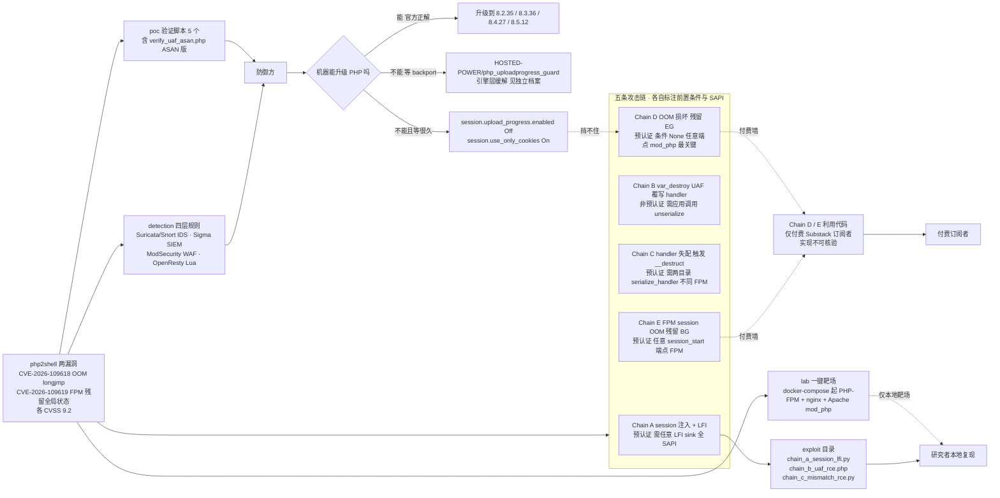

# ikow/php2shell-poc

## 一句话定位
CVE-2026-109618 / CVE-2026-109619 的 PHP 预认证 RCE 研究与工具包——把两条 CVE 拆成五条标注了前置条件与 SAPI 的攻击链，配一键 Docker 靶场、四类检测规则与逐链验证脚本。

## 它解决的问题
2026-10-21 PHP 发布两条 `critical` 级 RCE：

| CVE | GHSA | CVSS | 官方描述 |
|---|---|---:|---|
| CVE-2026-109618 | GHSA-w8hw-w9fx-j79w | 9.2 | OOM → `longjmp()` 使 Zend 引擎状态失效 → RCE |
| CVE-2026-109619 | GHSA-6wmf-4rv5-p3rp | 9.2 | FPM worker 请求间残留全局状态 → UAF → RCE |

官方补丁为 commit `3584a98bda`（作者日期 2026-10-18T15:26:39Z，标题 `Avoid state corruption via bailout`，**改动 300 个文件**），首个 release `php-8.5.12` 于 2026-10-21T14:06:46Z 发布。**advisory 发布（13:34Z）到 release 发布只隔了 32 分钟，而补丁 commit 的作者日期比 advisory 早 3 天**——修复早于披露，披露早于分发。

问题在于：一条 CVSS 9.2 的预认证 RCE 在补丁发布当天下午被公开，而受影响面是「所有用 PHP 提供 Web 服务的安装」。管理员需要立刻知道三件事——**哪条链真的能用、怎么复现安全地验证自己有没有被打、怎么在 IDS/WAF 上加规则**。这个项目一次性回答了这三个问题。

## 为什么值得关注（2026-10-22）
**因为它的 star 数是本日最高的，而这恰恰是最需要被谨慎解读的一件事。**

13 小时 859⭐ ⑂308（fork-star 35.9%，本批最高，是昨日记录的最高值的两倍以上），但：

1. **最关键的两条利用代码不免费。** `exploit/` 目录只公开 Chain A / B / C 三个文件；README Disclaimer 明写「Exploit code for Chains D and E (zero-dependency RCE) is available to **paid subscribers** of the writeup」。而 Chain D 正是作者自己判定为最关键的那条。**star 数最高的那部分价值，恰好是免费拿不到的。**
2. **热度来源是 CVE 事件而非工具采用。** 859⭐ 出现在 `created_at` 后约 13 小时，这个速度度量的是事件关注度。
3. **⚠️ 许可证存在可核验的不一致。** GitHub API 的 `license.spdx_id` 为 **null**（即 `NOLICENSE`），而 README 末尾写 **MIT**。以 GitHub 侧为准，该仓库**未附可被识别的许可证文件**——这对要复用其检测规则或靶场配置的人是一个必须先澄清的前置问题。

那么它为什么仍然值得建档？因为**它的资产分布与 star 数无关**：`detection/` 里四类规则（Suricata/Snort IDS · Sigma SIEM · ModSecurity WAF · OpenResty/Nginx Lua）覆盖了网络层、SIEM 层、WAF 层与应用层四层；`lab/` 的 `docker-compose.yml` 同时起 PHP-FPM + nginx + Apache mod_php，这解决了「我想安全地复现但没有三套 SAPI 环境」的实际困难。**这些是可复用的，与它有多少 star 无关。**

## 热度来源判断
**热度是真实的，但性质是「CVE 注意力洪峰」而非「工具采用」。** 三条可核验的理由：

1. **时间尺度**：13 小时 859⭐ 与 `subscribers_count = 4`、`open_issues_count = 2` 并存。**深度关注者极少**——说明绝大多数 star 来自事件驱动的围观，而非把仓库加入日常工具链。
2. **内容分布**：五条链中最重要的 D/E 在付费墙后，公开的 A/B/C 需要应用侧存在 LFI sink 或调用 `unserialize()`——**这些前提在真实生产环境中比 D/E 少得多**。也就是说，**免费部分的价值低于 star 暗示的水平**。
3. **生态同质化严重**：同一事件下还有 `eness/php2shell-...-PoC`（530⭐ ⑂94，无 license）、`9bie/php2shell-bypass-aslr-exp`（356⭐ ⑂130，21.5 MB，无 description）、`Zer061/CVE-2026-109618`（52⭐ ⑂39）、`junaire/CVE-2026-109618-exploit`（74⭐ ⑂49）、`wakemeiflose/php2shell`（34⭐ ⑂14）等多个竞争 PoC，多数无 license 或无 description。**多个项目同时抢同一个事件的热度，本身就说明热度是事件给的，不是质量给的。**

**但 fork-star 35.9% 需要单独解释，不能简单归为噪声。** 这个比例异常高（昨日记录的最高值是 fx0 的 18.6%）。一个合理的机制解释是：**这个仓库带 `lab/docker-compose.yml` 一键靶场与五条可运行的验证脚本，fork 一个仓库去搭自己的复现环境是有直接用途的**——而 fork 一个终端或一个 PHP 扩展则不然。**这是推断，不是事实**，且它只是本日四个数据点之一，不足以支撑普遍结论。

## 关键技术亮点
1. **五条链各自标注「是否预认证 / 需要什么条件 / 适用哪个 SAPI」**——这是把一个模糊的「PHP 有 RCE」变成五个可分别判断的问题的关键动作：
   - **Chain A**：session 注入 + LFI（预认证，需应用有任意 LFI sink，全 SAPI）
   - **Chain B**：`var_destroy` UAF → handler 覆写（非预认证，需应用调用 `unserialize()`，全 SAPI）
   - **Chain C**：handler 失配 → `__destruct`（预认证，需两个目录 `serialize_handler` 不同，FPM）
   - **Chain D**：OOM 损坏 → 残留 `EG()`（**预认证，条件「None — any endpoint」，mod_php**）
   - **Chain E**：FPM session OOM → 残留 `BG()`（预认证，任意 `session_start()` 端点，FPM）
2. **作者自己判定 Chain D 最关键**：「zero-dependency pre-auth RCE against any Apache mod_php installation. No LFI, no app vulnerability, no authentication — just a single multipart POST」。这个判定与官方 advisory 中「PHP considers the risk highest for mod_php」的表述一致（NCSC-NL 转述）。
3. **`lab/` 一键靶场：** `docker-compose.yml` 同时起 PHP-FPM + nginx + Apache mod_php，配 `php-apache.ini` 与 `setup.sh`——**这让「验证我自己的机器是否受影响」从「需要一台脏机器」变成「一条 docker-compose」。**
4. **`poc/` 五个验证脚本逐链对应**，其中 `verify_uaf_asan.php` 用 ASAN 复现 UAF 类问题——对内存破坏类漏洞用 ASAN 是标准做法，能把「疑似 UAF」变成「确证 UAF」。
5. **`detection/` 四类规则同一仓库覆盖四个层次：** `php2shell.rules`（Suricata/Snort IDS）· `php2shell.yaml`（Sigma SIEM）· `modsecurity.conf`（ModSecurity WAF）· `php2shell.lua`（OpenResty/Nginx Lua 模块）。
6. **缓解建议附带边界声明：** `session.upload_progress.enabled = Off` + `session.use_only_cookies = On`，并明写「**The only complete fix is patching PHP to 8.2.35 / 8.3.36 / 8.4.27 / 8.5.12+. The OOM corruption (Chain D) is in the Zend engine core — no INI setting fixes it.**」——**明确否定了「改 ini 就行」的流行说法**，与 `HOSTED-POWER/php_uploadprogress_guard` 的存在互为印证。
7. **下游影响表逐框架标注条件而非笼统打勾：** WordPress 核心不用 PHP session（但 WooCommerce 与多数插件用）· Joomla 默认用原生 session · Drupal 默认用原生 session · Magento **在维护模式下仍受影响** · Laravel 的 `PendingBroadcast` 是已知 `__destruct` gadget。「在维护模式下仍受影响」这一条尤其有用——它直接否定了「进维护模式」这个常见止血动作。

## 架构启发
这个项目最值得借鉴的不是漏洞本身，而是**它把「一个模糊的 CVE 编号」拆成「一组可分别判断的前提」的组织方式**。

大多数 CVE 分析给出的是「影响范围广，建议尽快升级」。这个项目给出的是：**五条链，每条注明是否预认证、需要什么应用侧条件、适用哪个 SAPI**。这个结构让三类人各自能立刻行动——系统管理员按 SAPI 判断、开发者按应用侧条件判断、检测工程师按攻击特征判断。**「把一件事拆成若干条带前置条件的断言」是任何 CVE 研究的通用模板。**

第二个启发关于**验证环境的价值**。漏洞研究里的一个隐性瓶颈是：验证需要特定的环境组合（这里是三套 SAPI），而绝大多数人手上只有一套。`lab/docker-compose.yml` 把这个瓶颈消掉了——**这对复现生态的影响可能大于利用代码本身。**

第三个启发关于**否定性结论的价值**。「Chain D 在 Zend 引擎核心里，没有任何 INI 设置能修」这句话，比列出十条缓解措施更有用：它**防止了运维把时间浪费在一个看起来可行但实际无效的方案上**。这类「明确说某个方案不work」的表述，在安全领域稀缺且珍贵。

## 架构师速览

| 决策问题 | 研究判断 | 证据边界 |
|---|---|---|
| 系统边界 | 一个**研究/工具包仓库**，不是运行时组件。四类内容：① `exploit/` 三个可运行的利用脚本（A/B/C）② `poc/` 五个逐链验证脚本（含 ASAN 版）③ `lab/` 靶场编排（PHP-FPM + nginx + mod_php 三 SAPI）④ `detection/` 四层规则（IDS / SIEM / WAF / 应用层）。**第五部分（Chain D/E 利用代码）在付费墙外** | 仓库树（`git/trees/HEAD?recursive=1`）19 个文件路径 + README 的 Exploits / Attack Chains / Repository structure 三节；**D/E 利用代码的实现形态完全不可核验** |
| 主路径 | 研究者：clone → 起 `lab/docker-compose.yml`（三 SAPI 靶场）→ 逐条跑 `poc/verify_*.py` 确认哪条链在自己的环境成立 → 需要完整利用时走 A/B/C 的公开脚本，D/E 转付费墙。防御方：直接取 `detection/` 四类规则部署到现有 IDS/SIEM/WAF。缓解方：读 README 的 Mitigation 段（并注意它明说了 INI 修不了 Chain D） | 逐条来自 README 的 `exploit/` `poc/` `lab/` `detection/` 四节 + Mitigation 段；**`lab/docker-compose.yml` 的镜像 tag、初始化脚本细节与是否含已打补丁的对照环境本窗口未取内容** |
| 关键权衡 | **公开可复现（`lab/` + `poc/` 让验证成本极低）vs 保持稀缺性（把 D/E 放付费墙）**——这个项目明确选择了后者，且用前者补偿 · **覆盖五类检测层（IDS/SIEM/WAF/应用）vs 专注一层（做深一条线）** · **逐框架标注下游影响（WordPress 核心/插件分开说）vs 笼统打勾** · **NOLICENSE 的实际效果（检测规则无法安全内嵌进商业产品）vs MIT 自述带来的可用性预期** | README 明示付费墙（Disclaimer）、五链条件表、下游影响表；**未明示：许可证意图（是疏漏还是刻意）、`detection/` 规则的测试覆盖、以及 lab 是否含已修复版本的对照环境** |
| 最小 PoC | 1. **不要在生产机上试** → 2. clone 后起 `lab/docker-compose.yml`（README 提供的靶场，起三套 SAPI）→ 3. 先跑 `poc/verify_oom_trigger.py` 确认 Chain D 的触发条件（这一条作者判定为最关键且零依赖）→ 4. 跑 `poc/verify_uaf_asan.php` **在 ASAN 下**确认 Chain B 的 UAF 是确证而非疑似 → 5. **防御侧优先于利用侧**：把 `detection/php2shell.rules` 投到测试环境的 Suricata，把 `modsecurity.conf` 投到测试环境的 ModSecurity，确认规则命中 → 6. 确认自己所有 PHP 机器的版本是否 ≥ 8.2.35 / 8.3.36 / 8.4.27 / 8.5.12（**注意 `openai/php2shell-checker` 明言 UNKNOWN 不等于已打补丁**）→ 7. 对不能升级的机器，转 `HOSTED-POWER/php_uploadprogress_guard` 的方案 → 8. **复用 `detection/` 规则前先解决许可证问题**（GitHub 侧 `license.spdx_id` 为 null） | PoC 顺序刻意把防御侧放在利用侧之前；**第 5 步（规则是否真能命中）比第 3 步（能否复现）对多数人更有价值**；**第 8 步是本项目特有的、不可跳过的一步** |

## 架构图（MMD）

> 证据边界：此图只采用本档案已有可核验描述；标注「待核验」的节点不应视为项目实现事实。

## 定位判断
**研究材料与检测资产（观察型），而非可直接依赖的工具。**

在 CVE 响应的分工里，这个项目占据了「谁解释漏洞 + 谁提供检测」两个位置——而这恰恰是 `NCSC-NL/php2shell`（谁在国家层面处置）与 `HOSTED-POWER/php_uploadprogress_guard`（谁在等补丁期间先保住机器）所不覆盖的部分。四层分工合起来，才构成一次完整的 CVE 响应。

它的独特优势不是唯一性（同事件至少有六个竞争 PoC），而是**完整性**：链 + 靶场 + 检测三者齐备在一个仓库里。竞争者大多只提供链。

**它不适合作为依赖引入生产流程**，原因有三：许可证不明（`license.spdx_id` 为 null）、利用代码部分不公开、以及它在 24 小时内的形态大概率还会变（`pushed_at` 距采集时刻不到 13 小时）。

## 风险 / 局限 / 泡沫点
1. **⚠️ 许可证不一致（可核验的事实）。** GitHub `license.spdx_id` = null，README 写 MIT。以 GitHub 侧为准即无授权。**这直接影响 `detection/` 规则能否被安全内嵌进商业产品**——这是复用前必须澄清的第一件事。
2. **最关键的利用代码不公开。** Chain D（作者判定最关键）与 Chain E 在付费墙后。**免费拿到的三条链都需要应用侧前提（LFI sink 或 `unserialize()`），在真实生产环境中的成立概率低于 Chain D/E。**
3. **热度来源是事件而非采用。** 13 小时 859⭐ 与 `subscribers_count = 4`、`oi = 2` 并存。**任何基于「今天最热的项目」做技术选型的判断，在这个案例上都会失效。**
4. **README 的影响面数字缺乏独立来源。** 「影响 78% 的网站，其中 WordPress 43%」是**作者主张**，本档案未独立核验。相比之下 `NCSC-NL/php2shell` 在 `software/` 目录给出具体产品清单——**「给产品名」比「给百分比」可核验得多**。
5. **生态同质化且质量参差。** 至少六个竞争 PoC，多数无 license 或无 description。作为研究参考没问题，作为「权威来源」需要交叉验证。
6. **非 GPL 授权的竞争者也可能更严谨。** 没有任何机制保证这个仓库的链条描述是准确的——**五条链中 D/E 的实现不可核验，其余三条也应自行验证而非直接采信。**
7. **README 引用了外部来源（Wiz 的下游影响演示、Sansec 的 PHPSESSID 堆泄漏发现、Corelight 的社区规则、Cloudflare 的 WAF 覆盖说明），本档案未逐条核验这些引用。**

## 与同类项目的关系
- **vs PHP 官方 advisory（GHSA-w8hw-w9fx-j79w / GHSA-6wmf-4rv5-p3rp）：** 不是竞品。官方给出 CVE、受影响版本范围与修复；本项目给出链条、复现与检测。**引用链细节时应回到官方 advisory 核对。**
- **vs `NCSC-NL/php2shell`（96⭐ ⑂21，EUPL-1.2，TLP:CLEAR）：** 分工不同。NCSC-NL 给出国家级处置建议、CERT-EU 编号 2026-018、引用其他成员国 CSIRT 公告，并在 `software/` 目录提供受影响产品清单；本项目提供技术细节。**NCSC-NL 有一句本项目没有的判断**：「PHP is also embedded in appliances, network devices, management interfaces and other vendor products where **administrators may not be able to update PHP directly**」——**这正是 `php_uploadprogress_guard` 存在的理由。**
- **vs `HOSTED-POWER/php_uploadprogress_guard`（53⭐ ⑂4，MIT）：** 互补而非替代。本项目提供「为什么必须改引擎」的证据（Chain D 在 Zend 核心里，无 INI 可修），guard 提供「那怎么办」。**两者的缓解建议可以叠加，README 均未讨论对方。**
- **vs `openai/php2shell-checker`（310⭐ ⑂22，Apache-2.0）：** 分工清晰。本项目做检测引擎（规则），checker 只做版本判定，且诚实声明「UNKNOWN 不等于已打补丁」「不独立验证安全修复」。**checker 的 Limitations 段是本项目缺失的东西。**
- **vs `syhunt/php2shell-protection`（62⭐ ⑂6，PHP + MIT）：** 那个走 Apache 侧加固（multipart POST 阻断、请求大小限制），属配置层；本项目走规则层。**两者可叠加。**
- **vs 同事件的其他 PoC（`eness/...`、`9bie/...`、`Zer061/...`、`junaire/...` 等）：** 内容重叠，多数无 license。本项目的相对优势是完整性（链 + 靶场 + 检测）与作者自述的背景（Qi Deng / Substack 长文）。

## 是否值得持续跟踪
**作为研究材料跟踪，作为依赖不推荐。** 三条明确理由：

1. **可抽取的资产**：`detection/` 四类规则与 `lab/` 靶场配置是可直接复用的东西，值得抽出来单独评估。
2. **不可核验的部分**：Chain D/E 的实现、README 的 78% 影响面数字、以及引用的外部来源，都需要交叉验证。
3. **必须先解决的前置问题**：NOLICENSE 与 MIT 自述的不一致——在这个事件里大家都在复制粘贴规则，而规则能不能商用取决于许可证。

**具体动作建议：**
- **防御方（多数人）**：直接取 `detection/` 规则部署，同时用 `openai/php2shell-checker` 之类做版本盘点——**规则能否内嵌进商业产品需先澄清许可证**。
- **研究者**：优先看 `lab/` 与 `poc/`，而不是 `exploit/`——公开的三条链前提更强，而靶场与验证脚本是更稀缺的资产。
- **不建议**：把这个仓库加入生产工具链依赖，或引用其影响面数字。

## 后续观察点
1. **是否会补上 LICENSE 文件。** 这是决定 `detection/` 规则能否被安全内嵌进商业产品的唯一因素，也是本档案列出的第一待观察项。
2. **Chain D / E 的公开程度。** 若作者后续免费放出，观察是否引发更多同类研究（当前的付费墙客观上限制了扩散，也限制了被独立验证的机会）。
3. **四类检测规则是否被主流项目合并。** README 提到 Corelight 的社区规则；观察 Suricata / ModSecurity / Sigma 官方规则库是否吸收本项目的规则——**被合并是检测质量的第三方背书**。
4. **README 的「78% 网站 / WordPress 43%」是否会补上独立来源。** 目前是作者主张。
5. **仓库形态在 24 小时后的稳定性。** `pushed_at` 距采集时刻不到 13 小时，观察是否继续高频改动、链条描述是否被修正。
6. **同事件生态是否收敛。** 六个竞争 PoC 中是否有项目主动合并或退出——收敛通常意味着事实被交叉验证完毕。

---

*首次记录：2026-10-22*