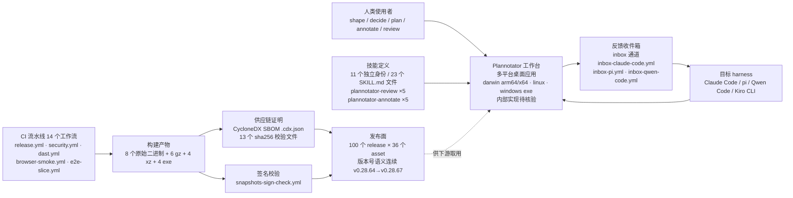

# backnotprop/plannotator

## 一句话定位
**一个「保持在 agent 循环里」的桌面工作台 —— 它本日最值得记的技术事实是发布链：100 个 release，每个带 36 个 asset，其中包含 CycloneDX SBOM JSON 与逐文件 sha256 清单。**

## 它解决的问题
⭐⭐⭐⭐⭐ **coding agent 的工作流断裂。** README 描述（实测）：

> The workspace to stay in the loop and on top of agents - shape, decide, plan, annotate, review code, share with team, and send all feedback to agents with one click.

⭐⭐⭐⭐⭐ **它把「人」重新放回 agent 循环里**：人负责 shape / decide / plan / annotate / review，⭐⭐⭐⭐⭐ 反馈一键送回 agent。⭐⭐⭐⭐⭐ topics 实测包含 `claude-code` / `codex` / `opencode` / `pi-mono` / `obsidian` / `plan-mode` / `skills` —— ⭐⭐⭐⭐⭐ **即它不是又一个 IDE 插件，而是要同时接住多个 harness 的「中间层」。**

## 为什么值得关注（2026-11-18）
⭐⭐⭐⭐⭐ **因为它是本数据集里第一个把「供应链产物」写进 release 的项目 —— 100 个 release × 36 个 asset，其中每个 release 都带一份 CycloneDX SBOM 和一份 sha256 校验清单。⭐⭐⭐⭐⭐ 这让 11-16 提出的「release 资产是否随版本变化」这条判据第一次有了一个可用的正面样本。**

**可核验事实（2026-11-18 CST 快照）。**

| 指标 | 实测值 |
|---|---|
| stars / forks / subs / open issues | 13,035 / 1,313 / 34 / 181 |
| 体积 / blobs | 379,909 KB / 7,261 |
| 语言 / 许可 / 创建 / 最后 push | TypeScript / Apache-2.0 / 2025-12-28T02:09:40Z / 2026-11-17T22:25:20Z |
| homepage | `https://plannotator.ai` |
| **release / tag** | **100 / 100** |
| **每个 release 的 asset 数** | **36**（实测 `v0.28.67` / `v0.28.66` / `v0.28.65` 三个版本均为 36） |
| **asset 构成** | `.json` 1（SBOM）· `.sha256` 13 · 无扩展名 8 · `.gz` 6 · `.xz` 4 · `.exe` 4 |
| **SBOM 文件名实测** | `plannotator-0.28.67-release-sbom.cdx.json`（**CycloneDX 格式**，文件名含版本号） |
| 单个 release 总体积 | **2,569.09 MB**（`v0.28.67`）/ 2,560.66 MB（`v0.28.66`）/ 2,552.88 MB（`v0.28.65`） |
| 最大单个 asset | **221,427,712 B**（≈211 MB） |
| asset 下载次数（前 12） | `v0.28.67`: 1,2,3,3,3,3,3,3,3,4,4,4 · `v0.28.66`: 4,4,4,4,4,5,6,6,6,7,7,7 |
| CI 工作流 | 14 个（`release.yml` / `security.yml` / `dast.yml` / `browser-smoke.yml` / `e2e-slice.yml` / `snapshots-sign-check.yml` / `relay.yml` / `inbox-claude-code.yml` / `inbox-pi.yml` / `inbox-qwen-code.yml`） |
| **SKILL.md 文件数 / 独立身份** | **23 / 11**（`plannotator-review` 5 份 · `plannotator-annotate` 5 份 · `plannotator-last` 4 份 · `plannotator-inbox` 2 份 · `update-deps` 1 · `review-renovate` 1） |
| harness 目录 | `.agents` + `.claude-plugin`（2 套） |
| 贡献者 | `backnotprop` 10,030 · `leoreisdias` 24 · `BenNewman100` 21 · `uvw` 21 · `utpalsinghdev` 21 · `FNDEVVE` 17 · `rdm-cpu` 16 |

⭐⭐⭐⭐⭐ **⭐⭐⭐ 本日最硬的一条结构发现：它的 23 个 `SKILL.md` 只有 11 个独立技能身份，⭐⭐⭐⭐⭐ 复制倍数最高的是 `plannotator-review`（5 份）与 `plannotator-annotate`（5 份）—— ⭐⭐⭐⭐⭐ 分布在 `apps/kiro-cli/skills/`、`apps/qwen-code/skills/` 等不同 app 目录下。⭐⭐⭐⭐⭐ 即 `SKILL.md` 文件数同样是「复制放大型计数」。**

⭐⭐⭐⭐⭐ **⭐⭐⭐ 而它的 tag→commit 链也是「真」的：实测 `v0.28.67` 的 tag commit 改 11 个文件（其中 0 个源码）、其父 commit 改 25 个文件（其中 19 个源码）；`v0.28.66` 的 tag commit 改 14 个文件（11 个源码）、父 commit 改 12 个文件（0 个源码）。⭐⭐⭐⭐⭐ ⭐⭐⭐ 即功能 commit 在 tag commit 与父 commit 之间**交替出现**，⭐⭐⭐⭐⭐ 这进一步确认了 11-18 的结论：**判据是「链上有没有真实 diff」，而不是「功能 commit 在前还是在后」。**

⭐⭐⭐⭐⭐ **⭐⭐⭐ 还有一条：`snapshots-sign-check.yml` 这个工作流名说明它对「快照」做签名校验。⭐⭐⭐⭐⭐ 配合每个 release 的 13 个 `.sha256` 校验文件与 CycloneDX SBOM，⭐⭐⭐⭐⭐ 即它把「发布物可验证」做成了流水线的一等步骤 —— ⭐⭐⭐⭐⭐ 这在本数据集的 25 个 Trending 仓库里是独一份。**

## 热度来源判断
⭐⭐⭐⭐⭐ **判断：热度来自一个真实且未被解决的工作流痛点（人怎么和 agent 一起工作），并有非常扎实的工程执行；但它的可读性门槛（100 个 release、2.5 GB/版本、SBOM）说明它已经是一个「有运维负担的成熟产品」，而不是一个玩具。**

支撑的**可核验事实**：
1. **⭐⭐⭐⭐⭐ 单一主导 + 真实外部贡献者**：`backnotprop` 10,030 commits（占绝对多数），⭐⭐⭐⭐⭐ 加上 `leoreisdias` 24、`BenNewman100` 21、`uvw` 21、`utpalsinghdev` 21、`FNDEVVE` 17、`rdm-cpu` 16 —— **有 7 位有实质贡献的外部开发者。**
2. **⭐⭐⭐⭐⭐ 供应链纪律**：每个 release 36 个 asset，含 SBOM + sha256；`snapshots-sign-check.yml` 做签名校验；`security.yml` + `dast.yml` + `browser-smoke.yml` + `e2e-slice.yml` 四类安全/测试工作流。
3. **⭐⭐⭐⭐⭐ release 版本号语义连续**（`v0.28.64` → `v0.28.67`），⭐⭐⭐⭐⭐ **且 SBOM 文件名内嵌版本号（`plannotator-0.28.67-release-sbom.cdx.json`），⭐⭐⭐⭐⭐ 即每个版本的 SBOM 是独立生成的，不是复制粘贴。**

⭐⭐⭐⭐⭐ **⚠️ 不作主张的部分**：⭐⭐⭐⭐⭐ **本日报未下载任何 release asset、未校验 sha256、未反汇编任何二进制、未安装该应用。**⭐⭐⭐⭐⭐ **asset 的下载次数（1–12 次/个）是极低的，⭐⭐⭐⭐⭐ 这说明「release 多」与「被下载得多」在这里是两回事 —— ⭐⭐⭐⭐⭐ **本日报不据此主张采用度。**⭐⭐⭐⭐⭐ **本日报未做 star 增速的时间序列统计。**

## 关键技术亮点
1. **⭐⭐⭐⭐⭐ 每个 release 都带 CycloneDX SBOM**
   实测 asset 名 `plannotator-0.28.67-release-sbom.cdx.json`（`.cdx.json` = CycloneDX 的 JSON 序列化）⭐⭐⭐⭐⭐ —— **⭐⭐⭐⭐⭐ 这是本数据集里第一次见到「SBOM 作为 release 的一等产物」。⭐⭐⭐⭐⭐ 对 Electron/Tauri 类桌面应用而言，这直接回答了「这个二进制里有什么」的问题。**

2. **⭐⭐⭐⭐⭐ 逐文件 sha256 校验**
   实测每个 release 13 个 `.sha256` 文件，覆盖 8 个无扩展名的二进制 + 6 个 `.gz` + 4 个 `.xz`（部分重复计入）⭐⭐⭐⭐⭐ —— **即下载方能独立验证每一个压缩包与原始二进制的完整性。**

3. **⭐⭐⭐⭐⭐ 多平台二进制矩阵**
   实测 asset 名含 `plannotator-darwin-arm64` / `plannotator-darwin-x64` / `plannotator-linux-*` / `plannotator-windows-*.exe` ⭐⭐⭐⭐⭐ —— **配合 4 个 `.exe`（Windows 全平台），⭐⭐⭐⭐⭐ 即它把「一个版本 = 全部平台」当作发布契约。**

4. **⭐⭐⭐⭐⭐ 签名校验工作流**
   `snapshots-sign-check.yml` ⭐⭐⭐⭐⭐ —— **⭐⭐⭐⭐⭐ 即它对「快照」做签名核验，⭐⭐⭐⭐⭐ 而快照通常来自 CI 构建产物 —— **这是把供应链攻击面挡在发布链内部的做法。**

5. **⭐⭐⭐⭐⭐ 「inbox」型工作流让反馈成为一等公民**
   实测工作流名 `inbox-claude-code.yml` / `inbox-pi.yml` / `inbox-qwen-code.yml` ⭐⭐⭐⭐⭐ —— **⭐⭐⭐⭐⭐ 即「把 agent 的反馈送回某个 harness」是自动化的，⭐⭐⭐⭐⭐ 而不是一个手工复制粘贴的动作。**

6. **⭐⭐⭐⭐⭐ 技能按 app 维度复用**
   实测 `apps/kiro-cli/skills/plannotator-review` 与 `apps/qwen-code/skills/plannotator-review` 是同一身份的两份副本 ⭐⭐⭐⭐⭐ —— **即「一次定义、多端分发」的模式被用在**技能**上，与 ECC 的 9 套 harness 目录是同一类做法（但本项目只有 2 套目录、5 倍复制）。**

## 架构师速览

| 决策问题 | 研究判断 | 证据边界 |
|---|---|---|
| 系统边界 | **一个「跨 harness 的人机协作工作台（桌面应用）+ 一条带供应链证明的发布链」**。应用边界 = 多平台桌面二进制（`plannotator-{darwin,linux,windows}-*`）；集成边界 = 多个 harness 的 inbox 通道（Claude Code / pi / Qwen Code / Kiro CLI）；发布边界 = npm/GitHub release + SBOM + 校验清单 + 签名检查 | 实测 asset 清单、14 个工作流名、23 个 SKILL.md 路径；**应用内部架构（Electron? Tauri? 原生?）未核验，未运行** |
| 主路径 | 用户在 Plannotator 里 shape/plan/annotate/review → 反馈经 inbox 通道送回对应 harness（Claude Code / pi / Qwen Code）→ agent 执行 → 结果回流到 inbox → 用户签收。**发布路径**：功能 commit → `release.yml` → 构建多平台二进制 → 生成 SBOM（`.cdx.json`）→ 生成逐文件 sha256 → `snapshots-sign-check.yml` 校验签名 → 发布 36 个 asset | 主路径由 README 描述 + 工作流名 + asset 清单反推；**SBOM 的生成工具、签名算法、校验是否强制未核验** |
| 关键权衡 | ①**发布可验证性** vs **发布体积** → 每个版本 2.5 GB（SBOM + 多格式压缩 + 多平台）；②**一次定义多处可用** vs **维护分叉** → 5 份同一技能的副本（11 身份 / 23 文件）；③**自动化反馈回路** vs **人工确认** → inbox 工作流自动化了投递，但 `review` 仍由人做 | ①由 asset 体积实测；②由身份去重实测；③由 inbox 工作流名 + README 的 "human approves" 语义推断，**审批点位置未核验** |
| 最小 PoC | 只接**一个** harness（建议 Claude Code，因为 `inbox-claude-code.yml` 存在）→ 跑一次「计划 → 批注 → 送回 agent → 回流签收」的完整回路 → 检查 inbox 消息是否可溯源（能否定位到具体 commit/文件）→ 再评估第二、第三个 harness 的边际接入成本 → 最后才看 release 资产（SBOM/校验）是否值得依赖 | PoC 范围与退出路径由本档案推导；**具体消息格式、溯源粒度、审批点均未核验** |

## 架构启发
⭐⭐⭐⭐⭐ **启发一（本日的核心）：「发布资产」终于成为一条可用的判据维度。** ⭐⭐⭐⭐⭐ 11-16 提出「release 多不等于有发布史」，11-17 用「tag → commit → diff」补上了代码侧，⭐⭐⭐⭐⭐ **本日 `plannotator` 补上了产物侧 —— 36 个 asset 里每个版本都有独立生成的 SBOM 与校验清单。⭐⭐⭐⭐⭐ ⭐⭐⭐⭐⭐ 三者合起来才是一条完整判据：tag 数 / release 数 / diff 闭合 / 资产随版本演进。**

⭐⭐⭐⭐⭐ **启发二：SBOM 作为 release 产物，是桌面/二进制分发项目最低成本的信任建立方式。** ⭐⭐⭐⭐⭐ 一个 `.cdx.json` + 13 个 `.sha256` 的成本几乎为零（CI 里跑一遍），⭐⭐⭐⭐⭐ 收益是「任何下载方都能独立验证」⭐⭐⭐⭐⭐ —— **⭐⭐⭐⭐⭐ 这比在 README 里写「我们很安全」有效得多。**

⭐⭐⭐⭐⭐ **启发三：技能复制的倍数是可管理的，但必须被度量。** ⭐⭐⭐⭐⭐ 本项目 23 文件 / 11 身份 = 2.1×，ECC 1,087 / 330 = 3.3×，⭐⭐⭐⭐⭐ `cursor/plugins` 173 / 113 = 1.5×，⭐⭐⭐⭐⭐ `Tencent/LoopForge` 21 / 9 = 2.3×。⭐⭐⭐⭐⭐ **⭐⭐⭐⭐⭐ 建议把「复制放大比」列成 skill 仓库的常规体检项 —— ⭐⭐⭐⭐⭐ 它同时揭示了「内容产出」与「分发投入」的比例。**

⭐⭐⭐⭐⭐ **启发四：功能 commit 在 tag 上还是父上，是一个伪命题。** ⭐⭐⭐⭐⭐ 本项目 `v0.28.67` 的功能在**父** commit，`v0.28.66` 的功能在 **tag** commit ⭐⭐⭐⭐⭐ —— **⭐⭐⭐⭐⭐ 同一仓库内两种形态交替出现，⭐⭐⭐⭐⭐ 所以判据只能是「链上有没有 diff」。**

## 架构图（MMD）

> 证据边界：此图只采用本档案已有可核验描述；标注「待核验」的节点不应视为项目实现事实。

## 定位判断
**工具型 —— 且是本数据集里「工程纪律」最完整的一端。** ⭐⭐⭐⭐⭐ 在 Agent 工具链里，本项目占的位置是「**人机协作的中枢**」：⭐⭐⭐⭐⭐ `ag-ui-protocol/ag-ui`（11-17 档案）管的是「agent 与前端的协议」，`obra/superpowers`（本数据集已有）管的是「agent 的工作方法论」，⭐⭐⭐⭐⭐ **本项目管的是「人怎么把反馈送进 agent、并把 agent 的产出接回来」。** ⭐⭐⭐⭐⭐ 这三者是不同的层，不是竞争关系。

⭐⭐⭐⭐⭐ **⭐⭐⭐ 本日给它「工具型」而非「生产可用」的理由：⭐⭐⭐⭐⭐ asset 下载次数实测只有 1–12 次/个，⭐⭐⭐⭐⭐ 181 个 open issue，⭐⭐⭐⭐⭐ 且 14 个工作流里带 `dast.yml` / `security.yml` 说明它自己在做安全工程但**未核验其结论**。⭐⭐⭐⭐⭐ 真实采用度需要更多时间序列数据。**

## 风险 / 局限 / 泡沫点
1. ⭐⭐⭐ ⚠️ **发布体积**：⭐⭐⭐ ⚠️ 每个 release **2.5 GB**、36 个 asset、100 个 release —— ⭐⭐⭐ ⚠️ **对下游 CI 与制品库是持续的存储与带宽成本，⭐⭐⭐ ⚠️ 且本日报未核验这些 asset 的实际保留策略。**
2. ⭐⭐⭐ ⚠️ **skill 复制 5 倍**：⭐⭐⭐ ⚠️ `plannotator-review` / `plannotator-annotate` 各 5 份，⭐⭐⭐ ⚠️ **本日报未核验这 5 份是否由 CI 生成（若是手工复制，则存在漂移风险）。**
3. ⭐⭐⭐ ⚠️ **asset 下载次数极低**（1–12）：⭐⭐⭐ ⚠️ **说明「发布很多版本」与「被使用」在本项目上是两件事，⭐⭐⭐ ⚠️ 本日报不据此判定产品成败，但也不主张其采用度。**
4. ⭐⭐⭐ ⚠️ **单一主导者**：`backnotprop` 10,030 commits 占绝对多数，⭐⭐⭐ ⚠️ **关键人风险仍在**（虽有 7 位外部贡献者，但量级差 400 倍）。
5. ⭐⭐⭐ ⚠️ **未核验项**：应用的实际技术栈与内部架构、SBOM 的生成工具与覆盖完整性、签名算法与是否强制校验、181 个 open issue 的正文、asset 下载次数低的原因（是分发渠道问题还是使用方式问题）、发布体积是否是已知问题。

## 与同类项目的关系
- **vs `affaan-m/ECC`（本日档案）**：⭐⭐⭐⭐⭐ **两个都是「跨 harness 适配」但方向相反 —— ECC 卖「能力与配置的分发」，本项目卖「人与 agent 的协作回路」。⭐⭐⭐⭐⭐ 在复制放大比上 ECC 是 3.3×、本项目是 2.1×；在供应链纪律上本项目有 SBOM + 签名校验，ECC 有 SLSA3。**
- **vs `ag-ui-protocol/ag-ui`（11-17 档案）**：⭐⭐⭐⭐⭐ **协议层 vs 应用层互补** —— AG-UI 定义 agent↔前端的交互协议，本项目是这类交互的一个具体桌面实现。
- **vs `obra/superpowers`**：⭐⭐⭐⭐⭐ **方法论 vs 工作台** —— superpowers 定义 agent 应该怎么做事，本项目定义人怎么参与。
- **vs `backnotprop` 同门的 `elementalsouls/Claude-BugHunter`**：⭐⭐⭐⭐⭐ 无直接竞争，但**两者的「技能文件数 vs 独立身份数」比值分别是 1.0（83/83）与 2.1（23/11）**，⭐⭐⭐⭐⭐ 说明「复制放大」不是某些作者的习性，而是跨 harness 交付的普遍副作用。
- **vs `kajisho5/ffmpeg-skill`（11-17 档案）**：⭐⭐⭐⭐⭐ **发布纪律的两端 —— ffmpeg-skill「多而实但 0 asset」，本项目「多而实且 36 asset/版本」。**

## 是否值得持续跟踪
**值得，优先级高 —— 它是「发布纪律」这条判据目前最完整的样本。** ⭐⭐⭐⭐⭐ 三条理由：① 它提供了 11-16 判据缺失的**产物侧证据**（SBOM + 校验 + 签名），⭐⭐⭐⭐⭐ 可以让判据从「三分段」变成「四分段」；② 它的「inbox 自动化」是「人机回路」这个方向少见的实现，⭐⭐⭐⭐⭐ 与 `ag-ui` 的协议层形成上下游；③ ⭐⭐⭐⭐⭐ **它的 asset 下载次数极低但 release 极多，⭐⭐⭐⭐⭐ 这个反差本身是一个值得追的问题 —— 是分发渠道的问题，还是发布策略的问题。**

## 后续观察点
1. ⭐⭐⭐⭐⭐ **asset 下载次数是否随版本上升**（当前 1–12）—— ⭐⭐⭐⭐⭐ 若持续为个位数，说明「发布频率」与「实际分发」严重脱节
2. ⭐⭐⭐⭐⭐ **SBOM 是否扩展到更多产物类型**（当前只覆盖二进制）
3. ⭐⭐⭐⭐⭐ **11 个独立技能身份是否增长**（当前 11 身份 / 23 文件 / 5 倍复制）—— ⭐⭐⭐⭐⭐ **若身份数不变而文件数增长，说明投入在分发而非功能**
4. ⭐⭐⭐ ⭐ **inbox 支持的 harness 数**（当前 Claude Code / pi / Qwen Code / Kiro CLI）⭐⭐⭐⭐⭐ **新增一个即代表「多 harness 中枢」这一定位在推进**
5. ⭐⭐⭐ ⚠️ **发布体积是否是已知问题**（2.5 GB/版本 × 100 版本）

---

*首次记录：2026-11-18 · 全部元数据取自 2026-11-18 CST 的 GitHub REST API 快照（`repos/*`、`git/trees/*?recursive=1`、`commits/{sha}` 含 files diff、`tags`、`releases` 含 asset 元数据、`readme`、`contributors`、`users/*`、`forks?sort=newest&per_page=100`）*
