# snuri00/ps2-web-recomp

## 一句话定位
ps2-web-recomp 是 PS2 游戏的浏览器内静态重编译器——Emotion Engine（R5900）机器码被提前翻译为 C++ 并编译到 WebAssembly，主 CPU 永远不被解释；控制台其余（操作系统 + 硬件）由 WebGPU 运行时模拟；GT4 + GoW II 两游戏实测跑通；scripts/port.sh mygame mygame.iso → build/web-mygame 通用 ISO → page；MIT。

## 它解决的问题
2026 年复古游戏跨平台需求极大，但 PS2 游戏要么原生 PCSX2 桌面模拟器（无浏览器、无 console-like 体验）、要么原生 PS2（硬件老旧）、要么 Switch PS2 模拟器（商业闭源）。ps2-web-recomp 直击痛点：（1）**静态重编译**——Emotion Engine 主码重译为 C++ → WebAssembly，主 CPU 永远不被解释，性能 / 兼容性显著优于解释器；（2）**WebGPU 运行时模拟**——控制台其余（OS / 硬件）由 WebGPU 运行时模拟，浏览器内 50/60fps；（3）**通用 ISO → page**——scripts/port.sh mygame mygame.iso 通用，任何 PS2 游戏可尝试移植；（4）**GT4 + GoW II 实测**——GT4 50fps PAL release @ 2× PS2 resolution in Chrome + GoW II 60fps heavy combat @ PS2 resolution；（5）**HTTP Range disc read**——disc 读通过 HTTP Range requests，仅 executable 先下载；（6）**self-host game data**——游戏 disc 不携带，用户自带 disc image。解决的是 **「复古游戏 + 跨平台 + 浏览器内 + 严肃工程化」** 严肃工程化整合问题。

## 为什么值得关注（2026-10-14）
- **Stars:** 683（截至 2026-10-14），6 天 683⭐ ⑂59 fork/star 8.6%，**增长率** 8.6%（fork/star 反映社区参与）
- **Forks:** 59，社区参与度中（retrocomputing 类项目天然适合 fork 二次开发）
- **Size:** 12924 KB（含 eerecomp + WebAssembly build pipeline + WebGPU runtime + SPU2 + IPU + IOP + scripts/port.sh + GT4 + GoW II scripts）
- **License:** MIT
- **语言:** C++（主体）+ Python（scripts）+ C++20 + clang + CMake + Ninja
- **活跃度:** created 2026-10-08，pushed_at 2026-10-13，持续高活跃
- **平台:** Linux x86_64 + macOS Apple Silicon（wgpu-native on Metal）+ Chrome / Edge 浏览器（WebGPU）

## 热度来源判断
ps2-web-recomp 的热度是 **「复古游戏 + 浏览器内 + 严肃工程化 × Emotion Engine 静态重译 × WebGPU compute shaders × VU1 重实现 × SPU2 + IPU + IOP × GT4 + GoW II 实测 × scripts/port.sh 通用 × HTTP Range disc read × MIT」** 的组合。复古游戏需求极大但跨平台严肃工程化体验稀缺。静态重编译 + WebGPU + WebAssembly 的组合是「模拟器 + 严肃工程化」的新范式，自然爆火。热度真实且具「复古游戏 + 严肃工程化」场景的强需求。

## 关键技术亮点
1. **eerecomp 静态重编译器：** reads game's executable + follows control flow + finds functions + emits C++ in units of 16 KiB of guest code
2. **R5900 quirks 全保留：** 128-bit registers + multimedia instructions + branch delay slots + PS2 FPU（no infinities / denormals / 不同舍入）+ VU0 用作 coprocessor
3. **Jumps 间 tail call + thread switch unwind host stack：** generated code never needs a stack per guest thread
4. **PS2 kernel HLE：** threads + semaphores + interrupt handlers for DMA controller and VBlank + alarms + SIF channel
5. **IOP 解释器 + IOP kernel + libraries C++ 重写：** game's own IRX modules（sound driver + disc streaming + controller + memory card drivers）on R3000 CPU interpreter
6. **HTTP Range disc read：** only executable downloaded up front + rest streaming
7. **VU1 重实现：** pipeline delays of MAC + status and clip flags modelled + PS2 float rules（no infinities/NaN + denormals flushed to zero + overflow clamped）
8. **Microprograms 编译：** seen during test run 提前编译为 SIMD C++ + new ones 现场译为 WebAssembly（几毫秒）
9. **GS 4MB GPU memory + native swizzled layouts：** lives on GPU + drawing by WebGPU compute shaders
10. **GS 渲染规则：** triangles bin into tiles + rasterize with GS own rules（texturing + palettes + alpha blending + depth + destination alpha tests）+ framebuffer as palette work the way
12. **Software rasterizer reference：** GPU output vs software rasterizer 对比
13. **3 worker threads：** emulation runs in worker + VU1 has worker of its own + GS commands ring buffer to page thread owns WebGPU device
14. **SPU2 重实现：** 48 voices ADPCM + ADSR envelopes + streaming DMA for music + output to AudioWorklet through shared memory
15. **IPU 重实现：** MPEG-2 decoder for movies
16. **GT4 实测：** boot → opening movie → menus → races + 50fps PAL release in Chrome @ 2× PS2 resolution on integrated GPU
17. **GoW II 实测：** menus → cutscenes → combat + 60fps heavy combat @ PS2 resolution in Chrome
18. **scripts/port.sh mygame mygame.iso：** → build/web-mygame + build/native-mygame（3.5 分钟 ISO → page on 8-core）
19. **Native runner：** wgpu-native on Vulkan/Metal + SDL2 + brew install bash cmake ninja sevenzip on macOS Apple Silicon
20. **Browser controls：** keyboard ZXAS face buttons + QW12 shoulders + Enter/Backspace start/select + IJKL left stick + arrow keys D-pad + F fullscreen + gamepad API + DualShock 2 pressure-sensitive L2/R2 + vibration
21. **跨平台：** Linux x86_64 + macOS Apple Silicon + Chrome / Edge（chrome://flags/#enable-unsafe-webgpu on Linux）
22. **MIT：** 商业使用友好

## 架构师速览

| 决策问题 | 研究判断 | 证据边界 |
|---|---|---|
| 系统边界 | 一个 PS2 静态重编译器（eerecomp + 多次 exploring runs 自动 entry points 探测）+ 一个 WebAssembly build pipeline（Emscripten + C++20 + clang + CMake + Ninja）+ 一个 WebGPU runtime（GS 4MB GPU memory + compute shaders + worker threads + AudioWorklet）+ 一个 native runner（wgpu-native on Vulkan/Metal + SDL2）+ 一个 SPU2 重实现（48 voices ADPCM/ADSR/DMA）+ 一个 IPU（MPEG-2 decoder）+ 一个 IOP 解释器（R3000 CPU）+ 一个 IOP kernel + libraries C++ 重写 + 一个 PS2 disc HTTP Range reader + 一个 scripts/port.sh（ISO → build/web-mygame + build/native-mygame）+ 一个 game loader（HTTP serve.py + port 8620）+ Chrome/Edge 浏览器（chrome://flags/#enable-unsafe-webgpu + Vulkan on Linux） | 仅基于 README 「eerecomp + WebGPU + GS 4MB GPU memory + WebAssembly + VU1 + SPU2 + IPU + IOP + disc HTTP Range + scripts/port.sh + browser 50/60fps + native runner + Chrome/Edge + Linux x86_64/macOS Apple Silicon + Emscripten SDK」 推断；具体 worker scheduler、ring buffer 实现、AudioWorklet shared memory 细节、GPU 显存 swizzled layouts 完整度未在档案明示 |
| 主路径 | 用户 `git clone snuri00/ps2-web-recomp.git` → `scripts/port.sh mygame "My Game.iso"` → eerecomp 译 guest code 16 KiB units → exploring runs 收集未探明 entry points → VU1 microprograms 提前 SIMD C++ 编译 → WebAssembly build → `python3 scripts/serve.py build/web-mygame games/mygame/disc.iso` → http://localhost:8620/ → Chrome 启用 WebGPU → 玩游戏（GT4 50fps 2× / GoW II 60fps 1×）→ saves 到 browser memory card | 主路径为 README 「How it works + Lessons from making it fast + A second game + Port a game of your own + Browsers + Playing natively」 段落整理；具体 entry points 自动探测算法、VU1 microprogram JIT 实现、AudioWorklet 同步细节未在档案明示 |
| 关键权衡 | 静态重编译 vs JIT vs 模拟 vs 桌面 vs 浏览器 vs WebGPU compute shaders vs 软件 rasterizer reference vs GT4 + GoW II 仅 2 游戏 vs scripts/port.sh 通用 vs C++20 / clang vs Emscripten SDK 大 vs SPU2 重实现 vs IPU 重实现 vs IOP 解释器 vs MIT + 6 天 683⭐ ⑂59 fork/star 8.6% 增长曲线 | 权衡来自 README 「the main CPU is never interpreted + the rest of the console, its operating system and hardware, is emulated by a runtime that draws with WebGPU + sibling of psp-web-recomp + No game data is included + GT4 + GoW II + scripts/port.sh + Chrome/Edge + Linux x86_64 + macOS Apple Silicon」 |
| 最小 PoC | 在 Linux x86_64 上 git clone → `scripts/port.sh gt4 "gt4.iso"` 等 ~3.5 分钟 → 启 Emscripten SDK + wgpu-native → `python3 scripts/serve.py build/web-gt4 games/gt4/disc.iso` → 开 Chrome 启 WebGPU flags → 玩 GT4 races 验证 50fps @ 2× PS2 resolution | PoC 由 README 「Port a game of your own + Browsers + Playing natively」 段落整理；具体 disc ISO 来源（用户自带 disc image）、audio latency、gamepad 在 Linux 上 vibration 完整支持、Steam Deck 上 wgpu-native Vulkan/SDL 行为未在档案明示 |
| 证据边界 | 仅核验：仓库存在、stars/forks/description/license/size/language 来自 GitHub API；README 节录自 raw 接口；eerecomp + WebGPU compute shaders + GS 4MB GPU memory + VU1 重实现 + SPU2 + IPU + IOP + GT4 + GoW II + scripts/port.sh + MIT 由 README 直接叙述 | 待核验：VU1 microprogram JIT 实现完整度、GPU swizzled layouts 跨 vendor 兼容性、AudioWorklet shared memory 同步、worker scheduler、IOP library 完整度、gamepad vibration 跨 browser 支持 |

## 架构启发
ps2-web-recomp 的核心启发是 **「Emotion Engine 静态重编译 + WebGPU compute shaders + WebAssembly + 通用 ISO → page」严肃工程化整合**。当前 PS2 游戏跨平台要么原生 PCSX2 桌面模拟器（无浏览器、无 console-like 体验），要么原生 PS2（硬件老旧），要么 Switch PS2 模拟器（商业闭源）。ps2-web-recomp 把「Emotion Engine 主码静态重译为 C++ → WebAssembly + IOP 解释器 + WebGPU 运行时模拟 GS（4MB 显存住 GPU 原生 swizzled layouts）+ VU1 重实现 + SPU2 + IPU + HTTP Range disc read + scripts/port.sh 通用」整合为严肃工程化形态。这指向 **「静态重编译 + WebGPU + 浏览器 + 严肃工程化」** 的未来——更多复古主机（Sega Saturn / N64 / Dreamcast / PSP）可能采用同样范式。这与 `c22dev/muguet`（GTA V Apple Mach-O 移植）+ `jhaizhou-ops/d2r-mobile`（D2R iOS aarch64 移植）形成完整的「跨平台游戏严肃工程化」方向。

## 架构图（MMD）

> 证据边界：此图只采用本档案已有可核验描述；"待核验"节点不应视为项目实现事实。

```mermaid
flowchart LR
  User[用户] -->|git clone| Repo[snuri00/ps2-web-recomp.git]
  Repo -->|scripts/port.sh mygame mygame.iso| Port[scripts/port.sh<br/>ISO → build/web-mygame + build/native-mygame]
  Port -->|eerecomp| Recomp[eerecomp 静态重编译器<br/>reads executable + follows control flow<br/>emits C++ 16 KiB units per guest code]
  Recomp -->|exploring runs 自动 entry points| Entry[entry points 自动探测<br/>收集未探明函数地址]
  Entry -->|重译 + 重 build| Recomp
  Recomp -->|WebAssembly build| WASM[WebAssembly build<br/>Emscripten SDK + C++20 + clang + CMake + Ninja]
  Recomp -->|VU1 microprograms 提前 SIMD C++| VU1SIMD[VU1 SIMD C++ 编译]
  VU1SIMD -.new ones 现场.-> JIT[VU1 microprogram JIT<br/>几毫秒译为 WebAssembly]
  WASM --> Build[build/web-mygame<br/>build/native-mygame]
  Build -->|HTTP serve.py port 8620| Server[python3 scripts/serve.py]
  Build -->|wgpu-native Vulkan/Metal + SDL2| Native[native runner<br/>wgpu-native on Vulkan/Metal + SDL2]
  Server -->|http://localhost:8620/| Browser[Chrome / Edge 浏览器<br/>chrome://flags/#enable-unsafe-webgpu + Vulkan on Linux]
  Native -->|--window --memcard| SDL2[SDL2 window<br/>Steam Deck 支持]
  Browser -->|WebGPU runtime| Runtime[WebGPU 运行时]
  Runtime -->|GS 4MB GPU memory| GS[Graphics Synthesizer<br/>4MB GPU memory + native swizzled layouts]
  Runtime -->|3 worker threads| Workers[emulation worker + VU1 worker + GS ring buffer → page thread owns WebGPU device]
  Runtime -->|AudioWorklet shared memory| Audio[AudioWorklet<br/>SPU2 重实现 48 voices ADPCM/ADSR/DMA]
  Runtime -->|IPU 重实现| Video[IPU MPEG-2 decoder]
  Runtime -->|IOP 解释器| IOP[IOP R3000 CPU interpreter<br/>+ IOP kernel + libraries C++ 重写]
  IOP -->|game's own IRX modules| IRX[sound driver + disc streaming<br/>controller + memory card drivers]
  Runtime -->|HTTP Range disc read| Disc[disc HTTP Range reader<br/>仅 executable 先下载]
  GS -->|triangles bin + rasterize with GS rules| Compute[WebGPU compute shaders<br/>texturing + palettes + alpha blending + depth + destination alpha tests]
  VU1SIMD -->|pipeline delays of MAC + status + clip flags + PS2 float rules| VU1Logic[VU1 pipeline delays + float rules<br/>no infinities/NaN + denormals flushed + overflow clamped]
  JIT --> VU1Logic
  Compute --> Browser
  VU1Logic --> Browser
  IOP --> Browser
  Audio --> Browser
  Video --> Browser
  GS -.software rasterizer reference 对比.-> Reference[GPU vs software rasterizer 对比]
```

## 定位判断
**工具型项目（跨平台游戏严肃工程化整合）。** ps2-web-recomp 不仅是 PS2 模拟器，更展示了「Emotion Engine 静态重编译 + WebGPU compute shaders + WebAssembly + 通用 ISO → page」严肃工程化路径。683⭐ + 59 fork/star 8.6% 已显示复古游戏严肃工程化需求。但能否持续取决于：（1）更多 PS2 游戏兼容；（2）VU1 microprogram JIT 现场编译延迟；（3）GPU swizzled layouts 跨 vendor 兼容性；（4）AudioWorklet 同步；（5）worker scheduler；（6）IOP library 完整度；（7）gamepad vibration 跨 browser 支持；（8）non-deterministic floating-point（host 舍入 vs console 截断）。定位是「跨平台游戏严肃工程化」头部样本，向「更多复古主机 + 严肃工程化」演进是合理路径。

## 风险 / 局限 / 泡沫点
- **仅 GT4 + GoW II 2 游戏实测：** 仅 2 游戏实测，更多 PS2 游戏兼容性需验证
- **VU1 microprogram JIT 现场编译延迟：** new ones 现场译为 WebAssembly（几毫秒）
- **GPU swizzled layouts 跨 vendor 兼容性：** GPU 显存原生 swizzled layouts 跨 vendor（NVIDIA/AMD/Intel/ARM Mali）兼容性未在档案明示
- **AudioWorklet 同步：** SPU2 输出到 AudioWorklet 通过 shared memory 同步延迟未在档案明示
- **worker scheduler：** 3 worker threads 调度策略未在档案明示
- **IOP library 完整度：** IOP kernel + libraries 重写完整度未在档案明示
- **gamepad vibration 跨 browser 支持：** Chrome + Edge 支持，Safari / 移动 browser 支持未在档案明示
- **non-deterministic floating-point：** host 舍入 vs console 截断（last bit 差异）可能影响游戏行为
- **disc image 来源：** 用户必须自带 disc image（README 不携带 game data）
- **PS5 / Xbox 等 console browser WebGPU 支持：** console browser WebGPU 支持未在档案明示

## 与同类项目的关系
- **vs PCSX2:** PCSX2 桌面模拟器；ps2-web-recomp 浏览器内静态重编译 + WebGPU + WebAssembly
- **vs PSP / PS3 / PS4 模拟器:** ps2-web-recomp 是 PS2 浏览器静态重编译，与 PSP-web-recomp（sibling）同范式
- **vs RetroArch / OpenEMU:** RetroArch 多机模拟器框架；ps2-web-recomp 是 PS2 单机静态重编译严肃工程化
- **vs c22dev/muguet:** muguet 是 GTA V Apple Mach-O 移植；ps2-web-recomp 是 PS2 浏览器静态重编译
- **vs jhaizhou-ops/d2r-mobile:** d2r-mobile 是 D2R iOS aarch64 移植；ps2-web-recomp 是 PS2 浏览器静态重编译
- **vs JavaScript 浏览器模拟器:** v86 / js-dos 等 JS 模拟器；ps2-web-recomp 是 C++ → WebAssembly 静态重编译，性能显著优于解释器

## 是否值得持续跟踪
**值得跟踪（跨平台游戏 + 严肃工程化整合）。** ps2-web-recomp 代表了复古游戏从「桌面模拟器 / 原生 console / 商业模拟器」到「Emotion Engine 静态重编译 + WebGPU + WebAssembly + 通用 ISO → page」严肃工程化路径的演进。无论其本身成败，这一方向是「静态重编译 + WebGPU + 浏览器」的范式创新。建议关注：（1）更多 PS2 游戏兼容；（2）VU1 microprogram JIT 实现；（3）GPU swizzled layouts 跨 vendor；（4）AudioWorklet 同步；（5）worker scheduler；（6）IOP library 完整度；（7）gamepad vibration 跨 browser；（8）其他复古主机（Saturn / N64 / Dreamcast / PSP）是否采用同样范式。对拥有 PS2 disc image 的复古游戏玩家，这个工具是严肃工程化整合的实用选择，值得直接采用。

## 后续观察点
- 是否演化为独立公司 / 平台（从 GitHub 仓库升级为商业产品）
- 更多 PS2 游戏兼容性扩展
- VU1 microprogram JIT 现场编译延迟优化
- GPU swizzled layouts 跨 vendor（NVIDIA / AMD / Intel / ARM Mali）兼容性
- AudioWorklet 同步延迟优化
- worker scheduler 策略
- IOP kernel + libraries 重写完整度
- gamepad vibration 跨 browser 支持（Chrome / Edge / Safari / 移动）
- non-deterministic floating-point（host 舍入 vs console 截断）对游戏行为的影响
- disc image 来源合规性
- console browser WebGPU 支持（PS5 / Xbox / Switch）
- 其他复古主机（Sega Saturn / N64 / Dreamcast / PSP）是否采用同样范式

---
> 数据来源: GitHub Repository API (2026-10-14) + README raw 接口 | Stars: 683 | Forks: 59 | License: MIT | 语言: C++ + Python | Size: 12924 KB | 创建: 2026-10-08 | 平台: Linux x86_64 + macOS Apple Silicon + Chrome / Edge (WebGPU)