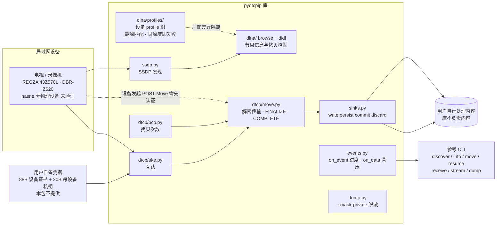

# tsukumijima/pydtcpip

## 一句话定位
**一个非官方的 DTCP-IP + DLNA/UPnP asyncio Python 实现库（外加一个参考 CLI）—— ⭐⭐⭐⭐⭐ 它的特别之处不是实现了加密传输协议，而是把「我们从未实现过的那几项」写成了 `AGENTS.md` 的第一段，并把每台真实设备的验证状态做成三档表格。**

## 它解决的问题
**日本家庭的电视与蓝光/硬盘录像机（REGZA、nasne、DBR 系列等）用 DTCP-IP 做互认加密传输与「追放（ダビング / dubbing）」，而 DTCP-IP 的公开规格（Informational Version）省略了密码学参数与部分函数细节。** ⭐⭐⭐⭐⭐ 项目自己的说法是：

> **for more than 20 years since the specification was established, there had been no open-source implementation that integrated DLNA / UPnP discovery, mutual authentication, decryption, and Move.**

⭐⭐⭐⭐⭐ **它的用户群非常具体**：家里有老录像机、想把广播录制内容抢救到 PC 的人；以及研究 DLNA / DTCP-IP 实现细节的人。⭐⭐⭐⭐⭐ 这是一个「小众但真实存在、且会随设备老化而加速消失」的需求 —— README 把这层意思写了出来：**「a foundation library for recovering broadcast recordings from aging recording devices and continuing to archive them as the industry as a whole declines」**。

## 为什么值得关注（2026-11-16）
⭐⭐⭐⭐⭐ **因为它是本数据集至今为止「issue 内容质量最高」的一个样本 —— 9 个 open issue 全部是带具体型号的真机兼容性报告，而不是「装不上」或「求教程」。**

**实测 9 个 open issue 的标题与作者：**

| # | 作者 | 标题 |
|---|---|---|
| #10 | `aoiro-labo` | Add: Panasonic のレコーダー用プロファイルを追加し、残りコピー回数を表示する |
| #9 | `aoiro-labo` | Support the Panasonic DIGA recorder family: remaining copy count and Move support |
| #8 | `aoiro-labo` | Compatibility report: TOSHIBA TVS REGZA 43M550M |
| #7 | `aoiro-labo` | Compatibility report: Panasonic DMR-BXT3000 |
| #6 | `aoiro-labo` | Compatibility report: Panasonic DMR-BRX/BCX2060 |
| #4 | `grfkrn` | Compatibility report: Buffalo nasne NS-N100 |
| #3 | `junpeiT` | Compatibility report: SIE nasne CECH-ZNR1J |
| #2 | `tatsuya0902` | Compatibility report: SONY BDZ-ZW1500 |
| #1 | `tt-s8` | Compatibility report: SHARP AQUOS BD-W2700 |

⭐⭐⭐⭐⭐ **6 位不同的用户、8 个不同的设备型号 —— 这正是本日报自 11-12 起使用的判据（「issue 的存在说明项目正在被真实使用与质疑，这是正信号」）的最强形态。**

⭐⭐⭐⭐⭐ **第二个值得记的点：`AGENTS.md` 的第一段就是否定式清单。**

> The project **does not** implement recorder scheduling, proprietary preparation for mobile downloads, remote access, Enhanced Full Authentication, PCP2, or a DTCP Source for playback distribution.

⭐⭐⭐⭐⭐ **第三个值得记的点：README 的「Supported devices」表用三档标注每一台机器的每一项能力**，⭐⭐⭐⭐⭐ 并且对 nasne 明确降级：

| Model | Discovery / recording listings | Move | Push dubbing reception | Streaming |
|---|---|---|---|---|
| Toshiba REGZA 43Z570L | Verified | Verified | Verified | Verified |
| Toshiba DBR-Z620 | Verified | Verified | Verified | Verified |
| SIE nasne | Unverified (profile implemented) | Unverified (profile implemented) | Not applicable | Unverified (profile implemented) |

> ⭐⭐⭐⭐⭐ **A device profile (`sie_nasne`) for SIE nasne is also implemented, but its operation is unverified because no physical device is available.**

⭐⭐⭐⭐⭐ **第四个值得记的点：它把「Move 会消耗源副本、且可能删除源录像」这类不可逆风险写成了 agent 也要遵守的硬约束：**

> For Move, persist the entire recording before sending FINALIZE. After a verified finalize response, commit the sink before sending COMPLETE. If the response is lost, retain the full data and resume state; **the source may already have consumed a copy.**

⭐⭐⭐⭐⭐ **而 README 还写明一个多数同类项目不会写的现实：「Even commercial recorders frequently encounter interoperability problems with each other.」**

## 热度来源判断
⭐⭐⭐⭐⭐ **真实且窄的需求驱动，不是尝鲜流量。**

支持「真实」的一面：⭐⭐⭐⭐⭐ **owner 账号创建于 2018-05-14，有 140 个公开仓库、462 followers**；⭐⭐⭐⭐⭐ 9 个 open issue 来自 6 位不同用户的真机报告；⭐⭐⭐⭐⭐ 项目已发布到 PyPI 并有 `uv.lock`；⭐⭐⭐⭐⭐ CI 矩阵覆盖 3 个操作系统 × 3 个 Python 版本。

⭐⭐⭐⭐⭐ **fork 到达分布也支持这一点**：⭐⭐⭐⭐⭐ 实测 5 个 fork 的到达间隔**中位 15,971 秒（约 4.4 小时）**、**≤10 秒的 0 个**、跨度 879.6 分钟 —— ⭐⭐⭐⭐⭐ **按 11-15 建立的判据（「有人在替你制造分母」vs「成果确实可复制」），这是「关注是真的」的弱正证**，⭐⭐⭐⭐⭐ 与同日 `HideKazekage/rob-run-cheat-tool`（76 个 fork，中位间隔 **4 秒**，62/75 个 ≤10 秒，跨度仅 10.2 分钟）形成极端对照。

⭐⭐⭐⭐⭐ **但热度规模必然有限**：44⭐ 对应的是一个「家里有 REGZA 或 nasne 的小众用户群」，⭐⭐⭐⭐⭐ **本项目不太可能成为大热门，它的价值在深度而非广度。**

## 关键技术亮点
1. **纯 asyncio 库 + Pydantic 模型 + 类型安全事件**：三个主类 `DLNAClient` / `DTCPClient` / `DubbingReceiver`，⭐⭐⭐⭐⭐ 接收侧通过 `on_event` 推送进度、`on_data` 回调施加背压。
2. **SSDP 发现 + 目录浏览**：⭐⭐⭐⭐⭐ 走 DLNA/UPnP 前置阶段获取设备与节目信息与拷贝控制信息（README 明写「recording listings and protection information are exchanged through DLNA / UPnP at the preceding stage」）。
3. **完整 Move 生命周期**：⭐⭐⭐⭐⭐ 互认 → 解密 → `FINALIZE` → `COMPLETE`，⭐⭐⭐⭐⭐ 且支持**断线后只重做 finalize 而不重传数据**（`resume`）。
4. **作为 NAS 接收端（POST Move）**：⭐⭐⭐⭐⭐ 让不支持流式推送、只能从设备菜单发起「送り出しダビング」的机型也能把录像推到 PC。
5. **流式接收不消耗拷贝次数**：⭐⭐⭐⭐⭐ 带背压控制，可直接管道给 FFplay 等工具。
6. **设备 profile 树**：⭐⭐⭐⭐⭐ `profiles/` 下 `base.py` / `generic.py` / `toshiba.py` / `toshiba_regza_tv.py` / `sie_nasne.py`，⭐⭐⭐⭐⭐ **按最深匹配选择，同深度冲突视为测试失败**。
7. **隐私脱敏导出**：`dump --mask-private` 把设备响应中的标识替换为文档值，⭐⭐⭐⭐⭐ **「保留已知非敏感值、替换内嵌标识、抹掉其余一切（含未知元素、属性、CDATA、注释、URL 路径、header）」**。
8. **测试夹具用合成数据**：⭐⭐⭐⭐⭐ `tests/fixtures/` 下两台设备的 `description.xml` / `recording.xml`，⭐⭐⭐⭐⭐ `AGENTS.md` 明写「The repository is public. Never include actual credentials, personal identifiers, recording content, raw device responses … Use sanitized synthetic fixtures.」

## 架构师速览

| 决策问题 | 研究判断 | 证据边界 |
|---|---|---|
| 系统边界 | 库 + CLI，边界 = 「一个 DLNA/DTCP-IP 设备」与「一个本地 sink」；⭐⭐⭐⭐⭐ **库不负责内容处理**（`AGENTS.md`：Leave the handling of received content to the user） | `AGENTS.md` 的 Purpose 段 + 树结构（`pydtcpip/` 31 文件、`tests/` 17 文件）。⚠️ **本日报未 clone、未安装、未连接任何设备** |
| 主路径 | SSDP 发现 → 浏览目录取节目信息与拷贝控制 → （可选）AKE 互认 → 解密传输 → 落盘 → `FINALIZE` → `COMPLETE`；⭐⭐⭐⭐⭐ 另一条路径是设备发起 POST Move，本库作为 NAS 接收 | 由 `AGENTS.md` 的 Transfer safety 段与 README 的 Main features 给出。⚠️ **FINALIZE/COMPLETE 的确切时序本日报未逐行核对实现代码** |
| 关键权衡 | ①拷贝次数是不可逆资源 → 宁可在协议层也不消耗 → 提供不消耗次数的 `stream` 路径；②设备差异大 → 隔离成 profile 树而不是塞进核心；③「已实现」≠「已验证」→ 三档标注；④公开仓库 → 只放合成夹具，不放真实响应 | 权衡 ①②③④均有 `AGENTS.md` / README 原文支撑。⭐⭐⭐ ⚠️ **每个权衡的实际代价本日报未实测**（未测吞吐、未测断线恢复、未测与真实设备的兼容性） |
| 最小 PoC | ① `uv tool install pydtcpip`；② `pydtcpip discover` 列出局域网内的 DLNA 媒体服务器；③ `pydtcpip info` 读某台设备的一档节目信息；④ 在**不消耗拷贝**的前提下跑 `pydtcpip stream` 试一段；⑤ 若有真实设备，再对照 `AGENTS.md` 里 REGZA 43Z570L / DBR-Z620 的已知行为逐条核对 | PoC 范围由本档案的取证路径推导。⭐⭐⭐ ⚠️ **本日报未执行任何一步**（需要真实电视/录像机与凭据）；⭐⭐⭐ ⚠️ **凭据必须自备**（88 字节设备证书 + 20 字节每设备私钥，README 明写本包不提供） |

## 架构启发
⭐⭐⭐⭐⭐ **最值得抄的一条：把「实现状态」与「验证状态」做成两个正交字段。**

本项目用 `Verified` / `Unverified (profile implemented)` / `Not applicable` 三档标注每一台设备的每一项能力，⭐⭐⭐⭐⭐ 并在只有实现、没有设备时明确写「operation is unverified because no physical device is available」。⭐⭐⭐⭐⭐ **这与本数据集已记录的 `hikaku-extension`（`Sanity check, not a benchmark.`）、`ScanDot`（README 第二段声明手机端不做摄影测量）是同一条原则的不同实现 —— 但 pydtcpip 的版本更结构化，因为它要标注的是 3 台设备 × 4 项能力 = 12 个格子。**

⭐⭐⭐⭐⭐ 第二条：**「不可逆操作的顺序」应当被写成 agent 也要遵守的规则。** ⭐⭐⭐⭐⭐ `AGENTS.md` 的 Transfer safety 段把「先落盘再 FINALIZE、收到确认再 commit sink」写成了硬约束，⭐⭐⭐⭐⭐ 并且承认了「源可能已经消耗了拷贝」这种无法回滚的状态。

⭐⭐⭐⭐⭐ 第三条：**「同深度冲突视为测试失败」是配置系统的一个好规则。** ⭐⭐⭐⭐⭐ profile 树按最深匹配选择，同深度出现歧义直接判为失败 —— ⭐⭐⭐⭐⭐ 这把「配置选择错了」从运行期事故变成了测试期失败。

⭐⭐⭐⭐⭐ 第四条：**公开协议实现仓库应该用合成夹具。** ⭐⭐⭐⭐⭐ `AGENTS.md` 明写不得把真实凭据、个人标识、录像内容、原始设备响应放进仓库，⭐⭐⭐⭐⭐ 且要求脱敏后的输出**仍可作为测试夹具** —— ⭐⭐⭐⭐⭐ 这是「可公开」与「可复现」两个目标同时达成的做法。

## 架构图（MMD）

> 证据边界：此图的结构取自 `AGENTS.md`、README 与仓库树；标「待核验」的节点是本日报未能独立验证的部分。

## 定位判断
**生产可用。** ⭐⭐⭐⭐⭐ 理由：已发布到 PyPI、有版本号（v0.1.0）、有跨 3 平台 × 3 Python 版本的 CI、有 9 个来自真实用户的设备兼容性 issue、有独立于实现的 profile 抽象、有脱敏导出工具。

⭐⭐⭐⭐⭐ **它在本数据集里的位置很特殊：这是一个「协议实现」类项目 —— ⭐⭐⭐⭐⭐ 与 11-08 记录的 `impacket-rs`（74/74 协议覆盖）同类，但方向相反：⭐⭐⭐⭐⭐ impacket-rs 做的是「把断言做成可回归的计数」，⭐⭐⭐⭐⭐ pydtcpip 做的是「把不确定的设备兼容性做成三档状态表」。**⭐⭐⭐⭐⭐ **两者都在解决同一个问题：如何让「我支持什么」变成可核验的陈述。**

⭐⭐⭐⭐⭐ 但它同时是**边界项目**：44⭐、1 个 release、v0.1.0、文档日英双语且以英语为主 —— **它不会成为流行项目，但它对特定用户是刚需。**

## 风险/局限/泡沫点
- ⭐⭐⭐⭐⭐ **「20 多年无开源实现」是项目自述**，⭐⭐⭐ ⚠️ **本日报未做独立文献核查**，**无法排除存在本日报未收录的实现**。
- ⭐⭐⭐⭐⭐ **凭据必须自备且不可从包内获得**（88 字节设备证书 + 20 字节每设备私钥）—— ⭐⭐⭐⭐⭐ 这既是合理的分发边界（README 明写「This package provides only the protocol implementation and does not include a device certificate or per-device private key」），⭐⭐⭐⭐⭐ **也意味着普通用户无法开箱即用**。
- ⭐⭐⭐⭐⭐ **Move 会消耗源副本、且在某些情况下删除源录像** —— ⭐⭐⭐⭐⭐ 这是一个**不可逆且有用户数据损失风险的操作**，项目对此的处理是把风险写进文档与 agent 规则，⭐⭐⭐⭐⭐ 而不是提供安全模式。
- ⭐⭐⭐⭐⭐ **设备 profile 的覆盖面决定了实际可用性**：⭐⭐⭐⭐⭐ 目前明确验证的是 2 台设备（REGZA 43Z570L / DBR-Z620），nasne 只有 profile；⭐⭐⭐⭐⭐ **而 issue 里出现的另外 6 个型号（Panasonic DIGA / DMR-BXT3000 / DMR-BRX/BCX2060 / 43M550M / Buffalo nasne / SONY BDZ-ZW1500 / SHARP BD-W2700）都还没有验证状态**。
- ⭐⭐⭐⭐⭐ **v0.1.0 + 1 个 release**：⭐⭐⭐⭐⭐ API 稳定性无保证。
- ⭐⭐⭐ ⚠️ **未核验项**：真实设备上的任何实际行为、PyPI 包内容与仓库的一致性、9 个 issue 的正文、`tests/fixtures/` 的内容、吞吐量与断线恢复表现。

## 与同类项目的关系
- **vs 11-08 的 `impacket-rs`**：⭐⭐⭐⭐⭐ 两者都在「让支持范围可核验」，但一个用计数断言（74/74），一个用能力矩阵（三档状态）。⭐⭐⭐⭐⭐ **pydtcpip 的方法更适合「能力按设备分叉」的场景。**
- **vs 11-12 的 `Kianuni/Erosion-CN`**：⭐⭐⭐⭐⭐ 同样是「把修改做成可回滚」，但 Erosion-CN 是**写入前自动备份原值 + 一键回滚**，⭐⭐⭐⭐⭐ pydtcpip 是**在协议层就拒绝不可逆顺序** —— 后者更保守，但要求客户端与设备配合。
- **vs 11-13 的 `open-orange`**：⭐⭐⭐⭐⭐ open-orange 把兼容度做成 34 个日期的逐日可 diff 结果，⭐⭐⭐⭐⭐ pydtcpip 把兼容度做成 issue 里的真机报告 —— ⭐⭐⭐⭐⭐ **两种都是「用外部证据代替自述」，前者需要用户跑 conformance，后者需要用户有设备。**
- **vs `v2rayN` / `PattN` 等客户端**：⭐⭐⭐⭐⭐ 那些是通用代理客户端；⭐⭐⭐⭐⭐ pydtcpip 面向的是**广播录制的追放协议**这一特定场景，⭐⭐⭐⭐⭐ 不重叠。
- **vs 本日同窗的 `Gemini-Config-Checker-` 族**：⭐⭐⭐⭐⭐ 后者复刻了一个真实项目的代码并改许可换载荷，⭐⭐⭐⭐⭐ **本项目的代码与许可都是自己的** —— 同一天窗口内，两种「镜像」的对照极其清晰。

## 是否值得持续跟踪
**值得，且建议相关用户直接采用。**

具体建议：
1. ⭐⭐⭐⭐⭐ **有 REGZA / DBR / nasne 等设备的用户可直接安装试用**（`uv tool install pydtcpip`），⭐⭐⭐⭐⭐ **但必须先用 `stream` 路径，不要一上来就 `move`** —— 前者不消耗拷贝次数。
2. ⭐⭐⭐⭐⭐ **做协议实现类项目的人应抄它的三件事**：能力矩阵的三档状态、profile 树 + 同深度歧义判失败、合成夹具 + 脱敏导出。
3. ⭐⭐⭐⭐⭐ **做 agent 协作类项目的人应抄它的 `AGENTS.md` 写法**：把「不做什么」放在第一段，把「不可逆操作的顺序」写成硬约束。
4. ⭐⭐⭐ 关注 issue 里的兼容性报告如何沉淀进 profile。

## 后续观察点
- 兼容性 issue 是否被转成 `profiles/` 下的新 profile（目前 `aoiro-labo` 提的 Panasonic DIGA 支持是一个明确的候选）
- v0.1.0 之后是否发布 0.2.0，以及 API 是否有破坏性变更
- 是否被主流 AOSP/DLNA 客户端集成（这是这类库最大的扩散路径）
- `sie_nasne` profile 是否从「Unverified」变成「Verified」
- `AGENTS.md` 里「Do not identify which firmware, devices or applications were analyzed」这类自我约束是否长期坚持（它对本项目的合规性至关重要）

---
> 数据来源: GitHub API (2026-11-16) | Stars: 44 | Forks: 5 | Subscribers: 1 | Open Issues: 9 | License: MIT | 语言: Python | 创建: 2026-11-15T00:26:42Z | release v0.1.0 | owner 创建: 2018-05-14T14:43:38Z | fork 间隔中位 15971s ≤10s 0/5
