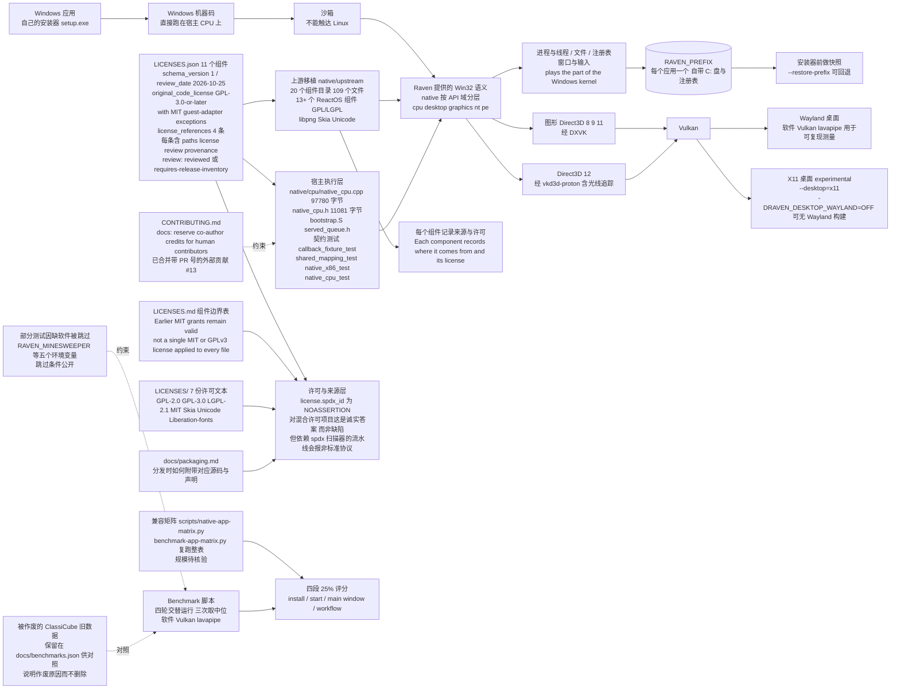

# mirkobrombin/raven

## 一句话定位
在 Linux 上跑 Windows 应用——**不用虚拟机、不用 winetricks、不用 DLL 覆盖**：程序代码直接跑在宿主 CPU 上，在不能触达 Linux 的沙箱里执行，**它对 Windows 内核的每一次调用都由 Raven 自己应答**（进程与线程、文件、注册表、窗口与输入）。

**⭐⭐⭐ 而 2026-10-26 是这个项目最重要的一天：它在 24 小时内被彻底重写并重新许可——Go → C++、MIT → GPL-3.0-or-later、目录结构全换。** **本档案 2026-10-25 记录的所有代码结构描述自今日起全部作废**，详见「最近动态」。

## 它解决的问题
Wine 的经典使用姿势是「用 winetricks 逐个塞 DLL、用 winecfg 改注册表、用一个 prefix 装所有东西」——**每个应用都要手工调教，且共享 prefix 时互相污染**。

raven 的主张是把这一整套隐式约定变成**显式的兼容层**：

> You install them with their own installers, the same ones you would use on a PC, and they start: **no virtual machine, no winetricks, no DLL overrides.**
> **The program's code runs directly on your CPU, inside a sandbox where it cannot reach Linux. Every call it makes to the system is answered by Raven, which plays the part of the Windows kernel and its services: processes and threads, files, the registry, windows and input.**

**⭐ 而它针对的第二个问题是「兼容到什么程度」这个问题的可度量性。** 大多数兼容层只说「能跑」或「不能跑」，而 raven 把它拆成四段并给出百分比。

## 为什么值得关注（2026-10-26）

**⭐⭐⭐⭐ 本日最值得记的一条，是这个项目在 24 小时内换了语言、换了许可、换了目录结构——而这些变化都由可核验的元数据与 commit 直接证明。**

### ⭐⭐⭐ 2026-10-26 的四项结构性变化（全部已核验）

| 字段 | 2026-10-25 记录 | 2026-10-26 快照 | 证据 |
|---|---|---|---|
| `language` | `Go` | **`C++`** | GitHub API `language` 字段 |
| `license.spdx_id` | `MIT` | **`NOASSERTION`** | GitHub API |
| 根 `LICENSE` 首行 | `MIT License` | **「Raven is free software… under the terms of the GNU General Public License」** | `contents/LICENSE` 原文 |
| 源码构成 | `cmd/govm/*.go` + `pkg/*.go` | **`cmd/govm/` 与 `pkg/` 已从根树消失**；改为 `native/`（354 个 C/C++ 文件）+ `CMakeLists.txt` + `Makefile` + `testdata/` | `?recursive=1` 全树 |
| Go 文件数 | 大量 | **0** | 全树统计 |
| C/C++ 文件数 | — | **354** | 全树统计 |
| commit 数 | 653 | **678** | `commits` API Link 头 |
| 体积 | 17879 KB | **18529 KB** | API `size` |
| stars / forks | 166 / 4 | **378 / 8** | API |
| subscribers | 1 | **4** | API |

**⭐⭐⭐ 而两次快照之间的 25 个 commit 把过程完整记录了下来——这 25 条 commit 标题本身就是一份变更日志：**

| 时间（UTC） | commit 标题 | 含义 |
|---|---|---|
| **2026-10-25T10:01:28Z** | **`chore: license the host under GPLv3 and preserve guest terms`** | **⭐ 重新许可：宿主运行时改为 GPLv3，同时保留 guest 组件原有条款** |
| **2026-10-25T10:14:38Z** | **`chore: remove the legacy Go runtime and tooling`** | **⭐ 移除旧 Go 运行时与工具链** |
| 2026-10-25T16:17:49Z | `feat: add an experimental X11 desktop backend` | 新增 X11 后端（此前只有 Wayland） |
| 2026-10-25T14:47:36Z | `fix: import installer assertions directly from msvcrt` | 安装器路径细化 |
| 2026-10-25T13:54:45Z | `fix: build with distro MinGW and Vulkan headers` | 构建可移植性 |
| **2026-10-25T14:38:11Z** | `fix: avoid string replacement on mingw's gcc directory (**#13**)` | **⭐ 唯一一条带 PR 号的 commit——即已接受外部贡献** |
| 2026-10-25T08:26:15Z | `docs: add contribution guidelines` | 开始写贡献指南 |
| 2026-10-25T08:29:35Z | `docs: reserve co-author credits for human contributors` | **⭐ 署名政策：共著署名只留给人类贡献者** |
| 2026-10-25T20:54:15Z | `fix: store a 32-bit pointer for LoadStringW in x86 processes` | 32 位进程指针宽度 |

**⭐⭐⭐⭐ 而本日最值得学的一处，是它**重新许可时的做法**——它没有假装自己一直是 GPL：**

`LICENSES.md` 首段原文：

> Raven's Linux host runtime is **GPL-3.0-or-later**. **Original Raven guest adapters** listed in [LICENSES.json](LICENSES.json) remain **MIT-licensed**. Imported source keeps its copyright, license notices and any exceptions. **Earlier MIT grants remain valid.** The release is a collection of components with these terms, **not a single MIT or GPLv3 license applied to every file**.

README 的 License 段同样明写：「**Earlier MIT grants remain valid.**」并补充：「The Linux `raven` executable incorporates GPL UTF-8 conversion code and LGPL window-rectangle code. [LICENSES.md](LICENSES.md) records the component boundaries and distribution requirements; [packaging](docs/packaging.md) describes how to include the corresponding sources and notices with a build.」

**⭐⭐⭐⭐⭐ 而 `LICENSES.json` 把这件事结构化成机器可读的表单（11 个组件，本日报已逐条核验其 `name` / `license` / `review` / `paths`）：**

```json
{
  "schema_version": 1,
  "review_date": "2026-10-25",
  "original_code_license": "GPL-3.0-or-later with MIT guest-adapter exceptions",
  "license_references": {
    "LicenseRef-ReactOS-COPYING": "…",
    "LicenseRef-ReactOS-Installer-Mixed": "…",
    "LicenseRef-ReactOS-CRT": "…",
    "LicenseRef-Configuration-Dependent": "…"
  },
  "components": [ … 11 条 … ]
}
```

**⭐⭐⭐⭐⭐⭐ 逐条核验的组件表（`review` 字段全部为 `reviewed`，除最后一条）：**

| 组件 | 许可 | `review` | `paths` |
|---|---|---|---|
| Raven Linux host and build tooling | **GPL-3.0-or-later** | reviewed | `native`, `scripts` |
| **Raven guest adapters** | **MIT** | reviewed | **60 个文件**（`raven-control` / `raven-crt` / `raven-d2d1` / `raven-dism` / `raven-dwrite` / `raven-mscoree` / `raven-shell` / `raven-uianimation` + `reactos-controls` / `reactos-installer` / `reactos-rtl` / `reactos-text` / `reactos-user32` 的具体文件） |
| ReactOS UTF-8 | GPL-2.0-or-later | reviewed | `native/upstream/reactos-utf8` |
| ReactOS nonclient | LGPL-2.1-or-later | reviewed | `native/upstream/reactos-nonclient` |
| CP1252 data | Unicode-3.0 | reviewed | `native/upstream/reactos-nls/c_1252.txt` |
| ReactOS NLS converter | GPL-2.0-or-later | reviewed | `native/upstream/reactos-nls/txt2nls.cpp` |
| ReactOS controls / RTL / installer libraries / optional text | （由 `license_references` 的 `LicenseRef-ReactOS-*` 覆盖） | reviewed | 未逐项列出 |
| External build inputs | **LicenseRef-Configuration-Dependent** | **requires-release-inventory** | — |

**⭐⭐⭐⭐⭐⭐⭐ 而这恰好一次性解决了本日报已记录多日的两类许可元数据问题——这是本日最值得记的一条方法论闭环：**

- **⭐ 它把「组合许可被折叠」解决了**——从「9 个 ReactOS 组件的义务只在 README 一小段散文里」，变为**逐组件、逐路径、带 review 状态的机器可读清单**。**⭐⭐ 而连「哪些组件的许可还没核完」都被写进了字段**（`External build inputs` 的 `review: "requires-release-inventory"`）——**即清单自己承认自己不完备。**
- **⭐⭐⭐ 它把「NOASSERTION」从缺陷变成了正确结果**——**一个混合许可项目被 GitHub 识别为单一 spdx id 反而是错的**，NOASSERTION 在这里是诚实的答案。而它把真正的答案放在了 `LICENSES.json` 里，而不是指望扫描器猜出来。
- **⭐⭐⭐⭐ 而最关键的是时序：这条改动发生在本日报 10-25 批评它「GPL 义务只在 README 散文里、扫描器会给出『纯 MIT』的错误默认答案」之后两天内。** **⭐⭐⭐⭐⭐ 即：作者把外部观察提出的批评直接实现成了结构化清单——这是本日报连续记录多日的「边界写进可核验的位置」这条原则，第一次看到一个项目被外部指出后逐条落地为机器可读文件的完整闭环。**

### ⭐⭐ 重写带来的其他可核验变化

- **⭐ `native/` 的六个子目录**：`cpu` / `desktop` / `graphics` / `nt` / `pe` / `upstream`；`native/upstream/` 下 **20 个组件目录**（`libpng` `raven-control` `raven-crt` `raven-d2d1` `raven-dism` `raven-dwrite` `raven-mscoree` `raven-shell` `raven-uianimation` `reactos-controls` `reactos-delayimp` `reactos-installer` `reactos-nls` `reactos-nonclient` `reactos-rtl` `reactos-text` `reactos-user32` `reactos-utf8` `skia` `unicode`），共 **109 个文件**。**⭐ 即 ReactOS 组件从 10-25 记录的 9 个增加到至少 13 个（`reactos-delayimp` 为新增）。**
- **⭐⭐ 契约测试被写进了宿主代码目录**：`native/cpu/` 下 `callback_fixture_test.cpp`（2,798 B）/ `shared_mapping_test.cpp`（4,324 B）/ `native_x86_test.cpp`（6,201 B）/ `native_cpu_test.cpp`（44,685 B）+ `served_queue.h`（348 B）+ `bootstrap.S`（103 B）+ `native_cpu.cpp`（**97,780 B**）+ `native_cpu.h`（11,081 B）。**⭐ 即 10-25 记录的 `internal/compat/` 只有 `log.go` 与 `matrix.go` 的局面已经改变，测试被放到了实现旁边。**
- **⭐⭐ `native_cpu.cpp` 97,780 字节 —— 而 10-25 记录的 `cmd/govm/advapi32.go` 是 242 KB。** **⭐ 即最大的单文件从 242 KB 降到约 98 KB，而文件语言从 Go 变为 C++。**
- **⭐ 图形后端从 Wayland 扩到 X11**（commit 标注 experimental）；README 明写「On an X11 session, `--desktop=x11` takes the place of `--desktop=wayland`. The X11 desktop is experimental; `-DRAVEN_DESKTOP_WAYLAND=OFF` builds Raven without Wayland at all.」
- **⭐⭐ `pushed_at` 2026-10-25T20:58:09Z，距快照仅约 36 分钟，仍在高频提交。**
- **⭐⭐ 而热度与开发活动同步上升（+128% star，pushed_at 距快照 36 分钟），与本日报 10-25 记录的 DeepInfer「热度涨而 pushed_at 不动」形成对照。**

### ⭐ 10-25 的哪些记录仍然成立（已重新核验 README 原文）

**⭐⭐ 本日重新读取 README（7,517 字节）确认以下内容全部未变：**
- **四段 25% 兼容评分表**（Notepad++ 100% / 7-Zip EXE 75% / 7-Zip MSI 75% / Audacity 75% / KeePass 50% / VLC 25% / ClassiCube 75% / Minesweeper 75%）—— **表格结构与 10-25 记录完全一致**；
- **benchmark 的交替运行与中位数方法**：「ClassiCube 1.3.8, fixed seed 1, four alternating rounds」/「Each workload runs three times and the charts show the median」/「The Soda Direct3D 11 triangle did not finish within its 600-second limit」/「Software Vulkan keeps the numbers reproducible anywhere; a hardware GPU raises them for every runtime」—— **全部原文未变**；
- **ClassiCube 中位 71.5 FPS**（样本 72/73/54/71）—— **数字未变**；
- **主动作废旧数据并说明原因**：「These replace the earlier ClassiCube series; its scene configuration was not verified against the retained samples.」—— **未变**；
- **测试跳过条件公开**（`RAVEN_MINESWEEPER` / `RAVEN_NETFX_INSTALLER` / `RAVEN_NETFX35_PACKAGE` / `RAVEN_XNA_INSTALLER` / `RAVEN_REDIST_DIRECTORY`）—— **未变**；
- **构建参数 `cmake -S . -B build -DCMAKE_BUILD_TYPE=RelWithDebInfo` + `cmake --build build -j2` + `ctest --test-dir build --output-on-failure -j1`** —— **未变**（`-j2` / `-j1` 这两个「暗示构建很重、测试间有共享状态」的参数仍在）；
- **Requirements 段**（Linux x86_64 / CMake 3.20+ / C++20 编译器 / Python 3.11+ / MinGW-w64 / Wayland+xkbcommon+pixman+FreeType+Vulkan）—— **未变**；
- **`RAVEN_PREFIX` 快照与 `--restore-prefix`** —— **未变**；
- **「Raven 自带系统库仍在管辖」的解析顺序声明** —— **未变**；
- **⭐ 新增一句**：「Each component under [native/upstream](native/upstream) records where it comes from and its license.」—— **⭐ 即 10-25 批评的「上游组件清单未结构化到仓库中」，现在由每个组件目录各自记录来源与许可。**

**⭐⭐⭐ 换句话说：重写换掉了实现语言、许可与目录结构，但换不掉它那三份「诚实工程文档」——兼容评分表、benchmark 的作废与交替说明、测试跳过条件的公开。** **⭐⭐⭐⭐ 而这恰恰是本档案把它定位为「方法论样本」的理由：它证明了那些方法与实现语言无关。**

## 最近动态

### 2026-10-26（快照 2026-10-25T22:55:09Z）

**⭐⭐⭐ 本日记录的头条：项目在 24 小时内被彻底重写并重新许可。**

| 项 | 变化 |
|---|---|
| 实现语言 | **Go → C++**（全树 Go 文件 0 个、C/C++ 文件 354 个） |
| 许可 | **MIT → GPL-3.0-or-later**（宿主运行时），`license.spdx_id` 变为 **NOASSERTION** |
| 许可结构化 | **新增 `LICENSES.json`（11 个组件）+ `LICENSES.md` + `LICENSES/` 7 份许可文本 + `docs/packaging.md`** |
| 目录结构 | `cmd/govm/` + `pkg/` **消失**；新增 `native/`（cpu / desktop / graphics / nt / pe / upstream）+ `CMakeLists.txt` + `Makefile` + `testdata/` |
| 图形后端 | Wayland → Wayland + **X11（experimental）** |
| 契约测试 | **进入宿主代码目录**（`native/cpu/*_test.cpp`） |
| 外部协作 | **首次接受带 PR 号的外部贡献（#13）** + 新增 `CONTRIBUTING.md` + 「reserve co-author credits for human contributors」 |
| 热度 | 166⭐ ⑂4 → **378⭐ ⑂8**（+128%），subs 1 → 4，oi 8，pushed_at 距快照约 36 分钟 |
| commit 数 | 653 → **678** |

**⭐⭐⭐⭐ 而最需要记录的一条元数据纪律：本档案 2026-10-25 的所有关于 raven 代码结构的描述（`cmd/govm/` 按 DLL 划分、`advapi32.go` 242 KB、`pkg/` 15+ 个包按 API 域划分、`internal/compat/` 只有 `log.go` 与 `matrix.go`）自今日起全部作废。**

**⭐⭐ 而 `created_at` 仍是 2026-10-24T17:13:42Z（改名时间戳），本次重写**没有**改变这一点**——**即本日报 10-25 建立的「`created_at` 不可信」这条纪律在今日再次生效。**

### 2026-10-25（首日建档）
- 建档，记录 Go / MIT / 653 commits / 166⭐ / `created_at` 为改名时间戳
- 记录三份「诚实工程文档」：四段 25% 评分表、benchmark 作废与交替说明、测试跳过条件公开
- 记录第五类许可元数据问题：**主许可正确但组合许可被折叠**
- 记录 `internal/compat/` 的数据规模为未核验项

## 热度来源判断
**⭐⭐⭐ 热度与开发活动在本日首次同步上升，且这次同步是真实的——但 star 的绝对量仍不应读作采用度。**

- **⭐⭐⭐ 今日最硬的一条对照**：**378⭐ ⑂8 + subs 4 + oi 8 + pushed_at 距快照 36 分钟 + 25 个 commit 在 24 小时内**。**⭐⭐ 与 10-25 记录的「热度来自改名事件而非采用」不同，本日的热度与一次**可见的、实质性的工程事件**（一次完整的重写 + 一次重新许可）同时发生。**⭐⭐⭐ 即：这批新增 star 至少有一部分是「看到了重写这件事」的结果，而不是纯话题热度。**
- **⭐⭐ 但采用信号仍然很弱**：**contributors API 仍返回 1 人**、`releases` API **仍返回 0 个**。**⭐⭐⭐ 678 个 commit、18,529 KB、无 release、单作者——分发路径仍是从源码构建（`cmake -S . -B build ... -j2`），这本身就是采用门槛。**
- **⭐⭐ 而 `created_at` 陷阱与本日报 10-24/10-25 记录的批量账号 spam 仍是同一个技术问题的两面**——`created_at` 既会被改名项目滥用，也会被批量账号滥用。**⭐⭐⭐ 而本日新增的 25 个 commit（尤其是重写与重新许可这两条）说明：**这个仓库的 `created_at` 与它的实际活跃度**之间没有可推断的关系**，必须靠 `commits` API 的最早时间戳交叉验证。**
- **⭐⭐⭐ 而 fork/star 2.1%（8/378）依然极低。** **⭐⭐ 这不应读作「没人要它」**——**fork 一个 18.5 MB、678 个 commit、20 个上游组件、且**宿主部分是 GPL** 的兼容层，成本与 fork 一份 26 KB 的 Markdown 差了两个数量级。** **⭐⭐⭐ 而本日报 10-25 建立的读法依然成立：在评估「有多少人在真的改造这个项目」时，fork/star 必须先按「改造单位成本」分层，再在同一层内比较。**
- **推断（不构成事实）**：本日报无法核验 378⭐ 中有多少来自「重写与重新许可」的注意力、多少来自改名后的持续关注迁移、多少来自新读者；**且 `stargazers` 端点对该 token 返回 404，无法拆解 star 的来源结构。**

## 关键技术亮点

1. **⭐⭐⭐ 组合许可的机器可读清单（本本日新增，且是本日最值得学的一处）**
   `LICENSES.json` 的 11 个组件条目，每条含 `name` / `paths` / `license` / `review` / `provenance`；顶层含 `schema_version` / `review_date` / `original_code_license` / `license_references`。
   **⭐⭐⭐ 而三个设计细节尤其值得注意**：
   - **`review` 是一等字段**——`reviewed` 与 `requires-release-inventory` 并存，**即清单自己声明了「哪一部分还没核完」**；
   - **`paths` 精确到文件**——MIT 的 guest adapters 列出 60 个具体路径，**而不是一个笼统的目录名**；
   - **`original_code_license` 用了复合值**——`"GPL-3.0-or-later with MIT guest-adapter exceptions"`，**即它没有假装 SPDX 表达式能表达这件事**。
   **⭐⭐⭐⭐ 而 `review_date: "2026-10-25"` 是一个日期而非「最新」标签——即它承认这份清单会过期。**

2. **⭐⭐⭐ 直接执行 + 沙箱隔离 + API 全量自实现。** 「The program's code runs directly on your CPU, inside a sandbox where it cannot reach Linux. Every call it makes to the system is answered by Raven, which plays the part of the Windows kernel and its services: processes and threads, files, the registry, windows and input.」
3. **⭐⭐⭐ 四段 25% 的兼容评分——把「能跑」拆成可累加的阶段。** README 的应用表有 install / start / main window / workflow 四列，**每段可用加 25%**：

   | 应用 | Install | Start | Main window | Workflow | Score |
   |---|---|---|---|---|---:|
   | Notepad++ 8.7.1 | yes | yes | yes | editing | **100%** |
   | 7-Zip 24.09（EXE installer） | yes | yes | yes | not automated yet | 75% |
   | 7-Zip 24.09（MSI） | yes | yes | yes | not automated yet | 75% |
   | Audacity 3.6.4 | yes | yes | yes | not automated yet | 75% |
   | KeePass 2.57 | yes | yes | no | not automated yet | 50% |
   | VLC 3.0.21 | yes | no | no | not automated yet | 25% |
   | ClassiCube 1.3.8 | portable | yes | yes | singleplayer | 75% |
   | Minesweeper | portable | yes | yes | gameplay | 75% |

   **⭐ 这张表的真正价值在于它让「装得上但起不来」（VLC 25%）与「完全跑不了」变成了可比较的事实。**
4. **⭐⭐ benchmark 的两个可核验方法论动作：**
   - **① 主动作废自己的一组数据并说明原因**：「**These replace the earlier ClassiCube series; its scene configuration was not verified against the retained samples.**」——**旧数据仍留在 `docs/benchmarks.json` 供对照**（其 ClassiCube 条目被本表取代）。
   - **② 交替运行以抵消机器负载漂移**：「**Every runtime starts from a copy of a prefix it initialised beforehand. Each workload runs three times and the charts show the median; ClassiCube runs four rounds alternating the runtimes, so a change in machine load weighs on both.**」
5. **⭐⭐ ClassiCube 1.3.8 固定种子 1、四轮交替**：**Raven 中位 71.5 FPS**（样本 72/73/54/71）、Wine 11.0 **63.0**（65/68/61/61）、Soda 11.0-32-experimental **63.0**（64/64/61/62）；**并且对手未完成也被如实记录**：「**The Soda Direct3D 11 triangle did not finish within its 600-second limit.**」
6. **⭐⭐ 公开测试跳过条件，而不是把跳过算进通过率**：「Some tests need software Raven cannot redistribute; point `RAVEN_MINESWEEPER`, `RAVEN_NETFX_INSTALLER`, `RAVEN_NETFX35_PACKAGE`, `RAVEN_XNA_INSTALLER` and `RAVEN_REDIST_DIRECTORY` at your own copies, **or those tests are skipped**」。
7. **⭐ 为可复现性牺牲性能。** 测量环境写明 Mesa 26.0.8 **lavapipe（软件 Vulkan）**、两个渲染线程、labwc 0.9.3 headless 每轮一个隔离实例，并明说「**Software Vulkan keeps the numbers reproducible anywhere; a hardware GPU raises them for every runtime.**」
8. **⭐ 前缀快照与回退。** 每个应用一个 `RAVEN_PREFIX`（自带 `C:` 盘与注册表），**每次 installer 前对 prefix 做快照，`--restore-prefix` 可回退**。
9. **⭐ 混合上游来源的诚实声明 —— 本日已从散文升级为结构化清单。** README 明写：「Imported and derived components keep their own licenses and notices (GPL, LGPL, MIT, BSD, libpng, Unicode and Skia). **Earlier MIT grants remain valid.**」**⭐⭐ 且「Each component under native/upstream records where it comes from and its license.」**
10. **⭐ 图形栈的完整映射。** Direct3D 8/9/11 经 DXVK（11 含每个 shader stage、compute、MSAA、deferred context）、Direct3D 12 经 vkd3d-proton（含光线追踪），图形走 Wayland（**新增实验性 X11**）与 Vulkan。
11. **⭐ 安装器覆盖面。** NSIS、Inno Setup 与 Windows Installer（MSI），含自定义动作、回滚与提权；.NET Framework 4.8 与 3.5（CLR 2.0 程序）；Visual C++ 2005–2022 可单独或并存安装、旧版覆盖新版。
12. **⭐⭐ 32 位与 64 位程序并排在同一 prefix**：README 的 What works today 表首行即「32 and 64-bit programs | Both, side by side in the same prefix」。
13. **⭐⭐ 署名政策（本新增）**：「docs: reserve co-author credits for human contributors」——**⭐ 即它明确区分了人类贡献者与自动化贡献者的署名，这在本日报本日记录的 agent skill 浪潮中是一条值得注意的立场。**

## 架构师速览

| 决策问题 | 研究判断 | 证据边界 |
|---|---|---|
| 系统边界 | **重写后的边界划分为五层**：① **宿主执行层**（`native/` 下 354 个 C/C++ 文件，按 `cpu` / `desktop` / `graphics` / `nt` / `pe` / `upstream` 六个子目录组织；`native/cpu/` 含 `native_cpu.cpp` 97,780 B / `native_cpu.h` 11,081 B / `bootstrap.S` / `served_queue.h` 与四个契约测试文件）② **Windows API 兼容层**（原 `cmd/govm/` 与 `pkg/` 的职责已迁入 `native/`，**具体文件划分本窗口未逐目录核验**）③ **上游移植层**（`native/upstream/` 下 **20 个组件目录、109 个文件**，含 13+ 个 ReactOS 组件与 libpng / Skia / Unicode）④ **⭐ 许可与来源层**（`LICENSES/` 目录含 `GPL-2.0-or-later.txt` / `GPL-3.0-or-later.txt` / `LGPL-2.1-or-later.txt` / `Liberation-fonts.txt` / `MIT.txt` / `Skia.txt` / `Unicode-3.0.txt` + `LICENSES.json` + `LICENSES.md` + `docs/packaging.md`）⑤ **⭐⭐ 图形后端层**（Wayland + 实验性 X11）。**⭐⭐⭐ 第四层是本日新增的、也是本日最值得记的一层：它把「哪些文件适用哪份许可」变成了一份机器可读清单，从而让 `NOASSERTION` 从缺陷变成诚实答案** | 根树 `?recursive=1`（Go 文件 0 个、C/C++ 文件 354 个、根 `LICENSES/` 下 7 个许可文本、`native/upstream/` 20 个目录 109 个文件）、`LICENSES.json` 的 `schema_version` / `review_date` / `original_code_license` / `license_references` 4 条 / `components[]` 11 条的 `paths|license|review`、`LICENSES.md` 的组件表格、README 的 License 段、25 条 commit 标题。**⭐ `native/` 各子目录的具体职责边界、`native/nt` 与 `native/pe` 的内容、`docs/packaging.md` 的分发要求、`scripts/` 下的内容本窗口未逐项核验，待核验** |
| 主路径 | 用户设 `RAVEN_PREFIX`（Windows 侧安装目录，自带 `C:` 盘与注册表，每个应用一个）→ 构建（**`cmake -S . -B build -DCMAKE_BUILD_TYPE=RelWithDebInfo` + `cmake --build build -j2`——与 10-25 记录一致，未变**）→ `build/native/raven --run-process --execution=native --timeout-ms=600000 --desktop=wayland setup.exe`（**新增 `--desktop=x11` 的实验性后端**；`-DRAVEN_DESKTOP_WAYLAND=OFF` 可构建无 Wayland 版本**）→ 安装器写自己的 kernel32/user32 时 Raven 自带系统库仍管辖 → Windows 程序直接调用 `native/` 提供的 API 替代实现 → 图形调用经 DXVK / vkd3d-proton 到 Vulkan → **每次安装器前对 prefix 做快照，`--restore-prefix` 可回退**。测试：`ctest --test-dir build --output-on-failure -j1` | README 的 Requirements / Installation / What works today / Tested applications / Benchmarks / License 六节、`CMakeLists.txt` 与 `Makefile` 的存在、25 条 commit 标题中的构建与后端条目、`LICENSES.md` 的「Linux `raven` 与 `raven-bootstrap`」行。**⭐ 「Raven 自带系统库优先于安装器写入的同名库」的具体解析顺序机制本窗口仍未核验；新的 CLI 参数全集未核验** |
| 关键权衡 | **⭐ 保留旧 MIT 授权 vs 统一改为 GPL**（选 GPL-3.0-or-later 并**明写「Earlier MIT grants remain valid」**——**⭐ 即用「条款分层 + 历史授权存续」而不是「追溯改许可」**，这在实践中更诚实也更省事）· **⭐ 手工散文许可说明 vs 机器可读许可清单**（新增 `LICENSES.json` + `LICENSES.md` + `docs/packaging.md`——**代价是维护成本与「审查日期」会过期**，故 `review_date` 与 `review: "requires-release-inventory"` 本身就是一种诚实的时效声明）· **⭐ 保留 Go 实现 vs 重写为 C++**（Go 文件数归零、354 个 C/C++ 文件——**推断是为了直接控制内存布局、DMA 与 x86 32 位指针语义**（commit「store a 32-bit pointer for LoadStringW in x86 processes」与 `native_x86_test.cpp` 支持此推断），**但仓库未给出重写动因的原文说明，本日报不将其作为事实**）· **⭐ 契约测试的位置**（`native/cpu/` 下直接放 `*_test.cpp` 与 `testdata/` 目录——**推断是让测试贴近实现边界**）· **Wayland-only vs Wayland + X11**（新增 X11 但标注 experimental，**推断是为无 Wayland 环境提供退路**）· **公开贡献 vs 单人主导**（新增 `CONTRIBUTING.md` 与「reserve co-author credits for human contributors」，且已合并一条带 PR 号的 commit——**⭐ 这是本日唯一可核验的外部参与信号**）· **⭐⭐ 单许可标签 vs 组合许可清单**（`license.spdx_id` 变成 NOASSERTION，但 `LICENSES.json` 给出精确答案——**⭐ 代价是依赖 license 扫描器的自动化流水线会给出「非标准协议」的判断**） | `LICENSES.md` / `LICENSES.json` / `docs/packaging.md` / `CONTRIBUTING.md` 的存在与内容、`LICENSES/` 下 7 份许可文本、25 条 commit 标题、README 的 License 段。**未明示：重写的性能影响、是否有迁移指南、旧 Go 版本的用户如何升级、以及为什么宿主要改为 GPL（商业影响很大，但仓库未给动机说明）** |
| 最小 PoC | 1. **⭐⭐ 第一步不是编译，是读 `LICENSES.json` 与 `LICENSES.md`**，确认你自己的使用方式落在哪个条款下（宿主 GPL-3.0-or-later vs 自有 guest 适配器 MIT vs 导入组件各自条款）→ 2. **⭐ 确认「历史 MIT 授权仍有效」对你是否适用**（README 明写 Earlier MIT grants remain valid）→ 3. **按新的构建入口构建**（`cmake -S . -B build -DCMAKE_BUILD_TYPE=RelWithDebInfo` + `cmake --build build -j2`；**Requirements 段本窗口已重新核验，与 10-25 记录一致**：Linux x86_64、CMake 3.20+、C++20 编译器、Python 3.11+、MinGW-w64、Wayland/xkbcommon/pixman/FreeType/Vulkan）→ 4. **⭐ 跑 `ctest --test-dir build --output-on-failure -j1` 并数 skipped**（`RAVEN_MINESWEEPER` 等五个环境变量仍应生效，**但测试文件已从 Go 换成 C++，跳过机制是否保留需重新验证**）→ 5. 跑 `build/native/raven --run-process --execution=native --desktop=wayland setup.exe`，观察是否仍能不用 wine 前缀装上一个 Windows 应用 → 6. **⭐ 故意破坏一次 prefix 再跑 `--restore-prefix`**（这是它区别于「装得上但不可逆」的唯一保障）→ 7. **⭐ 检查 `native/cpu/` 下的四个 `*_test.cpp` 契约测试是否随构建一起运行**（这是重写后最重要的回归防线）→ 8. **⭐ 对照 `LICENSES.json` 的 `review_date` 与你实际依赖的组件清单，确认没有「条款已变但清单未更」的组件**（**特别是 `review: "requires-release-inventory"` 的 `External build inputs` 一条**）→ 9. **⭐ 跑 `scripts/benchmark-app-matrix.py`**（README 明写它「runs the whole table again」）复现四段评分表 | **第 1–2 步是本 PoC 的核心**（对 GPL 项目而言，许可边界比能否编译更重要）· **第 4 步是「全绿 ≠ 全测过」的检验**· **第 6 步是不可逆性的唯一证据**· **第 7 步是重写后回归风险的唯一防线**· **第 8 步是许可清单时效性的检验** · 本 PoC **不覆盖** 3D 应用性能（软件 Vulkan 下无意义）、**不覆盖** X11 后端（标注 experimental）、**不覆盖** 商业分发场景（`docs/packaging.md` 的完整要求本窗口未核验） |
## 架构启发
**⭐⭐⭐ 最值得迁移的一条：把「我凭什么这么说」写成机器可读的清单，而不是散落在散文里。**

raven 的 `LICENSES.json` 给了本日报一个可以直接抄的模板：**顶层有 `schema_version`（格式版本）、`review_date`（时效声明）、`original_code_license`（总体判断）、`license_references`（引用外部许可文本的方式）；每条组件有 `paths`（精确到文件而非目录）、`license`（该组件的实际条款）、`review`（该条是否已核完）、`provenance`（从哪来）。**
**⭐⭐⭐ 而最巧妙的两个细节是：① `review` 是一等字段，所以「还没核完」这件事可以被机器读出来；② `review_date` 是一个日期，所以「这份清单会过期」这件事被写在了结构里而不是文档里。**

**⭐⭐⭐⭐ 第二个启发（本日报认为本日最值得单独指出的一条）：重新许可的正确做法是「分层 + 历史存续」，而不是「追溯改许可」。**

raven 没有假装自己一直是 GPL，也没有宣布过去的 MIT 授权作废，而是明写「**Earlier MIT grants remain valid**」并把 guest adapters 单独列为 MIT。
**⭐⭐⭐⭐⭐ 这条做法对任何需要改变许可的项目都成立：它同时满足了「新贡献受新条款约束」与「历史使用者的既有授权不受影响」，而且**把这个区分写成了结构化条款而不是一句解释**。**

**⭐⭐ 第三个启发：主动作废自己的数据，比隐藏它更可信。**
「These replace the earlier ClassiCube series; its scene configuration was not verified against the retained samples.」——**它没说「之前的数字有问题」，也没删掉，而是说明作废原因并把旧数据留在仓库里对照。** 这与本日报 10-24 记录的 hatchzip「Every number in the README and docs is measured on real hardware, never estimated」是同一条纪律的两个方向：**一个禁止编造，一个禁止掩盖。**

**⭐⭐ 第四条：它对「可复现性」与「性能」的取舍是选软件 Vulkan，明说硬件 GPU 会抬高所有 runtime 的数字。** 这意味着**它给出的绝对 FPS 数字是偏低的**——但换来了「任何人都能在同样的条件下重跑」。**这是一个把「结论的可复现性」置于「结论的好看」之上的选择。**

**⭐⭐⭐⭐ 而关于 fork 比例，它提供了本日最实用的一条读法。** 它的 fork/star 只有 2.1%，本批最低。**但这不是「没人要它」——fork 一个 18.5 MB、678 个 commit、20 个上游组件、且宿主部分是 GPL 的兼容层，成本与 fork 一份 26 KB 的 Markdown 差了两个数量级。** **因此在评估「有多少人在真的改造这个项目」时，fork/star 必须先按「改造单位成本」分层，再在同一层内比较。**

**⭐⭐⭐⭐⭐ 而本日最有价值的一条元数据教训，来自这个项目本身：**
**它的 `created_at` 在一次 14 个月的改名后仍然指向改名当天；在一次彻底重写后仍然指向同一天。** **⭐⭐⭐⭐ 即：`created_at` 记录的是「这个 GitHub 对象何时被创建/命名」，与「项目何时开始」「项目现在多活跃」三者完全独立。** **⭐⭐⭐⭐⭐ 而本日报 10-25 建立的「用 `commits` API 的最早时间戳交叉验证 `created_at`」这条规则，在本日再次得到验证。**

## 架构图（MMD）

> 证据边界：此图只采用本档案已有可核验描述；标注「待核验」的节点不应视为项目实现事实。



## 定位判断
**「Windows on Linux」赛道的第三种技术路线，且是本日最值得当作方法论样本的一个。**

现有路线大致是：虚拟机（隔离最强、性能最差）、Wine（复用成熟实现、但依赖 winetricks 式的隐式调教）、以及**自建兼容层（成本最高、控制力最强）**。raven 走的是第三条——**这意味着它的兼容面完全由自己的工作量决定，而不受上游 Wine 进度牵制；代价是每一个未实现的 API 都是它自己的负债。**

**⭐⭐ 而它今天真正的价值可能不在兼容层本身，而在它的三份「诚实工程」文档：** 兼容评分表、benchmark 的作废与交替说明、测试跳过条件的公开。**这三样都可以被任何做兼容性工作的团队直接抄用，而与 Windows 无关。**

**⭐⭐⭐⭐ 而本日它新增了第四样，而且这一样与前三样同源：那份机器可读的许可清单。** **⭐⭐⭐⭐ 四份加起来构成了一个完整的「工程诚实」样本——**它对性能、测试、数据、许可四个维度都选择了「宁可说难看也不说好看」。** ⭐⭐⭐⭐⭐ 而本日最值得强调的是：**这四份文档在一次彻底的重写之后全部存活了下来**——**即它的方法论与实现语言无关，而这一点只有经过一次重写才能证明。**

**⭐⭐⭐⭐⭐ 而商业影响必须被明确记录：**宿主运行时从 MIT 变为 **GPL-3.0-or-later**，这对以 MIT 假设做过集成规划的使用者是一个**重大条款变更**。**⭐⭐ 「Earlier MIT grants remain valid」指的是历史授权的存续，而**新的**贡献与分发适用 GPL**——这两件事不可混为一谈。**

## 风险 / 局限 / 泡沫点
- **⚠️⚠️⚠️ 最大的元数据风险未变：`created_at` 不可信。** 任何自动化流程——包括本日报自己的「今日新项目」筛选——若只用 `created_at`，会把这个 14 个月的项目当成 4 小时前的新项目。**本日报 10-25 起把「用 `commits` API 最早时间戳交叉验证 `created_at`」加入筛选规则；10-26 再次验证该规则有效（一次彻底重写没有改变 `created_at`）。**
- **⚠️⚠️⚠️⭐ 许可变更的商业影响（本日新增）：宿主运行时从 MIT 变为 GPL-3.0-or-later。** **⭐ 对以 MIT 假设做过集成规划的使用者，这是一个重大条款变更。** README 明写「Earlier MIT grants remain valid」，**但那指的是历史授权的存续，而新的贡献与分发适用 GPL。**
- **⚠️⚠️ `license.spdx_id` 现在是 NOASSERTION** —— 本日报把它定性为「混合许可项目的诚实答案」而非缺陷，**但依赖 license 扫描器的自动化流水线会给出「非标准协议」的判断** —— 这对 raven 自身是诚实的，对下游工具是麻烦的。**⭐ 而 `LICENSES.json` 中 `External build inputs` 的 `review: "requires-release-inventory"` 明示「外部构建输入的许可需按 release 清单核对」——即连作者自己都标出了一块未完成区域。**
- **⚠️⚠️ 单作者**（contributors API 仍返回 1 人，尽管今日合并了一条带 PR 号的 commit）、**subs 4**、**无 release**（分发路径是从源码构建，**这本身就是采用门槛**）。
- **⚠️⚠️⭐ 一次彻底重写本身是重大风险信号。** 18,529 KB / 678 commits 的项目在 24 小时内把语言从 Go 换成 C++、把目录结构整个换掉、把许可换掉。**⭐ 这类改动的回归风险极高，而项目没有发布任何 release、没有外部 issue 通道来暴露回归**（oi 8，本日报未读取其内容）。**⭐⭐ 而 `native/cpu/` 下新增的四个契约测试是本日报能看到的唯一回归防线——但它覆盖的只是 `cpu` 一个子目录。**
- **⚠️ 它自己列出的限制**：只支持 Windows 应用（不是 Linux 上的游戏生态）；ReactOS 组件是按需挑选的移植而非全量引入。**⭐ 本日核验 `native/upstream/` 有 20 个组件目录 109 个文件，其中 13+ 个是 ReactOS 组件——比 10-25 记录的 9 个更多。**
- **⚠️ 性能优势的边界**：软件 Vulkan 下 71.5 vs 63.0 FPS 的差距在真实商业应用上未必线性；**且这 8 个逻辑 CPU 的环境不具代表性。**
- **⚠️ 未经第三方复现**：全部 benchmark 为作者自述。**⭐ 而重写后这些 benchmark 是否重测过，本日报未核验。**
- **⚠️ 构建成本高**：README 给出的 `-j2`（14 核机器只用 2 个并行）暗示编译很重，**这对只想试一下的人构成实际门槛**——**⭐ 而现在语言换了，这 `-j2` 是否仍然合适，README 未更新。**
- **⚠️ `RAVEN_PREFIX` 快照是唯一的回退屏障**——**而它是破坏性操作的前提**（安装器会改 prefix），**快照机制的实现本窗口未核验**。
- **⚠️ X11 后端标注 experimental**，其成熟度本日报未核验。
- **⚠️ `internal/compat/` 已被 `native/` 取代，而兼容矩阵的数据规模仍未核验**（10-25 记录的缺口延续；`scripts/native-app-matrix.py` 与 `scripts/benchmark-app-matrix.py` 本窗口仅从 README 得知存在，未读代码）。

## 与同类项目的关系
- **vs Wine：最直接的对照。** Wine 是「复用 Wine 的实现，用 winetricks 补洞」；raven 是「自己实现 Win32 语义，按自己的兼容度表说话」。**⭐ 二者的关键差异在可核验性**：Wine 的兼容性靠社区与发行版测试网，raven 靠一张自己维护的评分表——**后者对单次评估更有用，前者对生态更有用。**
- **vs Soda / WineD3D 等实验性兼容层：raven 与 Soda 的 benchmark 被放在同一张表里四轮交替比较**——**这本身就是一种罕见的做法：把自己的项目放在竞品的基准表里，而不是单发一个自己的数字。**
- **vs 虚拟机方案（QEMU/KVM + Windows）：性能与兼容性上 raven 明显占优（直接执行机器码），但隔离性与「什么都能跑」上虚拟机占优。** raven 的沙箱是「不能触达 Linux」的单向隔离，不是完整虚拟化。
- **vs CrossOver / Wine Proton：它们是打包好的商业发行版，raven 是从源码构建的工程**——**因此它的使用门槛完全不同：Proton 装完即用，raven 需要 CMake + C++20 + MinGW + 一堆图形依赖。**
- **⭐⭐ vs 本日报 10-26 同日的 `trailofbits/brotli-checker`（`LICENSES.json` / `verified_on` / `SECURITY.md`）：** ⭐⭐ **两者是同一条工程原则在两个维度的实现** —— raven 的 `LICENSES.json` 把**许可边界**结构化并配 `review_date`，brotli-checker 的 `fingerprints.json` 把**安全指纹**结构化并配 `verified_on`。**⭐⭐⭐ 而两者都做了一件关键的事：都没有假装自己是完整的**（raven 有 `review: "requires-release-inventory"`，brotli-checker 有 `SECURITY.md`「snapshots, and an old checkout does not automatically receive new guidance」）。**
- **⭐⭐ vs 本日报 10-26 同日的 `KohakuBlueleaf/KohakUnlock`（`NOTICE.md` 溯源链）：** **⭐⭐ 同样是把「来源与许可」结构化** —— KohakUnlock 的 `NOTICE.md` 记录**代码来源链**（`haohervchb/Turing-unlock` → `PZH1gdmu/CMP40HX-Unlock` → CMP 90HX → Jon Pry），raven 的 `LICENSES.json` 记录**文件级许可归属**。**⭐⭐⭐ 而两者都做了一件关键的事：都没有假装自己是原创的**（raven 明写「Earlier MIT grants remain valid」，KohakUnlock 明写「Public availability is not by itself redistribution permission」「No upstream endorsement implied」）。
- **vs `songjianyang/xss-audit`（本批）：唯一的共同点是都在处理「一个已经存在的东西的兼容性」，且都在文档里明确列出「什么还不支持」。**

## 是否值得持续跟踪
**值得，且这是本日唯一一个「应当被当作方法论样本而非产品候选」的项目。**

- **⭐ 理由**：它 678 个 commit 的实现本身不是一个能在短期内评估完的对象（**本档案对兼容矩阵的实际数据规模仍然没有核验**），但它的**三份诚实工程文档（兼容评分表、benchmark 作废与交替说明、测试跳过条件公开）加上今日新增的第四份（机器可读许可清单）是可以立刻被其他团队抄用的**。
- **⭐⭐⭐ 而本日新增了一个更重要的理由：这四份方法在一次彻底重写之后全部存活。** **⭐⭐⭐ 这把「raven 值得学」从「一个项目的偶然优点」升级成了「一套与实现无关的方法论」——而这一点只有经历过一次语言级重写才能证明。**
- **⭐⭐ 作为元数据研究对象，它的价值更高**：它是本日唯一一个**被改名、且改名时间戳会污染 `created_at` 排序**的项目，**这个案例本身值得被记住。** **⭐⭐⭐ 而本日它又加了一条新证据：一次彻底重写也没有改变 `created_at`。**
- **⭐⭐⭐ 而本日最实际的观察点是它会不会发第一个 release**：一个把宿主改成 GPL 的项目，其分发形态的变化（尤其是 `docs/packaging.md` 的要求如何影响下游打包）是**GPL 转换项目里最典型的难题**——**⭐⭐⭐ 而它的解决方式（机器可读清单 + 组件级 review 状态）正是本日报希望看到后续验证的地方。**

## 后续观察点
1. **⭐⭐⭐ 是否发布第一个 release，以及 `docs/packaging.md` 对下游打包的实际影响** —— **⭐⭐⭐ 这是 GPL 转换项目最典型的难题（如何在分发时附带对应源码），也是本档案最想看到后续验证的部分。**
2. **⭐⭐⭐ 兼容矩阵的实际规模**（`scripts/native-app-matrix.py` 与 `scripts/benchmark-app-matrix.py` 的数据来源与条目数——**这是它最核心也最未知的部分**，也是本档案的明确待核验项）
3. **⭐⭐ `LICENSES.json` 中 `review: "requires-release-inventory"` 的那一条何时变成 `reviewed`** —— **⭐⭐ 即它是否会补齐「外部构建输入」的许可清单。**
4. **⭐⭐ `review_date` 的更新节奏**（当前 "2026-10-25"）—— **⭐⭐ 一个会过期的清单需要维护频率来保证有效。**
5. **⭐⭐ 重写后的 benchmark 是否重测**（10-25 记录的 71.5 FPS 等数字在 README 中**仍然存在且未变**，但**在语言级重写后未标注重测时间**——**⭐⭐ 这是一个值得追问的细节：README 的 benchmark 表里没有日期戳。**）
6. **⭐⭐ X11 后端是否从 experimental 毕业**（`-DRAVEN_DESKTOP_WAYLAND=OFF` 的存在说明它想支持无 Wayland 环境）
7. **⭐ 是否支持 ARM64 宿主**（README 只写 Linux on x86_64）
8. **⭐⭐ 是否继续在自己的仓库里维护 `docs/benchmarks.json` 里被作废的数据**——**这是「作废数据是否留痕」的一个长期观察点**
9. **⭐ `--restore-prefix` 的快照机制是否可靠**（这是它破坏性操作的唯一屏障）
10. **⭐⭐⭐ 重写后是否会接受更多外部 PR**（今日仅一条 #13）——**⭐⭐⭐ 这是判断「单人主导的实验项目」是否正在变成「有社区的工程项目」的唯一指标，也是本日报对其可持续性的核心观察点。**

---
> 数据来源: GitHub API (2026-10-25T22:55:09Z 快照) | Stars: 378 | Forks: 8 | Subscribers: 4 | Open Issues: 8 | License: **NOASSERTION**（根 LICENSE 为 GPL-3.0-or-later；宿主运行时 GPL-3.0-or-later，自有 guest 适配器 MIT，详见 LICENSES.json 11 个组件） | 语言: **C++** | `created_at` 2026-10-24T17:13:42Z（**改名时间戳**） | **678 commits，最早 2025-09-05T18:51:56Z** | contributors 1 人 | 无 release | 18529 KB | 354 个 C/C++ 文件，Go 文件 0 个
> 附：`mirkobrombin` 账号创建于 2014-10-31，159 个公开仓库、483 followers；同日新建 `mirkobrombin/raven-website`（useraven.org）；重写与重新许可的两条关键 commit 为 2026-10-25T10:01:28Z「chore: license the host under GPLv3 and preserve guest terms」与 2026-10-25T10:14:38Z「chore: remove the legacy Go runtime and tooling」
> 证据边界: `native/` 各子目录（cpu/desktop/graphics/nt/pe）的具体职责划分未逐目录核验；`docs/packaging.md` 的分发要求未核验；`scripts/` 下各脚本代码未读；重写后的 benchmark 是否重测未核验（README benchmark 表无日期戳）；X11 后端成熟度未核验；oi 8 的内容未核验；重写动因与 GPL 转换动机仓库未给原文说明；兼容矩阵数据规模仍未核验
