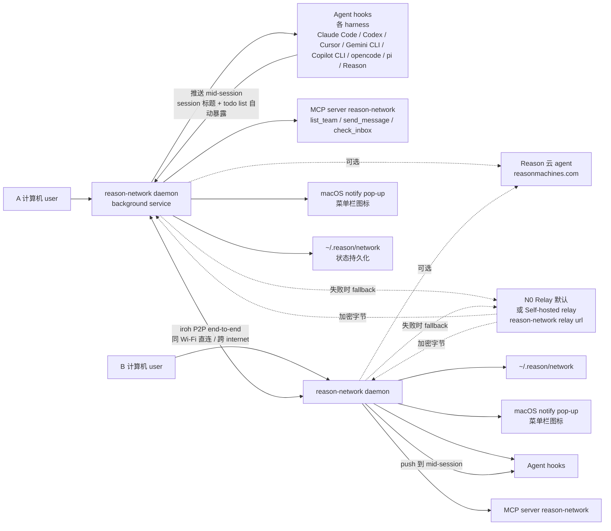

# reason-machines/reason-network

## 一句话定位
reason-machines 团队 2026-10-16 发布的 **P2P team coding agents 总线**——`one small daemon per computer + peer-to-peer + iroh (n0) + MCP server reason-network + list_team / send_message / check_inbox + 8 harness (Claude Code / Codex / Cursor / Gemini CLI / Copilot CLI / opencode / pi / Reason) + mid-session push + notify pop-up + menu bar icon + 由 tincan 重命名升级而来`，Rust + Apache-2.0 + DESIGN.md 详载架构。

## 它解决的问题
2025-2026 coding agent 单机突破后，团队协作仍卡在 Slack + IDE 切来切去 + 不知道队友的 agent 在干嘛 + 不知道哪个分支被谁在改。reason-machines/reason-network 直击——**每机一个 daemon + P2P 直连（iroh end-to-end + 跨 internet fallback relay）+ 队友机器自动发现 + MCP 让 agent 互相 list / send / check_inbox + mid-session push 主动送达 + notify 系统级弹窗 + menu bar icon 状态显示 + 完全可选 Reason 云**。把"Slack 在 coding-agent 时代的协作位置"用 Rust + iroh + MCP 多 harness 一致接入。

## 为什么值得关注（2026-10-18）
今日观察窗为 GitHub Search API 抓取时刻起、且截至 2026-10-18 仍在快速增长的新发现项目。`reason-machines/reason-network` 2 天 201⭐ ⑂21 fork/star 10.4%——201⭐ 在"P2P coding-agent 总线"这一类目中属合理新项目早期信号。**iroh（n0 公司）+ 8 harness 全覆盖 + mid-session push + check_inbox + notify pop-up + tincan 升级** 五个要素同时奉上，定位是取代 Slack 在 coding-agent 时代的协作位置。

## 热度来源判断
reason-network 的热度是 **"P2P first + iroh transport + MCP server + 8 harness 一致接入 + mid-session push + 由 tincan 升级 + 完全可选 Reason 云" 七要素共振**。
- P2P first：zero central server，只有 peer 直连失败才走 relay
- iroh transport：n0 公司维护的 end-to-end 加密 P2P
- MCP server reason-network：8 harness 都能集成
- mid-session push：Claude Code / opencode / pi / Reason 主动被打断；Cursor / Gemini / Copilot 下一步处理
- check_inbox：push 受限 harness 的退路
- notify pop-up：屏幕弹窗 + system notification
- macOS menu bar icon：在线状态

热度**真实且 network effect 潜力大**——团队 ≥ 5 人后才好用的工具，star 早期信号合理。

## 关键技术亮点
1. **每机一个 daemon**：background service + 安装链
2. **iroh（n0）P2P transport**：end-to-end 加密 + 默认 n0 relay + 可自建 relay（reason-network relay <url>）
3. **P2P first + cross-WiFi / 跨 internet**：同 Wi-Fi 直接连，跨 internet 走 iroh（必要时中继）
4. **8 harness MCP 一致接入**：Claude Code / Codex / Cursor / Gemini CLI / Copilot CLI / opencode / pi / Reason 全覆盖
5. **MCP 工具三件套**：list_team + send_message + check_inbox（push 受限 harness 用）
6. **Mid-session push**：Claude Code / opencode / pi / Reason mid-session 送达；空闲 session 唤醒
7. **Cursor / Gemini / Copilot next-step**：受限 harness 下一步处理
8. **Notify pop-up**：screen notification + 系统通知
9. **macOS menu bar icon**：在线状态 + 任务显示
10. **Self-hosted relay**：完全自建，不连 n0
11. **Tincan 升级路径**：用户、team、agents、background service 自动迁移
12. **Reason CLI**：可选账号体系，纯本地 team 也可用；与 reasonmachines.com cloud agent 接通
13. **~/.reason/network state**：本地持久化
14. **Uninstall**：reason-network leave && reason-network setup --remove && rm -rf ~/.reason/network ~/.local/bin/reason-network
15. **DESIGN.md**：状态结构 / 协议 / membership 持久化等设计文档独立

## 架构师速览

| 决策问题 | 研究判断 | 证据边界 |
|---|---|---|
| 系统边界 | 每机一个 daemon + MCP server reason-network + 可选 Reason 账号 + iroh P2P（可换自建 relay） | 基于 README「One small daemon per computer. Peer to peer, no server + iroh (n0 the company behind iroh)」 |
| 主路径 | agent session 在工作 → daemon 暴露 (who, repo, branch, status, current task) → teammates 通过 MCP list_team → send_message → daemon 投递到目标 session（mid-session push / next-step / check_inbox） → 可选 notify 屏幕弹窗 | 主路径为 README「What you get」段语义；具体 session registry 持久化、iroh 连接复用、与 Codex hooks 集成机制待核验 |
| 关键权衡 | P2P（zero server）vs 中继依赖 / end-to-end 加密 vs n0 公司默认 relay 看见加密字节 / 自建 relay 隔离 vs fork 自 tincan 需迁移 / mid-session push 对 harness 入侵深浅 | README「How it works」+「Uninstall」段 |
| 最小 PoC | 1. curl install.sh 用 with-reason 模式，跨两台机器互发 list_team + send_message → 2. 测试离线消息缓冲 + 上线送达 → 3. 在 Cursor (next-step) 与 Claude Code (mid-session) 间对比体验 → 4. 替换 self-hosted relay reason-network relay <url>，与 n0 默认 relay 对比延迟 | PoC 由 README Quick start + Unused 命令段推导；具体 session-binding 实现与 harness 兼容矩阵未公开 |

## 架构启发
reason-machines/reason-network 的核心启发是 **"team coding agents 总线 = iroh P2P transport + MCP multi-harness + mid-session push + notify + menu bar icon + 自建 relay 隔离"**。更进一步启发：**取代 Slack 在 coding-agent 时代的协作位置**——Slack 不懂 agent session、不懂 mid-session、不懂 harness、不懂 code review 自动化。reason-network 把这些都写进 daemon + MCP + iroh 三层。更深层的启发：**tincan 升级路径**——证明"已有项目 + 新名 + 自动迁移"是严肃工程化社区版本的范式。

## 架构图（MMD）

> 证据边界：此图只采用本档案已有可核验描述；"待核验"节点不应视为项目实现事实。

## 定位判断
**基础设施候选型项目（team coding agents 总线）。** reason-network 是 2026-Q4 "取代 Slack 在 coding-agent 时代的协作位置"赛道的代表样本。**iroh P2P + MCP multi-harness + mid-session push + 自建 relay + tincan 升级路径**五个要素同时奉上是稀缺差异化。对 small team + distributed team + 多 harness 用户而言，这是当前最接近"取代 Slack"愿景的实现。

## 风险 / 局限 / 泡沫点
- **n0 公司默认 relay 看见加密字节**：除非团队自建 relay（reason-network relay <url>），否则 n0 仍能见流量元数据（IP / 时长）
- **Mid-session push 对 harness 入侵深**：可能在 harness 升级时频繁不兼容
- **没有 server** 听起来很美，但消息存储、发现、team roster 都得本地——distributed consistency 复杂
- **Cursor / Gemini / Copilot 只能 next-step**：push 受限 harness 体验仍差
- **201⭐ 早期信号**：P2P 网络效应需要 ≥ 5 个互相连通的成员才好用
- **bus factor 集中于 reason-machines 团队**：tincan 升级路径已暗示团队统一控制
- **Reason CLI 锁定**：可选 Reason 账号体系可能引导用户迁移至 reasonmachines.com cloud
- **法律 / 合规位置**：mid-session 在 coding agent 工作时打断，团队动力学需要新规范

## 与同类项目的关系
- **vs tincan（reason-machines 同团队前身）**：tincan 是 reason-network 的前身，自动迁移
- **vs dtolnay/agent-team**：agent-team 是 dtolnay 个人 repo（Rust async 工坊），未发布
- **vs Slack / Discord / Linear**：这些通用协作工具不懂 agent session、不懂 mid-session、不懂 harness
- **vs iroh 直接使用**：iroh 是 transport 层，reason-network 是 team bus + MCP layer
- **vs OpenAI / Anthropic 官方 multi-agent**：尚无竞品（reason-network 抢先）
- **vs Anthropic sub-agent framework**：Anthropic 暂无 multi-machine agent bus
- **vs OpenAI Codex hooks**：Codex hooks 仅在单 Codex 内，reason-network 跨 harness

## 是否值得持续跟踪
**值得跟踪（team coding agents 总线候选）。** reason-network 是 2026-Q4 "team coding agents 总线"赛道的代表项目，**取代 Slack 在 coding-agent 时代的协作位置** 是合理愿景。建议关注：iroh 跨 internet 实测延迟、自建 relay 部署难易、Cursor (next-step) vs Claude Code (mid-session) 体验差、与 Slack / Linear 工作流冲突度、对 harness 升级的兼容性、distributed team roster 的实现。

对 distributed coding team + multi-harness 用户，这是值得试用 / 评估的项目；对单人或 2-3 人小团队，Slack 仍足够。

## 后续观察点
- iroh 跨 internet 实测延迟与稳定性
- 自建 relay reason-network relay <url> 部署难易度
- Cursor / Gemini / Copilot 的 mid-session push 推进
- 与 Slack / Linear / Notion 工作流集成深度
- Distributed team roster 一致性实现
- Reason CLI 与 Cloud Agent 商业化路径
- 是否被某 harness 官方集成（Claude Code / Codex 等）
- 团队规模 ≥ 5 人时实测体验

---
> 数据来源: GitHub API (2026-10-18) | Stars: 201 | Forks: 21 | License: Apache-2.0 | 语言: Rust | 创建: 2026-10-16 | Size: 1850 KB | Topics: coding-agents, iroh, mcp, peer-to-peer, reason
