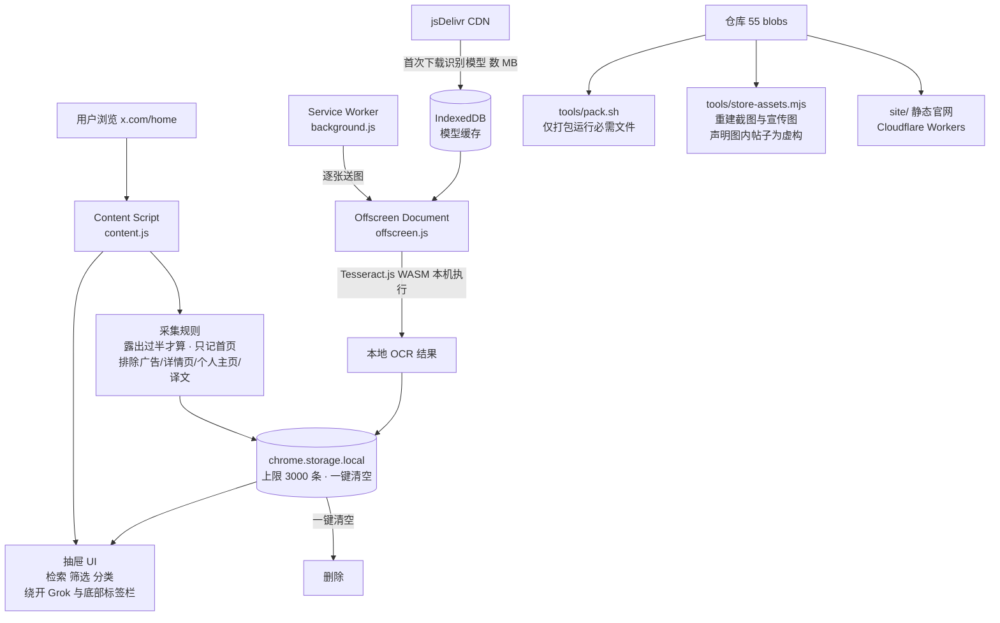

# yetone/rewind-for-x

## 一句话定位

一个 **Chrome 扩展**：默默记下你在 X（Twitter）首页**看到过**的每条推文，随时回看 —— 而它本日最值得抄的是它把「本地优先」写成了**可执行的结构约束**，而不是一句口号：**没有后端、没有账号、没有遥测，OCR 在本机跑，数据存在 `chrome.storage.local` 且上限 3000 条、可一键清空。**

## 它解决的问题

X 的首页推荐流一刷新，之前刷到的好帖子就消失了。**已有的解法分两类，各有明确缺陷：**

- **截图 / 录屏类工具** —— 能留住画面，但**留不住结构**：没法搜索、没法按类型筛选、没法复制正文。
- **服务端抓取类工具** —— 能搜索，但**必须把凭据或数据交给第三方**：需要登录授权，数据离开本机。

⭐⭐⭐⭐⭐ **而 `rewind-for-x` 的答案是第三条路：完全在浏览器扩展内完成记录、检索与 OCR，不与任何服务端交换数据。**

## 为什么值得关注（2026-11-10）

⭐⭐⭐⭐⭐ **它是本日最有说服力的「热度低但信号强」的样本：221⭐ ⑂7、subs 0、10 个 commit，而 221⭐ 这个数字在一个 97 个仓库、其中 60 多个是农场样本的榜单里，意味着它被 7 个人 fork 过 —— 而这 7 个 fork 的到达间隔中位数是 4,241 秒（0/6 ≤10 秒），跨度 464.4 分钟。**

⭐⭐⭐⭐⭐ **对照本日同榜的农场样本（`Roblox-FPS-Optimizer`：279⭐ / ⑂233 / fork 间隔 6 秒 / 2.9 分钟），同样是「中等星数 + 少量 fork」，两者的 fork 数差了 33 倍，时间分布差了三个数量级。** ⭐⭐⭐⭐⭐ **这说明：fork 数本身没有信息量，fork 的**时间分布**才有。**

⭐⭐⭐⭐⭐ **第二个值得抄的是它对「什么算被记录」的精确定义**，README 的三条硬规则：

> - **只记看过的**：推文在屏幕上**露出一半以上**才算，记下作者、正文、图片、引用、转帖人和链接
> - **只记首页**：推荐和关注时间线；**广告、推文详情页、个人主页都不记**
> - **随手打开**：右下角的按钮（在 X 的 Grok / 聊天按钮上方）、工具栏图标或 `Alt+Shift+R`

⭐⭐⭐⭐⭐ **「露出一半以上才算」是一个可实现的视口相交判定，而「只记首页、不记详情页、不记个人主页、不记广告」是一组显式的排除规则。** ⭐⭐⭐⭐⭐ **这与本日报此前记录的 `phoneuse`（写明未验证机型）、`solo-to-team-skills`（写明谁该做什么）属于同一条纪律线：把「我采什么、不采什么」写成可检验的规则，而不是留给使用者猜。**

⭐⭐⭐⭐⭐ **第三个值得抄的是它的 OCR 架构**：

> `ocr/`：图片文字识别，[Tesseract.js](https://github.com/naptha/tesseract.js) 7（Apache-2.0）跑在 offscreen 页面里。识别数据从 jsDelivr 下载，存在 IndexedDB

⭐⭐⭐⭐⭐ **注意「offscreen 页面」这个选择** —— Chrome 的 offscreen document 是 MV3 扩展在 Service Worker 无法使用 DOM 时的标准逃生口，而 **Tesseract.js 需要 DOM + Worker + WASM**。⭐⭐⭐⭐⭐ **即：它用 offscreen 页面承载一个 2.86 MB 的 WASM（`ocr/tesseract-core-simd-lstm.wasm`）+ 89 KB 的 SIMD LSTM core（`ocr/tesseract-core-simd-lstm.js`），全部在本机执行。**

⭐⭐⭐⭐⭐ **第四个值得抄的是它对「识别数据从哪来」的处理**：**识别数据从 jsDelivr 下载，存在 IndexedDB** —— 即模型走 CDN 但结果留本机，且第一次使用时才下载（README 明写「第一次使用时下载几 MB 的识别数据」）。

⭐⭐⭐⭐⭐ **第五个值得抄的是它把「本地」写成了可核对的产品规格，而不是隐私口号**：README 的第 6 条是「**数据只在本机**：存在 `chrome.storage.local`，最多 3000 条，可一键清空」。⭐⭐⭐⭐⭐ **注意「最多 3000 条」和「可一键清空」是两个不同的承诺 —— 前者是容量边界，后者是删除权。**

⭐⭐⭐⭐⭐ **第六个值得抄的是它的测试方式**：

> 需要 Playwright 和 Chromium。**测试用模拟 X 页面结构的页面，跑真实的扩展。**
> ```
> node test/e2e.mjs     # 记录、刷新后保留、忽略广告和非首页、跳过翻译插件的译文、抽屉、搜索、筛选、清空、深色主题
> node test/mobile.mjs  # 手机布局：按钮位置、全屏抽屉、触屏尺寸
> node test/ocr.mjs     # 搜图中文字：下载进度、识别、搜索、开关（要联网下载识别数据）
> ```

⭐⭐⭐⭐⭐ **「跳过翻译插件的译文」这一条尤其值得记** —— 浏览器翻译插件会改写页面 DOM，导致扩展可能把「译文」当成原文记录下来。⭐⭐⭐⭐⭐ **这是一个只有真正把扩展跑起来才会遇到的边界，而作者把它写进了测试名里。**

⭐⭐⭐⭐⭐ **第七个值得抄的是它对自己商店素材的诚实标注**：

> `node tools/store-assets.mjs`：重新生成 `store/screenshots/`（1280×800，中英文 × 浅色 / 深色 / 搜索）和 `store/promo/`（440×280、1400×560 宣传图），**图里的帖子都是虚构的**

⭐⭐⭐⭐⭐ **「图里的帖子都是虚构的」—— 在一个用户会看到截图并据此判断功能的场景里，主动声明素材是虚构的，是本日报记录到的少见做法。**

⭐⭐⭐⭐⭐ **第八个值得抄的是它的免责声明极短**：「非 X 官方产品，与 X Corp. 无关。」⭐⭐⭐⭐⭐ **而它同时有一个独立官网 `rewindforx.com`（源文件在 `site/`，Cloudflare Workers 静态资源托管，`site-worker/index.js` 做裸域跳转）+ 一份完整的隐私政策页 `site/privacy/index.html`。**

## 热度来源判断

**⭐⭐⭐⭐⭐ 热度来源是作者既有的长期影响力 + 一个真实但小众的痛点，而不是刷量。** 依据：

1. **⭐⭐⭐⭐⭐ 作者 `yetone` 账号 2011-11-19 创建，640 个公开仓库，10,484 followers** —— ⭐⭐⭐⭐⭐ **这是本日报记录到的第一个「有长期公开足迹的作者」样本**：前几日的农场账号是当天新建或 22 天前新建零 followers，而本项目的作者有 14 年历史与 1 万 followers。⭐⭐⭐⭐⭐ **一个 1 万 follower 的作者发一个 221⭐ 的小工具，是完全自然的传播形态 —— 这与农场样本「同一天创建几十个近似账号」形成结构性对照。**
2. **⭐⭐⭐⭐⭐ fork 间隔中位数 4,241.0 秒、0/6 个间隔 ≤10 秒、跨度 464.4 分钟** —— 与同日农场的 6.0 秒 / 29/29 相差三个数量级。
3. **⭐⭐⭐⭐⭐ 仓库内容完整可核验**：55 个 blob，含 `manifest.json`（892 B，真实 MV3 扩展清单）、`content.js`（32,702 B）、`background.js`（5,066 B）、`ocr/offscreen.js`（5,514 B）、`ocr/offscreen.html`（117 B）、`site/`（8 个文件的官网）、`store/`（商店素材与隐私表单全文）、`tools/pack.sh`。
4. **⭐⭐⭐⭐⭐ 它有 10 个 commit 落在 11 小时内，每个 commit 都对应一个可描述的功能**：`Add MIT license` / `Fit the phone layout of x.com` / `Drawer filter chips` / `Search the text in images, read on this device` / `Search ignores spacing around Chinese and Japanese` / `Privacy policy: say what Search text in images downloads` / `Website at rewindforx.com` / `Store listing: mention Search text in images`。
5. **⭐⭐⭐⭐⭐ 但它没有社区共建**：contributors 1 人、0 个 release、0 open issue、topics 空数组。⭐⭐⭐ **221⭐ ⑂7 的体量说明它还在「个人工具」阶段。**

⭐⭐⭐⭐⭐ **本日报的判断：这是一个真实、克制、实现到位的个人作品。它的 star 数在当天榜单里排不进前列 —— 这恰恰是本日报想记录的现象之一：在同一份榜单上，一个 221⭐ 的真项目和五个 279⭐ 的模板空壳混在一起，而真正能区分它们的东西全部不在 star 数里。**

## 关键技术亮点

1. **MV3 + Offscreen Document + WASM OCR 的三层架构** —— Service Worker（`background.js`，后台逐张识别图片）→ Offscreen Document（`ocr/offscreen.js` + `ocr/offscreen.html`，承载 Tesseract.js 的 DOM/Worker/WASM 环境）→ Content Script（`content.js`，在 x.com 记录推文并渲染抽屉 UI）。⭐⭐⭐⭐⭐ **offscreen 是 MV3 下跑 Tesseract.js 的正确解法 —— 这是本项目最值得抄的工程决策。**
2. **OCR 模型的按需下载与本地缓存** —— 识别数据从 jsDelivr 下载后存 IndexedDB，README 明写「第一次使用时下载几 MB 的识别数据」。
3. **中日文无空格搜索** —— commit `Search ignores spacing around Chinese and Japanese` 是一个专门处理的边界（中文/日文没有词间空格，按空格切词会失效）。⭐⭐⭐⭐⭐ **这是只有真正实现了搜索才会遇到的问题。**
4. **抽屉式 UI 而非弹窗** —— 按钮在右下角避开 X 的 Grok/聊天按钮；窄屏与触屏下抽屉铺满屏幕并避开底部标签栏与发帖按钮。⭐⭐⭐⭐⭐ **「避开哪些现有 UI 元素」被写进了 README —— 这是扩展类产品的真实约束。**
5. **广告与翻译插件的显式排除** —— 广告不记；翻译插件改写后的译文不作为原文记录。
6. **零后端** —— 官网为静态站点（Cloudflare Workers 静态资源），扩展不上报任何数据；`chrome.storage.local` 上限 3000 条。
7. **可复现的打包与商店素材生成** —— `tools/pack.sh` 打出只含运行必需文件的 zip；`tools/store-assets.mjs` 重新生成全部截图与宣传图；`tools/icons.py` 生成 `icons/`。

## 架构师速览

| 决策问题 | 研究判断 | 证据边界 |
|---|---|---|
| 系统边界 | 一个浏览器扩展（MV3）+ 一个静态官网 + 一个静态隐私页。**无后端、无账号、无遥测**；唯一的网络出口是 OCR 识别数据从 jsDelivr 首次下载 | 依据 README 与文件树（55 个 blob）；**本日报未在浏览器中实际安装运行该扩展** |
| 主路径 | Content Script 在 x.com/home 视口检测推文露出比例 → 记录到 `chrome.storage.local` → Service Worker 逐张把图片送进 offscreen document 做 OCR → 文本回写本地 → 抽屉 UI 做检索与筛选 | 主路径为 README 描述与文件名的抽象；**具体 DOM 选择器、存储 schema 与 OCR 调度逻辑未逐行核验** |
| 关键权衡 | ①「完全本地」vs「搜索质量」——本地 OCR 免费但慢、要下模型；②「什么算看到」——半屏阈值排除了短推文；③识别模型走 CDN 与「数据不出本机」之间的边界划在「模型」而非「数据」 | 前两项有 README 原文支撑；第三项由 README 的「数据从 jsDelivr 下载，存在 IndexedDB」与「数据只在本机」两句并存推出 |
| 最小 PoC | 装扩展 → 开 x.com/home → 刷过 20 条 → 打开抽屉确认已记录 → 断网后仍能检索已记录正文 → 打开一张含文字的图片验证 OCR（需先联网下模型） | 路径由 README 的测试清单推导；**本日报未执行** |
| 证据边界 | 221⭐ / ⑂7 / subs 0 / oi 0 / 10 commits / 2,201 KB / JavaScript / MIT / 0 release / 55 blobs / contributors 1 / topics 空 / 作者 2011-11-19 创建、640 repos、10,484 followers | 全部为 2026-11-09T21:50Z 快照值；**未运行扩展、未验证 OCR 准确率、未验证 3000 条上限的实际行为** |

## 架构启发

⭐⭐⭐⭐⭐ **本项目最值得架构师抄的是「本地优先」的三种落地方式，而不是它的功能。** 它把「不把数据交出去」拆成了三个可核对的层次：

1. **⭐⭐⭐⭐⭐ 记录在本地** —— `chrome.storage.local`，有容量上限（3000 条）与删除路径（一键清空）。⭐⭐⭐⭐⭐ **有上限才有「本地」这个承诺的边界 —— 无上限的本地存储迟早会被用户当成云存储。**
2. **⭐⭐⭐⭐⭐ 计算在本地** —— OCR 走 offscreen document 里的 WASM，识别结果不回传任何服务器。⭐⭐⭐⭐⭐ **注意这里的技术选型动机：不是「不想用云 OCR」，而是「云 OCR 要把图片发出去」—— 图片是内容，模型不是内容。**
3. **⭐⭐⭐⭐⭐ 备份在用户手里** —— 隐私政策有独立页面（`site/privacy/index.html`）并写明「Search text in images downloads」会下载什么。

⭐⭐⭐⭐⭐ **第二个启发是「把不适用的场景显式排除」。** ⭐⭐⭐⭐⭐ 它列了四条排除：广告、推文详情页、个人主页、翻译插件译文。⭐⭐⭐⭐⭐ **每一条排除都对应一类「看起来像目标但实际不是」的页面 —— 这是扩展类产品最常见的误采集来源。** ⭐⭐⭐⭐⭐ **而「翻译插件的译文」这一条只有真正部署过才会遇到。**

⭐⭐⭐⭐⭐ **第三个启发是「素材的虚构性被主动声明」。** ⭐⭐⭐⭐⭐ 商店截图里的帖子是编的，作者写明了这一点。⭐⭐⭐⭐⭐ **在一个截图即证据的产品形态里，声明「这是演的」比让人从截图里自己推断要诚实得多。**

## 架构图（MMD）

> 证据边界：此图只采用本档案已有可核验描述；"待核验" 节点不应视为项目实现事实。



## 定位判断

**工具型（浏览器扩展 / 个人效率工具）。** `rewind-for-x` 处在「社交平台时间线归档」这个细分品类里，而这个品类的既有竞争者分两类：截图类（无结构、不可搜）与服务端类（需交出凭据或数据）。⭐⭐⭐⭐⭐ **它的定位是「结构化 + 纯本地」这一格，而这一格在本日报观察到的窗口里没有第二个实现。**

⭐⭐⭐⭐⭐ **它与本仓库已收录的 `projects/dsh-see-now.md`（`NorthGateChat/dsh-think-game`，54⭐，JavaScript，8,685 KB，13 commits）同属「在别人的界面上叠加一层」的形态**（前者是 DSH 流式思考下方的小游戏，后者是 X 时间线的回看抽屉），⭐⭐⭐⭐⭐ **但两者方向相反：dsh-see-now 是往下滑动流里插入内容，rewind-for-x 是把已经滑过去的内容留住。**

⭐⭐⭐⭐⭐ **它与 `projects/satmux.md`（316⭐，纯标准库 Python）共享一条方法论** —— 两者都把「我做不到什么 / 我依赖什么」写进 README：satmux 写「removes extra round-trips, not the physical RTT of one hop」，rewind-for-x 写「非 X 官方产品」与「识别数据从 jsDelivr 下载」。⭐⭐⭐⭐⭐ **两者的共同点不是领域，而是「把限制写在最显眼处」这个习惯。**

## 风险 / 局限 / 泡沫点

- ⚠️ **⭐⭐⭐⭐⭐ 强依赖 X 的 DOM 结构。** ⭐⭐⭐⭐ **X 改版一次就可能让采集规则失效，而项目没有任何官方 API 可依赖 —— 这类「寄生式扩展」的结构性风险无法通过工程质量消除，只能靠快速跟进。** ⭐⭐⭐⭐⭐ **尤其讽刺的是：`X` 刚刚改过自己的「Grok / 聊天按钮」位置，而扩展的按钮必须避开它 —— 双方都在移动彼此的依赖对象。**
- ⚠️ **⭐⭐⭐⭐ 本日报未运行该扩展，未验证 OCR 准确率、检索行为、3000 条上限与「露出一半」的判定。** ⭐⭐⭐⭐ **所有功能描述均为对作者自述的转述。**
- ⚠️ **⭐⭐⭐⭐ OCR 模型的 CDN 依赖是单点。** ⭐⭐⭐⭐ **若 jsDelivr 不可达或被墙，「搜图中文字」这一整条能力会失效；而 README 没有给出模型文件的自托管方式。**
- ⚠️ **⭐⭐⭐ 隐私承诺缺少第三方核验。** ⭐⭐⭐ **「无后端」在本日报的取证范围内可确认（仓库里没有服务端代码，官网是静态的），但扩展若被篡改、或 Chrome 扩展商店的分发流程引入外部行为，不在本仓库可核验范围内。**
- ⚠️ **⭐⭐⭐ 单人维护、无 release、无 issue。** ⭐⭐⭐ **221⭐ ⑂7 的体量与 1 个 contributor 说明它处在「个人自用工具」阶段，尚无社区承接能力。**
- ⭐⭐ **可能的合规边界：存储并检索他人发布的推文内容，涉及平台条款与个人数据的双重约束。** ⭐⭐⭐ **本日报只记录技术事实，不主张其合规性，也不建议用户在不确认条款的前提下长期使用。**
- ⭐⭐ **热度本身很小（221⭐、subs 0）** —— 即真实 ≠ 热门，这一条在本项目上成立。

## 是否值得持续跟踪

**值得跟踪，但作为「本地优先架构范式」的样本，而不是作为要立刻用的工具。**

⭐⭐⭐⭐⭐ **推荐理由一：它是本日报判据的正面样本。** ⭐⭐⭐⭐⭐ **221⭐ / ⑂7 / fork 间隔 4,241 秒 / 有 14 年历史的作者 / 55 个真实文件 —— 与同榜 279⭐ 的模板空壳形成完整对照。**

⭐⭐⭐⭐⭐ **推荐理由二：它的技术选型（offscreen document 承载 WASM OCR）是可迁移的通用解法。** ⭐⭐⭐⭐⭐ **任何需要在 MV3 扩展里做本地推理的项目都会遇到同一个问题，它的解法值得抄。**

⭐⭐⭐⭐⭐ **推荐理由三：作者有 10,484 followers 与 640 个仓库** —— ⭐⭐⭐⭐ **这是本日报观察窗口里唯一一个「作者个人影响力可解释热度」的样本，⭐⭐⭐⭐ 值得作为对照基线记录。**

⭐⭐⭐⭐ **对普通用户：可以试用，但要先确认 X 的服务条款与自己的隐私需求。**

## 后续观察点

- ⭐⭐⭐⭐⭐ **X 改版后扩展是否失效，以及作者跟进的节奏** —— ⭐⭐⭐⭐ **这是这个项目唯一的生死线。**
- ⭐⭐⭐⭐⭐ **是否出现 0.2.0 / 首个 release** —— ⭐⭐⭐⭐ **目前 0 个 release，说明「打包 → 上架 → 迭代」的闭环还没跑通一次。**
- ⭐⭐⭐⭐ **是否会引入账号同步或服务端索引** —— ⭐⭐⭐⭐ **若引入，「数据只在本机」这条前提就会变，届时需要重新评估。**
- ⭐⭐⭐⭐ **OCR 模型是否改为可自托管 / 是否提供离线包** —— ⭐⭐⭐⭐ **这是消除单点依赖的最小改动。**
- ⭐⭐⭐ **社区是否出现 fork 贡献** —— ⭐⭐ **当前 7 个 fork 间隔中位数 4,241 秒，是真人节奏；若未来 fork 数暴涨但间隔骤降，即为异常信号。**
- ⭐⭐ **「搜索图中文字」是否引入本地向量检索** —— ⭐⭐ **若从字面匹配转向语义匹配，本地优先的成本模型会变。**

---
> 数据来源: GitHub REST API (2026-11-09T21:50Z 快照) | Stars: 221 | Forks: 7 | Subscribers: 0 | Open Issues: 0 | License: MIT | 语言: JavaScript | 创建: 2026-11-09T09:28:22Z | Blobs: 55 | Commits: 10 | Releases: 0 | 作者: yetone（2011-11-19 创建，640 repos，10,484 followers）
