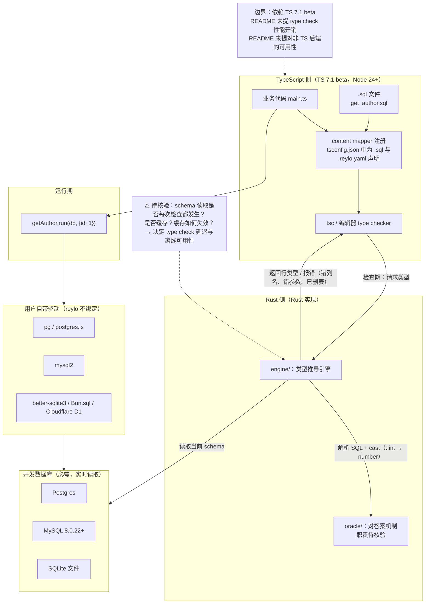

# colinhacks/reylo

## 一句话定位

把 `.sql` 文件直接 import 进 TypeScript，并让**类型直接从 SQL 本身推导出来**——不需要手写行类型，不需要 schema 文件同步，不需要 codegen；type checker 直接向 reylo 查询。

## 它解决的问题

TypeScript 生态里，SQL 与类型之间长期存在一条**必须手工维护的接缝**：

- 用 ORM（Prisma、Drizzle）：schema 是单一事实源，但你写不进原生 SQL 方言的全部能力。
- 手写 `.sql` + 手写行类型：两份东西必然漂移。
- 用 codegen（`:gen types` 之类）：有生成文件、有 watcher、有 diff 噪音，schema 改了要记得重跑。

reylo 的主张是把这条接缝消掉：**让 SQL 文件本身成为类型的事实源**。README 的演示图说明了这个体验——「hovering a query's result shows its type, which follows the SQL as the SQL changes」。示例代码：

```sql
-- get_author.sql
select u.id, u.name, count(p.id)::int as post_count
from users u
left join posts p on p.user_id = u.id
where u.id = :id::int
group by u.id
```

```ts
import getAuthor from "./get_author.sql";
const author = await getAuthor.run(db, { id: 1 });
// { id: number; name: string; post_count: number } | null
```

**类型跟着 SQL 变**——改 SQL，类型自动跟着变。

## 为什么值得关注（2026-10-23）

**它唯一的、也是决定性的技术前提，是 TypeScript 7.1 的 content mappers——而该特性目前在 beta。** README 明确：「Reylo is powered by TypeScript [content mappers](https://github.com/microsoft/typescript-go/pull/4712), introduced in TypeScript 7.1 (currently in beta)」。

这个依赖决定了它今天的所有性质：
- **成立的话**，它是第一个真正消灭 SQL↔类型同步成本的方案，且没有任何 codegen 副产物。
- **不成立的话**（content mappers 改了 API、或 TS 7.1 迟迟不发），整个项目无法运行。

**616⭐ ⑂3（fork/star 0.5%）出现在 1.9 天内，是本日四个项目中 fork 比例最低的**。这个数字与它的形态完全吻合：这是一个**依赖 beta 特性的库**，不是一个可以 fork 去改造的东西——你需要的是等 TS 7.1 stable 并升级，不是 fork 它。`subscribers_count = 0` 也印证了这一点。

## 热度来源判断

**热度来自作者本身，不是来自采用。** colinhacks 即 Colin McDonnell，是 TypeScript 编译器方向的核心贡献者（TS 7 的 typescript-go 路线中 content mappers 的 PR 即由他所在生态推动）。**一个编译器核心贡献者发布"第一个吃 content mappers 的库"，天然获得关注**——但 0 subscribers、0.5% fork-star 说明这份关注尚未转化为使用。

**必须说清**：`open_issues_count = 13` 而 stars 616、subscribers 0。13 个 issue 对一个 616⭐ 的库不算低，可能反映两类情况：真实用户在试 beta 特性时遇到具体问题，或 API 尚未稳定。**本窗口未取 issue 内容，不做判断。**

## 关键技术亮点

1. **零 codegen**：README 用「**No codegen** — the type checker asks Reylo directly: no generated files, no watcher」作为六大卖点之一。**这是它与所有现有方案最本质的区别**——不是"生成得更好"，而是"不生成"。
2. **对着真实数据库校验**：README 的 "Checked against your database" 一条写明，**拼错的列名、错误的参数、已删除的表都是类型错误**，且在 `tsc` 和编辑器里都成立。**校验发生在 type check 期而非运行期。**
3. **类型来自 SQL 本身**：README 的 DRY 一条写明「no hand-written row types, no schema file to keep in sync」。类型不是从数据库 schema 反推的（那会丢失方言特有信息），而是**从你写的这条具体 SQL 推导的**——所以 `count(p.id)::int as post_count` 会得到 `number` 而不是 `bigint`。
4. **面向 agent 的设计论证**：README 把「Agent-friendly」列为核心卖点之一，理由是「each fact lives in one place, so an agent cannot leave a stale type behind, and the type check finds every caller it missed」。**这是把「单一事实源」从 DRY 论点转成 agent 论点**，2026 年值得注意的论证方式转换。
5. **自带驱动而非绑定**：支持 Postgres、MySQL（8.0.22+）、SQLite，驱动由用户提供——`pg`、postgres.js、`mysql2`、`better-sqlite3`、`Bun.sql`、Cloudflare D1 等。
6. **Rust 实现**：仓库含 `Cargo.toml` / `Cargo.lock` / `engine/` / `oracle/` / `src/` / `packages/`，顶层目录显示 `engine`、`oracle`、`lab`、`skills`、`wiki`、`site`。**`oracle/` 这个目录名暗示存在一个用于对答案的机制（推测为类型推导正确性的对照实现，待核验）。**

## 架构师速览

| 决策问题 | 研究判断 | 证据边界 |
|---|---|---|
| 系统边界 | TypeScript 语言插件层（content mapper）· Rust 引擎（`engine/`）· **对真实数据库的 schema 读取通道**（"Checked against your database" 要求引擎能连库）· 类型检查期（`tsc` 与编辑器）· 运行期（`.run(db, params)` 执行）。数据面是类型检查时的 SQL 解析 + schema 查询；控制面是 TS 编译器调用 mapper | README 的 Setup 段（需 TS 7.1 beta、Node 24+、**一个正在运行的开发数据库**「Reylo reads your current schema from it」）+ 六卖点 + `Cargo.toml` / `engine/` / `oracle/` 目录；**`oracle/` 的职责与 `skills/` `wiki/` `lab/` 的内容本窗口未取，待核验** |
| 主路径 | 编辑器或 `tsc` 遇到 `.sql` import → 调 content mapper 请求类型 → mapper 交给 Rust 引擎 → 引擎解析 SQL **并连开发库读取当前 schema** → 推导该条查询的行类型（受方言与 cast 影响，如 `::int` → `number`）→ 返回类型给 type checker → 用户 hover 得到类型，错误列名/参数在检查期报错 → 运行期 `.run(db, params)` 执行同一条 SQL | 由 README 的 Setup 依赖（运行中的开发库）+ 六卖点 + 示例代码倒排；**「schema 读取是否每次检查都发生、是否缓存、缓存如何失效」README 未说明，这是本项目最关键的未决问题** |
| 关键权衡 | **零 codegen（类型检查时实时查询）vs 生成文件（离线、快、可 review）**——实时查询把成本转移到 type check 的延迟与对开发库的依赖上 · **对着真实数据库校验（准确）vs 纯静态解析（无需连库）**——前者要求开发者在编辑器里有一个活的库 · **零手写类型（DRY）vs 显式类型（可读性/可文档性）** · **依赖 TS 7.1 beta（拿到 content mapper 这个前所未有的能力）vs 现在就能用（用 ORM 或 codegen）** · **方言原生 SQL 全文力（任意语句、函数、运算符、语法）vs 可移植性**（README 强调 "any statement, function, operator or syntax your database supports, in its own dialect"） | README 明示的三项依赖（TS 7.1 beta / Node 24+ / 运行中的开发库）+ 六卖点逐条（No codegen / Checked against your database / DRY / full power of SQL in its own dialect）+ 类型来自 SQL 本身（`::int` 影响推导结果）这一事实；**未明示：type check 性能开销、schema 缓存策略、错误信息的质量、以及对非 SQL 文件（如 Python/Java 后端）的可用性** |
| 最小 PoC | 1. **先确认 TS 7.1 已可安装**（`npm install -D typescript@beta`，README 明确要求 beta）——**这一步不成立则整个 PoC 不成立，先不要往下走**→ 2. 准备 Node 24+ 与一个正在运行的开发库（Postgres / MySQL 8.0.22+ / SQLite 文件）→ 3. `npm install reylo` + `npm install -D @reylosql/postgres`（或 mysql / sqlite）+ `npm install -D typescript@beta` → 4. 在 `tsconfig.json` 里为 `.sql` 与项目文件（`.reylo.yaml` / `.reylo.yml`）注册 Reylo → 5. 用 README 的 `get_author.sql` 原样建表并 import，**先在编辑器里 hover 结果**，确认类型是 `{ id: number; name: string; post_count: number } | null` → 6. **故意把 `post_count` 改成 `post_counts`（不存在的列），确认编辑器立刻标红且 `tsc` 报错**——**这一步是整个 PoC 的意义所在**：验证"对着数据库校验"是真的，而不是只做了静态解析 → 7. 改 SQL 的 cast（`::int` → 不写），确认类型随之变化 → 8. 运行 `getAuthor.run(db, { id: 1 })` 确认运行期一致 → 9. **测量 type check 的延迟**：对一个只有几个 `.sql` 文件的项目跑一次 `tsc --diagnostics`，再对一个大项目跑——这是唯一能回答"零 codegen 是否真的划算"的方法 | 前 4 步来自 README 的 Setup 原文；**第 5–7 步是本项目最关键的自检动作**：如果第 6 步不报错，说明它根本没有连库校验，"Checked against your database" 就是空话；**第 9 步是 README 完全没提但决定该方案成败的问题**，本日报无法代答 |



> 证据边界：此图只采用 README 的 Setup 段、六卖点、示例代码与仓库顶层目录（`Cargo.toml` / `engine/` / `oracle/` / `src/` / `packages/`）。虚线节点为 README 未说明、待核验的问题；`oracle/` 的职责为本档案据目录名所作的推断，未经证实。

## 架构启发

**它最值得学的一条是把「事实源」这个概念推到了编译期。**

过去十年工具链里，「避免手写重复」的主流解法是 **codegen**：生成文件、提交、review、在 CI 里校验生成物是否最新。这套流程有明确成本——生成物进版本库造成 diff 噪音、watcher 吃掉本地资源、schema 变了忘了重跑就静默过期。

reylo 的主张是：**如果类型检查器能在检查期直接向一个服务提问，就根本不需要 codegen 这一步。** content mappers 正是为这件事准备的语言机制——README 引用的是 typescript-go 仓库的 PR #4712。

**这个思路的可迁移性比项目本身大。** 凡是「事实源 A 变了，派生物 B 需要重新生成」的场景，codegen 都在做同一件事。content mappers 把这件事从「生成文件」改成「检查时计算」——**派生物不再存在于磁盘上，因此不可能过期**。这是本日四个项目里唯一一条关于语言与工具链设计的判断。

第二条是它的 **agent 论证方式**：「each fact lives in one place, so an agent cannot leave a stale type behind, and the type check finds every caller it missed」。这把「单一事实源」从面向人的 DRY 论点，改写成面向 agent 的**失效模式论证**——不是"这样更整洁"，而是"这样 agent 就无法制造过期状态"。**2026 年工具设计开始用「agent 会怎么弄坏它」而不是「人会不会弄错它」来论证，这是一个值得注意的转变。**

## 定位判断

**证明型库（观察型），当前不具备生产可用性。**

README 把「The perfect option for the agent era」写在卖点列表里，语气是判断而非观察。本档案的判断不同：**它现在是 beta 依赖上的概念验证。** 依据是三条可核验事实——`subscribers_count = 0`、`fork/star 0.5%`、`requires TypeScript 7.1 (currently in beta)`。

与同类项目的关系：
- **vs Prisma / Drizzle**：它们用 schema-as-source 换取可移植性，代价是 SQL 方言受限；reylo 用 SQL-as-source 换全文力，代价是方言绑死在你的数据库上。**这是同一枚硬币的两面，reylo 的取舍在有大量 SQL 方言特定语法的存量代码库里更有利。**
- **vs sqlc / Slither（Go 侧同类）**：sqlc 做同样的事但是**离线 codegen**。reylo 与 sqlc 的差别不在结果类型，而在于「结果存在磁盘上还是检查时计算」。这是同一个问题的两种答案，也正因如此 sqlc 的存在说明这个需求是被验证过的。
- **vs 类型安全的 API 客户端（如 Speakeasy、OpenAPI codegen）**：同一问题在 API 边界上的版本，答案是 codegen。
- **vs TS 7.1 本身**：reylo 是 content mappers 最早的重量级使用者之一——**它的成败会直接影响该特性的成熟度判断**。

## 风险 / 局限 / 泡沫点

1. **⚠️ 完全依赖 TS 7.1 beta**：README 明确要求 `typescript@beta` 与 Node 24+。**若 content mappers 在 stable 前变更 API，本项目需要重写；若 TS 7.1 跳票，它就是零。** 这是本项目唯一的、也是压倒性的单点风险。
2. **需要运行中的开发数据库**：README 的 Prerequisites 写明「A running dev database」。**这意味着编辑器里的类型检查依赖一个网络可达的服务**——在没有 DB 的环境（CI 的某些阶段、新机器、离线场景）会怎样，README 未说明。
3. **type check 性能未测**：README 通篇没有 type check 延迟的任何数据或基准。**「零 codegen 是否真的划算」完全取决于这个数字，而它不可得。**
4. **`subscribers_count = 0` 与 fork/star 0.5%**：**热度目前完全是曝光，没有任何采用信号。** 这与 10-21、10-22 连续两日的观察一致——多批项目的 fork-star 都在偏低区间。
5. **`open_issues_count = 13`**：对一个 616⭐、0 subscribers 的库，issue/star 比偏高。可能反映真实用户遇到 beta 特性的边界，也可能反映 API 未稳定。**本窗口未取 issue 内容，不做判断。**
6. **方言绑定的隐性成本**：README 强调「any statement, function, operator or syntax your database supports, in its own dialect」——这是全文力，但也是**不可移植**。同一段 SQL 换数据库就可能不成立，README 未讨论跨库场景。
7. **仓库含 67 MB 代码**（`size = 66704 KB`）但 stars 616、forks 3：**绝大部分 star 来自围观而非使用。**
8. **`topics` 字段为空数组**（未设置 GitHub topics）。

## 是否值得持续跟踪

**值得跟踪，但跟踪的应���是「TS 7.1 的进度」而非「reylo 的 star 数」。** 理由：它的存续完全由上游语言特性决定，而 content mappers 的最终形态是本项目所有设计的前提。

**7 天后判断标准**：只看一件事——**TypeScript 7.1 是否进入 stable / content mapper API 是否发生变更**。若两者皆无变化，reylo 的 star 数再涨也不代表任何东西；若 TS 7.1 定稿而 reylo 未跟进，那才是一个有信息量的负面信号。

## 后续观察点

- TypeScript 7.1 的发布时间表与 content mappers 的 API 稳定性（**决定性变量**）
- type check 的性能开销是否有公开基准（决定「零 codegen」这个卖点的真实成本）
- schema 缓存策略：是否每次检查都连库、是否可离线
- `@reylosql/*` 驱动包的数量与覆盖范围（当前只有 postgres / mysql / sqlite 三种）
- `oracle/` 目录的职责（若它是对推导正确性的对照实现，那么它的测试方式是本项目可信度的关键）
- 是否出现第二个重量级使用者——这对 content mappers 这个特性本身比对 reylo 更重要

---
*首次记录：2026-10-23*