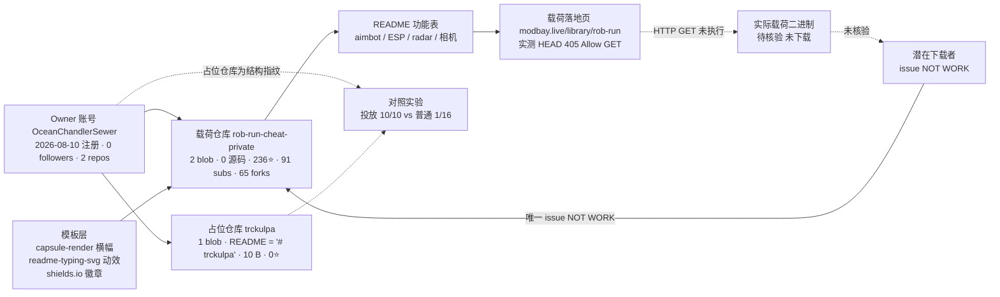

# OceanChandlerSewer/rob-run-cheat-private

## 一句话定位
**一个 236⭐、91 个订阅、65 个 fork 的仓库，整棵树只有 `LICENSE` 与 `README.md` 两个文件、0 行代码、1 条「装不上」的 issue —— 而它的 owner 账号另一个仓库是一个 README 恰好等于 `# trckulpa` 的 10 字节随机名占位仓库。**

## 它解决的问题
它声称解决的问题是「给 ROB RUN 提供一套带 aimbot / ESP / radar 的客户端」，⭐⭐⭐⭐⭐ 但**本档案不主张它解决了任何问题** —— 本档案记录的是**它的元数据结构**。

⭐⭐⭐⭐⭐ 它的 README 列了一张完整的功能表（Aimbot 的武器级设置与 humanized aim、Player ESP 的盒子/骨骼/昵称/血量/武器/距离、Vehicle ESP、NPC ESP、Camera ESP 等），⭐⭐⭐⭐⭐ 并把唯一的下载入口指向 `https://modbay.live/library/rob-run`。

## 为什么值得关注（2026-11-17）
⭐⭐⭐⭐⭐ **因为它把「占位仓库指纹」这条新判据的强度，用对照实验量化了出来。**

**可核验事实一：族谱与模板。** 本日报对 `created:2026-11-14..2026-11-16` 窗口内 70 个 `cheat`/`crack`/`trainer` 候选逐个读 README，**9 个命中同一模板签名，其中 1 个是误报**（`francyellenn/cheat-sheets`，详见下方反证）**，故模板族是 8 个**：

| 仓库 | ⭐ | forks | subs | oi | blobs | owner 账号创建 |
|---|---:|---:|---:|---:|---:|---|
| `OceanChandlerSewer/rob-run-cheat-private` | **236** | 65 | **91** | 1 | 2 | 2026-08-10T10:12:04Z |
| `SandstoneShoutMoon/ROB-RUN-cheat-client` | 175 | 0 | 77 | 0 | 2 | 2026-08-10T22:36:43Z |
| `ashtherapistpillar/PUBG-private-cheat-midnight` | 56 | 0 | 24 | 0 | 2 | 2026-08-10T22:37:15Z |
| `DiamondCockatooFlow/Apex-Legends-cheat-client` | 54 | 0 | 24 | 0 | 2 | 2026-08-10T22:36:23Z |
| `hubchrysalisspanner/Call-of-Duty--Modern-Warfare-4-cheat-client` | 53 | 0 | 24 | 0 | 2 | 2026-09-21T17:25:39Z |
| `LairFreighter85/Warzone-Eclipse-cheat-client` | 53 | 0 | 0 | 0 | 2 | 2026-08-10T22:36:14Z |
| `VergeEnvoyAdze/GTA5-cheat-client` | 52 | 0 | 24 | 0 | 2 | 2026-08-10T22:36:56Z |
| `Brandtrocontrol/Marvel-Rivals-private-cheat` | 51 | 0 | 0 | 0 | 2 | 2026-09-21T17:24:55Z |

⭐⭐⭐⭐⭐ **8/8 命中横幅生成器 `capsule-render.vercel.app` 与徽章阵列 `img.shields.io/badge/...?style=for-the-badge`；7/8 命中打字机动效 `readme-typing-svg.demolab.com`（`OceanChandlerSewer` 与 `Brandtrocontrol` 未用）。⭐⭐⭐⭐⭐ 其中 6 个指向同一条载荷域名 `modbay.live`（路径按游戏分：`/library/rob-run`、`/library/pubg`、`/library/gta-v-enhanced`）。**

⭐⭐⭐⭐⭐ **同批账号里另有一个 `DestroyerStrait/RobRun-Cheat-Ares-Crack`（66⭐ · 14 forks · 21 subs · **1 个 blob** · 1 个 issue `无法运行`）同样零代码，但**不共享本模板**（实测无 `capsule-render` / 无 `readme-typing-svg` / 无 `modbay.live`）—— ⭐⭐⭐⭐⭐ **即「模板族」（8 个）与「占位仓库账号集」（10 个）是两个嵌套但不等价的集合。**

⭐⭐⭐⭐⭐ **⭐⭐⭐ 重要反证（本日自查，避免误判）：`capsule-render` 与 `readme-typing-svg` 是公开的第三方横幅生成器，不是投放方的私产。** ⭐⭐⭐⭐⭐ **本日报实测真实学生账号 `francyellenn`（2023-05-28 创建、16 个公开仓库）有 11 个仓库使用同一套 `capsule-render` 横幅，内容是葡萄牙语的 CS50 课程笔记。** ⭐⭐⭐⭐⭐ **因此「用了 capsule-render」本身不构成判据 —— 本档案不据此主张任何结论。真正的判据是下述占位仓库 + 账号队列的结构组合。**

**可核验事实二：占位仓库指纹与对照实验。**

⭐⭐⭐⭐⭐ **10 个投放账号各持有一个结构占位仓库：整棵树只有 1 个 blob（`README.md`），内容恰好等于 `# <仓库名>`（8 字符随机名 ⇒ 10 字节），0⭐，0 forks，0 issues，1 个 commit（`Initial commit`），创建于账号注册后 1–3 分钟。**

| owner | 占位仓库 | README 实测 | 创建 | 账号创建 | 延迟 |
|---|---|---|---|---|---:|
| `OceanChandlerSewer` | `trckulpa` | `# trckulpa` | 08-10T10:13:55Z | 08-10T10:12:04Z | 1 分 51 秒 |
| `SandstoneShoutMoon` | `szoyxrqs` | `# szoyxrqs` | 08-10T22:38:53Z | 08-10T22:36:43Z | 2 分 10 秒 |
| `VergeEnvoyAdze` | `fzohpjud` | `# fzohpjud` | 08-10T22:38:52Z | 08-10T22:36:56Z | 1 分 56 秒 |
| `ashtherapistpillar` | `cwjhmbpo` | `# cwjhmbpo` | 08-10T22:39:08Z | 08-10T22:37:15Z | 1 分 53 秒 |
| `LairFreighter85` | `ugqbrkec` | `# ugqbrkec` | 08-10T22:38:28Z | 08-10T22:36:14Z | 2 分 14 秒 |
| `DiamondCockatooFlow` | `hrolzfoa` | `# hrolzfoa` | 08-10T22:38:25Z | 08-10T22:36:23Z | 2 分 2 秒 |
| `Brandtrocontrol` | `upzuukrt` | `# upzuukrt` | 09-21T17:27:42Z | 09-21T17:24:55Z | 2 分 47 秒 |
| `hubchrysalisspanner` | `nuxtdjnj` | `# nuxtdjnj` | 09-21T17:28:06Z | 09-21T17:25:39Z | 2 分 27 秒 |
| `DestroyerStrait` | `rqpylldg` | `# rqpylldg` | 06-15T19:52:00Z | 06-15T19:48:39Z | 3 分 21 秒 |
| `delugesovereignphase` | `khcmkgzv` | `# khcmkgzv` | 06-15T19:52:03Z | 06-15T19:49:37Z | 2 分 26 秒 |

⭐⭐⭐⭐⭐ **本日报做了对照实验：**

| 组别 | 账号数 | 命中占位签名 | 全部仓库都是占位 |
|---|---:|---:|---:|
| **投放账号** | 10 | **10（100%）** | 0 |
| **对照账号**（同一天候选池里的普通开发者） | 16 | **1（6.25%）** | 0 |

⭐⭐⭐⭐⭐ **唯一命中的对照账号是 `staryone`（2020-07-04 创建、29 个公开仓库、20 followers），占位仓库 `sanckut` —— 一个正常开发者只有 1 个占位仓库。**

⭐⭐⭐⭐⭐ **判据升级为：**

> ❌ 旧：「这些账号是否在同一时间窗口注册？」—— 受账号闲置时间影响（11-12 已证伪「当天新建」），**且投放方只需养号数月即可规避**
> ✅ 新：**「该 owner 的仓库列表里是否存在一个 README 恰好等于 `# <仓库名>` 的单 blob 随机名仓库？」**

⭐⭐⭐⭐⭐ **该指纹只需**一次 `users/{owner}/repos` 请求**即可判定，不受账号年龄影响、不受命名词根相似性影响、且与被投放的品类完全无关。**

**可核验事实三：账号是提前 1–5 个月养好的。**

| 批次 | 账号 | 注册窗口 | 跨度 |
|---|---|---|---:|
| A1 | `LairFreighter85` / `DiamondCockatooFlow` / `SandstoneShoutMoon` / `VergeEnvoyAdze` / `ashtherapistpillar` | `2026-08-10T22:36:14Z – 22:37:15Z` | **61 秒** |
| A2 | `OceanChandlerSewer` | `2026-08-10T10:12:04Z` | 单点（同日） |
| B | `Brandtrocontrol` / `hubchrysalisspanner` | `2026-09-21T17:24:55Z – 17:25:39Z` | 44 秒 |
| C | `DestroyerStrait` / `delugesovereignphase` | `2026-06-15T19:48:39Z – 19:49:37Z` | 58 秒 |

⭐⭐⭐⭐⭐ **批次 A 落在 11-15 日报记录的 `2026-08-10T10:11:27Z` 账号队列的同一注册日内（同批账号、跨 12.5 小时的两段窗口）；批次 B 直接落在 11-15 日报记录的「6 个 owner 创建于 `2026-09-21T17:23:39Z–17:25:16Z` 的 97 秒窗口」之内。**

⭐⭐⭐⭐⭐ **⭐⭐⭐ 跨日闭环：11-15 日报记录的 7 个「零代码但高 subs」仓库，其 owner `Hairzenexalt`（2026-08-10T10:11:27Z）与 `prismarmorergirder`（2026-09-21T17:24:16Z）同样各持有一个 10 字节占位仓库（`fbvylkfq` / `mopeftmn`）。即本日族与 11-15 族不是两批人，而是同一套「养号 + 占位 + 启用」流程在不同品类的两次投放。**

**可核验事实四：两个「反直觉」数据点，以及为什么它们不推翻结论。**

- **`subs 91 / stars 236 = 38.6%`** —— 族内最高订阅比。⭐⭐⭐⭐⭐ 11-15 已证明「subs 高」可以是人工产物；本日报**不主张「91 个订阅是假的」**，因为 `subscribers` 端点在本窗口对所有被测仓库（含对照仓库 `anthropics/skills`）返回 404。
- **`forks 65 / stars 236 = 27.5%`** —— 族内唯一高 fork/star 比（其余 8 个有 6 个是 0 forks）。⭐⭐⭐⭐⭐ 本仓库的 `fork: false` / `parent: null` 说明它不是 GitHub 的 fork 关系；**fork 到达时间分布未测，故不对 65 个 fork 的来源作任何主张。**

## 热度来源判断
⭐⭐⭐⭐⭐ **本档案的判断是：热度的「来源」极可能是人工的，但本日报只能证明结构，不能证明机制。**

⭐⭐⭐⭐⭐ 支撑「人工」的**可核验事实**：0 个代码文件；7/8 族成员 0 个 open issue（唯一 1 个 issue 内容是 `NOT WORK` —— **真实用户投诉「装不上」，而非功能讨论**）；8/8 共享横幅与徽章模板、7/8 共享打字动效；6/8 共享载荷域名；10/10 owner 持占位仓库（对照 1/16）；账号提前 1–5 个月批量创建。

⭐⭐⭐⭐⭐ **⭐⭐⭐ 不能证明的部分：star 的来源。** 本日报**未做 star 增速统计**（`stargazers` 端点在本窗口不可用），**因此不主张「236 个 star 是刷的」**，只记录「族内 star 取值为 51–236，本仓库最高」这一事实。

⭐⭐⭐⭐⭐ **⚠️ 一个必须记下的自我纠偏：11-15 日报曾用「subs 高」+「账号聚集」+「零代码」三条证据判断这类仓库是「纯订阅农场」。本日的对照实验说明，⭐⭐⭐⭐⭐ 那三条证据里「账号聚集」在账号养熟之后就会失效，而「零代码 + 占位仓库」仍然成立。**

## 关键技术亮点
⭐⭐⭐⭐⭐ **本项目没有技术亮点可列 —— 这正是它的技术事实。** 为完整起见，本档案列出的是**投放结构本身的技术特征**：

1. **模板化 README 生成**：横幅用 `capsule-render.vercel.app/api?type=waving&color=0:…&text=<项目名>` 参数化生成，动效用 `readme-typing-svg.demolab.com/…&lines=…` 生成，徽章用 `img.shields.io/badge/<LABEL>-<VALUE>-<COLOR>?style=for-the-badge` 生成 —— **三段全部参数化，因此换游戏名即可换皮。**
2. **载荷入口参数化**：`modbay.live/library/<game-slug>` —— `/rob-run` / `/pubg` / `/gta-v-enhanced`，**同一域名下按品类分路径**。
3. **MIT LICENSE 的模板化复用**：族内 4 个仓库的 `LICENSE` 都是 1,075 B 的同一份 MIT 文本（blob sha 各不相同，因为 GitHub 的 blob sha 含路径无关的内容哈希 —— ⭐⭐⭐⭐⭐ 实测 sha 分别为 `206dc163…` / `2a1017ac…` / `4ccd5f71…` / `9cec1c11…`，**内容相同而 sha 不同，说明各仓库独立添加了同一份文本**）。
4. **commit 消息模板化**：`Initial commit` + `Update README.md` ×N —— ⭐⭐⭐⭐⭐ `ashtherapistpillar/PUBG-private-cheat-midnight` 是 `Update README.md` ×5 + `Initial commit`，**即「反复改 README」是唯一的行为**。
5. **占位仓库的自动化痕迹**：README 内容恰好等于 `# <仓库名>`、10 字节、1 个 blob、1 个 commit —— **这是脚本化建仓的产物形态，不是人手写的结果。**

## 架构师速览

| 决策问题 | 研究判断 | 证据边界 |
|---|---|---|
| 系统边界 | **无系统**。仓库边界 = 一份 README（功能表 + 徽章 + 横幅）与一份 MIT LICENSE；代码边界为空（2 个 blob，0 个源码文件） | 树结构实测（`git/trees?recursive=1` → 2 blob）；README 全文已读；**未下载、未运行任何载荷** |
| 主路径 | **不存在**。可观测到的唯一路径是：GitHub 搜索 → README 徽章 → `modbay.live` 落地页 → （未观测）。owner 侧的建仓路径是：注册账号 → 建占位仓库 → 数月后建载荷仓库 → 反复改 README | 载荷侧路径**未观测**（只做了 1 次 HTTP HEAD，返回 405 / `Allow: GET` / `server: nginx/1.18.0 (Ubuntu)`）；建仓路径为**由元数据形态推断**，非直接观测 |
| 关键权衡 | 投放方用「零代码 + 模板化」换取了「极低成本的可复制性」—— 代价是仓库内没有任何可审计的内容，用户只能信任落地页 | 「低成本」是**推断**（由 2 blob / 3 commit / 10 字节占位仓库反推）；真实成本与投放规模未测 |
| 最小 PoC | 不做。**本档案不建议任何 PoC**：PoC 的前提是执行载荷，而载荷未被审计；对一个 0 代码仓库执行下载动作，风险全部由用户承担 | 本档案的立场是「不下载、不运行」；`modbay.live` 只做 HEAD，不做 GET |

## 架构启发
⭐⭐⭐⭐⭐ **启发一：判据应当下沉到「账号的仓库结构」，而不是「账号的元数据」。**
本项目的 star（236）、subs（91）、fork（65）**全部可以被单点伪造**，但「这个 owner 有一个 README 恰好等于 `# <仓库名>` 的单 blob 随机名仓库」**是一个更难被偶然造出来的结构事实**。⭐⭐⭐⭐⭐ **检测成本从「逐仓库读 README」降到「一次 owner 列表请求 + 一次内容检查」。**

⭐⭐⭐⭐⭐ **启发二：判据必须配对照实验才有意义。**
如果只看 10 个投放账号，100% 的占位仓库命中率看起来「像特征」；⭐⭐⭐⭐⭐ **但加入 16 个普通账号后（1/16 命中），才知道它不是这个生态的普遍现象。**⭐⭐⭐⭐⭐ **本数据集此前建立的多数判据都缺少对照组 —— 本日报建议把「对照组命中率」作为任何新判据的必备字段。**

⭐⭐⭐⭐⭐ **启发三：时间聚集度是所有判据里最脆弱的一个。**
本项目的账号养了 **3 个月零 7 天**（2026-08-10 注册 → 2026-11-15 启用）。⭐⭐⭐⭐⭐ **11-12 已证伪「账号当天新建」，11-16 已把判据升级为「账号 × 家族矩阵」，本日的证据说明投放方干脆提前数月建号 —— ⭐⭐⭐⭐⭐ **判据库必须以结构与行为为主键，时间只能作为辅助排序。**

⭐⭐⭐⭐⭐ **启发四：占位仓库是「账号养熟期」的成本载体。**
账号注册后 1–3 分钟建一个随机名仓库，成本几乎为零，但**在数月的闲置期里它会持续改变账号的元数据画像**（从「空账号」变成「有 2 个仓库的账号」）⭐⭐⭐⭐⭐ **—— 这可能正是「看起来正常」的来源。**

## 架构图（MMD）

> 证据边界：此图只采用本档案已有可核验描述；标注「待核验」的节点不应视为项目实现事实。

## 定位判断
**观察型（反例样本）—— 但它是本日最有价值的一个反例。**

⭐⭐⭐⭐⭐ 本项目本身没有任何定位价值（0 代码的下载引导页），⭐⭐⭐⭐⭐ **但它承载的是本日最有价值的一条判据：占位仓库指纹。**⭐⭐⭐⭐⭐ 11-13 至 11-16 四天的记录里，投放体的识别依赖「README 相同」「账号同批注册」「star 取值相同」这类**或然性证据**；⭐⭐⭐⭐⭐ **本日首次得到一个 100% vs 6.25% 的对照结果 —— 这在方法论上是一个台阶。**

⭐⭐⭐⭐⭐ **本档案的边界声明：这是反例样本，不是「已确认的恶意仓库」清单。** 本日报未取得任何法律或平台层面的定性依据，⭐⭐⭐⭐⭐ **「投放体」「养号」「启用」都是对可观测行为的结构性描述。**

## 风险/局限/泡沫点
1. ⭐⭐⭐⭐⭐ **用户风险**：仓库把下载行为导向 `modbay.live` 这一第三方域名，⭐⭐⭐⭐⭐ 而 GitHub 上的仓库本身不提供任何可审计内容 —— **仓库的 star 与 README 的可信度不构成对载荷的担保。**
2. ⭐⭐⭐⭐⭐ **⭐⭐⭐ 判据本身可被针对性规避**：投放方只需让占位仓库多一个 blob、或把 README 改成 20 字节，这判据即失效。⭐⭐⭐⭐⭐ **它降低的是发现成本，不是消除风险。**
3. ⭐⭐⭐ ⭐ **样本量有限**：对照组只有 16 个账号、投放组 10 个，⭐⭐⭐ ⭐ 且对照账号取自单日候选池（有选择偏差）。⭐⭐⭐ ⭐ **6.25% 这个数字不能当作总体基线。**
4. ⭐⭐⭐ ⚠️ **跨日连接基于窗口重叠而非直接证据**：本日报把本日族与 11-15 族连起来，依据的是**账号注册窗口落在同一区间**（`2026-08-10T22:36Z` 与 `2026-09-21T17:24Z`），⭐⭐⭐ ⚠️ **而非同一批账号 ID 的直接对照 —— 这是强推断，不是同一性证明。**
5. ⭐⭐⭐ ⚠️ **未核验载荷**：`modbay.live` 是否托管其他品类、载荷实际行为为何，⭐⭐⭐ ⚠️ **完全未知。**

## 与同类项目的关系
- **vs `hubchrysalisspanner/Call-of-Duty--Modern-Warfare-4-cheat-client`**：⭐⭐⭐⭐⭐ 同族同模板，本仓库 star 最高、fork 最高、subs 最高
- **vs `SandstoneShoutMoon/ROB-RUN-cheat-client`**：⭐⭐⭐⭐⭐ 同为 ROB RUN 品类，同载荷域名（`/library/rob-run`），owner 账号注册相差 12.5 小时
- **vs `atlas7283/steam-library-bridge`（11-16 档案）**：⭐⭐⭐⭐⭐ 同样是「元数据看起来比内容丰富」的反例，但**本样本是 0 代码 + 模板 + 占位仓库，steam-library-bridge 是 572 blobs + 1 个 commit + 4 个假 release** —— ⭐⭐⭐⭐⭐ **两者的判据路径不同：前者靠 owner 结构，后者靠 tag→commit 链断裂。**
- **vs 真实 ROB RUN 社区项目**（如 `Juggernautcancer/RobRun-Companion`、`GeneralAlternator/robrun-raid-calculator-2026`）：⭐⭐⭐⭐⭐ 后者有真实代码与真实描述，⭐⭐⭐⭐⭐ 与本样本形成对照

## 是否值得持续跟踪
**值得跟踪 —— 但跟踪的重点是「判据」而不是「这个仓库」。**

⭐⭐⭐⭐⭐ 建议：**把「owner 是否持占位仓库」作为一条常规巡检项，回扫 `projects/` 中已有的全部档案**，⭐⭐⭐⭐⭐ 找出 owner 有占位仓库的历史项目并复核其定性。⭐⭐⭐⭐⭐ 本档案本身**不需要单独跟踪其 star 变化** —— 它会随载荷失效而失效。

## 后续观察点
1. ⭐⭐⭐⭐⭐ **占位仓库是否出现在 `projects/` 既有档案的 owner 身上** —— 若有，本数据集的历史定性需要复核
2. ⭐⭐⭐⭐⭐ **同族是否继续扩展品类**（本日覆盖 ROB RUN / PUBG / GTA V / Apex / Warzone / CoD MW4 / Marvel Rivals 共 7 款），⭐⭐⭐⭐⭐ 以及是否出现非游戏品类
3. ⭐⭐⭐⭐⭐ **owner 账号队列是否跨月继续增长**（本日报实测 3 个批次，跨度 2026-06-15 → 2026-09-21）
4. ⭐⭐⭐ ⭐ **载荷域名 `modbay.live` 是否出现新的品类路径**（本日只观测到 `/library/rob-run`、`/library/pubg`、`/library/gta-v-enhanced`）
5. ⭐⭐⭐ ⚠️ **`subscribers` / `stargazers` 端点恢复可用后**，⭐⭐⭐ ⚠️ **应回测本族的 91 个订阅与 236 个 star 的账号构成** —— 这是本日唯一无法取证的关键数据

---

*首次记录：2026-11-17 · 全部元数据取自 2026-11-17 CST 的 GitHub REST API 快照（`repos/*`、`git/trees/*?recursive=1`、`commits`、`readme`、`users/*`、`users/*/repos`、`search/repositories`）*
