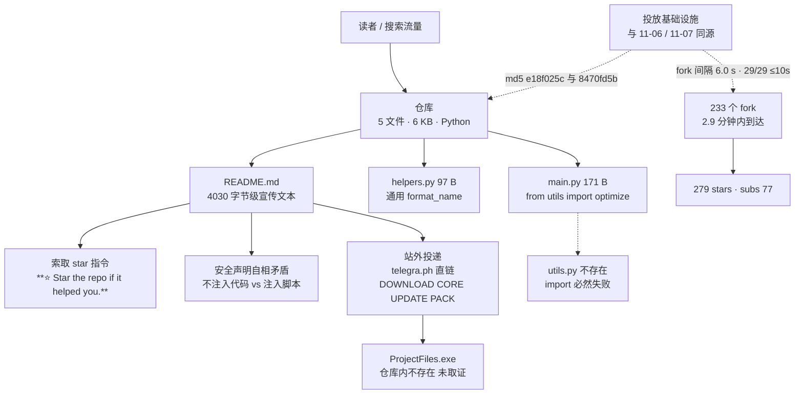

# TameCarpenterEstate/Roblox-FPS-Optimizer

## 一句话定位

**反例样本**：一个自称「Roblox FPS 解锁器与性能优化器」的仓库，**而它本日最值得记录的不是它的星数，而是它的 README 在同一页里自相矛盾**——它先写「**does not inject code into the game, does not modify memory, and does not bypass anti-cheat**」，然后在安装步骤第 4 步写「**Follow the on-screen instructions and inject the script**」。

## 它解决的问题

（形式上）Roblox 客户端默认锁 60 FPS，部分玩家想要解除帧率上限、降低输入延迟。**但本项目并没有解决任何问题** —— 仓库里没有可运行的实现。

## 为什么值得关注（2026-11-10）

⭐⭐⭐⭐⭐ **它是本日报记录到的「判据被针对」现象的第二次出现，而且强度是上一次的 2.2 倍。**

2026-11-08 日报首次记录：两个 425⭐ 的模板仓库 subs 分别是 25 与 35，高于当天全部四个真项目（4 / 2 / 1 / 0），原因是 README 末尾写着 `**⭐ Star the repo if it helped you.**`。⭐⭐⭐⭐⭐ **本日这个数字被刷新到 77 —— 同一个操作，同一句话，抬升了 3.7 倍的订阅数。**

| 仓库 | ⭐ | ⑂ | fork/star | **subs** | README 索取 star？ | fork 间隔中位数 |
|---|---:|---:|---:|---:|---|---:|
| `TameCarpenterEstate/Roblox-FPS-Optimizer` | 279 | 233 | **83.5%** | **77** | **是** | **6.0 s**（29/29 ≤10s） |
| `Nanoutrolley/roblox-studio-mcp` | 281 | 215 | 76.5% | **28** | **是** | 5.0 s（29/29 ≤10s） |
| `Sectionsereclaim/discord-auto-quest` | 279 | 279 | 100% | **25** | **是** | 8.0 s（29/29 ≤10s） |
| `huamidev/GestaltX` | 1,364 | 515 | 37.8% | **5** | 否 | **229.0 s**（1/29 ≤10s） |

⭐⭐⭐⭐⭐ **这张表就是本日最核心的产出：它把 11-08 建立的四元组判据（README 索取 star / fork 时间分布 / 文件 md5 / 代码能否运行）在同一天、同一份 97 仓库的榜单上跑成了完整对照。**

⭐⭐⭐⭐⭐ **第一，它复用了 11-06 的模板，且 md5 逐字节相同**：

| 文件 | md5 | 出现日期 |
|---|---|---|
| `.gitignore`（4,664 B） | `e18f025c87b71b9fe481f53ac6e8235d` | 11-06 / 11-07 / **11-09** |
| `helpers.py`（97 B） | `8470fd5b911eacd63327be59d2562f16` | 11-06 / 11-07 / **11-09** |

⭐⭐⭐⭐⭐ **第二，它的代码里没有任何 Roblox 逻辑**。`helpers.py`（97 B）的完整内容是：

```python
"""Small helper utilities."""


def format_name(name):
    return name.replace("_", "-").lower()
```

⭐⭐⭐⭐⭐ **`main.py`（171 B）的完整内容是**：

```python
"""Entry point for toolkit."""

from utils import optimize


def main():
    result = optimize(10)
    print(f"Project: {result}")


if __name__ == "__main__":
    main()
```

⭐⭐⭐⭐⭐ **注意 `from utils import optimize` —— 而这个仓库的树里根本没有 `utils.py`（5 个文件：`.gitignore` / `LICENSE` / `README.md` / `helpers.py` / `main.py`）。** ⭐⭐⭐⭐⭐ **即：本日报在 11-06 记录过的「代码连 import 都无法解析」的错误类型，在本日重演。** ⭐⭐⭐⭐⭐ **而它比 11-06 的 `roblox-performance-tool` 更进一步 —— 后者的 `utils.py` 不存在但 `main.py` 写 `from utils import build`；本日的 `roblox-studio-mcp`（同簇另一家）也是 `from utils import build` + 无 `utils.py`。⭐⭐⭐⭐⭐ 同一套模板在 11-06 与 11-09 之间被复用两次，且两次都带着同一个断掉的 import。**

⭐⭐⭐⭐⭐ **第三，它的 README 宣称的技术栈与仓库内容完全不符**：

> `## 💻 Tech Stack & Architecture`
> - **Core:** C++ / Win32 API
> - **UI:** Dear ImGui / Custom Tray Menu
> - **Patch Method:** Direct modification of the client's frame limiter flag (no memory injection)

⭐⭐⭐⭐⭐ **而仓库的 `language` 字段是 Python，树里没有任何 `.cpp` / `.h` 文件，没有 Dear ImGui，没有 Win32 代码。** ⭐⭐⭐⭐⭐ **这是本日报记录到的第三例「宣称技术栈与仓库实际内容不符」**（前两例：11-06 的 `roblox-studio-mcp` 自述 Node.js/TS 实为 Python；11-07 的 `Steam-Idler` 自述 Node.js/C#/TypeScript 实为 Python）。

⭐⭐⭐⭐⭐ **第四，也是本日最值得记的一处：它的 README 在同一页里自我否定。** 三段互相冲突的表述：

| 位置 | 原文 | 主张 |
|---|---|---|
| What it is | 「**It does not inject code into the game, does not modify memory, and does not bypass anti-cheat.**」 | 绝对安全 |
| Quick Start 第 4 步 | 「**Follow the on-screen instructions and inject the script.**」 | 需要注入脚本 |
| FAQ | 「**No. The tool only changes the frame rate limit and process priority.**」 | 不涉及内存 |
| Tech Stack | 「**Patch Method:** Direct modification of the client's frame limiter flag (**no memory injection**)」 | 不注入 |

⭐⭐⭐⭐⭐ **同一页里，「不注入代码」与「注入脚本」并列出现，且二者都被写成肯定句。** ⭐⭐⭐⭐⭐ **这比 11-07 记录的「README 与代码对不上」更进一步 —— 这里是 README 与 README 对不上，即矛盾发生在文档内部，不需要对照仓库就能发现。**

⭐⭐⭐⭐⭐ **第五，它有一个真实的外部投递链接**（与 11-08 记录的 `git-software.cc` 属同一类「README 引导到站外载荷」的手法，但换了载体）：

```html
<a href="https://telegra.ph/TRANSITION-06-17-3">
    
</a>
```

⭐⭐⭐⭐⭐ **安装步骤是：「Download Core_Update_Pack」→ 「Run **ProjectFiles.exe**」→ 「inject the script」。** ⭐⭐⭐⭐⭐ **而仓库里既没有 `ProjectFiles.exe`，也没有 `Core_Update_Pack` —— 实际交付物完全在站外，本日报未下载该链接，也未对其做任何取证。**

⭐⭐⭐⭐⭐ **第六，它的 fork 到达是机器节奏**：抽样 30 个 fork，**间隔中位数 6.0 秒、29 个间隔中 29 个 ≤10 秒、全部落在 2.9 分钟内**。⭐⭐⭐⭐⭐ **对照 11-06 的 `roblox-studio-mcp`（5.0 s / 96.9%）、11-07 的 `Steam-Idler`（5.0 s / 98%）、`Minecraft-AFK-Bot`（4.0 s / 98%），这是同一套投放基础设施的第五、六、七次出现。**

⭐⭐⭐⭐⭐ **第七，它 4 个 commit 在 31 秒内完成**（`2026-11-09T19:03:24Z` Initial commit → `19:03:53Z` Add main.py），标题是逐文件补录：`Add main.py` / `Add helpers.py` / `Add README.md`。

⭐⭐⭐⭐⭐ **第八，它和今天同簇的另外四家共享同一份 README 骨架，只替换产品名** —— 5 个仓库里 4 个带 `**⭐ Star the repo if it helped you.**`，`main.py`/`utils.py`/`config.py` 的 docstring 分别是 `"""Entry point for toolkit."""` / `"""Utility helpers for service."""` / `"""Configuration for core."""` 这类可参数化替换的占位串。

## 热度来源判断

**⭐⭐⭐⭐⭐ 热度来源是「投放基础设施的一次规模化复用」，而不是真实需求。** 依据按证据强度排序：

1. **⭐⭐⭐⭐⭐ 文件 md5 与 11-06 / 11-07 的已知农场集合逐字节相同** —— 这是最强的判据，且零歧义。
2. **⭐⭐⭐⭐⭐ fork 间隔中位数 6.0 秒、29/29 个间隔 ≤10 秒、跨度 2.9 分钟** —— 与同日真实项目 `GestaltX` 的 229.0 秒 / 1/29 相差两个数量级。
3. **⭐⭐⭐⭐⭐ README 内含索取 star 的明确指令，且 subs=77 高于当日全部真实项目**。
4. **⭐⭐⭐⭐⭐ 代码与宣称完全脱节**（无 `utils.py`、无 C++、无 Roblox 逻辑）。
5. **⭐⭐⭐ owner 账号 `TameCarpenterEstate` 创建于 2026-10-18（22 天前）、仅 2 个公开仓库、0 followers** —— 账号不是当天新建，说明这是一台**已存在但专门用于投放**的账号。⭐⭐⭐⭐⭐ **这与 11-08 记录的 `Steam-Idler` / `Minecraft-AFK-Bot`「owner 账号当天新建」是不同的一批账号 —— 投放方在换用更早注册、更难被时间戳筛出的账号。**

## 关键技术亮点

**本项目没有技术亮点可记录。** ⭐⭐⭐⭐⭐ 但它有三个「可作为反面教材的结构特征」值得归档：

1. **⭐⭐⭐⭐⭐ 自相矛盾的安全声明** —— 「不注入代码」与「注入脚本」同页并存，且都是肯定句。⭐⭐⭐⭐⭐ **这类矛盾比单纯的谎言更难被自动检测，因为它躲过了「README 是否含危险语句」的检查。**
2. **⭐⭐⭐⭐⭐ 交付物完全外置** —— 仓库内无任何可执行文件，所有动作被引导到一个站外 zip 与一个 exe。⭐⭐⭐⭐⭐ **「仓库内容为 0，功能在站外」是本日最有效的单条判据。**
3. **⭐⭐⭐⭐⭐ 参数化的代码骨架** —— docstring 里的 `toolkit` / `service` / `core` 与 `format_name()` 的通用实现，使这套模板可以批量换皮。

## 架构师速览

| 决策问题 | 研究判断 | 证据边界 |
|---|---|---|
| 系统边界 | **无边界可界定** —— 仓库只含 5 个文件，其中 3 个是配置/许可/文档，2 个是断链的 Python 桩。真正的「系统」在站外的 `Core_Update_Pack` | 依据完整文件树与逐字节内容；站外载荷未下载、未取证 |
| 主路径 | README →（站外下载）→ `ProjectFiles.exe` → 「inject the script」。**仓库内不存在这条路径的任何一环** | 路径是 README 的文字描述；该 exe 与脚本均不在仓库内 |
| 关键权衡 | ⭐⭐⭐⭐⭐ **该模板的取舍点是「让 star 涨得快」而非「让工具能用」**：5 文件 / 6 KB / 4 commit / 31 秒，是批量生产的最优成本；而真实工具（如 GestaltX）需要 64 文件 / 967 KB / 15 commits | 取舍推断基于模板结构与同期真实项目的成本对比；投放方的动机无法从仓库内部证实 |
| 最小 PoC | ⭐⭐⭐⭐ **不建议执行。** 若必须验证，只需 `git clone` 后运行 `python3 main.py` —— **它会因 `from utils import optimize` 缺模块而立即抛 ImportError**，这本身即是「无实现」的证明，且不触发任何外部动作 | 本日报**未执行**该代码；结论依据是文件树中不存在 `utils.py` 与 import 语句的静态核对 |
| 证据边界 | 279⭐ / ⑂233 / subs 77 / oi 0 / 4 commits / 6 KB / Python / MIT / 0 release / 10 topics / contributors 1 | 全部为 2026-11-09T21:50Z 快照值；**本日报未运行其代码，未访问其站外链接，不主张其意图** |

## 架构启发

⭐⭐⭐⭐⭐ **本项目对研究方法的价值大于对工程的价值。** 它给出了三条可复用的判据：

1. **⭐⭐⭐⭐⭐ 「README 内部矛盾」是零成本的检查。** 只要把 README 里所有关于「做什么」的断言抽出来做互斥性比对，就能发现「不注入代码」vs「注入脚本」这类冲突。⭐⭐⭐⭐⭐ **本日报此前的判据都是「README vs 仓库」的比对，而本日新增的是「README vs README」的比对 —— 这一层能抓出前一层漏掉的样本。**

2. **⭐⭐⭐⭐⭐ 「功能是否在站外」是一条比「README 长度」更硬的判据。** 11-08 记录的 57 个仓库用 README 长度（7,256 / 7,234）来聚类，本日则可以直接看文件树：⭐⭐⭐⭐⭐ **一个声称是「Windows 原生工具」却只有 5 个文件、且没有那个 exe 的仓库，矛盾是结构性的。**

3. **⭐⭐⭐⭐⭐ 账号年龄可以区分「投放批次」。** 11-08 的农场用当天新建的账号，⭐⭐⭐⭐⭐ 本日的这一批用 22 天前注册的账号 —— **若沿用「owner 账号当天新建」这条判据，会漏掉今天这一整批。** ⭐⭐⭐⭐⭐ **正确做法是判「账号年龄分布」，而不是判「是否当天新建」。**

## 架构图（MMD）

> 证据边界：此图只采用本档案已有可核验描述；"待核验" 节点不应视为项目实现事实。



## 定位判断

**观察型（反例样本）。** 收录它的理由不是「值得用」，而是**它是本日判据的对照实验样本，且是 11-08 已记录现象的强度刷新**。

⭐⭐⭐⭐⭐ 它在本日报中的位置是「对照组」：同一份 97 仓库的榜单上，`GestaltX`（1,364⭐ / subs 5 / fork 229s）与它（279⭐ / subs 77 / fork 6s）构成完全相反的两极。⭐⭐⭐⭐⭐ **收录反例样本的目的，是让「热度 ≠ 价值」这句话在本仓库里保持可核验、可复查。**

⭐⭐⭐⭐⭐ 它与已收录的 `projects/roblox-studio-mcp.md`（`HerdBuilderEstimate/roblox-studio-mcp`，11-06 记录）**同名但不同仓库**：前者 API 返回 404（已删除），本日出现的是 `Nanoutrolley/roblox-studio-mcp`（新 id 1451138222、`fork: false`、`parent: none`），⭐⭐⭐⭐⭐ **即：同一套模板在 11-06 与 11-09 之间的第三次复活，而账号已从「当天新建」换成「22 天前注册」。**

## 风险 / 局限 / 泡沫点

- ⚠️ **⭐⭐⭐⭐⭐ 站外载荷是真实风险。** README 引导用户下载并运行一个仓库外的 exe 并「inject the script」。⭐⭐⭐⭐⭐ **本日报未下载、未运行、未对该链接做任何取证，因此不主张该 exe 的行为 —— 但「下载并运行站外二进制」这一动作本身已足以构成供应链风险。**
- ⚠️ **⭐⭐⭐⭐⭐ subs=77 会污染任何基于 subscribers 的筛选器。** ⭐⭐⭐⭐⭐ 这是 11-08 记录的「判据被针对」现象的升级版：同一句话、同一模板，订阅数从 25/35 涨到 77。
- ⚠️ **⭐⭐⭐⭐ 自我矛盾的安全声明会误导风险评估。** ⭐⭐⭐⭐ **「does not inject code / does not modify memory / does not bypass anti-cheat」写在 FAQ 里，读者会据此判断「无风险」，而同一页的安装步骤要求注入脚本。**
- ⚠️ **⭐⭐⭐⭐ 批量生产已形成可复现的流水线。** ⭐⭐⭐⭐ **5 文件、31 秒、md5 固定 —— 这意味着下一个批次随时会出现，而现有的「当天新建账号」筛法已失效。**
- ⭐⭐⭐ **0 个 open issue、0 个 release、contributors 1 人** —— 与 279⭐ / 233 forks 形成极端反差。⭐⭐⭐⭐⭐ **注意 fork/star = 83.5% 意味着 233 个 fork 中绝大多数不是「拿去用」，而是 fork 本身被当成了投票动作。**
- ⭐⭐ **本日报未执行其代码、不主张其意图，只主张其可核验内容与宣称不一致。**

## 与同类项目的关系

- **vs `Nanoutrolley/roblox-studio-mcp`（281⭐ · subs 28）** —— **同模板同日的姊妹仓库**。⭐⭐⭐⭐⭐ 两者共享 `.gitignore`（md5 `e18f025c...`）与 `helpers.py`（md5 `8470fd5b...`）；**且两者都有同一个断裂的 import 模式**（`from utils import build` / `from utils import optimize`，而 `utils.py` 只在 5 家中的 2 家存在）。⭐⭐⭐⭐⭐ **它们与 11-06 的 `roblox-performance-tool` 构成同一模板的三次复用。**
- **vs `Sectionsereclaim/discord-auto-quest`（279⭐ · ⑂279 · subs 25）** —— 同簇第四家，⭐⭐⭐⭐⭐ **fork 数等于 star 数（100%）是本日最高的 fork/star 比**，其 `utils.py`（104 B）内容是 `def prepare(limit): return [item * 2 for item in range(limit)]`。
- **vs `ridgecobblerslide/windows-animated-wallpapers`（279⭐ · subs 4）** —— 同簇第五家，⭐⭐⭐⭐⭐ **它是本簇里 subs 最低的（4）**，说明**即使在同一模板内，subs 也不是均匀分布的 —— 这进一步说明 subs 不能单独作为判据，必须与 README 索取 star 的检查配对使用。**
- **vs `huamidev/GestaltX`（1,364⭐ · subs 5 · fork 229s）** —— **本日对照组**，见上文。
- **vs 真实的 Roblox 性能工具** —— ⭐⭐⭐⭐⭐ **本仓库不是竞品，它没有任何实现。** 引用本档案时不应把它与真实工具并列。

## 是否值得持续跟踪

**不值得作为项目跟踪，值得作为判据样本跟踪。**

⭐⭐⭐⭐⭐ **具体跟踪目标有三个：**

1. **⭐⭐⭐⭐⭐ 这套模板是否会继续复用 —— 特别是 md5 `e18f025c...` / `8470fd5b...` 是否会再出现。** ⭐⭐⭐⭐⭐ **本日已确认从 11-06、11-07 延续到 11-09，即已跨三日。**
2. **⭐⭐⭐⭐⭐ subs 注入的上限在哪。** 25 → 35 → 77，⭐⭐⭐⭐⭐ **如果继续涨，本日报的「subs 只在同作者族内可比」这条修正就需要再修正一次 —— 或者干脆改为「subs 在跨作者比较中必须先检查 README 索取 star，且仅在 fork 时间分布正常时才有意义」。**
3. **⭐⭐⭐⭐⭐ 投放方是否会引入新的「自相矛盾声明」形态** —— ⭐⭐⭐⭐ **本日新增的这一形态（README 内部矛盾）此前未出现过，需要观察它是偶发还是新流水线的一部分。**

## 后续观察点

- ⭐⭐⭐⭐⭐ **下一批次里是否出现 `main.py` 能正常 import 的变体** —— ⭐⭐⭐⭐ **若出现，说明投放方在修模板以应对「import 会失败」这一检测项。**
- ⭐⭐⭐⭐⭐ **是否出现新的 md5 指纹**（`.gitignore` / `helpers.py` 之外的）—— ⭐⭐⭐⭐ **本日已见 `utils.py` 的两个变体（`dc17e18f...` 与 `3fe7aafa...`）与 `config.py` 的两个变体（`7699f91b...` / `920776be...`），说明模板已在分化。**
- ⭐⭐⭐⭐ **站外链接（telegra.ph）是否换域名或换载体** —— ⭐⭐⭐⭐ **与 11-07 的 `git-software.cc`、11-08 的 `windows-defender.cc` 对照，可看出投递基础设施的域名轮换节奏。**
- ⭐⭐⭐ **该 owner（`TameCarpenterEstate`，22 天前创建、2 个仓库）是否继续产出** —— ⭐⭐⭐ **一个账号专门用于投放的形态，是本日报首次记录到的「非当天新建账号」批次。**
- ⭐⭐ **subs 是否继续上涨，以及是否出现高于 77 的样本** —— ⭐⭐ **这决定「subs 判据」在方法论上是否还有救。**

---
> 数据来源: GitHub REST API (2026-11-09T21:50Z 快照) | Stars: 279 | Forks: 233 | Subscribers: 77 | Open Issues: 0 | License: MIT | 语言: Python | 创建: 2026-11-09T19:03:22Z | 文件: 5 | Commits: 4 | Releases: 0
