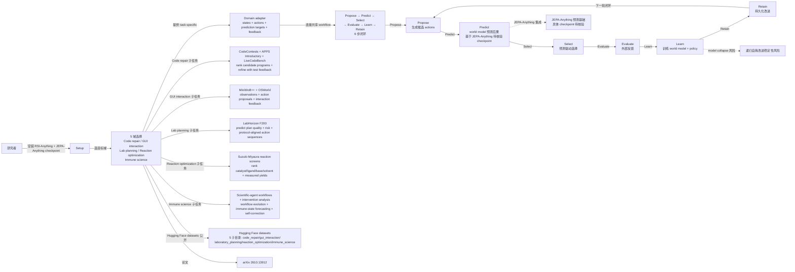

# Gen-Verse/RSI-Anything

## 一句话定位
RSI-Anything 是一个跨 5 域的 AI 递归自我改进框架——Propose → Predict → Select → Evaluate → Learn → Retain 6 步闭环，基于 JEPA-Anything 预测基础，应用于 Code repair（CodeContests / APPS / LiveCodeBench）、GUI interaction（MiniWoB++ / OSWorld）、Laboratory planning（LabHorizon F200）、Reaction optimization（Suzuki-Miyaura）、Immune science（scientific-agent workflows）；Hugging Face datasets + arXiv 2610.13912 + Python 3.10+ + Apache-2.0。

## 它解决的问题
2026 年 AI 递归自我改进（Recursive Self-Improvement）是 AGI 研究方向之一，但现有方案要么单次训练（缺乏持续改进）、要么单域（缺乏跨域通用）、要么论文级（缺乏严肃工程化代码 / 数据集）。RSI-Anything 直击痛点：（1）**6 步闭环**——Propose → Predict → Select → Evaluate → Learn → Retain 让 RSI 严肃工程化；（2）**5 域通用**——单 framework 适用 Code / GUI / Lab / Reaction / Immune 5 类任务；（3）**Built on JEPA-Anything**——基于预测基础（world model）而非纯 LLM；（4）**公开 Hugging Face datasets**——5 域完整数据集公开可复现；（5）**arXiv 2610.13912**——论文 + 代码 + 数据完整严肃工程化。解决的是 **「跨域 AI RSI 研究」** 需要「6 步闭环 + 预测基础 + 5 域通用 + Hugging Face datasets + arXiv」严肃工程化整合问题。

## 为什么值得关注（2026-10-14）
- **Stars:** 615（截至 2026-10-14），6 天 615⭐ ⑂54 fork/star 8.8%，**增长率** 8.8%（fork/star 反映社区参与）
- **Forks:** 54，社区参与度中（学术框架类项目天然适合 fork 二次研究）
- **Size:** 11786 KB（含 5 域 framework + Hugging Face datasets + arXiv paper + docs）
- **License:** Apache-2.0
- **语言:** HTML（README）+ Python 3.10+（核心 framework）
- **活跃度:** created 2026-10-08，pushed_at 2026-10-13，持续高活跃
- **平台:** Hugging Face datasets + arXiv + GitHub

## 热度来源判断
RSI-Anything 的热度是 **「AI 递归自我改进研究刚需 × 跨 5 域通用 × 基于 JEPA-Anything 预测基础 × Propose → Predict → Select → Evaluate → Learn → Retain 6 步闭环 × Hugging Face datasets 公开 × arXiv 2610.13912 × Apache-2.0」** 的组合。RSI 是 2026 年 AGI 研究方向之一，跨域通用 + 严肃工程化代码 + 公开数据集的组合是学术研究刚需。热度真实且具「跨域 AI RSI 研究」场景的强需求。

## 关键技术亮点
1. **Propose → Predict → Select → Evaluate → Learn → Retain 6 步闭环：** 让 RSI 严肃工程化
2. **Built on JEPA-Anything 预测基础：** 基于 world model 而非纯 LLM
3. **5 域通用 framework：**
   - **Code repair:** CodeContests + APPS Introductory + LiveCodeBench + Rank candidate programs using predicted execution outcomes + refine with test feedback
   - **GUI interaction:** MiniWoB++ + OSWorld + Connect observations + action proposals + interaction feedback + improve task completion
   - **Laboratory planning:** LabHorizon F200 + Predict candidate plan quality + risk + select protocol-aligned laboratory action sequences
   - **Reaction optimization:** Suzuki-Miyaura reaction screens + Rank catalyst + ligand + base + solvent choices using yield predictions + use measured yields to guide subsequent experiments
   - **Immune science:** Scientific-agent workflows + intervention analysis + Connect workflow evolution + immune-state forecasting + self-correction → intervention ranking + prospective hypothesis generation
4. **Domain adapters：** connect the shared workflow to each task's states + action space + external feedback
5. **Hugging Face datasets 公开：** 5 子目录（code_repair / gui_interaction / laboratory_planning / reaction_optimization / immune_science）完整公开
6. **arXiv 2610.13912：** 论文 + 代码 + 数据完整严肃工程化
7. **Python 3.10+ + Apache-2.0：** 商业使用友好

## 架构师速览

| 决策问题 | 研究判断 | 证据边界 |
|---|---|---|
| 系统边界 | 一个 RSI 框架（Gen-Verse 团队）+ 一个预测基础（JEPA-Anything）+ 5 域 adapter（Code repair + GUI interaction + Lab planning + Reaction optimization + Immune science）+ 一个共享 6 步闭环（Propose → Predict → Select → Evaluate → Learn → Retain）+ 5 个 Hugging Face datasets 子目录（code_repair / gui_interaction / laboratory_planning / reaction_optimization / immune_science）+ 一篇 arXiv 论文 2610.13912 + Python 3.10+ | 仅基于 README 「domain-general framework + Built on JEPA-Anything + Propose → Predict → Select → Evaluate → Learn → Retain + CodeContests/APPS/LiveCodeBench + MiniWoB++/OSWorld + LabHorizon F200 + Suzuki-Miyaura + Hugging Face datasets + arXiv 2610.13912」+ Apache-2.0 badge 推断；具体 JEPA-Anything 集成方式、Domain adapter 代码结构、Hugging Face datasets 完整度（多少样本、多 task）未在档案明示 |
| 主路径 | 用户安装 RSI-Anything → 选目标域（Code repair / GUI interaction / Lab planning / Reaction optimization / Immune science）→ 提供 task-specific state / actions / prediction targets / feedback → 框架执行 Propose（生成候选 actions）→ Predict（world model 预测后果）→ Select（预测驱动选择）→ Evaluate（外部反馈）→ Learn（训练 world model + policy）→ Retain（持久化改进）→ 下一轮闭环 | 主路径为 README 「Framework + Domains table」 段落整理；具体 world model 选型（JEPA-Anything 具体 checkpoint）、Domain adapter 接口形式、Learn 阶段训练数据来源未在档案明示 |
| 关键权衡 | 5 域通用 vs 每个域具体 SOTA 比较 vs 单 world model 跨域 vs arXiv paper 形式 vs Hugging Face 公开 datasets vs Python 3.10+ vs Apache-2.0 vs domain adapter 可扩展性 vs 递归自我改进的稳定性风险（model collapse）vs 与 Anthropic / DeepMind 等 RSI 路线对比 | 权衡来自 README 「domain-general framework + Built on JEPA-Anything + 5 域 + Hugging Face datasets + arXiv 2610.13912 + Apache-2.0」 |
| 最小 PoC | 在 Code repair 域：装 RSI-Anything + JEPA-Anything checkpoint → 选 CodeContests task → 给定 problem statement → framework 生成候选 programs → world model 预测 execution outcomes → select → run tests 评估 → learn → retain → 第二轮看是否改善 | PoC 由 README 「Quick Start + Results table」 段落整理；具体 CodeContests subset、Hugging Face dataset 完整度、evaluation metric 未在档案明示 |
| 证据边界 | 仅核验：仓库存在、stars/forks/description/license/size/language 来自 GitHub API；README 节录自 raw 接口；JEPA-Anything + 5 域 + 6 步闭环 + Hugging Face datasets + arXiv 2610.13912 + Apache-2.0 由 README 直接叙述 | 待核验：JEPA-Anything 具体集成方式、Domain adapter 代码结构、Hugging Face datasets 完整度、5 域 SOTA 对比、递归自我改进稳定性、与其他 RSI 框架对比 |

## 架构启发
RSI-Anything 的核心启发是 **「Propose → Predict → Select → Evaluate → Learn → Retain 6 步闭环 + 跨 5 域 + JEPA-Anything 预测基础 + Hugging Face datasets + arXiv」严肃工程化整合**。当前 AI RSI 研究要么单次训练（缺乏持续改进），要么单域（缺乏跨域通用），要么论文级（缺乏严肃工程化代码 / 数据集）。RSI-Anything 把「6 步闭环 + 跨 5 域 + JEPA-Anything + Hugging Face datasets + arXiv」整合为严肃工程化形态。这指向 **「AGI 研究方向之一 RSI 严肃工程化」** 的未来。RSI-Anything 还展示了 **「跨域通用 + 严肃工程化代码 + 公开数据集」** 的设计哲学——单 framework 适用 Code / GUI / Lab / Reaction / Immune 5 类任务，Hugging Face datasets 完整公开可复现。这与 `storytold/craft-launcher`（Rust 全家桶 Launcher）+ `opengeos/RustGIS`（跨平台 pure-Rust GIS）形成「严肃工程化开源生态」完整方向。

## 架构图（MMD）

> 证据边界：此图只采用本档案已有可核验描述；"待核验"节点不应视为项目实现事实。

## 定位判断
**观察型项目（跨域 AI RSI 严肃工程化整合）。** RSI-Anything 不仅是 RSI 论文框架，更展示了「Propose → Predict → Select → Evaluate → Learn → Retain 6 步闭环 + 跨 5 域 + JEPA-Anything + Hugging Face datasets + arXiv」严肃工程化路径。615⭐ + 54 fork/star 8.8% 已显示学术框架需求。但能否持续取决于：（1）JEPA-Anything 具体集成方式；（2）Domain adapter 代码成熟度；（3）Hugging Face datasets 完整度；（4）5 域 SOTA 对比；（5）递归自我改进稳定性（model collapse 风险）；（6）与其他 RSI 框架对比。定位是「跨域 AI RSI 严肃工程化」头部样本，向「AGI 研究方向之一严肃工程化」演进是合理路径。

## 风险 / 局限 / 泡沫点
- **仅 5 域覆盖：** Code / GUI / Lab / Reaction / Immune 5 类任务，更多域（Robotics / Game Playing / Autonomous Driving）未覆盖
- **world model 选型依赖 JEPA-Anything：** JEPA-Anything 具体 checkpoint 与集成方式未在档案明示
- **Domain adapter 代码成熟度：** 5 个 Domain adapter 的代码结构与扩展性未在档案明示
- **Hugging Face datasets 完整度：** 5 个子目录样本数 / task 数 / evaluation metric 未在档案明示
- **递归自我改进 model collapse 风险：** 6 步闭环可能 model collapse，未在档案明示
- **与其他 RSI 框架对比：** vs Anthropic Constitutional AI / DeepMind Self-Taught Reasoner 等 RSI 路线对比未在档案明示
- **Learn 阶段训练数据来源：** train world model + policy 的训练数据来源未在档案明示
- **5 域 SOTA 对比：** vs 5 域各自的 SOTA 方法对比未在档案明示

## 与同类项目的关系
- **vs Anthropic Constitutional AI:** Constitutional AI 是 Anthropic 的 AI 安全框架；RSI-Anything 是跨域 RSI 严肃工程化框架
- **vs DeepMind Self-Taught Reasoner:** STaR 是 DeepMind 的推理自我改进；RSI-Anything 是跨域 RSI 严肃工程化框架
- **vs OpenAI Self-Refine:** Self-Refine 是 OpenAI 的反思改进；RSI-Anything 是跨域 RSI 严肃工程化框架
- **vs Hugging Face trl/PEFT 等训练框架:** trl/PEFT 是 RLHF / LoRA 训练框架；RSI-Anything 是跨域 RSI 严肃工程化框架
- **vs Meta AI CICERO:** CICERO 是 Meta AI 的 Diplomacy 自我改进；RSI-Anything 是跨域 RSI 严肃工程化框架
- **vs JEPA-Anything:** JEPA-Anything 是预测基础；RSI-Anything 是基于 JEPA-Anything 的 RSI 严肃工程化框架

## 是否值得持续跟踪
**值得跟踪（跨域 AI RSI 严肃工程化整合）。** RSI-Anything 代表了 AI RSI 从「单次训练 + 单域 + 论文级」到「6 步闭环 + 跨 5 域 + JEPA-Anything + Hugging Face datasets + arXiv」严肃工程化路径的演进。无论其本身成败，这一方向是 AGI 研究方向之一的严肃工程化。建议关注：（1）JEPA-Anything 具体集成方式；（2）Domain adapter 代码成熟度；（3）Hugging Face datasets 完整度；（4）5 域 SOTA 对比；（5）递归自我改进稳定性（model collapse 风险）；（6）与其他 RSI 框架对比；（7）企业采用（研究机构是否将此作为 RSI 标准框架）。对需要「跨域 RSI 研究」的学术 / 工业团队，这个框架是严肃工程化整合的实用选择，值得直接采用。

## 后续观察点
- 是否演化为独立公司 / 平台（从 GitHub 仓库升级为商业产品）
- JEPA-Anything 具体集成方式
- Domain adapter 代码成熟度
- Hugging Face datasets 完整度（5 子目录样本数 / task 数）
- 5 域 SOTA 对比
- 递归自我改进稳定性（model collapse 风险）
- 与其他 RSI 框架对比（Constitutional AI / STaR / Self-Refine / CICERO）
- Learn 阶段训练数据来源
- 学术论文引用与社区采用
- 更多域扩展（Robotics / Game Playing / Autonomous Driving）

---
> 数据来源: GitHub Repository API (2026-10-14) + README raw 接口 | Stars: 615 | Forks: 54 | License: Apache-2.0 | 语言: HTML (README) + Python 3.10+ | Size: 11786 KB | 创建: 2026-10-08 | 平台: Hugging Face + arXiv + GitHub